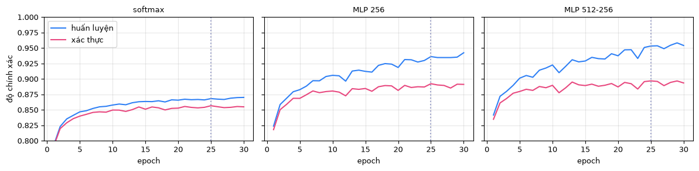

# Chương 16 · Ví dụ áp dụng: MLP cho ảnh thời trang

> Ghi chú của người biên soạn: trang này do người biên soạn viết thêm, không có trong sách gốc. Trang tiếp nối [ví dụ áp dụng của chương 15](ml/ch15_app_vi): cùng bộ *Fashion-MNIST* (Xiao, Rasul và Vollgraf, 2017), cùng cách chia dữ liệu, nhưng thay hồi quy softmax bằng mạng neuron đa tầng.

## Bài toán

Hồi quy softmax đạt khoảng 84.6% trên tập kiểm tra của Fashion-MNIST, và nhầm lẫn nhiều giữa các loại áo. Câu hỏi đặt ra:

- Thêm tầng ẩn cải thiện được bao nhiêu?
- Cái giá phải trả là gì: thời gian huấn luyện, số tham số, nguy cơ quá khớp?
- Các kỹ thuật của chương 8 (tập xác thực, kết thúc sớm, suy giảm trọng số) được dùng thế nào khi huấn luyện mạng neuron?

## 1. Dữ liệu và tập xác thực

<!-- run -->
```python
import numpy as np
import matplotlib.pyplot as plt
import torch
from torch import nn
from sklearn.datasets import fetch_openml
from time import perf_counter

X, y = fetch_openml("Fashion-MNIST", version=1, return_X_y=True, as_frame=False)
X, y = (X / 255.0).astype(np.float32), y.astype(int)
NAMES = ["áo phông", "quần dài", "áo len", "váy", "áo khoác", "xăng-đan", "áo sơ mi", "giày thể thao", "túi xách", "bốt"]
rng = np.random.default_rng(0)
perm = rng.permutation(60000)
tr, va = perm[:50000], perm[50000:]                       # tách 10 000 ảnh huấn luyện làm tập xác thực
X_tr, y_tr, X_va, y_va = torch.tensor(X[tr]), torch.tensor(y[tr]), torch.tensor(X[va]), torch.tensor(y[va])
X_te, y_te = torch.tensor(X[60000:]), torch.tensor(y[60000:])
print("huấn luyện:", tuple(X_tr.shape), " xác thực:", tuple(X_va.shape), " kiểm tra:", tuple(X_te.shape))
```

<!-- output -->
```output
huấn luyện: (50000, 784)  xác thực: (10000, 784)  kiểm tra: (10000, 784)
```
<!-- /output -->

## 2. Vòng huấn luyện có theo dõi tập xác thực

Sau mỗi epoch, ta đo độ chính xác trên tập xác thực và **giữ lại trọng số tốt nhất**. Đây là kết thúc sớm của chương 8, viết tay trong vài dòng.

<!-- run -->
```python
import copy

def evaluate(model, X, y):
    model.eval()
    with torch.no_grad():
        return (model(X).argmax(1) == y).float().mean().item()

def fit(model, epochs=30, lr=1e-3, weight_decay=0.0, seed=0):
    torch.manual_seed(seed)
    opt = torch.optim.Adam(model.parameters(), lr=lr, weight_decay=weight_decay)
    loss_fn = nn.CrossEntropyLoss()
    hist, best = [], (0, None, 0)
    t = perf_counter()
    for ep in range(epochs):
        model.train()
        for b in torch.randperm(len(X_tr)).split(256):
            opt.zero_grad(); loss_fn(model(X_tr[b]), y_tr[b]).backward(); opt.step()
        acc_tr, acc_va = evaluate(model, X_tr, y_tr), evaluate(model, X_va, y_va)
        hist.append((acc_tr, acc_va))
        if acc_va > best[0]:
            best = (acc_va, copy.deepcopy(model.state_dict()), ep + 1)
    model.load_state_dict(best[1])                       # quay lại epoch tốt nhất trên tập xác thực
    return np.array(hist), best[2], perf_counter() - t
```

## 3. So sánh ba mô hình

1. **Hồi quy softmax:** không có tầng ẩn, 7 850 tham số.
2. **MLP một tầng ẩn 256 neuron:** khoảng 200 nghìn tham số.
3. **MLP hai tầng ẩn 512 và 256 neuron:** hơn 500 nghìn tham số, nhiều hơn số ảnh huấn luyện tới 10 lần.

<!-- run -->
```python
torch.manual_seed(0)
models = {
    "softmax": nn.Linear(784, 10),
    "MLP 256": nn.Sequential(nn.Linear(784, 256), nn.ReLU(), nn.Linear(256, 10)),
    "MLP 512-256": nn.Sequential(nn.Linear(784, 512), nn.ReLU(), nn.Linear(512, 256), nn.ReLU(), nn.Linear(256, 10)),
}
results = {}
fig, axes = plt.subplots(1, 3, figsize=(12, 3), sharey=True)
for ax, (name, m) in zip(axes, models.items()):
    hist, best_ep, dt = fit(m)
    results[name] = (m, hist, best_ep)
    ax.plot(range(1, 31), hist[:, 0], color="#2f80f5", label="huấn luyện")
    ax.plot(range(1, 31), hist[:, 1], color="#e8487f", label="xác thực")
    ax.axvline(best_ep, ls=":", color="#9aa0c8")
    ax.set_title(name, fontsize=9); ax.set_xlabel("epoch"); ax.grid(alpha=.3)
    n_par = sum(p.numel() for p in m.parameters())
    print(f"{name:12s}: {n_par:7d} tham số, {dt:4.0f} s | epoch tốt nhất {best_ep:2d}: xác thực {hist[best_ep - 1, 1]:.4f} | "
          f"epoch 30: huấn luyện {hist[-1, 0]:.4f}, xác thực {hist[-1, 1]:.4f}")
axes[0].set_ylabel("độ chính xác"); axes[0].legend(); axes[0].set_ylim(0.8, 1.0)
fig.tight_layout()
```

<!-- output -->
```output
softmax     :    7850 tham số,    2 s | epoch tốt nhất 25: xác thực 0.8567 | epoch 30: huấn luyện 0.8701, xác thực 0.8549
MLP 256     :  203530 tham số,   16 s | epoch tốt nhất 25: xác thực 0.8923 | epoch 30: huấn luyện 0.9423, xác thực 0.8912
MLP 512-256 :  535818 tham số,   49 s | epoch tốt nhất 25: xác thực 0.8969 | epoch 30: huấn luyện 0.9541, xác thực 0.8935
```

<div align=center></div>
<!-- /output -->

Ba mô hình cho ba kiểu đường cong khác nhau:

- **Hồi quy softmax:** hai đường gần nhau và dừng ở khoảng 85–87%. Mô hình chưa khớp: nó quá đơn giản cho bài toán.
- **Hai mạng MLP:** độ chính xác xác thực tăng lên khoảng 89–90%, nhưng độ chính xác huấn luyện tiếp tục tăng tới khoảng 95%. Khoảng cách giữa hai đường mở rộng dần: dấu hiệu quen thuộc của quá khớp (chương 8).

Sau khoảng 20 epoch, độ chính xác xác thực gần như đứng yên. Nhờ giữ lại trọng số tốt nhất, ta không phải đoán trước nên dừng ở epoch nào. Cả ba mô hình tình cờ đạt đỉnh ở epoch 25, vì chúng dùng cùng một thứ tự xáo trộn mini-batch.

## 4. Suy giảm trọng số cho mạng lớn

Thử thêm suy giảm trọng số (tham số `weight_decay` của Adam) cho mạng lớn nhất:

<!-- run -->
```python
for wd in [1e-5, 1e-4]:
    torch.manual_seed(0)
    m = nn.Sequential(nn.Linear(784, 512), nn.ReLU(), nn.Linear(512, 256), nn.ReLU(), nn.Linear(256, 10))
    hist, best_ep, dt = fit(m, weight_decay=wd)
    results[f"MLP 512-256, wd={wd}"] = (m, hist, best_ep)
    print(f"weight_decay = {wd}: epoch tốt nhất {best_ep:2d}, xác thực {hist[best_ep - 1, 1]:.4f} | epoch 30: huấn luyện {hist[-1, 0]:.4f}, xác thực {hist[-1, 1]:.4f}")
```

<!-- output -->
```output
weight_decay = 1e-05: epoch tốt nhất 27, xác thực 0.8965 | epoch 30: huấn luyện 0.9546, xác thực 0.8929
weight_decay = 0.0001: epoch tốt nhất 30, xác thực 0.8935 | epoch 30: huấn luyện 0.9498, xác thực 0.8935
```
<!-- /output -->

Với lượng dữ liệu này, suy giảm trọng số gần như không thay đổi độ chính xác xác thực. Mức $10^{-4}$ chỉ làm độ chính xác huấn luyện giảm nhẹ. Với Fashion-MNIST, 50 000 ảnh đủ để kết thúc sớm giữ được quá khớp ở mức chấp nhận được.

## 5. Đánh giá lần cuối trên tập kiểm tra

Chọn mô hình tốt nhất **theo tập xác thực**, rồi đo một lần trên tập kiểm tra. In thêm độ chính xác của từng loại áo (những lớp khó nhất ở chương 15):

<!-- run -->
```python
best_name = max(results, key=lambda k: results[k][1][results[k][2] - 1, 1])
print("mô hình được chọn theo tập xác thực:", best_name)
for name in ["softmax", best_name]:
    m = results[name][0]; m.eval()
    with torch.no_grad():
        pred = m(X_te).argmax(1).numpy()
    yt = y_te.numpy()
    per = {NAMES[k]: np.mean(pred[yt == k] == k) for k in [0, 2, 4, 6]}
    print(f"{name:24s}: kiểm tra {np.mean(pred == yt):.4f} | " + ", ".join(f"{k} {v:.2f}" for k, v in per.items()))
```

<!-- output -->
```output
mô hình được chọn theo tập xác thực: MLP 512-256
softmax                 : kiểm tra 0.8456 | áo phông 0.82, áo len 0.73, áo khoác 0.74, áo sơ mi 0.57
MLP 512-256             : kiểm tra 0.8915 | áo phông 0.88, áo len 0.80, áo khoác 0.84, áo sơ mi 0.67
```
<!-- /output -->

Trên tập kiểm tra, MLP đạt khoảng 89.2%, so với 84.6% của hồi quy softmax: số ảnh bị nhận sai giảm khoảng 30%. Cải thiện rõ nhất ở những lớp khó: áo sơ mi tăng từ 57% lên 67%, áo khoác từ 74% lên 84%. Tầng ẩn học được những đặc trưng phi tuyến (hình dáng cổ áo, độ dài tay áo) mà một khuôn mẫu tuyến tính cho mỗi lớp không biểu diễn được.

## Rút ra được gì

- Thêm tầng ẩn cải thiện rõ rệt so với mô hình tuyến tính: từ 84.6% lên khoảng 89%, nhất là ở những lớp dễ nhầm.
- Cái giá phải trả: số tham số tăng 25–70 lần, thời gian huấn luyện tăng 8–25 lần, và mô hình bắt đầu quá khớp (khoảng cách 5–6% giữa huấn luyện và xác thực).
- Những công cụ của chương 8 là phần không thể thiếu khi huấn luyện mạng neuron: một tập xác thực riêng, giữ lại trọng số tốt nhất (kết thúc sớm), và suy giảm trọng số.
- Áo sơ mi vẫn chỉ đúng khoảng hai phần ba. Muốn đi xa hơn cần mô hình khai thác cấu trúc không gian của ảnh, như mạng tích chập (CNN). Đó sẽ là chủ đề của khoá Học sâu trong lộ trình.
