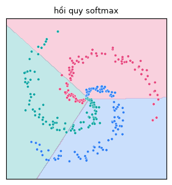
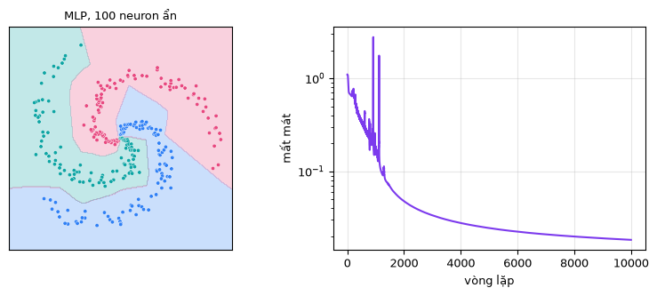
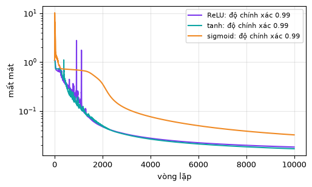
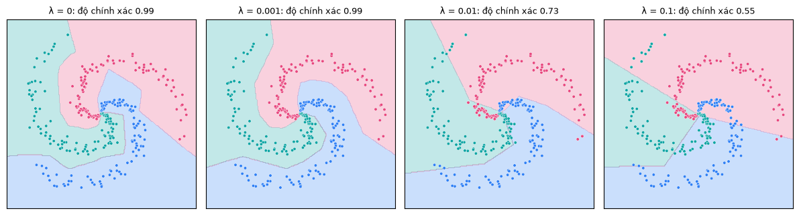

# Chương 16 · Code từ đầu

> Ghi chú của người biên soạn: trang này do người biên soạn viết thêm, không có trong sách gốc. Trang cài đặt mạng neuron đa tầng (MLP) bằng NumPy như [mục 16.5](ml/ch16_vi), có kiểm tra lan truyền ngược bằng đạo hàm số, rồi thử các hàm kích hoạt và suy giảm trọng số.

## Cách dùng trang này

Các khối chạy lần lượt từ trên xuống và dùng chung biến. Chỉ cần `numpy` và `matplotlib`. Giống sách, mỗi **hàng** của `X` là một điểm dữ liệu, $\mathbf{W}^{(l)}$ có kích thước $d^{(l-1)} \times d^{(l)}$.

## 1. XOR bằng hai tầng perceptron

<small class="viz-ref">Mục 16.1.2 · hình 16.2</small>

Một perceptron không biểu diễn được XOR ([trang Code chương 13](ml/ch13_code_vi)). Nhưng $\text{XOR}(x_1, x_2) = \text{AND}(\text{OR}(x_1, x_2), \text{NAND}(x_1, x_2))$, và mỗi hàm OR, NAND, AND chỉ cần một perceptron. Ghép chúng thành hai tầng:

<!-- run -->
```python
import numpy as np
import matplotlib.pyplot as plt

step = lambda z: (z > 0).astype(int)
X_xor = np.array([[0, 0], [0, 1], [1, 0], [1, 1]])
W1 = np.array([[1, -1], [1, -1]]); b1 = np.array([-0.5, 1.5])     # cột 1: OR, cột 2: NAND
W2 = np.array([[1], [1]]);         b2 = np.array([-1.5])          # AND
hidden = step(X_xor @ W1 + b1)
out = step(hidden @ W2 + b2)
for x, h, o in zip(X_xor, hidden, out.ravel()):
    print(f"x = {x}  →  tầng ẩn (OR, NAND) = {h}  →  đầu ra {o}")
```

<!-- output -->
```output
x = [0 0]  →  tầng ẩn (OR, NAND) = [0 1]  →  đầu ra 0
x = [0 1]  →  tầng ẩn (OR, NAND) = [1 1]  →  đầu ra 1
x = [1 0]  →  tầng ẩn (OR, NAND) = [1 1]  →  đầu ra 1
x = [1 1]  →  tầng ẩn (OR, NAND) = [1 0]  →  đầu ra 0
```
<!-- /output -->

Tầng ẩn biến bốn điểm XOR thành ba điểm $(0, 1)$, $(1, 1)$, $(1, 0)$, và ba điểm này tách được bằng một đường thẳng (hàm AND). Đây là ý tưởng cốt lõi của mạng nhiều tầng: tầng ẩn **biến đổi** dữ liệu sang một không gian mới, nơi bài toán trở nên tuyến tính.

## 2. Dữ liệu xoắn ốc

<small class="viz-ref">Mục 16.5.1 · hình 16.9</small>

Sách không in đoạn code sinh dữ liệu. Dưới đây là cách sinh dữ liệu xoắn ốc ba nhánh phổ biến (từ khoá học CS231n của Stanford), mỗi nhánh 100 điểm. Một mô hình tuyến tính như hồi quy softmax không thể tách các nhánh này:

<!-- run -->
```python
def spiral(N=100, C=3, seed=0):
    rng = np.random.default_rng(seed)
    X = np.zeros((N * C, 2)); y = np.repeat(np.arange(C), N)
    for c in range(C):
        r = np.linspace(0.0, 1, N)
        t = np.linspace(c * 4, (c + 1) * 4, N) + rng.normal(0, 0.2, N)
        X[c * N:(c + 1) * N] = np.c_[r * np.sin(t), r * np.cos(t)]
    return X, y

X, y = spiral()

def softmax_stable(Z):
    e = np.exp(Z - Z.max(1, keepdims=True)); return e / e.sum(1, keepdims=True)

def crossentropy(Yhat, y):
    return -np.mean(np.log(Yhat[np.arange(len(y)), y]))

# Mô hình tuyến tính (hồi quy softmax, chương 15) để so sánh
W, b = np.zeros((2, 3)), np.zeros(3)
for _ in range(2000):
    A = softmax_stable(X @ W + b); A[np.arange(len(y)), y] -= 1
    W -= 1.0 * X.T @ A / len(y); b -= 1.0 * A.mean(0)
print(f"hồi quy softmax: độ chính xác trên tập huấn luyện {np.mean((X @ W + b).argmax(1) == y):.3f}")

COLORS = np.array(["#2f80f5", "#e8487f", "#0ea5a4"])
xx, yy = np.meshgrid(np.linspace(-1.1, 1.1, 250), np.linspace(-1.1, 1.1, 250))
grid = np.c_[xx.ravel(), yy.ravel()]
def show(ax, predict, title):
    ax.contourf(xx, yy, predict(grid).reshape(xx.shape), levels=[-.5, .5, 1.5, 2.5], colors=COLORS, alpha=.25)
    ax.scatter(*X.T, c=COLORS[y], s=10, edgecolors="w", linewidths=.3); ax.set_title(title, fontsize=9); ax.set_aspect("equal"); ax.set_xticks([]); ax.set_yticks([])
fig, ax = plt.subplots(figsize=(3.4, 3.4))
show(ax, lambda G: (G @ W + b).argmax(1), "hồi quy softmax")
```

<!-- output -->
```output
hồi quy softmax: độ chính xác trên tập huấn luyện 0.540
```

<div align=center></div>
<!-- /output -->

Hồi quy softmax chỉ đúng khoảng một nửa số điểm. Ba đường thẳng không thể chia ba nhánh xoắn ốc.

## 3. MLP một tầng ẩn: lan truyền thuận và lan truyền ngược

<small class="viz-ref">Mục 16.4–16.5 · Thuật toán 16.3</small>

Code dưới đây giống code của sách (tầng ẩn 100 neuron, ReLU, softmax ở đầu ra, GD trên toàn bộ dữ liệu với $\eta = 1$), viết lại cho Python 3:

<!-- run -->
```python
def mlp_init(d0, d1, d2, rng):
    return [0.01 * rng.normal(size=(d0, d1)), np.zeros(d1), 0.01 * rng.normal(size=(d1, d2)), np.zeros(d2)]

def forward(X, params):
    W1, b1, W2, b2 = params
    Z1 = X @ W1 + b1                 # (N, d1)
    A1 = np.maximum(Z1, 0)           # ReLU
    Z2 = A1 @ W2 + b2                # (N, d2)
    return Z1, A1, softmax_stable(Z2)

def backward(X, y, params, cache, lam=0.0):
    """Gradient của entropy chéo trung bình (+ λ/2·‖W‖²) theo W1, b1, W2, b2 (Thuật toán 16.3)."""
    W1, b1, W2, b2 = params
    Z1, A1, Yhat = cache
    E2 = Yhat.copy(); E2[np.arange(len(y)), y] -= 1; E2 /= len(y)    # ∂J/∂Z2
    dW2 = A1.T @ E2 + lam * W2;  db2 = E2.sum(0)
    E1 = E2 @ W2.T; E1[Z1 <= 0] = 0                                    # ∂J/∂Z1, đạo hàm của ReLU
    dW1 = X.T @ E1 + lam * W1;   db1 = E1.sum(0)
    return [dW1, db1, dW2, db2]

def mlp_fit(X, y, params, eta, iters=10000, lam=0.0, log_every=2000):
    loss_hist = []
    for i in range(iters):
        cache = forward(X, params)
        loss = crossentropy(cache[2], y)
        loss_hist.append(loss)
        if log_every and i % log_every == 0:
            print(f"vòng {i:5d}, mất mát {loss:.6f}")
        grads = backward(X, y, params, cache, lam)
        params = [p - eta * g for p, g in zip(params, grads)]
    return params, loss_hist

params, hist = mlp_fit(X, y, mlp_init(2, 100, 3, np.random.default_rng(0)), eta=1.0)
predict = lambda G, p=params: forward(G, p)[2].argmax(1)
print(f"độ chính xác trên tập huấn luyện: {100 * np.mean(predict(X) == y):.2f}%   (sách: 99.33%)")

fig, axes = plt.subplots(1, 2, figsize=(8, 3.4))
show(axes[0], predict, "MLP, 100 neuron ẩn")
axes[1].semilogy(hist, color="#7c3aed"); axes[1].set_xlabel("vòng lặp"); axes[1].set_ylabel("mất mát"); axes[1].grid(alpha=.3)
fig.tight_layout()
```

<!-- output -->
```output
vòng     0, mất mát 1.098644
vòng  2000, mất mát 0.047734
vòng  4000, mất mát 0.027823
vòng  6000, mất mát 0.022470
vòng  8000, mất mát 0.019924
độ chính xác trên tập huấn luyện: 99.33%   (sách: 99.33%)
```

<div align=center></div>
<!-- /output -->

Độ chính xác 99.33% trùng với sách. Các giá trị mất mát ở từng vòng hơi khác sách, vì dữ liệu và khởi tạo ngẫu nhiên khác nhau. Ranh giới quyết định uốn theo các nhánh xoắn ốc: 100 neuron ReLU tạo ra một hàm tuyến tính từng khúc đủ linh hoạt.

## 4. Kiểm tra lan truyền ngược bằng đạo hàm số

Lan truyền ngược rất dễ viết sai mà vẫn "chạy được". Mất mát vẫn có thể giảm dù gradient sai. Hãy luôn so với đạo hàm số trên một mạng nhỏ:

<!-- run -->
```python
rng = np.random.default_rng(1)
Xs, ys = rng.normal(size=(20, 2)), rng.integers(0, 3, 20)
p = [rng.normal(size=s) for s in [(2, 5), (5,), (5, 3), (3,)]]
lam = 0.1

def J(p):
    W1, b1, W2, b2 = p
    return crossentropy(forward(Xs, p)[2], ys) + lam / 2 * (np.sum(W1 ** 2) + np.sum(W2 ** 2))

analytic = backward(Xs, ys, p, forward(Xs, p), lam)
for name, k in zip(["W1", "b1", "W2", "b2"], range(4)):
    num = np.zeros_like(p[k])
    for idx in np.ndindex(p[k].shape):
        q1 = [x.copy() for x in p]; q1[k][idx] += 1e-6
        q2 = [x.copy() for x in p]; q2[k][idx] -= 1e-6
        num[idx] = (J(q1) - J(q2)) / 2e-6
    print(f"{name}: sai khác lớn nhất {np.abs(num - analytic[k]).max():.2e}")
```

<!-- output -->
```output
W1: sai khác lớn nhất 3.09e-10
b1: sai khác lớn nhất 2.10e-10
W2: sai khác lớn nhất 3.45e-10
b2: sai khác lớn nhất 6.56e-11
```
<!-- /output -->

Mọi gradient từ lan truyền ngược đều khớp với đạo hàm số tới khoảng $10^{-10}$, kể cả số hạng suy giảm trọng số.

## 5. So sánh các hàm kích hoạt

<small class="viz-ref">Mục 16.3</small>

Thay ReLU bằng sigmoid hoặc tanh. Ta chỉ cần đổi hàm kích hoạt và đạo hàm của nó trong `forward` và `backward`:

<!-- run -->
```python
ACT = {
    "ReLU":    (lambda z: np.maximum(z, 0), lambda z, a: (z > 0).astype(float)),
    "tanh":    (np.tanh,                    lambda z, a: 1 - a ** 2),
    "sigmoid": (lambda z: 1 / (1 + np.exp(-z)), lambda z, a: a * (1 - a)),
}

def fit_act(name, iters=10000, eta=1.0, seed=0):
    f, df = ACT[name]
    W1, b1, W2, b2 = mlp_init(2, 100, 3, np.random.default_rng(seed))
    hist = []
    for i in range(iters):
        Z1 = X @ W1 + b1; A1 = f(Z1); Yhat = softmax_stable(A1 @ W2 + b2)
        hist.append(crossentropy(Yhat, y))
        E2 = Yhat; E2[np.arange(len(y)), y] -= 1; E2 /= len(y)
        E1 = (E2 @ W2.T) * df(Z1, A1)
        W2 -= eta * A1.T @ E2; b2 -= eta * E2.sum(0); W1 -= eta * X.T @ E1; b1 -= eta * E1.sum(0)
    acc = np.mean((f(X @ W1 + b1) @ W2 + b2).argmax(1) == y)
    return hist, acc

fig, ax = plt.subplots(figsize=(5.6, 3.2))
for name, c in zip(ACT, ["#7c3aed", "#0ea5a4", "#f08a24"]):
    h, acc = fit_act(name)
    ax.semilogy(h, color=c, label=f"{name}: độ chính xác {acc:.2f}")
    print(f"{name:8s}: mất mát sau 1000 vòng {h[999]:.4f}, sau 10000 vòng {h[-1]:.4f}, độ chính xác {acc:.3f}")
ax.set_xlabel("vòng lặp"); ax.set_ylabel("mất mát"); ax.legend(fontsize=8); ax.grid(alpha=.3)
```

<!-- output -->
```output
ReLU    : mất mát sau 1000 vòng 0.1785, sau 10000 vòng 0.0184, độ chính xác 0.993
tanh    : mất mát sau 1000 vòng 0.1322, sau 10000 vòng 0.0169, độ chính xác 0.993
sigmoid : mất mát sau 1000 vòng 0.6879, sau 10000 vòng 0.0326, độ chính xác 0.993
```

<div align=center></div>
<!-- /output -->

Cả ba hàm kích hoạt cuối cùng đều đạt 99.3%, nhưng tốc độ rất khác nhau. Sau 1000 vòng, mạng dùng sigmoid mới giảm mất mát từ $\ln 3 \approx 1.10$ xuống 0.69, trong khi ReLU đã xuống 0.18. Đạo hàm của sigmoid nhỏ nhất (tối đa 0.25) và đầu ra không có tâm ở 0, nên gradient truyền về tầng trước yếu. Đây là một lý do khiến ReLU trở thành lựa chọn mặc định (mục 16.3.3).

## 6. Suy giảm trọng số

<small class="viz-ref">Mục 16.6</small>

<!-- run -->
```python
fig, axes = plt.subplots(1, 4, figsize=(12, 3.1))
for ax, lam in zip(axes, [0, 1e-3, 1e-2, 1e-1]):
    p_l, _ = mlp_fit(X, y, mlp_init(2, 100, 3, np.random.default_rng(0)), eta=1.0, lam=lam, log_every=0)
    acc = np.mean(forward(X, p_l)[2].argmax(1) == y)
    show(ax, lambda G, p=p_l: forward(G, p)[2].argmax(1), f"λ = {lam}: độ chính xác {acc:.2f}")
    print(f"λ = {lam:5}: độ chính xác {acc:.3f}, ‖W1‖ = {np.linalg.norm(p_l[0]):.1f}, ‖W2‖ = {np.linalg.norm(p_l[2]):.1f}")
fig.tight_layout()
```

<!-- output -->
```output
λ =     0: độ chính xác 0.993, ‖W1‖ = 27.2, ‖W2‖ = 26.0
λ = 0.001: độ chính xác 0.990, ‖W1‖ = 11.6, ‖W2‖ = 11.6
λ =  0.01: độ chính xác 0.733, ‖W1‖ = 4.5, ‖W2‖ = 4.5
λ =   0.1: độ chính xác 0.547, ‖W1‖ = 1.0, ‖W2‖ = 1.0
```

<div align=center></div>
<!-- /output -->

Ở đây $\lambda$ được cộng vào hàm mất mát **trung bình**, tức $J = \frac{1}{N}\sum \text{entropy chéo} + \frac{\lambda}{2}\|\mathbf{W}\|^2$. Với $\lambda = 0.001$, mạng vẫn khớp dữ liệu (99%) với trọng số nhỏ hơn một nửa. Từ $\lambda = 0.01$, phạt quá nặng so với độ phức tạp mà dữ liệu xoắn ốc đòi hỏi: ranh giới bị kéo thẳng ra và độ chính xác giảm mạnh. Mức phạt phù hợp phụ thuộc vào bài toán, và phải chọn bằng tập xác thực như [chương 8](ml/ch08_vi).
