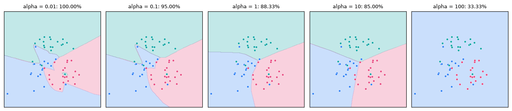

# Chương 16 · Dùng thư viện

> Ghi chú của người biên soạn: trang này do người biên soạn viết thêm, không có trong sách gốc. Trang chạy lại thí nghiệm `MLPClassifier` của [mục 16.6](ml/ch16_vi), rồi viết cùng mạng bằng PyTorch, công cụ mà người ta dùng trong thực tế cho mạng neuron.

## Cách dùng trang này

Các khối chạy lần lượt từ trên xuống và dùng chung biến. Cần `numpy`, `matplotlib`, `scikit-learn`, `torch`. Mục 3 tải MNIST ở lần chạy đầu.

| Trong sách | `MLPClassifier` | PyTorch |
| --- | --- | --- |
| Số neuron mỗi tầng ẩn | `hidden_layer_sizes=(100,)` | `nn.Linear(d_in, 100)` |
| Hàm kích hoạt | `activation="relu"` | `nn.ReLU()` |
| Suy giảm trọng số $\lambda$ | `alpha` | `weight_decay` của bộ tối ưu |
| Lan truyền ngược | tự động | `loss.backward()` |

## 1. `MLPClassifier`: thí nghiệm hình 16.11 của sách

<small class="viz-ref">Mục 16.6 · hình 16.11</small>

Ba lớp, mỗi lớp 20 điểm, một tầng ẩn 100 neuron, với các mức suy giảm trọng số khác nhau:

<!-- run -->
```python
import numpy as np
import matplotlib.pyplot as plt
import warnings
from sklearn.neural_network import MLPClassifier

rng = np.random.default_rng(1)
means = [[-1, -1], [1, -1], [0, 1]]
X = np.concatenate([rng.multivariate_normal(m, np.eye(2), 20) for m in means]); y = np.repeat([0, 1, 2], 20)
COLORS = np.array(["#2f80f5", "#e8487f", "#0ea5a4"])
xx, yy = np.meshgrid(np.linspace(-4, 4, 250), np.linspace(-4, 4, 250))

fig, axes = plt.subplots(1, 5, figsize=(13, 2.9))
for ax, alpha in zip(axes, [0.01, 0.1, 1, 10, 100]):
    with warnings.catch_warnings():
        warnings.simplefilter("ignore")
        clf = MLPClassifier(hidden_layer_sizes=(100,), alpha=alpha, solver="lbfgs", max_iter=2000, random_state=0).fit(X, y)
    Z = clf.predict(np.c_[xx.ravel(), yy.ravel()]).reshape(xx.shape)
    ax.contourf(xx, yy, Z, levels=[-.5, .5, 1.5, 2.5], colors=COLORS, alpha=.25)
    ax.scatter(*X.T, c=COLORS[y], s=14, edgecolors="w", linewidths=.4)
    ax.set_title(f"alpha = {alpha}: {100 * clf.score(X, y):.2f}%", fontsize=9); ax.set_xticks([]); ax.set_yticks([])
    print(f"alpha = {alpha:6}: độ chính xác trên tập huấn luyện {100 * clf.score(X, y):.2f}%, "
          f"độ lớn trọng số tầng ẩn {np.linalg.norm(clf.coefs_[0]):.2f}, xác suất dự đoán tại (0, 0): {clf.predict_proba([[0, 0]]).round(2)[0]}")
fig.tight_layout()
```

<!-- output -->
```output
alpha =   0.01: độ chính xác trên tập huấn luyện 100.00%, độ lớn trọng số tầng ẩn 17.03, xác suất dự đoán tại (0, 0): [1. 0. 0.]
alpha =    0.1: độ chính xác trên tập huấn luyện 95.00%, độ lớn trọng số tầng ẩn 7.97, xác suất dự đoán tại (0, 0): [0.92 0.03 0.04]
alpha =      1: độ chính xác trên tập huấn luyện 88.33%, độ lớn trọng số tầng ẩn 2.23, xác suất dự đoán tại (0, 0): [0.39 0.21 0.41]
alpha =     10: độ chính xác trên tập huấn luyện 85.00%, độ lớn trọng số tầng ẩn 1.26, xác suất dự đoán tại (0, 0): [0.33 0.28 0.4 ]
alpha =    100: độ chính xác trên tập huấn luyện 33.33%, độ lớn trọng số tầng ẩn 0.00, xác suất dự đoán tại (0, 0): [0.33 0.33 0.33]
```

<div align=center></div>
<!-- /output -->

Với `alpha` nhỏ, mạng đạt 100% trên tập huấn luyện bằng những ranh giới uốn éo quanh từng điểm (quá khớp, như sách nhận xét). `alpha` càng lớn thì trọng số càng nhỏ, ranh giới càng mượt và xác suất càng "khiêm tốn".

Sách đặt câu hỏi: vì sao với `alpha = 100` độ chính xác chỉ còn 33.33%? Dòng in cuối trả lời câu hỏi này. Phạt quá nặng làm mọi trọng số gần như bằng 0, nên mạng cho cùng một xác suất (khoảng 1/3 mỗi lớp) tại mọi điểm và dự đoán cùng một lớp cho tất cả. Một lớp chiếm 1/3 dữ liệu, nên độ chính xác là 33.33%.

## 2. PyTorch: mạng của mục 16.5 trên dữ liệu xoắn ốc

<!-- run -->
```python
import torch
from torch import nn

def spiral(N=100, C=3, seed=0):
    r_ = np.random.default_rng(seed)
    X = np.zeros((N * C, 2)); y = np.repeat(np.arange(C), N)
    for c in range(C):
        r = np.linspace(0.0, 1, N); t = np.linspace(c * 4, (c + 1) * 4, N) + r_.normal(0, 0.2, N)
        X[c * N:(c + 1) * N] = np.c_[r * np.sin(t), r * np.cos(t)]
    return X, y

Xs, ys = spiral()
Xt, yt = torch.tensor(Xs, dtype=torch.float32), torch.tensor(ys)
torch.manual_seed(0)
net = nn.Sequential(nn.Linear(2, 100), nn.ReLU(), nn.Linear(100, 3))     # không cần softmax: CrossEntropyLoss nhận logits
opt = torch.optim.SGD(net.parameters(), lr=1.0)
loss_fn = nn.CrossEntropyLoss()
for i in range(10000):
    opt.zero_grad(); loss = loss_fn(net(Xt), yt); loss.backward(); opt.step()
    if i % 2500 == 0: print(f"vòng {i:5d}, mất mát {loss.item():.4f}")
with torch.no_grad():
    print(f"độ chính xác trên tập huấn luyện: {100 * (net(Xt).argmax(1) == yt).float().mean():.2f}%")
print("số tham số:", sum(p.numel() for p in net.parameters()))
```

<!-- output -->
```output
vòng     0, mất mát 1.0711
vòng  2500, mất mát 0.0341
vòng  5000, mất mát 0.0242
vòng  7500, mất mát 0.0206
độ chính xác trên tập huấn luyện: 99.33%
số tham số: 603
```
<!-- /output -->

PyTorch cho đúng độ chính xác 99.33% như bản NumPy, với 603 tham số: $2 \times 100 + 100$ ở tầng ẩn, $100 \times 3 + 3$ ở tầng ra.

Lưu ý: `nn.Linear` khởi tạo trọng số theo phân phối đều với độ lớn khoảng $1/\sqrt{d_{\text{in}}}$, không phải $0.01 \times \mathcal{N}(0, 1)$ như sách. Vì vậy quá trình huấn luyện không giống hệt trang Code, nhưng mô hình và thuật toán là một.

## 3. MNIST: một tầng ẩn so với hồi quy softmax

Hồi quy softmax đạt khoảng 92% trên MNIST ([chương 15](ml/ch15_lib_vi)). Thêm một tầng ẩn 256 neuron:

<!-- run -->
```python
from sklearn.datasets import fetch_openml
from sklearn.model_selection import train_test_split
from time import perf_counter

X_all, y_all = fetch_openml("mnist_784", version=1, return_X_y=True, as_frame=False)
X_tr, X_te, y_tr, y_te = train_test_split(X_all / 255.0, y_all.astype(int), test_size=10000, random_state=0)
Xtr, ytr = torch.tensor(X_tr, dtype=torch.float32), torch.tensor(y_tr)
Xte, yte = torch.tensor(X_te, dtype=torch.float32), torch.tensor(y_te)

def train(model, epochs=10, lr=1e-3, seed=0):
    torch.manual_seed(seed)
    opt = torch.optim.Adam(model.parameters(), lr=lr)
    t = perf_counter()
    for ep in range(epochs):
        model.train()
        for b in torch.randperm(len(Xtr)).split(128):
            opt.zero_grad(); loss_fn(model(Xtr[b]), ytr[b]).backward(); opt.step()
    model.eval()
    with torch.no_grad():
        return (model(Xte).argmax(1) == yte).float().mean().item(), perf_counter() - t

torch.manual_seed(0)
for name, model in [("softmax (không tầng ẩn)", nn.Linear(784, 10)),
                    ("MLP 784-256-10", nn.Sequential(nn.Linear(784, 256), nn.ReLU(), nn.Linear(256, 10))),
                    ("MLP 784-256-128-10", nn.Sequential(nn.Linear(784, 256), nn.ReLU(), nn.Linear(256, 128), nn.ReLU(), nn.Linear(128, 10)))]:
    acc, dt = train(model)
    print(f"{name:24s}: độ chính xác kiểm tra {100 * acc:.2f}%, {sum(p.numel() for p in model.parameters()):7d} tham số, {dt:.0f} s")
```

<!-- output -->
```output
softmax (không tầng ẩn) : độ chính xác kiểm tra 92.17%,    7850 tham số, 1 s
MLP 784-256-10          : độ chính xác kiểm tra 97.59%,  203530 tham số, 6 s
MLP 784-256-128-10      : độ chính xác kiểm tra 97.56%,  235146 tham số, 9 s
```
<!-- /output -->

Chỉ một tầng ẩn đã giảm số ảnh nhận sai từ khoảng 780 xuống khoảng 240 trên 10 000 ảnh, tức giảm hơn 3 lần. Thêm tầng ẩn thứ hai không giúp gì thêm ở đây. Với ảnh, bước tiến lớn tiếp theo đến từ mạng tích chập (CNN). CNN khai thác cấu trúc không gian của ảnh, thứ mà MLP bỏ qua khi trải phẳng ảnh thành một vector 784 chiều.

## Tóm tắt

| Nhu cầu | Công cụ |
| --- | --- |
| Mạng nhỏ, dữ liệu dạng bảng | `MLPClassifier`, `MLPRegressor` |
| Chọn `alpha`, `hidden_layer_sizes` | `GridSearchCV` như các chương trước |
| Mạng tuỳ biến, dữ liệu lớn, GPU | PyTorch: `nn.Sequential`, `nn.CrossEntropyLoss`, `torch.optim.Adam` |
| Kiểm tra gradient tự viết | `torch.autograd.gradcheck`, hoặc đạo hàm số như trang Code |
