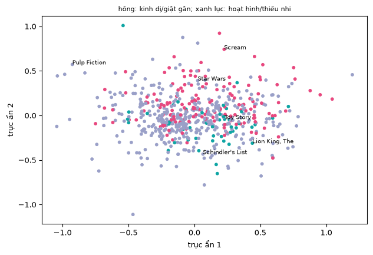

# Chương 19 · Ví dụ áp dụng: mô hình đã học được gì về các bộ phim?

> Ghi chú của người biên soạn: trang này do người biên soạn viết thêm, không có trong sách gốc. Phân tích ma trận ([chương 19](ml/ch19_vi)) biểu diễn mỗi phim bằng một vector ẩn $\mathbf{x}_m$ và mỗi người dùng bằng một vector $\mathbf{w}_n$, chỉ từ các con số đánh giá. Trang huấn luyện mô hình trên toàn bộ MovieLens 100k rồi xem các vector đó mã hoá điều gì: độ lệch của phim, các trục ẩn, và các phim gần nhau trong không gian ẩn.

## 1. Huấn luyện

Dùng bình phương tối thiểu luân phiên với các tham số đã chọn ở [trang Code](ml/ch19_code_vi) ($K = 50$, $\lambda = 15$), trên toàn bộ 100 000 đánh giá.

<!-- run -->
```python
import numpy as np
import pandas as pd
import matplotlib.pyplot as plt
import urllib.request, zipfile
from pathlib import Path

root = Path.home() / ".cache"
if not (root / "ml-100k" / "u.data").exists():
    root.mkdir(parents=True, exist_ok=True)
    urllib.request.urlretrieve("https://files.grouplens.org/datasets/movielens/ml-100k.zip", root / "ml-100k.zip")
    zipfile.ZipFile(root / "ml-100k.zip").extractall(root)
path = root / "ml-100k"
R = pd.read_csv(path / "u.data", sep="\t", names=["u", "i", "r", "t"]); R[["u", "i"]] -= 1
items = pd.read_csv(path / "u.item", sep="|", header=None, encoding="latin-1")
titles = items[1].to_numpy()
genre_names = ["unknown", "Action", "Adventure", "Animation", "Children", "Comedy", "Crime", "Documentary", "Drama", "Fantasy",
               "Film-Noir", "Horror", "Musical", "Mystery", "Romance", "Sci-Fi", "Thriller", "War", "Western"]
G = items.iloc[:, -19:].to_numpy()
n_users, n_items = 943, 1682
u_a, i_a, y_a = R.u.to_numpy(), R.i.to_numpy(), R.r.to_numpy().astype(float)
by_user = [np.flatnonzero(u_a == n) for n in range(n_users)]
by_item = [np.flatnonzero(i_a == m) for m in range(n_items)]
mu = y_a.mean()

def als(K, lam, iters=15, seed=0, lam_bias=1.0):
    rng = np.random.default_rng(seed)
    P = 0.1 * rng.standard_normal((n_users, K)); Q = 0.1 * rng.standard_normal((n_items, K))
    bu = np.zeros(n_users); bi = np.zeros(n_items)
    reg = np.diag(np.r_[np.full(K, lam), lam_bias])
    for it in range(iters):
        for n in range(n_users):
            ids = by_user[n]; A = np.c_[Q[i_a[ids]], np.ones(len(ids))]
            sol = np.linalg.solve(A.T @ A + reg, A.T @ (y_a[ids] - mu - bi[i_a[ids]])); P[n], bu[n] = sol[:K], sol[K]
        for m in range(n_items):
            ids = by_item[m]; A = np.c_[P[u_a[ids]], np.ones(len(ids))]
            sol = np.linalg.solve(A.T @ A + reg, A.T @ (y_a[ids] - mu - bu[u_a[ids]])); Q[m], bi[m] = sol[:K], sol[K]
    return P, Q, bu, bi

P, Q, bu, bi = als(50, 15)
pred = mu + bu[u_a] + bi[i_a] + np.sum(P[u_a] * Q[i_a], 1)
print(f"RMSE trên dữ liệu huấn luyện: {np.sqrt(np.mean((np.clip(pred, 1, 5) - y_a) ** 2)):.4f}")
```

<!-- output -->
```output
RMSE trên dữ liệu huấn luyện: 0.7168
```
<!-- /output -->

## 2. Độ lệch của phim: "chất lượng" đã điều chỉnh

$b_m$ cho biết phim $m$ được chấm cao hơn hay thấp hơn mức chung, **sau khi** đã tính tới việc người xem nó dễ tính hay khó tính. Khác với điểm trung bình thô, nó cũng bị kéo về 0 với những phim ít người xem (nhờ hệ số phạt).

<!-- run -->
```python
cnt = np.bincount(i_a, minlength=n_items)
avg = np.bincount(i_a, weights=y_a, minlength=n_items) / np.maximum(cnt, 1)
print("Điểm trung bình thô cao nhất:")
for m in np.argsort(-avg)[:5]:
    print(f"  {titles[m][:40]:40s} trung bình {avg[m]:.2f} ({cnt[m]} lượt)")
print("Độ lệch b_m cao nhất:")
for m in np.argsort(-bi)[:5]:
    print(f"  {titles[m][:40]:40s} b = {bi[m]:+.2f} (trung bình {avg[m]:.2f}, {cnt[m]} lượt)")
```

<!-- output -->
```output
Điểm trung bình thô cao nhất:
  Prefontaine (1997)                       trung bình 5.00 (3 lượt)
  Star Kid (1997)                          trung bình 5.00 (3 lượt)
  Marlene Dietrich: Shadow and Light (1996 trung bình 5.00 (1 lượt)
  Someone Else's America (1995)            trung bình 5.00 (1 lượt)
  Aiqing wansui (1994)                     trung bình 5.00 (1 lượt)
Độ lệch b_m cao nhất:
  Pather Panchali (1955)                   b = +1.24 (trung bình 4.62, 8 lượt)
  Close Shave, A (1995)                    b = +0.99 (trung bình 4.49, 112 lượt)
  Wrong Trousers, The (1993)               b = +0.97 (trung bình 4.47, 118 lượt)
  Casablanca (1942)                        b = +0.97 (trung bình 4.46, 243 lượt)
  Schindler's List (1993)                  b = +0.96 (trung bình 4.47, 298 lượt)
```
<!-- /output -->

Điểm trung bình thô cao nhất toàn là những phim có 1–3 lượt đánh giá. Theo độ lệch $b_m$, đứng đầu là những phim được đánh giá cao bởi hàng trăm người (*Casablanca*, *Schindler's List*, hai phim hoạt hình *Wallace & Gromit*). *Pather Panchali* chỉ có 8 lượt vẫn đứng đầu: hệ số phạt kéo nó về 0 nhưng chưa đủ, vì cả 8 người đều chấm rất cao so với thói quen của họ.

## 3. Các trục ẩn

Mỗi phim là một điểm trong không gian 50 chiều. Chiếu xuống 2 thành phần chính ([chương 21](ml/ch21_vi)) của các vector phim có nhiều đánh giá, rồi xem những phim nằm ở hai đầu mỗi trục:

<!-- run -->
```python
pop = cnt >= 50
Qp = Q[pop] - Q[pop].mean(0)
U, s, Vt = np.linalg.svd(Qp, full_matrices=False)
Z = Qp @ Vt[:2].T
idx_pop = np.flatnonzero(pop)
for k in range(2):
    order = np.argsort(Z[:, k])
    print(f"trục {k + 1}, một đầu: {'; '.join(titles[idx_pop[j]][:28] for j in order[:5])}")
    print(f"trục {k + 1}, đầu kia: {'; '.join(titles[idx_pop[j]][:28] for j in order[-5:])}")
    corr = [np.corrcoef(Z[:, k], G[idx_pop, g])[0, 1] for g in range(19)]
    top = np.argsort(np.abs(np.nan_to_num(corr)))[::-1][:3]
    print(f"   thể loại tương quan mạnh nhất với trục {k + 1}: " + ", ".join(f"{genre_names[g]} ({corr[g]:+.2f})" for g in top))

fig, ax = plt.subplots(figsize=(6.4, 4.4))
colors = np.where(G[idx_pop, 11] | G[idx_pop, 16], "#e8487f", np.where(G[idx_pop, 3] | G[idx_pop, 4], "#0ea5a4", "#9aa0c8"))
ax.scatter(*Z.T, s=10, c=colors)
for name in ["Star Wars (1977)", "Toy Story (1995)", "Scream (1996)", "Lion King, The (1994)", "Pulp Fiction (1994)", "Schindler's List (1993)"]:
    j = np.flatnonzero(titles[idx_pop] == name)
    if len(j): ax.annotate(name.split(" (")[0], Z[j[0]], fontsize=7)
ax.set_xlabel("trục ẩn 1"); ax.set_ylabel("trục ẩn 2"); ax.set_title("hồng: kinh dị/giật gân; xanh lục: hoạt hình/thiếu nhi", fontsize=8)
fig.tight_layout()
```

<!-- output -->
```output
trục 1, một đầu: Leaving Las Vegas (1995); Trainspotting (1996); Clockwork Orange, A (1971); Boogie Nights (1997); Pulp Fiction (1994)
trục 1, đầu kia: Top Gun (1986); Conspiracy Theory (1997); Twister (1996); Air Force One (1997); Independence Day (ID4) (1996
   thể loại tương quan mạnh nhất với trục 1: Action (+0.32), Drama (-0.22), Adventure (+0.20)
trục 2, một đầu: English Patient, The (1996); Evita (1996); Sound of Music, The (1965); E.T. the Extra-Terrestrial (; Postino, Il (1994)
trục 2, đầu kia: Scream (1996); Starship Troopers (1997); Fifth Element, The (1997); Terminator, The (1984); Beavis and Butt-head Do Amer
   thể loại tương quan mạnh nhất với trục 2: Action (+0.36), Sci-Fi (+0.33), Drama (-0.27)
```

<div align=center></div>
<!-- /output -->

Hai trục đầu tiên có thể diễn giải được:

- **Trục 1** đặt các phim "kén khán giả", gai góc (*Trainspotting*, *A Clockwork Orange*, *Pulp Fiction*) đối diện các phim bom tấn hành động đại chúng (*Top Gun*, *Independence Day*).
- **Trục 2** đặt phim chính kịch, nhạc kịch, lãng mạn (*The English Patient*, *Evita*, *The Sound of Music*) đối diện phim hành động, khoa học viễn tưởng, kinh dị (*Scream*, *Starship Troopers*, *The Terminator*).

Tương quan với thể loại chỉ ở mức vừa phải (khoảng 0.3): các trục ẩn mô tả *gu xem phim* của khán giả, không trùng với cách phân loại thể loại.

## 4. Phim gần nhau trong không gian ẩn

<!-- run -->
```python
Qn = Q / np.linalg.norm(Q, axis=1, keepdims=True)
for q in ["Star Wars (1977)", "Toy Story (1995)", "Scream (1996)"]:
    m = np.flatnonzero(titles == q)[0]
    sims = Qn @ Qn[m]; sims[~pop] = -1; sims[m] = -1
    print(f"{q}: " + "; ".join(titles[j][:30] for j in np.argsort(-sims)[:5]))
```

<!-- output -->
```output
Star Wars (1977): Empire Strikes Back, The (1980; Return of the Jedi (1983); Raiders of the Lost Ark (1981); Indiana Jones and the Last Cru; Giant (1956)
Toy Story (1995): Beauty and the Beast (1991); Singin' in the Rain (1952); Lion King, The (1994); Evil Dead II (1987); Cool Hand Luke (1967)
Scream (1996): Scream 2 (1997); I Know What You Did Last Summe; Nightmare on Elm Street, A (19; Pump Up the Volume (1990); Event Horizon (1997)
```
<!-- /output -->

Phần lớn láng giềng hợp lý: các phần tiếp theo (*Scream 2*, hai phần *Star Wars*), phim cùng loại (*Beauty and the Beast*, *The Lion King* gần *Toy Story*). Cũng có vài láng giềng khó giải thích (*Evil Dead II* gần *Toy Story*): với 50 chiều và dữ liệu thưa, không phải chiều nào cũng được ước lượng tốt.

## Rút ra được gì

- Độ lệch $b_m$ là một thước đo chất lượng phim tốt hơn điểm trung bình thô: nó điều chỉnh theo người xem và không bị những phim chỉ có một lượt đánh giá chi phối.
- Không ai nói cho mô hình biết thể loại phim, nhưng các trục ẩn có ý nghĩa và tương quan với thể loại. Mô hình tự khám phá chúng từ việc những người nào thích những phim nào.
- Các vector ẩn dùng được như vector đặc trưng của phim cho các bài toán khác: tìm phim tương tự, phân cụm, hay làm đầu vào cho một mô hình khác.
