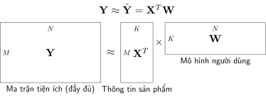

# Chương 19 Matrix factorization collaborative filtering

> Ghi chú của người biên soạn: chương này lấy nguyên văn từ sách *Machine Learning cơ bản* của **Vũ Hữu Tiệp** ([mã nguồn LaTeX](https://github.com/tiepvupsu/ebookMLCB), giấy phép [CC BY-SA 4.0](https://creativecommons.org/licenses/by-sa/4.0/); trang gốc [machinelearningcoban.com](https://machinelearningcoban.com)). Người biên soạn chỉ đổi định dạng sang trang web: số chương, mục, công thức và hình giữ như bản PDF, hình vector được vẽ lại dưới dạng SVG.
>
> **Đính chính** *(người biên soạn)*:
>
> - Code ở mục 19.3 không chạy được như in: thân vòng lặp trong hàm `loss` thiếu thụt lề, và có dấu cách sau dấu `\` nối dòng trong `__init__`; `as_matrix()` đã bị gỡ khỏi pandas.
> - Với tham số của sách (`lam = .01`, phần sai số chia cho số đánh giá nhưng phần phạt thì không), mọi vector ẩn $\mathbf{X}, \mathbf{W}$ bị kéo về cỡ $10^{-80}$ sau khi huấn luyện. RMSE 0.962 vì vậy thực chất là của mô hình chỉ gồm các độ lệch $b_m + d_n$. Với hệ số phạt đặt đúng thang, phân tích ma trận đạt RMSE khoảng 0.933. Xem trang [Code từ đầu](ml/ch19_code_vi).

## 19.1 Giới thiệu 

Trong Chương [18](ml/ch18_vi) (*Lọc cộng tác lân cận*), chúng ta đã làm quen với phương pháp lọc cộng tác dựa trên hành vi của người dùng hoặc sản phẩm lân cận. Trong chương này, chúng ta sẽ làm quen với một hướng tiếp cận khác cho lọc cộng tác dựa trên bài toán *phân tích ma trận thành nhân tử* (matrix factorization hoặc matrix decomposition). Phương pháp này được gọi là *lọc cộng tác phân tích ma trận* (matrix factorization collaborative filtering – MFCF) .

Nhắc lại rằng trong hệ thống gợi ý dựa trên nội dung, mỗi sản phẩm được mô tả bằng một vector thông tin $\mathbf{x}$. Trong phương pháp đó, ta cần tìm một vector trọng số $\mathbf{w}$ tương ứng với mỗi người dùng sao cho các đánh giá đã biết của người dùng tới các sản phẩm được xấp xỉ bởi:

$$
y \approx \mathbf{x}^T\mathbf{w} \tag{19.1}
$$

Với cách làm này, ma trận tiện ích $\mathbf{Y}$, *giả sử đã được điền hết*, sẽ xấp xỉ với:

$$
\mathbf{Y} \approx \left[ \begin{matrix} \mathbf{x}^T_1\mathbf{w}_1 &
\mathbf{x}^T_1\mathbf{w}_2 & \dots & \mathbf{x}^T_1 \mathbf{w}_N\\ 
\mathbf{x}^T_2\mathbf{w}_1 & \mathbf{x}^T_2\mathbf{w}_2 & \dots &
\mathbf{x}^T_2 \mathbf{w}_N\\  \dots & \dots & \ddots & \dots \\ 
\mathbf{x}^T_M\mathbf{w}_1 & \mathbf{x}^T_M\mathbf{w}_2 & \dots & \mathbf{x}^T_M \mathbf{w}_N \end{matrix} \right] = \left[ \begin{matrix} \mathbf{x}^T_1 \\  \mathbf{x}^T_2 \\  \dots \\  \mathbf{x}^T_M  \end{matrix} \right]
\left[ \begin{matrix} \mathbf{w}_1 & \mathbf{w}_2 & \dots & \mathbf{w}_N \end{matrix} \right] = \mathbf{X}^T\mathbf{W} \tag{19.2}
$$

với $M, N$ lần lượt là số lượng sản phẩm và người dùng. Chú ý rằng trong hệ thống gợi ý dựa trên nội dung, $\mathbf{x}$ được xây dựng dựa trên thông tin mô tả của sản phẩm và quá trình xây dựng này độc lập với quá trình đi tìm hệ số phù hợp cho mỗi người dùng. Như vậy, việc xây dựng thông tin sản phẩm đóng vai trò quan trọng và có ảnh hưởng trực tiếp tới hiệu năng của mô hình. Thêm nữa, việc xây dựng từng mô hình riêng lẻ cho mỗi người dùng dẫn đến kết quả chưa thực sự tốt vì không khai thác được mối quan hệ giữa người dùng.

Bây giờ, giả sử rằng không cần xây dựng trước thông tin sản phẩm $\mathbf{x}$ mà vector này có thể được huấn luyện đồng thời với mô hình của mỗi người dùng (ở đây là một vector trọng số). Điều này nghĩa là, biến số trong bài toán tối ưu là cả $\mathbf{X}$ và $\mathbf{W}$; trong đó, mỗi cột của $\mathbf{X}$ là thông tin về một sản phẩm, mỗi cột của $\mathbf{W}$ là mô hình của một người dùng.

Với cách làm này, chúng ta đang cố gắng xấp xỉ ma trận tiện ích $\mathbf{Y} \in \mathbb{R}^{M \times N}$ bằng tích của hai ma trận $\mathbf{X}\in \mathbb{R}^{K\times M}$ và $\mathbf{W} \in \mathbb{R}^{K \times N}$. Thông thường, $K$ được chọn là một số nhỏ hơn so với $M, N$. Khi đó, cả hai ma trận $\mathbf{X}$ và $\mathbf{W}$ đều có hạng không vượt quá $K$. Chính vì vậy, phương pháp này còn được gọi là *phân tích ma trận hạng thấp* (low-rank matrix factorization) (xem Hình 19.1).

<div align=center>

</div>
<div align=center>Hình 19.1: Phân tích ma trận. Ma trận tiện ích $\mathbf{Y} \in \mathbb{R}^{M\times N}$ được xấp xỉ bởi tích của hai ma trận $\mathbf{X} \in \mathbb{R}^{M\times K}$ và $\mathbf{W} \in \mathbb{R}^{K\times N}$.</div>

Một vài điểm cần lưu ý:

- Ý tưởng chính đằng sau lọc cộng tác phân tích ma trận là tồn tại các *đặc trưng ẩn* (latent feature) mô tả mối quan hệ giữa sản phẩm và người dùng. Ví dụ, trong hệ thống khuyến nghị các bộ phim, đặc trưng ẩn có thể là *hình sự*, *chính trị*, *hành động*, *hài*,...; cũng có thể là một sự kết hợp nào đó của các thể loại này. Đặc trưng ẩn cũng có thể là bất cứ điều gì mà chúng ta không thực sự cần đặt tên. Mỗi sản phẩm sẽ mang đặc trưng ẩn ở một mức độ nào đó tương ứng với các hệ số trong vector $\mathbf{x}$ của nó, hệ số càng cao tương ứng với việc mang tính chất đó càng cao. Tương tự, mỗi người dùng cũng sẽ có xu hướng thích những tính chất ẩn nào đó được mô tả bởi các hệ số trong vector $\mathbf{w}$. Hệ số cao tương ứng với việc người dùng thích các bộ phim có tính chất ẩn đó nhiều. Giá trị của biểu thức $\mathbf{x}^T\mathbf{w}$ sẽ cao nếu các thành phần tương ứng của $\mathbf{x}$ và $\mathbf{w}$ đều cao (và dương) hoặc đều thấp (và âm). Điều này nghĩa là sản phẩm mang các tính chất ẩn mà người dùng thích, vậy ta nên gợi ý sản phẩm này cho người dùng đó.

- Tại sao phân tích ma trận được xếp vào lọc cộng tác? Câu trả lời đến từ việc tối ưu hàm mất mát được thảo luận ở Mục 19.2. Về cơ bản, để tìm nghiệm của bài toán tối ưu, ta phải lần lượt đi tìm $\mathbf{X}$ và $\mathbf{W}$ khi thành phần còn lại được cố định. Như vậy, mỗi cột của $\mathbf{X}$ sẽ phụ thuộc vào toàn bộ các cột của $\mathbf{W}$. Ngược lại, mỗi cột của $\mathbf{W}$ phụ thuộc vào toàn bộ các cột của $\mathbf{X}$. Như vậy, có những mỗi quan hệ ràng buộc chằng chịt giữa các thành phần của hai ma trận trên. Vì vậy, phương pháp này cũng được xếp vào lọc cộng tác.

- Trong các bài toán thực tế, số lượng sản phẩm $M$ và số lượng người dùng $N$ thường rất lớn. Việc tìm ra các mô hình đơn giản giúp dự đoán độ quan tâm cần được thực hiện một cách nhanh nhất có thể. Lọc cộng tác dựa trên lân cận không yêu cầu việc huấn luyện quá nhiều, nhưng trong quá trình dự đoán, ta cần đi tìm độ tương tự của một người dùng với toàn bộ người dùng còn lại rồi suy ra kết quả. Ngược lại, với phân tích ma trận, việc huấn luyện tạp hơn vì phải lặp đi lặp lại việc tối ưu một ma trận khi cố định ma trận còn lại. Tuy nhiên, việc dự đoán đơn giản hơn vì chỉ cần tính tích vô hướng $\mathbf{x}^T\mathbf{w}$, mỗi vector có độ dài $K$ là một số nhỏ hơn nhiều so với $M, N$. Vì vậy, quá trình dự đoán không yêu cầu nặng về tính toán. Việc này khiến phân tích ma trận trở nên phù hợp với các mô hình có tập dữ liệu lớn.

- Hơn nữa, việc lưu trữ hai ma trận $\mathbf{X}$ và $\mathbf{W}$ yêu cầu lượng bộ nhớ nhỏ so với việc lưu toàn bộ ma trận tiện ích và tương tự trong lọc cộng tác lân cận. Cụ thể, ta cần bộ nhớ để chứa $K(M+N)$ phần tử thay vì $M^2$ hoặc $N^2$ của ma trận tương tự ($K \ll M, N$).

## 19.2 Xây dựng và tối ưu hàm mất mát

### 19.2.1 Xấp xỉ các đánh giá đã biết

Như đã đề cập, đánh giá của người dùng $n$ tới sản phẩm $m$ có thể được xấp xỉ bởi $y_{mn} = \mathbf{x}^T_m\mathbf{w}_n$. Ta cũng có thể thêm các hệ số điều chỉnh vào công thức xấp xỉ này và tối ưu các hệ số đó. Cụ thể:

$$
y_{mn} \approx \mathbf{x}_m^T \mathbf{w}_n + b_m + d_n \tag{19.3}
$$

Trong đó, $b_m$ và $d_n$ lượt lượt là các hệ số điều chỉnh ứng với sản phẩm $m$ và người dùng $n$. Vector $\mathbf{b} = [b_1, b_2, \dots, b_M]^T$ là vector điều chỉnh cho các sản phẩm, vector $\mathbf{d} = [d_1, d_2, \dots, d_N]^T$ là vector điều chỉnh cho các người dùng. Giống như lọc cộng tác lân cận (NBCF), các giá trị này cũng có thể được coi là các giá trị giúp chuẩn hoá dữ liệu với $\mathbf{b}$ tương ứng với lọc cộng tác sản phẩm và $\mathbf{d}$ tương ứng với lọc cộng tác người dùng. Không giống như trong NBCF, các vector này sẽ được tối ưu để tìm ra các giá trị phù hợp với tập huấn luyện nhất. Thêm vào đó, huấn luyện $\mathbf{d}$ và $\mathbf{b}$ cùng lúc giúp kết hợp cả lọc cộng tác người dùng và lân cận vào một bài toán tối ưu. Vì vậy, chúng ta mong đợi rằng phương pháp này sẽ mang lại hiệu quả tốt hơn.

### 19.2.2 Hàm mất mát 

Hàm mất mát cho MFCF có thể được viết như sau:

$$
\mathcal{L}(\mathbf{X}, \mathbf{W}, \mathbf{b}, \mathbf{d}) = \underbrace{\frac{1}{2s}\sum_{n=1}^N
\sum_{m:r_{mn} =
1} (\mathbf{x}_m^T\mathbf{w}_n + b_m + d_n - y_{mn})^2}_{\text{mất mát trên dữ liệu}} +
\underbrace{\frac{\lambda}{2}(\|\mathbf{X}\|_F^2 +
\|\mathbf{W}\|_F^2)}_{\text{mất mát kiểm soát}}
$$

trong đó $r_{mn} = 1$ nếu sản phẩm thứ $m$ đã được đánh giá bởi người dùng thứ $n$, $s$ là số lượng đánh giá đã biết trong tập huấn luyện, $y_{mn}$ là đánh giá chưa chuẩn hoá<sup>1</sup> của người dùng thứ $n$ tới sản phẩm thứ $m$. Thành phần thứ nhất của hàm mất mát chính là sai số trung bình bình phương sai số của mô hình. Thành phần thứ hai chính là kiểm soát $l_2$ giúp mô hình tránh quá khớp.

Việc tối ưu đồng thời $\mathbf{X}, \mathbf{W}, \mathbf{b}, \mathbf{d}$ là tương đối phức tạp. Phương pháp được sử dụng là lần lượt tối ưu một trong hai cặp $(\mathbf{X}, \mathbf{b})$, $(\mathbf{W}, \mathbf{d})$ trong lúc cố định cặp còn lại. Quá trình này được lặp đi lặp lại cho tới khi hàm mất mát hội tụ.

### 19.2.3 Tối ưu hàm mất mát 

Khi cố định cặp $(\mathbf{X}, \mathbf{b})$, bài toán tối ưu cặp $(\mathbf{W}, \mathbf{d})$ có thể được tách thành $N$ bài toán nhỏ:

$$
\mathcal{L}_1(\mathbf{w}_n, d_n) = \frac{1}{2s} \sum_{m:r_{mn} = 1}
(\mathbf{x}_m^T\mathbf{w}_n + b_m + d_n - y_{mn})^2 + \frac{\lambda}{2}
\|\mathbf{w_n}\|_F^2 \tag{19.4}
$$

Mỗi bài toán có thể được tối ưu bằng gradient descent. Công việc quan trọng là tính các gradient của từng hàm mất mát nhỏ này theo $\mathbf{w}_n$ và $d_n$. Vì biểu thức trong dấu $\sum$ chỉ phụ thuộc vào các sản phẩm đã được đánh giá bởi người dùng thứ $n$ (tương ứng với các $r_{mn}  = 1$), ta có thể đơn giản (19.4) bằng cách đặt $\hat{\mathbf{X}}_n$ là ma trận con được tạo bởi các cột của $\mathbf{X}$ tương ứng với các sản phẩm đã được đánh giá bởi người dùng $n$, $\hat{\mathbf{b}}_n$ là vector điều chỉnh con tương ứng, và $\hat{\mathbf{y}}_n$ là các đánh giá tương ứng. Khi đó,

$$
\mathcal{L}_1(\mathbf{w}_n, d_n) = \frac{1}{2s} \|\hat{\mathbf{X}}^T_n\mathbf{w}_n +
\hat{\mathbf{b}}_n + d_n\mathbf{1} - \hat{\mathbf{y}}_n\|^2 + \frac{\lambda}{2}\|\mathbf{w}_n\|_2^2 \tag{19.5}
$$

với $\mathbf{1}$ là vector với mọi phần tử bằng một với kích thước phù hợp. Các gradient của nó là:

$$
\begin{align*}
\nabla_{\mathbf{w}_n}\mathcal{L}_1
&=
\frac{1}{s}\hat{\mathbf{X}}_n(\hat{\mathbf{X}}_n^T\mathbf{w}_n + \hat{\mathbf{b}}_n + d_n\mathbf{1} -
\hat{\mathbf{y}}_n) + \lambda \mathbf{w}_n \tag{19.6} \\
\nabla_{b_n}\mathcal{L}_1
&=
\frac{1}{s}\mathbf{1}^T(\hat{\mathbf{X}}_n^T\mathbf{w}_n + \hat{\mathbf{b}}_n + d_n\mathbf{1} -
\hat{\mathbf{y}}_n) \tag{19.7}
\end{align*}
$$

***Công thức cập nhật cho $\mathbf{w}_n$ và $d_n$:***

$$
\begin{align*}
\mathbf{w}_n &\leftarrow \mathbf{w}_n - \eta \left(\frac{1}{s}\hat{\mathbf{X}}_n(\hat{\mathbf{X}}_n^T\mathbf{w}_n +
\hat{\mathbf{b}}_n + d_n\mathbf{1} - \hat{\mathbf{y}}_n) + \lambda \mathbf{w}_n\right) \tag{19.8} \\
d_n &\leftarrow d_n - \eta \left(\frac{1}{s}\mathbf{1}^T(\hat{\mathbf{X}}_n^T\mathbf{w}_n + \hat{\mathbf{b}}_n + d_n\mathbf{1} -
\hat{\mathbf{y}}_n)\right) \tag{19.9}
\end{align*}
$$

Tương tự, mỗi cột $\mathbf{x}_m$ của $\mathbf{X}$ và $b_m$ sẽ được tìm bằng cách tối ưu bài toán

$$
\begin{align*}
\mathcal{L}_2(\mathbf{x}_m, b_m) &= \frac{1}{2s}\sum_{n:r_{mn} = 1}
(\mathbf{w}_n^T\mathbf{x}_m + d_n  + b_m - y_{mn})^2 + \frac{\lambda}{2}\|\mathbf{x}_m\|_2^2 \tag{19.10}
\end{align*}
$$

Đặt $\hat{\mathbf{W}}_m$ là ma trận con tạo bởi các cột của $\mathbf{W}$ ứng với các người dùng đã đánh giá sản phẩm $m$, $\hat{\mathbf{d}}_m$ là vector điều chỉnh con tương ứng, và $\hat{\mathbf{y}}^m$ là vector các đánh giá tương ứng. Bài toán (19.10) trở thành

$$
\mathcal{L}(\mathbf{x}_m, b_m)
= \frac{1}{2s}\|\hat{\mathbf{W}}_m^T\mathbf{x}_m + \hat{\mathbf{d}}_m + b_n\mathbf{1} - \hat{\mathbf{y}}_m \| +
\frac{\lambda}{2}\|\mathbf{x}_m\|_2^2. \tag{19.11}
$$

Tương tự ta có

***Công thức cập nhật cho $\mathbf{x}_m$ và $b_m$:***

$$
\begin{align*}
\mathbf{x}_m &\leftarrow  \mathbf{x}_m -
\eta\left(\frac{1}{s}\hat{\mathbf{W}}_m(\hat{\mathbf{W}}_m^T\mathbf{x}_m + \hat{\mathbf{d}}_m +
b_n\mathbf{1} - \hat{\mathbf{y}}_m) + \lambda\mathbf{x}_m\right) \tag{19.12} \\
b_m &\leftarrow b_m - \eta\left(\frac{1}{s}\mathbf{1}^T(\hat{\mathbf{W}}_m^T\mathbf{x}_m + \hat{\mathbf{d}}_m +
b_n\mathbf{1} - \hat{\mathbf{y}}_m)\right) \tag{19.13}
\end{align*}
$$

## 19.3 Lập trình Python 

Chúng ta sẽ viết một `class MF` thực hiện việc tối ưu các biến với ma trận tiện ích được cho dưới dạng `Y_data` giống như với NBCF.

Trước tiên, ta khai báo một vài thư viện cần thiết và khởi tạo `class MF`:

```python
from __future__ import print_function
import pandas as pd
import numpy as np
from sklearn.metrics.pairwise import cosine_similarity
from scipy import sparse

class MF(object):
    def __init__(self, Y, K, lam = 0.1, Xinit = None, Winit = None,
        learning_rate = 0.5, max_iter = 1000, print_every = 100):
        self.Y = Y  # represents the utility matrix
        self.K = K  
        self.lam = lam  # regularization parameter
        self.learning_rate = learning_rate # for gradient descent
        self.max_iter = max_iter # maximum number of iterations
        self.print_every = print_every # print loss after each a few iters
        self.n_users = int(np.max(Y[:, 0])) + 1
        self.n_items = int(np.max(Y[:, 1])) + 1
        self.n_ratings = Y.shape[0] # number of known ratings
        self.X = np.random.randn(self.n_items, K) if Xinit is None\ 
            else Xinit
        self.W = np.random.randn(K, self.n_users) if Winit is None\
            else Winit
        self.b = np.random.randn(self.n_items) # item biases
        self.d = np.random.randn(self.n_users) # user biases
```

Tiếp theo, chúng ta viết các phương thức `loss, updateXb, updateWd` cho `class MF`.

```python
    def loss(self):
        L = 0
        for i in range(self.n_ratings):
        # user_id, item_id, rating
        n, m, rating = int(self.Y[i,0]), int(self.Y[i,1]), self.Y[i,2]
        L += 0.5*(self.X[m].dot(self.W[:, n])\
        + self.b[m] + self.d[n] - rating)**2

        L /= self.n_ratings
        # regularization, don't ever forget this
        return L + 0.5*self.lam*(np.sum(self.X**2) + np.sum(self.W**2))

    def updateXb(self):
        for m in range(self.n_items):
            # get all users who rated item m and corresponding ratings
            ids = np.where(self.Y[:, 1] == m)[0] # row indices of items m
            user_ids, ratings=self.Y[ids, 0].astype(np.int32),self.Y[ids, 2]
            Wm, dm = self.W[:, user_ids], self.d[user_ids]
            for i in range(30): # 30 iteration for each sub problem
                xm = self.X[m]
                error = xm.dot(Wm) + self.b[m] + dm - ratings
                grad_xm = error.dot(Wm.T)/self.n_ratings + self.lam*xm
                grad_bm = np.sum(error)/self.n_ratings
                # gradient descent
                self.X[m] -= self.learning_rate*grad_xm.reshape(-1)
                self.b[m] -= self.learning_rate*grad_bm

    def updateWd(self): # and d
        for n in range(self.n_users):
            # get all items rated by user n, and the corresponding ratings
            ids = np.where(self.Y[:,0] == n)[0] #indexes of items rated by n
            item_ids,ratings=self.Y[ids, 1].astype(np.int32), self.Y[ids, 2]
            Xn, bn = self.X[item_ids], self.b[item_ids]
            for i in range(30): # 30 iteration for each sub problem
                wn = self.W[:, n]
                error = Xn.dot(wn) + bn + self.d[n] - ratings
                grad_wn = Xn.T.dot(error)/self.n_ratings + self.lam*wn
                grad_dn = np.sum(error)/self.n_ratings
                # gradient descent
                self.W[:, n] -= self.learning_rate*grad_wn.reshape(-1)
                self.d[n] -= self.learning_rate*grad_dn
```

Phần tiếp theo là quá trình tối ưu chính của MF (`fit`), dự đoán đánh giá (`pred`) và đánh giá chất lượng mô hình bằng RMSE (`evaluate_RMSE`).

```python
    def fit(self):
        for it in range(self.max_iter):
            self.updateWd()
            self.updateXb()
            if (it + 1) % self.print_every == 0:
                rmse_train = self.evaluate_RMSE(self.Y)
                print('iter = %d, loss = %.4f, RMSE train = %.4f'%(it + 1,
                      self.loss(), rmse_train))
```

```python
    def pred(self, u, i):
        """
        predict the rating of user u for item i
        """
        u, i = int(u), int(i)
        pred = self.X[i, :].dot(self.W[:, u]) + self.b[i] + self.d[u]
        return max(0, min(5, pred)) # 5-scale in MoviesLen

    def evaluate_RMSE(self, rate_test):
        n_tests = rate_test.shape[0] # number of test
        SE = 0 # squared error
        for n in range(n_tests):
            pred = self.pred(rate_test[n, 0], rate_test[n, 1])
            SE += (pred - rate_test[n, 2])**2

        RMSE = np.sqrt(SE/n_tests)
        return RMSE
```

Tới đây, class `MF` đã được xây dựng với các phương thúc cần thiết. Ta cần kiểm tra chất lượng mô hình khi áp dụng lên tập dữ liệu MoviesLen 100k:

```python
r_cols = ['user_id', 'movie_id', 'rating', 'unix_timestamp']
ratings_base = pd.read_csv('ml-100k/ua.base', sep='\t', names=r_cols)
ratings_test = pd.read_csv('ml-100k/ua.test', sep='\t', names=r_cols)

rate_train = ratings_base.as_matrix()
rate_test = ratings_test.as_matrix()

# indices start from 0
rate_train[:, :2] -= 1
rate_test[:, :2] -= 1

rs = MF(rate_train, K = 50, lam = .01, print_every = 5, learning_rate = 50,
max_iter = 30)
rs.fit()
# evaluate on test data
RMSE = rs.evaluate_RMSE(rate_test)
print('\nMatrix Factorization CF, RMSE = %.4f' %RMSE)
```

*Kết quả:*

```text
iter = 5, loss = 0.4447, RMSE train = 0.9429
iter = 10, loss = 0.4215, RMSE train = 0.9180
iter = 15, loss = 0.4174, RMSE train = 0.9135
iter = 20, loss = 0.4161, RMSE train = 0.9120
iter = 25, loss = 0.4155, RMSE train = 0.9114
iter = 30, loss = 0.4152, RMSE train = 0.9110

Matrix Factorization CF, RMSE = 0.9621
```

RMSE thu được là 0.9621, tốt hơn so với NBCF trong chương trước (0.9688).

## 19.4 Thảo luận

- **Phân tích ma trận không âm:**. Khi ma trận tiện ích chưa được chuẩn hoá, các phần tử đều là giá trị không âm. Kể cả trong trường hợp dải giá trị của các đánh giá có chứa giá trị âm, ta chỉ cần cộng thêm vào ma trận tiện ích một giá trị hợp lý để có được các thành phần là các số không âm. Khi đó, một phương pháp phân tích ma trận thường mang lại hiệu quả cao trong các hệ thống gợi ý là *phân tích ma trận không âm* (nonnegative matrix factorization – NMF) , tức phân tích ma trận thành tích các ma trận có các phần tử không âm. Lúc này, đặc trưng ẩn của một sản phẩm và hệ số tương ứng của người dùng là các số không âm.

  Thông qua phân tích ma trận, người dùng và sản phẩm được liên kết với nhau bởi các *đặc trưng ẩn*. Độ liên kết của mỗi người dùng và sản phẩm tới mỗi đặc trưng ẩn được đo bằng thành phần tương ứng trong vector đặc trưng, giá trị càng lớn thể hiện việc người dùng hoặc sản phẩm có liên quan đến đặc trưng ẩn đó càng lớn. Bằng trực giác, sự liên quan của một người dùng hoặc sản phẩm đến một đặc trưng ẩn nên là một số không âm với giá trị không thể hiện việc không liên quan thay vì giá trị âm. Hơn nữa, mỗi người dùng và sản phẩm chỉ liên quan đến một vài đặc trưng ẩn nhất định. Vì vậy, các vector đặc trưng cho người dùng và sản phẩm nên là các vector không âm và có rất nhiều giá trị bằng không. Những nghiệm này có thể đạt được bằng cách cho thêm ràng buộc không âm vào các thành phần của $\mathbf{X}$ và $\mathbf{W}$. Đây chính là nguồn gốc của ý tưởng và tên gọi phân tích ma trận không âm.

- **Phân tích ma trận điều chỉnh nhỏ**: thời gian dự đoán của một hệ thống gợi ý sử dụng phân tích ma trận là rất nhanh nhưng thời gian huấn luyện là khá lâu với các bài toán quy mô lớn. Thực tế cho thấy, ma trận tiện ích thay đổi liên tục vì có thêm người dùng, sản phẩm cũng như các đánh giá mới, vì vậy các tham số mô hình cũng phải thường xuyên được cập nhật. Điều này đồng nghĩa với việc ta phải tiếp tục thực hiện quá trình huấn luyện vốn tốn khá nhiều thời gian. Thay vì huấn luyện lại toàn bộ mô hình, ta có thể điều chỉnh các ma trận $\mathbf{X}$ và $\mathbf{W}$ bằng cách huấn luyện thêm một vài vòng lặp. Kỹ thuật này được gọi là *phân tích ma trận điều chỉnh nhỏ* (incremental matrix factorization) , được áp dụng nhiều trong các bài toán quy mô lớn.

- Có nhiều các giải bài toán tối ưu của phân tích ma trận ngoài cách áp dụng gradient descent. Bạn đọc có thể xem thêm *alternating least square (ALS)* (<https://goo.gl/g2M4fb>), *generalized low rank models* (<https://goo.gl/DrDWyW>), và *phân tích giá trị suy biến* . Chương [20](ml/ch20_vi) (*Phân tích giá trị suy biến*) sẽ trình bày kỹ về phân tích giá trị suy biến.

- Mã nguồn trong chương này có thể được tìm thấy tại <https://goo.gl/XbbFH4>.

---

**Chú thích**

1. việc chuẩn hoá sẽ được tự động thực hiện thông qua việc huấn luyện $\mathbf{b}$ và $\mathbf{d}$
