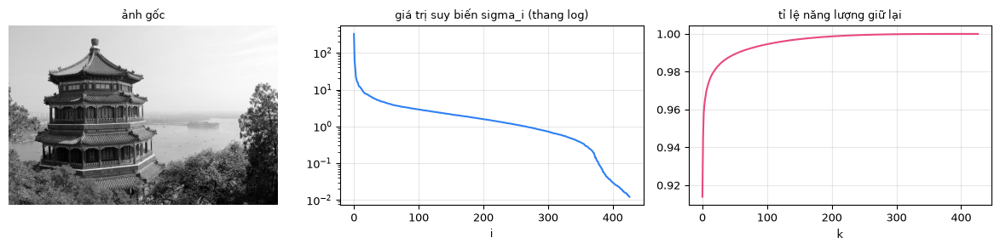
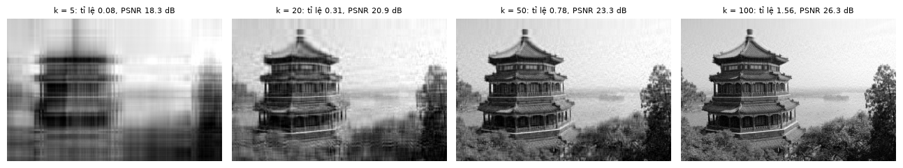
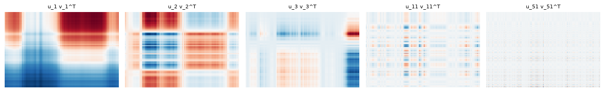

# Chương 20 · Ví dụ áp dụng: nén ảnh bằng SVD cắt ngọn

> Ghi chú của người biên soạn: trang này do người biên soạn viết thêm, không có trong sách gốc. Trang làm lại thí nghiệm nén ảnh ở [mục 20.3](ml/ch20_vi) trên một ảnh chụp thật, đo chất lượng và tỉ lệ nén theo công thức (20.22), rồi xem vì sao cách nén này kém hơn các định dạng ảnh thông thường.

## Bài toán

Một ảnh xám $m \times n$ là một ma trận $\mathbf{A}$. Lưu SVD cắt ngọn $\mathbf{A}_k = \mathbf{U}_k\mathbf{\Sigma}_k\mathbf{V}_k^T$ cần $k(m + n + 1)$ số thay vì $mn$. Theo mục 20.2.6, đây là cách xấp xỉ tốt nhất (theo chuẩn Frobenius) trong mọi ma trận hạng $k$.

## 1. Ảnh và các giá trị suy biến

<!-- run -->
```python
import numpy as np
import matplotlib.pyplot as plt
from sklearn.datasets import load_sample_image

rgb = load_sample_image("china.jpg").astype(float) / 255
A = rgb @ np.array([0.299, 0.587, 0.114])                  # chuyển sang ảnh xám
m, n = A.shape
U, s, Vt = np.linalg.svd(A, full_matrices=False)
energy = np.cumsum(s ** 2) / np.sum(s ** 2)
print(f"ảnh {m} x {n}; hạng {np.linalg.matrix_rank(A)}")
for k in [1, 10, 50, 100]:
    print(f"k = {k:3d}: giữ {energy[k - 1]:.4%} 'năng lượng' (tổng sigma_i^2)")

fig, axes = plt.subplots(1, 3, figsize=(12, 3))
axes[0].imshow(A, cmap="gray"); axes[0].axis("off"); axes[0].set_title("ảnh gốc", fontsize=9)
axes[1].semilogy(s, color="#2f80f5"); axes[1].set_xlabel("i"); axes[1].set_title("giá trị suy biến sigma_i (thang log)", fontsize=9); axes[1].grid(alpha=.3)
axes[2].plot(energy, color="#e8487f"); axes[2].set_xlabel("k"); axes[2].set_title("tỉ lệ năng lượng giữ lại", fontsize=9); axes[2].grid(alpha=.3)
fig.tight_layout()
```

<!-- output -->
```output
ảnh 427 x 640; hạng 427
k =   1: giữ 91.3858% 'năng lượng' (tổng sigma_i^2)
k =  10: giữ 97.3524% 'năng lượng' (tổng sigma_i^2)
k =  50: giữ 98.9159% 'năng lượng' (tổng sigma_i^2)
k = 100: giữ 99.4492% 'năng lượng' (tổng sigma_i^2)
```

<div align=center></div>
<!-- /output -->

Giống Hình 20.3 của sách: vài giá trị suy biến đầu lớn hơn hẳn phần còn lại. Riêng $\sigma_1$ đã giữ phần lớn "năng lượng", vì nó mô tả độ sáng trung bình của ảnh.

## 2. Ảnh dựng lại và tỉ lệ nén

<small class="viz-ref">Mục 20.3 · công thức (20.22)</small>

Tỉ lệ nén theo (20.22) giả sử ảnh gốc lưu mỗi điểm ảnh bằng 1 byte, còn các số trong SVD lưu bằng 4 byte. Đo chất lượng bằng PSNR (peak signal-to-noise ratio, càng cao càng tốt; trên 30 dB thường khó phân biệt bằng mắt).

<!-- run -->
```python
def psnr(a, b):
    return 10 * np.log10(1 / np.mean((a - b) ** 2))

ks = [5, 20, 50, 100]
fig, axes = plt.subplots(1, 4, figsize=(13, 2.7))
for ax, k in zip(axes, ks):
    Ak = (U[:, :k] * s[:k]) @ Vt[:k]
    ratio = 4 * k * (m + n + 1) / (m * n)
    ax.imshow(np.clip(Ak, 0, 1), cmap="gray"); ax.axis("off")
    ax.set_title(f"k = {k}: tỉ lệ {ratio:.2f}, PSNR {psnr(A, Ak):.1f} dB", fontsize=8)
    print(f"k = {k:3d}: tỉ lệ nén (20.22) = {ratio:.3f}, PSNR = {psnr(A, Ak):.1f} dB, "
          f"sai số Frobenius^2 = {np.sum((A - Ak) ** 2):.2f} = tổng sigma_i^2 bỏ đi {np.sum(s[k:] ** 2):.2f}")
fig.tight_layout()
k_even = m * n / (4 * (m + n + 1))
print(f"\nhoà vốn (tỉ lệ = 1) khi k = {k_even:.0f}")
```

<!-- output -->
```output
k =   5: tỉ lệ nén (20.22) = 0.078, PSNR = 18.3 dB, sai số Frobenius^2 = 4069.59 = tổng sigma_i^2 bỏ đi 4069.59
k =  20: tỉ lệ nén (20.22) = 0.313, PSNR = 20.9 dB, sai số Frobenius^2 = 2242.82 = tổng sigma_i^2 bỏ đi 2242.82
k =  50: tỉ lệ nén (20.22) = 0.782, PSNR = 23.3 dB, sai số Frobenius^2 = 1266.25 = tổng sigma_i^2 bỏ đi 1266.25
k = 100: tỉ lệ nén (20.22) = 1.563, PSNR = 26.3 dB, sai số Frobenius^2 = 643.40 = tổng sigma_i^2 bỏ đi 643.40

hoà vốn (tỉ lệ = 1) khi k = 64
```

<div align=center></div>
<!-- /output -->

Với $k = 20$ ta nhận ra được cảnh vật nhưng ảnh nhoè. Với $k = 100$ ảnh khá rõ, nhưng tỉ lệ nén đã vượt 1: lưu SVD còn tốn hơn lưu ảnh gốc. Công thức (20.22) cho thấy SVD chỉ tiết kiệm khi $k < \frac{mn}{4(m + n + 1)}$, ở đây khoảng 64.

## 3. So với định dạng JPEG

<!-- run -->
```python
from io import BytesIO
from PIL import Image

img8 = Image.fromarray((A * 255).round().astype(np.uint8))
print(f"{'':22s} {'kích thước':>12s} {'PSNR':>8s}")
for q in [10, 30, 70]:
    buf = BytesIO(); img8.save(buf, format="JPEG", quality=q)
    dec = np.asarray(Image.open(BytesIO(buf.getvalue())), float) / 255
    print(f"JPEG, quality = {q:3d}     {buf.tell() / 1024:9.1f} KB {psnr(A, dec):7.1f} dB")
for k in [20, 50]:
    Ak = (U[:, :k] * s[:k]) @ Vt[:k]
    size = 4 * k * (m + n + 1) / 1024
    print(f"SVD, k = {k:3d} (float32)  {size:9.1f} KB {psnr(A, Ak):7.1f} dB")
print(f"ảnh gốc (1 byte/điểm ảnh)  {m * n / 1024:9.1f} KB")
```

<!-- output -->
```output
                         kích thước     PSNR
JPEG, quality =  10          12.3 KB    23.5 dB
JPEG, quality =  30          26.0 KB    26.3 dB
JPEG, quality =  70          50.5 KB    31.0 dB
SVD, k =  20 (float32)       83.4 KB    20.9 dB
SVD, k =  50 (float32)      208.6 KB    23.3 dB
ảnh gốc (1 byte/điểm ảnh)      266.9 KB
```
<!-- /output -->

JPEG nén tốt hơn nhiều: JPEG với `quality = 10` (12 KB) cho chất lượng ngang SVD với $k = 50$ (209 KB), tức nhỏ hơn khoảng 17 lần. JPEG chia ảnh thành các khối $8 \times 8$ và biến đổi từng khối sang miền tần số, khai thác việc ảnh tự nhiên thay đổi chậm ở cấp độ cục bộ. SVD chỉ khai thác cấu trúc "hạng thấp" của toàn bộ ảnh, mà ảnh tự nhiên không thật sự có hạng thấp. Ý nghĩa thực tế của thí nghiệm này là minh hoạ: SVD cắt ngọn là công cụ xấp xỉ ma trận rất tốt, nhưng ứng dụng mạnh nhất của nó nằm ở dữ liệu thật sự có cấu trúc hạng thấp, như ma trận đánh giá trong hệ thống gợi ý ([chương 19](ml/ch19_vi)) hay dữ liệu cho PCA ([chương 21](ml/ch21_vi)).

## 4. Những thành phần đầu tiên trông như thế nào

Mỗi số hạng $\sigma_i\mathbf{u}_i\mathbf{v}_i^T$ là một ảnh hạng 1: tích ngoài của một cột và một hàng, nên nó chỉ gồm các sọc ngang và dọc.

<!-- run -->
```python
fig, axes = plt.subplots(1, 5, figsize=(13, 2.2))
for ax, i in zip(axes, [0, 1, 2, 10, 50]):
    ax.imshow(np.outer(U[:, i], Vt[i]), cmap="RdBu_r"); ax.axis("off"); ax.set_title(f"u_{i + 1} v_{i + 1}^T", fontsize=8)
fig.tight_layout()
```

<!-- output -->
<div align=center></div>
<!-- /output -->

## Rút ra được gì

- Giá trị suy biến giảm nhanh, nên vài chục thành phần đầu đã giữ hình dạng chính của ảnh.
- Tỉ lệ nén (20.22) chỉ nhỏ hơn 1 khi $k$ nhỏ; với ảnh này, điểm hoà vốn là khoảng $k = 64$.
- Làm định dạng ảnh, SVD thua JPEG. Giá trị thật của nó là một công cụ xấp xỉ hạng thấp tối ưu, dùng ở nhiều chương sau.
