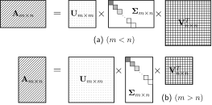
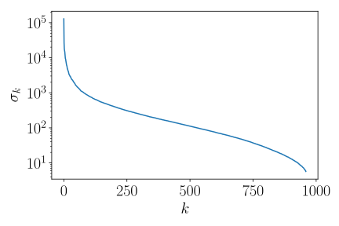
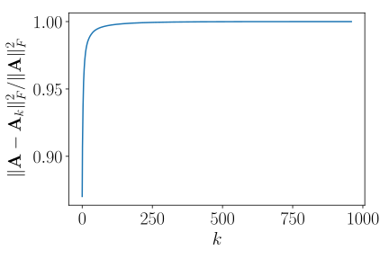
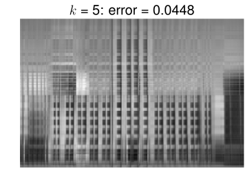
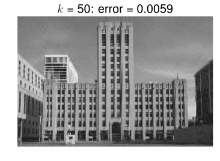

# Chương 20 Singular value decomposition (SVD)

> Ghi chú của người biên soạn: chương này lấy nguyên văn từ sách *Machine Learning cơ bản* của **Vũ Hữu Tiệp** ([mã nguồn LaTeX](https://github.com/tiepvupsu/ebookMLCB), giấy phép [CC BY-SA 4.0](https://creativecommons.org/licenses/by-sa/4.0/); trang gốc [machinelearningcoban.com](https://machinelearningcoban.com)). Người biên soạn chỉ đổi định dạng sang trang web: số chương, mục, công thức và hình giữ như bản PDF, hình vector được vẽ lại dưới dạng SVG.

## 20.1 Giới thiệu

Nhắc lại bài toán chéo hoá ma trận: Một ma trận vuông $\mathbf{A} \in \mathbb{R}^{n\times n}$ gọi là chéo hoá được nếu tồn tại ma trận đường chéo $\mathbf{D}$ và ma trận khả nghịch $\mathbf{P}$ sao cho:

$$
\mathbf{A} = \mathbf{P} \mathbf{D} \mathbf{P}^{-1} \tag{20.1}
$$

Nhân cả hai vế của (20.1) với $\mathbf{P}$ ta có

$$
\mathbf{AP} = \mathbf{PD} \tag{20.2}
$$

Gọi $\mathbf{p}_i, \mathbf{d}_i$ lần lượt là cột thứ $i$ của ma trận $\mathbf{P}$ và $\mathbf{D}$. Vì mỗi cột của vế trái và vế phải của (20.2) phải bằng nhau, ta cần có

$$
\mathbf{Ap}_i = \mathbf{Pd}_i = d_{ii}\mathbf{p}_i \tag{20.3}
$$

với $d_{ii}$ là phần tử thứ $i$ của $\mathbf{d}_i$. Dấu bằng thứ hai xảy ra vì $\mathbf{D}$ là ma trận đường chéo, tức $\mathbf{d}_i$ chỉ có thành phần $d_{ii}$ khác không. Biểu thức (20.3) chỉ ra rằng mỗi phần tử $d_{ii}$ phải là một trị riêng của $\mathbf{A}$ và mỗi vector cột $\mathbf{p}_i$ phải là một vector riêng của $\mathbf{A}$ ứng với trị riêng $d_{ii}$.

Cách phân tích một ma trận vuông thành nhân tử như (20.1) còn được gọi là *phân tích riêng* (eigen decomposition). Đáng chú ý, không phải lúc nào cũng tồn tại cách phân tích này cho một ma trận bất kỳ. Nó chỉ tồn tại nếu ma trận $\mathbf{A}$ có $n$ vector riêng độc lập tuyến tính, tức ma trận $\mathbf{P}$ khả nghịch. Thêm nữa, cách phân tích này không phải là duy nhất vì nếu $\mathbf{P}, \mathbf{D}$ thoả mãn (20.1) thì $k\mathbf{P}, \mathbf{D}$ cũng thoả mãn với $k$ là một số thực khác không bất kỳ.

Việc phân tích một ma trận thành tích của nhiều ma trận đặc biệt khác mang lại những ích lợi quan trọng trong bài toán gợi ý sản phẩm, giảm chiều dữ liệu, nén dữ liệu, tìm hiểu các đặc tính của dữ liệu, giải các hệ phương trình tuyến tính, phân cụm và nhiều ứng dụng khác.

Trong chương này, chúng ta sẽ làm quen với một trong những phương pháp phân tích ma trận rất đẹp của đại số tuyến tính có tên là *phân tích giá trị suy biên* (singular value decomposition – SVD) . Mọi ma trận, không nhất thiết vuông, đều có thể được phân tích thành tích của ba ma trận đặc biệt.

## 20.2 Phân tích giá trị suy biến

Để hạn chế nhầm lẫn trong các phép toán, ta sẽ ký hiệu một ma trận cùng với kích thước của nó, ví dụ $\mathbf{A}_{m \times n}$ ký hiệu một ma trận $\mathbf{A} \in \mathbb{R}^{m \times n}$.

### 20.2.1 Phát biểu phân tích giá trị suy biến

> **Phân tích giá trị suy biến (SVD)**
>
> Một ma trận $\mathbf{A}_{m \times n}$ bất kỳ đều có thể phân tích thành dạng:
>
> $$
> \mathbf{A}_{m \times n} = \mathbf{U}_{m \times m}\mathbf{\mathbf{\Sigma}}_{m \times n} (\mathbf{V}_{n \times n})^T \tag{20.4}
> $$
>
> với $\mathbf{U}, \mathbf{V}$ là các *ma trận trực giao*, $\mathbf{\mathbf{\Sigma}}$ là một ma trận đường chéo cùng kích thước với $\mathbf{A}$. Các phần tử trên đường chéo chính của $\mathbf{\Sigma}$ là không âm và được sắp xếp theo thứ tự giảm dần $\sigma_1 \geq \sigma_2 \geq \dots \geq\sigma_r \geq 0 = 0 = \dots = 0$. Số lượng các phần tử khác không trong $\mathbf{\Sigma}$ chính là hạng của ma trận $\mathbf{A}$: $r = \text{rank}(\mathbf{A})$.

SVD của một ma trận bất kỳ luôn tồn tại<sup>1</sup>. Cách biểu diễn (20.4) không là duy nhất vì ta chỉ cần đổi dấu của cả $\mathbf{U}$ và $\mathbf{V}$ thì (20.4) vẫn thoả mãn.

Hình 20.1 mô tả SVD của ma trận $\mathbf{A}_{m \times n}$ trong hai trường hợp: $m < n$ và $m > n$. Trường hợp $m =n$ có thể xếp vào một trong hai trường hợp trên.

<div align=center>

</div>
<div align=center>Hình 20.1: SVD cho ma trận $\mathbf{A}$ khi: (a) $m < n$, và (b) $m > n$. $\mathbf{\Sigma}$ là một ma trận đường chéo với các phần tử trên đó giảm dần và không âm. Màu xám càng đậm thể hiện giá trị càng cao. Các ô màu trắng trên ma trận $\mathbf{\Sigma}$ thể hiện giá trị bằng không.</div>

### 20.2.2 Nguồn gốc tên gọi

Tạm bỏ qua chiều của mỗi ma trận, từ (20.4) ta có:

$$
\begin{align*}
\mathbf{AA}^T &= \mathbf{U}\mathbf{\mathbf{\Sigma}} \mathbf{V}^T (\mathbf{U}\mathbf{\mathbf{\Sigma}} \mathbf{V}^T)^T \tag{20.5} \\
&= \mathbf{U}\mathbf{\mathbf{\Sigma}} \mathbf{V}^T \mathbf{V}\mathbf{\mathbf{\Sigma}}^T\mathbf{U}^T \tag{20.6} \\
&= \mathbf{U}\mathbf{\mathbf{\Sigma}}\mathbf{\mathbf{\Sigma}}^T\mathbf{U}^T =  \mathbf{U}\mathbf{\mathbf{\Sigma}}\mathbf{\mathbf{\Sigma}}^T\mathbf{U}^{-1} \tag{20.7}
\end{align*}
$$

Dấu bằng ở (20.6) xảy ra vì $\mathbf{V}^T\mathbf{V} = \mathbf{I}$ do $\mathbf{V}$ là một ma trận trực giao. Dấu bằng ở (20.7) xảy ra vì $\mathbf{U}$ là một ma trận trực giao.

Quan sát thấy rằng $\mathbf{\Sigma}\mathbf{\Sigma}^T$ là một ma trận đường chéo với các phần tử trên đường chéo là $\sigma_1^2, \sigma_2^2, \dots$ Vậy (20.7) chính là một phân tích riêng của $\mathbf{A}\mathbf{A}^T$và $\sigma_1^2, \sigma_2^2, \dots$ là các trị riêng của ma trận này. Ma trận $\mathbf{A}\mathbf{A}^T$ luôn là nửa xác định dương nên các trị riêng của nó là không âm. Căn bậc hai các trị riêng của $\mathbf{A}\mathbf{A}^T$, $\sigma_i$, còn được gọi là *giá trị suy biến* (singular value) của $\mathbf{A}$. Tên gọi *phân tích giá trị suy biến* xuất phát từ đây.

Cũng theo đó, mỗi cột của $\mathbf{U}$ là một vector riêng của $\mathbf{A}\mathbf{A}^T$. Ta gọi mỗi cột này là một *vector suy biến trái* (left-singular vector) của $\mathbf{A}$. Tương tự, $\mathbf{A}^T\mathbf{A} = \mathbf{V}\mathbf{\Sigma}^T\mathbf{\Sigma} \mathbf{V}^T$ và các cột của $\mathbf{V}$ được gọi là các *vector suy biến phải* (right-singular vectors) của $\mathbf{A}$.

Trong Python, để tính SVD của một ma trận, chúng ta sử dụng module `linalg` của `numpy`:

```python
from __future__ import print_function
import numpy as np
from numpy import linalg as LA

m, n = 3, 4
A = np.random.rand(m, n)
U, S, V = LA.svd(A) # A = U*S*V (no V transpose here)

# checking if U, V are orthogonal and S is a diagonal matrix with
# nonnegative decreasing elements
print('Frobenius norm of (UU^T - I) =', LA.norm(U.dot(U.T) - np.eye(m)))
print('S = ', S)
print('Frobenius norm of (VV^T - I) =', LA.norm(V.dot(V.T) - np.eye(n)))
```

Kết quả:

```text
Frobenius norm of (UU^T - I) = 4.09460889695e-16
S =  [ 1.76321041  0.59018069  0.3878011 ]
Frobenius norm of (VV^T - I) = 5.00370755311e-16
```

Lưu ý rằng biến `S` được trả về chỉ bao gồm các phần tử trên đường chéo của $\mathbf{\Sigma}$. Biến `V` trả về là $\mathbf{V}^T$ trong (20.4).

### 20.2.3 Giá trị suy biến của ma trận nửa xác định dương

Giả sử $\mathbf{A}$ là một ma trận vuông đối xứng nửa xác định dương, ta sẽ chứng minh rằng giá trị suy biến chính là trị riêng của nó. Thật vậy, gọi $\lambda$ là một trị riêng của $\mathbf{A}$ và $\mathbf{x}$ là một vector riêng ứng với trị riêng và $\|\mathbf{x}\|_2 = 1$. Vì $\mathbf{A}$ là nửa xác định dương, $\lambda \geq 0$. Ta có

$$
\mathbf{A}\mathbf{x} = \lambda\mathbf{x} \Rightarrow \mathbf{A}^T\mathbf{A}\mathbf{x} = \lambda\mathbf{A}\mathbf{x} = \lambda^2\mathbf{x} \tag{20.8}
$$

Như vậy, $\lambda^2$ là một trị riêng của $\mathbf{A}^T\mathbf{A} \Rightarrow$ giá trị suy biến của $\mathbf{A}$ chính là $\sqrt{\lambda^2} = \lambda$.

<div align=center>

</div>
<div align=center>Hình 20.2: Biểu diễn *compact SVD* dưới dạng tổng các ma trận có rank bằng 1. Các khối ma trận đặt cạnh nhau thể hiện phép nhân ma trận.</div>

### 20.2.4 Phân tích giá trị suy biến giản lược

Viết lại biểu thức (20.4) dưới dạng tổng của các ma trận có hạng bằng môt:

$$
\mathbf{A} = \sigma_1 \mathbf{u}_1 \mathbf{v}^T_1 + \sigma_2\mathbf{u}_2\mathbf{v}_2^T + \dots + \sigma_r\mathbf{u}_r\mathbf{v}_r^T \tag{20.9}
$$

với chú ý rằng mỗi $\mathbf{u}_i\mathbf{v}^T_i, 1 \leq i \leq r$, là một ma trận có hạng bằng một.

Trong cách biểu diễn này, ma trận $\mathbf{A}$ chỉ phụ thuộc vào $r$ cột đầu tiên của $\mathbf{U, V}$ và $r$ giá trị khác 0 trên đường chéo của ma trận $\mathbf{\Sigma}$. Vì vậy ta có một cách phân tích gọn hơn và gọi là *SVD giản lược* (compact SVD):

$$
\mathbf{A} = {\mathbf{U}}_r{\mathbf{\Sigma}}_r({\mathbf{V}}_r)^T \tag{20.10}
$$

với $\mathbf{U}_r, \mathbf{V}_r$ lần lượt là ma trận được tạo bởi $r$ cột đầu tiên của $\mathbf{U}$ và $\mathbf{V}$. $\mathbf{\Sigma}_r$ là ma trận con được tạo bởi $r$ hàng đầu tiên và $r$ cột đầu tiên của $\mathbf{\Sigma}$. Nếu ma trận $\mathbf{A}$ có hạng nhỏ hơn rất nhiều so với số hàng và số cột, tức $r \ll m, n$, ta sẽ được lợi nhiều về việc lưu trữ. Hình 20.2 là một ví dụ minh hoạ với $m = 4, n = 6, r = 2$.

### 20.2.5 Phân tích giá trị suy biến cắt ngọn

Nhắc lại rằng các giá trị trên đường chéo chính của $\mathbf{\Sigma}$ là không âm và giảm dần $\sigma_1 \geq \sigma_2 \geq \dots \geq \sigma_r \geq 0 = 0 = \dots = 0$. Thông thường, chỉ một lượng nhỏ các $\sigma_i$ mang giá trị lớn, các giá trị còn lại nhỏ và gần không. Khi đó ta có thể xấp xỉ ma trận $\mathbf{A}$ bằng tổng của $k < r$ ma trận có hạng bằng một:

$$
\mathbf{A} \approx \mathbf{A}_k = \mathbf{U}_k \mathbf{\Sigma}_k (\mathbf{V}_k)^T = \sigma_1 \mathbf{u}_1 \mathbf{v}^T_1 + \sigma_2\mathbf{u}_2\mathbf{v}_2^T + \dots + \sigma_k\mathbf{u}_k\mathbf{v}_k^T \tag{20.11}
$$

Việc bỏ đi $r-k$ giá trị suy biến khác không nhỏ nhất được gọi là *SVD cắt ngọn* (truncated SVD). Dưới đây là một định lý thú vị. Định lý này nói rằng sai số do cách xấp xỉ SVD cắt ngọn bằng căn bậc hai tổng bình phương của các giá trị suy biến bị cắt đi. Ở đây sai số được định nghĩa là Frobineous norm của hiệu hai ma trận.

> **Định lý 20.1: Sai số do xấp xỉ bởi SVD cắt ngọn**
>
> Sai số do xấp xỉ một ma trận $\mathbf{A}$ có hạng $r$ bởi SVD cắt ngọn với $k < r$ phần tử là
>
> $$
> \|\mathbf{A} - \mathbf{A}_k\|_F^2 = \sum_{i = k + 1}^r \sigma_i^2 \tag{20.12}
> $$

*Chứng minh:* Sử dụng tính chất $\|\mathbf{X}\|_F^2 = \text{trace}(\mathbf{X}\mathbf{X}^T)$ và $\text{trace}(\mathbf{XY}) = \text{trace}(\mathbf{YX})$ với mọi ma trận $\mathbf{X, Y}$ ta có:

$$
\begin{align*}
\|\mathbf{A} - \mathbf{A}_k\|_F^2 & =  \left\|\sum_{i = k + 1}^r \sigma_i
\mathbf{u}_i\mathbf{v}_i^T \right\|_F^2
=  \text{trace}\left\{ \left(\sum_{i = k + 1}^r \sigma_i \mathbf{u}_i\mathbf{v}_i^T\right)
\left(\sum_{j = k + 1}^r \sigma_j \mathbf{u}_j\mathbf{v}_j^T\right)^T
\right\} \\
&= \text{trace}\left\{ \sum_{i = k + 1}^r \sum_{j = k + 1}^r \sigma_i\sigma_j \mathbf{u}_i\mathbf{v}_i^T \mathbf{v}_j \mathbf{u}_j^T
\right\}
= \text{trace}\left\{ \sum_{i = k + 1}^r  \sigma_i^2\mathbf{u}_i\mathbf{u}_i^T
\right\} \tag{20.13} \\
&= \text{trace}\left\{ \sum_{i = k + 1}^r  \sigma_i^2\mathbf{u}_i^T\mathbf{u}_i
\right\} \tag{20.14} \\
&= \text{trace}\left\{ \sum_{i = k + 1}^r  \sigma_i^2
\right\}  = \sum_{i = k + 1}^r \sigma_i^2 \tag{20.15}
\end{align*}
$$

Dấu bằng thứ hai ở (20.13) xảy ra vì $\mathbf{V}$ có các cột vuông góc với nhau. Dấu bằng ở (20.14) xảy ra vì hàm $\text{trace}$ có tính chất giao hoán. Dấu bằng ở (20.15) xảy ra vì biểu thức trong dấu ngoặc là một số vô hướng.

Thay $k = 0$ ta sẽ có

$$
\|\mathbf{A}\|_F^2 = \sum_{i = 1}^r \sigma_i^2 \tag{20.16}
$$

Từ đó

$$
\frac{\|\mathbf{A} - \mathbf{A}_k\|_F^2}{\|\mathbf{A}\|_F^2} = {\frac{\sum_{i =
k + 1}^r \sigma_i^2}{\sum_{j = 1}^r \sigma_j^2}} \tag{20.17}
$$

Như vậy, *sai số do xấp xỉ càng nhỏ nếu các giá trị suy biến bị cắt càng nhỏ so với các giá trị suy biến được giữ lại.* Đây là một định lý quan trọng giúp xác định việc xấp xỉ ma trận dựa trên lượng thông tin muốn giữ lại. Ở đây, lượng thông tin được định nghĩa là tổng bình phương của giá trị suy biến. Ví dụ, nếu muốn giữ lại ít nhất 90% lượng thông tin trong $\mathbf{A}$, trước hết ta tính $\sum_{j = 1}^r \sigma_j^2$, sau đó chọn $k$ là số nhỏ nhất sao cho

$$
\frac{\sum_{i = 1}^k \sigma_i^2}{\sum_{j = 1}^r \sigma_j^2} \geq 0.9 \tag{20.18}
$$

Khi $k$ nhỏ, ma trận $\mathbf{A}_k$ có hạng nhỏ bằng $k$ Vì vậy, SVD cắt ngọn cũng được xếp vào loại *xấp xỉ hạng thấp*.

### 20.2.6 Xấp xỉ hạng $k$ tốt nhất

Người ta chứng minh được rằng<sup>2</sup> $\mathbf{A}_k$ chính là nghiệm của bài toán tối ưu sau đây:

$$
\begin{aligned}
\min_{\mathbf{B}} &\|\mathbf{A} - \mathbf{B}\|_F \\ 
\text{thoả mãn:}~ & \text{rank}(\mathbf{B}) = k
\end{aligned} \tag{20.19}
$$

và $\|\mathbf{A} - \mathbf{A}_k\|_F^2 = \sum_{i = k + 1}^r \sigma_i^2$ như đã chứng minh ở trên .

Nếu sử dụng $\ell_2$ norm của ma trận (xem Phụ lục [A](math/appendix_a_vi) (*Phương pháp nhân tử Lagrange*)) thay vì Frobenius norm để đo sai số, $\mathbf{A}_k$ cũng là nghiệm của bài toán tối ưu

$$
\begin{aligned}
\min_{\mathbf{B}} &\|\mathbf{A} - \mathbf{B}\|_2 \\ 
\text{thoả mãn:}~ & \text{rank}(\mathbf{B}) = k
\end{aligned} \tag{20.20}
$$

và sai số $\|\mathbf{A} - \mathbf{A}_k\|_2^2 = \sigma_{k+1}^2$. Trong đó, $\ell_2$ norm của một ma trận được định nghĩa bởi

$$
\|\mathbf{A}\|_2 = \max_{\|\mathbf{x}\|_2 = 1} \|\mathbf{Ax}\|_2 \tag{20.21}
$$

Frobenius norm và $\ell_2$ norm là hai norm được sử dụng nhiều nhất trong ma trận. Như vậy, xét trên cả hai norm này, SVD cắt ngọn đều cho xấp xỉ tốt nhất. Vì vậy, SVD cắt ngọn còn được coi là *xấp xỉ hạng thấp tốt nhất* (best low-rank approximation).

## 20.3 Phân tích giá trị suy biến cho bài toán nén ảnh

<div align=center class="ml-fig">
<span class="ml-subfig"><br><small>(a)</small></span><span class="ml-subfig"><br><small>(b)</small></span><span class="ml-subfig"><br><small>(c)</small></span><span class="ml-subfig"><br><small>(d)</small></span><span class="ml-subfig"><br><small>(e)</small></span><span class="ml-subfig"><br><small>(f)</small></span>
</div>
<div align=center>Hình 20.3: Ví dụ về SVD cho ảnh. (a) Bức ảnh gốc là một ma trận cỡ $960 \times 1440$. (b) Các giá trị suy biến của ma trận ảnh theo thang đo logarit. Các giá trị suy biến giảm nhanh ở khoảng $k = 200$. (c) Biểu diễn lượng thông tin được giữ lại khi chọn các $k$ khác nhau. Có thể thấy từ khoảng $k = 200$, lượng thông tin giữ lại gần bằng 1. Vậy ta có thể xấp xỉ ma trận ảnh này bằng một ma trận có hạng nhỏ hơn. (d), (e), (f) Các ảnh xấp xỉ với $k$ lần lượt là 5, 50, 100.</div>

Xét ví dụ trong Hình 20.3. Bức ảnh gốc trong Hình 20.3(a) là một ảnh xám có kích thước $960\times 1440$ điểm ảnh. Bức ảnh này có thể được coi là một ma trận $\mathbf{A} \in \mathbb{R}^{960\times 1440}$. Có thể thấy rằng ma trận này có hạng thấp vì toà nhà có các tầng tương tự nhau, tức ma trận có nhiều hàng tương tự nhau. Hình 20.3(b) thể hiện các giá trị suy biến sắp xếp theo thứ tự giảm dần của ma trận điểm ảnh. Ở đây, các giá trị suy biến được biểu diễn trong thang logarit thập phân. Giá trị suy biến đầu tiên lớn hơn giá trị suy biến thứ 250 khoảng gần 1000 lần. Hình 20.3(c) mô tả chất lượng của việc xấp xỉ $\mathbf{A}$ bởi $\mathbf{A}_k$ thông qua SVD cắt ngọn. Ta thấy giá trị này xấp xỉ bằng một tại $k = 200$. Hình 20.3(d), 20.3(e), 20.3(f) là các bức ảnh xấp xỉ khi chọn các giá trị $k$ khác nhau. Khi $k$ gần 100, lượng thông tin mất đi hơn 0.3%, ảnh thu được có chất lượng gần như ảnh gốc.

Để lưu ảnh với SVD cắt ngọn, ta lưu các ma trận $\mathbf{U}_k \in \mathbb{R}^{m \times k}, \mathbf{\Sigma}_k \in \mathbb{R}^{k \times k}, \mathbf{V}_k \in \mathbb{R}^{n \times k}$. Tổng số phần tử phải lưu là $k(m + n + 1)$ với chú ý rằng $\mathbf{\Sigma}_k$ là một ma trận đường chéo. Nếu mỗi phần tử được lưu bởi một số thực bốn byte thì số byte cần lưu là $4k(m + n + 1)$. Nếu so giá trị này với ảnh gốc có kích thước $mn$, mỗi giá trị là một số nguyên một byte, tỉ lệ nén là

$$
\frac{4k(m + n + 1)}{mn} \tag{20.22}
$$

Khi $k \ll m, n$, ta được một tỉ lệ nhỏ hơn 1. Trong ví dụ trên, $m = 960, n = 1440, k = 100$, tỉ lệ nén là xấp xỉ 0.69, tức đã tiết kiệm được khoảng 30% bộ nhớ.

## 20.4 Thảo luận

- Ngoài những ứng dụng nêu trên, SVD còn được áp dụng trong việc giải phương trình tuyến tính thông qua giả nghịch đảo Moore Penrose (<https://goo.gl/4wrXue>), hệ thống gợi ý , giảm chiều dữ liệu , *khử mờ ảnh* (image deblurring) , phân cụm ,...

- Khi ma trận $\mathbf{A}$ lớn, việc tính toán SVD tốn nhiều thời gian. Cách tính SVD cắt ngọn với $k$ như được trình bày trở nên không khả thi. Có một phương pháp lặp giúp tính các trị riêng và vector riêng của một ma trận lớn một cách hiệu quả. Trong phương pháp này, ta chỉ cần tìm $k$ trị riêng lớn nhất của $\mathbf{AA}^T$ và các vector riêng tương ứng. Việc này giúp khối lượng tính toán giảm đi đáng kể. Bạn đọc có thể tìm đọc thêm *Power method for approximating eigenvalues* (<https://goo.gl/PfDqsn>).

- Mã nguồn trong chương này có thể được tìm thấy tại <https://goo.gl/Z3wbsU>.

#### Đọc thêm

1.  *Singular Value Decomposition - Stanford University* (<https://goo.gl/Gp726X>).

2.  *Singular Value Decomposition - Princeton* (<https://goo.gl/HKpcsB>).

3.  *CS168: The Modern Algorithmic Toolbox Lecture \#9: The Singular Value Decomposition (SVD) and Low-Rank Matrix Approximations - Stanford* (<https://goo.gl/RV57KU>).

4.  *The Moore-Penrose Pseudoinverse (Math 33A - UCLA)* (<https://goo.gl/VxMYx1>).

---

**Chú thích**

1. Bạn đọc có thể tìm thấy chứng minh cho việc này tại <https://goo.gl/TdtWDQ>.
2. Singular Value Decomposition – Princeton (<https://goo.gl/hU38GF>).
