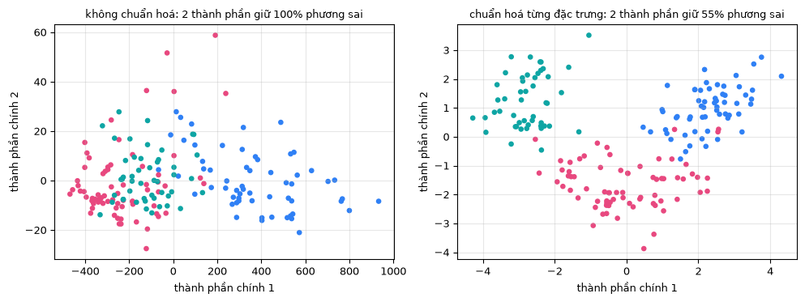
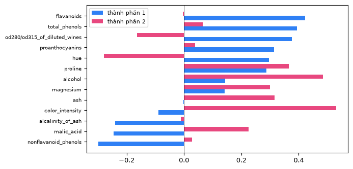
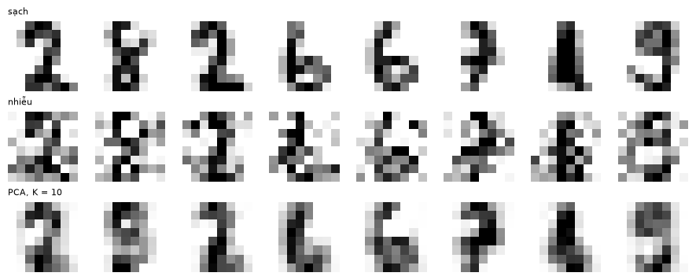

# Chương 21 · Ví dụ áp dụng: nhìn dữ liệu nhiều chiều và khử nhiễu

> Ghi chú của người biên soạn: trang này do người biên soạn viết thêm, không có trong sách gốc. Trang dùng PCA ([chương 21](ml/ch21_vi)) cho hai việc thường gặp với dữ liệu thật: chiếu dữ liệu 13 chiều xuống mặt phẳng để nhìn và diễn giải, và khử nhiễu ảnh bằng cách chỉ giữ các thành phần chính đầu tiên.

## 1. Nhìn dữ liệu 13 chiều

Bộ dữ liệu *Wine* (178 mẫu rượu vang, 13 kết quả phân tích hoá học, 3 giống nho; xem [ví dụ áp dụng chương 6](ml/ch06_app_vi)). Chiếu xuống 2 thành phần chính đầu tiên, có và không chuẩn hoá trước:

<!-- run -->
```python
import numpy as np
import matplotlib.pyplot as plt
from sklearn.datasets import load_wine
from sklearn.decomposition import PCA
from sklearn.preprocessing import StandardScaler

wine = load_wine()
X, y, names = wine.data, wine.target, np.array(wine.feature_names)
colors = np.array(["#2f80f5", "#e8487f", "#0ea5a4"])

fig, axes = plt.subplots(1, 2, figsize=(10, 3.8))
for ax, (title, Z_in) in zip(axes, [("không chuẩn hoá", X), ("chuẩn hoá từng đặc trưng", StandardScaler().fit_transform(X))]):
    pca = PCA(2).fit(Z_in)
    Z = pca.transform(Z_in)
    ax.scatter(*Z.T, c=colors[y], s=14)
    ax.set_title(f"{title}: 2 thành phần giữ {pca.explained_variance_ratio_.sum():.0%} phương sai", fontsize=9)
    ax.set_xlabel("thành phần chính 1"); ax.set_ylabel("thành phần chính 2"); ax.grid(alpha=.3)
    top = np.argsort(-np.abs(pca.components_[0]))[:3]
    print(f"{title}: thành phần chính 1 chủ yếu gồm {', '.join(f'{n} ({w:+.2f})' for n, w in zip(names[top], pca.components_[0][top]))}")
fig.tight_layout()
```

<!-- output -->
```output
không chuẩn hoá: thành phần chính 1 chủ yếu gồm proline (+1.00), magnesium (+0.02), alcalinity_of_ash (-0.00)
chuẩn hoá từng đặc trưng: thành phần chính 1 chủ yếu gồm flavanoids (+0.42), total_phenols (+0.39), od280/od315_of_diluted_wines (+0.38)
```

<div align=center></div>
<!-- /output -->

Không chuẩn hoá, "giữ 100% phương sai" chỉ là ảo giác: proline có phương sai lớn gấp hàng nghìn lần các đặc trưng khác, nên thành phần chính thứ nhất gần như chính là proline. PCA tìm phương có phương sai lớn nhất, và phương sai phụ thuộc vào đơn vị đo. Sau khi chuẩn hoá, mọi đặc trưng có cùng phương sai 1, và hai thành phần chính tách ba giống nho khá rõ, dù PCA không hề dùng nhãn.

## 2. Đọc ý nghĩa của các thành phần chính

Mỗi thành phần chính là một tổ hợp tuyến tính của các đặc trưng ban đầu. Các hệ số của nó (gọi là *loadings*) cho biết thành phần đó đo điều gì.

<!-- run -->
```python
Xs = StandardScaler().fit_transform(X)
pca = PCA().fit(Xs)
print("tỉ lệ phương sai của từng thành phần:", pca.explained_variance_ratio_.round(3))
fig, ax = plt.subplots(figsize=(7, 3.4))
order = np.argsort(pca.components_[0])
ax.barh(np.arange(13) - 0.2, pca.components_[0][order], height=0.4, color="#2f80f5", label="thành phần 1")
ax.barh(np.arange(13) + 0.2, pca.components_[1][order], height=0.4, color="#e8487f", label="thành phần 2")
ax.set_yticks(range(13)); ax.set_yticklabels(names[order], fontsize=7); ax.axvline(0, color="k", lw=.5); ax.legend(fontsize=8)
fig.tight_layout()
```

<!-- output -->
```output
tỉ lệ phương sai của từng thành phần: [0.362 0.192 0.111 0.071 0.066 0.049 0.042 0.027 0.022 0.019 0.017 0.013
 0.008]
```

<div align=center></div>
<!-- /output -->

Thành phần 1 có hệ số dương lớn với các hợp chất phenol (flavanoids, total phenols, OD280, proanthocyanins) và âm với nonflavanoid phenols, malic acid: nó gần như đo "mức độ phenol" của rượu. Thành phần 2 chủ yếu gồm cường độ màu, độ cồn, proline (dương) và hue (âm): rượu "đậm" hay "nhạt". (Dấu của cả một thành phần có thể đảo ngược tuỳ thư viện, như đã nói ở [trang Code](ml/ch21_code_vi).) Hai trục mới có ý nghĩa hoá học, dù chúng được tìm hoàn toàn tự động.

## 3. Khử nhiễu ảnh

<small class="viz-ref">Mục 21.1</small>

Nhiễu ngẫu nhiên phân tán đều trên mọi phương, còn tín hiệu (hình dạng chữ số) tập trung ở vài thành phần chính đầu. Chiếu ảnh nhiễu xuống $K$ thành phần đầu rồi dựng lại sẽ loại bớt phần nhiễu nằm ở các phương còn lại.

<!-- run -->
```python
from sklearn.datasets import load_digits
from sklearn.model_selection import train_test_split

D = load_digits().data / 16.0
Dtr, Dte = train_test_split(D, test_size=0.3, random_state=0)
rng = np.random.default_rng(0)
noisy = Dte + rng.normal(0, 0.35, Dte.shape)                    # nhiễu khá mạnh

errs = {}
for K in [2, 5, 10, 15, 20, 30, 40, 64]:
    p = PCA(K).fit(Dtr)                                          # PCA học trên ảnh SẠCH
    rec = p.inverse_transform(p.transform(noisy))
    errs[K] = np.mean((rec - Dte) ** 2)
    print(f"K = {K:2d}: sai số bình phương trung bình so với ảnh sạch {errs[K]:.4f}")
print(f"ảnh nhiễu (không xử lý): {np.mean((noisy - Dte) ** 2):.4f}")

Kbest = min(errs, key=errs.get)
p = PCA(Kbest).fit(Dtr); rec = p.inverse_transform(p.transform(noisy))
fig, axes = plt.subplots(3, 8, figsize=(9, 3.6))
for k in range(8):
    for r, (img, t) in enumerate([(Dte[k], "sạch"), (noisy[k], "nhiễu"), (rec[k], f"PCA, K = {Kbest}")]):
        axes[r, k].imshow(img.reshape(8, 8), cmap="gray_r", vmin=0, vmax=1); axes[r, k].axis("off")
        if k == 0: axes[r, k].set_title(t, fontsize=8, loc="left")
fig.tight_layout()
```

<!-- output -->
```output
K =  2: sai số bình phương trung bình so với ảnh sạch 0.0574
K =  5: sai số bình phương trung bình so với ảnh sạch 0.0446
K = 10: sai số bình phương trung bình so với ảnh sạch 0.0394
K = 15: sai số bình phương trung bình so với ảnh sạch 0.0415
K = 20: sai số bình phương trung bình so với ảnh sạch 0.0469
K = 30: sai số bình phương trung bình so với ảnh sạch 0.0611
K = 40: sai số bình phương trung bình so với ảnh sạch 0.0773
K = 64: sai số bình phương trung bình so với ảnh sạch 0.1222
ảnh nhiễu (không xử lý): 0.1222
```

<div align=center></div>
<!-- /output -->

Sai số có hình chữ U theo $K$:

- $K$ quá nhỏ: mất cả tín hiệu (mọi chữ số trông như nhau).
- $K$ quá lớn: giữ lại cả nhiễu. Với $K = 64$, phép chiếu không làm gì cả.

$K$ tốt nhất nằm ở giữa. Đây cũng là sự đánh đổi giữa chưa khớp và quá khớp ở [chương 8](ml/ch08_vi).

## Rút ra được gì

- Luôn chuẩn hoá dữ liệu trước PCA khi các đặc trưng có đơn vị khác nhau; nếu không, PCA chỉ tìm ra đặc trưng có số đo lớn nhất.
- Các thành phần chính là tổ hợp tuyến tính có thể diễn giải được của các đặc trưng ban đầu.
- Giữ ít thành phần chính là một cách khử nhiễu: tín hiệu nằm trong vài phương, nhiễu trải đều trên mọi phương.
