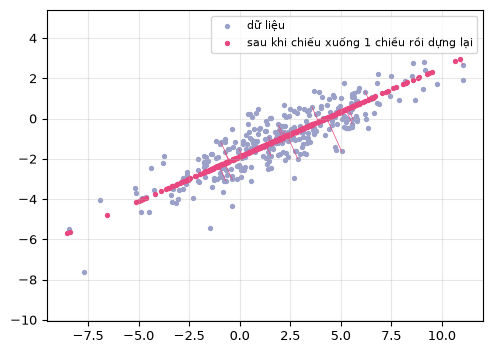
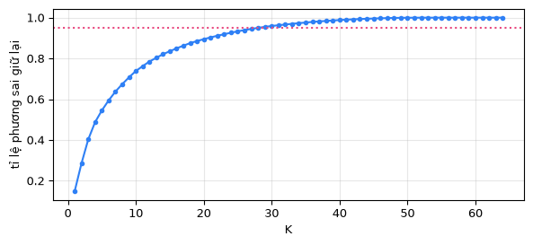
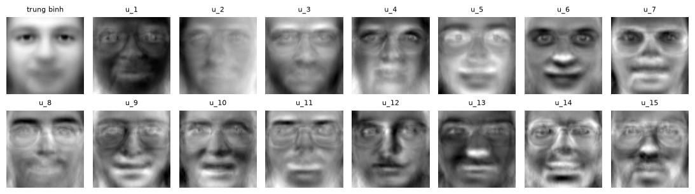
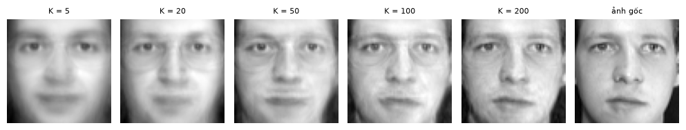

# Chương 21 · Code từ đầu

> Ghi chú của người biên soạn: trang này do người biên soạn viết thêm, không có trong sách gốc. Trang cài đặt PCA theo đúng các bước ở [mục 21.2](ml/ch21_vi) chỉ với NumPy, kiểm tra quan hệ với SVD (mục 21.3), cách chọn số chiều (mục 21.4), mẹo tính khi số chiều lớn hơn số điểm dữ liệu (mục 21.5.1), rồi làm lại thí nghiệm khuôn mặt riêng (mục 21.6.1). Bộ ảnh Yale của sách không có sẵn để tải tự động, nên ta dùng bộ khuôn mặt Olivetti, cùng loại dữ liệu.

## Cách dùng trang này

Các khối chạy lần lượt từ trên xuống và dùng chung biến. Cần `numpy`, `matplotlib`, và `scikit-learn` (để tải dữ liệu và đối chiếu). Mục 4 tải bộ ảnh Olivetti (khoảng 4 MB) ở lần chạy đầu.

Theo quy ước của sách, mỗi **cột** của ma trận dữ liệu $\mathbf{X} \in \mathbb{R}^{D \times N}$ là một điểm dữ liệu.

## 1. Các bước của PCA

<small class="viz-ref">Mục 21.2 · công thức (21.15), (21.16) · Hình 21.4</small>

<!-- run -->
```python
import numpy as np
import matplotlib.pyplot as plt

def pca_fit(X, K):
    """X: D x N (mỗi cột một điểm). Trả về (xbar, U_K, các trị riêng giảm dần)."""
    xbar = X.mean(axis=1, keepdims=True)                     # bước 1: vector trung bình
    Xhat = X - xbar                                          # bước 2: (21.15)
    S = Xhat @ Xhat.T / X.shape[1]                           # bước 3: (21.16)
    lam, V = np.linalg.eigh(S)                               # bước 4: trị riêng, vector riêng
    order = np.argsort(lam)[::-1]
    lam, V = lam[order], V[:, order]
    return xbar, V[:, :K], lam                               # bước 5: K vector đầu = thành phần chính

def pca_transform(X, xbar, UK):
    return UK.T @ (X - xbar)                                 # bước 6-7: Z = U_K^T Xhat

def pca_inverse(Z, xbar, UK):
    return UK @ Z + xbar                                     # x ~ U_K z + xbar

rng = np.random.default_rng(0)
X = np.array([[3.0, 1.0], [1.0, 1.2]]) @ rng.standard_normal((2, 300)) + np.array([[2.0], [-1.0]])
xbar, U1, lam = pca_fit(X, K=1)
Z = pca_transform(X, xbar, U1)
Xr = pca_inverse(Z, xbar, U1)
print("vector trung bình:", xbar.ravel().round(3))
print("trị riêng của S:", lam.round(3), "; thành phần chính thứ nhất:", U1.ravel().round(3))
print(f"phương sai của Z = {Z.var():.3f} = trị riêng lớn nhất {lam[0]:.3f}")
print(f"sai số dựng lại trung bình (1/N) sum ||x - x_tilde||^2 = {np.mean(np.sum((X - Xr) ** 2, 0)):.3f} = trị riêng còn lại {lam[1]:.3f}")

fig, ax = plt.subplots(figsize=(5, 3.6))
ax.scatter(*X, s=8, color="#9aa0c8", label="dữ liệu")
ax.scatter(*Xr, s=8, color="#e8487f", label="sau khi chiếu xuống 1 chiều rồi dựng lại")
for i in range(0, 300, 15): ax.plot([X[0, i], Xr[0, i]], [X[1, i], Xr[1, i]], color="#e8487f", lw=.5)
ax.axis("equal"); ax.legend(fontsize=8); ax.grid(alpha=.3)
fig.tight_layout()
```

<!-- output -->
```output
vector trung bình: [ 1.883 -1.047]
trị riêng của S: [12.5    0.532] ; thành phần chính thứ nhất: [-0.914 -0.406]
phương sai của Z = 12.500 = trị riêng lớn nhất 12.500
sai số dựng lại trung bình (1/N) sum ||x - x_tilde||^2 = 0.532 = trị riêng còn lại 0.532
```

<div align=center></div>
<!-- /output -->

Hai đẳng thức in ra là nội dung chính của mục 21.1: chiếu lên thành phần chính thứ nhất giữ lại phương sai lớn nhất có thể (bằng trị riêng lớn nhất), và phần thông tin bị mất (sai số dựng lại) bằng tổng các trị riêng còn lại. Các đoạn thẳng màu hồng vuông góc với thành phần chính: phép chiếu là phép chiếu vuông góc.

## 2. PCA qua SVD

<small class="viz-ref">Mục 21.3</small>

Nếu $\widehat{\mathbf{X}} = \mathbf{U}\mathbf{\Sigma}\mathbf{V}^T$ thì $\mathbf{S} = \frac{1}{N}\mathbf{U}\mathbf{\Sigma}\mathbf{\Sigma}^T\mathbf{U}^T$: các thành phần chính là các cột của $\mathbf{U}$, và trị riêng của $\mathbf{S}$ là $\sigma_i^2 / N$. Không cần dựng $\mathbf{S}$.

<!-- run -->
```python
Xhat = X - xbar
Usvd, s, Vt = np.linalg.svd(Xhat, full_matrices=False)
print("sigma_i^2 / N:", (s ** 2 / X.shape[1]).round(3), " = trị riêng của S:", lam.round(3))
print("cùng thành phần chính (có thể khác dấu):", np.allclose(np.abs(Usvd[:, 0]), np.abs(U1.ravel())))
```

<!-- output -->
```output
sigma_i^2 / N: [12.5    0.532]  = trị riêng của S: [12.5    0.532]
cùng thành phần chính (có thể khác dấu): True
```
<!-- /output -->

Một vector riêng chỉ xác định đến dấu: $\mathbf{u}$ và $-\mathbf{u}$ đều là thành phần chính. Các thư viện khác nhau có thể trả về dấu khác nhau.

## 3. Chọn số chiều: tỉ lệ phương sai giữ lại

<small class="viz-ref">Mục 21.4</small>

<!-- run -->
```python
from sklearn.datasets import load_digits

Xd = load_digits().data.T                                   # 64 x 1797
_, _, lam_d = pca_fit(Xd, K=64)
ratio = np.cumsum(lam_d) / lam_d.sum()
for t in [0.5, 0.8, 0.9, 0.95, 0.99]:
    print(f"giữ {t:.0%} phương sai cần K = {np.argmax(ratio >= t) + 1}")

fig, ax = plt.subplots(figsize=(6, 2.8))
ax.plot(range(1, 65), ratio, "o-", ms=3, color="#2f80f5"); ax.axhline(0.95, color="#e8487f", ls=":")
ax.set_xlabel("K"); ax.set_ylabel("tỉ lệ phương sai giữ lại"); ax.grid(alpha=.3)
fig.tight_layout()
```

<!-- output -->
```output
giữ 50% phương sai cần K = 5
giữ 80% phương sai cần K = 13
giữ 90% phương sai cần K = 21
giữ 95% phương sai cần K = 29
giữ 99% phương sai cần K = 41
```

<div align=center></div>
<!-- /output -->

## 4. Khi số chiều lớn hơn số điểm dữ liệu: khuôn mặt riêng

<small class="viz-ref">Mục 21.5.1, 21.6.1</small>

Mỗi ảnh khuôn mặt Olivetti có $64 \times 64 = 4096$ điểm ảnh, nhưng chỉ có 400 ảnh. Ma trận hiệp phương sai cỡ $4096 \times 4096$, nhưng hạng của nó không quá 400. Mục 21.5.1 của sách: tính trị riêng của ma trận nhỏ $\widehat{\mathbf{X}}^T\widehat{\mathbf{X}}$ ($400 \times 400$); nếu $\widehat{\mathbf{X}}^T\widehat{\mathbf{X}}\mathbf{v} = \lambda\mathbf{v}$ thì $\widehat{\mathbf{X}}\mathbf{v}$ là vector riêng của $\widehat{\mathbf{X}}\widehat{\mathbf{X}}^T$ với cùng trị riêng.

<!-- run -->
```python
from time import perf_counter
from sklearn.datasets import fetch_olivetti_faces

faces = fetch_olivetti_faces()
F = faces.data.T                                            # 4096 x 400
D, N = F.shape
fbar = F.mean(1, keepdims=True); Fh = F - fbar
K = 100

t = perf_counter()
lam_s, Vs = np.linalg.eigh(Fh.T @ Fh)                      # 400 x 400
order = np.argsort(lam_s)[::-1][:K]
U_small = Fh @ Vs[:, order]
U_small /= np.linalg.norm(U_small, axis=0)                  # chuẩn hoá về độ dài 1
t_small = perf_counter() - t

t = perf_counter()
lam_b, Vb = np.linalg.eigh(Fh @ Fh.T / N)                   # 4096 x 4096, cách trực tiếp
U_big = Vb[:, np.argsort(lam_b)[::-1][:K]]
t_big = perf_counter() - t
print(f"ma trận {N}x{N}: {t_small:.2f} s;  ma trận {D}x{D}: {t_big:.1f} s")
print("hai cách cho cùng không gian con:", np.allclose(np.abs(np.sum(U_small * U_big, 0)), 1, atol=1e-6))
print(f"trị riêng thứ 400 của ma trận lớn: {np.sort(lam_b)[::-1][N - 1]:.2e} (hạng không quá {N - 1} vì đã trừ trung bình)")
```

<!-- output -->
```output
ma trận 400x400: 1.72 s;  ma trận 4096x4096: 26.3 s
hai cách cho cùng không gian con: True
trị riêng thứ 400 của ma trận lớn: 1.31e-07 (hạng không quá 399 vì đã trừ trung bình)
```
<!-- /output -->

Hai cách cho cùng các thành phần chính, nhưng cách của mục 21.5.1 nhanh hơn hẳn. Hiển thị ảnh trung bình và các "khuôn mặt riêng" (các cột đầu của $\mathbf{U}_K$, sắp lại thành ảnh):

<!-- run -->
```python
fig, axes = plt.subplots(2, 8, figsize=(11, 3.2))
axes[0, 0].imshow(fbar.reshape(64, 64), cmap="gray"); axes[0, 0].set_title("trung bình", fontsize=8)
for i, ax in enumerate(axes.ravel()[1:]):
    ax.imshow(U_small[:, i].reshape(64, 64), cmap="gray"); ax.set_title(f"u_{i + 1}", fontsize=8)
for ax in axes.ravel(): ax.axis("off")
fig.tight_layout()

# Dựng lại một khuôn mặt từ K thành phần
fig, axes = plt.subplots(1, 6, figsize=(10, 2))
x = F[:, [7]]
for ax, k in zip(axes, [5, 20, 50, 100, 200, None]):
    if k is None:
        ax.imshow(x.reshape(64, 64), cmap="gray"); ax.set_title("ảnh gốc", fontsize=8)
    else:
        Uk = Fh @ Vs[:, np.argsort(lam_s)[::-1][:k]]; Uk /= np.linalg.norm(Uk, axis=0)
        ax.imshow(pca_inverse(pca_transform(x, fbar, Uk), fbar, Uk).reshape(64, 64), cmap="gray"); ax.set_title(f"K = {k}", fontsize=8)
    ax.axis("off")
fig.tight_layout()
```

<!-- output -->
<div align=center></div>

<div align=center></div>
<!-- /output -->

Các khuôn mặt riêng đầu tiên mô tả những biến đổi lớn nhất trong bộ ảnh: hướng ánh sáng, hình dáng khuôn mặt, kiểu tóc. Với $K = 50$ (so với 4096 chiều ban đầu) khuôn mặt đã nhận ra được.

## 5. Dò tìm điểm bất thường

<small class="viz-ref">Mục 21.6.2</small>

Ý tưởng của sách: dữ liệu bình thường nằm gần không gian con của các thành phần chính, còn điểm bất thường thì không. Đo bằng sai số dựng lại $\|\mathbf{x} - \tilde{\mathbf{x}}\|_2$. Thử với các ảnh không phải khuôn mặt: ảnh khuôn mặt bị lật ngược, và các mảnh ảnh phong cảnh.

<!-- run -->
```python
from sklearn.datasets import load_sample_image

idx = np.arange(N) % 10
tr, va, te = idx < 6, (idx == 6) | (idx == 7), idx >= 8         # mỗi người: 6 ảnh học PCA, 2 ảnh xác thực, 2 ảnh kiểm tra
xb, U50, _ = pca_fit(F[:, tr], K=50)
err = lambda Y: np.linalg.norm(Y - pca_inverse(pca_transform(Y, xb, U50), xb, U50), axis=0)

upside = F[:, te].reshape(64, 64, -1)[::-1].reshape(4096, -1)
land = load_sample_image("china.jpg").mean(2) / 255
patches = np.array([land[r:r + 64, c:c + 64].ravel() for r in range(0, 360, 50) for c in range(0, 570, 60)]).T
groups = [("khuôn mặt dùng để học", F[:, tr]), ("khuôn mặt mới", F[:, te]), ("khuôn mặt lộn ngược", upside), ("mảnh ảnh phong cảnh", patches)]
for name, Y in groups:
    e = err(Y)
    print(f"{name:22s}: sai số dựng lại trung vị {np.median(e):.2f}, nhỏ nhất {e.min():.2f}, lớn nhất {e.max():.2f}")

for how, ref in [("trên ảnh đã học", F[:, tr]), ("trên tập xác thực", F[:, va])]:
    thr = np.quantile(err(ref), 0.95)
    print(f"\nngưỡng = phân vị 95% của sai số {how}: {thr:.2f}")
    for name, Y in groups[1:]:
        print(f"  {name:22s}: tỉ lệ bị coi là bất thường {np.mean(err(Y) > thr):.2f}")
```

<!-- output -->
```output
khuôn mặt dùng để học : sai số dựng lại trung vị 2.83, nhỏ nhất 2.08, lớn nhất 3.79
khuôn mặt mới         : sai số dựng lại trung vị 3.77, nhỏ nhất 2.41, lớn nhất 6.14
khuôn mặt lộn ngược   : sai số dựng lại trung vị 6.93, nhỏ nhất 5.46, lớn nhất 9.02
mảnh ảnh phong cảnh   : sai số dựng lại trung vị 7.77, nhỏ nhất 3.37, lớn nhất 13.80

ngưỡng = phân vị 95% của sai số trên ảnh đã học: 3.58
  khuôn mặt mới         : tỉ lệ bị coi là bất thường 0.59
  khuôn mặt lộn ngược   : tỉ lệ bị coi là bất thường 1.00
  mảnh ảnh phong cảnh   : tỉ lệ bị coi là bất thường 0.99

ngưỡng = phân vị 95% của sai số trên tập xác thực: 4.97
  khuôn mặt mới         : tỉ lệ bị coi là bất thường 0.11
  khuôn mặt lộn ngược   : tỉ lệ bị coi là bất thường 1.00
  mảnh ảnh phong cảnh   : tỉ lệ bị coi là bất thường 0.68
```
<!-- /output -->

Hai điều rút ra:

- **Ngưỡng phải chọn trên dữ liệu chưa dùng để học PCA.** Các thành phần chính được tính để khớp với chính các ảnh huấn luyện, nên sai số dựng lại của chúng nhỏ hơn hẳn sai số của một khuôn mặt mới (một dạng quá khớp, [chương 8](ml/ch08_vi)). Chọn ngưỡng theo ảnh đã học, 59% khuôn mặt mới bị coi là bất thường. Chọn theo tập xác thực, tỉ lệ này giảm còn 11%: gần mức 5% mong muốn hơn nhiều; phần chênh còn lại là do tập xác thực chỉ có 80 ảnh nên phân vị 95% ước lượng chưa chính xác.
- **Khuôn mặt lộn ngược bị phát hiện gần như toàn bộ**, dù nó chứa đúng các điểm ảnh của một khuôn mặt: chúng chỉ nằm sai chỗ, nên không biểu diễn được bằng các khuôn mặt riêng. Khoảng hai phần ba số mảnh ảnh phong cảnh bị phát hiện; phần còn lại có sai số dựng lại nhỏ không kém một khuôn mặt. Sai số dựng lại chỉ là một tín hiệu, không phải bộ phân loại hoàn hảo.

## Tóm tắt

| Trong sách | Trên trang này |
| --- | --- |
| Các bước của PCA (21.2) | `pca_fit`, `pca_transform`, `pca_inverse` |
| Quan hệ với SVD (21.3) | thành phần chính = cột của $\mathbf{U}$, trị riêng = $\sigma_i^2/N$ |
| Chọn số chiều (21.4) | tỉ lệ phương sai tích luỹ |
| $D > N$ (21.5.1) | trị riêng của $\widehat{\mathbf{X}}^T\widehat{\mathbf{X}}$ |
| Khuôn mặt riêng, điểm bất thường (21.6) | Olivetti; sai số dựng lại |
