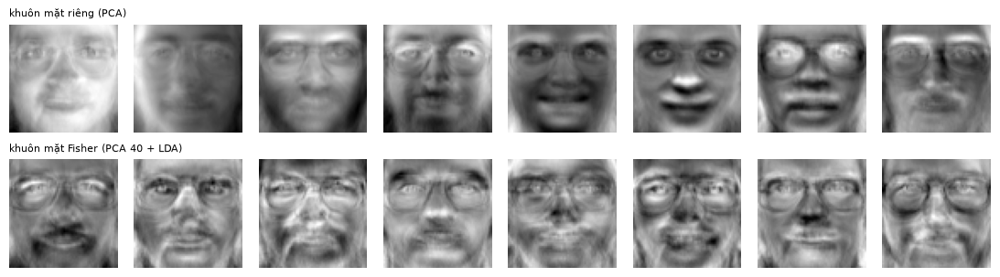

# Chương 22 · Ví dụ áp dụng: khuôn mặt riêng và khuôn mặt Fisher

> Ghi chú của người biên soạn: trang này do người biên soạn viết thêm, không có trong sách gốc. Trang so sánh hai cách giảm chiều cho nhận dạng khuôn mặt: PCA ("khuôn mặt riêng", [chương 21](ml/ch21_vi)) và PCA rồi LDA ("khuôn mặt Fisher", Belhumeur và cộng sự, 1997), áp dụng [chương 22](ml/ch22_vi) trên bộ ảnh khuôn mặt Olivetti.

## Bài toán

Bộ Olivetti có 40 người, mỗi người 10 ảnh $64 \times 64$. Với mỗi người, dùng $n$ ảnh để học, các ảnh còn lại để kiểm tra. Nhận dạng bằng 1-NN trong không gian đã giảm chiều.

Không áp dụng trực tiếp LDA trên 4096 chiều được: với chỉ vài trăm ảnh, $\mathbf{S}_W$ có hạng không quá $N - C$ nên suy biến ([trang Thư viện](ml/ch22_lib_vi), mục 4). Cách của khuôn mặt Fisher: dùng PCA giảm xuống $N - C$ chiều trước (để $\mathbf{S}_W$ khả nghịch), rồi LDA xuống $C - 1 = 39$ chiều.

## 1. Dữ liệu

<!-- run -->
```python
import numpy as np
import matplotlib.pyplot as plt
from sklearn.datasets import fetch_olivetti_faces
from sklearn.decomposition import PCA
from sklearn.discriminant_analysis import LinearDiscriminantAnalysis
from sklearn.neighbors import KNeighborsClassifier
from sklearn.pipeline import make_pipeline

faces = fetch_olivetti_faces()
X, y = faces.data, faces.target
C = 40
print("ảnh:", X.shape, "; số người:", C)

def split(n_train, seed):
    rng = np.random.default_rng(seed)
    tr, te = [], []
    for c in range(C):
        idx = rng.permutation(np.flatnonzero(y == c))
        tr += list(idx[:n_train]); te += list(idx[n_train:])
    return np.array(tr), np.array(te)
```

<!-- output -->
```output
ảnh: (400, 4096) ; số người: 40
```
<!-- /output -->

## 2. Cách làm "chuẩn" thất bại

<!-- run -->
```python
def eigenfaces(k):
    return make_pipeline(PCA(k, whiten=True, random_state=0), KNeighborsClassifier(1))

def fisherfaces(k):                                     # PCA xuống k chiều, rồi LDA xuống C - 1 chiều
    return make_pipeline(PCA(k, random_state=0), LinearDiscriminantAnalysis(n_components=min(C - 1, k)), KNeighborsClassifier(1))

def evaluate(make, n, seeds=range(5)):
    accs = []
    for seed in seeds:
        tr, te = split(n, seed)
        accs.append(make(len(tr)).fit(X[tr], y[tr]).score(X[te], y[te]))
    return np.mean(accs)

print(f"{'ảnh/người':>9s} {'ảnh gốc':>8s} {'khuôn mặt riêng':>16s} {'Fisher, PCA N-C chiều':>22s}")
for n in [3, 5, 7]:
    print(f"{n:9d} {evaluate(lambda N: KNeighborsClassifier(1), n):8.3f} {evaluate(lambda N: eigenfaces(39), n):16.3f} {evaluate(lambda N: fisherfaces(N - C), n):22.3f}")

tr, te = split(7, 0)
fish = fisherfaces(len(tr) - C).fit(X[tr], y[tr])
Ztr = fish[:2].transform(X[tr])
within = np.mean([np.linalg.norm(Ztr[y[tr] == c] - Ztr[y[tr] == c].mean(0), axis=1).mean() for c in range(C)])
between = np.mean(np.linalg.norm(np.array([Ztr[y[tr] == c].mean(0) for c in range(C)]) - Ztr.mean(0), axis=1))
print(f"\nkhông gian Fisher, trên ảnh huấn luyện: khoảng cách tới tâm lớp {within:.2f}, giữa tâm các lớp và tâm chung {between:.2f}")
```

<!-- output -->
```output
ảnh/người  ảnh gốc  khuôn mặt riêng  Fisher, PCA N-C chiều
        3    0.777            0.770                  0.475
        5    0.877            0.880                  0.507
        7    0.922            0.935                  0.572

không gian Fisher, trên ảnh huấn luyện: khoảng cách tới tâm lớp 5.40, giữa tâm các lớp và tâm chung 470.86
```
<!-- /output -->

Khuôn mặt Fisher theo công thức gốc (PCA xuống $N - C$ chiều) còn kém xa việc dùng thẳng ảnh gốc. Dòng cuối cho thấy nguyên nhân: trên ảnh huấn luyện, các ảnh của cùng một người gần như trùng nhau trong không gian Fisher, trong khi các người khác nhau cách nhau rất xa. Mô hình đã **quá khớp** ([chương 8](ml/ch08_vi)). Với $N - C$ chiều, ma trận $\mathbf{S}_W$ tuy khả nghịch nhưng có những phương mà phương sai trong lớp gần bằng 0 chỉ do tình cờ (mỗi người chỉ có vài ảnh). LDA coi các phương đó là "phân biệt rất tốt" và dồn hết trọng số vào chúng.

## 3. Sửa lại: ít thành phần PCA hơn, hoặc co rút

Hai cách giảm quá khớp: giữ ít thành phần PCA hơn (bỏ các phương có phương sai nhỏ, nơi ước lượng $\mathbf{S}_W$ kém tin cậy nhất), hoặc co rút $\mathbf{S}_W$ ([trang Thư viện](ml/ch22_lib_vi), mục 4).

<!-- run -->
```python
def fisher_shrink(N):
    return make_pipeline(PCA(N - 1, random_state=0), LinearDiscriminantAnalysis(solver="eigen", shrinkage="auto", n_components=C - 1), KNeighborsClassifier(1))

print(f"{'ảnh/người':>9s} " + " ".join(f"{'PCA ' + str(k):>8s}" for k in [20, 40, 60, 100]) + f" {'co rút':>8s} {'khuôn mặt riêng':>16s}")
for n in [3, 5, 7]:
    vals = [evaluate(lambda N, k=k: fisherfaces(k), n) if k <= n * C - C else np.nan for k in [20, 40, 60, 100]]
    print(f"{n:9d} " + " ".join(f"{v:8.3f}" for v in vals) + f" {evaluate(fisher_shrink, n):8.3f} {evaluate(lambda N: eigenfaces(39), n):16.3f}")
```

<!-- output -->
```output
ảnh/người   PCA 20   PCA 40   PCA 60  PCA 100   co rút  khuôn mặt riêng
        3    0.866    0.874    0.829      nan    0.895            0.770
        5    0.947    0.957    0.962    0.942    0.961            0.880
        7    0.965    0.967    0.972    0.970    0.968            0.935
```
<!-- /output -->

Sửa lại như vậy, khuôn mặt Fisher vượt khuôn mặt riêng ở mọi số ảnh huấn luyện, và vượt rõ nhất khi dữ liệu ít: với 3 ảnh mỗi người, co rút đạt 89.5% so với 77% của khuôn mặt riêng. (Ô `nan`: với 3 ảnh mỗi người chỉ có $N - C = 80$ chiều khả dụng, không đủ cho 100 thành phần.)

Lưu ý: bảng trên đánh giá nhiều cấu hình trên cùng các tập kiểm tra, nên để *chọn* số thành phần PCA thì phải dùng một tập xác thực riêng. Ở đây ta chỉ dùng bảng để hiểu xu hướng.

## 4. Nhìn các khuôn mặt Fisher

Hướng chiếu của LDA, đưa ngược về không gian ảnh (qua ma trận của PCA), cũng là những "khuôn mặt":

<!-- run -->
```python
tr, te = split(7, 0)
pca = PCA(40, random_state=0).fit(X[tr])
lda = LinearDiscriminantAnalysis(n_components=C - 1).fit(pca.transform(X[tr]), y[tr])
fisher = pca.components_.T @ lda.scalings_[:, :C - 1]          # 4096 x 39
pcs = PCA(8, random_state=0).fit(X[tr]).components_

fig, axes = plt.subplots(2, 8, figsize=(11, 3.2))
for i in range(8):
    axes[0, i].imshow(pcs[i].reshape(64, 64), cmap="gray"); axes[0, i].axis("off")
    axes[1, i].imshow(fisher[:, i].reshape(64, 64), cmap="gray"); axes[1, i].axis("off")
axes[0, 0].set_title("khuôn mặt riêng (PCA)", fontsize=8, loc="left"); axes[1, 0].set_title("khuôn mặt Fisher (PCA 40 + LDA)", fontsize=8, loc="left")
fig.tight_layout()
```

<!-- output -->
<div align=center></div>
<!-- /output -->

Khuôn mặt riêng mô tả những gì *thay đổi nhiều nhất* giữa các ảnh, bất kể của ai: hướng ánh sáng, tư thế. Khuôn mặt Fisher mô tả những gì *phân biệt người này với người khác*, và cố tình bỏ qua những thay đổi trong cùng một người.

## Rút ra được gì

- Khi mục tiêu là phân loại, LDA chọn hướng chiếu tốt hơn PCA vì nó dùng nhãn: nó tối đa khoảng cách giữa các lớp so với độ trải trong mỗi lớp.
- LDA cần $\mathbf{S}_W$ khả nghịch *và ước lượng được tin cậy*. Khả nghịch thôi chưa đủ: giữ quá nhiều thành phần PCA làm LDA quá khớp nặng. Giữ ít thành phần hơn hoặc dùng co rút.
- LDA giảm xuống tối đa $C - 1$ chiều. Với 40 người, đó là 39 chiều: rất gọn so với 4096 điểm ảnh.
