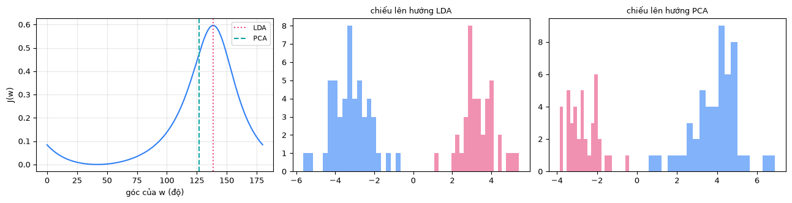
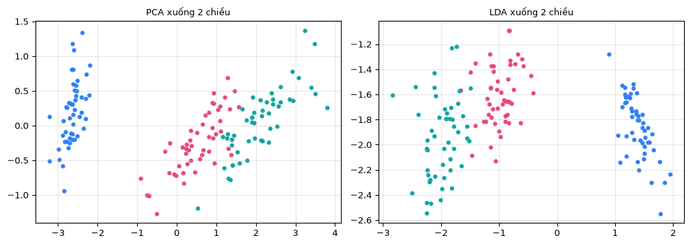

# Chương 22 · Code từ đầu

> Ghi chú của người biên soạn: trang này do người biên soạn viết thêm, không có trong sách gốc. Trang chạy lại ví dụ hai lớp của [mục 22.4](ml/ch22_vi), kiểm tra nghiệm dạng đóng của LDA hai lớp, rồi cài đặt LDA đa lớp (mục 22.3) chỉ với NumPy và so với PCA trên cùng dữ liệu.

## Cách dùng trang này

Các khối chạy lần lượt từ trên xuống và dùng chung biến. Cần `numpy`, `matplotlib`, và `scikit-learn` (để lấy dữ liệu Iris và đối chiếu).

## 1. Ví dụ của sách

<small class="viz-ref">Mục 22.4</small>

<!-- run -->
```python
import numpy as np
import matplotlib.pyplot as plt
np.random.seed(22)

means = [[0, 5], [5, 0]]
cov0 = [[4, 3], [3, 4]]
cov1 = [[3, 1], [1, 1]]
N0, N1 = 50, 40
N = N0 + N1
X0 = np.random.multivariate_normal(means[0], cov0, N0) # each row is a point
X1 = np.random.multivariate_normal(means[1], cov1, N1)

# Build S_B
m0 = np.mean(X0.T, axis = 1, keepdims = True)
m1 = np.mean(X1.T, axis = 1, keepdims = True)
a = (m0 - m1)
S_B = a.dot(a.T)

# Build S_W
A = X0.T - np.tile(m0, (1, N0))
B = X1.T - np.tile(m1, (1, N1))
S_W = A.dot(A.T) + B.dot(B.T)

lam, W = np.linalg.eig(np.linalg.inv(S_W).dot(S_B))
w = W[:,0]
print('w = ', w)
print('các trị riêng:', lam)
```

<!-- output -->
```output
w =  [ 0.75091074 -0.66040371]
các trị riêng: [ 5.96090633e-01 -5.55111512e-17]
```
<!-- /output -->

Kết quả trùng với sách: `w = [0.75091074 -0.66040371]`.

Một chi tiết cần lưu ý: `np.linalg.eig` **không sắp xếp** trị riêng. Ma trận $\mathbf{S}_W^{-1}\mathbf{S}_B$ có hạng 1 nên chỉ có một trị riêng khác 0; ở đây nó tình cờ đứng đầu, nên `W[:, 0]` đúng là vector cần tìm. Viết chắc chắn hơn là chọn cột ứng với trị riêng lớn nhất. Với hai lớp, cũng không cần tính trị riêng: vì $\mathbf{S}_B\mathbf{w} = (\mathbf{m}_0 - \mathbf{m}_1)(\mathbf{m}_0 - \mathbf{m}_1)^T\mathbf{w}$ luôn cùng phương với $\mathbf{m}_0 - \mathbf{m}_1$, nghiệm là $\mathbf{w} \propto \mathbf{S}_W^{-1}(\mathbf{m}_0 - \mathbf{m}_1)$.

<!-- run -->
```python
w_safe = np.real(W[:, np.argmax(np.real(lam))])
w_closed = np.linalg.solve(S_W, (m0 - m1).ravel()); w_closed /= np.linalg.norm(w_closed)
print("chọn theo trị riêng lớn nhất:", w_safe)
print("S_W^{-1}(m0 - m1), chuẩn hoá:", w_closed, "(cùng phương, có thể khác dấu)")
```

<!-- output -->
```output
chọn theo trị riêng lớn nhất: [ 0.75091074 -0.66040371]
S_W^{-1}(m0 - m1), chuẩn hoá: [-0.75091074  0.66040371] (cùng phương, có thể khác dấu)
```
<!-- /output -->

## 2. Hàm mục tiêu của Fisher

<small class="viz-ref">Mục 22.2.2 · công thức (22.5), (22.10)</small>

$J(\mathbf{w}) = \frac{\mathbf{w}^T\mathbf{S}_B\mathbf{w}}{\mathbf{w}^T\mathbf{S}_W\mathbf{w}}$ chỉ phụ thuộc vào phương của $\mathbf{w}$. Trong hai chiều, ta vẽ được $J$ theo góc của $\mathbf{w}$, và so với hướng mà PCA chọn (phương sai lớn nhất của toàn bộ dữ liệu, không dùng nhãn):

<!-- run -->
```python
J = lambda v: (v @ S_B @ v) / (v @ S_W @ v)
angles = np.linspace(0, np.pi, 721)
Js = np.array([J(np.array([np.cos(t), np.sin(t)])) for t in angles])
X = np.vstack([X0, X1]); y = np.r_[np.zeros(N0), np.ones(N1)]
Xc = X - X.mean(0)
pc1 = np.linalg.svd(Xc, full_matrices=False)[2][0]
ang = lambda v: np.degrees(np.arctan2(v[1], v[0])) % 180
print(f"J lớn nhất tại {np.degrees(angles[np.argmax(Js)]):.2f} độ; hướng LDA {ang(w):.2f} độ; hướng PCA {ang(pc1):.2f} độ")
print(f"J(w_LDA) = {J(w):.4f} = trị riêng khác 0 {np.real(lam).max():.4f};  J(w_PCA) = {J(pc1):.4f}")

fig, axes = plt.subplots(1, 3, figsize=(13, 3.4))
axes[0].plot(np.degrees(angles), Js, color="#2f80f5"); axes[0].axvline(ang(w), color="#e8487f", ls=":", label="LDA"); axes[0].axvline(ang(pc1), color="#0ea5a4", ls="--", label="PCA")
axes[0].set_xlabel("góc của w (độ)"); axes[0].set_ylabel("J(w)"); axes[0].legend(fontsize=8); axes[0].grid(alpha=.3)
for ax, v, name in [(axes[1], w, "chiếu lên hướng LDA"), (axes[2], pc1, "chiếu lên hướng PCA")]:
    z = X @ v
    ax.hist(z[y == 0], bins=20, alpha=.6, color="#2f80f5"); ax.hist(z[y == 1], bins=20, alpha=.6, color="#e8487f"); ax.set_title(name, fontsize=9)
fig.tight_layout()
```

<!-- output -->
```output
J lớn nhất tại 138.75 độ; hướng LDA 138.67 độ; hướng PCA 126.67 độ
J(w_LDA) = 0.5961 = trị riêng khác 0 0.5961;  J(w_PCA) = 0.4702
```

<div align=center></div>
<!-- /output -->

Hướng LDA tìm bằng trị riêng trùng với đỉnh của đường $J$ (sai lệch 0.08° chỉ do lưới góc), và giá trị $J$ tại đó đúng bằng trị riêng khác 0, như công thức (22.10). Ở dữ liệu này hai lớp nằm rất xa nhau, nên chiếu lên hướng PCA cũng tách được chúng; nhưng $J$ nhỏ hơn (0.47 so với 0.60): khoảng trống giữa hai lớp hẹp hơn so với độ trải của mỗi lớp. Khi các lớp gần nhau hơn, khác biệt này quyết định việc tách được hay không; hãy thử ở [trang Mô phỏng](ml/ch22_viz_vi).

## 3. LDA đa lớp

<small class="viz-ref">Mục 22.3 · công thức (22.19)–(22.23)</small>

Với $C$ lớp: $\mathbf{S}_W = \sum_k \sum_{n \in \mathcal{C}_k}(\mathbf{x}_n - \mathbf{m}_k)(\mathbf{x}_n - \mathbf{m}_k)^T$, $\mathbf{S}_B = \sum_k N_k(\mathbf{m}_k - \mathbf{m})(\mathbf{m}_k - \mathbf{m})^T$. Các cột của $\mathbf{W}$ là các vector riêng ứng với trị riêng lớn nhất của $\mathbf{S}_W^{-1}\mathbf{S}_B$. Vì $\mathbf{S}_B$ là tổng của $C$ ma trận hạng 1 có ràng buộc (các $\mathbf{m}_k - \mathbf{m}$ có tổng có trọng số bằng 0), hạng của nó không quá $C - 1$: LDA giảm được tối đa xuống $C - 1$ chiều.

<!-- run -->
```python
from sklearn.datasets import load_iris
from sklearn.discriminant_analysis import LinearDiscriminantAnalysis

Xi, yi = load_iris(return_X_y=True)

def lda_fit(X, y, K):
    m = X.mean(0)
    SW = np.zeros((X.shape[1], X.shape[1])); SB = np.zeros_like(SW)
    for c in np.unique(y):
        Xc = X[y == c]; mc = Xc.mean(0)
        SW += (Xc - mc).T @ (Xc - mc)                                  # (22.19)
        SB += len(Xc) * np.outer(mc - m, mc - m)                       # (22.22)
    lam, V = np.linalg.eig(np.linalg.solve(SW, SB))
    order = np.argsort(-lam.real)
    return V[:, order[:K]].real, lam.real[order]

W, lam_i = lda_fit(Xi, yi, K=2)
print("trị riêng của S_W^{-1} S_B:", lam_i.round(4), "(chỉ C - 1 = 2 trị riêng khác 0)")
Z = Xi @ W
Zs = LinearDiscriminantAnalysis(n_components=2).fit(Xi, yi).transform(Xi)
corr = [abs(np.corrcoef(Z[:, k], Zs[:, k])[0, 1]) for k in range(2)]
print("tương quan với LinearDiscriminantAnalysis.transform (từng chiều):", np.round(corr, 6))

from sklearn.decomposition import PCA
Zp = PCA(2).fit_transform(Xi)
fig, axes = plt.subplots(1, 2, figsize=(10, 3.6))
for ax, ZZ, t in [(axes[0], Zp, "PCA xuống 2 chiều"), (axes[1], Z, "LDA xuống 2 chiều")]:
    for c, col in zip(range(3), ["#2f80f5", "#e8487f", "#0ea5a4"]):
        ax.scatter(*ZZ[yi == c].T, s=12, color=col)
    ax.set_title(t, fontsize=9); ax.grid(alpha=.3)
fig.tight_layout()
```

<!-- output -->
```output
trị riêng của S_W^{-1} S_B: [32.1919  0.2854  0.      0.    ] (chỉ C - 1 = 2 trị riêng khác 0)
tương quan với LinearDiscriminantAnalysis.transform (từng chiều): [1. 1.]
```

<div align=center></div>
<!-- /output -->

`LinearDiscriminantAnalysis.transform` cho cùng các hướng chiếu (tương quan bằng 1); chỉ khác ở cách chuẩn hoá độ dài và dấu của từng vector. Trên hình, cả hai cách đều tách setosa (xanh lam) ra xa. Với versicolor và virginica (hồng, xanh lục), LDA cho hai nhóm ít chồng lên nhau hơn PCA, vì nó dùng nhãn để chọn hướng; nhưng vẫn còn vài điểm lẫn vào nhau, đúng như [ví dụ áp dụng chương 23](math/ch23_app_vi) đã chứng minh hai loài này không tách được tuyến tính.

## Tóm tắt

| Trong sách | Trên trang này |
| --- | --- |
| LDA hai lớp (22.2) | khớp sách: `w = [0.75091074, -0.66040371]`; nghiệm dạng đóng $\mathbf{S}_W^{-1}(\mathbf{m}_0 - \mathbf{m}_1)$ |
| Hàm mục tiêu Fisher (22.5) | vẽ $J$ theo góc; so với hướng PCA |
| LDA đa lớp (22.3) | `lda_fit`; tối đa $C - 1$ chiều |
