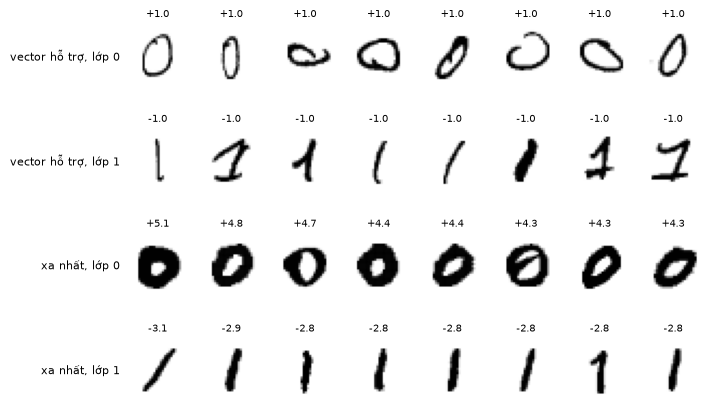
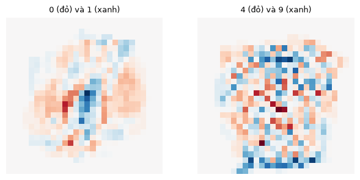
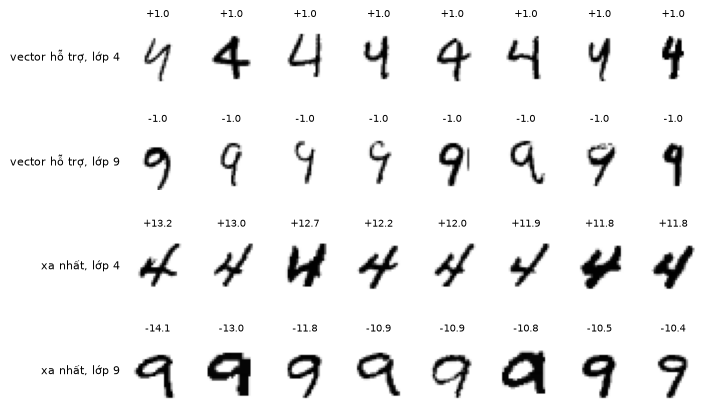

# Chương 26 · Ví dụ áp dụng: lề lớn nhất trên chữ số viết tay

> Ghi chú của người biên soạn: trang này do người biên soạn viết thêm, không có trong sách gốc. Trang áp dụng SVM lề cứng ([chương 26](ml/ch26_vi)) cho các cặp chữ số của MNIST: xem các vector hỗ trợ là những ảnh nào, và trả lời câu hỏi để ngỏ ở cuối [chương 13](ml/ch13_vi): trong vô số đường phân chia của perceptron, đường có lề lớn nhất có thật sự tốt hơn không?

## Bài toán

MNIST gồm ảnh $28 \times 28$ của chữ số viết tay, mỗi ảnh là một vector 784 chiều với giá trị trong $[0, 1]$. Với một cặp chữ số, ví dụ 0 và 1, ta có bài toán phân loại hai lớp. Trong 784 chiều, vài nghìn ảnh của hai lớp thường tách biệt tuyến tính, nên SVM lề cứng áp dụng được. Như sách, ta dùng `SVC(kernel="linear")` với $C$ rất lớn.

## 1. Chữ số 0 và 1

<!-- run -->
```python
import numpy as np
import matplotlib.pyplot as plt
from sklearn.datasets import fetch_openml
from sklearn.svm import SVC

X, y = fetch_openml("mnist_784", version=1, return_X_y=True, as_frame=False)
X = X / 255.0; y = y.astype(int)
Xtr, ytr, Xte, yte = X[:60000], y[:60000], X[60000:], y[60000:]

def pair(a, b, n, seed=0):
    """n ảnh huấn luyện ngẫu nhiên của hai chữ số a (nhãn +1) và b (nhãn -1), cùng toàn bộ ảnh kiểm tra."""
    pool = np.where((ytr == a) | (ytr == b))[0]
    idx = np.random.default_rng(seed).choice(pool, n, replace=False)
    t = np.isin(yte, [a, b])
    return (Xtr[idx], np.where(ytr[idx] == a, 1, -1), Xte[t], np.where(yte[t] == a, 1, -1))

def hard_svm(a, b, n=2000):
    Xa, ya, Xt, yt = pair(a, b, n)
    m = SVC(kernel="linear", C=1e6).fit(Xa, ya)
    print(f"{a} và {b}, {n} ảnh huấn luyện: đúng trên tập huấn luyện {np.mean(m.predict(Xa) == ya):.0%}, "
          f"số vector hỗ trợ {m.n_support_.sum()} ({m.n_support_[1]} ảnh {a}, {m.n_support_[0]} ảnh {b}), "
          f"lề 1/||w|| = {1 / np.linalg.norm(m.coef_):.3f}, đúng trên {len(yt)} ảnh kiểm tra {np.mean(m.predict(Xt) == yt):.2%}")
    return m, Xa, ya

m01, X01, y01 = hard_svm(0, 1)
```

<!-- output -->
```output
0 và 1, 2000 ảnh huấn luyện: đúng trên tập huấn luyện 100%, số vector hỗ trợ 43 (24 ảnh 0, 19 ảnh 1), lề 1/||w|| = 0.944, đúng trên 2115 ảnh kiểm tra 99.81%
```
<!-- /output -->

2000 ảnh của hai chữ số tách biệt tuyến tính: SVM không sai ảnh huấn luyện nào. Chỉ 43 ảnh (khoảng 2%) là vector hỗ trợ; 1957 ảnh còn lại có thể xoá đi mà nghiệm không đổi. Trên hơn 2000 ảnh kiểm tra, mô hình chỉ sai 4 ảnh.

## 2. Vector hỗ trợ là những ảnh nào?

<small class="viz-ref">Mục 26.3.5</small>

So sánh các vector hỗ trợ (sát mặt phân chia) với những ảnh nằm xa mặt phân chia nhất.

<!-- run -->
```python
def show_rows(m, Xa, ya, a, b, k=8):
    f = m.decision_function(Xa)
    sv = m.support_
    rows = [(f"vector hỗ trợ, lớp {a}", sv[ya[sv] == 1][:k]),
            (f"vector hỗ trợ, lớp {b}", sv[ya[sv] == -1][:k]),
            (f"xa nhất, lớp {a}", np.argsort(-f)[:k]),
            (f"xa nhất, lớp {b}", np.argsort(f)[:k])]
    fig, axes = plt.subplots(4, k, figsize=(k * 0.9, 4.4))
    for r, (title, ids) in enumerate(rows):
        for c in range(k):
            ax = axes[r, c]; ax.axis("off")
            if c < len(ids):
                ax.imshow(Xa[ids[c]].reshape(28, 28), cmap="gray_r")
                ax.set_title(f"{f[ids[c]]:+.1f}", fontsize=7)
        axes[r, 0].text(-4, 14, title, ha="right", va="center", fontsize=8)
    plt.tight_layout(); plt.show()

show_rows(m01, X01, y01, 0, 1)
```

<!-- output -->
<div align=center></div>
<!-- /output -->

Số trên mỗi ảnh là $\mathbf{w}^T\mathbf{x} + b$. Các vector hỗ trợ có giá trị đúng bằng $\pm 1$, và đúng là những ảnh "khó": số 0 bị bóp dẹt, nghiêng, hoặc chưa khép kín; số 1 có gạch chân, có nét móc ở đầu nên trông giống số 7. Những ảnh xa mặt phân chia nhất là các số 0 tròn, nét đậm và các số 1 thẳng, rất điển hình. Mặt phân chia của SVM được quyết định hoàn toàn bởi các ảnh ở biên, không phải bởi các ảnh điển hình.

## 3. Vector $\mathbf{w}$ dưới dạng ảnh

Mỗi thành phần của $\mathbf{w}$ ứng với một điểm ảnh. Điểm ảnh có trọng số dương (đỏ) mà đậm thì đẩy ảnh về lớp $+1$; trọng số âm (xanh) đẩy về lớp $-1$.

<!-- run -->
```python
m49, X49, y49 = hard_svm(4, 9)

fig, axes = plt.subplots(1, 2, figsize=(6.4, 3))
for ax, m, t in [(axes[0], m01, "0 (đỏ) và 1 (xanh)"), (axes[1], m49, "4 (đỏ) và 9 (xanh)")]:
    W = m.coef_.reshape(28, 28); v = np.abs(W).max()
    ax.imshow(W, cmap="RdBu_r", vmin=-v, vmax=v); ax.set_title(t, fontsize=9); ax.axis("off")
plt.tight_layout(); plt.show()
```

<!-- output -->
```output
4 và 9, 2000 ảnh huấn luyện: đúng trên tập huấn luyện 100%, số vector hỗ trợ 191 (96 ảnh 4, 95 ảnh 9), lề 1/||w|| = 0.101, đúng trên 1991 ảnh kiểm tra 95.18%
```

<div align=center></div>
<!-- /output -->

Cặp 4 và 9 khó hơn nhiều: vẫn tách biệt tuyến tính trên 2000 ảnh huấn luyện, nhưng lề nhỏ hơn khoảng 9 lần, số vector hỗ trợ tăng lên 191, và độ chính xác kiểm tra giảm còn 95%.

Ảnh trọng số của cặp 0 và 1 dễ đọc: vòng đỏ là nơi số 0 có nét, vệt xanh dọc ở giữa là nơi số 1 có nét còn số 0 thì rỗng. Ảnh của cặp 4 và 9 lốm đốm hơn; vệt xanh đậm ở phía trên là chỗ số 9 khép vòng còn số 4 thường để hở.

## 4. Chữ số 4 và 9

<!-- run -->
```python
show_rows(m49, X49, y49, 4, 9)
```

<!-- output -->
<div align=center></div>
<!-- /output -->

Các vector hỗ trợ của cặp 4 và 9 là những số 4 có đỉnh gần khép lại và những số 9 có vòng trên hở. Ảnh xa nhất của lớp 4 là những số 4 viết nét thẳng, đỉnh hở rất rõ.

## 5. Lề lớn nhất so với một nghiệm bất kỳ của perceptron

<small class="viz-ref">Mục 26.1.2 · Hình 26.1</small>

Với dữ liệu tách biệt tuyến tính, thuật toán học perceptron (PLA, [chương 13](ml/ch13_vi)) dừng ở một đường phân chia nào đó, tuỳ thứ tự duyệt điểm. SVM chọn đường có lề lớn nhất. Hai đường cùng không sai điểm huấn luyện nào; câu hỏi là đường nào sai ít hơn trên ảnh mới. Với mỗi cỡ tập huấn luyện, lặp lại 20 lần với 20 tập huấn luyện ngẫu nhiên.

<!-- run -->
```python
def pla(Xa, ya, rng):
    Xb = np.c_[Xa, np.ones(len(Xa))]; w = np.zeros(Xb.shape[1])
    while True:
        mistakes = 0
        for i in rng.permutation(len(ya)):
            if ya[i] * (Xb[i] @ w) <= 0:
                w += ya[i] * Xb[i]; mistakes += 1
        if mistakes == 0:
            return w

print("cặp  N    lỗi PLA   lỗi SVM   số lần SVM tốt hơn / hoà / kém hơn")
for a, b in [(0, 1), (4, 9)]:
    for n in [20, 50, 200]:
        ep, es = [], []
        for rep in range(20):
            Xa, ya, Xt, yt = pair(a, b, n, seed=rep)
            w = pla(Xa, ya, np.random.default_rng(rep))
            ep.append(np.mean((np.c_[Xt, np.ones(len(Xt))] @ w) * yt <= 0))
            es.append(np.mean(SVC(kernel="linear", C=1e6).fit(Xa, ya).predict(Xt) != yt))
        ep, es = np.array(ep), np.array(es)
        print(f"{a}/{b}  {n:<4d} {ep.mean():7.2%}   {es.mean():7.2%}   "
              f"{np.sum(es < ep):2d} / {np.sum(es == ep):2d} / {np.sum(es > ep):2d}")
```

<!-- output -->
```output
cặp  N    lỗi PLA   lỗi SVM   số lần SVM tốt hơn / hoà / kém hơn
0/1  20     2.58%     0.61%   12 /  0 /  8
0/1  50     0.72%     0.34%   15 /  0 /  5
0/1  200    0.33%     0.17%   12 /  3 /  5
4/9  20    23.11%    18.98%   18 /  0 /  2
4/9  50    13.17%    11.16%   12 /  2 /  6
4/9  200    7.45%     7.13%   11 /  0 /  9
```
<!-- /output -->

Với 20 ảnh huấn luyện, SVM giảm lỗi rõ rệt: ở cặp 4 và 9 từ 23% xuống 19%, và tốt hơn PLA trong 18 trên 20 lần thử. Khi số ảnh huấn luyện tăng lên 200, khoảng cách thu hẹp lại (7.45% so với 7.13%), và PLA thắng gần nửa số lần thử. Lý do: khi có ít dữ liệu, có rất nhiều đường phân chia không sai điểm huấn luyện nào, và PLA dừng ở một đường tuỳ ý trong đó; khi dữ liệu nhiều, tập các đường này hẹp lại, mọi nghiệm đều gần nhau. Lề lớn nhất là một cách chọn hợp lý, nhưng không phải lúc nào cũng tốt hơn.

## 6. Số vector hỗ trợ và một chặn trên cho sai số

Một kết quả cổ điển (Vapnik, 1995): với SVM lề cứng, sai số kiểm tra chéo bỏ-một (leave-one-out) không vượt quá $|\mathcal{S}| / N$. Lý do: bỏ một điểm không phải vector hỗ trợ thì nghiệm không đổi ([trang Code](ml/ch26_code_vi), mục 5), nên điểm đó vẫn được phân loại đúng; chỉ khi bỏ một vector hỗ trợ thì mới có thể sai.

<!-- run -->
```python
for (a, b), m in [((0, 1), m01), ((4, 9), m49)]:
    Xa, ya, Xt, yt = pair(a, b, 2000)
    print(f"{a}/{b}: |S|/N = {m.n_support_.sum()}/2000 = {m.n_support_.sum() / 2000:.2%}, "
          f"sai số trên tập kiểm tra = {np.mean(m.predict(Xt) != yt):.2%}")
```

<!-- output -->
```output
0/1: |S|/N = 43/2000 = 2.15%, sai số trên tập kiểm tra = 0.19%
4/9: |S|/N = 191/2000 = 9.55%, sai số trên tập kiểm tra = 4.82%
```
<!-- /output -->

Chặn trên đúng với cả hai cặp. Nó không chặt (sai số kiểm tra thấp hơn chặn từ hai lần với cặp 4 và 9 đến hơn mười lần với cặp 0 và 1), nhưng có một ý nghĩa thực tế: số vector hỗ trợ nhỏ so với $N$ là dấu hiệu tốt. Chặn này chỉ áp dụng cho SVM lề cứng trên dữ liệu tách biệt; với lề mềm ([chương 27](ml/ch27_vi)), các điểm vi phạm lề cũng là vector hỗ trợ và lập luận phải sửa lại.

## Tóm tắt

- Trong 784 chiều, vài nghìn ảnh của hai chữ số thường tách biệt tuyến tính, và SVM lề cứng tìm được đường phân chia với chỉ vài chục đến vài trăm vector hỗ trợ.
- Vector hỗ trợ là các ảnh khó, nằm sát biên; độ khó của bài toán thể hiện ở độ rộng lề và số vector hỗ trợ.
- Lề lớn nhất cho sai số kiểm tra thấp hơn một nghiệm bất kỳ của perceptron khi ít dữ liệu; khi nhiều dữ liệu, lợi thế này nhỏ dần.
- Sai số kiểm tra chéo bỏ-một của SVM lề cứng không vượt quá $|\mathcal{S}|/N$.
