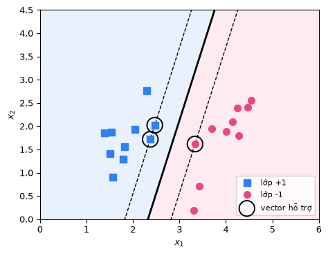

# Chương 26 · Code từ đầu

> Ghi chú của người biên soạn: trang này do người biên soạn viết thêm, không có trong sách gốc. Trang chạy lại ví dụ của [mục 26.4](ml/ch26_vi), giải bài toán đối ngẫu (26.11) và bài toán gốc (26.3) bằng `scipy.optimize` thay cho CVXOPT, rồi kiểm tra từng điều kiện KKT và tính chất "chỉ các vector hỗ trợ quyết định nghiệm".

## Cách dùng trang này

Các khối chạy lần lượt từ trên xuống và dùng chung biến. Cần `numpy`, `scipy`, `matplotlib`. Sách dùng CVXOPT; ở đây dùng `scipy.optimize.minimize` với phương pháp SLSQP, đủ cho bài toán vài chục biến.

## 1. Dữ liệu và bài toán đối ngẫu

<small class="viz-ref">Mục 26.3.4, 26.4.1 · công thức (26.11)</small>

Bài toán đối ngẫu: tối thiểu $\frac{1}{2}\boldsymbol{\lambda}^T\mathbf{V}^T\mathbf{V}\boldsymbol{\lambda} - \mathbf{1}^T\boldsymbol{\lambda}$ với $\boldsymbol{\lambda} \succeq 0$ và $\mathbf{y}^T\boldsymbol{\lambda} = 0$, trong đó cột thứ $n$ của $\mathbf{V}$ là $y_n\mathbf{x}_n$. Trong code, `V` lưu mỗi $y_n\mathbf{x}_n$ thành một hàng nên ma trận $\mathbf{Q}$ là `V @ V.T`.

<!-- run -->
```python
import numpy as np
import matplotlib.pyplot as plt
from scipy.optimize import minimize

np.random.seed(22)
means = [[2, 2], [4, 2]]
cov = [[.3, .2], [.2, .3]]
N = 10
X0 = np.random.multivariate_normal(means[0], cov, N)   # lớp +1 (vuông)
X1 = np.random.multivariate_normal(means[1], cov, N)   # lớp -1 (tròn)
X = np.concatenate((X0, X1), axis=0)
y = np.concatenate((np.ones(N), -np.ones(N)))

V = y[:, None] * X                 # hàng n là y_n x_n
Q = V @ V.T

def dual_obj(l):  return 0.5 * l @ Q @ l - l.sum()
def dual_grad(l): return Q @ l - 1

res = minimize(dual_obj, np.zeros(2 * N), jac=dual_grad, method="SLSQP",
               bounds=[(0, None)] * (2 * N),
               constraints=[{"type": "eq", "fun": lambda l: y @ l, "jac": lambda l: y}],
               options={"ftol": 1e-12, "maxiter": 500})
lam = res.x
S = np.where(lam > 1e-6)[0]        # tập hỗ trợ
w = V.T @ lam                      # (26.18)
b = np.mean(y[S] - X[S] @ w)       # (26.19)
print("hội tụ:", res.success, "| số vòng lặp:", res.nit)
print("lambda > 0 tại các điểm", S, "với giá trị", np.round(lam[S], 4))
print("w =", w, " b =", round(b, 6))
print("sách: w = [-2.00984382  0.64068336]  b = 4.66856068329")
```

<!-- output -->
```output
hội tụ: True | số vòng lặp: 16
lambda > 0 tại các điểm [ 0  2 12] với giá trị [0.854 1.371 2.225]
w = [-2.00984386  0.64068337]  b = 4.668561
sách: w = [-2.00984382  0.64068336]  b = 4.66856068329
```
<!-- /output -->

Nghiệm khớp với sách đến khoảng 7 chữ số. Chỉ ba nhân tử $\lambda_n$ dương: ba vector hỗ trợ. Code in trong sách dùng biến `Xbar` chưa được định nghĩa ở dòng `w = Xbar.T.dot(l)`; biến đúng là `V` (xem ghi chú đầu [bài đọc](ml/ch26_vi)).

## 2. Bài toán gốc cho cùng nghiệm

<small class="viz-ref">Mục 26.2 · công thức (26.3)</small>

Giải trực tiếp bài toán gốc: tối thiểu $\frac{1}{2}\|\mathbf{w}\|_2^2$ với $y_n(\mathbf{w}^T\mathbf{x}_n + b) \geq 1$. Biến là $(\mathbf{w}, b)$, chỉ 3 số, nhưng có 20 ràng buộc.

<!-- run -->
```python
def primal_obj(v):  return 0.5 * v[:2] @ v[:2]
def primal_grad(v): return np.r_[v[:2], 0.0]
cons = {"type": "ineq",
        "fun": lambda v: y * (X @ v[:2] + v[2]) - 1,
        "jac": lambda v: np.c_[V, y]}
res_p = minimize(primal_obj, np.zeros(3), jac=primal_grad, method="SLSQP",
                 constraints=[cons], options={"ftol": 1e-12})
w_p, b_p = res_p.x[:2], res_p.x[2]
print("bài toán gốc:     w =", w_p, " b =", round(b_p, 6))
print("chênh lệch với nghiệm đối ngẫu:", np.linalg.norm(w_p - w), abs(b_p - b))
print("độ rộng lề 2/||w|| =", round(2 / np.linalg.norm(w), 4))
print("giá trị tối ưu: gốc", round(primal_obj(res_p.x), 6), "| đối ngẫu", round(-dual_obj(lam), 6))
```

<!-- output -->
```output
bài toán gốc:     w = [-2.00984382  0.64068337]  b = 4.668561
chênh lệch với nghiệm đối ngẫu: 4.4044021379059656e-08 1.1156323243000088e-07
độ rộng lề 2/||w|| = 0.9481
giá trị tối ưu: gốc 2.224974 | đối ngẫu 2.224974
```
<!-- /output -->

Hai cách giải cho cùng $(\mathbf{w}, b)$, và giá trị tối ưu của hai bài toán bằng nhau: đối ngẫu mạnh xảy ra, đúng như tiêu chuẩn Slater ở mục 26.3.1 bảo đảm.

Một kiểm tra nữa: tổng các $\lambda_n$ ở khối 1 là $0.854 + 1.371 + 2.225 = 4.45 = \|\mathbf{w}\|_2^2$. Đây là hệ quả của (26.14), (26.15) và (26.16): $\|\mathbf{w}\|_2^2 = \sum_n \lambda_n y_n \mathbf{w}^T\mathbf{x}_n = \sum_n \lambda_n (1 - y_n b) = \sum_n \lambda_n$. Vì vậy độ rộng lề có thể đọc thẳng từ nghiệm đối ngẫu: $2/\sqrt{\sum_n \lambda_n}$. Ràng buộc (26.16) cũng giải thích vì sao $\lambda$ của điểm tròn duy nhất (2.225) bằng tổng $\lambda$ của hai điểm vuông.

## 3. Kiểm tra các điều kiện KKT

<small class="viz-ref">Mục 26.3.5 · công thức (26.12)–(26.16)</small>

<!-- run -->
```python
margin = y * (X @ w + b)                    # y_n (w^T x_n + b)
print("ràng buộc gốc y_n(w^T x_n + b) >= 1:  nhỏ nhất =", round(margin.min(), 6))
print("lambda >= 0:                         nhỏ nhất =", round(lam.min(), 8))
print("bù yếu lambda_n (1 - y_n(...)) = 0:  lớn nhất |.| =", f"{np.abs(lam * (1 - margin)).max():.1e}")
print("sum lambda_n y_n = 0:                ", f"{lam @ y:.1e}")
print("w = sum lambda_n y_n x_n:            sai khác", f"{np.linalg.norm(w - V.T @ lam):.1e}")
print()
print("y_n(w^T x_n + b) của 20 điểm, sắp tăng dần:")
print(np.round(np.sort(margin), 3))
```

<!-- output -->
```output
ràng buộc gốc y_n(w^T x_n + b) >= 1:  nhỏ nhất = 1.0
lambda >= 0:                         nhỏ nhất = 0.0
bù yếu lambda_n (1 - y_n(...)) = 0:  lớn nhất |.| = 6.1e-08
sum lambda_n y_n = 0:                 -2.1e-15
w = sum lambda_n y_n x_n:            sai khác 0.0e+00

y_n(w^T x_n + b) của 20 điểm, sắp tăng dần:
[1.    1.    1.    1.512 1.764 1.813 1.831 1.854 1.905 2.026 2.089 2.168
 2.308 2.332 2.529 2.777 2.778 2.787 2.821 3.073]
```
<!-- /output -->

Mọi điều kiện đều thoả mãn đến sai số tính toán. Đúng ba điểm có $y_n(\mathbf{w}^T\mathbf{x}_n + b) = 1$, tức nằm trên hai đường hỗ trợ; đó cũng là ba điểm có $\lambda_n > 0$. Điểm gần nhất tiếp theo đã cách khá xa (1.512).

## 4. Hình 26.4

<small class="viz-ref">Hình 26.4</small>

<!-- run -->
```python
fig, ax = plt.subplots(figsize=(5.2, 4.4))
xx = np.linspace(0, 6, 2)
for c, ls, lw in [(0, "-", 2), (1, "--", 1), (-1, "--", 1)]:
    ax.plot(xx, (c - b - w[0] * xx) / w[1], "k", ls=ls, lw=lw)
g0, g1 = np.meshgrid(np.linspace(0, 6, 300), np.linspace(0, 4.5, 300))
ax.contourf(g0, g1, np.sign(w[0] * g0 + w[1] * g1 + b), levels=[-2, 0, 2],
            colors=["#fde3ec", "#e1ecfd"], alpha=0.7)
ax.plot(X0[:, 0], X0[:, 1], "s", c="#2f80f5", ms=7, label="lớp +1")
ax.plot(X1[:, 0], X1[:, 1], "o", c="#e8487f", ms=7, label="lớp -1")
ax.scatter(X[S, 0], X[S, 1], s=260, facecolors="none", edgecolors="k", lw=1.4, label="vector hỗ trợ")
ax.set(xlim=(0, 6), ylim=(0, 4.5), aspect="equal", xlabel="$x_1$", ylabel="$x_2$")
ax.legend(loc="lower right", fontsize=8)
plt.show()
```

<!-- output -->
<div align=center></div>
<!-- /output -->

Ba điểm khoanh tròn là ba vector hỗ trợ: hai điểm vuông nằm trên đường nét đứt bên trái, một điểm tròn trên đường bên phải. Đường đậm nằm chính giữa hai đường nét đứt.

## 5. Chỉ các vector hỗ trợ quyết định nghiệm

<small class="viz-ref">Mục 26.3.5</small>

Xoá một điểm không phải vector hỗ trợ rồi giải lại: nghiệm không đổi. Xoá một vector hỗ trợ: nghiệm thay đổi. Hàm `svm_dual` gói lại khối 1.

<!-- run -->
```python
def svm_dual(X, y):
    V = y[:, None] * X; Q = V @ V.T; n = len(y)
    r = minimize(lambda l: 0.5 * l @ Q @ l - l.sum(), np.zeros(n), jac=lambda l: Q @ l - 1,
                 method="SLSQP", bounds=[(0, None)] * n,
                 constraints=[{"type": "eq", "fun": lambda l: y @ l, "jac": lambda l: y}],
                 options={"ftol": 1e-12, "maxiter": 500})
    l = r.x; S = np.where(l > 1e-6)[0]; w = V.T @ l
    return w, np.mean(y[S] - X[S] @ w), S

far = np.argmax(margin)                 # điểm xa mặt phân chia nhất
for name, k in [("điểm xa nhất (không hỗ trợ)", far), ("một vector hỗ trợ", S[0])]:
    keep = np.arange(2 * N) != k
    w2, b2, S2 = svm_dual(X[keep], y[keep])
    print(f"bỏ {name} #{k}: w = {np.round(w2, 4)}, b = {b2:.4f}, độ rộng lề = {2 / np.linalg.norm(w2):.4f}")
```

<!-- output -->
```output
bỏ điểm xa nhất (không hỗ trợ) #8: w = [-2.0098  0.6407], b = 4.6686, độ rộng lề = 0.9481
bỏ một vector hỗ trợ #0: w = [-1.8961  0.8846], b = 3.8946, độ rộng lề = 0.9559
```
<!-- /output -->

Bỏ điểm xa nhất, nghiệm giữ nguyên đến bốn chữ số. Bỏ một vector hỗ trợ, đường phân chia xoay hẳn đi và lề rộng hơn một chút (ít ràng buộc hơn thì lề lớn nhất có thể chỉ tăng). Đây là ưu điểm và cũng là nhược điểm của SVM lề cứng: nghiệm chỉ phụ thuộc vài điểm sát biên, nên một điểm nhiễu ở đó đủ làm lệch cả mô hình. [Chương 27](ml/ch27_vi) xử lý vấn đề này.

## Tóm tắt

| Trong sách | Trên trang này |
| --- | --- |
| Giải đối ngẫu (26.11) bằng CVXOPT | `scipy.optimize.minimize` (SLSQP); khớp sách: `w = [-2.0098, 0.6407]`, `b = 4.6686` |
| Bài toán gốc (26.3) | giải trực tiếp, cùng nghiệm và cùng giá trị tối ưu |
| Điều kiện KKT (26.12)–(26.16) | kiểm tra từng điều kiện; $\sum_n \lambda_n = \|\mathbf{w}\|_2^2$ |
| Hình 26.4 | vẽ lại, khoanh ba vector hỗ trợ |
| Chỉ vector hỗ trợ quyết định nghiệm | bỏ một điểm xa: nghiệm giữ nguyên; bỏ một vector hỗ trợ: nghiệm đổi |
