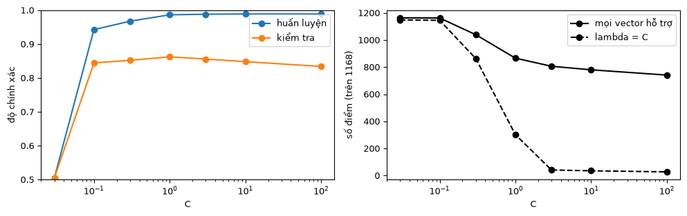
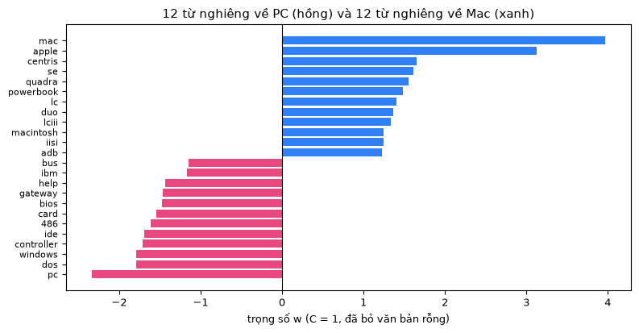

# Chương 27 · Ví dụ áp dụng: phân loại văn bản

> Ghi chú của người biên soạn: trang này do người biên soạn viết thêm, không có trong sách gốc. Trang áp dụng SVM lề mềm ([chương 27](ml/ch27_vi)) cho bài toán phân loại văn bản, một trong những ứng dụng thành công nhất của SVM tuyến tính (Joachims, 1998): phân biệt bài viết về phần cứng PC và phần cứng Mac trong bộ 20 Newsgroups.

## Bài toán

Mỗi văn bản được biểu diễn bằng vector TF-IDF ([chương 6](ml/ch06_vi)): một chiều cho mỗi từ, nên số chiều lên tới hàng nghìn và vector rất thưa. Dữ liệu như vậy thường gần tách biệt tuyến tính, đúng trường hợp của SVM lề mềm. Phần đầu thư (người gửi, tiêu đề), chữ ký và các đoạn trích dẫn được bỏ đi để mô hình phải đọc nội dung thật.

## 1. Dữ liệu

<!-- run -->
```python
import numpy as np
import matplotlib.pyplot as plt
from sklearn.datasets import fetch_20newsgroups
from sklearn.feature_extraction.text import TfidfVectorizer
from sklearn.svm import SVC

cats = ["comp.sys.ibm.pc.hardware", "comp.sys.mac.hardware"]
rm = ("headers", "footers", "quotes")
tr = fetch_20newsgroups(subset="train", categories=cats, remove=rm)
te = fetch_20newsgroups(subset="test", categories=cats, remove=rm)
vec = TfidfVectorizer(sublinear_tf=True, min_df=2, stop_words="english")
Xtr, Xte = vec.fit_transform(tr.data), vec.transform(te.data)
ytr, yte = np.where(tr.target == 1, 1, -1), np.where(te.target == 1, 1, -1)   # +1: Mac, -1: PC
print("huấn luyện:", Xtr.shape, "| kiểm tra:", Xte.shape)
print("tỉ lệ Mac trong tập huấn luyện:", round(np.mean(ytr == 1), 3))
print("số phần tử khác 0 trung bình mỗi văn bản:", round(Xtr.nnz / Xtr.shape[0], 1))
```

<!-- output -->
```output
huấn luyện: (1168, 4757) | kiểm tra: (777, 4757)
tỉ lệ Mac trong tập huấn luyện: 0.495
số phần tử khác 0 trung bình mỗi văn bản: 38.2
```
<!-- /output -->

1168 văn bản huấn luyện, hai lớp gần cân bằng. Từ điển có 4757 từ (giữ các từ xuất hiện trong ít nhất hai văn bản), nhưng mỗi văn bản trung bình chỉ dùng 38 từ: ma trận dữ liệu thưa hơn 99%.

## 2. Ảnh hưởng của $C$

<small class="viz-ref">Mục 27.3.4, 27.5.4</small>

Với mỗi $C$, đếm số vector hỗ trợ và số điểm có $\lambda_n = C$ (các điểm vi phạm lề, $\xi_n > 0$). Ở đây độ chính xác trên tập kiểm tra chỉ để quan sát; việc chọn $C$ được làm ở mục 5 bằng kiểm tra chéo.

<!-- run -->
```python
rows = []
for C in [0.03, 0.1, 0.3, 1, 3, 10, 100]:
    m = SVC(kernel="linear", C=C).fit(Xtr, ytr)
    lam = np.abs(m.dual_coef_.toarray().ravel())
    rows.append((C, m.score(Xtr, ytr), m.score(Xte, yte), len(m.support_), np.sum(lam > C * (1 - 1e-6))))
    print(f"C = {C:6g}: đúng huấn luyện {rows[-1][1]:.3f}, đúng kiểm tra {rows[-1][2]:.3f}, "
          f"vector hỗ trợ {rows[-1][3]:4d}, trong đó lambda = C: {rows[-1][4]:4d}")
r = np.array(rows)
fig, ax = plt.subplots(1, 2, figsize=(10, 3.2))
ax[0].semilogx(r[:, 0], r[:, 1], "o-", label="huấn luyện"); ax[0].semilogx(r[:, 0], r[:, 2], "o-", label="kiểm tra")
ax[0].set(xlabel="C", ylabel="độ chính xác", ylim=(0.5, 1.0)); ax[0].legend()
ax[1].semilogx(r[:, 0], r[:, 3], "o-", c="k", label="mọi vector hỗ trợ")
ax[1].semilogx(r[:, 0], r[:, 4], "o--", c="k", label="lambda = C")
ax[1].set(xlabel="C", ylabel="số điểm (trên 1168)"); ax[1].legend()
plt.tight_layout(); plt.show()
```

<!-- output -->
```output
C =   0.03: đúng huấn luyện 0.505, đúng kiểm tra 0.505, vector hỗ trợ 1163, trong đó lambda = C: 1148
C =    0.1: đúng huấn luyện 0.943, đúng kiểm tra 0.844, vector hỗ trợ 1162, trong đó lambda = C: 1145
C =    0.3: đúng huấn luyện 0.967, đúng kiểm tra 0.852, vector hỗ trợ 1039, trong đó lambda = C:  863
C =      1: đúng huấn luyện 0.986, đúng kiểm tra 0.862, vector hỗ trợ  866, trong đó lambda = C:  302
C =      3: đúng huấn luyện 0.988, đúng kiểm tra 0.856, vector hỗ trợ  806, trong đó lambda = C:   41
C =     10: đúng huấn luyện 0.989, đúng kiểm tra 0.848, vector hỗ trợ  780, trong đó lambda = C:   35
C =    100: đúng huấn luyện 0.989, đúng kiểm tra 0.834, vector hỗ trợ  741, trong đó lambda = C:   27
```

<div align=center></div>
<!-- /output -->

Cùng một bức tranh như ở [trang Thư viện](ml/ch27_lib_vi), nhưng rõ hơn. Với $C = 0.03$, gần như mọi điểm có $\lambda_n = C$: lề rộng tới mức mọi văn bản đều nằm trong lề, và mô hình chỉ đoán một lớp (đúng 50%). Khi $C$ tăng, số điểm vi phạm lề giảm nhanh, độ chính xác huấn luyện tiến gần 99%, còn độ chính xác kiểm tra đạt đỉnh quanh $C = 1$ rồi giảm dần: quá khớp.

Có hai điều khác với dữ liệu hai chiều của sách. Thứ nhất, ngay cả khi $C$ lớn, hơn 60% văn bản vẫn là vector hỗ trợ: trong không gian hàng nghìn chiều, rất nhiều điểm nằm đúng trên lề. Thứ hai, độ chính xác huấn luyện dừng ở 98.9% chứ không đạt 100%, dù số chiều lớn gấp bốn lần số điểm.

## 3. Những điểm vẫn vi phạm lề khi $C$ rất lớn

Với $C = 100$, vi phạm lề bị phạt rất nặng, nhưng vẫn còn vài chục điểm có $\lambda_n = C$. Chúng là những văn bản nào?

<!-- run -->
```python
m100 = SVC(kernel="linear", C=100).fit(Xtr, ytr)
lam = np.abs(m100.dual_coef_.toarray().ravel())
viol = m100.support_[lam > 100 * (1 - 1e-6)]
empty = np.asarray(Xtr.sum(axis=1)).ravel() == 0          # vector TF-IDF toàn số 0
f = m100.decision_function(Xtr)
print(f"{len(viol)} điểm có lambda = C, trong đó {empty[viol].sum()} là văn bản rỗng sau khi tách từ")
print(f"tập huấn luyện có {empty.sum()} văn bản rỗng: {np.sum(ytr[empty] == 1)} Mac, {np.sum(ytr[empty] == -1)} PC")
print("w^T x + b của mọi văn bản rỗng:", np.unique(f[empty].round(4)), "= b")
print("ví dụ vài văn bản gốc của chúng:", [tr.data[i][:40] for i in viol[:6]])
```

<!-- output -->
```output
27 điểm có lambda = C, trong đó 27 là văn bản rỗng sau khi tách từ
tập huấn luyện có 35 văn bản rỗng: 22 Mac, 13 PC
w^T x + b của mọi văn bản rỗng: [0.9998] = b
ví dụ vài văn bản gốc của chúng: ['', '\n\n\n', '\n', '', '\n\n\n\n', '']
```
<!-- /output -->

Toàn bộ 27 điểm vi phạm lề là **văn bản rỗng**: sau khi bỏ phần đầu thư, chữ ký và trích dẫn, những bài này không còn chữ nào (hoặc chỉ còn từ dừng như "each"). Vector TF-IDF của chúng bằng 0, nên $\mathbf{w}^T\mathbf{x} + b = b$ với mọi $\mathbf{w}$: không mô hình tuyến tính nào phân loại đúng cả hai lớp trong số chúng. SVM đặt $b \approx 1$ để 22 văn bản rỗng nhãn Mac nằm sát lề, và chấp nhận sai 13 văn bản rỗng nhãn PC. Đây là chỗ SVM lề mềm thể hiện đúng vai trò: các điểm "không thể giải thích" được gom vào một số ít $\xi_n > 0$ thay vì làm hỏng cả nghiệm, như SVM lề cứng sẽ gặp phải.

## 4. Từ nào quyết định?

Mỗi thành phần của $\mathbf{w}$ ứng với một từ. Từ có trọng số dương lớn đẩy văn bản về phía Mac, âm lớn về phía PC.

<!-- run -->
```python
keep = ~empty
Xc, yc = Xtr[keep], ytr[keep]
m = SVC(kernel="linear", C=1).fit(Xc, yc)
w = m.coef_.toarray().ravel()
vocab = vec.get_feature_names_out()
order = np.argsort(w)
fig, ax = plt.subplots(figsize=(8, 4.2))
idx = np.r_[order[:12], order[-12:]]
ax.barh(range(24), w[idx], color=["#e8487f"] * 12 + ["#2f80f5"] * 12)
ax.set_yticks(range(24), vocab[idx], fontsize=8); ax.axvline(0, c="k", lw=0.8)
ax.set(xlabel="trọng số w (C = 1, đã bỏ văn bản rỗng)", title="12 từ nghiêng về PC (hồng) và 12 từ nghiêng về Mac (xanh)")
plt.tight_layout(); plt.show()
print(f"bỏ {empty.sum()} văn bản rỗng: đúng huấn luyện {m.score(Xc, yc):.3f}, đúng kiểm tra {m.score(Xte, yte):.3f}")
```

<!-- output -->
```output
bỏ 35 văn bản rỗng: đúng huấn luyện 0.997, đúng kiểm tra 0.862
```

<div align=center></div>
<!-- /output -->

Các từ có trọng số lớn đều hợp lý: tên hãng (mac, apple, ibm), tên dòng máy Mac (centris, quadra, powerbook, lc, duo), và các thành phần đặc trưng của PC (dos, windows, bios, ide, 486). Bỏ 35 văn bản rỗng, độ chính xác huấn luyện tăng lên 99.7%; độ chính xác kiểm tra giữ nguyên, vì văn bản rỗng không chứa thông tin gì để học.

## 5. Chọn $C$ bằng kiểm tra chéo và so sánh với các mô hình khác

So với Naive Bayes ([chương 11](ml/ch11_vi)) và hồi quy logistic ([chương 14](ml/ch14_vi)), mỗi mô hình chọn tham số kiểm soát bằng kiểm tra chéo 5 phần trên tập huấn luyện.

<!-- run -->
```python
from sklearn.model_selection import GridSearchCV, StratifiedKFold
from sklearn.naive_bayes import MultinomialNB
from sklearn.linear_model import LogisticRegression
from sklearn.svm import LinearSVC

cv = StratifiedKFold(5, shuffle=True, random_state=0)
cands = {
    "Naive Bayes": (MultinomialNB(), {"alpha": np.logspace(-3, 0, 7)}),
    "hồi quy logistic": (LogisticRegression(max_iter=5000), {"C": np.logspace(-1, 3, 9)}),
    "SVM tuyến tính": (LinearSVC(), {"C": np.logspace(-2, 2, 9)}),
}
for name, (est, grid) in cands.items():
    g = GridSearchCV(est, grid, cv=cv).fit(Xc, yc)
    k, v = next(iter(g.best_params_.items()))
    print(f"{name:17s}: {k} = {v:8.4g}, kiểm tra chéo {g.best_score_:.3f}, tập kiểm tra {g.score(Xte, yte):.3f}")
```

<!-- output -->
```output
Naive Bayes      : alpha =  0.03162, kiểm tra chéo 0.894, tập kiểm tra 0.837
hồi quy logistic : C =        1, kiểm tra chéo 0.877, tập kiểm tra 0.857
SVM tuyến tính   : C =      0.1, kiểm tra chéo 0.880, tập kiểm tra 0.856
```
<!-- /output -->

Ba mô hình cho độ chính xác kiểm tra rất gần nhau, khoảng 84–86%. Naive Bayes có điểm kiểm tra chéo cao nhất nhưng điểm trên tập kiểm tra thấp nhất: tập kiểm tra của 20 Newsgroups gồm các bài đăng *sau* các bài huấn luyện, nên phân bố từ đã thay đổi một chút, và kiểm tra chéo trên tập huấn luyện không thấy được điều đó. Với văn bản, SVM tuyến tính và hồi quy logistic thường ngang nhau; ưu điểm thực tế của SVM là nghiệm thưa theo $\lambda$, còn của hồi quy logistic là cho xác suất.

## Tóm tắt

- Văn bản biểu diễn bằng TF-IDF có hàng nghìn chiều và rất thưa; SVM tuyến tính lề mềm hoạt động tốt trên loại dữ liệu này.
- $C$ nhỏ: mọi điểm nằm trong lề, mô hình chưa khớp; $C$ lớn: quá khớp. Chọn $C$ bằng kiểm tra chéo.
- Các điểm có $\lambda_n = C$ khi $C$ lớn đáng được xem kỹ: ở đây chúng đều là văn bản rỗng, một lỗi của khâu chuẩn bị dữ liệu.
- Trên bài toán này, SVM tuyến tính, hồi quy logistic và Naive Bayes cho kết quả gần nhau.
