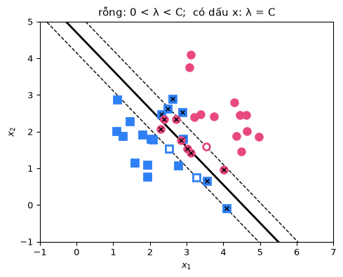
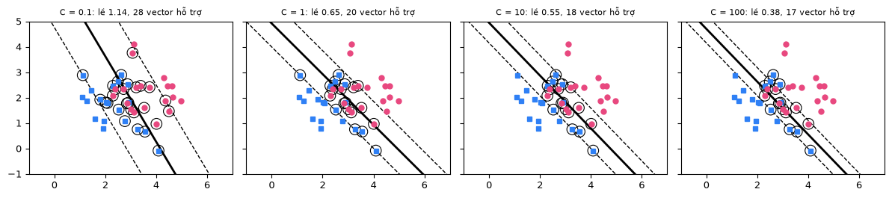

# Chương 27 · Code từ đầu

> Ghi chú của người biên soạn: trang này do người biên soạn viết thêm, không có trong sách gốc. Trang chạy lại ba cách giải SVM lề mềm của [mục 27.5](ml/ch27_vi): thư viện, bài toán đối ngẫu (27.10)–(27.11) (bằng `scipy.optimize` thay cho CVXOPT) và gradient descent trên mất mát bản lề (27.33). Sau đó phân loại các điểm theo giá trị $\lambda_n$ và vẽ lại Hình 27.5.

## Cách dùng trang này

Các khối chạy lần lượt từ trên xuống và dùng chung biến. Cần `numpy`, `scipy`, `matplotlib`, `scikit-learn`.

## 1. Dữ liệu và nghiệm của `sklearn`

<small class="viz-ref">Mục 27.5.1</small>

<!-- run -->
```python
import numpy as np
import matplotlib.pyplot as plt
from scipy.optimize import minimize
from sklearn.svm import SVC

np.random.seed(22)
means = [[2, 2], [4, 2]]
cov = [[.7, 0], [0, .7]]
N = 20
X0 = np.random.multivariate_normal(means[0], cov, N)
X1 = np.random.multivariate_normal(means[1], cov, N)
X = np.concatenate((X0, X1))
y = np.concatenate((np.ones(N), -np.ones(N)))

C = 100
clf = SVC(kernel="linear", C=C).fit(X, y)
w_sklearn, b_sklearn = clf.coef_.ravel(), clf.intercept_[0]
print("w_sklearn =", w_sklearn, " b_sklearn =", b_sklearn)
print("sách:      [-1.87461946 -1.80697358]               8.49691190196")
```

<!-- output -->
```output
w_sklearn = [-1.87461946 -1.80697358]  b_sklearn = 8.496911901960104
sách:      [-1.87461946 -1.80697358]               8.49691190196
```
<!-- /output -->

Khớp hoàn toàn với kết quả in trong sách.

## 2. Bài toán đối ngẫu

<small class="viz-ref">Mục 27.3.3, 27.3.4, 27.5.2 · công thức (27.10), (27.11), (27.19)</small>

So với lề cứng ([trang Code chương 26](ml/ch26_code_vi)), chỉ khác ở chặn trên $\lambda_n \leq C$.

<!-- run -->
```python
V = y[:, None] * X
Q = V @ V.T
res = minimize(lambda l: 0.5 * l @ Q @ l - l.sum(), np.zeros(2 * N), jac=lambda l: Q @ l - 1,
               method="SLSQP", bounds=[(0, C)] * (2 * N),
               constraints=[{"type": "eq", "fun": lambda l: y @ l, "jac": lambda l: y}],
               options={"ftol": 1e-12, "maxiter": 1000})
lam = res.x
S = np.where(lam > 1e-5)[0]                       # tập hỗ trợ
M = np.where((lam > 1e-5) & (lam < .999 * C))[0]  # 0 < lambda < C: nằm đúng trên đường hỗ trợ
w_dual = V[S].T @ lam[S]
b_dual = np.mean(y[M] - X[M] @ w_dual)            # (27.19), trung bình trên M
print("hội tụ:", res.success)
print("w_dual =", w_dual, " b_dual =", b_dual)
print("sách:   [-1.87457279 -1.80695039]               8.49672109814")
print(f"|S| = {len(S)}, |M| = {len(M)}, số điểm có lambda = C: {np.sum(lam >= .999 * C)}")
```

<!-- output -->
```output
hội tụ: True
w_dual = [-1.87458697 -1.80693758]  b_dual = 8.496748578819329
sách:   [-1.87457279 -1.80695039]               8.49672109814
|S| = 17, |M| = 3, số điểm có lambda = C: 14
```
<!-- /output -->

Nghiệm đối ngẫu khớp với sách và với `sklearn` đến khoảng bốn chữ số; khác biệt nhỏ đến từ sai số dừng của mỗi bộ giải. Trong 40 điểm, 17 điểm là vector hỗ trợ, nhưng chỉ 3 điểm có $0 < \lambda_n < C$ (tập $\mathcal{M}$) để tính $b$ theo (27.19). 14 điểm còn lại có $\lambda_n = C$.

## 3. Gradient descent trên mất mát bản lề

<small class="viz-ref">Mục 27.4.3, 27.4.4, 27.5.3 · công thức (27.33)</small>

Hàm `loss` và `grad` như sách (`lam = 1/C`), chỉ đổi `xrange` thành `range`. Kiểm tra gradient với bước sai phân `eps = 1e-6` thay vì `1e-10` của sách: bước quá nhỏ làm sai số làm tròn lấn át.

<!-- run -->
```python
lam_reg = 1. / C
def loss(X, y, w, b):
    z = X.dot(w) + b
    yz = y * z
    return (np.sum(np.maximum(0, 1 - yz)) + .5 * lam_reg * w.dot(w)) / X.shape[0]

def grad(X, y, w, b):
    z = X.dot(w) + b
    yz = y * z
    active_set = np.where(yz <= 1)[0]
    _yX = - X * y[:, np.newaxis]
    grad_w = (np.sum(_yX[active_set], axis=0) + lam_reg * w) / X.shape[0]
    grad_b = (-np.sum(y[active_set])) / X.shape[0]
    return (grad_w, grad_b)

def num_grad(X, y, w, b, eps=1e-6):
    gw = np.zeros_like(w)
    for i in range(len(w)):
        wp, wm = w.copy(), w.copy()
        wp[i] += eps; wm[i] -= eps
        gw[i] = (loss(X, y, wp, b) - loss(X, y, wm, b)) / (2 * eps)
    gb = (loss(X, y, w, b + eps) - loss(X, y, w, b - eps)) / (2 * eps)
    return (gw, gb)

w = .1 * np.random.randn(X.shape[1]); b = np.random.randn()
(gw0, gb0), (gw1, gb1) = grad(X, y, w, b), num_grad(X, y, w, b)
print("grad_w difference =", np.linalg.norm(gw0 - gw1))
print("grad_b difference =", abs(gb0 - gb1))
```

<!-- output -->
```output
grad_w difference = 1.8360430756771528e-10
grad_b difference = 4.069561354569373e-11
```
<!-- /output -->

Hai cách tính gradient khớp nhau đến khoảng $10^{-10}$. Với `eps = 1e-10` như sách, sai khác lên tới cỡ $10^{-6}$, không phải vì hàm `grad` sai mà vì phép trừ hai số gần bằng nhau mất gần hết chữ số có nghĩa.

<!-- run -->
```python
def softmarginSVM_gd(X, y, w0, b0, eta, iters=10000, print_every=2000):
    w, b = w0.copy(), b0
    for it in range(1, iters + 1):
        gw, gb = grad(X, y, w, b)
        w -= eta * gw
        b -= eta * gb
        if it % print_every == 0:
            print(f"iter {it:6d} loss: {loss(X, y, w, b):.6f}")
    return w, b

w0 = .1 * np.random.randn(X.shape[1]); b0 = .1 * np.random.randn()
w_hinge, b_hinge = softmarginSVM_gd(X, y, w0, b0, 0.05)
print("w_hinge =", w_hinge, " b_hinge =", b_hinge)       # sách in nhầm w_dual, b_dual ở dòng này
print("loss tại nghiệm đối ngẫu:", round(loss(X, y, w_dual, b_dual), 6))
```

<!-- output -->
```output
iter   2000 loss: 0.405424
iter   4000 loss: 0.395173
iter   6000 loss: 0.394098
iter   8000 loss: 0.393895
iter  10000 loss: 0.393834
w_hinge = [-1.37327856 -1.3207334 ]  b_hinge = 6.480385170734615
loss tại nghiệm đối ngẫu: 0.391531
```
<!-- /output -->

Đây là chỗ code của sách có lỗi: dòng cuối in `w_dual` và `b_dual` dưới tên `w_hinge`, nên kết quả "giống hệt nghiệm đối ngẫu" trong sách thực ra là nghiệm đối ngẫu in lại. Nghiệm thật của gradient descent sau 10000 vòng lặp là $\mathbf{w} \approx (-1.37, -1.32)$, $b \approx 6.48$: cùng hướng nhưng khác khá xa về độ lớn.

Dù vậy, giá trị hàm mất mát đã gần tối ưu (0.3938 so với 0.3915). Hàm mất mát rất bẹt theo hướng tăng đều $\mathbf{w}$ và $b$: nhân $(\mathbf{w}, b)$ với một số hơi lớn hơn 1 chỉ làm đường phân chia giữ nguyên và lề hẹp lại chút ít, nên mất mát thay đổi rất ít. Gradient theo hướng đó rất nhỏ, và gradient descent đi rất chậm.

<!-- run -->
```python
w_long, b_long = softmarginSVM_gd(X, y, w0, b0, 0.05, iters=400000, print_every=50000)
print("sau 400000 vòng lặp: w =", w_long, " b =", b_long)
```

<!-- output -->
```output
iter  50000 loss: 0.391925
iter 100000 loss: 0.391925
iter 150000 loss: 0.392003
iter 200000 loss: 0.391601
iter 250000 loss: 0.391604
iter 300000 loss: 0.391999
iter 350000 loss: 0.391602
iter 400000 loss: 0.391600
sau 400000 vòng lặp: w = [-1.85996294 -1.79217198]  b = 8.437885170640104
```
<!-- /output -->

Chạy thêm 40 lần lâu hơn, nghiệm tiến gần nghiệm đối ngẫu ($b \approx 8.44$ so với $8.50$) nhưng mất mát dao động quanh 0.3916–0.3920 mà không giảm hẳn. Mất mát bản lề không khả vi tại các điểm có $y_nz_n = 1$; với tốc độ học cố định, gradient descent nhảy qua lại quanh những điểm gãy này. Giảm dần tốc độ học, hoặc giải bài toán đối ngẫu như mục 2, sẽ cho nghiệm chính xác hơn. Đây là lý do các thư viện như libsvm, liblinear giải bài toán đối ngẫu bằng phương pháp toạ độ thay vì gradient descent.

## 4. Ba nhóm điểm theo $\lambda_n$

<small class="viz-ref">Mục 27.3.4 · Hình 27.2</small>

Theo hệ KKT: $\lambda_n = 0$ thì điểm nằm trong vùng an toàn ($\xi_n = 0$); $0 < \lambda_n < C$ thì điểm nằm đúng trên đường hỗ trợ; $\lambda_n = C$ thì điểm vi phạm lề ($\xi_n \geq 0$, thường dương).

<!-- run -->
```python
f = X @ w_dual + b_dual
xi = np.maximum(0, 1 - y * f)                     # biến lỏng lẻo tối ưu, (27.25)
groups = {"lambda = 0": lam < 1e-5, "0 < lambda < C": (lam > 1e-5) & (lam < .999 * C), "lambda = C": lam >= .999 * C}
for name, mask in groups.items():
    print(f"{name:15s}: {mask.sum():2d} điểm, y f(x) từ {np.min(y[mask] * f[mask]):6.3f} đến {np.max(y[mask] * f[mask]):6.3f}, "
          f"xi lớn nhất {xi[mask].max():.3f}")
print("số điểm bị phân loại sai (xi > 1):", np.sum(xi > 1))

fig, ax = plt.subplots(figsize=(5.4, 4.4))
xx = np.linspace(-1, 7, 2)
for c, ls, lw in [(0, "-", 2), (1, "--", 1), (-1, "--", 1)]:
    ax.plot(xx, (c - b_dual - w_dual[0] * xx) / w_dual[1], "k", ls=ls, lw=lw)
mk = {1: "s", -1: "o"}; col = {1: "#2f80f5", -1: "#e8487f"}
for c in (1, -1):
    for name, face in [("lambda = 0", None), ("0 < lambda < C", "ring"), ("lambda = C", "x")]:
        m = groups[name] & (y == c)
        ax.plot(X[m, 0], X[m, 1], mk[c], c=col[c], ms=7, mfc=col[c] if face != "ring" else "white", mew=2)
        if face == "x":
            ax.plot(X[m, 0], X[m, 1], "kx", ms=5)
ax.set(xlim=(-1, 7), ylim=(-1, 5), aspect="equal", xlabel="$x_1$", ylabel="$x_2$",
       title="rỗng: 0 < λ < C;  có dấu x: λ = C")
plt.show()
```

<!-- output -->
```output
lambda = 0     : 23 điểm, y f(x) từ  1.197 đến  4.768, xi lớn nhất 0.000
0 < lambda < C :  3 điểm, y f(x) từ  1.000 đến  1.000, xi lớn nhất 0.000
lambda = C     : 14 điểm, y f(x) từ -1.649 đến  0.978, xi lớn nhất 2.649
số điểm bị phân loại sai (xi > 1): 8
```

<div align=center></div>
<!-- /output -->

Đúng như hệ KKT: 23 điểm có $\lambda_n = 0$ đều nằm trong vùng an toàn ($y_nf(\mathbf{x}_n) > 1$); 3 điểm có $0 < \lambda_n < C$ nằm đúng trên đường hỗ trợ ($y_nf(\mathbf{x}_n) = 1$, các điểm rỗng trên hình); 14 điểm có $\lambda_n = C$ đều vi phạm lề, trong đó 8 điểm nằm hẳn sang phía lớp kia ($\xi_n > 1$). Mọi điểm vi phạm lề đều là vector hỗ trợ, khác với lề cứng.

## 5. Ảnh hưởng của $C$: Hình 27.5

<small class="viz-ref">Mục 27.5.4 · Hình 27.5</small>

<!-- run -->
```python
fig, axes = plt.subplots(1, 4, figsize=(12, 3.4), sharey=True)
for ax, Cv in zip(axes, [0.1, 1, 10, 100]):
    m = SVC(kernel="linear", C=Cv).fit(X, y)
    wv, bv = m.coef_.ravel(), m.intercept_[0]
    for c, ls, lw in [(0, "-", 2), (1, "--", 1), (-1, "--", 1)]:
        ax.plot(xx, (c - bv - wv[0] * xx) / wv[1], "k", ls=ls, lw=lw)
    ax.plot(X0[:, 0], X0[:, 1], "s", c="#2f80f5", ms=5); ax.plot(X1[:, 0], X1[:, 1], "o", c="#e8487f", ms=5)
    ax.scatter(*X[m.support_].T, s=110, facecolors="none", edgecolors="k", lw=0.8)
    ax.set(xlim=(-1, 7), ylim=(-1, 5), aspect="equal",
           title=f"C = {Cv}: lề {1 / np.linalg.norm(wv):.2f}, {len(m.support_)} vector hỗ trợ")
    ax.title.set_fontsize(8)
plt.tight_layout(); plt.show()
```

<!-- output -->
<div align=center></div>
<!-- /output -->

Đây là Hình 27.5 vẽ lại với nhãn đầy đủ. Trong sách, hình (d) bị lặp lại hình (a) ($C = 0.1$) thay vì $C = 100$ (xem ghi chú đầu [bài đọc](ml/ch27_vi)). Khi $C$ tăng, mô hình phạt vi phạm nặng hơn: lề hẹp lại từ 1.14 xuống 0.38, và số vector hỗ trợ giảm từ 28 xuống 17.

## Tóm tắt

| Trong sách | Trên trang này |
| --- | --- |
| Nghiệm `sklearn` (27.5.1) | khớp sách |
| Nghiệm đối ngẫu (27.5.2) bằng CVXOPT | `scipy.optimize` (SLSQP); khớp sách đến bốn chữ số |
| Gradient descent trên mất mát bản lề (27.5.3) | sách in nhầm nghiệm đối ngẫu; nghiệm thật sau 10000 vòng lặp còn xa, vì mất mát rất bẹt và không khả vi |
| Hệ KKT (27.12)–(27.17) | chia 40 điểm thành ba nhóm theo $\lambda_n$ |
| Hình 27.5 | vẽ lại với $C = 0.1, 1, 10, 100$ (hình (d) của sách bị lặp) |
