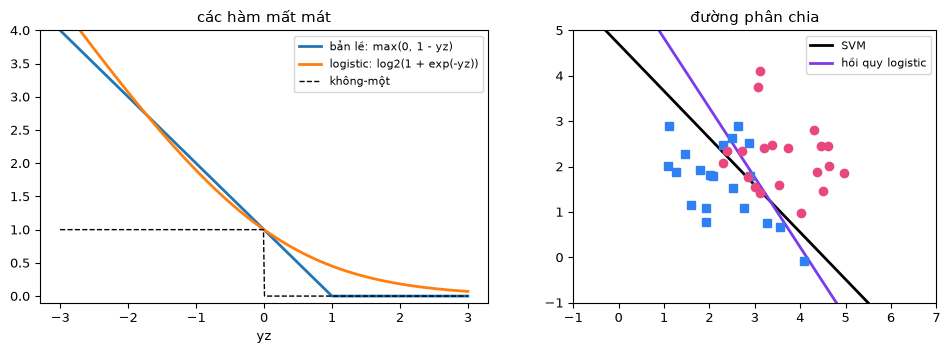
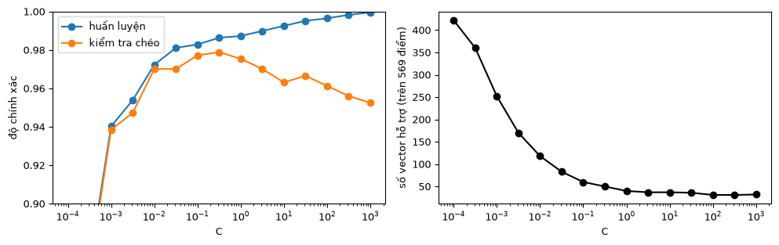

# Chương 27 · Dùng thư viện

> Ghi chú của người biên soạn: trang này do người biên soạn viết thêm, không có trong sách gốc. Trang so sánh ba cách scikit-learn giải SVM lề mềm ([chương 27](ml/ch27_vi)), cách quy đổi tham số giữa chúng, rồi bàn hai việc luôn phải làm khi dùng SVM trên dữ liệu thật: chuẩn hoá đặc trưng và chọn $C$ bằng kiểm tra chéo.

## Cách dùng trang này

Các khối chạy lần lượt từ trên xuống và dùng chung biến. Cần `numpy`, `matplotlib`, `scikit-learn`.

| Lớp | Hàm mục tiêu | Tham số phạt |
| --- | --- | --- |
| `SVC(kernel="linear", C)` | $\frac{1}{2}\|\mathbf{w}\|_2^2 + C\sum_n \max(0, 1 - y_nz_n)$, giải đối ngẫu | `C` |
| `LinearSVC(loss="hinge", C)` | như trên, nhưng phạt cả $b$ ([trang Thư viện chương 26](ml/ch26_lib_vi)) | `C` |
| `SGDClassifier(loss="hinge", alpha)` | $\frac{1}{N}\sum_n \max(0, 1 - y_nz_n) + \frac{\alpha}{2}\|\mathbf{w}\|_2^2$, giải bằng SGD | `alpha` $= \frac{1}{NC}$ |

Hàm mất mát (27.33) của sách chính là dạng của `SGDClassifier` với $\alpha = \lambda / N = 1/(NC)$.

## 1. Ba lớp, một bài toán

<small class="viz-ref">Mục 27.4.3, 27.5 · công thức (27.27), (27.33)</small>

<!-- run -->
```python
import numpy as np
import matplotlib.pyplot as plt
from sklearn.svm import SVC, LinearSVC
from sklearn.linear_model import SGDClassifier, LogisticRegression

np.random.seed(22)
means = [[2, 2], [4, 2]]
cov = [[.7, 0], [0, .7]]
N = 20
X0 = np.random.multivariate_normal(means[0], cov, N)
X1 = np.random.multivariate_normal(means[1], cov, N)
X = np.concatenate((X0, X1)); y = np.concatenate((np.ones(N), -np.ones(N)))
C = 100

models = {
    "SVC": SVC(kernel="linear", C=C),
    "LinearSVC(hinge, intercept_scaling=10)": LinearSVC(loss="hinge", C=C, intercept_scaling=10, max_iter=1_000_000, tol=1e-6),
    "SGDClassifier(hinge)": SGDClassifier(loss="hinge", alpha=1 / (C * len(y)), max_iter=100000, tol=None,
                                          learning_rate="optimal", random_state=0),
}
for name, m in models.items():
    m.fit(X, y)
    print(f"{name:40s} w = {np.round(m.coef_.ravel(), 4)}, b = {m.intercept_[0]:.4f}")
print("số vòng lặp của LinearSVC:", models["LinearSVC(hinge, intercept_scaling=10)"].n_iter_)
```

<!-- output -->
```output
SVC                                      w = [-1.8746 -1.807 ], b = 8.4969
LinearSVC(hinge, intercept_scaling=10)   w = [-1.8746 -1.8069], b = 8.4967
SGDClassifier(hinge)                     w = [-1.8732 -1.7785], b = 8.4658
số vòng lặp của LinearSVC: 152550
```
<!-- /output -->

Cả ba cho cùng một đường phân chia, khớp với nghiệm của sách. `SGDClassifier` lệch nhẹ ở chữ số thứ ba vì SGD dừng ở một nghiệm gần đúng. `LinearSVC` cần hơn 150 nghìn vòng lặp: để gần như không phạt $b$, phải tăng `intercept_scaling`, và điều đó làm bài toán kém điều kiện, phương pháp toạ độ hội tụ chậm. Với `intercept_scaling=100` và một triệu vòng lặp, nó vẫn chưa hội tụ.

Trên dữ liệu nhỏ, dùng `SVC`. Với hàng trăm nghìn điểm, `SVC` chậm (thời gian tăng cỡ $N^2$ đến $N^3$), khi đó dùng `LinearSVC` hoặc `SGDClassifier` sau khi đã chuẩn hoá dữ liệu về trung bình 0 (để $b$ nhỏ).

## 2. Mất mát bản lề và mất mát logistic

<small class="viz-ref">Mục 27.4.1, 27.4.2 · Hình 27.3</small>

Mục 27.4.1 so sánh mất mát bản lề của SVM với mất mát của hồi quy logistic. Trên cùng dữ liệu, với cùng mức phạt, hai mô hình cho đường phân chia gần nhau; khác biệt nằm ở điểm nào ảnh hưởng tới nghiệm.

<!-- run -->
```python
logreg = LogisticRegression(C=C, max_iter=10000).fit(X, y)
svc = models["SVC"]
fig, axes = plt.subplots(1, 2, figsize=(10, 3.6))
z = np.linspace(-3, 3, 400)
axes[0].plot(z, np.maximum(0, 1 - z), lw=2, label="bản lề: max(0, 1 - yz)")
axes[0].plot(z, np.log1p(np.exp(-z)) / np.log(2), lw=2, label="logistic: log2(1 + exp(-yz))")
axes[0].plot(z, (z < 0).astype(float), "k--", lw=1, label="không-một")
axes[0].set(xlabel="yz", ylim=(-0.1, 4), title="các hàm mất mát"); axes[0].legend(fontsize=8)

xx = np.linspace(-1, 7, 2)
for m, c, lab in [(svc, "k", "SVM"), (logreg, "#7c3aed", "hồi quy logistic")]:
    w, b = m.coef_.ravel(), m.intercept_[0]
    axes[1].plot(xx, -(b + w[0] * xx) / w[1], c=c, lw=2, label=lab)
axes[1].plot(X0[:, 0], X0[:, 1], "s", c="#2f80f5"); axes[1].plot(X1[:, 0], X1[:, 1], "o", c="#e8487f")
axes[1].set(xlim=(-1, 7), ylim=(-1, 5), aspect="equal", title="đường phân chia"); axes[1].legend(fontsize=8)
plt.tight_layout(); plt.show()

p = logreg.predict_proba(X)[:, 1]
print("số điểm có lambda > 0 trong SVM:", len(svc.support_), "/ 40")
print("hồi quy logistic: mọi điểm đều đóng góp vào gradient; xác suất nhỏ nhất của lớp đúng =",
      round(np.min(np.where(y > 0, p, 1 - p)), 4))
```

<!-- output -->
```output
số điểm có lambda > 0 trong SVM: 17 / 40
hồi quy logistic: mọi điểm đều đóng góp vào gradient; xác suất nhỏ nhất của lớp đúng = 0.1955
```

<div align=center></div>
<!-- /output -->

Mất mát logistic (chia cho $\log 2$ để đi qua điểm $(0, 1)$ như mất mát bản lề) là một phiên bản trơn của mất mát bản lề. Khác biệt quan trọng ở phía phải: mất mát bản lề bằng 0 hẳn khi $yz \geq 1$, nên 23 điểm nằm trong vùng an toàn không ảnh hưởng gì tới nghiệm SVM. Mất mát logistic luôn dương, nên mọi điểm đều kéo đường phân chia một chút. Ở đây, đám điểm tròn ở phía trên bên phải kéo đường logistic xoay đi so với đường SVM.

## 3. Chuẩn hoá đặc trưng

SVM dùng khoảng cách Euclid trong không gian đặc trưng, nên đặc trưng có thang đo lớn sẽ chi phối. Dữ liệu ung thư vú Wisconsin có 30 đặc trưng, từ cỡ $10^{-3}$ (độ lõm) đến cỡ $10^3$ (diện tích).

<!-- run -->
```python
from sklearn.datasets import load_breast_cancer
from sklearn.model_selection import cross_val_score, StratifiedKFold, GridSearchCV
from sklearn.pipeline import make_pipeline
from sklearn.preprocessing import StandardScaler
import time

Xb, yb = load_breast_cancer(return_X_y=True)
print("thang đo các đặc trưng: nhỏ nhất", Xb.std(0).min().round(4), "| lớn nhất", Xb.std(0).max().round(1))
cv = StratifiedKFold(5, shuffle=True, random_state=0)
for name, model in [("không chuẩn hoá", SVC(kernel="linear", C=1)),
                    ("StandardScaler + SVC", make_pipeline(StandardScaler(), SVC(kernel="linear", C=1)))]:
    t = time.perf_counter()
    acc = cross_val_score(model, Xb, yb, cv=cv)
    print(f"{name:22s}: độ chính xác kiểm tra chéo {acc.mean():.4f} ± {acc.std():.4f}, thời gian {time.perf_counter() - t:.2f} s")
```

<!-- output -->
```output
thang đo các đặc trưng: nhỏ nhất 0.0026 | lớn nhất 568.9
không chuẩn hoá       : độ chính xác kiểm tra chéo 0.9526 ± 0.0070, thời gian 3.19 s
StandardScaler + SVC  : độ chính xác kiểm tra chéo 0.9754 ± 0.0102, thời gian 0.02 s
```
<!-- /output -->

Không chuẩn hoá, độ chính xác giảm hơn 2 điểm phần trăm và `SVC` chạy chậm hơn khoảng 150 lần: bài toán đối ngẫu có ma trận $\mathbf{V}^T\mathbf{V}$ với các phần tử chênh nhau hàng triệu lần, rất kém điều kiện. Đặt `StandardScaler` vào trong `Pipeline` để phép chuẩn hoá được học lại trên từng phần huấn luyện của kiểm tra chéo, không nhìn thấy phần kiểm tra.

## 4. Chọn $C$ bằng kiểm tra chéo

<small class="viz-ref">Mục 27.5.4</small>

<!-- run -->
```python
pipe = make_pipeline(StandardScaler(), SVC(kernel="linear"))
grid = GridSearchCV(pipe, {"svc__C": np.logspace(-4, 3, 15)}, cv=cv, return_train_score=True).fit(Xb, yb)
r = grid.cv_results_
Cs = r["param_svc__C"].data.astype(float)
nsv = [make_pipeline(StandardScaler(), SVC(kernel="linear", C=c)).fit(Xb, yb)[-1].n_support_.sum() for c in Cs]
fig, ax = plt.subplots(1, 2, figsize=(10, 3.2))
ax[0].semilogx(Cs, r["mean_train_score"], "o-", label="huấn luyện")
ax[0].semilogx(Cs, r["mean_test_score"], "o-", label="kiểm tra chéo")
ax[0].set(xlabel="C", ylabel="độ chính xác", ylim=(0.9, 1.0)); ax[0].legend()
ax[1].semilogx(Cs, nsv, "o-", c="k"); ax[1].set(xlabel="C", ylabel="số vector hỗ trợ (trên 569 điểm)")
plt.tight_layout(); plt.show()
print("C tốt nhất:", grid.best_params_["svc__C"].round(4), "| độ chính xác kiểm tra chéo:", round(grid.best_score_, 4))
```

<!-- output -->
```output
C tốt nhất: 0.3162 | độ chính xác kiểm tra chéo: 0.9789
```

<div align=center></div>
<!-- /output -->

Hình bên trái là đường cong quen thuộc của việc chọn tham số kiểm soát: $C$ nhỏ (phạt vi phạm nhẹ, lề rộng) thì chưa khớp; $C$ lớn thì độ chính xác huấn luyện tiến về 1 còn độ chính xác kiểm tra chéo giảm. Hình bên phải cho thấy cơ chế: $C$ càng nhỏ, càng nhiều điểm nằm trong lề và trở thành vector hỗ trợ. Với $C = 10^{-4}$, hơn 400 trên 569 điểm là vector hỗ trợ, và độ chính xác chỉ còn khoảng 0.65 (nằm ngoài khung hình), gần bằng tỉ lệ 0.63 của lớp đông hơn.

## Tóm tắt

- `SVC(kernel="linear")`, `LinearSVC` và `SGDClassifier(loss="hinge")` cùng giải SVM lề mềm; quy đổi tham số bằng $\alpha = 1/(NC)$. `LinearSVC` phạt cả $b$.
- Mất mát bản lề bỏ qua các điểm đã nằm trong vùng an toàn; mất mát logistic thì không.
- Luôn chuẩn hoá đặc trưng trước khi dùng SVM, bên trong `Pipeline`.
- $C$ là tham số kiểm soát: chọn bằng kiểm tra chéo trên thang logarit.
