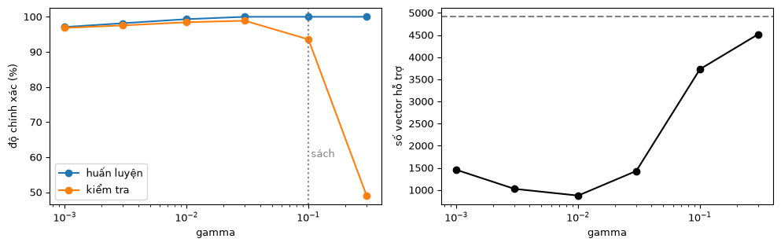
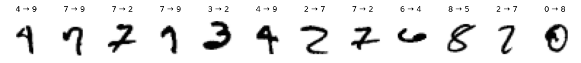

# Chương 28 · Ví dụ áp dụng: chọn $\gamma$ cho SVM hạt nhân RBF trên MNIST

> Ghi chú của người biên soạn: trang này do người biên soạn viết thêm, không có trong sách gốc. Trang chạy lại thí nghiệm MNIST của [mục 28.4.3](ml/ch28_vi), tìm hiểu vì sao tham số `gamma=0.1` của sách cho kết quả kém hơn nhiều so với khả năng của mô hình, chọn tham số bằng kiểm tra chéo, rồi mở rộng sang đủ 10 chữ số.

## Bài toán

Phân loại ảnh chữ số viết tay $28 \times 28$, mỗi ảnh là vector 784 chiều trong $[0, 1]$. Hạt nhân RBF $k(\mathbf{x}, \mathbf{z}) = \exp(-\gamma\|\mathbf{x} - \mathbf{z}\|_2^2)$ đo độ giống nhau giữa hai ảnh; $\gamma$ quyết định "giống" là gần tới mức nào.

## 1. Thí nghiệm của sách

<small class="viz-ref">Mục 28.4.3</small>

Bốn chữ số 0, 1, 2, 3; khoảng 4900 ảnh để huấn luyện và 24000 ảnh để kiểm tra, `gamma=0.1` như sách. `fetch_mldata` của sách đã bị gỡ khỏi scikit-learn; dùng `fetch_openml`.

<!-- run -->
```python
import numpy as np
import matplotlib.pyplot as plt
import time
from sklearn.datasets import fetch_openml
from sklearn.svm import SVC
from sklearn.model_selection import train_test_split

X_all, y_all = fetch_openml("mnist_784", version=1, return_X_y=True, as_frame=False)
X_all = X_all / 255.0; y_all = y_all.astype(int)
ids = np.isin(y_all, [0, 1, 2, 3])
X, y = X_all[ids], y_all[ids]
X_train, X_test, y_train, y_test = train_test_split(X, y, test_size=24000, random_state=0)
print("số ảnh:", len(y), "| huấn luyện:", len(y_train), "| kiểm tra:", len(y_test))

t = time.perf_counter()
model = SVC(kernel="rbf", gamma=.1, coef0=0).fit(X_train, y_train)
acc = model.score(X_test, y_test)
print(f"gamma = 0.1: độ chính xác {100 * acc:.2f} % (sách: 94.22 %), "
      f"số vector hỗ trợ {model.n_support_.sum()} / {len(y_train)}, thời gian {time.perf_counter() - t:.0f} s")
```

<!-- output -->
```output
số ảnh: 28911 | huấn luyện: 4911 | kiểm tra: 24000
gamma = 0.1: độ chính xác 93.57 % (sách: 94.22 %), số vector hỗ trợ 3728 / 4911, thời gian 64 s
```
<!-- /output -->

Kết quả gần với sách (khác chút ít vì cách chia ngẫu nhiên). Con số đáng chú ý là số vector hỗ trợ: 3728 trên 4911 ảnh huấn luyện, tức hơn 3/4 dữ liệu. Với SVM, đó là dấu hiệu rõ của quá khớp: mô hình phải "nhớ" gần hết các điểm.

## 2. $\gamma = 0.1$ có ý nghĩa gì với ảnh MNIST?

<small class="viz-ref">Mục 28.3.2 · công thức (28.10)</small>

Giá trị hạt nhân giữa hai ảnh phụ thuộc vào $\gamma\|\mathbf{x} - \mathbf{z}\|_2^2$. Xem khoảng cách thực tế giữa các ảnh:

<!-- run -->
```python
rng = np.random.default_rng(0)
A = X_train[rng.choice(len(X_train), 400, replace=False)]
d2 = ((A[:, None, :] - A[None, :, :]) ** 2).sum(-1)[np.triu_indices(400, 1)]
nn = np.sort(((A[:, None, :] - X_train[None, :2000, :]) ** 2).sum(-1), axis=1)[:, 1]   # láng giềng gần nhất (bỏ chính nó)
print(f"bình phương khoảng cách giữa hai ảnh ngẫu nhiên: trung vị {np.median(d2):.0f}")
print(f"bình phương khoảng cách tới láng giềng gần nhất (trong 2000 ảnh): trung vị {np.median(nn):.0f}")
for g in [0.001, 0.01, 0.03, 0.1, 0.3]:
    print(f"gamma = {g:<5}: k với ảnh ngẫu nhiên ~ {np.exp(-g * np.median(d2)):.1e}, "
          f"k với láng giềng gần nhất ~ {np.exp(-g * np.median(nn)):.1e}")
print("gamma='scale' của sklearn = 1 / (số chiều * phương sai) =", round(1 / (X_train.shape[1] * X_train.var()), 4))
```

<!-- output -->
```output
bình phương khoảng cách giữa hai ảnh ngẫu nhiên: trung vị 110
bình phương khoảng cách tới láng giềng gần nhất (trong 2000 ảnh): trung vị 30
gamma = 0.001: k với ảnh ngẫu nhiên ~ 9.0e-01, k với láng giềng gần nhất ~ 9.7e-01
gamma = 0.01 : k với ảnh ngẫu nhiên ~ 3.3e-01, k với láng giềng gần nhất ~ 7.4e-01
gamma = 0.03 : k với ảnh ngẫu nhiên ~ 3.7e-02, k với láng giềng gần nhất ~ 4.0e-01
gamma = 0.1  : k với ảnh ngẫu nhiên ~ 1.7e-05, k với láng giềng gần nhất ~ 4.8e-02
gamma = 0.3  : k với ảnh ngẫu nhiên ~ 5.2e-15, k với láng giềng gần nhất ~ 1.1e-04
gamma='scale' của sklearn = 1 / (số chiều * phương sai) = 0.013
```
<!-- /output -->

Hai ảnh MNIST ngẫu nhiên có bình phương khoảng cách cỡ 110, và ngay cả láng giềng gần nhất cũng cách cỡ 30. Với $\gamma = 0.1$, giá trị hạt nhân giữa một ảnh và láng giềng gần nhất của nó chỉ còn khoảng 0.05, và với hầu hết các ảnh khác thì gần bằng 0. Mỗi ảnh huấn luyện chỉ "phủ" một vùng rất nhỏ quanh nó. Một ảnh kiểm tra không đủ gần ảnh huấn luyện nào thì hàm quyết định (28.6) gần như chỉ còn hằng số $b$.

Giá trị $\gamma$ hợp lý là giá trị làm $\gamma\|\mathbf{x} - \mathbf{z}\|_2^2$ có cỡ 1 với các cặp điểm "gần": khoảng 0.01 đến 0.03 ở đây. Lựa chọn mặc định `gamma="scale"` của scikit-learn (0.013) rơi đúng vào khoảng đó. Khi sách được viết, mặc định của scikit-learn còn là `gamma="auto"` $= 1/784 \approx 0.0013$.

## 3. Quét $\gamma$

<!-- run -->
```python
rows = []
for g in [0.001, 0.003, 0.01, 0.03, 0.1, 0.3]:
    m = SVC(kernel="rbf", gamma=g).fit(X_train, y_train)
    rows.append((g, m.score(X_train, y_train), m.score(X_test, y_test), m.n_support_.sum()))
    print(f"gamma = {g:<5}: huấn luyện {100 * rows[-1][1]:6.2f} %, kiểm tra {100 * rows[-1][2]:6.2f} %, "
          f"vector hỗ trợ {rows[-1][3]:4d}")
r = np.array(rows)
fig, ax = plt.subplots(1, 2, figsize=(10, 3.2))
ax[0].semilogx(r[:, 0], 100 * r[:, 1], "o-", label="huấn luyện"); ax[0].semilogx(r[:, 0], 100 * r[:, 2], "o-", label="kiểm tra")
ax[0].axvline(0.1, c="gray", ls=":"); ax[0].text(0.105, 60, "sách", color="gray")
ax[0].set(xlabel="gamma", ylabel="độ chính xác (%)"); ax[0].legend()
ax[1].semilogx(r[:, 0], r[:, 3], "o-", c="k"); ax[1].axhline(len(y_train), c="gray", ls="--")
ax[1].set(xlabel="gamma", ylabel="số vector hỗ trợ")
plt.tight_layout(); plt.show()
```

<!-- output -->
```output
gamma = 0.001: huấn luyện  97.09 %, kiểm tra  96.85 %, vector hỗ trợ 1456
gamma = 0.003: huấn luyện  98.17 %, kiểm tra  97.54 %, vector hỗ trợ 1026
gamma = 0.01 : huấn luyện  99.33 %, kiểm tra  98.45 %, vector hỗ trợ  874
gamma = 0.03 : huấn luyện 100.00 %, kiểm tra  98.89 %, vector hỗ trợ 1429
gamma = 0.1  : huấn luyện 100.00 %, kiểm tra  93.57 %, vector hỗ trợ 3728
gamma = 0.3  : huấn luyện 100.00 %, kiểm tra  49.05 %, vector hỗ trợ 4515
```

<div align=center></div>
<!-- /output -->

Hình bên trái có dạng quen thuộc của quá khớp: từ $\gamma = 0.03$ trở lên, mô hình đúng 100% trên tập huấn luyện, nhưng độ chính xác kiểm tra giảm mạnh: 93.6% với $\gamma = 0.1$ và chỉ 49% với $\gamma = 0.3$. Số vector hỗ trợ (hình bên phải) đạt nhỏ nhất ở khoảng $\gamma = 0.01$, đúng vùng mô hình tổng quát hoá tốt nhất. $\gamma$ quá nhỏ cũng làm tăng số vector hỗ trợ: hạt nhân gần như hằng số, mô hình gần như tuyến tính và nhiều điểm nằm trong lề.

## 4. Chọn $\gamma$ và $C$ bằng kiểm tra chéo

Mục 3 dùng tập kiểm tra để quan sát; để *chọn* tham số thì chỉ được dùng tập huấn luyện.

<!-- run -->
```python
from sklearn.model_selection import GridSearchCV, StratifiedKFold
t = time.perf_counter()
grid = GridSearchCV(SVC(kernel="rbf"), {"gamma": [0.003, 0.01, 0.03], "C": [1, 10]},
                    cv=StratifiedKFold(3, shuffle=True, random_state=0), n_jobs=-1).fit(X_train, y_train)
print("tham số tốt nhất:", grid.best_params_, f"| kiểm tra chéo {100 * grid.best_score_:.2f} %")
print(f"trên 24000 ảnh kiểm tra: {100 * grid.score(X_test, y_test):.2f} %  (thời gian {time.perf_counter() - t:.0f} s)")
```

<!-- output -->
```output
tham số tốt nhất: {'C': 10, 'gamma': 0.01} | kiểm tra chéo 98.62 %
trên 24000 ảnh kiểm tra: 98.81 %  (thời gian 21 s)
```
<!-- /output -->

Kiểm tra chéo trên chỉ 4911 ảnh huấn luyện chọn $\gamma = 0.01$, $C = 10$, và cho 98.8% trên 24000 ảnh kiểm tra: số lỗi giảm khoảng 5 lần so với tham số của sách.

## 5. Đủ 10 chữ số

<!-- run -->
```python
from sklearn.linear_model import LogisticRegression
Xtr10, ytr10 = X_all[:10000], y_all[:10000]
Xte10, yte10 = X_all[60000:], y_all[60000:]
for name, m in [("hồi quy softmax", LogisticRegression(max_iter=2000, C=0.1)),
                ("SVM tuyến tính", SVC(kernel="linear", C=0.05)),
                ("SVM RBF, tham số của mục 4", SVC(kernel="rbf", **grid.best_params_))]:
    t = time.perf_counter(); m.fit(Xtr10, ytr10)
    print(f"{name:27s}: {100 * m.score(Xte10, yte10):.2f} % trên 10000 ảnh kiểm tra, {time.perf_counter() - t:.0f} s")
svm10 = m
```

<!-- output -->
```output
hồi quy softmax            : 91.16 % trên 10000 ảnh kiểm tra, 15 s
SVM tuyến tính             : 93.18 % trên 10000 ảnh kiểm tra, 18 s
SVM RBF, tham số của mục 4 : 96.57 % trên 10000 ảnh kiểm tra, 28 s
```
<!-- /output -->

Với 10 chữ số và 10000 ảnh huấn luyện, SVM hạt nhân RBF hơn hẳn hai mô hình tuyến tính (hồi quy softmax của [chương 15](ml/ch15_vi), SVM tuyến tính). Dùng thêm dữ liệu huấn luyện, kết quả này còn tăng; đổi lại, thời gian huấn luyện tăng nhanh hơn tuyến tính theo số điểm ([trang Thư viện](ml/ch28_lib_vi), mục 4).

<!-- run -->
```python
pred = svm10.predict(Xte10)
wrong = np.where(pred != yte10)[0]
dec = svm10.decision_function(Xte10[wrong])
order = wrong[np.argsort(-dec.max(1))][:12]          # các ảnh sai mà mô hình tự tin nhất
fig, axes = plt.subplots(1, 12, figsize=(12, 1.6))
for ax, i in zip(axes, order):
    ax.imshow(Xte10[i].reshape(28, 28), cmap="gray_r"); ax.axis("off")
    ax.set_title(f"{yte10[i]} → {pred[i]}", fontsize=9)
plt.show()
print(f"{len(wrong)} ảnh sai trên 10000; nhãn thật → nhãn dự đoán ở trên mỗi ảnh")
```

<!-- output -->
```output
343 ảnh sai trên 10000; nhãn thật → nhãn dự đoán ở trên mỗi ảnh
```

<div align=center></div>
<!-- /output -->

Các ảnh sai mà mô hình tự tin nhất phần lớn khó cả với người: số 4 và 7 có nét khép kín như số 9, số 7 có gạch ngang trông như số 2.

## Tóm tắt

- $\gamma$ trong hạt nhân RBF phải phù hợp với thang khoảng cách của dữ liệu: $\gamma\|\mathbf{x} - \mathbf{z}\|_2^2$ nên có cỡ 1 với các cặp điểm gần nhau.
- $\gamma$ quá lớn thì mỗi điểm huấn luyện chỉ ảnh hưởng tới chính nó: đúng 100% trên tập huấn luyện, hầu hết các điểm thành vector hỗ trợ, và mô hình tổng quát hoá kém.
- `gamma="scale"` là điểm xuất phát tốt; sau đó chọn $\gamma$ và $C$ bằng kiểm tra chéo.
- Trên MNIST 0–3, chọn lại tham số đưa độ chính xác từ 93.6% (tham số của sách) lên 98.8%.
