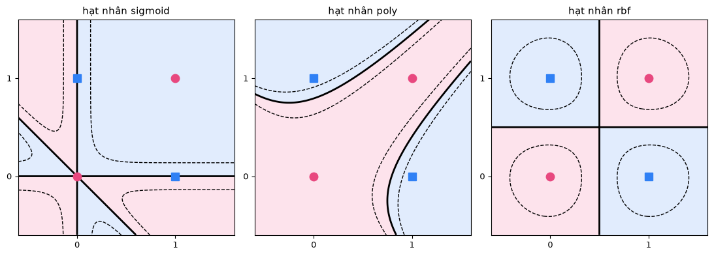

# Chương 28 · Code từ đầu

> Ghi chú của người biên soạn: trang này do người biên soạn viết thêm, không có trong sách gốc. Sách dừng ở việc gọi `sklearn` ("chúng ta sẽ không đi sâu vào việc tính nghiệm này", mục 28.3.1). Trang này viết một bộ giải bài toán đối ngẫu (28.5) bằng thuật toán SMO chỉ với NumPy, kiểm tra nó với `sklearn` trên ví dụ XOR của mục 28.4.1, rồi kiểm chứng bằng số hai ý chính của chương: thủ thuật hạt nhân và điều kiện Mercer.

## Cách dùng trang này

Các khối chạy lần lượt từ trên xuống và dùng chung biến. Cần `numpy`, `matplotlib`, `scikit-learn` (để đối chiếu).

## 1. Thủ thuật hạt nhân, kiểm tra bằng số

<small class="viz-ref">Mục 28.2 · công thức (28.5), (28.6)</small>

Ví dụ của mục 28.2: với $\Phi(\mathbf{x}) = [1, \sqrt{2} x_1, \sqrt{2} x_2, x_1^2, \sqrt{2} x_1x_2, x_2^2]^T$ thì $\Phi(\mathbf{x})^T\Phi(\mathbf{z}) = (1 + \mathbf{x}^T\mathbf{z})^2$. Hệ quả: SVM tuyến tính trên $\Phi(\mathbf{x})$ và SVM với hạt nhân đa thức bậc hai trên $\mathbf{x}$ là cùng một mô hình.

<!-- run -->
```python
import numpy as np
import matplotlib.pyplot as plt
from sklearn.svm import SVC

def phi(X):
    x1, x2 = X[:, 0], X[:, 1]
    return np.c_[np.ones(len(X)), np.sqrt(2) * x1, np.sqrt(2) * x2, x1**2, np.sqrt(2) * x1 * x2, x2**2]

rng = np.random.default_rng(0)
A, B = rng.normal(size=(5, 2)), rng.normal(size=(5, 2))
print("max |Phi(x)^T Phi(z) - (1 + x^T z)^2| =", np.abs(phi(A) @ phi(B).T - (1 + A @ B.T) ** 2).max())

# hai lớp: trong và ngoài một đường tròn (giống Hình 28.1)
X = rng.uniform(-2, 2, size=(200, 2))
y = np.where(X[:, 0] ** 2 + X[:, 1] ** 2 < 1.6, 1, -1)
lin_on_phi = SVC(kernel="linear", C=10).fit(phi(X), y)
poly_on_x = SVC(kernel="poly", degree=2, gamma=1, coef0=1, C=10).fit(X, y)
T = rng.uniform(-2, 2, size=(1000, 2))
d1, d2 = lin_on_phi.decision_function(phi(T)), poly_on_x.decision_function(T)
print("SVM tuyến tính trên Phi(x): số vector hỗ trợ", len(lin_on_phi.support_))
print("SVM hạt nhân đa thức trên x: số vector hỗ trợ", len(poly_on_x.support_))
print("chênh lệch lớn nhất của w^T Phi(x) + b trên 1000 điểm mới:", np.abs(d1 - d2).max().round(6))
```

<!-- output -->
```output
max |Phi(x)^T Phi(z) - (1 + x^T z)^2| = 1.7763568394002505e-15
SVM tuyến tính trên Phi(x): số vector hỗ trợ 14
SVM hạt nhân đa thức trên x: số vector hỗ trợ 14
chênh lệch lớn nhất của w^T Phi(x) + b trên 1000 điểm mới: 0.0
```
<!-- /output -->

Hai mô hình có cùng tập vector hỗ trợ và cho cùng giá trị $\mathbf{w}^T\Phi(\mathbf{x}) + b$ tại mọi điểm mới, chính xác tới sai số làm tròn. Khác biệt chỉ nằm ở chi phí: mô hình thứ nhất phải tính $\Phi(\mathbf{x})$ 6 chiều; mô hình thứ hai chỉ tính tích vô hướng 2 chiều rồi bình phương. Với bậc $d$ và $D$ chiều ban đầu, $\Phi(\mathbf{x})$ có $\binom{D + d}{d}$ chiều (với ảnh MNIST, $D = 784$, $d = 3$: khoảng 81 triệu chiều), còn hạt nhân vẫn chỉ tốn một tích vô hướng $D$ chiều. Với hạt nhân RBF, $\Phi(\mathbf{x})$ có vô hạn chiều.

Ví dụ này cũng cho thấy mục 28.2 có hai lỗi đánh máy nhỏ: $\Phi(\mathbf{x})$ có 6 chứ không phải 5 thành phần, và trong dòng khai triển thứ hai, số hạng $x_1^2x_2^2$ phải là $x_1^2z_1^2$ (xem ghi chú đầu [bài đọc](ml/ch28_vi)).

## 2. SMO: giải bài toán đối ngẫu với hạt nhân

<small class="viz-ref">Mục 28.2 · công thức (28.5)</small>

Bài toán (28.5) có $N$ biến, ràng buộc hộp $0 \leq \lambda_n \leq C$ và một ràng buộc đẳng thức $\sum_n \lambda_n y_n = 0$. Vì ràng buộc đẳng thức, không thể thay đổi một $\lambda_n$ đơn lẻ; SMO (Platt, 1998) mỗi bước chỉ thay đổi *hai* biến $\lambda_i, \lambda_j$, giải chính xác bài toán con hai biến đó (một parabol trên một đoạn thẳng), rồi lặp lại. Cặp $(i, j)$ được chọn là cặp vi phạm điều kiện KKT nhiều nhất, như trong libsvm.

Viết bài toán dưới dạng tối thiểu $\frac{1}{2}\boldsymbol{\lambda}^T\mathbf{Q}\boldsymbol{\lambda} - \mathbf{1}^T\boldsymbol{\lambda}$ với $Q_{nm} = y_ny_m k(\mathbf{x}_n, \mathbf{x}_m)$, và theo dõi gradient $\mathbf{g} = \mathbf{Q}\boldsymbol{\lambda} - \mathbf{1}$.

<!-- run -->
```python
def kernel_matrix(A, B, kind, gamma=1.0, coef0=0.0, degree=3):
    """Bảng 28.2, cùng định nghĩa với sklearn."""
    if kind == "linear":  return A @ B.T
    if kind == "poly":    return (gamma * A @ B.T + coef0) ** degree
    if kind == "sigmoid": return np.tanh(gamma * A @ B.T + coef0)
    if kind == "rbf":
        d2 = (A ** 2).sum(1)[:, None] + (B ** 2).sum(1)[None, :] - 2 * A @ B.T
        return np.exp(-gamma * np.maximum(d2, 0))

def smo(K, y, C, tol=1e-6, max_iter=100000):
    n = len(y)
    Q = (y[:, None] * y[None, :]) * K
    lam, g = np.zeros(n), -np.ones(n)
    for it in range(max_iter):
        # i: tăng được lambda_i theo hướng có lợi nhất; j: tương tự theo hướng ngược lại
        up = ((y > 0) & (lam < C)) | ((y < 0) & (lam > 0))
        low = ((y < 0) & (lam < C)) | ((y > 0) & (lam > 0))
        v = -y * g
        i = np.where(up)[0][np.argmax(v[up])]
        j = np.where(low)[0][np.argmin(v[low])]
        if v[i] - v[j] < tol:                     # điều kiện KKT thoả mãn tới sai số tol
            break
        # tối ưu theo hướng d: lambda_i += y_i t, lambda_j -= y_j t (giữ nguyên sum lambda_n y_n)
        a = max(K[i, i] + K[j, j] - 2 * K[i, j], 1e-12)
        t = (v[i] - v[j]) / a
        # chặn t để cả hai biến còn trong [0, C]
        t = min(t, C - lam[i] if y[i] > 0 else lam[i], lam[j] if y[j] > 0 else C - lam[j])
        di, dj = y[i] * t, -y[j] * t
        lam[i] += di; lam[j] += dj
        g += Q[:, i] * di + Q[:, j] * dj
    # b: trung bình trên các điểm 0 < lambda < C (tập M), như (28.6)
    free = (lam > 1e-8) & (lam < C - 1e-8)
    b = np.mean(-y[free] * g[free]) if free.any() else (v[i] + v[j]) / 2
    return lam, b, it

def svm_fit(X, y, C, **kp):
    lam, b, it = smo(kernel_matrix(X, X, **kp), y.astype(float), C)
    S = lam > 1e-8
    return dict(Xs=X[S], coef=(lam * y)[S], b=b, kp=kp, iters=it)

def svm_decision(model, T):
    return kernel_matrix(T, model["Xs"], **model["kp"]) @ model["coef"] + model["b"]     # (28.6)
```

Ở dòng tính `b`: với $0 < \lambda_n < C$, điều kiện KKT cho $y_n(\mathbf{w}^T\Phi(\mathbf{x}_n) + b) = 1$, tức $b = y_n - \mathbf{w}^T\Phi(\mathbf{x}_n)$. Mà $\mathbf{w}^T\Phi(\mathbf{x}_n) = \sum_m \lambda_m y_m k(\mathbf{x}_m, \mathbf{x}_n) = y_n(\mathbf{Q}\boldsymbol{\lambda})_n = y_n(g_n + 1)$, nên $b = -y_ng_n$: không cần tính lại hạt nhân. Lấy trung bình trên tập $\mathcal{M}$ như (28.6) để giảm sai số.

## 3. Bài toán XOR của sách, so với `sklearn`

<small class="viz-ref">Mục 28.4.1 · Hình 28.2</small>

Tham số như sách: `gamma=4, coef0=0`; `C` và `degree` để mặc định (`C=1`, `degree=3`). Nhãn của sách là 0 và 1, ở đây đổi thành $-1$ và $+1$.

<!-- run -->
```python
Xx = np.array([[0, 0], [1, 1], [1, 0], [0, 1]], dtype=float)
yx = np.array([-1, -1, 1, 1])
g0, g1 = np.meshgrid(np.linspace(-0.6, 1.6, 300), np.linspace(-0.6, 1.6, 300))
G = np.c_[g0.ravel(), g1.ravel()]
fig, axes = plt.subplots(1, 3, figsize=(11, 3.8))
for ax, kind in zip(axes, ["sigmoid", "poly", "rbf"]):
    kp = dict(kind=kind, gamma=4.0, coef0=0.0, degree=3)
    mine = svm_fit(Xx, yx, C=1.0, **kp)
    sk = SVC(kernel=kind, gamma=4, coef0=0, C=1, tol=1e-8).fit(Xx, yx)
    diff = np.abs(svm_decision(mine, G) - sk.decision_function(G)).max()
    print(f"{kind:8s}: {mine['iters']:2d} vòng SMO, b = {mine['b']:+.4f} (sklearn {sk.intercept_[0]:+.4f}), "
          f"lệch lớn nhất trên lưới {diff:.1e}")
    F = svm_decision(mine, G).reshape(g0.shape)
    ax.contourf(g0, g1, F > 0, levels=[-0.5, 0.5, 1.5], colors=["#fde3ec", "#e1ecfd"])
    ax.contour(g0, g1, F, levels=[-0.5, 0, 0.5], colors="k", linestyles=["--", "-", "--"], linewidths=[1, 2, 1])
    ax.plot(*Xx[yx > 0].T, "s", c="#2f80f5", ms=9); ax.plot(*Xx[yx < 0].T, "o", c="#e8487f", ms=9)
    ax.set(title=f"hạt nhân {kind}", aspect="equal", xticks=[0, 1], yticks=[0, 1])
plt.tight_layout(); plt.show()
```

<!-- output -->
```output
sigmoid :  2 vòng SMO, b = +0.0000 (sklearn -0.0000), lệch lớn nhất trên lưới 4.4e-16
poly    : 37 vòng SMO, b = -1.0000 (sklearn -1.0000), lệch lớn nhất trên lưới 1.0e-06
rbf     :  2 vòng SMO, b = +0.0000 (sklearn -0.0000), lệch lớn nhất trên lưới 3.4e-15
```

<div align=center></div>
<!-- /output -->

Bộ giải viết tay cho cùng hàm quyết định với `sklearn` (đặt `tol=1e-8` cho `sklearn`; với `tol` mặc định `1e-3`, kết quả hạt nhân đa thức lệch ở chữ số thứ tư). Ba hình giống Hình 28.2 của sách:

- `sigmoid`: ba trong bốn điểm nằm đúng trên đường phân chia, và điểm $(1, 1)$ còn bị phân loại sai. Với `coef0=0`, $k(\mathbf{x}, \mathbf{0}) = \tanh(0) = 0$, nên điểm gốc toạ độ không đóng góp gì.
- `poly`: phân loại đúng cả bốn điểm, nhưng ranh giới không đối xứng dù dữ liệu đối xứng.
- `rbf`: bốn ô vuông đối xứng, đúng với cấu trúc của XOR. Mỗi điểm nằm giữa một vùng tròn (đường nét đứt).

Với RBF và sigmoid, SMO dừng sau 2 vòng: dữ liệu đối xứng nên chỉ cần cho cả bốn $\lambda_n$ bằng nhau.

## 4. Điều kiện Mercer

<small class="viz-ref">Mục 28.3.1 · công thức (28.7), (28.8)</small>

Điều kiện (28.7) nói rằng với mọi tập điểm, ma trận hạt nhân $[k(\mathbf{x}_n, \mathbf{x}_m)]$ phải nửa xác định dương, tức mọi trị riêng không âm. Kiểm tra trên 100 điểm ngẫu nhiên:

<!-- run -->
```python
P = rng.normal(size=(100, 2))
for kind, kp in [("linear", {}), ("poly", dict(gamma=1, coef0=1, degree=3)), ("rbf", dict(gamma=1)),
                 ("sigmoid", dict(gamma=1, coef0=0)), ("sigmoid", dict(gamma=0.5, coef0=-1))]:
    ev = np.linalg.eigvalsh(kernel_matrix(P, P, kind, **kp))
    print(f"{kind:8s} {str(kp):38s} trị riêng nhỏ nhất {ev.min():+10.3f}, số trị riêng âm (< -1e-8): {np.sum(ev < -1e-8)}")
```

<!-- output -->
```output
linear   {}                                     trị riêng nhỏ nhất     -0.000, số trị riêng âm (< -1e-8): 0
poly     {'gamma': 1, 'coef0': 1, 'degree': 3}  trị riêng nhỏ nhất     -0.000, số trị riêng âm (< -1e-8): 0
rbf      {'gamma': 1}                           trị riêng nhỏ nhất     +0.000, số trị riêng âm (< -1e-8): 0
sigmoid  {'gamma': 1, 'coef0': 0}               trị riêng nhỏ nhất     -9.199, số trị riêng âm (< -1e-8): 45
sigmoid  {'gamma': 0.5, 'coef0': -1}            trị riêng nhỏ nhất    -65.595, số trị riêng âm (< -1e-8): 42
```
<!-- /output -->

Tuyến tính, đa thức và RBF đều thoả (28.7): trị riêng nhỏ nhất bằng 0 tới sai số làm tròn. Hạt nhân sigmoid thì không, với cả hai bộ tham số: gần một nửa số trị riêng âm. Đây là lý do mục 28.3.1 nói "một vài hàm số $k()$ không thoả mãn điều kiện Mercer vẫn cho kết quả chấp nhận được": hạt nhân sigmoid được dùng vì nó giống một tầng của mạng neuron, không phải vì nó là một hạt nhân đúng nghĩa.

Nếu ma trận hạt nhân có trị riêng âm thì $\mathbf{Q}$ cũng vậy, và hàm mục tiêu $\frac{1}{2}\boldsymbol{\lambda}^T\mathbf{Q}\boldsymbol{\lambda} - \mathbf{1}^T\boldsymbol{\lambda}$ không còn lồi. Kiểm tra trực tiếp định nghĩa hàm lồi: lấy ngẫu nhiên các cặp điểm khả thi $\boldsymbol{\lambda}_a, \boldsymbol{\lambda}_b$ (trong hộp, thoả $\sum_n \lambda_ny_n = 0$) và đếm số cặp mà giá trị tại trung điểm *lớn hơn* trung bình giá trị tại hai đầu.

<!-- run -->
```python
yP = np.where(P[:, 0] * P[:, 1] > 0, 1, -1).astype(float)
r = np.random.default_rng(1)
def feasible():
    l = r.uniform(0, 1, len(yP))                            # trong hộp [0, C] với C = 1
    sp, sn = l[yP > 0].sum(), l[yP < 0].sum()
    l[yP > 0 if sp > sn else yP < 0] *= min(sp, sn) / max(sp, sn)   # thu nhỏ một lớp để sum lambda_n y_n = 0
    return l

for kind, kp in [("rbf", dict(gamma=1)), ("sigmoid", dict(gamma=0.5, coef0=-1))]:
    Q = (yP[:, None] * yP[None, :]) * kernel_matrix(P, P, kind, **kp)
    f = lambda l: 0.5 * l @ Q @ l - l.sum()
    bad = 0
    for _ in range(2000):
        a, b_ = feasible(), feasible()
        bad += f((a + b_) / 2) > (f(a) + f(b_)) / 2 + 1e-9
    lam, b, it = smo(kernel_matrix(P, P, kind, **kp), yP, C=1.0, max_iter=20000)
    print(f"{kind:8s}: {bad:4d}/2000 cặp vi phạm định nghĩa hàm lồi; SMO dừng sau {it} vòng tại giá trị {f(lam):.3f}")
```

<!-- output -->
```output
rbf     :    0/2000 cặp vi phạm định nghĩa hàm lồi; SMO dừng sau 250 vòng tại giá trị -29.903
sigmoid :   38/2000 cặp vi phạm định nghĩa hàm lồi; SMO dừng sau 209 vòng tại giá trị -44.610
```
<!-- /output -->

Với RBF, không cặp nào vi phạm: hàm mục tiêu lồi và SMO tìm được nghiệm tối ưu toàn cục. Với sigmoid, có những cặp vi phạm: hàm mục tiêu không lồi. SMO vẫn dừng ở một điểm thoả điều kiện KKT (libsvm cũng vậy), nhưng không còn gì bảo đảm điểm đó là nghiệm tối ưu, và lý thuyết đối ngẫu của [chương 25](math/ch25_vi) không còn áp dụng được.

## Tóm tắt

| Trong sách | Trên trang này |
| --- | --- |
| Thủ thuật hạt nhân (28.2) | kiểm tra $\Phi(\mathbf{x})^T\Phi(\mathbf{z}) = (1 + \mathbf{x}^T\mathbf{z})^2$; SVM tuyến tính trên $\Phi(\mathbf{x})$ trùng SVM hạt nhân đa thức |
| Giải (28.5): "không đi sâu" | SMO viết bằng NumPy (khoảng 30 dòng), khớp `sklearn` |
| Hình 28.2 (XOR, ba hạt nhân) | vẽ lại từ bộ giải tự viết |
| Điều kiện Mercer (28.7), (28.8) | trị riêng của ma trận hạt nhân; sigmoid vi phạm và bài toán đối ngẫu không còn lồi |
