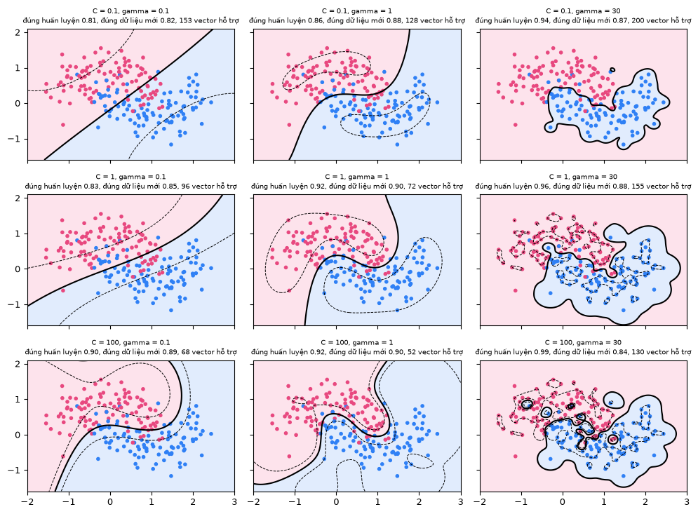

# Chương 28 · Dùng thư viện

> Ghi chú của người biên soạn: trang này do người biên soạn viết thêm, không có trong sách gốc. Trang đi qua các tuỳ chọn của `sklearn.svm.SVC` liên quan tới hạt nhân ([chương 28](ml/ch28_vi)): ảnh hưởng chung của $C$ và $\gamma$, cách `SVC` xử lý bài toán nhiều lớp, hạt nhân tự định nghĩa (mục "Hàm tự định nghĩa"), và cách dùng ý tưởng hạt nhân khi dữ liệu quá lớn cho `SVC`.

## Cách dùng trang này

Các khối chạy lần lượt từ trên xuống và dùng chung biến. Cần `numpy`, `matplotlib`, `scikit-learn`.

## 1. $C$ và $\gamma$ cùng lúc

<small class="viz-ref">Mục 28.3.2, 28.4.2 · Hình 28.3</small>

Với hạt nhân RBF, $\gamma$ quyết định mỗi điểm ảnh hưởng xa tới đâu, còn $C$ quyết định mức phạt vi phạm lề. Cả hai cùng điều khiển độ phức tạp của mô hình.

<!-- run -->
```python
import numpy as np
import matplotlib.pyplot as plt
import time
from sklearn.svm import SVC, LinearSVC
from sklearn.datasets import make_moons

X, y = make_moons(200, noise=0.3, random_state=0)
Xv, yv = make_moons(2000, noise=0.3, random_state=1)            # dữ liệu mới để đánh giá
g0, g1 = np.meshgrid(np.linspace(-2, 3, 250), np.linspace(-1.6, 2.1, 200))
G = np.c_[g0.ravel(), g1.ravel()]
fig, axes = plt.subplots(3, 3, figsize=(10, 7.4), sharex=True, sharey=True)
for i, C in enumerate([0.1, 1, 100]):
    for j, gamma in enumerate([0.1, 1, 30]):
        m = SVC(kernel="rbf", C=C, gamma=gamma).fit(X, y)
        ax = axes[i, j]
        F = m.decision_function(G).reshape(g0.shape)
        ax.contourf(g0, g1, F > 0, levels=[-0.5, 0.5, 1.5], colors=["#fde3ec", "#e1ecfd"])
        ax.contour(g0, g1, F, levels=[-1, 0, 1], colors="k", linestyles=["--", "-", "--"], linewidths=[0.7, 1.5, 0.7])
        ax.scatter(*X.T, c=np.where(y, "#2f80f5", "#e8487f"), s=9)
        ax.set_title(f"C = {C}, gamma = {gamma}\nđúng huấn luyện {m.score(X, y):.2f}, đúng dữ liệu mới {m.score(Xv, yv):.2f}, "
                     f"{len(m.support_)} vector hỗ trợ", fontsize=7.5)
plt.tight_layout(); plt.show()
```

<!-- output -->
<div align=center></div>
<!-- /output -->

Đi theo đường chéo từ góc trên bên trái xuống góc dưới bên phải, mô hình phức tạp dần. Góc trên bên trái ($C$ và $\gamma$ nhỏ): ranh giới gần như thẳng, chưa khớp. Góc dưới bên phải ($C = 100$, $\gamma = 30$): đúng 99% trên tập huấn luyện, ranh giới bao quanh từng đám điểm nhỏ, và chỉ đúng 84% trên dữ liệu mới. Các ô giữa ($C = 1$ hoặc $100$, $\gamma = 1$) cho ranh giới hình trăng khuyết đúng với cách dữ liệu được sinh ra, và đúng 90% trên dữ liệu mới.

Nhiều cặp $(C, \gamma)$ khác nhau cho kết quả gần nhau: $\gamma$ lớn có thể bù bằng $C$ nhỏ và ngược lại. Vì vậy hai tham số này nên được tìm cùng nhau, trên một lưới thang logarit.

## 2. `SVC` với nhiều lớp: one-vs-one

<small class="viz-ref">Mục 28.4.3</small>

<!-- run -->
```python
from sklearn.datasets import load_digits
Xd, yd = load_digits(return_X_y=True)                   # ảnh 8x8, 10 lớp
for shape in ["ovr", "ovo"]:
    m = SVC(kernel="rbf", gamma="scale", decision_function_shape=shape).fit(Xd, yd)
    print(f"decision_function_shape='{shape}': decision_function có {m.decision_function(Xd[:1]).shape[1]} cột")
print("dual_coef_:", m.dual_coef_.shape, " (C - 1 hàng: mỗi vector hỗ trợ có hệ số trong C - 1 bộ phân loại cặp chứa lớp của nó)")
print("số bộ phân loại nhị phân được huấn luyện: C(C-1)/2 =", 10 * 9 // 2)
```

<!-- output -->
```output
decision_function_shape='ovr': decision_function có 10 cột
decision_function_shape='ovo': decision_function có 45 cột
dual_coef_: (9, 747)  (C - 1 hàng: mỗi vector hỗ trợ có hệ số trong C - 1 bộ phân loại cặp chứa lớp của nó)
số bộ phân loại nhị phân được huấn luyện: C(C-1)/2 = 45
```
<!-- /output -->

Với `decision_function_shape="ovo"`, `decision_function` trả về đúng 45 giá trị: một cho mỗi bộ phân loại cặp. Giá trị mặc định `"ovr"` gộp 45 giá trị này thành 10 cột (đếm phiếu bầu, cộng thêm một phần nhỏ của độ tự tin), nhưng mô hình bên dưới vẫn là one-vs-one, khác với điều mục 28.4.3 viết. One-vs-one huấn luyện nhiều bộ phân loại hơn one-vs-rest (45 so với 10), nhưng mỗi bộ chỉ dùng dữ liệu của hai lớp, nên với SVM hạt nhân lại thường nhanh hơn.

## 3. Hạt nhân tự định nghĩa

<small class="viz-ref">Mục 28.3.2, "Hàm tự định nghĩa"</small>

`SVC` nhận `kernel` là một hàm Python trả về ma trận hạt nhân, hoặc `kernel="precomputed"` cùng với ma trận đã tính sẵn. Ví dụ dưới viết lại hạt nhân RBF theo cả hai cách và so với hạt nhân có sẵn; sau đó thử một hạt nhân không có trong Bảng 28.2: hạt nhân Laplace $k(\mathbf{x}, \mathbf{z}) = \exp(-\gamma\|\mathbf{x} - \mathbf{z}\|_1)$.

<!-- run -->
```python
from sklearn.metrics.pairwise import euclidean_distances, manhattan_distances
from sklearn.model_selection import cross_val_score, StratifiedKFold

def my_rbf(A, B, gamma=0.001):
    return np.exp(-gamma * euclidean_distances(A, B, squared=True))

Xd_tr, yd_tr, Xd_te, yd_te = Xd[:1200], yd[:1200], Xd[1200:], yd[1200:]
builtin = SVC(kernel="rbf", gamma=0.001).fit(Xd_tr, yd_tr)
callable_k = SVC(kernel=my_rbf).fit(Xd_tr, yd_tr)
pre = SVC(kernel="precomputed").fit(my_rbf(Xd_tr, Xd_tr), yd_tr)
print("hàm quyết định lệch nhau tối đa:",
      np.abs(builtin.decision_function(Xd_te) - callable_k.decision_function(Xd_te)).max(),
      np.abs(builtin.decision_function(Xd_te) - pre.decision_function(my_rbf(Xd_te, Xd_tr))).max())

cv = StratifiedKFold(5, shuffle=True, random_state=0)
for name, k in [("RBF (chuẩn l2)", lambda A, B: np.exp(-0.001 * euclidean_distances(A, B, squared=True))),
                ("Laplace (chuẩn l1)", lambda A, B: np.exp(-0.01 * manhattan_distances(A, B)))]:
    print(f"{name:20s}: kiểm tra chéo {cross_val_score(SVC(kernel=k), Xd, yd, cv=cv).mean():.4f}")
```

<!-- output -->
```output
hàm quyết định lệch nhau tối đa: 0.0 0.0
RBF (chuẩn l2)      : kiểm tra chéo 0.9900
Laplace (chuẩn l1)  : kiểm tra chéo 0.9861
```
<!-- /output -->

Hàm tự viết và ma trận tính sẵn cho đúng cùng mô hình với hạt nhân có sẵn. Với `"precomputed"`, khi dự đoán phải truyền ma trận hạt nhân giữa điểm mới và *toàn bộ* điểm huấn luyện. Hạt nhân Laplace cũng thoả điều kiện Mercer và cho kết quả gần với RBF trên bộ dữ liệu này.

## 4. Khi dữ liệu lớn: xấp xỉ hạt nhân

<small class="viz-ref">Mục 28.5</small>

`SVC` cần tính hạt nhân giữa các cặp điểm, nên thời gian huấn luyện tăng nhanh hơn tuyến tính theo $N$. Một cách khác là *xấp xỉ* $\Phi(\mathbf{x})$ bằng một vector hữu hạn chiều $\tilde\Phi(\mathbf{x})$ sao cho $\tilde\Phi(\mathbf{x})^T\tilde\Phi(\mathbf{z}) \approx k(\mathbf{x}, \mathbf{z})$, rồi dùng một SVM tuyến tính. `Nystroem` dựng $\tilde\Phi$ từ một tập con các điểm huấn luyện.

<!-- run -->
```python
from sklearn.datasets import fetch_openml
from sklearn.kernel_approximation import Nystroem
from sklearn.pipeline import make_pipeline

Xm, ym = fetch_openml("mnist_784", version=1, return_X_y=True, as_frame=False)
Xm = Xm / 255.0
Xte, yte = Xm[60000:], ym[60000:]
print("  N     SVC RBF               Nystroem(2000) + LinearSVC")
for n in [5000, 10000, 20000]:
    out = []
    for model in [SVC(kernel="rbf", gamma=0.02, C=10),
                  make_pipeline(Nystroem(gamma=0.02, n_components=2000, random_state=0), LinearSVC(C=1))]:
        t = time.perf_counter(); model.fit(Xm[:n], ym[:n]); fit_t = time.perf_counter() - t
        out.append(f"{100 * model.score(Xte, yte):.2f} %, {fit_t:5.1f} s")
    print(f"{n:6d}  {out[0]:20s}  {out[1]}")
```

<!-- output -->
```output
  N     SVC RBF               Nystroem(2000) + LinearSVC
  5000  96.00 %,   2.8 s      95.15 %,  10.5 s
 10000  96.96 %,  13.6 s      95.90 %,  17.5 s
 20000  97.77 %,  42.2 s      96.78 %,  32.0 s
```
<!-- /output -->

Thời gian huấn luyện của `SVC` tăng khoảng 15 lần khi $N$ tăng 4 lần; của Nyström chỉ khoảng 3 lần. Với 20000 ảnh, Nyström đã nhanh hơn. Đổi lại, nó kém khoảng một điểm phần trăm, vì $\tilde\Phi$ 2000 chiều chỉ là xấp xỉ. Với hàng trăm nghìn điểm, `SVC` không còn dùng được nữa, còn cách xấp xỉ vẫn chạy được.

## Tóm tắt

| Tuỳ chọn | Ý nghĩa |
| --- | --- |
| `kernel="rbf"`, `gamma` | hạt nhân (28.10); `gamma="scale"` $= 1/(d \cdot \text{Var}(\mathbf{X}))$ là mặc định |
| `kernel="poly"`, `degree`, `gamma`, `coef0` | hạt nhân (28.9) |
| `C` | phạt vi phạm lề, như [chương 27](ml/ch27_vi); chọn cùng `gamma` bằng kiểm tra chéo |
| nhiều lớp | luôn huấn luyện one-vs-one; `decision_function_shape` chỉ đổi cách trình bày |
| `kernel=hàm` hoặc `"precomputed"` | hạt nhân tự định nghĩa |
| `Nystroem`, `RBFSampler` + `LinearSVC` | xấp xỉ hạt nhân cho dữ liệu lớn |
