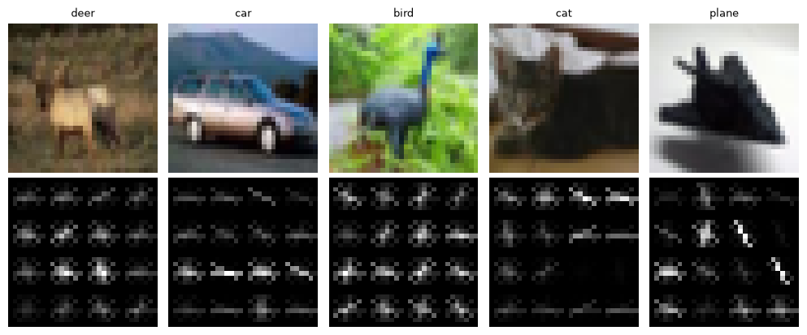
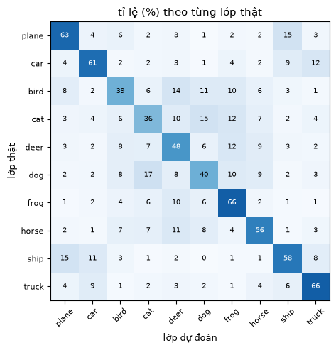

# Chương 29 · Ví dụ áp dụng: đặc trưng tốt hơn cho CIFAR-10

> Ghi chú của người biên soạn: trang này do người biên soạn viết thêm, không có trong sách gốc. Ở [trang Code](ml/ch29_code_vi), SVM đa lớp trên điểm ảnh thô của CIFAR-10 chỉ đạt khoảng 39%, và độ chính xác trên tập huấn luyện cũng chỉ ngần ấy: mô hình chưa khớp. Mục 29.1.3 của sách nhắc rằng vector đặc trưng có thể được xây dựng bằng các phương pháp khác thay vì dùng thẳng điểm ảnh. Trang này làm đúng điều đó với hai đặc trưng cổ điển: HOG (histogram of oriented gradients) cho hình dạng và histogram màu cho màu sắc.

## Bài toán

Phân loại ảnh màu $32 \times 32$ vào 10 lớp. Mô hình giữ nguyên: SVM đa lớp với hàm mất mát (29.5), huấn luyện bằng mini-batch gradient descent như mục 29.3.3. Chỉ thay vector đặc trưng $\mathbf{x}$.

## 1. Dữ liệu và đặc trưng HOG

HOG chia ảnh thành các ô $8 \times 8$ điểm ảnh; trong mỗi ô, nó đếm hướng của gradient độ sáng vào 9 ngăn (0° đến 180°), rồi chuẩn hoá theo từng khối $2 \times 2$ ô. Kết quả mô tả các cạnh và đường viền, gần như không phụ thuộc vào màu và độ sáng chung của ảnh.

<!-- run -->
```python
import numpy as np
import matplotlib.pyplot as plt
import pickle, tarfile, time, urllib.request
from pathlib import Path
from skimage.feature import hog
from skimage.color import rgb2hsv

root = Path.home() / ".cache" / "cifar10"
folder = root / "cifar-10-batches-py"
if not folder.exists():
    root.mkdir(parents=True, exist_ok=True)
    urllib.request.urlretrieve("https://www.cs.toronto.edu/~kriz/cifar-10-python.tar.gz", root / "cifar.tar.gz")
    tarfile.open(root / "cifar.tar.gz").extractall(root)

def load_batch(name):
    d = pickle.load(open(folder / name, "rb"), encoding="latin1")
    return d["data"].reshape(-1, 3, 32, 32).transpose(0, 2, 3, 1), np.array(d["labels"])

parts = [load_batch(f"data_batch_{i}") for i in range(1, 6)]
img_train = np.concatenate([p[0] for p in parts]); y_train = np.concatenate([p[1] for p in parts])
img_test, y_test = load_batch("test_batch")
classes = ["plane", "car", "bird", "cat", "deer", "dog", "frog", "horse", "ship", "truck"]

fig, axes = plt.subplots(2, 5, figsize=(10, 4.2))
for k, i in enumerate([3, 4, 6, 9, 29]):
    _, vis = hog(img_train[i].mean(2) / 255, orientations=9, pixels_per_cell=(8, 8), cells_per_block=(2, 2), visualize=True)
    axes[0, k].imshow(img_train[i]); axes[0, k].set_title(classes[y_train[i]], fontsize=9)
    axes[1, k].imshow(vis, cmap="gray")
for ax in axes.ravel(): ax.axis("off")
plt.tight_layout(); plt.show()
```

<!-- output -->
<div align=center></div>
<!-- /output -->

Hàng dưới là HOG của từng ảnh: mỗi ô vẽ một "bông hoa" gồm các vạch theo hướng của cạnh, vạch càng sáng thì cạnh theo hướng đó càng mạnh. Thân xe và mặt đường cho các vạch ngang; cánh máy bay cho một vạch chéo dài. Màu sắc bị bỏ qua hoàn toàn, nên phải bổ sung bằng histogram màu.

## 2. Vector đặc trưng

Mỗi ảnh được mô tả bởi vector HOG (324 chiều) nối với histogram 10 ngăn của kênh sắc độ (hue) trong không gian màu HSV, tổng cộng 334 chiều, ít hơn gần 10 lần so với 3072 điểm ảnh. Sau đó chuẩn hoá từng chiều về trung bình 0, phương sai 1 (theo tập huấn luyện) và thêm phần tử bằng 1 (mục 29.1.4).

<!-- run -->
```python
def features(imgs):
    out = np.empty((len(imgs), 334))
    for n, im in enumerate(imgs):
        h = hog(im.mean(2) / 255, orientations=9, pixels_per_cell=(8, 8), cells_per_block=(2, 2))
        hue = np.histogram(rgb2hsv(im)[..., 0], bins=10, range=(0, 1))[0] / 1024
        out[n] = np.r_[h, hue]
    return out

t = time.time()
F_all, F_test = features(img_train), features(img_test)
mu, sd = F_all.mean(0), F_all.std(0)
prep = lambda F: np.c_[(F - mu) / sd, np.ones(len(F))]
F_all, F_test = prep(F_all), prep(F_test)
X_train, y_tr = F_all[:49000], y_train[:49000]
X_val, y_val = F_all[49000:], y_train[49000:]
print("số chiều:", X_train.shape[1], f"| thời gian tính đặc trưng: {time.time() - t:.0f} s")
```

<!-- output -->
```output
số chiều: 335 | thời gian tính đặc trưng: 23 s
```
<!-- /output -->

334 đặc trưng cộng một phần tử bằng 1. Tính HOG cho 60000 ảnh mất khoảng nửa phút; việc này chỉ làm một lần.

## 3. SVM đa lớp trên đặc trưng mới

<small class="viz-ref">Mục 29.2.3, 29.3.2, 29.3.3 · công thức (29.5)</small>

Hàm mất mát vector hoá và mini-batch gradient descent như [trang Code](ml/ch29_code_vi). Vì các đặc trưng đã được chuẩn hoá, tốc độ học hợp lý lớn hơn hàng triệu lần so với khi dùng điểm ảnh thô (0 đến 255).

<!-- run -->
```python
def svm_loss_vectorized(W, X, y, reg):
    N = X.shape[0]
    Z = X.dot(W)
    id0 = np.arange(N)
    margins = np.maximum(0, Z - Z[id0, y].reshape(N, 1) + 1)
    margins[id0, y] = 0
    loss = np.sum(margins) / N + 0.5 * reg * np.sum(W * W)
    F = (margins > 0).astype(float)
    F[id0, y] = -np.sum(F, axis=1)
    return loss, X.T.dot(F) / N + reg * W

def train(X, y, lr, reg, epochs=20, batch_size=1000, seed=0):
    rng = np.random.default_rng(seed)
    W = 1e-3 * rng.normal(size=(X.shape[1], 10))
    for _ in range(epochs):
        mix = rng.permutation(len(y))
        for b in range(0, len(y), batch_size):
            ids = mix[b: b + batch_size]
            _, dW = svm_loss_vectorized(W, X[ids], y[ids], reg)
            W -= lr * dW
    return W

evaluate = lambda W, X, y: 100 * np.mean(np.argmax(X @ W, axis=1) == y)
best = (0, None, None)
t = time.time()
for lr in [1e-3, 1e-2, 1e-1]:
    accs = []
    for reg in [1e-4, 1e-3, 1e-2, 1e-1]:
        W = train(X_train, y_tr, lr, reg)
        accs.append(evaluate(W, X_val, y_val))
        if accs[-1] > best[0]: best = (accs[-1], W, (lr, reg))
    print(f"lr = {lr:.0e}: val acc " + ", ".join(f"{a:.1f}" for a in accs) + "  (reg = 1e-4, 1e-3, 1e-2, 1e-1)")
acc_val, W_best, (lr_b, reg_b) = best
print(f"tốt nhất: lr = {lr_b}, reg = {reg_b} | thời gian {time.time() - t:.0f} s")
print(f"độ chính xác trên tập huấn luyện: {evaluate(W_best, X_train, y_tr):.2f} %")
print(f"độ chính xác trên tập kiểm tra:   {evaluate(W_best, F_test, y_test):.2f} %   (điểm ảnh thô, trang Code: 39.27 %)")
```

<!-- output -->
```output
lr = 1e-03: val acc 50.8, 50.8, 50.8, 50.9  (reg = 1e-4, 1e-3, 1e-2, 1e-1)
lr = 1e-02: val acc 53.6, 53.6, 53.3, 53.1  (reg = 1e-4, 1e-3, 1e-2, 1e-1)
lr = 1e-01: val acc 52.5, 52.1, 51.9, 51.7  (reg = 1e-4, 1e-3, 1e-2, 1e-1)
tốt nhất: lr = 0.01, reg = 0.0001 | thời gian 8 s
độ chính xác trên tập huấn luyện: 54.43 %
độ chính xác trên tập kiểm tra:   53.21 %   (điểm ảnh thô, trang Code: 39.27 %)
```
<!-- /output -->

Cùng một mô hình, cùng hàm mất mát, chỉ thay đặc trưng: độ chính xác kiểm tra tăng từ 39% lên 53%. Một lần nữa, độ chính xác huấn luyện (54%) gần bằng độ chính xác kiểm tra, và tham số kiểm soát gần như không ảnh hưởng: mô hình tuyến tính vẫn chưa khớp, chỉ là ở một mức cao hơn. Mỗi lần huấn luyện 20 epoch chỉ mất chưa đến một giây, vì vector đặc trưng ngắn hơn gần 10 lần.

## 4. Lớp nào bị nhầm với lớp nào?

<!-- run -->
```python
from sklearn.metrics import confusion_matrix
pred = np.argmax(F_test @ W_best, axis=1)
M = confusion_matrix(y_test, pred, normalize="true")
fig, ax = plt.subplots(figsize=(6, 5))
im = ax.imshow(M, cmap="Blues", vmin=0, vmax=0.8)
for i in range(10):
    for j in range(10):
        ax.text(j, i, f"{100 * M[i, j]:.0f}", ha="center", va="center", fontsize=7, color="white" if M[i, j] > 0.45 else "black")
ax.set_xticks(range(10), classes, rotation=45, fontsize=8); ax.set_yticks(range(10), classes, fontsize=8)
ax.set(xlabel="lớp dự đoán", ylabel="lớp thật", title="tỉ lệ (%) theo từng lớp thật")
plt.tight_layout(); plt.show()
```

<!-- output -->
<div align=center></div>
<!-- /output -->

Đường chéo là tỉ lệ đúng của từng lớp. Nhìn chung, các lớp phương tiện (máy bay, ô tô, tàu thuỷ, xe tải) được nhận ra tốt hơn các lớp động vật, trừ ếch (66%). Những nhầm lẫn lớn nhất đều hợp lý: chó và mèo (15–17%), máy bay và tàu thuỷ (15% mỗi chiều: cùng nền xanh của trời và nước, cùng một vật thể thon dài), ô tô và xe tải. Chim là lớp khó nhất, hay bị nhầm với hươu, chó, ếch: những ảnh có nền cây cỏ.

## 5. Thêm hạt nhân

<small class="viz-ref">Chương 28 · mục 29.4</small>

SVM đa lớp vẫn là bộ phân loại tuyến tính trên vector đặc trưng (mục 29.4). Dùng SVM hạt nhân RBF ([chương 28](ml/ch28_vi)) trên cùng đặc trưng; vì chi phí huấn luyện tăng nhanh theo số điểm, chỉ dùng 20000 ảnh huấn luyện.

<!-- run -->
```python
from sklearn.svm import SVC
t = time.time()
ksvm = SVC(kernel="rbf", C=10, gamma="scale").fit(X_train[:20000, :-1], y_tr[:20000])
print(f"SVM hạt nhân RBF, 20000 ảnh huấn luyện: {100 * ksvm.score(F_test[:, :-1], y_test):.2f} % trên tập kiểm tra, "
      f"{len(ksvm.support_)} vector hỗ trợ, {time.time() - t:.0f} s")
```

<!-- output -->
```output
SVM hạt nhân RBF, 20000 ảnh huấn luyện: 61.91 % trên tập kiểm tra, 18090 vector hỗ trợ, 141 s
```
<!-- /output -->

SVM hạt nhân RBF tăng thêm gần 9 điểm phần trăm, lên 62%, dù chỉ dùng 20000 ảnh huấn luyện. Đổi lại, 18090 trên 20000 điểm là vector hỗ trợ: mô hình phải lưu gần như toàn bộ dữ liệu huấn luyện và tính hạt nhân với từng điểm khi dự đoán. Việc huấn luyện mất hơn hai phút, so với vài giây của SVM đa lớp tuyến tính. Đây là sự đánh đổi mục 29.4 nhắc tới.

Các mạng neuron tích chập hiện nay đạt trên 95% trên CIFAR-10. Về bản chất, chúng *học* vector đặc trưng từ dữ liệu thay vì dùng các đặc trưng thiết kế bằng tay như HOG, và lớp cuối thường vẫn là một bộ phân loại tuyến tính như hồi quy softmax hoặc SVM đa lớp.

## Tóm tắt


| Mô hình | Đặc trưng | Độ chính xác kiểm tra |
| --- | --- | --- |
| SVM đa lớp (tuyến tính) | điểm ảnh thô, 3072 chiều | 39.3% ([trang Code](ml/ch29_code_vi)) |
| SVM đa lớp (tuyến tính) | HOG + histogram màu, 334 chiều | 53.2% |
| SVM hạt nhân RBF, 20000 ảnh huấn luyện | HOG + histogram màu | 61.9% |

- Khi mô hình chưa khớp (độ chính xác huấn luyện thấp như độ chính xác kiểm tra), tăng tham số kiểm soát không giúp; cần một mô hình mạnh hơn hoặc đặc trưng tốt hơn.
- Đặc trưng thiết kế bằng tay như HOG cải thiện mô hình tuyến tính rất nhiều; hạt nhân cải thiện thêm, với chi phí lớn.
