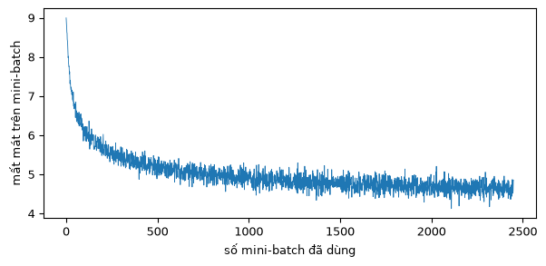
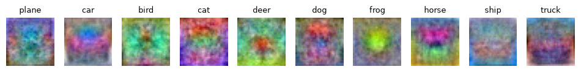

# Chương 29 · Code từ đầu

> Ghi chú của người biên soạn: trang này do người biên soạn viết thêm, không có trong sách gốc. Trang chạy lại toàn bộ code của [chương 29](ml/ch29_vi) trên CIFAR-10 với Python 3 và NumPy: hàm mất mát và gradient (cách vòng lặp và cách vector hoá), kiểm tra gradient bằng số (sách để dành cho bạn đọc), mini-batch gradient descent, tìm siêu tham số trên lưới (sửa hai lỗi trong code của sách) và hình các vector trọng số.

## Cách dùng trang này

Các khối chạy lần lượt từ trên xuống và dùng chung biến. Cần `numpy`, `matplotlib`, `scikit-learn`. Sách dùng hàm đọc dữ liệu của khoá CS231n; ở đây tự viết hàm đọc, dữ liệu CIFAR-10 (170 MB) được tải ở lần chạy đầu.

## 1. Dữ liệu CIFAR-10

<small class="viz-ref">Mục 29.1.2, 29.1.3, 29.1.4</small>

<!-- run -->
```python
import numpy as np
import matplotlib.pyplot as plt
import pickle, tarfile, time, urllib.request
from pathlib import Path
from sklearn.model_selection import train_test_split

root = Path.home() / ".cache" / "cifar10"
folder = root / "cifar-10-batches-py"
if not folder.exists():
    root.mkdir(parents=True, exist_ok=True)
    urllib.request.urlretrieve("https://www.cs.toronto.edu/~kriz/cifar-10-python.tar.gz", root / "cifar.tar.gz")
    tarfile.open(root / "cifar.tar.gz").extractall(root)

def load_batch(name):
    d = pickle.load(open(folder / name, "rb"), encoding="latin1")
    return d["data"].reshape(-1, 3, 32, 32).transpose(0, 2, 3, 1).astype(float), np.array(d["labels"])

parts = [load_batch(f"data_batch_{i}") for i in range(1, 6)]
X_train = np.concatenate([p[0] for p in parts]); y_train = np.concatenate([p[1] for p in parts])
X_test, y_test = load_batch("test_batch")
classes = ["plane", "car", "bird", "cat", "deer", "dog", "frog", "horse", "ship", "truck"]

# Extract a validation from X_train
X_train, X_val, y_train, y_val = train_test_split(X_train, y_train, test_size=1000, random_state=0)

# mean image of all training images
img_mean = np.mean(X_train, axis=0)

def feature_engineering(X):
    X = X - img_mean                    # zero-centered
    N = X.shape[0]
    X = X.reshape(N, -1)                # vectorization
    return np.concatenate((X, np.ones((N, 1))), axis=1)   # bias trick

X_train_img = X_train.copy()
X_train = feature_engineering(X_train)
X_val = feature_engineering(X_val)
X_test = feature_engineering(X_test)
print('X_train shape = ', X_train.shape)
print('X_val shape   = ', X_val.shape)
print('X_test shape  = ', X_test.shape)
```

<!-- output -->
```output
X_train shape =  (49000, 3073)
X_val shape   =  (1000, 3073)
X_test shape  =  (10000, 3073)
```
<!-- /output -->

Kích thước khớp với sách: 49000 ảnh huấn luyện, 1000 ảnh xác thực, 10000 ảnh kiểm tra; mỗi ảnh $32 \times 32 \times 3 = 3072$ số, thêm một phần tử bằng 1 cho thủ thuật gộp hệ số điều chỉnh.

## 2. Hàm mất mát: cách dùng vòng lặp

<small class="viz-ref">Mục 29.3.1 · công thức (29.5), (29.7), (29.8)</small>

Code của sách, chỉ đổi `xrange` thành `range`.

<!-- run -->
```python
def svm_loss_naive(W, X, y, reg):
    d, C = W.shape
    N = X.shape[0]
    loss = 0
    dW = np.zeros_like(W)
    for n in range(N):
        xn = X[n]
        score = xn.dot(W)
        for j in range(C):
            if j == y[n]:
                continue
            margin = 1 - score[y[n]] + score[j]
            if margin > 0:
                loss += margin
                dW[:, j] += xn
                dW[:, y[n]] -= xn
    loss /= N
    loss += 0.5 * reg * np.sum(W * W)
    dW /= N
    dW += reg * W
    return loss, dW

np.random.seed(0)
d, C, N = 100, 3, 300
W_rand = np.random.randn(d, C)
X_rand = np.random.randn(N, d)
y_rand = np.random.randint(0, C, N)
print('Loss with reg = 0  :', svm_loss_naive(W_rand, X_rand, y_rand, 0)[0])
print('Loss with reg = 0.1:', svm_loss_naive(W_rand, X_rand, y_rand, .1)[0])
```

<!-- output -->
```output
Loss with reg = 0  : 11.180405226036799
Loss with reg = 0.1: 26.21282016684075
```
<!-- /output -->

Giá trị khác sách vì dữ liệu ngẫu nhiên khác (sách không đặt hạt giống), nhưng có cùng tính chất: thêm phần kiểm soát làm mất mát tăng.

## 3. Kiểm tra gradient bằng số

<small class="viz-ref">Mục 29.3.1</small>

Phần sách "dành lại cho bạn đọc": so gradient tính theo (29.7), (29.8) với sai phân trung tâm $\frac{J(\mathbf{W} + \varepsilon\mathbf{E}_{ij}) - J(\mathbf{W} - \varepsilon\mathbf{E}_{ij})}{2\varepsilon}$ tại một vài phần tử ngẫu nhiên.

<!-- run -->
```python
def num_grad_check(f, W, n_checks=8, eps=1e-5, seed=0):
    r = np.random.default_rng(seed)
    _, g = f(W)
    for _ in range(n_checks):
        i, j = r.integers(W.shape[0]), r.integers(W.shape[1])
        Wp, Wm = W.copy(), W.copy(); Wp[i, j] += eps; Wm[i, j] -= eps
        g_num = (f(Wp)[0] - f(Wm)[0]) / (2 * eps)
        print(f"  W[{i:2d}, {j}]: giải tích {g[i, j]:+.6f}, số {g_num:+.6f}, sai số tương đối "
              f"{abs(g[i, j] - g_num) / max(1e-12, abs(g[i, j]) + abs(g_num)):.1e}")

num_grad_check(lambda W: svm_loss_naive(W, X_rand, y_rand, 0.1), W_rand)
```

<!-- output -->
```output
  W[85, 1]: giải tích +0.006211, số +0.006211, sai số tương đối 1.5e-08
  W[51, 0]: giải tích -0.049515, số -0.049515, sai số tương đối 5.8e-09
  W[30, 0]: giải tích -0.088674, số -0.088674, sai số tương đối 2.3e-09
  W[ 7, 0]: giải tích +0.058426, số +0.058426, sai số tương đối 4.6e-09
  W[17, 2]: giải tích -0.055756, số -0.055756, sai số tương đối 3.6e-10
  W[64, 2]: giải tích +0.046710, số +0.046710, sai số tương đối 1.0e-09
  W[50, 1]: giải tích +0.250289, số +0.250289, sai số tương đối 2.8e-11
  W[97, 2]: giải tích -0.228232, số -0.228232, sai số tương đối 1.3e-11
```
<!-- /output -->

Gradient tính theo (29.7), (29.8) khớp với sai phân số tới sai số tương đối cỡ $10^{-8}$ hoặc nhỏ hơn. Hàm mất mát không khả vi tại các điểm $1 - \mathbf{w}_{y_n}^T\mathbf{x}_n + \mathbf{w}_j^T\mathbf{x}_n = 0$, nhưng với $\mathbf{W}$ ngẫu nhiên, xác suất rơi đúng vào những điểm đó (trong khoảng $\pm\varepsilon$) gần như bằng 0.

## 4. Hàm mất mát: cách vector hoá

<small class="viz-ref">Mục 29.3.2 · Hình 29.5</small>

<!-- run -->
```python
def svm_loss_vectorized(W, X, y, reg):
    d, C = W.shape
    N = X.shape[0]
    Z = X.dot(W)                                        # shape (N, C)
    id0 = np.arange(Z.shape[0])
    correct_class_score = Z[id0, y].reshape(N, 1)       # shape (N, 1)
    margins = np.maximum(0, Z - correct_class_score + 1)  # shape (N, C)
    margins[id0, y] = 0
    loss = np.sum(margins)
    loss /= N
    loss += 0.5 * reg * np.sum(W * W)

    F = (margins > 0).astype(int)                       # shape (N, C)
    F[np.arange(F.shape[0]), y] = np.sum(-F, axis=1)
    dW = X.T.dot(F) / N + reg * W
    return loss, dW

d, C = 3073, 10
reg = .1
W_rand = np.random.randn(d, C)
t1 = time.time()
l1, dW1 = svm_loss_naive(W_rand, X_train, y_train, reg)
t2 = time.time()
l2, dW2 = svm_loss_vectorized(W_rand, X_train, y_train, reg)
t3 = time.time()
print('Naive       --  run time:', round(t2 - t1, 2), '(s)')
print('Vectorized  --  run time:', round(t3 - t2, 2), '(s)')
print('loss difference:', np.linalg.norm(l1 - l2))
print('gradient difference:', np.linalg.norm(dW1 - dW2))
```

<!-- output -->
```output
Naive       --  run time: 2.21 (s)
Vectorized  --  run time: 0.17 (s)
loss difference: 4.547473508864641e-10
gradient difference: 2.0220634754567503e-10
```
<!-- /output -->

Hai cách tính cho cùng kết quả. Cách vector hoá nhanh hơn khoảng 13 lần (sách: 20 lần). Tỉ lệ này phụ thuộc máy: vòng lặp Python chậm như nhau trên mọi máy, còn phép nhân ma trận dùng thư viện BLAS đa luồng.

## 5. Mini-batch gradient descent

<small class="viz-ref">Mục 29.3.3 · Hình 29.6</small>

Hàm của sách, với hai sửa nhỏ: in giá trị mất mát trung bình của mỗi *epoch* (sách in `loss_history[it]`, tức mất mát của mini-batch thứ `it`, không phải của epoch thứ `it`), và sao chép `Winit` để không sửa ma trận khởi tạo.

<!-- run -->
```python
def multiclass_svm_GD(X, y, Winit, reg, lr=.1, batch_size=1000, num_iters=50, print_every=10, seed=0):
    rng = np.random.default_rng(seed)
    W = Winit.copy()
    loss_history = []
    n_batches = int(np.ceil(X.shape[0] / float(batch_size)))
    for it in range(num_iters):
        mix_ids = rng.permutation(X.shape[0])
        for ib in range(n_batches):
            ids = mix_ids[batch_size * ib: min(batch_size * (ib + 1), X.shape[0])]
            lossib, dW = svm_loss_vectorized(W, X[ids], y[ids], reg)
            loss_history.append(lossib)
            W -= lr * dW
        if (it + 1) % print_every == 0:
            print('epoch %d/%d, loss = %f' % (it + 1, num_iters, np.mean(loss_history[-n_batches:])))
    return W, loss_history

d, C = X_train.shape[1], 10
W_init = 0.00001 * np.random.randn(d, C)
t = time.time()
W, loss_history = multiclass_svm_GD(X_train, y_train, W_init, reg=.1, lr=1e-8, num_iters=50, print_every=5)
print(f"thời gian: {time.time() - t:.0f} s")

plt.figure(figsize=(7, 3))
plt.plot(loss_history, lw=0.6)
plt.xlabel("số mini-batch đã dùng"); plt.ylabel("mất mát trên mini-batch")
plt.show()
```

<!-- output -->
```output
epoch 5/50, loss = 5.613665
epoch 10/50, loss = 5.217222
epoch 15/50, loss = 5.032403
epoch 20/50, loss = 4.919399
epoch 25/50, loss = 4.840837
epoch 30/50, loss = 4.782154
epoch 35/50, loss = 4.735619
epoch 40/50, loss = 4.697462
epoch 45/50, loss = 4.665258
epoch 50/50, loss = 4.637517
thời gian: 23 s
```

<div align=center></div>
<!-- /output -->

Mất mát giảm đều qua các epoch. Mất mát trên từng mini-batch dao động mạnh vì mỗi mini-batch là một mẫu ngẫu nhiên khác nhau của dữ liệu; đường trung bình theo epoch thì giảm đơn điệu.

## 6. Đánh giá và tìm siêu tham số trên lưới

<small class="viz-ref">Mục 29.3.3</small>

Đoạn tìm trên lưới của sách có hai lỗi: (i) dòng gọi hàm luôn truyền `lr = 1e-8` thay vì biến `lr`, nên bốn giá trị tốc độ học thực ra là một; (ii) ma trận `W` không được khởi tạo lại, nên mỗi cặp tham số tiếp tục huấn luyện từ kết quả của cặp trước. Bảng kết quả trong sách vì vậy là 16 chặng nối tiếp của *một* lần huấn luyện 1600 epoch với `lr = 1e-8`. Dưới đây là phiên bản đã sửa, mỗi cặp huấn luyện 20 epoch từ cùng một điểm khởi tạo.

<!-- run -->
```python
def multisvm_predict(W, X):
    Z = X.dot(W)
    return np.argmax(Z, axis=1)

def evaluate(W, X, y):
    y_pred = multisvm_predict(W, X)
    acc = 100 * np.mean(y_pred == y)
    return acc

print(f"sau mục 5 (lr = 1e-8, 50 epoch): đúng trên tập xác thực {evaluate(W, X_val, y_val):.1f} %")
lrs = [1e-9, 1e-8, 1e-7, 1e-6]
regs = [0.1, 0.01, 0.001, 0.0001]
best_W, best_acc, results = None, 0, {}
t = time.time()
for lr in lrs:
    for reg in regs:
        W, loss_history = multiclass_svm_GD(X_train, y_train, W_init, reg, lr=lr, num_iters=20, print_every=10**9)
        acc = evaluate(W, X_val, y_val)
        results[lr, reg] = acc
        if acc > best_acc:
            best_acc, best_W, best_lr = acc, W, lr
for lr in lrs:
    print(f"lr = {lr:.0e}: val acc = " + ", ".join(f"{results[lr, r]:.1f} (reg {r:g})" for r in regs))
print(f"thời gian: {time.time() - t:.0f} s")
```

<!-- output -->
```output
sau mục 5 (lr = 1e-8, 50 epoch): đúng trên tập xác thực 37.3 %
lr = 1e-09: val acc = 30.5 (reg 0.1), 30.5 (reg 0.01), 30.5 (reg 0.001), 30.5 (reg 0.0001)
lr = 1e-08: val acc = 36.2 (reg 0.1), 36.2 (reg 0.01), 36.2 (reg 0.001), 36.2 (reg 0.0001)
lr = 1e-07: val acc = 40.8 (reg 0.1), 40.8 (reg 0.01), 40.8 (reg 0.001), 40.8 (reg 0.0001)
lr = 1e-06: val acc = 38.0 (reg 0.1), 37.8 (reg 0.01), 38.0 (reg 0.001), 38.0 (reg 0.0001)
thời gian: 176 s
```
<!-- /output -->

Sau khi sửa, kết quả cho thấy hai điều mà bảng của sách che mất:

- **Tốc độ học quyết định kết quả**: từ 30.5% với `lr = 1e-9` (chưa đi được bao xa sau 20 epoch) lên 40.8% với `lr = 1e-7`, rồi giảm với `1e-6` (bước quá dài).
- **Tham số kiểm soát gần như không có tác dụng** trong khoảng 0.0001 đến 0.1 của sách: mỗi bước, phần kiểm soát chỉ thu nhỏ $\mathbf{W}$ đi một tỉ lệ $\eta \cdot \text{reg} \leq 10^{-7}$. Các điểm ảnh có giá trị tới hàng trăm nên $\mathbf{W}$ tối ưu rất nhỏ, và phần $\frac{\text{reg}}{2}\|\mathbf{W}\|_F^2$ không đáng kể so với mất mát dữ liệu. Muốn phần kiểm soát có tác dụng, `reg` phải lên tới cỡ $10^3$–$10^4$.

<!-- run -->
```python
acc = evaluate(best_W, X_test, y_test)
print('Accuracy on test data = %.2f %%' % acc)
print('Accuracy on training data = %.2f %%' % evaluate(best_W, X_train, y_train))
```

<!-- output -->
```output
Accuracy on test data = 39.27 %
Accuracy on training data = 40.21 %
```
<!-- /output -->

Kết quả gần với sách (39.88%). Độ chính xác trên tập huấn luyện cũng chỉ khoảng 40%: mô hình **chưa khớp** chứ không quá khớp. Đây là lý do tăng tham số kiểm soát không giúp được gì; giới hạn nằm ở bản thân mô hình tuyến tính trên điểm ảnh thô. [Trang Ví dụ áp dụng](ml/ch29_app_vi) cải thiện bằng cách thay điểm ảnh bằng đặc trưng tốt hơn, đúng hướng mục 29.1.3 gợi ý.

## 7. Vector trọng số dưới dạng ảnh

<small class="viz-ref">Mục 29.3.4 · Hình 29.7</small>

<!-- run -->
```python
fig, axes = plt.subplots(1, 10, figsize=(12, 1.8))
Wimg = best_W[:-1].reshape(32, 32, 3, 10)               # bỏ hàng hệ số điều chỉnh
for k, ax in enumerate(axes):
    w = Wimg[..., k]
    ax.imshow((w - w.min()) / (w.max() - w.min())); ax.axis("off"); ax.set_title(classes[k], fontsize=9)
plt.show()
```

<!-- output -->
<div align=center></div>
<!-- /output -->

Hình 29.7 bản màu: mỗi vector $\mathbf{w}_i$ (bỏ hệ số điều chỉnh) được sắp lại thành ảnh $32 \times 32 \times 3$ và co giãn về $[0, 1]$. Một số đặc điểm sách nêu đọc được ở đây: *plane* và *ship* có nền xanh của trời và nước, *frog* có màu xanh lá ở giữa, *car* có khối màu đỏ ở giữa ảnh. Mỗi vector giống một "ảnh trung bình" mờ của lớp đó, vì mô hình tuyến tính chỉ có một mẫu cho mỗi lớp.

## Tóm tắt

| Trong sách | Trên trang này |
| --- | --- |
| Đọc CIFAR-10 bằng `cs231n.data_utils` | tự viết hàm đọc, tải dữ liệu nếu chưa có |
| `svm_loss_naive`, `svm_loss_vectorized` (29.3.1, 29.3.2) | chạy được với Python 3; hai cách khớp nhau |
| Kiểm tra gradient "dành cho bạn đọc" | sai số tương đối cỡ $10^{-8}$ |
| Mini-batch GD (29.3.3) | in mất mát trung bình theo epoch |
| Tìm trên lưới | sửa hai lỗi (`lr` cố định, `W` không khởi tạo lại); `lr` quyết định, `reg` gần như vô tác dụng |
| Độ chính xác kiểm tra 39.88% | 39.27%; độ chính xác huấn luyện cũng chỉ 40%: chưa khớp |
| Hình 29.7 | bản màu |
