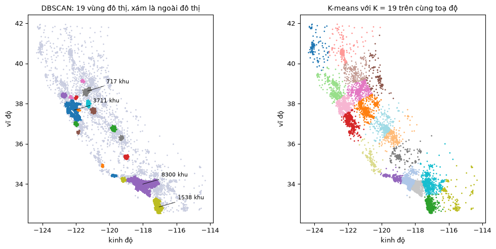
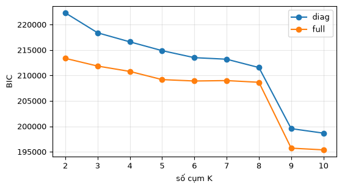
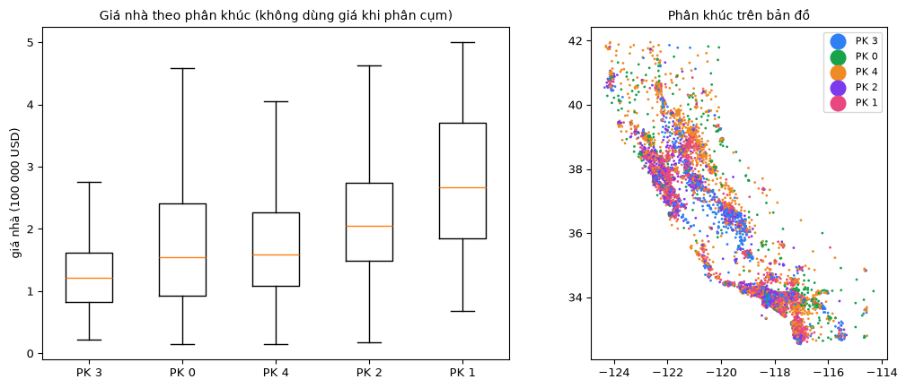

# Advanced clustering · Ví dụ áp dụng: đô thị và khu dân cư California

> Ghi chú của người biên soạn: trang này do người biên soạn viết thêm. Dữ liệu là bộ *California Housing* (Pace và Barry, 1997) từ điều tra dân số Mỹ năm 1990, có sẵn trong scikit-learn. Bộ này cũng được dùng ở [chương 7](ml/ch07_app_vi) và bài [Học tổ hợp](ml/ensemble_app_vi).

## Bài toán

Bộ dữ liệu có 20 640 khu dân cư (block group). Mỗi khu có toạ độ và vài chỉ số kinh tế–xã hội. Trang này làm hai việc phân cụm khác nhau, mỗi việc hợp với một thuật toán:

1. **Tìm các vùng đô thị** chỉ từ vị trí các khu dân cư. Số đô thị không biết trước, đô thị có hình dạng bất kỳ, và các khu nông thôn lẻ tẻ không thuộc đô thị nào. Đây đúng là việc của **DBSCAN**.
2. **Phân khúc khu dân cư** theo đặc điểm (thu nhập, tuổi nhà, mật độ ở…). Các nhóm chồng lấn nhau và có hình elip trong không gian đặc trưng, và ta muốn biết mức độ chắc chắn của mỗi khu. Đây là việc của **GMM**.

## 1. Dữ liệu

<!-- run -->
```python
import numpy as np
import pandas as pd
import matplotlib.pyplot as plt
from sklearn.datasets import fetch_california_housing

cal = fetch_california_housing(as_frame=True)
df = cal.frame.rename(columns={"MedInc": "thu nhập", "HouseAge": "tuổi nhà", "AveRooms": "số phòng",
                               "AveBedrms": "phòng ngủ", "Population": "dân số", "AveOccup": "người/hộ",
                               "Latitude": "vĩ độ", "Longitude": "kinh độ", "MedHouseVal": "giá nhà"})
print(df.shape)
print(df.describe().loc[["mean", "50%", "min", "max"]].round(2).to_string())
```

<!-- output -->
```output
(20640, 9)
      thu nhập  tuổi nhà  số phòng  phòng ngủ    dân số  người/hộ  vĩ độ  kinh độ  giá nhà
mean      3.87     28.64      5.43       1.10   1425.48      3.07  35.63  -119.57     2.07
50%       3.53     29.00      5.23       1.05   1166.00      2.82  34.26  -118.49     1.80
min       0.50      1.00      0.85       0.33      3.00      0.69  32.54  -124.35     0.15
max      15.00     52.00    141.91      34.07  35682.00   1243.33  41.95  -114.31     5.00
```
<!-- /output -->

## 2. Tìm các vùng đô thị bằng DBSCAN

<small class="viz-ref">Mục P.5 · hình P.6, P.7</small>

Toạ độ là kinh độ và vĩ độ trên mặt cầu, nên khoảng cách đúng là khoảng cách **haversine** (đường tròn lớn). scikit-learn hỗ trợ khoảng cách này khi toạ độ tính bằng radian; khi đó $\varepsilon$ là góc, bằng khoảng cách chia cho bán kính Trái Đất (6371 km).

Một khu được coi là "lõi đô thị" nếu trong bán kính 8 km có ít nhất 60 khu dân cư khác.

<!-- run -->
```python
from sklearn.cluster import DBSCAN, KMeans

coords = np.radians(df[["vĩ độ", "kinh độ"]].to_numpy())
R_EARTH = 6371.0
db = DBSCAN(eps=8 / R_EARTH, min_samples=60, metric="haversine", algorithm="ball_tree").fit(coords)
df["đô thị"] = db.labels_
n_city = db.labels_.max() + 1
print(f"số vùng đô thị: {n_city}   khu dân cư nằm ngoài đô thị (nhiễu): {np.sum(db.labels_ < 0)} "
      f"({np.mean(db.labels_ < 0):.1%})")

summary = (df[df["đô thị"] >= 0].groupby("đô thị")
           .agg(số_khu=("giá nhà", "size"), vĩ_độ=("vĩ độ", "mean"), kinh_độ=("kinh độ", "mean"),
                dân_số=("dân số", "sum"), thu_nhập=("thu nhập", "median"), giá_nhà=("giá nhà", "median"))
           .sort_values("số_khu", ascending=False))
print(summary.head(8).round(2).to_string())
rural = df[df["đô thị"] < 0]
print(f"\nngoài đô thị: thu nhập trung vị {rural['thu nhập'].median():.2f}, giá nhà trung vị {rural['giá nhà'].median():.2f}")

km = KMeans(n_city, n_init=10, random_state=0).fit_predict(df[["vĩ độ", "kinh độ"]])
fig, axes = plt.subplots(1, 2, figsize=(11, 5))
ax = axes[0]
ax.scatter(df["kinh độ"][db.labels_ < 0], df["vĩ độ"][db.labels_ < 0], s=1, c="#c9cde0")
for c in range(n_city):
    m = db.labels_ == c
    ax.scatter(df["kinh độ"][m], df["vĩ độ"][m], s=1.5)
for _, r in summary.head(4).iterrows():
    ax.annotate(f"{int(r['số_khu'])} khu", (r["kinh_độ"], r["vĩ_độ"]), (r["kinh_độ"] + 1.2, r["vĩ_độ"] + 0.4),
                fontsize=8, arrowprops=dict(arrowstyle="-", lw=0.6))
ax.set_title(f"DBSCAN: {n_city} vùng đô thị, xám là ngoài đô thị", fontsize=10)
axes[1].scatter(df["kinh độ"], df["vĩ độ"], s=1, c=km, cmap="tab20")
axes[1].set_title(f"K-means với K = {n_city} trên cùng toạ độ", fontsize=10)
for a in axes: a.set_xlabel("kinh độ"); a.set_ylabel("vĩ độ"); a.set_aspect(1.2)
fig.tight_layout()
```

<!-- output -->
```output
số vùng đô thị: 19   khu dân cư nằm ngoài đô thị (nhiễu): 4077 (19.8%)
        số_khu  vĩ_độ  kinh_độ      dân_số  thu_nhập  giá_nhà
đô thị                                                       
4         8300  33.98  -118.10  12592868.0      3.71     2.03
0         3711  37.66  -122.18   4951707.0      4.24     2.58
8         1538  32.84  -117.13   2303305.0      3.54     1.69
7          717  38.61  -121.38   1110797.0      3.16     1.22
2          359  36.78  -119.77    479212.0      2.68     0.74
9          312  38.00  -121.29    355229.0      2.81     1.05
3          222  35.37  -119.01    312623.0      2.58     0.71
15         220  37.66  -120.98    284553.0      2.88     1.25

ngoài đô thị: thu nhập trung vị 2.90, giá nhà trung vị 1.12
```

<div align=center></div>
<!-- /output -->

Với bán kính 8 km và ngưỡng 60 khu, DBSCAN tìm được 19 vùng đô thị, và coi 4077 khu (gần 20%) là ngoài đô thị. Bốn vùng lớn nhất đúng là bốn đô thị lớn nhất California năm 1990:

- **Los Angeles** (8300 khu, quanh 34.0°B, 118.1°T), hình dạng trải dài và không đều, gồm cả Orange County;
- **Vùng vịnh San Francisco** (3711 khu);
- **San Diego** (1538 khu);
- **Sacramento** (717 khu).

Thu nhập và giá nhà trung vị giảm dần theo quy mô đô thị. Các khu ngoài đô thị có giá nhà trung vị chỉ 1.12, bằng một nửa Los Angeles.

So sánh với K-means cùng số cụm ở bên phải: K-means buộc phải chia **toàn bộ** bang thành 19 vùng lồi, cỡ gần bằng nhau. Nó cắt Los Angeles thành nhiều mảnh, và gán cả những khu sa mạc hẻo lánh vào một "cụm". Đây đúng là các điểm yếu ở [mục P.1](ml/cluster_vi).

## 3. Phân khúc khu dân cư bằng GMM

<small class="viz-ref">Mục P.2–P.4</small>

Ta phân cụm theo bốn đặc trưng: thu nhập, tuổi nhà, số phòng mỗi hộ và số người mỗi hộ. **Không dùng giá nhà**, để sau đó kiểm tra xem các phân khúc tìm được có ý nghĩa về giá hay không. Ba đặc trưng bị lệch phải được lấy log, rồi tất cả được chuẩn hoá. Các khu có giá trị cực đoan (số phòng hay số người mỗi hộ thuộc 0.5% cao nhất, thường là ký túc xá hoặc khu nghỉ dưỡng) được loại ra để không làm méo các Gauss.

<!-- run -->
```python
from sklearn.preprocessing import StandardScaler
from sklearn.mixture import GaussianMixture

feat = ["thu nhập", "tuổi nhà", "số phòng", "người/hộ"]
keep = (df["số phòng"] < df["số phòng"].quantile(0.995)) & (df["người/hộ"] < df["người/hộ"].quantile(0.995))
d2 = df[keep].copy()
Z = np.c_[np.log(d2["thu nhập"]), d2["tuổi nhà"], np.log(d2["số phòng"]), np.log(d2["người/hộ"])]
Z = StandardScaler().fit_transform(Z)
print("số khu dùng để phân cụm:", len(d2))

Ks = range(2, 11)
bics = {t: [GaussianMixture(k, covariance_type=t, n_init=3, random_state=0).fit(Z).bic(Z) for k in Ks] for t in ["diag", "full"]}
for t, b in bics.items():
    print(f"{t:<5} BIC:", "  ".join(f"K={k}:{v:.0f}" for k, v in zip(Ks, b)))

fig, ax = plt.subplots(figsize=(6, 3.2))
for t, b in bics.items():
    ax.plot(list(Ks), b, "o-", label=t)
ax.set_xlabel("số cụm K"); ax.set_ylabel("BIC"); ax.legend(); ax.grid(alpha=.3)
```

<!-- output -->
```output
số khu dùng để phân cụm: 20433
diag  BIC: K=2:222309  K=3:218395  K=4:216612  K=5:214883  K=6:213506  K=7:213198  K=8:211563  K=9:199557  K=10:198672
full  BIC: K=2:213369  K=3:211856  K=4:210800  K=5:209192  K=6:208917  K=7:208998  K=8:208666  K=9:195721  K=10:195384
```

<div align=center></div>
<!-- /output -->

## 4. Đọc các phân khúc

<small class="viz-ref">Mục P.2</small>

Bảng BIC có hai điều đáng chú ý:

- **Dạng full tốt hơn hẳn dạng diag** ở mọi $K$: các đặc trưng tương quan với nhau (khu thu nhập cao thường có nhà rộng hơn), nên cụm là các elip nghiêng.
- **BIC giảm đột ngột ở $K = 9$.** Đó không phải một phân khúc mới. Cột tuổi nhà bị **cắt trần** ở 52 năm: 1260 khu có tuổi nhà đúng bằng 52. Với $K = 9$, GMM dành riêng một cụm cho các khu này, với độ lệch chuẩn của tuổi nhà chỉ khoảng 0.01 năm. Một Gauss gần như suy biến như vậy cho mật độ rất lớn, nên likelihood tăng vọt. Đây chính là cái bẫy "cụm co về một điểm" ở [mục P.3](ml/cluster_vi), xuất hiện trong dữ liệu thật dưới dạng một giá trị bị ghi trùng hàng loạt.

Ngoài bước nhảy giả đó, BIC giảm đều nhưng chậm dần. Với dữ liệu thật hàng chục nghìn điểm, đây là chuyện thường gặp: dữ liệu không thật sự là hỗn hợp của vài Gauss, nên thêm cụm luôn khớp tốt hơn một chút. Ta chọn $K = 5$, chỗ BIC bắt đầu giảm chậm, để có số phân khúc đủ ít mà vẫn diễn giải được.

<!-- run -->
```python
gm = GaussianMixture(5, covariance_type="full", n_init=5, random_state=0).fit(Z)
P = gm.predict_proba(Z)
d2["phân khúc"] = P.argmax(1)
d2["độ chắc chắn"] = P.max(1)
prof = (d2.groupby("phân khúc")
        .agg(số_khu=("giá nhà", "size"), thu_nhập=("thu nhập", "median"), tuổi_nhà=("tuổi nhà", "median"),
             số_phòng=("số phòng", "median"), người_hộ=("người/hộ", "median"), giá_nhà=("giá nhà", "median"),
             chắc_chắn=("độ chắc chắn", "mean"))
        .sort_values("giá_nhà"))
print(prof.round(2).to_string())
print(f"\ntỉ lệ khu có xác suất phân khúc lớn nhất < 0.6: {np.mean(d2['độ chắc chắn'] < 0.6):.1%}")

order = prof.index.tolist()
fig, axes = plt.subplots(1, 2, figsize=(11, 4.4))
axes[0].boxplot([d2.loc[d2["phân khúc"] == k, "giá nhà"] for k in order], showfliers=False)
axes[0].set_xticks(range(1, 6), [f"PK {k}" for k in order])
axes[0].set_ylabel("giá nhà (100 000 USD)"); axes[0].set_title("Giá nhà theo phân khúc (không dùng giá khi phân cụm)", fontsize=10)
pal = np.array(["#2f80f5", "#16a34a", "#f08a24", "#7c3aed", "#e8487f"])        # từ phân khúc rẻ nhất đến đắt nhất
rank = {k: r for r, k in enumerate(order)}
perm = np.random.default_rng(0).permutation(len(d2))       # vẽ theo thứ tự ngẫu nhiên để không màu nào che màu nào
axes[1].scatter(d2["kinh độ"].to_numpy()[perm], d2["vĩ độ"].to_numpy()[perm], s=1,
                c=pal[d2["phân khúc"].map(rank).to_numpy()[perm]])
for r, k in enumerate(order):
    axes[1].scatter([], [], c=pal[r], label=f"PK {k}")
axes[1].legend(markerscale=2, fontsize=8); axes[1].set_aspect(1.2); axes[1].set_title("Phân khúc trên bản đồ", fontsize=10)
fig.tight_layout()
```

<!-- output -->
```output
           số_khu  thu_nhập  tuổi_nhà  số_phòng  người_hộ  giá_nhà  chắc_chắn
phân khúc                                                                    
3            4056      2.24      35.0      4.33      3.72     1.22       0.81
0            1055      2.00      27.0      4.24      2.30     1.55       0.78
4            4403      3.11      17.0      4.95      2.44     1.59       0.74
2            6412      3.78      36.0      5.18      2.67     2.05       0.74
1            4507      5.69      21.0      6.49      2.93     2.66       0.76

tỉ lệ khu có xác suất phân khúc lớn nhất < 0.6: 21.4%
```

<div align=center></div>
<!-- /output -->

Dù không dùng giá nhà khi phân cụm, năm phân khúc xếp thành một thang giá rõ ràng. Mỗi phân khúc có một "chân dung" dễ gọi tên (số thứ tự phân khúc do GMM đặt ngẫu nhiên):

| Phân khúc | Đặc điểm (trung vị) | Giá nhà trung vị | Trên bản đồ |
| --- | --- | --- | --- |
| PK 3 | thu nhập thấp (2.24), nhà cũ (35 năm), nhỏ, **đông người mỗi hộ** (3.7) | 1.22 | Thung lũng Trung tâm, các khu nội đô cũ của Los Angeles |
| PK 0 | thu nhập thấp nhất (2.00) nhưng **ít người mỗi hộ** (2.3) | 1.55, dao động rất rộng | rải rác vùng nông thôn, sa mạc |
| PK 4 | thu nhập trung bình, **nhà mới** (17 năm) | 1.59 | vùng ven đô đang mở rộng, phía bắc bang |
| PK 2 | trung lưu (3.78), nhà cũ (36 năm) | 2.05 | các khu dân cư lâu đời trong đô thị |
| PK 1 | **thu nhập cao** (5.69), nhà rộng (6.5 phòng) | 2.66 | ngoại ô ven biển quanh San Francisco và Los Angeles |

Đây là lợi ích của phân cụm **mềm**: 21.4% số khu có xác suất thuộc phân khúc chính dưới 0.6. Đó là những khu "lai", nằm giữa hai kiểu. Một ứng dụng thực tế (định giá, tiếp thị) có thể xử lý riêng các khu này thay vì ép chúng vào một nhóm.

Cũng nên thừa nhận giới hạn: hộp giá của các phân khúc chồng lấn nhau nhiều, và số phân khúc là do ta chọn chứ không phải "đúng". Phân cụm cho ra một cách nhìn **hữu ích** về dữ liệu, không phải một sự thật duy nhất. Thử $K = 4$ hay $K = 6$ sẽ cho những cách nhìn khác, cũng hợp lý.
