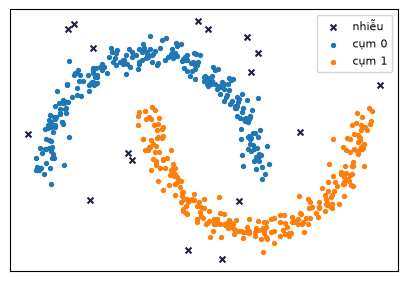

# Advanced clustering · Code từ đầu

> Ghi chú của người biên soạn: trang này do người biên soạn viết thêm. Trang tự viết bằng NumPy các thuật toán trong bài [Phân cụm nâng cao](ml/cluster_vi): EM cho mô hình hỗn hợp Gauss kèm BIC, DBSCAN, phân cụm phân cấp với bốn tiêu chí liên kết, và hệ số silhouette. Mỗi phần đều được đối chiếu với scikit-learn hoặc SciPy.

## Cách dùng trang này

Các khối chạy lần lượt từ trên xuống và dùng chung biến. Cần `numpy` và `matplotlib`; scikit-learn và SciPy chỉ dùng để sinh dữ liệu và đối chiếu kết quả.

## 1. EM cho mô hình hỗn hợp Gauss

<small class="viz-ref">Mục P.2–P.3 · thuật toán P.1 · hình P.3</small>

Mật độ Gauss được tính trong **thang log** để tránh tràn số: với dữ liệu nhiều chiều, $\mathcal{N}(\mathbf{x} \mid \cdot)$ có thể nhỏ hơn $10^{-300}$. Trách nhiệm được chuẩn hoá bằng mẹo **log-sum-exp**: $\log \sum_k e^{a_k} = m + \log \sum_k e^{a_k - m}$ với $m = \max_k a_k$.

<!-- run -->
```python
import numpy as np
import matplotlib.pyplot as plt
from sklearn.datasets import make_blobs

def log_gauss(X, mu, S):
    """log N(x | mu, S) cho mọi hàng của X, qua phân tích Cholesky S = L Lᵀ."""
    d = X.shape[1]
    L = np.linalg.cholesky(S)
    z = np.linalg.solve(L, (X - mu).T)                  # z = L⁻¹(x − μ), nên ‖z‖² = (x − μ)ᵀ S⁻¹ (x − μ)
    return -0.5 * (z ** 2).sum(0) - np.log(np.diag(L)).sum() - 0.5 * d * np.log(2 * np.pi)

def logsumexp(A):
    m = A.max(1, keepdims=True)
    return m[:, 0] + np.log(np.exp(A - m).sum(1))

def em_gmm(X, K, iters=200, tol=1e-6, seed=0, reg=1e-6):
    n, d = X.shape
    rng = np.random.default_rng(seed)
    mu = X[rng.choice(n, K, replace=False)]
    S = np.array([np.cov(X.T) for _ in range(K)])
    pi = np.full(K, 1 / K)
    ll_hist = []
    for _ in range(iters):
        # bước E
        logp = np.stack([np.log(pi[k]) + log_gauss(X, mu[k], S[k]) for k in range(K)], axis=1)
        lse = logsumexp(logp)
        R = np.exp(logp - lse[:, None])
        ll_hist.append(lse.sum())
        # bước M
        Nk = R.sum(0)
        pi = Nk / n
        mu = (R.T @ X) / Nk[:, None]
        S = np.array([(R[:, k, None] * (X - mu[k])).T @ (X - mu[k]) / Nk[k] + reg * np.eye(d) for k in range(K)])
        if len(ll_hist) > 1 and ll_hist[-1] - ll_hist[-2] < tol * abs(ll_hist[-1]):
            break
    return pi, mu, S, R, np.array(ll_hist)

# dữ liệu bị kéo dẹt, như hình P.1 và P.3
X, y = make_blobs(n_samples=600, centers=3, random_state=170)
X = X @ np.array([[0.6, -0.64], [-0.41, 0.85]])
pi, mu, S, R, ll = em_gmm(X, 3)
print(f"số vòng: {len(ll)}   log-likelihood: đầu {ll[0]:.2f}, cuối {ll[-1]:.2f}")
print("log-likelihood không bao giờ giảm:", bool(np.all(np.diff(ll) >= -1e-8)))
print("trọng số π:", pi.round(3))
print("tâm μ:\n", mu.round(3))
```

<!-- output -->
```output
số vòng: 27   log-likelihood: đầu -2759.05, cuối -1495.28
log-likelihood không bao giờ giảm: True
trọng số π: [0.333 0.334 0.333]
tâm μ:
 [[-2.751  2.96 ]
 [-3.133  1.099]
 [ 1.016 -0.932]]
```
<!-- /output -->

EM hội tụ sau 27 vòng, và log-likelihood tăng ở **mọi** vòng, đúng như chứng minh ở [mục P.3](ml/cluster_vi). Ba trọng số gần bằng nhau (mỗi cụm 200 điểm), đúng với cách dữ liệu được sinh ra.

Đối chiếu với `GaussianMixture` của scikit-learn, khởi tạo cùng các tâm:

<!-- run -->
```python
from sklearn.mixture import GaussianMixture
from sklearn.metrics import adjusted_rand_score

gm = GaussianMixture(3, covariance_type="full", means_init=mu, tol=1e-8, max_iter=500, reg_covar=1e-6).fit(X)
order = [int(np.argmin(np.linalg.norm(gm.means_ - m, axis=1))) for m in mu]
print("chênh lệch lớn nhất của μ:", np.abs(gm.means_[order] - mu).max().round(6))
print("chênh lệch lớn nhất của Σ:", np.abs(gm.covariances_[order] - S).max().round(6))
print(f"log-likelihood / điểm: tự viết {ll[-1] / len(X):.6f}   sklearn {gm.score(X):.6f}")
lab = R.argmax(1)
print("ARI so với nhãn thật:", adjusted_rand_score(y, lab))
print("số điểm có trách nhiệm lớn nhất < 0.9 (không chắc chắn):", int(np.sum(R.max(1) < 0.9)))
```

<!-- output -->
```output
chênh lệch lớn nhất của μ: 5e-06
chênh lệch lớn nhất của Σ: 9e-06
log-likelihood / điểm: tự viết -2.492135   sklearn -2.492135
ARI so với nhãn thật: 1.0
số điểm có trách nhiệm lớn nhất < 0.9 (không chắc chắn): 1
```
<!-- /output -->

Code 30 dòng cho cùng tham số với scikit-learn, sai khác chỉ ở chữ số thứ sáu (do tiêu chí dừng khác nhau). Chỉ 1 trong 600 điểm có trách nhiệm lớn nhất dưới 0.9: các cụm tách nhau rõ, nên phân cụm mềm gần như trùng phân cụm cứng.

## 2. Chọn số cụm bằng BIC

<small class="viz-ref">Mục P.4 · hình P.5</small>

Số tham số tự do của GMM dạng full trong $d$ chiều: $K - 1$ trọng số (vì tổng bằng 1), $Kd$ toạ độ tâm, và $K\,d(d+1)/2$ phần tử hiệp phương sai.

<!-- run -->
```python
def n_params(K, d):
    return (K - 1) + K * d + K * d * (d + 1) // 2

X4, y4 = make_blobs(n_samples=800, centers=[[0, 0], [4, 0], [2, 3.5], [6, 4]], cluster_std=[0.8, 0.8, 0.8, 1.0], random_state=4)
res = []
for K in range(1, 9):
    best = max((em_gmm(X4, K, seed=s)[4][-1] for s in range(5)))        # 5 khởi tạo, lấy log-likelihood tốt nhất
    p = n_params(K, 2)
    res.append((K, best, -2 * best + p * np.log(len(X4)), -2 * best + 2 * p))
    print(f"K = {K}: {p:2d} tham số   log L {best:9.1f}   BIC {res[-1][2]:8.1f}   AIC {res[-1][3]:8.1f}")
print("K có BIC nhỏ nhất:", min(res, key=lambda r: r[2])[0])
```

<!-- output -->
```output
K = 1:  5 tham số   log L   -3438.5   BIC   6910.4   AIC   6887.0
K = 2: 11 tham số   log L   -3275.4   BIC   6624.3   AIC   6572.8
K = 3: 17 tham số   log L   -3151.7   BIC   6417.1   AIC   6337.4
K = 4: 23 tham số   log L   -3027.4   BIC   6208.5   AIC   6100.7
K = 5: 29 tham số   log L   -3021.2   BIC   6236.3   AIC   6100.4
K = 6: 35 tham số   log L   -3018.3   BIC   6270.6   AIC   6106.6
K = 7: 41 tham số   log L   -3004.6   BIC   6283.3   AIC   6091.2
K = 8: 47 tham số   log L   -3008.1   BIC   6330.3   AIC   6110.2
K có BIC nhỏ nhất: 4
```
<!-- /output -->

- Log-likelihood tăng mạnh đến $K = 4$ (−3438 → −3027), rồi gần như đi ngang. BIC nhỏ nhất ở đúng $K = 4$.
- AIC phạt nhẹ hơn, nên nó gần như không phân biệt được $K$ từ 4 đến 8. Ở đây nó còn chọn $K = 7$ (6091.2), nhỉnh hơn $K = 4$ (6100.7) một chút. Đây là lý do BIC thường được ưa hơn khi mục tiêu là tìm số cụm "thật".
- Log-likelihood của $K = 8$ **thấp hơn** $K = 7$, dù mô hình 8 cụm chứa mô hình 7 cụm. EM đã kẹt ở cực đại địa phương trong cả 5 lần khởi tạo. Đó là lý do cần chạy nhiều khởi tạo (`n_init` trong scikit-learn).

## 3. DBSCAN

<small class="viz-ref">Mục P.5 · thuật toán P.2 · hình P.6, P.7</small>

Cài đặt đúng theo thuật toán P.2. Để đơn giản, ta tính cả ma trận khoảng cách $N \times N$; thư viện dùng cây k-d hoặc ball tree để không phải làm vậy.

<!-- run -->
```python
from collections import deque
from sklearn.datasets import make_moons

def dbscan(X, eps, min_pts):
    D = np.sqrt(((X[:, None, :] - X[None, :, :]) ** 2).sum(-1))
    nbrs = [np.where(D[i] <= eps)[0] for i in range(len(X))]
    core = np.array([len(nb) >= min_pts for nb in nbrs])
    label = np.full(len(X), -1)
    c = 0
    for i in range(len(X)):
        if not core[i] or label[i] != -1:
            continue
        label[i] = c
        q = deque([i])
        while q:                                    # loang theo chiều rộng qua các điểm lõi
            p = q.popleft()
            for j in nbrs[p]:
                if label[j] == -1:
                    label[j] = c
                    if core[j]:
                        q.append(j)
        c += 1
    return label, core

rng = np.random.default_rng(1)
Xm, ym = make_moons(n_samples=500, noise=0.06, random_state=0)
Xm = np.r_[Xm, rng.uniform([-1.3, -0.8], [2.3, 1.3], (25, 2))]
lab_db, core = dbscan(Xm, eps=0.15, min_pts=5)
print(f"số cụm {lab_db.max() + 1}, điểm lõi {core.sum()}, điểm biên {np.sum((lab_db >= 0) & ~core)}, nhiễu {np.sum(lab_db < 0)}")

from sklearn.cluster import DBSCAN
sk = DBSCAN(eps=0.15, min_samples=5).fit(Xm)
print("trùng với sklearn (ARI giữa hai cách gán):", adjusted_rand_score(sk.labels_, lab_db),
      "  cùng tập điểm nhiễu:", bool(np.array_equal(sk.labels_ < 0, lab_db < 0)))

fig, ax = plt.subplots(figsize=(5, 3.4))
ax.scatter(*Xm[lab_db < 0].T, s=18, marker="x", c="#1f2340", label="nhiễu")
for c in range(lab_db.max() + 1):
    ax.scatter(*Xm[lab_db == c].T, s=8, label=f"cụm {c}")
ax.legend(fontsize=8); ax.set_xticks([]); ax.set_yticks([])
```

<!-- output -->
```output
số cụm 2, điểm lõi 503, điểm biên 5, nhiễu 17
trùng với sklearn (ARI giữa hai cách gán): 1.0   cùng tập điểm nhiễu: True
```

<div align=center></div>
<!-- /output -->

Kết quả trùng hoàn toàn với scikit-learn: 2 cụm, 17 điểm nhiễu. Với $\varepsilon = 0.15$, đa số các điểm (503 trên 525) là điểm lõi; chỉ 5 điểm là điểm biên.

Một điểm biên nằm trong bán kính $\varepsilon$ của điểm lõi thuộc **hai** cụm khác nhau sẽ được gán cho cụm nào loang tới nó trước. Vì vậy kết quả của DBSCAN có thể phụ thuộc vào thứ tự duyệt các điểm, nhưng chỉ ở các điểm biên. Điểm lõi và điểm nhiễu thì luôn như nhau.

## 4. Phân cụm phân cấp với công thức Lance–Williams

<small class="viz-ref">Mục P.6 · hình P.8, P.9</small>

Sau khi gộp cụm $i$ và $j$ thành cụm mới, khoảng cách từ cụm mới tới mọi cụm $k$ khác được cập nhật từ các khoảng cách cũ, không cần tính lại từ dữ liệu. Đó là **công thức Lance–Williams** (1967):

$$
d(i \cup j, k) = \alpha_i\, d(i, k) + \alpha_j\, d(j, k) + \beta\, d(i, j) + \gamma\, |d(i, k) - d(j, k)|.
$$

Single linkage ứng với $\alpha_i = \alpha_j = \tfrac12$, $\beta = 0$, $\gamma = -\tfrac12$, tức $\min$. Complete linkage là $\gamma = +\tfrac12$, tức $\max$. Average linkage và Ward dùng hệ số theo kích thước cụm. Riêng Ward làm việc với **bình phương** khoảng cách.

<!-- run -->
```python
def agglomerative(X, method):
    n = len(X)
    D = np.sqrt(((X[:, None] - X[None]) ** 2).sum(-1))
    if method == "ward":
        D = D ** 2
    np.fill_diagonal(D, np.inf)
    size = {i: 1 for i in range(n)}
    active = list(range(n))
    ids = list(range(n))                     # mã cụm theo quy ước của scipy: cụm mới mang số n, n+1, …
    merges = []
    for step in range(n - 1):
        sub = D[np.ix_(active, active)]
        a, b = np.unravel_index(np.argmin(sub), sub.shape)
        i, j = active[a], active[b]
        dij = D[i, j]
        ni, nj = size[i], size[j]
        for k in active:
            if k in (i, j):
                continue
            nk = size[k]
            if method == "single":
                new = min(D[i, k], D[j, k])
            elif method == "complete":
                new = max(D[i, k], D[j, k])
            elif method == "average":
                new = (ni * D[i, k] + nj * D[j, k]) / (ni + nj)
            else:                            # Ward, trên bình phương khoảng cách
                new = ((ni + nk) * D[i, k] + (nj + nk) * D[j, k] - nk * dij) / (ni + nj + nk)
            D[i, k] = D[k, i] = new
        merges.append((ids[i], ids[j], np.sqrt(dij) if method == "ward" else dij, ni + nj))
        size[i] = ni + nj; ids[i] = n + step
        active.remove(j); D[j, :] = D[:, j] = np.inf
    return np.array(merges, dtype=float)

from scipy.cluster.hierarchy import linkage
rng = np.random.default_rng(4)
Xh = np.r_[rng.normal([0, 0], 0.5, (6, 2)), rng.normal([3, 0.5], 0.5, (5, 2)), rng.normal([1.5, 3], 0.5, (5, 2))]
for m in ["single", "complete", "average", "ward"]:
    ours = agglomerative(Xh, m)
    ref = linkage(Xh, m)
    print(f"{m:<9} độ cao các lần gộp khớp scipy: {np.allclose(np.sort(ours[:, 2]), np.sort(ref[:, 2]))}"
          f"   3 lần gộp cuối: {np.round(ours[-3:, 2], 3)}")
```

<!-- output -->
```output
single    độ cao các lần gộp khớp scipy: True   3 lần gộp cuối: [0.849 1.088 1.409]
complete  độ cao các lần gộp khớp scipy: True   3 lần gộp cuối: [2.111 3.398 4.051]
average   độ cao các lần gộp khớp scipy: True   3 lần gộp cuối: [1.365 2.175 3.02 ]
ward      độ cao các lần gộp khớp scipy: True   3 lần gộp cuối: [2.472 4.368 7.596]
```
<!-- /output -->

Cả bốn tiêu chí liên kết cho đúng các độ cao gộp như SciPy. Ba lần gộp cuối của Ward (2.47, 4.37, 7.60) chính là ba nhánh ngang trên cùng của dendrogram ở Hình P.8.

## 5. Hệ số silhouette

<small class="viz-ref">Mục P.7 · hình P.10</small>

<!-- run -->
```python
def silhouette(X, lab):
    D = np.sqrt(((X[:, None] - X[None]) ** 2).sum(-1))
    labs = np.unique(lab)
    s = np.zeros(len(X))
    for i in range(len(X)):
        same = lab == lab[i]
        if same.sum() == 1:                  # cụm một điểm: quy ước s = 0
            continue
        a = D[i, same].sum() / (same.sum() - 1)          # không tính khoảng cách tới chính nó
        b = min(D[i, lab == c].mean() for c in labs if c != lab[i])
        s[i] = (b - a) / max(a, b)
    return s

from sklearn.metrics import silhouette_score
from sklearn.cluster import KMeans
km = KMeans(2, n_init=10, random_state=0).fit_predict(Xm[:500])
db = dbscan(Xm[:500], 0.15, 5)[0]
print(f"silhouette của K-means (tự viết / sklearn): {silhouette(Xm[:500], km).mean():.4f} / {silhouette_score(Xm[:500], km):.4f}")
print(f"ARI so với nhãn thật:  K-means {adjusted_rand_score(ym, km):.3f}   DBSCAN {adjusted_rand_score(ym, db):.3f}")
mask = db >= 0
print(f"silhouette:            K-means {silhouette(Xm[:500], km).mean():.3f}   DBSCAN {silhouette(Xm[:500][mask], db[mask]).mean():.3f}")
```

<!-- output -->
```output
silhouette của K-means (tự viết / sklearn): 0.4887 / 0.4887
ARI so với nhãn thật:  K-means 0.253   DBSCAN 0.996
silhouette:            K-means 0.489   DBSCAN 0.329
```
<!-- /output -->

Đây là minh chứng bằng số cho cảnh báo ở [mục P.7](ml/cluster_vi). Trên hai vầng trăng, DBSCAN gần như khớp hoàn toàn với nhãn thật (ARI 0.996), còn K-means sai một nửa (ARI 0.253). Vậy mà silhouette lại chấm K-means **cao hơn** (0.489 so với 0.329). Silhouette đo độ "gọn và tách biệt" theo khoảng cách trung bình, nên ưu tiên các cụm tròn kiểu K-means. Hai vầng trăng dài và cong thì có khoảng cách trung bình trong cụm lớn. Chỉ số nội tại chỉ đáng tin khi định nghĩa "cụm" của nó khớp với định nghĩa ta cần.
