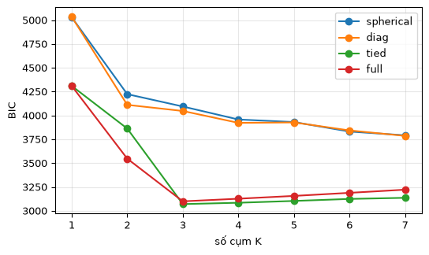
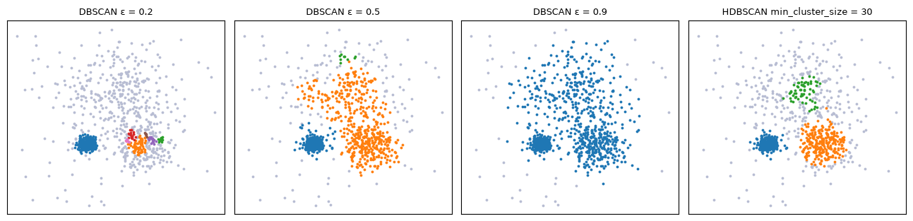
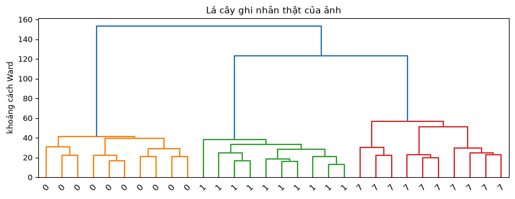

# Advanced clustering · Dùng thư viện

> Ghi chú của người biên soạn: trang này do người biên soạn viết thêm. Trang dùng scikit-learn và SciPy cho các ý trong bài [Phân cụm nâng cao](ml/cluster_vi): chọn mô hình GMM bằng BIC, GMM Bayes tự bỏ bớt cụm thừa, DBSCAN và HDBSCAN, dendrogram của SciPy, rồi so các thuật toán trên ảnh chữ số viết tay.

## Cách dùng trang này

Các khối chạy lần lượt từ trên xuống và dùng chung biến. Cần `numpy`, `matplotlib`, `scikit-learn`, `scipy`.

| Trong bài | Trong thư viện |
| --- | --- |
| GMM, EM | `GaussianMixture(n_components, covariance_type, n_init)`; `predict_proba` cho trách nhiệm |
| BIC, AIC | `gm.bic(X)`, `gm.aic(X)` |
| GMM Bayes (tự chọn số cụm) | `BayesianGaussianMixture(weight_concentration_prior)` |
| DBSCAN, HDBSCAN | `DBSCAN(eps, min_samples)`, `HDBSCAN(min_cluster_size)`; nhãn `-1` là nhiễu |
| Phân cụm phân cấp | `AgglomerativeClustering(n_clusters, linkage)`; dendrogram: `scipy.cluster.hierarchy` |
| Thước đo nội tại | `silhouette_score`, `davies_bouldin_score`, `calinski_harabasz_score` |
| Thước đo ngoại tại | `adjusted_rand_score`, `normalized_mutual_info_score` |

## 1. Chọn dạng hiệp phương sai và số cụm bằng BIC

<small class="viz-ref">Mục P.4 · hình P.4, P.5</small>

Thử mọi tổ hợp (dạng hiệp phương sai × số cụm), rồi chọn tổ hợp có BIC nhỏ nhất.

<!-- run -->
```python
import numpy as np
import matplotlib.pyplot as plt
from sklearn.datasets import make_blobs
from sklearn.mixture import GaussianMixture, BayesianGaussianMixture

X, y = make_blobs(n_samples=600, centers=3, random_state=170)
X = X @ np.array([[0.6, -0.64], [-0.41, 0.85]])

types = ["spherical", "diag", "tied", "full"]
Ks = range(1, 8)
bic = np.array([[GaussianMixture(k, covariance_type=t, n_init=3, random_state=0).fit(X).bic(X) for k in Ks] for t in types])
i, j = np.unravel_index(bic.argmin(), bic.shape)
print(f"tốt nhất: covariance_type='{types[i]}', K = {list(Ks)[j]}, BIC = {bic[i, j]:.1f}")
for t, row in zip(types, bic):
    print(f"{t:<10}", "  ".join(f"{v:7.0f}" for v in row))

fig, ax = plt.subplots(figsize=(6, 3.4))
for t, row in zip(types, bic):
    ax.plot(Ks, row, "o-", label=t)
ax.set_xlabel("số cụm K"); ax.set_ylabel("BIC"); ax.legend(); ax.grid(alpha=.3)
```

<!-- output -->
```output
tốt nhất: covariance_type='tied', K = 3, BIC = 3070.3
spherical     5031     4223     4094     3958     3931     3831     3792
diag          5035     4111     4047     3922     3927     3843     3786
tied          4310     3863     3070     3084     3103     3125     3136
full          4310     3547     3099     3127     3156     3188     3222
```

<div align=center></div>
<!-- /output -->

BIC chọn đúng $K = 3$ với dạng `tied`, vì dữ liệu được sinh bằng cách áp **cùng một** phép biến đổi tuyến tính lên cả ba cụm. Dạng `spherical` và `diag` không mô tả được cụm nghiêng, nên BIC của chúng cứ giảm mãi khi tăng $K$: chúng cố ghép nhiều hình tròn nhỏ để xấp xỉ một elip nghiêng. BIC giảm mãi như vậy là dấu hiệu dạng mô hình không phù hợp.

## 2. GMM Bayes: cho thừa cụm, để mô hình tự bỏ

<small class="viz-ref">Mục P.4</small>

`BayesianGaussianMixture` đặt một phân phối tiên nghiệm lên các trọng số $\pi_k$. Với `weight_concentration_prior` nhỏ, tiên nghiệm khuyến khích dùng **ít** cụm: các cụm không cần thiết bị đẩy trọng số về gần 0. Ta cho phép tới 10 cụm trên dữ liệu chỉ có 3 cụm.

<!-- run -->
```python
for prior in [1e-3, 1.0, 100.0]:
    bgm = BayesianGaussianMixture(n_components=10, weight_concentration_prior=prior, max_iter=1000,
                                  n_init=3, random_state=0).fit(X)
    w = np.sort(bgm.weights_)[::-1]
    print(f"prior = {prior:<6}: số cụm có trọng số > 1%: {np.sum(w > 0.01)}   trọng số: {np.round(w, 3)}")
```

<!-- output -->
```output
prior = 0.001 : số cụm có trọng số > 1%: 3   trọng số: [0.334 0.333 0.333 0.    0.    0.    0.    0.    0.    0.   ]
prior = 1.0   : số cụm có trọng số > 1%: 3   trọng số: [0.333 0.333 0.332 0.001 0.    0.    0.    0.    0.    0.   ]
prior = 100.0 : số cụm có trọng số > 1%: 3   trọng số: [0.331 0.329 0.328 0.002 0.002 0.002 0.002 0.002 0.002 0.002]
```
<!-- /output -->

Với cả ba giá trị tiên nghiệm, GMM Bayes đều giữ đúng 3 cụm có trọng số đáng kể; 7 cụm còn lại gần như bị tắt (trọng số 0 đến 0.2%). Tiên nghiệm càng lớn thì các cụm thừa giữ lại càng nhiều trọng số. Khi dữ liệu tách rõ như ở đây, dữ liệu áp đảo tiên nghiệm. Với dữ liệu mơ hồ hơn, `weight_concentration_prior` quyết định đáng kể số cụm.

## 3. DBSCAN, HDBSCAN và cụm khác mật độ

<small class="viz-ref">Mục P.5 · hình P.7</small>

Ba cụm có mật độ rất khác nhau, cộng thêm nhiễu rải đều. Với DBSCAN, một giá trị $\varepsilon$ duy nhất không thể hợp với cả ba cụm. HDBSCAN chỉ cần `min_cluster_size`.

<!-- run -->
```python
from sklearn.cluster import DBSCAN, HDBSCAN
from sklearn.metrics import adjusted_rand_score

rng = np.random.default_rng(0)
Xd = np.r_[rng.normal([0, 0], 0.25, (300, 2)), rng.normal([3, 0], 0.8, (300, 2)),
           rng.normal([1.5, 3.5], 1.4, (300, 2)), rng.uniform(-4, 7, (60, 2))]
yd = np.r_[np.zeros(300), np.ones(300), np.full(300, 2), np.full(60, -1)].astype(int)

def describe(lab):
    m = yd >= 0                                    # ARI chỉ tính trên các điểm không phải nhiễu thật
    return f"{lab.max() + 1} cụm, {np.sum(lab < 0)} điểm nhiễu, ARI {adjusted_rand_score(yd[m], lab[m]):.3f}"

fig, axes = plt.subplots(1, 4, figsize=(13, 3.2))
cases = [(f"DBSCAN ε = {e}", DBSCAN(eps=e, min_samples=10).fit_predict(Xd)) for e in [0.2, 0.5, 0.9]]
cases.append(("HDBSCAN min_cluster_size = 30", HDBSCAN(min_cluster_size=30).fit_predict(Xd)))
for ax, (name, lab) in zip(axes, cases):
    print(f"{name:<30} {describe(lab)}")
    ax.scatter(*Xd[lab < 0].T, s=3, c="#b8bdd3")
    for c in range(lab.max() + 1):
        ax.scatter(*Xd[lab == c].T, s=3)
    ax.set_title(name, fontsize=9); ax.set_xticks([]); ax.set_yticks([])
fig.tight_layout()
```

<!-- output -->
```output
DBSCAN ε = 0.2                 7 cụm, 538 điểm nhiễu, ARI 0.542
DBSCAN ε = 0.5                 3 cụm, 133 điểm nhiễu, ARI 0.544
DBSCAN ε = 0.9                 1 cụm, 41 điểm nhiễu, ARI 0.000
HDBSCAN min_cluster_size = 30  3 cụm, 332 điểm nhiễu, ARI 0.724
```

<div align=center></div>
<!-- /output -->

Không có giá trị $\varepsilon$ nào làm DBSCAN hài lòng cả ba cụm:

- $\varepsilon = 0.2$ chỉ đủ cho cụm đặc nhất, nên cụm thưa bị vụn thành nhiều mảnh và 538 điểm bị coi là nhiễu.
- $\varepsilon = 0.5$ cho đúng 3 cụm nhưng vẫn bỏ 133 điểm ở rìa cụm thưa.
- $\varepsilon = 0.9$ nối tất cả thành một cụm.

HDBSCAN tìm được 3 cụm với ARI cao nhất (0.724). Nó vẫn coi khá nhiều điểm ở rìa cụm thưa nhất là nhiễu; đó là tính "thận trọng" của thuật toán.

## 4. Dendrogram với SciPy

<small class="viz-ref">Mục P.6 · hình P.8</small>

`scipy.cluster.hierarchy.linkage` trả về ma trận các lần gộp; `fcluster` cắt cây theo số cụm hoặc theo độ cao. Ta dùng 30 ảnh chữ số đầu tiên của ba chữ số 0, 1 và 7, mỗi ảnh là một vector 64 chiều.

<!-- run -->
```python
from scipy.cluster.hierarchy import linkage, dendrogram, fcluster
from sklearn.datasets import load_digits

digits = load_digits()
pick = np.r_[np.where(digits.target == 0)[0][:10], np.where(digits.target == 1)[0][:10], np.where(digits.target == 7)[0][:10]]
Z = linkage(digits.data[pick], "ward")
lab3 = fcluster(Z, t=3, criterion="maxclust")
print("nhãn thật :", digits.target[pick])
print("3 cụm     :", lab3)
print("ARI:", adjusted_rand_score(digits.target[pick], lab3))

fig, ax = plt.subplots(figsize=(10, 3.4))
dendrogram(Z, labels=digits.target[pick], ax=ax, color_threshold=Z[-3, 2] + 1e-9, leaf_font_size=10)
ax.set_ylabel("khoảng cách Ward"); ax.set_title("Lá cây ghi nhãn thật của ảnh")
```

<!-- output -->
```output
nhãn thật : [0 0 0 0 0 0 0 0 0 0 1 1 1 1 1 1 1 1 1 1 7 7 7 7 7 7 7 7 7 7]
3 cụm     : [1 1 1 1 1 1 1 1 1 1 2 2 2 2 2 2 2 2 2 2 3 3 3 3 3 3 3 3 3 3]
ARI: 1.0
```

<div align=center></div>
<!-- /output -->

Ward tách hoàn hảo ba chữ số 0, 1 và 7 (ARI 1.0), và dendrogram cho thấy rõ ba nhánh lớn với khoảng cách gộp cuối cùng rất lớn. Số thứ tự cụm (1, 2, 3) không liên quan tới nhãn thật; ARI không quan tâm tên cụm.

## 5. So các thuật toán trên ảnh chữ số viết tay

<small class="viz-ref">Mục P.7–P.8</small>

1797 ảnh chữ số 8×8 (64 chiều). Ta giảm còn 20 chiều bằng PCA ([chương 21](ml/ch21_vi)) cho GMM để ước lượng hiệp phương sai ổn định hơn, rồi so các thuật toán bằng ARI, NMI (dùng nhãn thật) và silhouette (không dùng nhãn).

<!-- run -->
```python
from sklearn.decomposition import PCA
from sklearn.cluster import KMeans, AgglomerativeClustering
from sklearn.metrics import normalized_mutual_info_score, silhouette_score

Xg = digits.data; yg = digits.target
Xp = PCA(20, random_state=0).fit_transform(Xg)
algs = {
    "K-means (K = 10)": KMeans(10, n_init=10, random_state=0).fit_predict(Xp),
    "GMM full (K = 10)": GaussianMixture(10, covariance_type="full", n_init=5, random_state=0).fit(Xp).predict(Xp),
    "Ward (K = 10)": AgglomerativeClustering(10, linkage="ward").fit_predict(Xp),
    "average linkage (K = 10)": AgglomerativeClustering(10, linkage="average").fit_predict(Xp),
    "HDBSCAN": HDBSCAN(min_cluster_size=20).fit_predict(Xp),
}
print(f"{'thuật toán':<26}{'số cụm':>7}{'nhiễu':>7}{'ARI':>8}{'NMI':>8}{'silhouette':>12}")
for name, lab in algs.items():
    m = lab >= 0
    print(f"{name:<26}{lab.max() + 1:>7}{np.sum(~m):>7}{adjusted_rand_score(yg, lab):>8.3f}"
          f"{normalized_mutual_info_score(yg, lab):>8.3f}{silhouette_score(Xp[m], lab[m]):>12.3f}")
```

<!-- output -->
```output
thuật toán                 số cụm  nhiễu     ARI     NMI  silhouette
K-means (K = 10)               10      0   0.668   0.743       0.213
GMM full (K = 10)              10      0   0.759   0.842       0.210
Ward (K = 10)                  10      0   0.783   0.860       0.207
average linkage (K = 10)       10      0   0.635   0.769       0.165
HDBSCAN                         7    810   0.256   0.590       0.314
```
<!-- /output -->

- **Ward** và **GMM** tốt nhất theo ARI và NMI (0.78 và 0.76), hơn K-means (0.67). Average linkage kém hơn: nó dễ tạo vài cụm rất lớn và vài cụm lẻ tẻ.
- **HDBSCAN** chỉ tìm được 7 cụm và coi 810 ảnh (45%) là nhiễu, nên ARI thấp. Nhưng silhouette của nó lại **cao nhất** (0.314), vì silhouette chỉ tính trên các điểm được gán cụm, tức các ảnh "dễ", nằm sâu trong cụm. Đây lại là một ví dụ về việc chỉ số nội tại có thể đánh lừa.
- Silhouette của mọi thuật toán đều thấp (khoảng 0.2): trong không gian 20 chiều, các cụm chữ số chồng lấn nhau nhiều. Một vài chữ số (như 1 và 7, hay 3, 5 và 8) vốn rất giống nhau khi viết tay.
