# Advanced clustering

> Ghi chú của người biên soạn: bài này do người biên soạn viết thêm, không có trong sách *Machine Learning cơ bản*. Bài nối tiếp [chương 10](ml/ch10_vi) (K-means). Mọi hình trong bài đều vẽ từ số liệu thật bằng script `scripts/ml_extra/cluster_figs.py`.

K-means ở [chương 10](ml/ch10_vi) đơn giản và nhanh, nhưng nó ngầm giả định nhiều điều về hình dạng của cụm. Bài này giới thiệu ba họ thuật toán phân cụm khác, mỗi họ bỏ đi một giả định của K-means:

- **Mô hình hỗn hợp Gauss (GMM) và thuật toán EM** (P.2–P.4): cụm có thể là hình elip với kích thước tuỳ ý, và mỗi điểm thuộc về các cụm **theo xác suất**.
- **DBSCAN** (P.5): cụm là vùng có **mật độ cao**, hình dạng bất kỳ. Không cần biết trước số cụm, và có khái niệm **điểm nhiễu**.
- **Phân cụm phân cấp** (P.6): xây cả một **cây** các cụm lồng nhau, rồi cắt ở mức mong muốn.

Mục P.7 trả lời câu hỏi khó nhất: khi không có nhãn, làm sao biết một cách phân cụm là tốt?

## P.1 K-means thất bại ở đâu

K-means gán mỗi điểm vào **tâm gần nhất** theo khoảng cách Euclid. Vì vậy, ranh giới giữa hai cụm luôn là **đường trung trực** của hai tâm, và mỗi cụm là một đa giác lồi. Điều này ngầm giả định rằng các cụm **tròn**, **rộng như nhau**, và có số điểm **gần bằng nhau**. Hình P.1 cho thấy chuyện gì xảy ra khi các giả định đó sai.

<div align=center>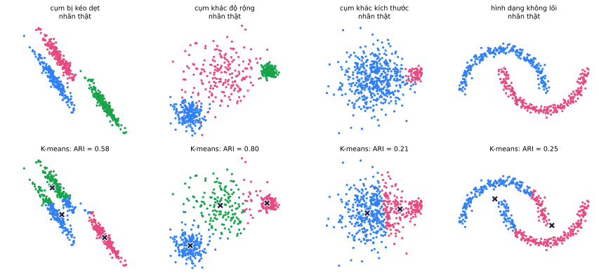</div>
<div align=center>Hình P.1: Hàng trên là nhãn thật, hàng dưới là kết quả K-means (dấu × là tâm). Chỉ số ARI (mục P.7) bằng 1 khi khớp hoàn toàn với nhãn thật, và gần 0 khi không hơn gì chia ngẫu nhiên.</div>

- **Cụm bị kéo dẹt** (ARI 0.58): K-means cắt ngang các cụm dài, vì nó chỉ nhìn khoảng cách tới tâm.
- **Cụm khác độ rộng** (ARI 0.80): cụm rộng bị cụm hẹp bên cạnh "lấn" sang, vì ranh giới luôn nằm chính giữa hai tâm.
- **Cụm khác kích thước** (ARI 0.21): để giảm tổng khoảng cách, K-means chia đôi cụm lớn thay vì tách riêng cụm nhỏ.
- **Hình dạng không lồi** (ARI 0.25): không có cách nào dùng hai vùng lồi để tách hai nửa vầng trăng lồng vào nhau.

## P.2 Mô hình hỗn hợp Gauss

**Mô hình hỗn hợp Gauss** (Gaussian mixture model, GMM) giả sử dữ liệu được sinh ra như sau. Để sinh một điểm:

1. Chọn ngẫu nhiên một cụm $z \in \{1, \dots, K\}$, với xác suất chọn cụm $k$ là $\pi_k$ (các $\pi_k \ge 0$ và có tổng bằng 1).
2. Lấy điểm $\mathbf{x}$ từ phân phối chuẩn nhiều chiều của cụm đó, $\mathcal{N}(\boldsymbol{\mu}_k, \boldsymbol{\Sigma}_k)$.

Ta không quan sát được $z$; nó là một **biến ẩn** (latent variable). Mật độ của $\mathbf{x}$ là tổng theo mọi giá trị có thể của $z$:

$$
p(\mathbf{x}) = \sum_{k=1}^{K} \pi_k\, \mathcal{N}(\mathbf{x} \mid \boldsymbol{\mu}_k, \boldsymbol{\Sigma}_k).
$$

Mỗi cụm có tâm $\boldsymbol{\mu}_k$ **và** ma trận hiệp phương sai $\boldsymbol{\Sigma}_k$ riêng. Ma trận này cho phép cụm có hình elip với hướng và độ rộng tuỳ ý, còn trọng số $\pi_k$ cho phép các cụm có kích thước khác nhau.

<div align=center>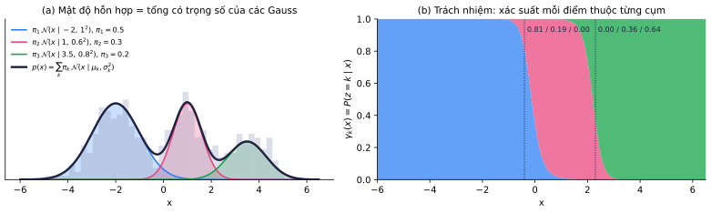</div>
<div align=center>Hình P.2: (a) Ba Gauss một chiều có trọng số khác nhau cộng lại thành một mật độ ba đỉnh; cột xám là 400 điểm lấy từ mật độ này. (b) Xác suất một điểm thuộc từng cụm, tính theo công thức Bayes.</div>

Khi đã biết các tham số, xác suất để điểm $\mathbf{x}_i$ thuộc cụm $k$ được tính bằng công thức Bayes ([chương 3 khoá Toán](math/ch03_vi)):

$$
\gamma_{ik} = P(z_i = k \mid \mathbf{x}_i) = \frac{\pi_k\, \mathcal{N}(\mathbf{x}_i \mid \boldsymbol{\mu}_k, \boldsymbol{\Sigma}_k)}{\sum_{j=1}^{K} \pi_j\, \mathcal{N}(\mathbf{x}_i \mid \boldsymbol{\mu}_j, \boldsymbol{\Sigma}_j)}.
$$

Đại lượng $\gamma_{ik}$ được gọi là **trách nhiệm** (responsibility) của cụm $k$ đối với điểm $i$. Đây là **phân cụm mềm** (soft clustering): điểm $x = -0.4$ trong Hình P.2b thuộc cụm xanh với xác suất 0.81 và cụm hồng với xác suất 0.19, thay vì bị gán cứng vào một cụm như K-means.

## P.3 Thuật toán EM

Ta muốn tìm các tham số $\theta = \{\pi_k, \boldsymbol{\mu}_k, \boldsymbol{\Sigma}_k\}$ cực đại hoá log-likelihood ([chương 4 khoá Toán](math/ch04_vi)):

$$
\ell(\theta) = \sum_{i=1}^{N} \log \sum_{k=1}^{K} \pi_k\, \mathcal{N}(\mathbf{x}_i \mid \boldsymbol{\mu}_k, \boldsymbol{\Sigma}_k).
$$

Tổng nằm **bên trong** logarit làm cho đạo hàm không có nghiệm dạng đóng. Nhưng hãy để ý một điều: nếu biết trước mỗi điểm thuộc cụm nào, bài toán rất dễ. Ta chỉ cần tính tỉ lệ, trung bình và hiệp phương sai của từng cụm. Thuật toán **EM** (Expectation–Maximization; Dempster, Laird và Rubin, 1977) tận dụng đúng điều này. Nó luân phiên giữa hai bước:

```
Thuật toán P.1: EM cho mô hình hỗn hợp Gauss
Input:  x_1, …, x_N; số cụm K
Output: π_k, μ_k, Σ_k; trách nhiệm γ_ik

khởi tạo μ_k (vd. K điểm ngẫu nhiên hoặc kết quả K-means), Σ_k ← hiệp phương sai của dữ liệu, π_k ← 1/K
repeat
    # bước E: tính trách nhiệm với tham số hiện tại
    for each i, k do
        γ_ik ← π_k·N(x_i | μ_k, Σ_k) / Σ_j π_j·N(x_i | μ_j, Σ_j)
    # bước M: ước lượng lại tham số, mỗi điểm đóng góp theo trọng số γ_ik
    for each k do
        N_k ← Σ_i γ_ik
        π_k ← N_k / N
        μ_k ← (1/N_k)·Σ_i γ_ik·x_i
        Σ_k ← (1/N_k)·Σ_i γ_ik·(x_i − μ_k)(x_i − μ_k)ᵀ
until log-likelihood ℓ(θ) gần như không đổi
```

Các công thức ở bước M chính là **trung bình có trọng số**: giống hệt cách ước lượng một Gauss ở [chương 4 khoá Toán](math/ch04_vi), chỉ khác là mỗi điểm được đếm theo tỉ lệ $\gamma_{ik}$.

<div align=center>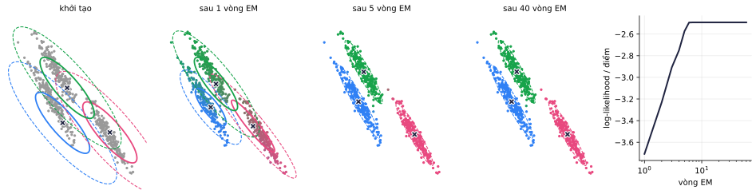</div>
<div align=center>Hình P.3: EM trên dữ liệu bị kéo dẹt. Màu mỗi điểm trộn theo trách nhiệm; elip nét liền là 1 độ lệch chuẩn, nét đứt là 2. Log-likelihood tăng sau mọi vòng và hội tụ sau khoảng 10 vòng.</div>

Ở Hình P.3, log-likelihood trung bình trên mỗi điểm tăng từ −3.708 sau vòng 1 lên −2.573 sau vòng 5, rồi −2.492 sau vòng 60. Kết quả khớp hoàn toàn với nhãn thật (ARI = 1.00), trong khi K-means chỉ đạt 0.58 trên cùng dữ liệu.

### Vì sao EM luôn làm log-likelihood tăng

Với mọi phân phối $q_i(k)$ trên các cụm, bất đẳng thức Jensen (logarit là hàm lõm) cho:

$$
\log \sum_k \pi_k \mathcal{N}(\mathbf{x}_i \mid \cdot) = \log \sum_k q_i(k) \frac{\pi_k \mathcal{N}(\mathbf{x}_i \mid \cdot)}{q_i(k)} \ \ge\ \sum_k q_i(k) \log \frac{\pi_k \mathcal{N}(\mathbf{x}_i \mid \cdot)}{q_i(k)}.
$$

Vế phải là một **cận dưới** $\mathcal{L}(q, \theta)$ của $\ell(\theta)$.

- **Bước E** chọn $q_i(k) = \gamma_{ik}$. Với lựa chọn này, dấu bằng xảy ra: cận dưới chạm $\ell(\theta)$ tại tham số hiện tại.
- **Bước M** cực đại hoá cận dưới theo $\theta$, với $q$ giữ nguyên. Khi đó tổng nằm **ngoài** logarit, và lời giải chính là các công thức trung bình có trọng số ở trên.

Gọi $\theta^{(t)}$ là tham số trước một vòng và $\theta^{(t+1)}$ là tham số sau vòng đó. Ta có

$$
\ell(\theta^{(t+1)}) \ge \mathcal{L}(q, \theta^{(t+1)}) \ge \mathcal{L}(q, \theta^{(t)}) = \ell(\theta^{(t)}).
$$

Bất đẳng thức đầu là tính chất cận dưới, bất đẳng thức thứ hai là do bước M cực đại hoá, còn dấu bằng cuối là do bước E. Vậy log-likelihood **không bao giờ giảm**. EM chỉ đảm bảo hội tụ về một **cực đại địa phương**, nên trong thực tế người ta chạy nhiều lần với các khởi tạo khác nhau và giữ kết quả tốt nhất.

> **K-means là trường hợp riêng của EM.** Cho mọi cụm cùng hiệp phương sai $\sigma^2\mathbf{I}$ và các $\pi_k$ bằng nhau, rồi cho $\sigma \to 0$. Khi đó $\gamma_{ik}$ bằng 1 cho tâm gần nhất và bằng 0 cho các tâm còn lại: bước E trở thành bước gán điểm của K-means, còn bước M trở thành bước tính lại tâm.

**Một cái bẫy:** nếu một cụm co lại quanh **một** điểm duy nhất, $\boldsymbol{\Sigma}_k \to 0$ và likelihood tiến ra vô cùng. Các thư viện tránh điều này bằng cách cộng một lượng nhỏ vào đường chéo của $\boldsymbol{\Sigma}_k$ (tham số `reg_covar` của scikit-learn).

## P.4 Chọn dạng hiệp phương sai và số cụm

Một ma trận hiệp phương sai đầy đủ trong $d$ chiều có $d(d+1)/2$ tham số. Khi $d$ lớn hoặc dữ liệu ít, ta có thể ràng buộc nó (Hình P.4):

<div align=center>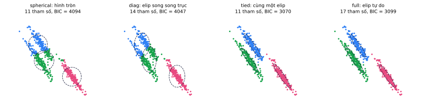</div>
<div align=center>Hình P.4: Bốn dạng hiệp phương sai trên cùng dữ liệu. BIC nhỏ hơn là tốt hơn. Dạng tied thắng, vì dữ liệu được sinh bằng cách biến đổi cùng một phép tuyến tính cho cả ba cụm.</div>

| Dạng (`covariance_type`) | Hình dạng cụm | Số tham số hiệp phương sai |
| --- | --- | --- |
| `spherical` | hình tròn, mỗi cụm một bán kính | $K$ |
| `diag` | elip song song trục toạ độ | $K d$ |
| `tied` | mọi cụm dùng chung một elip | $d(d+1)/2$ |
| `full` | mỗi cụm một elip tự do | $K\,d(d+1)/2$ |

Mô hình nhiều tham số hơn luôn khớp dữ liệu huấn luyện tốt hơn, nên **không thể** chọn mô hình bằng log-likelihood. Ta cần một tiêu chí phạt độ phức tạp. Hai tiêu chí thông dụng là

$$
\text{BIC} = -2\,\ell(\hat\theta) + p \ln N, \qquad \text{AIC} = -2\,\ell(\hat\theta) + 2p,
$$

trong đó $p$ là số tham số tự do và $N$ là số điểm. Mô hình có BIC (hoặc AIC) **nhỏ nhất** được chọn. BIC phạt nặng hơn AIC khi $N \ge 8$, nên thường chọn mô hình gọn hơn. Ở Hình P.4, dạng full có thêm 6 tham số so với dạng tied mà likelihood không tăng đủ để bù lại, nên BIC của full (3099) lớn hơn của tied (3070).

<div align=center>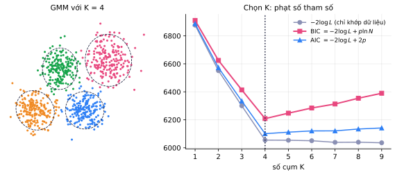</div>
<div align=center>Hình P.5: Dữ liệu sinh từ 4 cụm. $-2\log L$ giảm mãi khi tăng $K$, còn BIC và AIC đều nhỏ nhất ở $K = 4$.</div>

## P.5 DBSCAN: cụm là vùng đậm đặc

GMM linh hoạt hơn K-means, nhưng mỗi cụm vẫn là một elip. Với hai nửa vầng trăng hay hai vòng tròn lồng nhau, GMM cũng thất bại (mục P.8). **DBSCAN** (Density-Based Spatial Clustering of Applications with Noise; Ester và cộng sự, 1996) định nghĩa cụm theo một cách hoàn toàn khác: **cụm là một vùng mà các điểm nằm sát nhau**, ngăn cách với các cụm khác bởi những vùng thưa.

DBSCAN có hai tham số: bán kính $\varepsilon$ và số điểm tối thiểu `minPts`. Mỗi điểm được xếp vào một trong ba loại (Hình P.6):

- **Điểm lõi** (core point): có ít nhất `minPts` điểm trong bán kính $\varepsilon$, tính cả chính nó.
- **Điểm biên** (border point): không phải điểm lõi, nhưng nằm trong bán kính $\varepsilon$ của một điểm lõi.
- **Nhiễu** (noise): không thuộc hai loại trên.

<div align=center>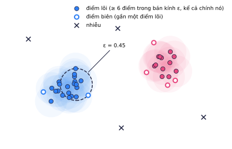</div>
<div align=center>Hình P.6: Với ε = 0.45 và minPts = 6: 32 điểm lõi (viền đen), 6 điểm biên (rỗng), 4 điểm nhiễu (dấu ×). Vòng tròn mờ là vùng bán kính ε quanh mỗi điểm lõi.</div>

Một **cụm** là tập các điểm lõi **nối được với nhau** qua một chuỗi điểm lõi, mỗi điểm cách điểm kế tiếp không quá $\varepsilon$, cộng thêm các điểm biên của chúng.

```
Thuật toán P.2: DBSCAN
Input:  x_1, …, x_N; bán kính ε; số điểm tối thiểu minPts
Output: nhãn cụm cho mỗi điểm (−1 là nhiễu)

N(i) ← {j : ‖x_i − x_j‖ ≤ ε}  với mọi i          # vùng lân cận, tính cả i
core ← {i : |N(i)| ≥ minPts}
label_i ← −1  với mọi i;  c ← 0
for each i ∈ core có label_i = −1 do
    label_i ← c;  queue ← [i]
    while queue không rỗng do                      # loang theo chiều rộng
        p ← lấy ra khỏi queue
        for each j ∈ N(p) do
            if label_j = −1 then
                label_j ← c
                if j ∈ core then thêm j vào queue      # chỉ điểm lõi mới loang tiếp
    c ← c + 1
```

Ưu điểm của DBSCAN:

- **Không cần biết số cụm.** Số cụm là kết quả của thuật toán, không phải đầu vào.
- **Hình dạng bất kỳ.** Vầng trăng, vòng tròn, đường ngoằn ngoèo đều được.
- **Có khái niệm nhiễu.** Điểm lạc lõng không bị ép vào cụm nào. Vì vậy DBSCAN cũng dùng được để phát hiện điểm bất thường.

Nhược điểm lớn nhất là chọn $\varepsilon$. Một cách thực tế là **đồ thị k-distance**: với mỗi điểm, tính khoảng cách tới láng giềng thứ `minPts − 1`, rồi sắp xếp các khoảng cách đó tăng dần. Chọn $\varepsilon$ ở chỗ đường cong bắt đầu bẻ gập lên.

<div align=center>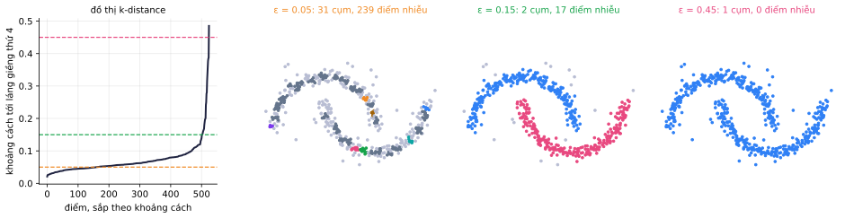</div>
<div align=center>Hình P.7: Hai nửa vầng trăng cộng 25 điểm nhiễu rải đều. ε quá nhỏ: 31 cụm vụn và 239 điểm bị coi là nhiễu. ε = 0.15 (ngay chỗ đồ thị k-distance bẻ gập): đúng 2 cụm, 17 điểm nhiễu. ε quá lớn: mọi thứ dính thành 1 cụm.</div>

DBSCAN dùng **một** ngưỡng mật độ cho cả không gian, nên gặp khó khi các cụm có mật độ khác nhau nhiều. **HDBSCAN** (Campello và cộng sự, 2013) khắc phục điều này bằng cách xét mọi giá trị $\varepsilon$ cùng lúc, rồi giữ lại những cụm "sống lâu" nhất khi $\varepsilon$ thay đổi. Thuật toán này có trong scikit-learn từ phiên bản 1.3.

## P.6 Phân cụm phân cấp

**Phân cụm phân cấp gộp** (agglomerative hierarchical clustering) bắt đầu với mỗi điểm là một cụm. Ở mỗi bước, hai cụm **gần nhau nhất** được gộp lại, cho đến khi chỉ còn một cụm. Lịch sử gộp được vẽ thành **dendrogram** (Hình P.8). Chiều cao của mỗi nhánh ngang là khoảng cách giữa hai cụm khi chúng được gộp.

<div align=center>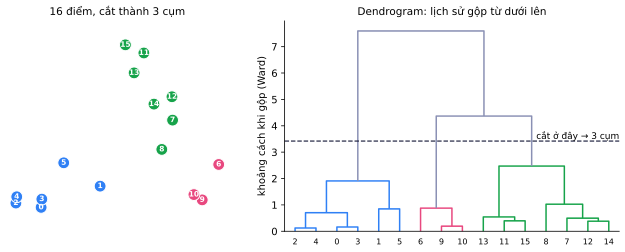</div>
<div align=center>Hình P.8: Cắt dendrogram bằng một đường ngang cho ra một cách phân cụm. Đường cắt ở độ cao khoảng 3.4 cho 3 cụm. Các bước gộp cuối cần khoảng cách lớn (4.4 và 7.6) nên 3 là số cụm tự nhiên.</div>

Ưu điểm lớn của cách này là chỉ cần chạy **một lần** là có kết quả cho **mọi** số cụm, và dendrogram cho thấy cấu trúc lồng nhau của dữ liệu: cụm nào gần cụm nào. Cái giá là bộ nhớ $O(N^2)$ cho ma trận khoảng cách, và thời gian ít nhất $O(N^2)$. Vì vậy phân cụm phân cấp chỉ hợp với dữ liệu tối đa vài chục nghìn điểm.

"Khoảng cách giữa hai cụm" có nhiều cách định nghĩa, gọi là **tiêu chí liên kết** (linkage):

| Linkage | Khoảng cách giữa cụm $A$ và $B$ | Đặc điểm |
| --- | --- | --- |
| single | $\min_{a \in A, b \in B} \|a - b\|$ | nối thành chuỗi; tìm được cụm hình dạng bất kỳ, nhưng rất nhạy với nhiễu |
| complete | $\max_{a \in A, b \in B} \|a - b\|$ | cụm gọn, đường kính nhỏ |
| average | trung bình mọi cặp $\|a - b\|$ | trung gian giữa single và complete |
| Ward | độ tăng tổng bình phương khoảng cách tới tâm khi gộp | giống K-means: cụm tròn, cỡ đều; thường là mặc định tốt |

<div align=center>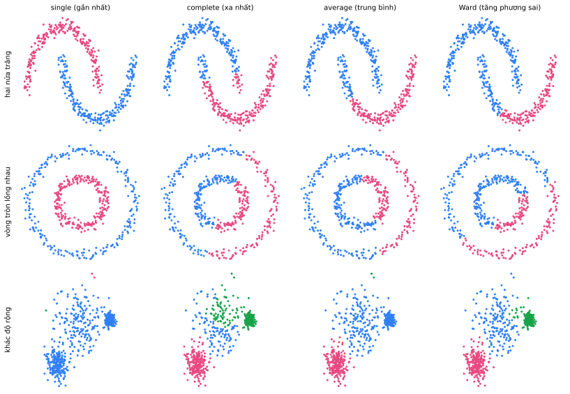</div>
<div align=center>Hình P.9: Single linkage tách hoàn hảo vầng trăng và vòng tròn, nhưng thất bại hoàn toàn với các cụm khác độ rộng: nó gộp gần hết điểm vào một cụm. Ward làm ngược lại.</div>

## P.7 Đánh giá kết quả phân cụm

Phân cụm không có nhãn, nên không có "accuracy". Có hai loại thước đo.

**Khi không có nhãn** (thước đo nội tại): đo xem các cụm có **gọn** và **tách biệt** không. Thông dụng nhất là **hệ số silhouette**. Với điểm $i$:

- $a(i)$ là khoảng cách trung bình từ $i$ tới các điểm **cùng cụm**;
- $b(i)$ là khoảng cách trung bình từ $i$ tới các điểm của **cụm gần nhất khác**;
- $s(i) = \dfrac{b(i) - a(i)}{\max\{a(i), b(i)\}} \in [-1, 1]$.

$s(i)$ gần 1 nghĩa là điểm nằm sâu trong cụm của nó. Gần 0 nghĩa là điểm nằm ở ranh giới. Âm nghĩa là điểm có lẽ bị gán nhầm cụm. Silhouette trung bình trên mọi điểm dùng được để so sánh các cách phân cụm hoặc chọn $K$ (Hình P.10).

<div align=center>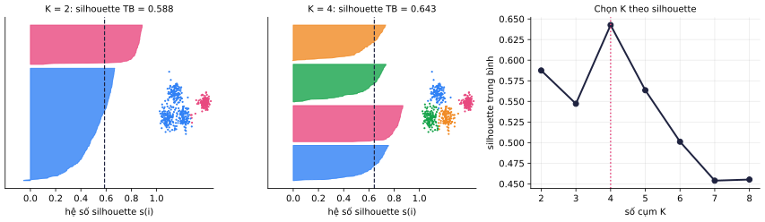</div>
<div align=center>Hình P.10: Dữ liệu 4 cụm. Mỗi "lưỡi dao" là các giá trị s(i) của một cụm, sắp giảm dần. Với K = 2, cụm xanh gộp ba cụm thật nên có nhiều điểm s(i) thấp. Silhouette trung bình lớn nhất ở K = 4 (0.643).</div>

Silhouette ưu tiên các cụm lồi và tách biệt, giống K-means. Với hai vầng trăng lồng nhau, silhouette có thể chấm cách phân cụm **sai** của K-means cao hơn cách phân cụm **đúng** của DBSCAN. Không có thước đo nội tại nào phù hợp với mọi định nghĩa "cụm".

**Khi có nhãn tham chiếu** (thước đo ngoại tại), ví dụ khi thử thuật toán trên dữ liệu có sẵn nhãn: so cách phân cụm với nhãn, nhưng **không** quan tâm tên cụm. Cụm "1" của thuật toán có thể ứng với lớp "3" của nhãn.

- **ARI** (adjusted Rand index): xét mọi **cặp** điểm và đếm tỉ lệ cặp mà hai cách chia "đồng ý" với nhau (cùng cụm ở cả hai, hoặc khác cụm ở cả hai). Sau đó hiệu chỉnh để chia ngẫu nhiên cho giá trị kỳ vọng 0. ARI bằng 1 khi khớp hoàn toàn.
- **NMI** (normalized mutual information): lượng thông tin chung giữa hai cách chia, chuẩn hoá về $[0, 1]$.

## P.8 So sánh các thuật toán

<div align=center>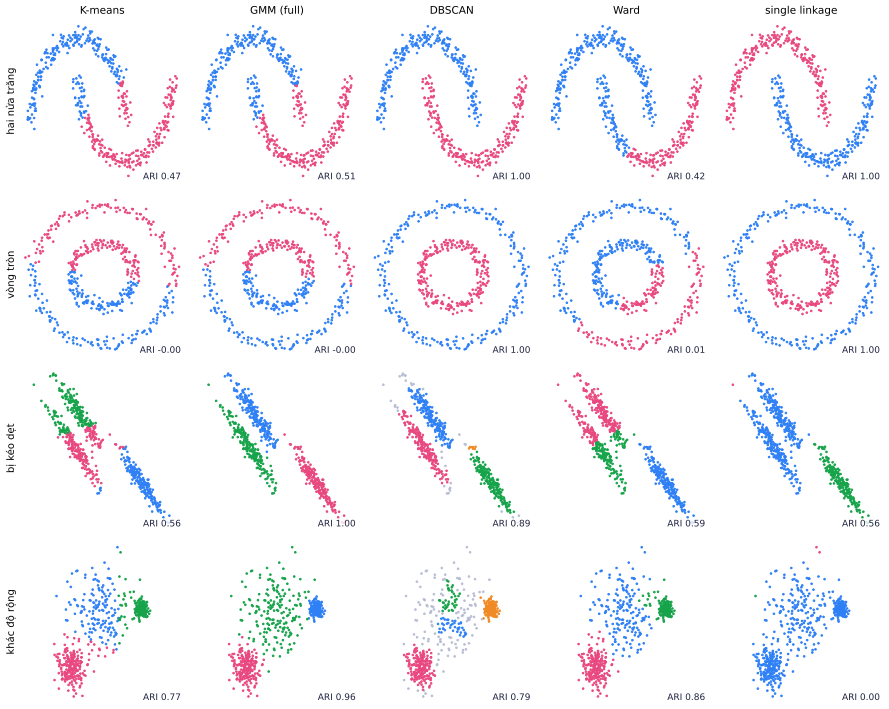</div>
<div align=center>Hình P.11: Năm thuật toán trên bốn bộ dữ liệu (đã chuẩn hoá), kèm ARI so với nhãn thật. Điểm xám là nhiễu theo DBSCAN.</div>

Không thuật toán nào thắng ở mọi nơi:

- **DBSCAN** và **single linkage** đạt ARI 1.00 trên vầng trăng và vòng tròn, nơi K-means và GMM gần như vô dụng (ARI −0.00 trên vòng tròn).
- **GMM** đạt 1.00 trên dữ liệu bị kéo dẹt và 0.96 trên dữ liệu khác độ rộng, tốt nhất ở cả hai.
- **DBSCAN** gặp khó với các cụm khác mật độ (ARI 0.79, coi 127 điểm của cụm thưa là nhiễu). **Single linkage** thất bại hoàn toàn (0.00).

| | K-means | GMM | DBSCAN / HDBSCAN | Phân cấp |
| --- | --- | --- | --- | --- |
| Cần biết số cụm | có | có (chọn bằng BIC) | không (cần ε, minPts) | không (cắt dendrogram sau) |
| Hình dạng cụm | tròn, lồi | elip | bất kỳ | tuỳ linkage |
| Gán mềm (xác suất) | không | có | không | không |
| Xử lý nhiễu | không | không | có | không |
| Dữ liệu lớn | rất tốt | tốt | tốt (dùng cây chỉ mục) | kém, $O(N^2)$ |
| Mật độ khác nhau | — | được | DBSCAN kém, HDBSCAN được | tuỳ linkage |

Một vài lời khuyên:

- **Luôn chuẩn hoá dữ liệu** trước khi phân cụm theo khoảng cách ([mục 6.5](ml/ch06_vi)). Nếu không, đặc trưng có thang đo lớn sẽ quyết định tất cả.
- **Thử nhiều thuật toán** và nhìn kết quả (vẽ trực tiếp, hoặc qua PCA hay t-SNE nếu dữ liệu nhiều chiều).
- **Kiểm tra bằng hiểu biết về lĩnh vực**: các cụm có ý nghĩa không, có ổn định khi đổi khởi tạo hay lấy mẫu lại không? Phân cụm là công cụ **khám phá**, không có đáp án đúng duy nhất.

---

**Học tiếp:** [Code từ đầu](ml/cluster_code_vi) tự viết EM, DBSCAN, phân cụm phân cấp và silhouette · [Dùng thư viện](ml/cluster_lib_vi) dùng `GaussianMixture`, `DBSCAN`, `HDBSCAN`, `AgglomerativeClustering` · [Ví dụ áp dụng](ml/cluster_app_vi) tìm các vùng đô thị và phân khúc khu dân cư California · [Mô phỏng](ml/cluster_viz_vi) chạy EM từng bước và kéo ε của DBSCAN.
