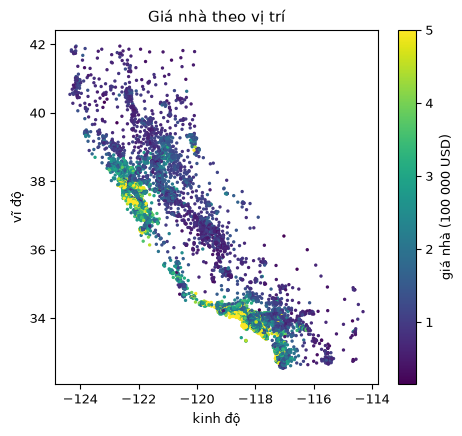
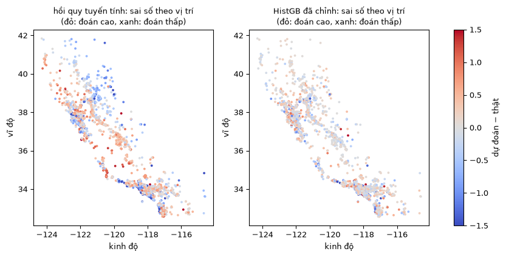
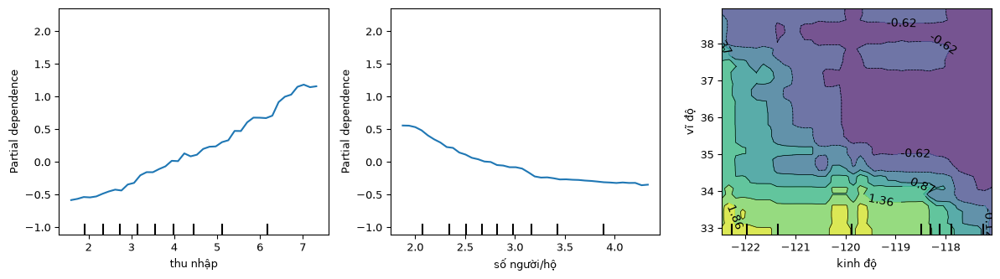

# Ensemble learning · Ví dụ áp dụng: giá nhà California

> Ghi chú của người biên soạn: trang này do người biên soạn viết thêm. Dữ liệu là bộ *California Housing* (Pace và Barry, 1997) từ điều tra dân số Mỹ năm 1990, có sẵn trong scikit-learn. Bộ này đã dùng ở [chương 7](ml/ch07_app_vi) với hồi quy tuyến tính.

## Bài toán

Mỗi dòng là một khu dân cư (block group) ở California: thu nhập trung vị, tuổi nhà trung vị, số phòng trung bình, dân số, vĩ độ, kinh độ… Cần dự đoán **giá nhà trung vị** của khu, đơn vị 100 000 USD.

Ở [chương 7](ml/ch07_app_vi), hồi quy tuyến tính đạt $R^2$ khoảng 0.6. Trang này cho thấy các tổ hợp cây làm tốt hơn bao nhiêu, và vì sao: giá nhà phụ thuộc vào **vị trí** theo một cách rất phi tuyến (ven biển, quanh San Francisco và Los Angeles), điều mà một mô hình tuyến tính theo vĩ độ và kinh độ không thể mô tả.

## 1. Dữ liệu

<!-- run -->
```python
import time
import numpy as np
import matplotlib.pyplot as plt
from sklearn.datasets import fetch_california_housing
from sklearn.model_selection import train_test_split

cal = fetch_california_housing()
X, y = cal.data, cal.target
names = ["thu nhập", "tuổi nhà", "số phòng", "số phòng ngủ", "dân số", "số người/hộ", "vĩ độ", "kinh độ"]
print("số khu:", len(y), "  đặc trưng:", len(names))
print(f"giá: trung bình {y.mean():.2f}, trung vị {np.median(y):.2f}, lớn nhất {y.max():.5f}")
print("số khu có giá đúng bằng mức lớn nhất (bị cắt trần):", int(np.sum(y >= 5.0)))
X_tr, X_te, y_tr, y_te = train_test_split(X, y, test_size=0.2, random_state=0)

fig, ax = plt.subplots(figsize=(5.2, 4.6))
sc = ax.scatter(X[:, 7], X[:, 6], c=y, s=2, cmap="viridis")
fig.colorbar(sc, ax=ax, label="giá nhà (100 000 USD)")
ax.set_xlabel("kinh độ"); ax.set_ylabel("vĩ độ"); ax.set_title("Giá nhà theo vị trí")
```

<!-- output -->
```output
số khu: 20640   đặc trưng: 8
giá: trung bình 2.07, trung vị 1.80, lớn nhất 5.00001
số khu có giá đúng bằng mức lớn nhất (bị cắt trần): 992
```

<div align=center></div>
<!-- /output -->

Bản đồ cho thấy vì sao vị trí quan trọng: giá cao tập trung thành các dải ven biển quanh San Francisco (vĩ độ khoảng 38) và Los Angeles (khoảng 34), còn sâu trong đất liền thì rẻ. Có 992 khu bị **cắt trần** ở 5.00001: giá thật có thể cao hơn nhiều, nhưng bộ dữ liệu ghi như nhau. Không mô hình nào đoán đúng được phần bị cắt này.

## 2. So sánh các mô hình bằng xác thực chéo

<small class="viz-ref">Mục T.9</small>

<!-- run -->
```python
from sklearn.model_selection import KFold, cross_validate
from sklearn.pipeline import make_pipeline
from sklearn.preprocessing import StandardScaler
from sklearn.linear_model import LinearRegression
from sklearn.neighbors import KNeighborsRegressor
from sklearn.tree import DecisionTreeRegressor
from sklearn.ensemble import RandomForestRegressor, GradientBoostingRegressor, HistGradientBoostingRegressor

cv = KFold(5, shuffle=True, random_state=0)
models = {
    "hồi quy tuyến tính": make_pipeline(StandardScaler(), LinearRegression()),
    "KNN, K = 10": make_pipeline(StandardScaler(), KNeighborsRegressor(10)),
    "một cây (min_leaf 20)": DecisionTreeRegressor(min_samples_leaf=20, random_state=0),
    "random forest 200 cây": RandomForestRegressor(n_estimators=200, max_features=0.33, n_jobs=-1, random_state=0),
    "GradientBoosting 300 cây": GradientBoostingRegressor(n_estimators=300, max_depth=5, learning_rate=0.1, random_state=0),
    "HistGradientBoosting": HistGradientBoostingRegressor(max_iter=500, learning_rate=0.1, random_state=0),
}
res = {}
print(f"{'mô hình':<26}{'RMSE':>16}{'R²':>16}{'thời gian học':>15}")
for name, m in models.items():
    r = cross_validate(m, X_tr, y_tr, cv=cv, scoring=["neg_root_mean_squared_error", "r2"])
    res[name] = r
    print(f"{name:<26}{-r['test_neg_root_mean_squared_error'].mean():>9.3f} ± {r['test_neg_root_mean_squared_error'].std():.3f}"
          f"{r['test_r2'].mean():>9.3f} ± {r['test_r2'].std():.3f}{r['fit_time'].mean():>12.1f} s")
```

<!-- output -->
```output
mô hình                               RMSE              R²  thời gian học
hồi quy tuyến tính            0.728 ± 0.021    0.604 ± 0.015         0.0 s
KNN, K = 10                   0.627 ± 0.011    0.706 ± 0.007         0.0 s
một cây (min_leaf 20)         0.618 ± 0.007    0.715 ± 0.008         0.1 s
random forest 200 cây         0.497 ± 0.006    0.815 ± 0.003         0.8 s
GradientBoosting 300 cây      0.472 ± 0.003    0.833 ± 0.003        16.3 s
HistGradientBoosting          0.467 ± 0.006    0.837 ± 0.007         0.6 s
```
<!-- /output -->

Thứ hạng đúng như bài lý thuyết dự đoán:

- **Một cây** (đã giới hạn `min_samples_leaf`) đã vượt hồi quy tuyến tính rất xa ($R^2$ 0.715 so với 0.604), vì nó chia được bản đồ thành các vùng.
- **Random forest** đẩy $R^2$ lên 0.815 bằng cách lấy trung bình 200 cây bất ổn.
- **Gradient boosting** đứng đầu (0.833–0.837). Bản histogram nhanh hơn bản cổ điển 16 lần mà còn tốt hơn chút ít.
- Độ lệch chuẩn qua 5 lần chia nhỏ (±0.003–0.007), nên khoảng cách giữa các nhóm mô hình là thật, không phải may rủi.

Cột thời gian chỉ tính thời gian **học**. KNN gần như không tốn thời gian học, nhưng mỗi lần dự đoán phải tìm láng giềng trong toàn bộ dữ liệu.

## 3. Chỉnh HistGradientBoosting

<small class="viz-ref">Mục T.6–T.7</small>

Ta tìm ngẫu nhiên trong không gian siêu tham số: tốc độ học, số lá tối đa, số mẫu tối thiểu ở lá, phạt L2. Dừng sớm tự quyết định số cây.

<!-- run -->
```python
from sklearn.model_selection import RandomizedSearchCV
from scipy.stats import loguniform, randint

search = RandomizedSearchCV(
    HistGradientBoostingRegressor(max_iter=3000, early_stopping=True, n_iter_no_change=50, random_state=0),
    {"learning_rate": loguniform(0.02, 0.3), "max_leaf_nodes": randint(15, 128),
     "min_samples_leaf": randint(5, 80), "l2_regularization": loguniform(1e-3, 10)},
    n_iter=30, cv=cv, scoring="neg_root_mean_squared_error", random_state=0, n_jobs=-1)
t0 = time.perf_counter(); search.fit(X_tr, y_tr)
print(f"tìm kiếm 30 cấu hình × 5 lần: {time.perf_counter() - t0:.0f} s")
print("cấu hình tốt nhất:", {k: (round(float(v), 4) if isinstance(v, float) else int(v)) for k, v in search.best_params_.items()})
print(f"RMSE xác thực chéo: {-search.best_score_:.3f}")
```

<!-- output -->
```output
tìm kiếm 30 cấu hình × 5 lần: 60 s
cấu hình tốt nhất: {'l2_regularization': 0.1847, 'learning_rate': 0.041, 'max_leaf_nodes': 42, 'min_samples_leaf': 19}
RMSE xác thực chéo: 0.458
```
<!-- /output -->

Chỉnh siêu tham số giảm RMSE xác thực chéo từ 0.467 xuống 0.458. Cấu hình tốt nhất dùng tốc độ học nhỏ (0.041) và cây khoảng 42 lá. Đúng như [mục T.6](ml/ensemble_vi): ν nhỏ cần nhiều cây hơn, nhưng cho kết quả tốt hơn.

## 4. Kết quả trên tập kiểm tra

<small class="viz-ref">Mục E.9</small>

<!-- run -->
```python
from sklearn import metrics as M

final = {"hồi quy tuyến tính": models["hồi quy tuyến tính"], "random forest 200 cây": models["random forest 200 cây"],
         "HistGB đã chỉnh": search.best_estimator_}
pred = {}
for name, m in final.items():
    if name != "HistGB đã chỉnh":
        m.fit(X_tr, y_tr)
    pred[name] = m.predict(X_te)
    print(f"{name:<24} RMSE {M.root_mean_squared_error(y_te, pred[name]):.3f}   MAE {M.mean_absolute_error(y_te, pred[name]):.3f}"
          f"   R² {M.r2_score(y_te, pred[name]):.3f}")
print("số cây sau dừng sớm:", search.best_estimator_.n_iter_)

fig, axes = plt.subplots(1, 2, figsize=(10.5, 4.2))
for ax, name in zip(axes, ["hồi quy tuyến tính", "HistGB đã chỉnh"]):
    err = pred[name] - y_te
    sc = ax.scatter(X_te[:, 7], X_te[:, 6], c=err, s=3, cmap="coolwarm", vmin=-1.5, vmax=1.5)
    ax.set_title(f"{name}: sai số theo vị trí\n(đỏ: đoán cao, xanh: đoán thấp)", fontsize=9.5)
    ax.set_xlabel("kinh độ"); ax.set_ylabel("vĩ độ")
fig.colorbar(sc, ax=axes, label="dự đoán − thật")
```

<!-- output -->
```output
hồi quy tuyến tính       RMSE 0.727   MAE 0.535   R² 0.594
random forest 200 cây    RMSE 0.488   MAE 0.330   R² 0.818
HistGB đã chỉnh          RMSE 0.436   MAE 0.286   R² 0.854
số cây sau dừng sớm: 1906
```

<div align=center></div>
<!-- /output -->

Trên tập kiểm tra, mô hình đã chỉnh đạt $R^2 = 0.854$ và MAE 0.286, tức trung bình lệch khoảng 28 600 USD, so với 53 500 USD của hồi quy tuyến tính. Dừng sớm chọn tới 1906 cây: với ν = 0.041, mỗi cây chỉ đóng góp rất ít.

Bản đồ sai số nói rõ hơn mọi con số. Sai số của hồi quy tuyến tính có **cấu trúc theo vùng**: đoán thấp hàng loạt ở ven biển (xanh), đoán cao ở nội địa (đỏ). Đó là dấu hiệu mô hình bỏ sót một quy luật ([mục E.9](ml/eval_vi)). Sai số của gradient boosting nhỏ hơn và phân tán hơn, không còn mảng màu theo vùng rõ rệt.

## 5. Mô hình đã học được gì

<small class="viz-ref">Mục C.8</small>

Hai công cụ diễn giải: **độ quan trọng hoán vị** trên tập kiểm tra, và **đồ thị phụ thuộc riêng phần** (partial dependence): dự đoán trung bình thay đổi thế nào khi ta chỉ thay đổi một đặc trưng, giữ nguyên các đặc trưng khác.

<!-- run -->
```python
from sklearn.inspection import permutation_importance, PartialDependenceDisplay

best = search.best_estimator_
pi = permutation_importance(best, X_te, y_te, n_repeats=10, random_state=0, scoring="neg_root_mean_squared_error")
for j in np.argsort(-pi.importances_mean):
    print(f"{names[j]:<14} RMSE tăng {pi.importances_mean[j]:.3f} ± {pi.importances_std[j]:.3f} khi xáo trộn")

fig, ax = plt.subplots(1, 3, figsize=(12, 3.4))
PartialDependenceDisplay.from_estimator(best, X_tr, [0, 5, (7, 6)], feature_names=names, ax=ax,
                                        grid_resolution=40, n_jobs=-1)
fig.tight_layout()
```

<!-- output -->
```output
vĩ độ          RMSE tăng 0.884 ± 0.012 khi xáo trộn
kinh độ        RMSE tăng 0.784 ± 0.007 khi xáo trộn
thu nhập       RMSE tăng 0.352 ± 0.009 khi xáo trộn
số người/hộ    RMSE tăng 0.178 ± 0.008 khi xáo trộn
số phòng       RMSE tăng 0.141 ± 0.006 khi xáo trộn
tuổi nhà       RMSE tăng 0.057 ± 0.003 khi xáo trộn
số phòng ngủ   RMSE tăng 0.017 ± 0.001 khi xáo trộn
dân số         RMSE tăng 0.015 ± 0.001 khi xáo trộn
```

<div align=center></div>
<!-- /output -->

- **Vĩ độ và kinh độ** là hai đặc trưng quan trọng nhất: xáo trộn mỗi cột làm RMSE tăng gần gấp ba. Ở hồi quy tuyến tính, hai cột này gần như vô dụng vì giá không tăng đều theo hướng bắc–nam hay đông–tây.
- **Thu nhập** đứng thứ ba. Đồ thị phụ thuộc riêng phần cho thấy giá tăng gần như tuyến tính theo thu nhập. Đồ thị chỉ vẽ trong khoảng từ phân vị 5% đến 95% của mỗi đặc trưng, nơi có đủ dữ liệu.
- **Số người/hộ** có ảnh hưởng ngược và phi tuyến: giá giảm khi mỗi hộ đông dần từ khoảng 2 đến 3.5 người, rồi gần như đi ngang.
- Đồ thị hai chiều (kinh độ, vĩ độ) là một bản đồ giá mà mô hình tự học được: giá cao nhất ở góc tây nam (vùng Los Angeles ven biển) và giảm dần về phía đông bắc, vào nội địa. Các đường mức có dạng bậc thang, đặc trưng của mô hình cây.

Lưu ý: độ quan trọng và đồ thị phụ thuộc mô tả **mô hình**, không phải quan hệ nhân quả. Hai đặc trưng tương quan mạnh (như số phòng và số phòng ngủ) có thể chia nhau độ quan trọng theo những cách khó đoán.
