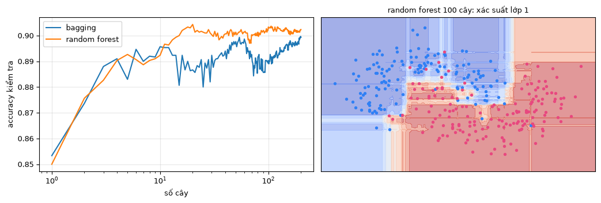
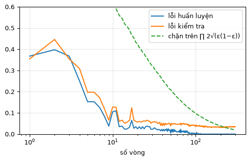

# Ensemble learning · Code từ đầu

> Ghi chú của người biên soạn: trang này do người biên soạn viết thêm. Trang tự viết bằng NumPy các thuật toán trong bài [Học tổ hợp](ml/ensemble_vi): bootstrap và ước lượng out-of-bag, bagging, random forest, AdaBoost và gradient boosting cho hồi quy lẫn phân loại.

## Cách dùng trang này

Các khối chạy lần lượt từ trên xuống và dùng chung biến. Chỉ cần `numpy` và `matplotlib`; khối 5 dùng thêm scikit-learn để đối chiếu.

## 1. Một cây hồi quy gọn nhẹ

Mọi thuật toán trên trang dùng chung một cây CART hồi quy, viết lại gọn từ trang [Cây quyết định · Code từ đầu](ml/tree_code_vi). Nó nhận thêm `max_features` để dùng cho random forest.

Với phân loại hai lớp, ta vẫn dùng **cây hồi quy trên nhãn 0/1**. Giá trị ở lá khi đó là tỉ lệ lớp 1, tức một xác suất. Và với nhãn 0/1, MSE trong một nút là $p(1-p)$, đúng bằng **một nửa Gini**. Vì vậy cây hồi quy trên nhãn 0/1 chọn **đúng những phép chia** mà cây phân loại theo Gini sẽ chọn.

<!-- run -->
```python
import numpy as np
import matplotlib.pyplot as plt

def build_tree(X, y, max_depth=None, min_leaf=1, max_features=None, rng=None, depth=0):
    """Cây hồi quy CART. Nút: ('leaf', giá trị) hoặc ('split', j, t, trái, phải)."""
    n, d = X.shape
    if (max_depth is not None and depth >= max_depth) or n < 2 * min_leaf or np.all(y == y[0]):
        return ("leaf", y.mean())
    feats = rng.choice(d, max_features, replace=False) if max_features else range(d)
    best = (np.inf, None, None)
    for j in feats:
        o = np.argsort(X[:, j], kind="mergesort"); xs, ys = X[o, j], y[o]
        k = np.arange(1, n); cs = np.cumsum(ys)[:-1]; cq = np.cumsum(ys ** 2)[:-1]
        sse = (cq - cs ** 2 / k) + ((ys ** 2).sum() - cq - (ys.sum() - cs) ** 2 / (n - k))
        ok = (xs[1:] > xs[:-1]) & (k >= min_leaf) & (n - k >= min_leaf)
        if ok.any():
            i = np.argmin(np.where(ok, sse, np.inf))
            if sse[i] < best[0]:
                best = (sse[i], j, (xs[i] + xs[i + 1]) / 2)
    if best[1] is None:
        return ("leaf", y.mean())
    _, j, t = best
    m = X[:, j] <= t
    return ("split", j, t, build_tree(X[m], y[m], max_depth, min_leaf, max_features, rng, depth + 1),
            build_tree(X[~m], y[~m], max_depth, min_leaf, max_features, rng, depth + 1))

def predict_tree(node, X):
    if node[0] == "leaf":
        return np.full(len(X), node[1])
    _, j, t, L, R = node
    out = np.empty(len(X)); m = X[:, j] <= t
    out[m], out[~m] = predict_tree(L, X[m]), predict_tree(R, X[~m])
    return out

def moons(n, noise, rng):
    t = np.pi * rng.uniform(size=n); c = rng.integers(0, 2, n)
    X = np.c_[np.where(c, 1 - np.cos(t), np.cos(t)), np.where(c, 0.5 - np.sin(t), np.sin(t))]
    return X + rng.normal(0, noise, X.shape), c

rng = np.random.default_rng(0)
X_tr, y_tr = moons(300, 0.3, rng)
X_te, y_te = moons(3000, 0.3, rng)
one = build_tree(X_tr, y_tr.astype(float))
print("một cây sâu: accuracy huấn luyện", np.mean((predict_tree(one, X_tr) > .5) == y_tr),
      "  kiểm tra", round(np.mean((predict_tree(one, X_te) > .5) == y_te), 3))
```

<!-- output -->
```output
một cây sâu: accuracy huấn luyện 1.0   kiểm tra 0.836
```
<!-- /output -->

Một cây mọc hết cỡ khớp đúng 100% tập huấn luyện nhưng chỉ đạt 0.836 trên tập kiểm tra: variance cao, như [mục C.8](ml/tree_vi).

## 2. Bootstrap và out-of-bag

<small class="viz-ref">Mục T.3 · hình T.3</small>

<!-- run -->
```python
for N in [10, 100, 1000, 100000]:
    frac = np.mean([np.unique(rng.integers(0, N, N)).size / N for _ in range(200)])
    print(f"N = {N:>6}: tỉ lệ điểm khác nhau trong một mẫu bootstrap {frac:.4f}   lý thuyết 1-(1-1/N)^N = {1 - (1 - 1 / N) ** N:.4f}")
print(f"giới hạn 1 - 1/e = {1 - np.exp(-1):.4f}")
```

<!-- output -->
```output
N =     10: tỉ lệ điểm khác nhau trong một mẫu bootstrap 0.6535   lý thuyết 1-(1-1/N)^N = 0.6513
N =    100: tỉ lệ điểm khác nhau trong một mẫu bootstrap 0.6338   lý thuyết 1-(1-1/N)^N = 0.6340
N =   1000: tỉ lệ điểm khác nhau trong một mẫu bootstrap 0.6325   lý thuyết 1-(1-1/N)^N = 0.6323
N = 100000: tỉ lệ điểm khác nhau trong một mẫu bootstrap 0.6321   lý thuyết 1-(1-1/N)^N = 0.6321
giới hạn 1 - 1/e = 0.6321
```
<!-- /output -->

Tỉ lệ $1 - (1 - 1/N)^N$ hội tụ rất nhanh về $1 - 1/e \approx 0.632$: với $N = 100$ đã là 0.634. Mô phỏng khớp với lý thuyết đến chữ số thứ ba.

## 3. Bagging và random forest

<small class="viz-ref">Mục T.3–T.4 · hình T.4, T.5</small>

Một hàm duy nhất cho cả hai: `max_features=None` là bagging, `max_features=1` (một trong hai đặc trưng) là random forest. Ta ghi lại accuracy kiểm tra sau mỗi cây, và ước lượng OOB.

<!-- run -->
```python
def forest(X, y, X_test, B=200, max_features=None, seed=0):
    r = np.random.default_rng(seed)
    n = len(X)
    sum_te, sum_oob, cnt_oob, acc = np.zeros(len(X_test)), np.zeros(n), np.zeros(n), []
    for b in range(B):
        idx = r.integers(0, n, n)
        oob = np.setdiff1d(np.arange(n), idx)
        t = build_tree(X[idx], y[idx].astype(float), max_features=max_features, rng=r)
        sum_te += predict_tree(t, X_test)
        sum_oob[oob] += predict_tree(t, X[oob]); cnt_oob[oob] += 1
        acc.append(np.mean((sum_te / (b + 1) > 0.5) == y_te))
    has = cnt_oob > 0
    oob_acc = np.mean((sum_oob[has] / cnt_oob[has] > 0.5) == y[has])
    return np.array(acc), oob_acc, sum_te / B

acc_bag, oob_bag, p_bag = forest(X_tr, y_tr, X_te, max_features=None)
acc_rf, oob_rf, p_rf = forest(X_tr, y_tr, X_te, max_features=1)
for name, a, o in [("bagging", acc_bag, oob_bag), ("random forest", acc_rf, oob_rf)]:
    print(f"{name:<14} 1 cây {a[0]:.3f}   10 cây {a[9]:.3f}   200 cây {a[-1]:.3f}   ước lượng OOB {o:.3f}")

fig, ax = plt.subplots(1, 2, figsize=(10.5, 3.6))
ax[0].plot(np.arange(1, 201), acc_bag, label="bagging"); ax[0].plot(np.arange(1, 201), acc_rf, label="random forest")
ax[0].set_xscale("log"); ax[0].set_xlabel("số cây"); ax[0].set_ylabel("accuracy kiểm tra"); ax[0].legend(); ax[0].grid(alpha=.3)
xx, yy = np.meshgrid(np.linspace(-1.8, 2.8, 200), np.linspace(-1.4, 1.9, 200))
G = np.c_[xx.ravel(), yy.ravel()]
r = np.random.default_rng(0); trees = []
for b in range(100):
    idx = r.integers(0, len(X_tr), len(X_tr)); trees.append(build_tree(X_tr[idx], y_tr[idx].astype(float), max_features=1, rng=r))
pg = np.mean([predict_tree(t, G) for t in trees], axis=0).reshape(xx.shape)
ax[1].contourf(xx, yy, pg, levels=np.linspace(0, 1, 11), cmap="coolwarm", alpha=.5)
ax[1].scatter(*X_tr[y_tr == 0].T, s=8, c="#2f80f5"); ax[1].scatter(*X_tr[y_tr == 1].T, s=8, c="#e8487f")
ax[1].set_title("random forest 100 cây: xác suất lớp 1", fontsize=9); ax[1].set_xticks([]); ax[1].set_yticks([])
fig.tight_layout()
```

<!-- output -->
```output
bagging        1 cây 0.853   10 cây 0.896   200 cây 0.899   ước lượng OOB 0.907
random forest  1 cây 0.850   10 cây 0.892   200 cây 0.902   ước lượng OOB 0.920
```

<div align=center></div>
<!-- /output -->

- Chỉ 10 cây đã đưa accuracy từ khoảng 0.85 lên gần 0.9. Thêm tới 200 cây chỉ nhích thêm một chút và **không** làm accuracy giảm: thêm cây không gây quá khớp.
- Với dữ liệu hai chiều, random forest chỉ có thể chọn 1 trong 2 đặc trưng ở mỗi lần chia. Đây là mức ngẫu nhiên rất mạnh, nhưng kết quả vẫn ngang bagging (0.902 so với 0.899).
- Ước lượng OOB (0.907 và 0.920) gần với accuracy kiểm tra thật, mà không cần tách riêng dữ liệu. Nó hơi lạc quan một chút vì chỉ dựa trên 300 điểm.

## 4. AdaBoost với stump

<small class="viz-ref">Mục T.5 · thuật toán T.2 · hình T.6</small>

Stump có trọng số: thử mọi đặc trưng và ngưỡng, cả hai hướng ($\pm 1$), chọn cái có lỗi có trọng số nhỏ nhất. Lý thuyết của AdaBoost cho một chặn trên của lỗi huấn luyện: $\text{lỗi} \le \prod_t 2\sqrt{\varepsilon_t(1 - \varepsilon_t)}$. Ta kiểm tra chặn này bằng số.

<!-- run -->
```python
def fit_stump(X, y, w):
    """y ∈ {-1, +1}. Trả về (lỗi, j, t, s) với dự đoán s·sign(x_j - t)."""
    best = (np.inf, 0, 0.0, 1)
    for j in range(X.shape[1]):
        o = np.argsort(X[:, j]); xs, ys, ws = X[o, j], y[o], w[o]
        # lỗi khi dự đoán +1 bên phải ngưỡng: các điểm +1 bên trái và các điểm -1 bên phải
        left_pos = np.r_[0, np.cumsum(ws * (ys > 0))]
        right_neg = np.r_[np.cumsum((ws * (ys < 0))[::-1])[::-1], 0]
        err = left_pos + right_neg
        cand = np.r_[xs[0] - 1, (xs[1:] + xs[:-1]) / 2, xs[-1] + 1]
        for e, s in [(err, 1), (1 - err, -1)]:
            i = np.argmin(e)
            if e[i] < best[0]:
                best = (e[i], j, cand[i], s)
    return best

def stump_predict(st, X):
    _, j, t, s = st
    return s * np.where(X[:, j] > t, 1, -1)

def circle(n, rng):
    X = rng.uniform(-1, 1, (n, 2)); return X, np.where((X ** 2).sum(1) < 0.45, 1, -1)

Xa, ya = circle(400, np.random.default_rng(5)); Xa_te, ya_te = circle(4000, np.random.default_rng(6))
w = np.ones(len(ya)) / len(ya)
F, Ft, bound, hist = np.zeros(len(ya)), np.zeros(len(ya_te)), 1.0, []
for t in range(1, 301):
    st = fit_stump(Xa, ya, w)
    eps = st[0]; alpha = 0.5 * np.log((1 - eps) / eps)
    h = stump_predict(st, Xa)
    w *= np.exp(-alpha * ya * h); w /= w.sum()
    F += alpha * h; Ft += alpha * stump_predict(st, Xa_te)
    bound *= 2 * np.sqrt(eps * (1 - eps))
    hist.append((t, np.mean(np.sign(F) != ya), np.mean(np.sign(Ft) != ya_te), bound, eps))
for t, e_tr, e_te, b, eps in hist:
    if t in (1, 2, 3, 10, 30, 100, 300):
        print(f"vòng {t:3d}: ε = {eps:.3f}   lỗi huấn luyện {e_tr:.3f}  (chặn trên {b:.3f})   lỗi kiểm tra {e_te:.3f}")

H = np.array(hist)
fig, ax = plt.subplots(figsize=(6, 3.4))
ax.plot(H[:, 0], H[:, 1], label="lỗi huấn luyện"); ax.plot(H[:, 0], H[:, 2], label="lỗi kiểm tra")
ax.plot(H[:, 0], H[:, 3], "--", label="chặn trên ∏ 2√(ε(1−ε))")
ax.set_xscale("log"); ax.set_ylim(0, 0.6); ax.set_xlabel("số vòng"); ax.legend(); ax.grid(alpha=.3)
```

<!-- output -->
```output
vòng   1: ε = 0.368   lỗi huấn luyện 0.367  (chặn trên 0.964)   lỗi kiểm tra 0.354
vòng   2: ε = 0.319   lỗi huấn luyện 0.398  (chặn trên 0.898)   lỗi kiểm tra 0.446
vòng   3: ε = 0.375   lỗi huấn luyện 0.367  (chặn trên 0.870)   lỗi kiểm tra 0.354
vòng  10: ε = 0.386   lỗi huấn luyện 0.105  (chặn trên 0.624)   lỗi kiểm tra 0.128
vòng  30: ε = 0.411   lỗi huấn luyện 0.022  (chặn trên 0.322)   lỗi kiểm tra 0.057
vòng 100: ε = 0.432   lỗi huấn luyện 0.000  (chặn trên 0.098)   lỗi kiểm tra 0.036
vòng 300: ε = 0.449   lỗi huấn luyện 0.000  (chặn trên 0.020)   lỗi kiểm tra 0.035
```

<div align=center></div>
<!-- /output -->

Ba vòng đầu, lỗi có trọng số $\varepsilon$ quanh 0.32–0.38: mỗi stump chỉ tốt hơn đoán mò một chút. Lỗi huấn luyện thậm chí **tăng** ở vòng 2, nhưng chặn trên thì luôn giảm. Sau 100 vòng, lỗi huấn luyện về 0, và chặn trên luôn nằm trên lỗi thật, đúng như lý thuyết.

Điều thú vị nằm ở cột cuối: từ vòng 100 đến vòng 300, lỗi huấn luyện đã bằng 0 mà lỗi kiểm tra **vẫn giảm nhẹ** (0.036 → 0.035) chứ không tăng. AdaBoost tiếp tục nới rộng **lề** (margin) $y_i F(\mathbf{x}_i)$ của các điểm huấn luyện, giống ý tưởng lề lớn nhất của [SVM](ml/ch26_vi). Hiện tượng này khiến AdaBoost từng được cho là "không quá khớp". Thực tế nó vẫn quá khớp được khi dữ liệu nhiều nhiễu nhãn.

## 5. Gradient boosting cho hồi quy

<small class="viz-ref">Mục T.6 · thuật toán T.3 · hình T.7</small>

Với mất mát bình phương, gradient âm chính là phần dư. Ta so kết quả với `GradientBoostingRegressor` của scikit-learn dùng cùng tham số.

<!-- run -->
```python
from sklearn.ensemble import GradientBoostingRegressor

def gb_fit(X, y, M=100, lr=0.1, depth=3):
    F0 = y.mean(); F = np.full(len(y), F0); trees = []
    for m in range(M):
        r = y - F                                    # gradient âm của ½(y − F)²
        t = build_tree(X, r, max_depth=depth)
        F += lr * predict_tree(t, X); trees.append(t)
    return F0, trees

def gb_predict(model, X, lr=0.1, upto=None):
    F0, trees = model
    return F0 + lr * sum(predict_tree(t, X) for t in trees[:upto])

r5 = np.random.default_rng(1)
xg = r5.uniform(0, 1, (200, 1)); yg = np.sin(2 * np.pi * xg[:, 0]) + 0.3 * xg[:, 0] + r5.normal(0, 0.3, 200)
xg_te = r5.uniform(0, 1, (2000, 1)); yg_te = np.sin(2 * np.pi * xg_te[:, 0]) + 0.3 * xg_te[:, 0] + r5.normal(0, 0.3, 2000)

model = gb_fit(xg, yg, M=100, lr=0.1, depth=3)
sk = GradientBoostingRegressor(n_estimators=100, learning_rate=0.1, max_depth=3, random_state=0).fit(xg, yg)
ours, theirs = gb_predict(model, xg_te), sk.predict(xg_te)
print(f"MSE kiểm tra: tự viết {np.mean((ours - yg_te) ** 2):.4f}   scikit-learn {np.mean((theirs - yg_te) ** 2):.4f}")
print(f"chênh lệch lớn nhất giữa hai dự đoán: {np.abs(ours - theirs).max():.2e}")
for M in [1, 5, 20, 50, 100]:
    print(f"M = {M:3d}: MSE huấn luyện {np.mean((gb_predict(model, xg, upto=M) - yg) ** 2):.4f}"
          f"   kiểm tra {np.mean((gb_predict(model, xg_te, upto=M) - yg_te) ** 2):.4f}")
```

<!-- output -->
```output
MSE kiểm tra: tự viết 0.1124   scikit-learn 0.1124
chênh lệch lớn nhất giữa hai dự đoán: 8.88e-16
M =   1: MSE huấn luyện 0.4469   kiểm tra 0.4259
M =   5: MSE huấn luyện 0.2321   kiểm tra 0.2376
M =  20: MSE huấn luyện 0.0645   kiểm tra 0.1023
M =  50: MSE huấn luyện 0.0401   kiểm tra 0.1031
M = 100: MSE huấn luyện 0.0263   kiểm tra 0.1124
```
<!-- /output -->

Code 15 dòng cho **đúng cùng** kết quả với scikit-learn: chênh lệch lớn nhất giữa hai dự đoán là $10^{-15}$, tức sai số làm tròn số thực. Với mất mát bình phương, `GradientBoostingRegressor` làm đúng những gì thuật toán T.3 mô tả.

MSE kiểm tra thấp nhất quanh 20–50 cây (khoảng 0.102), rồi tăng lại ở 100 cây (0.112), trong khi MSE huấn luyện vẫn giảm. Đây là quá khớp của boosting ở [Hình T.8](ml/ensemble_vi).

## 6. Gradient boosting cho phân loại

<small class="viz-ref">Mục T.6</small>

Với nhãn $y \in \{0, 1\}$ và mất mát log $L = -y\log p - (1-y)\log(1-p)$, trong đó $p = \sigma(F)$, gradient âm theo $F$ là $y - p$. Mô hình cộng dồn trên thang **logit** $F$; xác suất là $\sigma(F)$.

<!-- run -->
```python
sigmoid = lambda z: 1 / (1 + np.exp(-z))

def gb_clf(X, y, X_test, M=200, lr=0.1, depth=2):
    p0 = y.mean(); F = np.full(len(y), np.log(p0 / (1 - p0))); Ft = np.full(len(X_test), F[0])
    out = []
    for m in range(M):
        r = y - sigmoid(F)                           # gradient âm của mất mát log
        t = build_tree(X, r, max_depth=depth)
        F += lr * predict_tree(t, X); Ft += lr * predict_tree(t, X_test)
        p = sigmoid(F)
        logloss = -np.mean(y * np.log(p) + (1 - y) * np.log(1 - p))
        out.append((m + 1, logloss, np.mean((Ft > 0) == y_te)))
    return np.array(out)

H = gb_clf(X_tr, y_tr.astype(float), X_te)
for m in [1, 10, 50, 100, 200]:
    print(f"M = {m:3d}: log loss huấn luyện {H[m - 1, 1]:.3f}   accuracy kiểm tra {H[m - 1, 2]:.3f}")
print(f"so sánh: một cây sâu {np.mean((predict_tree(one, X_te) > .5) == y_te):.3f}, random forest 200 cây {acc_rf[-1]:.3f}")
```

<!-- output -->
```output
M =   1: log loss huấn luyện 0.678   accuracy kiểm tra 0.515
M =  10: log loss huấn luyện 0.570   accuracy kiểm tra 0.883
M =  50: log loss huấn luyện 0.346   accuracy kiểm tra 0.883
M = 100: log loss huấn luyện 0.275   accuracy kiểm tra 0.881
M = 200: log loss huấn luyện 0.222   accuracy kiểm tra 0.887
so sánh: một cây sâu 0.836, random forest 200 cây 0.902
```
<!-- /output -->

Ở bước 1, accuracy chỉ 0.515: mô hình mới đi được một bước nhỏ (ν = 0.1) từ logit gần 0, nên phần lớn dự đoán vẫn nằm sát ngưỡng. Sau 10 cây, accuracy đã lên 0.883. Gradient boosting với cây độ sâu 2 (0.887 sau 200 cây) vượt xa một cây sâu (0.836) và gần bằng random forest (0.902). Với dữ liệu hai chiều đơn giản này, random forest vẫn nhỉnh hơn.

Lưu ý rằng cây ở đây khớp $y - p$ bằng giá trị trung bình ở lá. Friedman (2001) và scikit-learn đi thêm một bước: thay giá trị lá bằng một bước Newton, $\sum r_i / \sum p_i(1-p_i)$. Đây cũng chính là công thức lá $-G/H$ của XGBoost ở [mục T.7](ml/ensemble_vi) khi $\lambda = 0$.
