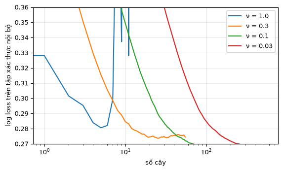

# Ensemble learning · Dùng thư viện

> Ghi chú của người biên soạn: trang này do người biên soạn viết thêm. Trang dùng các lớp trong `sklearn.ensemble` cho bài [Học tổ hợp](ml/ensemble_vi): random forest với ước lượng OOB, AdaBoost, hai bản gradient boosting của scikit-learn, dừng sớm, stacking. Cuối trang là cách viết tương ứng với XGBoost và LightGBM.

## Cách dùng trang này

Các khối chạy lần lượt từ trên xuống và dùng chung biến. Cần `numpy`, `pandas`, `matplotlib`, `scikit-learn`. Mục 2 tải bộ *Adult* (khoảng 4 MB) từ OpenML ở lần chạy đầu.

| Trong bài | Trong scikit-learn |
| --- | --- |
| Bagging tổng quát (mọi mô hình) | `BaggingClassifier(estimator, n_estimators)` |
| Random forest, ước lượng OOB | `RandomForestClassifier(n_estimators, max_features, oob_score=True)` |
| AdaBoost | `AdaBoostClassifier(estimator=DecisionTreeClassifier(max_depth=1))` |
| Gradient boosting (cổ điển, chính xác) | `GradientBoostingClassifier / Regressor` |
| Gradient boosting dựa trên histogram, kiểu LightGBM | `HistGradientBoostingClassifier / Regressor` |
| Dừng sớm | `early_stopping=True` (Hist…) hoặc `n_iter_no_change` (cổ điển) |
| Voting, stacking | `VotingClassifier`, `StackingClassifier` |

## 1. Random forest và ước lượng out-of-bag

<small class="viz-ref">Mục T.3–T.4</small>

Bộ *Breast Cancer Wisconsin*. So ước lượng OOB với xác thực chéo 10-fold và với tập kiểm tra.

<!-- run -->
```python
import time
import numpy as np
import pandas as pd
import matplotlib.pyplot as plt
from sklearn.datasets import load_breast_cancer
from sklearn.model_selection import train_test_split, cross_val_score, StratifiedKFold
from sklearn.tree import DecisionTreeClassifier
from sklearn.ensemble import RandomForestClassifier, BaggingClassifier

Xb, yb = load_breast_cancer(return_X_y=True)
Xb_tr, Xb_te, yb_tr, yb_te = train_test_split(Xb, yb, test_size=0.3, stratify=yb, random_state=0)
cv10 = StratifiedKFold(10, shuffle=True, random_state=0)

for name, m in [("một cây", DecisionTreeClassifier(random_state=0)),
                ("bagging 300 cây", BaggingClassifier(DecisionTreeClassifier(), n_estimators=300, oob_score=True, random_state=0)),
                ("random forest 300 cây", RandomForestClassifier(n_estimators=300, oob_score=True, random_state=0))]:
    cvs = cross_val_score(m, Xb_tr, yb_tr, cv=cv10).mean()
    m.fit(Xb_tr, yb_tr)
    oob = f"{m.oob_score_:.3f}" if hasattr(m, "oob_score_") else "  —  "
    print(f"{name:<22} OOB {oob}   xác thực chéo {cvs:.3f}   kiểm tra {m.score(Xb_te, yb_te):.3f}")
```

<!-- output -->
```output
một cây                OOB   —     xác thực chéo 0.925   kiểm tra 0.906
bagging 300 cây        OOB 0.960   xác thực chéo 0.947   kiểm tra 0.930
random forest 300 cây  OOB 0.967   xác thực chéo 0.967   kiểm tra 0.953
```
<!-- /output -->

Với cùng 300 cây, random forest tốt hơn bagging (0.953 so với 0.930 trên tập kiểm tra), và cả hai vượt xa một cây (0.906). Ước lượng OOB của random forest (0.967) khớp với xác thực chéo 10-fold (0.967), nhưng OOB chỉ cần học **một** lần thay vì 10 lần.

## 2. So sánh các tổ hợp trên dữ liệu Adult

<small class="viz-ref">Mục T.4–T.7, T.9</small>

Bộ *Adult* (điều tra dân số Mỹ năm 1994, 48 842 người): dự đoán thu nhập có trên 50 000 USD/năm không, từ tuổi, học vấn, nghề nghiệp, số giờ làm… Dữ liệu có cả đặc trưng số lẫn hạng mục, và có giá trị thiếu. Ta mã hoá hạng mục bằng `OrdinalEncoder`, vì cây không cần one-hot.

<!-- run -->
```python
from sklearn.datasets import fetch_openml
from sklearn.preprocessing import OrdinalEncoder
from sklearn.compose import make_column_transformer
from sklearn.pipeline import make_pipeline
from sklearn.ensemble import AdaBoostClassifier, GradientBoostingClassifier, HistGradientBoostingClassifier
from sklearn.linear_model import LogisticRegression
from sklearn.preprocessing import OneHotEncoder, StandardScaler
from sklearn.impute import SimpleImputer
from sklearn import metrics as M

adult = fetch_openml("adult", version=2, as_frame=True)
Xa = adult.data.drop(columns=["fnlwgt", "education"])      # education trùng với education-num
ya = (adult.target == ">50K").astype(int).to_numpy()
cat = Xa.select_dtypes("category").columns.tolist()
num = [c for c in Xa.columns if c not in cat]
print("số người:", len(ya), "  tỉ lệ >50K:", round(ya.mean(), 3), "  đặc trưng số:", len(num), "  hạng mục:", len(cat))
Xa_tr, Xa_te, ya_tr, ya_te = train_test_split(Xa, ya, test_size=0.3, stratify=ya, random_state=0)

ordinal = make_column_transformer(
    (OrdinalEncoder(handle_unknown="use_encoded_value", unknown_value=-1, encoded_missing_value=-1), cat),
    remainder="passthrough")
onehot = make_column_transformer(
    (make_pipeline(SimpleImputer(strategy="most_frequent"), OneHotEncoder(handle_unknown="ignore")), cat),
    (StandardScaler(), num))
cat_mask = [True] * len(cat) + [False] * len(num)          # sau ordinal: cột hạng mục đứng trước

models = {
    "hồi quy logistic (one-hot)": make_pipeline(onehot, LogisticRegression(max_iter=2000)),
    "một cây, độ sâu 8": make_pipeline(ordinal, DecisionTreeClassifier(max_depth=8, random_state=0)),
    "random forest 300 cây": make_pipeline(ordinal, RandomForestClassifier(n_estimators=300, min_samples_leaf=2, n_jobs=-1, random_state=0)),
    "AdaBoost 300 stump": make_pipeline(ordinal, AdaBoostClassifier(n_estimators=300, random_state=0)),
    "GradientBoosting 300 cây": make_pipeline(ordinal, GradientBoostingClassifier(n_estimators=300, max_depth=4, random_state=0)),
    "HistGradientBoosting": make_pipeline(ordinal, HistGradientBoostingClassifier(max_iter=300, categorical_features=cat_mask, random_state=0)),
}
rows = []
for name, m in models.items():
    t0 = time.perf_counter(); m.fit(Xa_tr, ya_tr); dt = time.perf_counter() - t0
    p = m.predict_proba(Xa_te)[:, 1]
    rows.append((name, M.accuracy_score(ya_te, p > .5), M.roc_auc_score(ya_te, p), M.log_loss(ya_te, p), dt))
print(f"\n{'mô hình':<28}{'accuracy':>9}{'ROC-AUC':>9}{'log loss':>10}{'thời gian học':>15}")
for r in rows:
    print(f"{r[0]:<28}{r[1]:>9.4f}{r[2]:>9.4f}{r[3]:>10.4f}{r[4]:>13.1f} s")
```

<!-- output -->
```output
số người: 48842   tỉ lệ >50K: 0.239   đặc trưng số: 5   hạng mục: 7

mô hình                      accuracy  ROC-AUC  log loss  thời gian học
hồi quy logistic (one-hot)     0.8508   0.9031    0.3233          0.4 s
một cây, độ sâu 8              0.8542   0.8984    0.3941          0.2 s
random forest 300 cây          0.8633   0.9159    0.2991          2.2 s
AdaBoost 300 stump             0.8553   0.9110    0.5667          5.5 s
GradientBoosting 300 cây       0.8735   0.9290    0.2756         11.6 s
HistGradientBoosting           0.8713   0.9283    0.2770          1.1 s
```
<!-- /output -->

Bảng này cho thấy gần như mọi điều ở [mục T.9](ml/ensemble_vi):

- Hai bản **gradient boosting** đứng đầu ở cả ba chỉ số. `HistGradientBoosting` cho kết quả gần như bằng bản cổ điển nhưng **nhanh hơn 11 lần** (1.0 s so với 11.5 s), nhờ histogram.
- **Random forest** đứng thứ ba, không cần chỉnh tham số nào.
- **Một cây** có accuracy nhỉnh hơn hồi quy logistic nhưng log loss tệ hơn nhiều: xác suất ở lá của một cây rất "cứng", nhiều lá có xác suất 0 hoặc 1.
- **AdaBoost** có ROC-AUC tốt (0.911) nhưng log loss rất cao (0.567). AdaBoost tối ưu mất mát mũ, không phải mất mát log, nên `predict_proba` của nó không phải là xác suất đáng tin. Nếu cần xác suất, hãy hiệu chỉnh (`CalibratedClassifierCV`) hoặc dùng gradient boosting.

## 3. Dừng sớm và tốc độ học

<small class="viz-ref">Mục T.6 · hình T.8</small>

`HistGradientBoostingClassifier` có sẵn dừng sớm: nó giữ lại 10% dữ liệu huấn luyện làm tập xác thực, và dừng khi mất mát trên tập đó không giảm trong `n_iter_no_change` vòng.

<!-- run -->
```python
fig, ax = plt.subplots(figsize=(6.4, 3.6))
for lr in [1.0, 0.3, 0.1, 0.03]:
    h = make_pipeline(ordinal, HistGradientBoostingClassifier(learning_rate=lr, max_iter=2000, early_stopping=True,
                      n_iter_no_change=30, validation_fraction=0.1, categorical_features=cat_mask, random_state=0))
    h.fit(Xa_tr, ya_tr)
    est = h[-1]
    p = h.predict_proba(Xa_te)[:, 1]
    print(f"ν = {lr:<5} dừng sau {est.n_iter_:4d} cây   log loss kiểm tra {M.log_loss(ya_te, p):.4f}   ROC-AUC {M.roc_auc_score(ya_te, p):.4f}")
    ax.plot(-est.validation_score_, label=f"ν = {lr}")
ax.set_xscale("log"); ax.set_xlabel("số cây"); ax.set_ylabel("log loss trên tập xác thực nội bộ")
ax.set_ylim(0.27, 0.36); ax.legend(); ax.grid(alpha=.3)
```

<!-- output -->
```output
ν = 1.0   dừng sau   35 cây   log loss kiểm tra 0.4311   ROC-AUC 0.9114
ν = 0.3   dừng sau   55 cây   log loss kiểm tra 0.2814   ROC-AUC 0.9262
ν = 0.1   dừng sau  135 cây   log loss kiểm tra 0.2770   ROC-AUC 0.9282
ν = 0.03  dừng sau  564 cây   log loss kiểm tra 0.2764   ROC-AUC 0.9286
```

<div align=center></div>
<!-- /output -->

Tốc độ học càng nhỏ thì càng cần nhiều cây trước khi dừng (35 → 564), và kết quả càng tốt. Riêng ν = 1 cho log loss kiểm tra 0.431, tệ hơn hẳn: mỗi cây nhảy một bước quá dài, nên mất mát xác thực dao động và dừng sớm ở một điểm kém. Từ ν = 0.1 trở xuống, lợi ích còn rất nhỏ (0.2770 → 0.2764) mà số cây tăng gấp 4. Trong thực tế, ν = 0.05–0.1 kèm dừng sớm là điểm khởi đầu hợp lý.

## 4. Stacking

<small class="viz-ref">Mục T.8 · hình T.9</small>

`StackingClassifier` tự tạo dự đoán out-of-fold bằng xác thực chéo (`cv=5`) cho mô hình tầng trên. Ta ghép hồi quy logistic, random forest và HistGradientBoosting.

<!-- run -->
```python
from sklearn.ensemble import StackingClassifier, VotingClassifier

base = [("logit", models["hồi quy logistic (one-hot)"]),
        ("rf", models["random forest 300 cây"]),
        ("hgb", models["HistGradientBoosting"])]
for name, m in [("voting (trung bình xác suất)", VotingClassifier(base, voting="soft")),
                ("stacking (logistic ở tầng trên)", StackingClassifier(base, final_estimator=LogisticRegression(), cv=5))]:
    t0 = time.perf_counter(); m.fit(Xa_tr, ya_tr); dt = time.perf_counter() - t0
    p = m.predict_proba(Xa_te)[:, 1]
    print(f"{name:<32} accuracy {M.accuracy_score(ya_te, p > .5):.4f}   ROC-AUC {M.roc_auc_score(ya_te, p):.4f}"
          f"   log loss {M.log_loss(ya_te, p):.4f}   ({dt:.0f} s)")
    if name.startswith("stacking"):
        print("   trọng số tầng trên:", {b[0]: round(float(c), 2) for b, c in zip(base, m.final_estimator_.coef_[0])})
```

<!-- output -->
```output
voting (trung bình xác suất)     accuracy 0.8699   ROC-AUC 0.9219   log loss 0.2893   (3 s)
stacking (logistic ở tầng trên)  accuracy 0.8726   ROC-AUC 0.9273   log loss 0.2951   (22 s)
   trọng số tầng trên: {'logit': 0.55, 'rf': 0.97, 'hgb': 5.22}
```
<!-- /output -->

Hai cách ghép đều không vượt được HistGradientBoosting đứng một mình (log loss 0.2770). Trọng số tầng trên cho thấy lý do: stacking dồn gần hết niềm tin vào HistGradientBoosting (5.22), còn hai mô hình kia gần như không thêm được thông tin gì. Voting lấy trung bình đều nên còn kém hơn: nó kéo mô hình tốt nhất về phía hai mô hình yếu hơn. Stacking chỉ đáng công khi các mô hình tầng dưới **mạnh ngang nhau và sai theo những cách khác nhau**.

## 5. XGBoost và LightGBM

<small class="viz-ref">Mục T.7</small>

Môi trường chạy trang này không cài XGBoost hay LightGBM, nên khối dưới đây **không được chạy sẵn**. Cả hai thư viện đều có giao diện giống scikit-learn, dùng được trong `Pipeline`, `cross_val_score` và `GridSearchCV`. Cài bằng `pip install xgboost lightgbm`.

```python
import xgboost as xgb
import lightgbm as lgb

# XGBoost: reg_lambda là λ, gamma là γ trong công thức độ lợi ở mục T.7
xgb_clf = xgb.XGBClassifier(n_estimators=2000, learning_rate=0.05, max_depth=6, subsample=0.8,
                            colsample_bytree=0.8, reg_lambda=1.0, gamma=0.0, tree_method="hist",
                            enable_categorical=True, early_stopping_rounds=50)
xgb_clf.fit(X_train, y_train, eval_set=[(X_val, y_val)], verbose=False)

# LightGBM: cây mọc theo lá, num_leaves giới hạn số lá thay vì độ sâu
lgb_clf = lgb.LGBMClassifier(n_estimators=2000, learning_rate=0.05, num_leaves=31, subsample=0.8,
                             subsample_freq=1, colsample_bytree=0.8, reg_lambda=1.0)
lgb_clf.fit(X_train, y_train, eval_set=[(X_val, y_val)], callbacks=[lgb.early_stopping(50)])
```

| Ý nghĩa | scikit-learn `HistGradientBoosting` | XGBoost | LightGBM |
| --- | --- | --- | --- |
| Số cây tối đa | `max_iter` | `n_estimators` | `n_estimators` |
| Tốc độ học $\nu$ | `learning_rate` | `learning_rate` (`eta`) | `learning_rate` |
| Kích thước cây | `max_leaf_nodes`, `max_depth` | `max_depth` | `num_leaves` |
| Phạt L2 trên giá trị lá, $\lambda$ | `l2_regularization` | `reg_lambda` | `reg_lambda` |
| Độ lợi tối thiểu để chia, $\gamma$ | — | `gamma` | `min_split_gain` |
| Lấy mẫu con theo dòng / cột | — / `max_features` | `subsample` / `colsample_bytree` | `subsample` / `colsample_bytree` |
