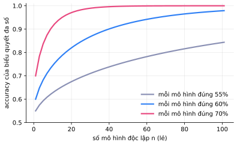
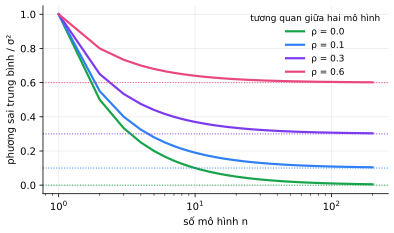
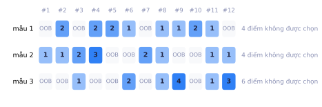
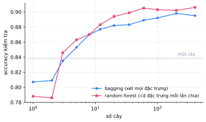
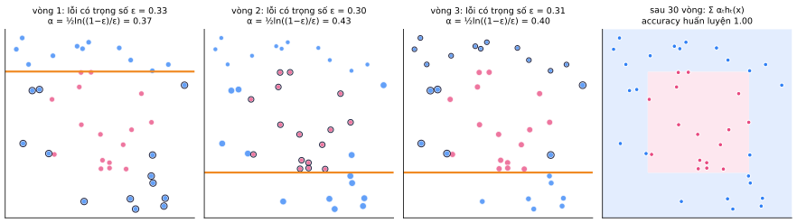
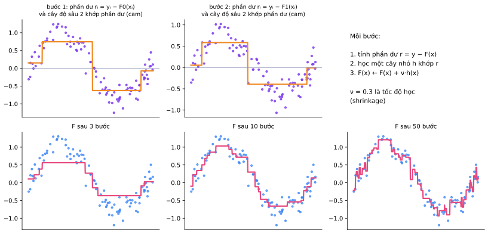
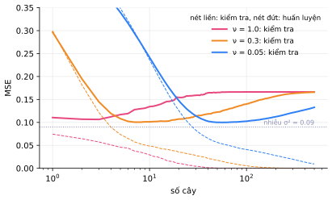
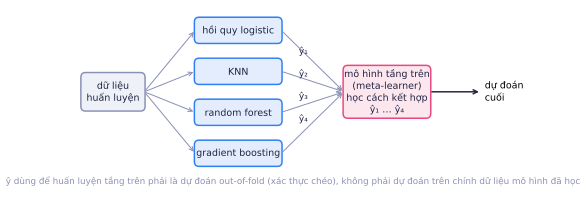

# Ensemble learning

> Ghi chú của người biên soạn: bài này do người biên soạn viết thêm, không có trong sách *Machine Learning cơ bản*. Bài dựa trên bài trước, [Cây quyết định](ml/tree_vi). Mọi hình trong bài đều vẽ từ số liệu thật bằng script `scripts/ml_extra/tree_figs.py`.

**Học tổ hợp** (ensemble learning) là ghép nhiều mô hình thành một mô hình mạnh hơn. Đây không phải mẹo nhỏ. Với dữ liệu dạng bảng (bảng tính, cơ sở dữ liệu, log giao dịch), các tổ hợp cây như **random forest** và **gradient boosting** (XGBoost, LightGBM, CatBoost) đến nay vẫn thường mạnh hơn mạng neuron, và thắng phần lớn các cuộc thi trên Kaggle với loại dữ liệu này.

Bài gồm ba họ phương pháp:

- **Bagging và random forest** (T.3–T.4): học nhiều cây **song song**, độc lập, rồi lấy trung bình. Mục tiêu là giảm **variance**.
- **Boosting** (T.5–T.7): học các cây **nối tiếp**, mỗi cây sửa lỗi của các cây trước. Mục tiêu là giảm **bias**.
- **Stacking** (T.8): học một mô hình để kết hợp các mô hình khác.

## T.1 Sức mạnh của số đông

Giả sử có $n$ bộ phân loại nhị phân, mỗi bộ đúng với xác suất $p > 0.5$, và chúng sai **độc lập** với nhau. Ta biểu quyết theo đa số. Kết quả đúng khi có hơn một nửa số bộ đúng, nên theo phân phối nhị thức:

$$
P(\text{đa số đúng}) = \sum_{k > n/2} \binom{n}{k} p^k (1-p)^{n-k}.
$$

<div align=center></div>
<div align=center>Hình T.1: Mỗi bộ chỉ đúng 60%, nhưng biểu quyết của 11 bộ đúng 75.3%, của 101 bộ đúng 97.9%.</div>

Đây là định lý bồi thẩm đoàn của Condorcet (1785). Nó cho thấy hai điều kiện để tổ hợp có ích:

1. Mỗi mô hình phải **tốt hơn đoán mò** ($p > 0.5$). Nếu $p < 0.5$, đa số càng đông càng sai.
2. Các mô hình phải **sai khác nhau**. Đây là điều kiện khó. Mười bản sao của cùng một mô hình thì biểu quyết vẫn chỉ bằng một mô hình.

## T.2 Vì sao sự đa dạng quan trọng

Với hồi quy, ta lấy trung bình thay vì biểu quyết. Giả sử $n$ mô hình có cùng phương sai $\sigma^2$, và mỗi cặp có hệ số tương quan $\rho$. Phương sai của trung bình là

$$
\operatorname{Var}\Big(\frac{1}{n}\sum_{i=1}^n \hat{f}_i\Big) = \rho\,\sigma^2 + \frac{1 - \rho}{n}\,\sigma^2.
$$

**Chứng minh.** Phương sai của tổng bằng tổng mọi hiệp phương sai: $n$ số hạng $\sigma^2$ trên đường chéo và $n(n-1)$ số hạng $\rho\sigma^2$ ngoài đường chéo. Chia cho $n^2$: $\frac{\sigma^2}{n} + \frac{n-1}{n}\rho\sigma^2 = \rho\sigma^2 + \frac{1-\rho}{n}\sigma^2$. $\square$

<div align=center></div>
<div align=center>Hình T.2: Thêm mô hình chỉ làm số hạng thứ hai về 0. Số hạng $\rho\sigma^2$ không giảm, dù thêm bao nhiêu mô hình đi nữa.</div>

Công thức này là chìa khoá của cả bài:

- **Số hạng thứ hai** giảm khi thêm mô hình. Bagging khai thác số hạng này.
- **Số hạng thứ nhất** chỉ giảm khi các mô hình **ít tương quan** hơn. Random forest khai thác số hạng này.
- Lấy trung bình **không** làm giảm bias: trung bình của nhiều mô hình lệch vẫn lệch. Muốn giảm bias, cần boosting.

## T.3 Bagging

Ngoài đời, ta chỉ có **một** tập huấn luyện. Làm sao có nhiều mô hình "độc lập"? **Bagging** (bootstrap aggregating; Breiman, 1996) tạo ra nhiều tập huấn luyện giả bằng **bootstrap**: lấy $N$ điểm **có hoàn lại** từ $N$ điểm ban đầu (Hình T.3).

<div align=center></div>
<div align=center>Hình T.3: Ba mẫu bootstrap từ 12 điểm. Số trong ô là số lần điểm đó được chọn; "OOB" là điểm không được chọn lần nào.</div>

Một điểm cụ thể **không** được chọn trong cả $N$ lần lấy với xác suất $(1 - 1/N)^N \to e^{-1} \approx 0.368$. Vậy mỗi mẫu bootstrap chứa khoảng **63.2%** số điểm khác nhau của dữ liệu gốc (mô phỏng với $N = 1000$ cho 63.1%). 36.8% còn lại là các điểm **out-of-bag** (OOB). Chúng là một tập xác thực miễn phí cho cây đó.

```
Thuật toán T.1: Bagging
Input:  tập huấn luyện S gồm N điểm; số mô hình B
Output: mô hình tổ hợp

for b = 1, …, B do
    S_b ← lấy N điểm từ S, có hoàn lại          # mẫu bootstrap
    h_b ← học một cây sâu (không cắt tỉa) trên S_b
return f(x) = trung bình của h_1(x), …, h_B(x)   # hồi quy: trung bình; phân loại: biểu quyết hoặc trung bình xác suất
```

**Ước lượng OOB**: với mỗi điểm $\mathbf{x}_i$, chỉ lấy trung bình các cây mà $\mathbf{x}_i$ nằm ngoài mẫu bootstrap của chúng (khoảng $0.368B$ cây). Sai số trên các dự đoán này gần với sai số xác thực chéo, mà không cần học lại mô hình nào.

Bagging hợp nhất với các mô hình **variance cao, bias thấp**: chính là cây quyết định sâu ([mục C.8](ml/tree_vi)). Mỗi cây quá khớp theo một kiểu riêng; lấy trung bình thì các kiểu quá khớp đó triệt tiêu nhau.

<div align=center></div>
<div align=center>Hình T.4: Một cây sâu cho vùng quyết định lởm chởm. Trung bình 200 cây bagging hoặc random forest cho ranh giới mượt hơn và accuracy kiểm tra cao hơn (0.867 → 0.880 → 0.887).</div>

## T.4 Random forest

Bagging có một điểm yếu: nếu có một đặc trưng rất mạnh, hầu như cây nào cũng chọn nó ở gốc, nên các cây **giống nhau** và $\rho$ cao. **Random forest** (Breiman, 2001) thêm một nguồn ngẫu nhiên nữa: ở **mỗi lần chia**, chỉ xét một tập con ngẫu nhiên gồm $m$ trong $d$ đặc trưng. Giá trị thông dụng là $m = \sqrt{d}$ cho phân loại và $m = d/3$ cho hồi quy.

Mỗi cây trở nên **kém hơn** một chút, vì đôi khi không được chọn đặc trưng tốt nhất. Đổi lại, các cây **ít tương quan** hơn nhiều, và theo công thức ở T.2, tổ hợp có thể tốt hơn.

<div align=center></div>
<div align=center>Hình T.5: Dữ liệu 20 đặc trưng. Với một cây, random forest kém hơn bagging (0.788 so với 0.807) vì mỗi lần chia chỉ được xem 4 đặc trưng. Từ 3 cây trở lên, random forest ngang hoặc vượt bagging; với 400 cây, random forest đạt 0.906, bagging đạt 0.895.</div>

Hình T.5 còn cho thấy một tính chất dễ chịu: **thêm cây không gây quá khớp**. Accuracy tăng nhanh rồi đi ngang. Số cây chỉ cần "đủ lớn", và cái giá duy nhất của nhiều cây là thời gian tính.

| Siêu tham số (scikit-learn) | Ý nghĩa | Thường dùng |
| --- | --- | --- |
| `n_estimators` | số cây | vài trăm; càng nhiều càng ổn định |
| `max_features` | $m$, số đặc trưng xét ở mỗi lần chia | `"sqrt"` (phân loại), `1.0` hoặc `0.33` (hồi quy) |
| `max_depth`, `min_samples_leaf` | độ sâu của từng cây | thường để cây mọc sâu; tăng `min_samples_leaf` khi dữ liệu nhiễu |
| `oob_score=True` | tính sai số OOB | miễn phí, nên bật |

Random forest là một lựa chọn mặc định rất tốt: gần như không cần chỉnh siêu tham số, khó quá khớp, không cần chuẩn hoá dữ liệu.

## T.5 Boosting và AdaBoost

Bagging giảm variance của những mô hình mạnh nhưng bất ổn. **Boosting** đi theo hướng ngược lại: ghép nhiều mô hình **yếu** (bias cao, ví dụ cây chỉ có một nhát cắt, gọi là *stump*) thành một mô hình mạnh. Các mô hình được học **lần lượt**, mỗi mô hình tập trung vào những điểm mà các mô hình trước làm sai.

**AdaBoost** (Freund và Schapire, 1997) là thuật toán boosting đầu tiên được dùng rộng rãi. Nhãn là $y_i \in \{-1, +1\}$. Mỗi điểm có một **trọng số** $w_i$, ban đầu bằng nhau.

```
Thuật toán T.2: AdaBoost
Input:  (x_1, y_1), …, (x_N, y_N) với y_i ∈ {−1, +1}; số vòng T
Output: F(x) = Σ_t α_t·h_t(x); dự đoán sign(F(x))

w_i ← 1/N  với mọi i
for t = 1, …, T do
    h_t ← học bộ phân loại yếu trên dữ liệu với trọng số w
    ε_t ← Σ_{i: h_t(x_i) ≠ y_i} w_i              # lỗi có trọng số
    α_t ← ½·ln((1 − ε_t) / ε_t)                   # mô hình càng chính xác, tiếng nói càng lớn
    w_i ← w_i·exp(−α_t·y_i·h_t(x_i))  với mọi i   # điểm sai: tăng trọng số; điểm đúng: giảm
    chuẩn hoá w để Σ w_i = 1
```

<div align=center></div>
<div align=center>Hình T.6: Mỗi stump (đường cam) chỉ cắt được một nhát. Kích thước điểm tỉ lệ với trọng số; điểm có viền đen là điểm stump đó làm sai. Sau 30 vòng, tổng có trọng số của 30 nhát cắt bao được vùng tròn ở giữa.</div>

Ở vòng 1, stump sai 13 trên 40 điểm, lỗi có trọng số $\varepsilon_1 = 0.33$, nên $\alpha_1 = 0.37$. Trọng số của 13 điểm sai được nhân với $e^{\alpha_1}$, các điểm đúng nhân với $e^{-\alpha_1}$. Sau khi chuẩn hoá, tổng trọng số của các điểm sai đúng bằng một nửa. Vì vậy stump ở vòng 2 buộc phải chú ý tới chúng. Một stump đơn lẻ chỉ cắt được một nhát thẳng, nhưng sau 30 vòng, tổng của chúng phân loại đúng toàn bộ 40 điểm huấn luyện.

AdaBoost có thể hiểu là thuật toán cực tiểu hoá **hàm mất mát mũ** $\sum_i e^{-y_i F(\mathbf{x}_i)}$ theo kiểu tham lam, mỗi vòng thêm một số hạng $\alpha_t h_t$ (Friedman, Hastie và Tibshirani, 2000). Cách nhìn "boosting là tối ưu một hàm mất mát" dẫn thẳng đến gradient boosting.

## T.6 Gradient boosting

**Gradient boosting** (Friedman, 2001) tổng quát hoá ý tưởng trên cho **mọi** hàm mất mát khả vi. Mô hình là một tổng các cây:

$$
F_M(\mathbf{x}) = F_0 + \nu \sum_{m=1}^{M} h_m(\mathbf{x}).
$$

Ở bước $m$, ta muốn thêm một cây $h_m$ làm giảm tổng mất mát $\sum_i L(y_i, F(\mathbf{x}_i))$ nhiều nhất. Hãy coi các giá trị $F(\mathbf{x}_1), \dots, F(\mathbf{x}_N)$ là $N$ biến số. Theo [gradient descent](ml/ch12_vi), hướng giảm nhanh nhất là **gradient âm**:

$$
r_{im} = -\left.\frac{\partial L(y_i, F)}{\partial F}\right|_{F = F_{m-1}(\mathbf{x}_i)}.
$$

Ta không cộng thẳng vector $\mathbf{r}_m$ vào, vì nó chỉ xác định tại $N$ điểm huấn luyện. Thay vào đó, ta học một **cây hồi quy** $h_m$ xấp xỉ $\mathbf{r}_m$, rồi cộng cây đó (đã nhân với tốc độ học $\nu$) vào mô hình. Gradient boosting chính là **gradient descent trong không gian hàm số**, mỗi bước là một cây.

Với mất mát bình phương $L = \frac{1}{2}(y - F)^2$, gradient âm là $y_i - F(\mathbf{x}_i)$, tức **phần dư**. Thuật toán trở nên rất trực quan: mỗi cây học phần mà các cây trước còn đoán sai (Hình T.7). Với mất mát log của phân loại nhị phân, gradient âm là $y_i - p_i$, với $p_i$ là xác suất dự đoán hiện tại.

```
Thuật toán T.3: Gradient boosting
Input:  (x_1, y_1), …, (x_N, y_N); hàm mất mát L; số bước M; tốc độ học ν; độ sâu cây
Output: F_M(x)

F_0(x) ← argmin_c Σ_i L(y_i, c)                  # bình phương: trung bình y
for m = 1, …, M do
    r_i ← −∂L(y_i, F)/∂F tại F = F_{m−1}(x_i)    # bình phương: r_i = y_i − F_{m−1}(x_i)
    h_m ← cây hồi quy nhỏ khớp {(x_i, r_i)}
    F_m(x) ← F_{m−1}(x) + ν·h_m(x)
return F_M
```

<div align=center></div>
<div align=center>Hình T.7: Hàng trên: phần dư ở bước 1 và 2 (tím) và cây độ sâu 2 khớp chúng (cam). Hàng dưới: mô hình sau 3, 10 và 50 bước với ν = 0.3. Sau 50 bước, MSE huấn luyện chỉ còn 0.008, trong khi phương sai của y là 0.42.</div>

Hình T.7 cũng là một cảnh báo: sau 50 bước, mô hình đã bắt đầu uốn theo từng điểm nhiễu. Khác với random forest, **boosting có thể quá khớp khi thêm cây**, vì mỗi cây mới tiếp tục giảm sai số huấn luyện. Ba cách kiểm soát chính:

- **Tốc độ học** $\nu$ (shrinkage): mỗi cây chỉ đóng góp một phần nhỏ. $\nu$ nhỏ cần nhiều cây hơn, nhưng thường cho kết quả tốt hơn.
- **Dừng sớm** (early stopping): theo dõi sai số trên tập xác thực và dừng khi nó không giảm nữa.
- **Cây nhỏ** (độ sâu 3–8) và **lấy mẫu con** (mỗi cây chỉ học trên một phần dữ liệu, gọi là *stochastic gradient boosting*).

<div align=center></div>
<div align=center>Hình T.8: Nét đứt là MSE huấn luyện, nét liền là MSE kiểm tra. ν = 1 đạt đáy (0.106) chỉ sau 3 cây rồi quá khớp nhanh. ν = 0.05 cần 56 cây để đạt đáy thấp hơn (0.0999), và sau 500 cây vẫn quá khớp ít hơn hẳn.</div>

## T.7 XGBoost, LightGBM và CatBoost

Ba thư viện này cùng là gradient boosting với cây, nhưng thêm nhiều cải tiến về độ chính xác và tốc độ.

**XGBoost** (Chen và Guestrin, 2016) dùng khai triển Taylor **bậc hai** của hàm mất mát. Gọi $g_i, h_i$ là đạo hàm bậc một và bậc hai của $L$ tại dự đoán hiện tại. Với một cây cố định cấu trúc, mất mát (cộng thêm phạt $\frac{\lambda}{2}\sum_j w_j^2$ trên giá trị lá và $\gamma$ cho mỗi lá) được tối ưu bằng giá trị lá

$$
w_j^* = -\frac{G_j}{H_j + \lambda}, \qquad G_j = \sum_{i \in \text{lá } j} g_i,\quad H_j = \sum_{i \in \text{lá } j} h_i,
$$

và độ lợi của một phép chia nút thành hai nút con $L$, $R$ là

$$
\text{Gain} = \frac{1}{2}\left[\frac{G_L^2}{H_L + \lambda} + \frac{G_R^2}{H_R + \lambda} - \frac{(G_L + G_R)^2}{H_L + H_R + \lambda}\right] - \gamma.
$$

Phép chia chỉ được giữ khi độ lợi dương, nên $\gamma$ đóng vai trò cắt tỉa. Với mất mát bình phương, $g_i = F_i - y_i$ và $h_i = 1$, và công thức lá trở thành trung bình phần dư, co về 0 bởi $\lambda$.

**LightGBM** (Ke và cộng sự, 2017) tập trung vào tốc độ:

- **Histogram**: gom giá trị mỗi đặc trưng vào khoảng 255 ô trước khi học, nên chỉ phải thử khoảng 255 ngưỡng thay vì $N - 1$.
- **Mọc theo lá** (leaf-wise): luôn chia lá có độ lợi lớn nhất, thay vì chia đều từng tầng. Với cùng số lá, cách này giảm mất mát nhanh hơn, nhưng cần giới hạn `num_leaves` để không quá khớp.
- **GOSS** và **EFB**: bỏ bớt các điểm có gradient nhỏ, và gộp các đặc trưng thưa không bao giờ cùng khác 0.

**CatBoost** (Prokhorenkova và cộng sự, 2018) xử lý tốt đặc trưng **hạng mục** (thành phố, mã sản phẩm…) bằng cách mã hoá theo thống kê nhãn có thứ tự, tránh rò rỉ nhãn. Nó dùng cây **đối xứng**: mọi nút cùng tầng hỏi cùng một câu hỏi.

| | XGBoost | LightGBM | CatBoost | scikit-learn `HistGradientBoosting` |
| --- | --- | --- | --- | --- |
| Tìm ngưỡng | chính xác hoặc histogram | histogram | histogram | histogram |
| Cách mọc cây | theo tầng (mặc định) | theo lá | đối xứng | theo lá |
| Đặc trưng hạng mục | hỗ trợ cơ bản | hỗ trợ | rất tốt | hỗ trợ |
| Giá trị thiếu | tự xử lý | tự xử lý | tự xử lý | tự xử lý |

Trong thực tế, bốn thư viện này thường cho kết quả gần nhau sau khi chỉnh tham số. Chọn theo tốc độ, theo loại dữ liệu, và theo thói quen của nhóm.

## T.8 Stacking

**Stacking** (Wolpert, 1992) kết hợp các mô hình **khác loại** (logistic, KNN, random forest, gradient boosting…) bằng một mô hình tầng trên học cách tin mô hình nào ở đâu (Hình T.9). Thường tầng trên chỉ là một hồi quy tuyến tính hoặc logistic đơn giản.

<div align=center></div>
<div align=center>Hình T.9: Các mô hình tầng dưới học trên dữ liệu gốc; mô hình tầng trên học từ dự đoán của chúng.</div>

Điểm mấu chốt là tầng trên phải học từ **dự đoán out-of-fold**: dự đoán cho mỗi điểm đến từ mô hình **không** được học trên điểm đó. Nếu dùng dự đoán trên chính dữ liệu huấn luyện, tầng trên sẽ tin nhầm mô hình quá khớp nhất. Đây lại là bài học về rò rỉ dữ liệu ở [mục E.1](ml/eval_vi).

Phiên bản đơn giản hơn là **voting**: lấy trung bình (hoặc biểu quyết) dự đoán của các mô hình, không học trọng số.

## T.9 So sánh và lời khuyên

| | Bagging / Random forest | Boosting (AdaBoost, GBM, XGBoost…) |
| --- | --- | --- |
| Cách học | các cây song song, độc lập | các cây nối tiếp, cây sau sửa lỗi cây trước |
| Mô hình thành phần | cây sâu (variance cao, bias thấp) | cây nông (bias cao, variance thấp) |
| Giảm chủ yếu | variance | bias |
| Thêm cây | không quá khớp, chỉ tốn thời gian | có thể quá khớp, cần dừng sớm |
| Chỉnh siêu tham số | gần như không cần | quan trọng: $\nu$, số cây, độ sâu, phạt |
| Song song hoá | dễ (mỗi cây độc lập) | khó hơn (song song bên trong từng cây) |
| Thường mạnh nhất? | là mốc rất tốt | thường thắng sau khi chỉnh kỹ |

Một quy trình thực tế cho dữ liệu dạng bảng:

1. Dựng mốc cơ sở đơn giản (logistic hoặc hồi quy tuyến tính).
2. Thử **random forest** với tham số mặc định: nhanh và khó sai.
3. Thử **gradient boosting** (`HistGradientBoosting`, LightGBM hoặc XGBoost) với dừng sớm, rồi chỉnh $\nu$, số lá và độ sâu bằng xác thực chéo.
4. Nếu cần thêm vài phần nghìn, thử stacking các mô hình tốt nhất.

---

**Học tiếp:** [Code từ đầu](ml/ensemble_code_vi) tự viết bagging, random forest, AdaBoost và gradient boosting · [Dùng thư viện](ml/ensemble_lib_vi) dùng scikit-learn và so sánh tốc độ · [Ví dụ áp dụng](ml/ensemble_app_vi) dự đoán giá nhà California với nhiều tổ hợp · [Mô phỏng](ml/ensemble_viz_vi) xem gradient boosting học từng bước và random forest mượt dần khi thêm cây.
