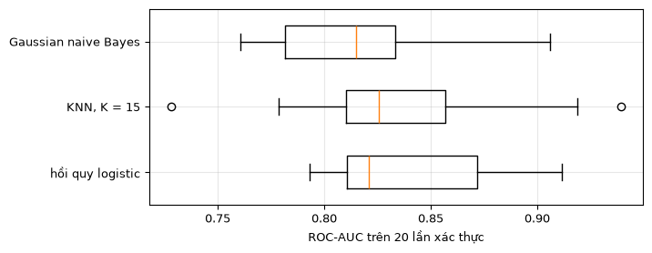
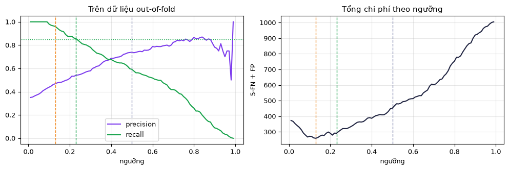
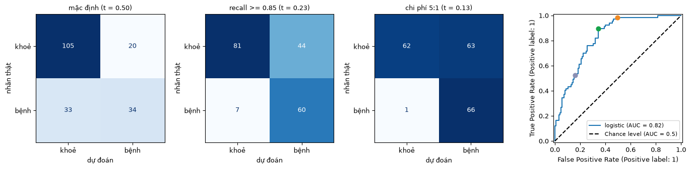

# Model evaluation · Ví dụ áp dụng: sàng lọc bệnh tiểu đường

> Ghi chú của người biên soạn: trang này do người biên soạn viết thêm. Dữ liệu là bộ *Pima Indians Diabetes* (Smith và cộng sự, 1988; Viện Quốc gia về Tiểu đường, Tiêu hoá và Thận Hoa Kỳ), tải từ [OpenML](https://www.openml.org/d/37). Trang chỉ nhằm minh hoạ cách đánh giá mô hình, không phải công cụ y tế.

## Bài toán

Bộ dữ liệu có 768 phụ nữ người Pima từ 21 tuổi trở lên. Mỗi người có 8 chỉ số: số lần mang thai, đường huyết sau nghiệm pháp dung nạp glucose 2 giờ, huyết áp tâm trương, độ dày nếp gấp da cơ tam đầu, insulin huyết thanh, chỉ số khối cơ thể (BMI), chỉ số di truyền tiểu đường (diabetes pedigree) và tuổi. Nhãn cho biết người đó có bị chẩn đoán tiểu đường trong vòng 5 năm hay không.

Giả sử ta xây một công cụ **sàng lọc**: người bị mô hình gắn cờ sẽ được mời đi xét nghiệm kỹ hơn. Bỏ sót một người bệnh (FN) nguy hiểm hơn nhiều so với mời nhầm một người khoẻ đi xét nghiệm (FP). Trang này đi qua đúng quy trình ở bài [Đánh giá mô hình](ml/eval_vi):

1. Tách riêng tập kiểm tra và không đụng tới nó cho đến bước cuối.
2. So sánh vài mô hình bằng xác thực chéo, có mốc cơ sở.
3. Chọn ngưỡng theo yêu cầu bài toán, chỉ dùng dữ liệu huấn luyện.
4. Báo cáo kết quả cuối cùng trên tập kiểm tra, **một lần**.

## 1. Dữ liệu và tập kiểm tra

<!-- run -->
```python
import numpy as np
import pandas as pd
import matplotlib.pyplot as plt
from sklearn.datasets import fetch_openml
from sklearn.model_selection import train_test_split

d = fetch_openml("diabetes", version=1, as_frame=True)
df = d.frame.rename(columns={"preg": "mang thai", "plas": "glucose", "pres": "huyết áp", "skin": "nếp da",
                             "insu": "insulin", "mass": "BMI", "pedi": "di truyền", "age": "tuổi"})
y = (df.pop("class") == "tested_positive").astype(int).to_numpy()
print("số người:", len(df), "  tỉ lệ dương:", round(y.mean(), 3))
print("số giá trị bằng 0 (thực chất là thiếu dữ liệu):")
print((df[["glucose", "huyết áp", "nếp da", "insulin", "BMI"]] == 0).sum().to_string())

X = df.to_numpy(dtype=float)
X_tr, X_te, y_tr, y_te = train_test_split(X, y, test_size=0.25, stratify=y, random_state=42)
print(f"\nhuấn luyện: {len(y_tr)} người ({y_tr.mean():.3f} dương)   kiểm tra: {len(y_te)} người ({y_te.mean():.3f} dương)")
```

<!-- output -->
```output
số người: 768   tỉ lệ dương: 0.349
số giá trị bằng 0 (thực chất là thiếu dữ liệu):
glucose       5
huyết áp     35
nếp da      227
insulin     374
BMI          11

huấn luyện: 576 người (0.349 dương)   kiểm tra: 192 người (0.349 dương)
```
<!-- /output -->

Glucose, huyết áp hay BMI bằng 0 là vô lý: đó là dữ liệu bị thiếu được ghi thành 0. Ta đổi chúng thành `NaN` rồi điền bằng trung vị. Bước điền nằm **trong** `Pipeline`, nên trung vị được tính lại chỉ trên phần huấn luyện ở mỗi lần chia ([mục E.1](ml/eval_vi)).

## 2. So sánh mô hình bằng xác thực chéo

<small class="viz-ref">Mục E.1, E.6, E.7</small>

Bốn ứng viên: mốc "luôn đoán lớp phổ biến", hồi quy logistic ([chương 14](ml/ch14_vi)), KNN ([chương 9](ml/ch09_vi)) và Gaussian naive Bayes ([chương 11](ml/ch11_vi)). Xác thực chéo phân tầng 5-fold, lặp lại 4 lần với các cách chia khác nhau, tổng cộng 20 lần đo cho mỗi mô hình.

<!-- run -->
```python
from sklearn.pipeline import make_pipeline
from sklearn.preprocessing import StandardScaler, FunctionTransformer
from sklearn.impute import SimpleImputer
from sklearn.linear_model import LogisticRegression
from sklearn.neighbors import KNeighborsClassifier
from sklearn.naive_bayes import GaussianNB
from sklearn.dummy import DummyClassifier
from sklearn.model_selection import RepeatedStratifiedKFold, cross_validate

ZERO_IS_MISSING = [1, 2, 3, 4, 5]          # glucose, huyết áp, nếp da, insulin, BMI
def zero_to_nan(X):
    X = X.copy(); X[:, ZERO_IS_MISSING] = np.where(X[:, ZERO_IS_MISSING] == 0, np.nan, X[:, ZERO_IS_MISSING])
    return X

def prep():
    return [FunctionTransformer(zero_to_nan), SimpleImputer(strategy="median"), StandardScaler()]

models = {
    "mốc: luôn đoán âm": DummyClassifier(strategy="most_frequent"),
    "hồi quy logistic": make_pipeline(*prep(), LogisticRegression()),
    "KNN, K = 15": make_pipeline(*prep(), KNeighborsClassifier(n_neighbors=15)),
    "Gaussian naive Bayes": make_pipeline(*prep(), GaussianNB()),
}
cv = RepeatedStratifiedKFold(n_splits=5, n_repeats=4, random_state=0)
scoring = ["accuracy", "roc_auc", "average_precision", "recall", "f1"]
res = {name: cross_validate(m, X_tr, y_tr, cv=cv, scoring=scoring) for name, m in models.items()}

print(f"{'':<22}" + "".join(f"{s:>20}" for s in scoring))
for name, r in res.items():
    print(f"{name:<22}" + "".join(f"{r['test_' + s].mean():>13.3f} ± {r['test_' + s].std():.3f}" for s in scoring))

fig, ax = plt.subplots(figsize=(7, 2.8))
names = list(res)[1:]
ax.boxplot([res[n]["test_roc_auc"] for n in names], orientation="horizontal", widths=0.5)
ax.set_yticks(range(1, len(names) + 1), names); ax.set_xlabel("ROC-AUC trên 20 lần xác thực"); ax.grid(alpha=.3)
```

<!-- output -->
```output
                                  accuracy             roc_auc   average_precision              recall                  f1
mốc: luôn đoán âm             0.651 ± 0.002        0.500 ± 0.000        0.349 ± 0.002        0.000 ± 0.000        0.000 ± 0.000
hồi quy logistic              0.783 ± 0.035        0.839 ± 0.041        0.735 ± 0.064        0.587 ± 0.082        0.652 ± 0.064
KNN, K = 15                   0.770 ± 0.036        0.832 ± 0.048        0.705 ± 0.069        0.593 ± 0.077        0.642 ± 0.061
Gaussian naive Bayes          0.759 ± 0.035        0.818 ± 0.043        0.692 ± 0.070        0.592 ± 0.068        0.631 ± 0.056
```

<div align=center></div>
<!-- /output -->

Mốc "luôn đoán âm" đạt accuracy 0.651 chỉ nhờ tỉ lệ lớp. Ba mô hình thật đều vượt mốc rõ rệt. Hồi quy logistic nhỉnh hơn ở mọi chỉ số, nhưng khoảng cách tới KNN (ROC-AUC 0.839 so với 0.832) nhỏ hơn nhiều so với độ dao động giữa các lần chia (±0.04). Biểu đồ hộp cho thấy ba hộp chồng lên nhau gần hết. Kết luận trung thực là: **ba mô hình ngang nhau trên bộ dữ liệu này**. Ta chọn logistic vì nó đơn giản và cho xác suất dễ diễn giải.

Cột recall đáng lo hơn: ở ngưỡng mặc định 0.5, mô hình chỉ bắt được khoảng 59% người bệnh. Với một công cụ sàng lọc, như vậy là quá thấp.

## 3. Chọn ngưỡng cho bài toán sàng lọc

<small class="viz-ref">Mục E.5 · hình E.5, E.6</small>

Ta chọn hồi quy logistic. Để chọn ngưỡng mà không đụng tới tập kiểm tra, ta cần điểm số "chưa từng thấy" cho mọi người trong tập huấn luyện. `cross_val_predict` làm đúng việc đó: điểm số của mỗi người đến từ mô hình học trên các phần **không chứa** người đó (out-of-fold).

Có hai cách đặt yêu cầu:

- **Theo ràng buộc**: recall ít nhất 85%. Trong các ngưỡng thoả điều kiện, lấy ngưỡng có precision cao nhất.
- **Theo chi phí**: giả sử bỏ sót một người bệnh đắt gấp 5 lần mời nhầm một người khoẻ. Chọn ngưỡng làm $5 \cdot \text{FN} + 1 \cdot \text{FP}$ nhỏ nhất.

<!-- run -->
```python
from sklearn.model_selection import cross_val_predict, StratifiedKFold
from sklearn import metrics as M

best = models["hồi quy logistic"]
s_oof = cross_val_predict(best, X_tr, y_tr, cv=StratifiedKFold(5, shuffle=True, random_state=1),
                          method="predict_proba")[:, 1]

ts = np.linspace(0.01, 0.99, 99)
rec = np.array([M.recall_score(y_tr, s_oof >= t) for t in ts])
prec = np.array([M.precision_score(y_tr, s_oof >= t, zero_division=1) for t in ts])
cost = np.array([5 * np.sum((s_oof < t) & (y_tr == 1)) + np.sum((s_oof >= t) & (y_tr == 0)) for t in ts])

ok = rec >= 0.85
t_recall = ts[ok][np.argmax(prec[ok])]
t_cost = ts[np.argmin(cost)]
for name, t in [("mặc định", 0.5), ("recall >= 0.85", t_recall), ("chi phí 5:1", t_cost)]:
    i = np.argmin(np.abs(ts - t))
    print(f"{name:<15} ngưỡng {t:.2f}: recall {rec[i]:.3f}  precision {prec[i]:.3f}  chi phí {cost[i]}")

fig, ax = plt.subplots(1, 2, figsize=(10, 3.4))
ax[0].plot(ts, prec, color="#7c3aed", label="precision"); ax[0].plot(ts, rec, color="#16a34a", label="recall")
ax[0].axhline(0.85, color="#16a34a", ls=":", lw=1)
for t, c in [(0.5, "#8a90b4"), (t_recall, "#16a34a"), (t_cost, "#f08a24")]:
    ax[0].axvline(t, color=c, ls="--", lw=1); ax[1].axvline(t, color=c, ls="--", lw=1)
ax[0].set_xlabel("ngưỡng"); ax[0].legend(); ax[0].grid(alpha=.3); ax[0].set_title("Trên dữ liệu out-of-fold")
ax[1].plot(ts, cost, color="#1f2340"); ax[1].set_xlabel("ngưỡng"); ax[1].set_ylabel("5·FN + FP")
ax[1].set_title("Tổng chi phí theo ngưỡng"); ax[1].grid(alpha=.3)
fig.tight_layout()
```

<!-- output -->
```output
mặc định        ngưỡng 0.50: recall 0.592  precision 0.739  chi phí 452
recall >= 0.85  ngưỡng 0.23: recall 0.856  precision 0.541  chi phí 291
chi phí 5:1     ngưỡng 0.13: recall 0.960  precision 0.468  chi phí 259
```

<div align=center></div>
<!-- /output -->

- Ngưỡng 0.5 bỏ sót 41% người bệnh trên dữ liệu out-of-fold.
- Yêu cầu recall ≥ 0.85 đẩy ngưỡng xuống 0.23. Precision giảm còn 0.54, tức khoảng một nửa số người được mời xét nghiệm thật sự có bệnh. Với sàng lọc, đó là cái giá chấp nhận được.
- Với chi phí 5:1, ngưỡng tối ưu còn thấp hơn (0.13): gần như gắn cờ mọi người có nguy cơ, recall 0.96. Đường chi phí khá phẳng quanh đáy, nên ngưỡng nào trong khoảng 0.1–0.25 cũng cho chi phí gần nhau.

## 4. Kết quả cuối cùng trên tập kiểm tra

<small class="viz-ref">Mục E.2–E.7</small>

Học lại mô hình trên **toàn bộ** tập huấn luyện, rồi đánh giá trên tập kiểm tra đúng một lần, với ba ngưỡng đã chốt từ trước.

<!-- run -->
```python
best.fit(X_tr, y_tr)
s_te = best.predict_proba(X_te)[:, 1]
print(f"ROC-AUC {M.roc_auc_score(y_te, s_te):.3f}   AP {M.average_precision_score(y_te, s_te):.3f}   "
      f"(mốc ngẫu nhiên của AP: {y_te.mean():.3f})\n")
fig, axes = plt.subplots(1, 4, figsize=(14, 3.3), gridspec_kw={"width_ratios": [1, 1, 1, 1.15]})
for ax, (name, t) in zip(axes, [("mặc định", 0.5), ("recall >= 0.85", t_recall), ("chi phí 5:1", t_cost)]):
    yp = (s_te >= t).astype(int)
    tn, fp, fn, tp = M.confusion_matrix(y_te, yp).ravel()
    print(f"{name:<15} t={t:.2f}  TP={tp:2d} FN={fn:2d} FP={fp:2d} TN={tn:3d}  accuracy {M.accuracy_score(y_te, yp):.3f}  "
          f"recall {M.recall_score(y_te, yp):.3f}  precision {M.precision_score(y_te, yp):.3f}  "
          f"F1 {M.f1_score(y_te, yp):.3f}  chi phí {5 * fn + fp}")
    M.ConfusionMatrixDisplay.from_predictions(y_te, yp, display_labels=["khoẻ", "bệnh"], ax=ax,
                                              cmap="Blues", colorbar=False)
    ax.set_title(f"{name} (t = {t:.2f})", fontsize=9); ax.set_xlabel("dự đoán"); ax.set_ylabel("nhãn thật")
M.RocCurveDisplay.from_predictions(y_te, s_te, ax=axes[3], name="logistic", plot_chance_level=True)
fpr, tpr, thr = M.roc_curve(y_te, s_te)
for t, c in [(0.5, "#8a90b4"), (t_recall, "#16a34a"), (t_cost, "#f08a24")]:
    i = np.argmin(np.abs(thr - t)); axes[3].scatter([fpr[i]], [tpr[i]], c=c, zorder=3, s=40)
axes[3].legend(loc="lower right", fontsize=8)
fig.tight_layout()
```

<!-- output -->
```output
ROC-AUC 0.824   AP 0.696   (mốc ngẫu nhiên của AP: 0.349)

mặc định        t=0.50  TP=34 FN=33 FP=20 TN=105  accuracy 0.724  recall 0.507  precision 0.630  F1 0.562  chi phí 185
recall >= 0.85  t=0.23  TP=60 FN= 7 FP=44 TN= 81  accuracy 0.734  recall 0.896  precision 0.577  F1 0.702  chi phí 79
chi phí 5:1     t=0.13  TP=66 FN= 1 FP=63 TN= 62  accuracy 0.667  recall 0.985  precision 0.512  F1 0.673  chi phí 68
```

<div align=center></div>
<!-- /output -->

Ba nhận xét:

1. **ROC-AUC trên tập kiểm tra (0.824) gần với ước lượng xác thực chéo (0.839 ± 0.041).** Quy trình đánh giá đáng tin: không có dấu hiệu rò rỉ hay chọn mô hình quá đà trên tập xác thực.
2. **Ngưỡng chọn trên dữ liệu huấn luyện "đứng vững" trên tập kiểm tra.** Ngưỡng 0.23 cho recall 0.896, vượt yêu cầu 0.85. Ngưỡng mặc định 0.5 chỉ bắt được 34 trong 67 người bệnh, còn ngưỡng 0.23 bắt được 60 người, đổi lại 24 người khoẻ bị mời nhầm thêm.
3. **Accuracy gần như không phân biệt được các lựa chọn** (0.724, 0.734, 0.667), và theo accuracy thì ngưỡng chi phí lại "tệ nhất". Trong khi đó, tổng chi phí giảm từ 185 xuống 68. Chọn sai thước đo là chọn sai mô hình.

## 5. Khoảng tin cậy cho con số cuối cùng

<small class="viz-ref">Mục E.12</small>

Tập kiểm tra chỉ có 192 người, trong đó 67 người bệnh. Recall đo trên 67 người có độ bất định khá lớn. Ta ước lượng khoảng tin cậy 95% bằng **bootstrap**: lấy mẫu có hoàn lại 2000 lần từ tập kiểm tra, mỗi lần tính lại chỉ số, rồi lấy phân vị 2.5% và 97.5%. Mô hình và ngưỡng giữ nguyên.

<!-- run -->
```python
rng = np.random.default_rng(0)
yp = (s_te >= t_recall).astype(int)
boot = {"recall": [], "precision": [], "ROC-AUC": []}
for _ in range(2000):
    i = rng.integers(0, len(y_te), len(y_te))
    boot["recall"].append(M.recall_score(y_te[i], yp[i]))
    boot["precision"].append(M.precision_score(y_te[i], yp[i]))
    boot["ROC-AUC"].append(M.roc_auc_score(y_te[i], s_te[i]))
point = {"recall": M.recall_score(y_te, yp), "precision": M.precision_score(y_te, yp), "ROC-AUC": M.roc_auc_score(y_te, s_te)}
for k, v in boot.items():
    lo, hi = np.percentile(v, [2.5, 97.5])
    print(f"{k:<10} {point[k]:.3f}   khoảng tin cậy 95%: [{lo:.3f}, {hi:.3f}]")
```

<!-- output -->
```output
recall     0.896   khoảng tin cậy 95%: [0.815, 0.967]
precision  0.577   khoảng tin cậy 95%: [0.482, 0.670]
ROC-AUC    0.824   khoảng tin cậy 95%: [0.764, 0.877]
```
<!-- /output -->

Recall 0.896 nghe chắc chắn, nhưng khoảng tin cậy trải từ 0.82 đến 0.97: với 67 người bệnh, mỗi người bị bỏ sót làm recall giảm 1.5 điểm phần trăm. Khi báo cáo, hãy viết "recall 0.90 (KTC 95%: 0.82–0.97)" thay vì chỉ "recall 0.90". Và nếu cần một cam kết chặt hơn, ví dụ "recall chắc chắn trên 0.85", thì cần nhiều dữ liệu kiểm tra hơn.

## Tóm tắt quy trình

| Bước | Dữ liệu dùng | Trên trang này |
| --- | --- | --- |
| Tách tập kiểm tra | toàn bộ | 25%, phân tầng, cất đi |
| Tiền xử lý | chỉ phần huấn luyện của mỗi lần chia | điền thiếu và chuẩn hoá trong `Pipeline` |
| So sánh mô hình | xác thực chéo trên tập huấn luyện | 5-fold × 4 lần, có mốc cơ sở |
| Chọn ngưỡng | điểm số out-of-fold trên tập huấn luyện | recall ≥ 0.85 hoặc chi phí 5:1 |
| Báo cáo | tập kiểm tra, một lần | kèm khoảng tin cậy bootstrap |
