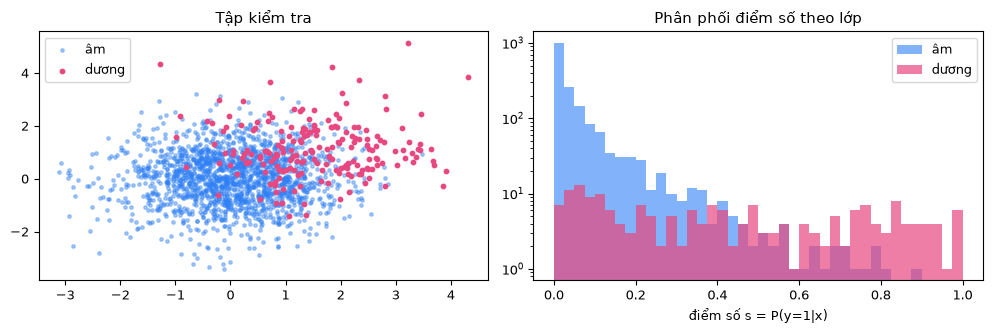
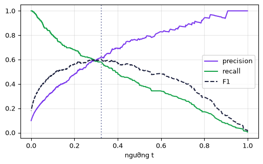
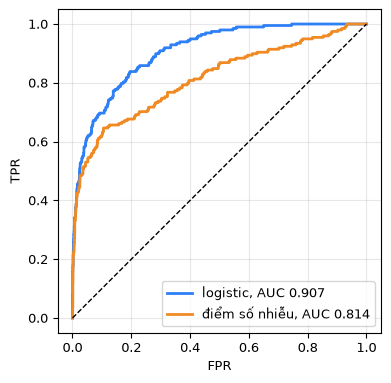
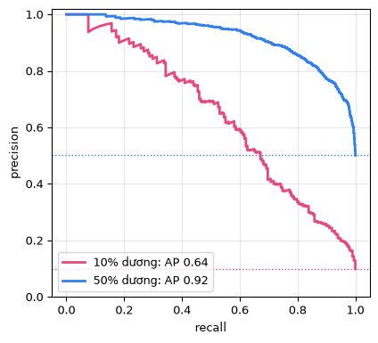
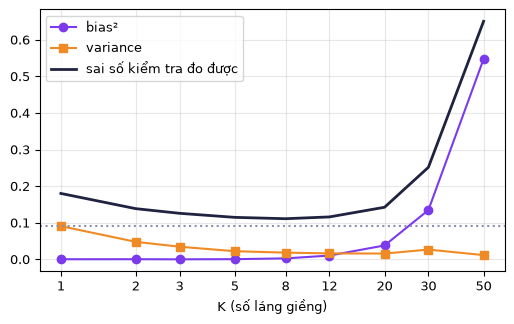

# Model evaluation · Code từ đầu

> Ghi chú của người biên soạn: trang này do người biên soạn viết thêm. Trang tự viết bằng NumPy mọi chỉ số trong bài [Đánh giá mô hình](ml/eval_vi): ma trận nhầm lẫn, precision, recall, F1, đường ROC, AUC, đường precision–recall, các cách lấy trung bình cho nhiều lớp, các chỉ số hồi quy, xác thực chéo phân tầng và phép tách bias–variance.

## Cách dùng trang này

Các khối chạy lần lượt từ trên xuống và dùng chung biến, giống các ô của một notebook. Chỉ cần `numpy` và `matplotlib`. Trang [Dùng thư viện](ml/eval_lib_vi) đối chiếu từng hàm ở đây với `sklearn.metrics`.

Quy ước: nhãn $y \in \{0, 1\}$, **1 là lớp dương** (lớp cần phát hiện).

## 1. Dữ liệu mất cân bằng và một mô hình cho điểm số

Ta sinh 2000 điểm hai chiều. Chỉ 10% là lớp dương, và hai lớp chồng lấn nhau một phần. Mô hình là hồi quy logistic ([chương 14](ml/ch14_vi)) học bằng gradient descent. Nó trả về **điểm số** là xác suất $P(y = 1 \mid \mathbf{x})$, chưa phải nhãn.

<!-- run -->
```python
import numpy as np
import matplotlib.pyplot as plt

rng = np.random.default_rng(0)

def make_data(n, pos_rate, rng):
    y = (rng.uniform(size=n) < pos_rate).astype(int)
    X = rng.normal(size=(n, 2)) + np.where(y[:, None] == 1, [1.6, 1.2], [0.0, 0.0])
    return X, y

def fit_logistic(X, y, lr=0.5, epochs=3000):
    Xb = np.c_[X, np.ones(len(X))]
    w = np.zeros(Xb.shape[1])
    for _ in range(epochs):
        p = 1 / (1 + np.exp(-Xb @ w))
        w -= lr * Xb.T @ (p - y) / len(y)
    return w

def predict_proba(w, X):
    return 1 / (1 + np.exp(-np.c_[X, np.ones(len(X))] @ w))

X_tr, y_tr = make_data(2000, 0.10, rng)
X_te, y_te = make_data(2000, 0.10, rng)
w = fit_logistic(X_tr, y_tr)
s_te = predict_proba(w, X_te)                 # điểm số trên tập kiểm tra
print("tỉ lệ lớp dương trong tập kiểm tra:", y_te.mean())

fig, ax = plt.subplots(1, 2, figsize=(10, 3.4))
ax[0].scatter(*X_te[y_te == 0].T, s=6, c="#2f80f5", alpha=.4, label="âm")
ax[0].scatter(*X_te[y_te == 1].T, s=10, c="#e8487f", label="dương")
ax[0].legend(); ax[0].set_title("Tập kiểm tra")
bins = np.linspace(0, 1, 41)
ax[1].hist(s_te[y_te == 0], bins, color="#2f80f5", alpha=.6, label="âm")
ax[1].hist(s_te[y_te == 1], bins, color="#e8487f", alpha=.7, label="dương")
ax[1].set_yscale("log"); ax[1].set_xlabel("điểm số s = P(y=1|x)"); ax[1].legend()
ax[1].set_title("Phân phối điểm số theo lớp")
fig.tight_layout()
```

<!-- output -->
```output
tỉ lệ lớp dương trong tập kiểm tra: 0.099
```

<div align=center></div>
<!-- /output -->

Điểm số của lớp dương dồn về phía 1 nhưng vẫn chồng lấn nhiều với lớp âm. Trục dọc của biểu đồ phải theo thang log vì lớp âm đông gấp 9 lần.

## 2. Ma trận nhầm lẫn và các chỉ số ở một ngưỡng

<small class="viz-ref">Mục E.2–E.4</small>

Mọi chỉ số chỉ là tỉ số giữa bốn ô TP, FN, FP, TN. Ta viết một hàm đếm, rồi các hàm còn lại chỉ việc chia.

<!-- run -->
```python
def confusion(y, y_hat):
    """Trả về TP, FN, FP, TN."""
    y, y_hat = np.asarray(y).astype(bool), np.asarray(y_hat).astype(bool)
    return (int(np.sum(y & y_hat)), int(np.sum(y & ~y_hat)),
            int(np.sum(~y & y_hat)), int(np.sum(~y & ~y_hat)))

def safe_div(a, b):
    return a / b if b > 0 else 0.0     # quy ước 0/0 = 0, giống zero_division=0 của sklearn

def metrics(y, y_hat, beta=1.0):
    tp, fn, fp, tn = confusion(y, y_hat)
    p, r = safe_div(tp, tp + fp), safe_div(tp, tp + fn)
    return {
        "accuracy": (tp + tn) / (tp + fn + fp + tn),
        "precision": p, "recall": r,
        "specificity": safe_div(tn, tn + fp),
        "F1": safe_div(2 * p * r, p + r),
        f"F{beta:g}": safe_div((1 + beta**2) * p * r, beta**2 * p + r),
    }

def show(name, y, y_hat, beta=2):
    tp, fn, fp, tn = confusion(y, y_hat)
    m = metrics(y, y_hat, beta)
    print(f"{name:<22} TP={tp:3d} FN={fn:3d} FP={fp:4d} TN={tn:4d} | "
          + "  ".join(f"{k} {v:.3f}" for k, v in m.items()))

show("luôn đoán âm", y_te, np.zeros_like(y_te))
show("luôn đoán dương", y_te, np.ones_like(y_te))
show("logistic, ngưỡng 0.5", y_te, s_te >= 0.5)
show("logistic, ngưỡng 0.2", y_te, s_te >= 0.2)
```

<!-- output -->
```output
luôn đoán âm           TP=  0 FN=198 FP=   0 TN=1802 | accuracy 0.901  precision 0.000  recall 0.000  specificity 1.000  F1 0.000  F2 0.000
luôn đoán dương        TP=198 FN=  0 FP=1802 TN=   0 | accuracy 0.099  precision 0.099  recall 1.000  specificity 0.000  F1 0.180  F2 0.355
logistic, ngưỡng 0.5   TP= 78 FN=120 FP=  24 TN=1778 | accuracy 0.928  precision 0.765  recall 0.394  specificity 0.987  F1 0.520  F2 0.436
logistic, ngưỡng 0.2   TP=135 FN= 63 FP= 146 TN=1656 | accuracy 0.895  precision 0.480  recall 0.682  specificity 0.919  F1 0.564  F2 0.629
```
<!-- /output -->

Bốn dòng kết quả cho thấy mọi điều ở [mục E.3–E.4](ml/eval_vi):

- "Luôn đoán âm" có accuracy 0.901 mà recall bằng 0. Đây là mốc cơ sở cần vượt qua.
- Ở ngưỡng mặc định 0.5, mô hình logistic có accuracy 0.928, precision 0.765, nhưng **chỉ tìm ra 39% ca dương**.
- Hạ ngưỡng xuống 0.2 thì recall tăng lên 0.682, precision giảm còn 0.480. Accuracy *giảm* (0.895), trong khi F1 và F2 đều *tăng*. Accuracy và F1 có thể chỉ hai hướng ngược nhau.

## 3. Quét ngưỡng: đánh đổi precision–recall

<small class="viz-ref">Mục E.5 · hình E.6</small>

Không cần tính lại ma trận nhầm lẫn cho từng ngưỡng. Sắp xếp điểm số giảm dần: hạ ngưỡng qua từng điểm chỉ làm **một** mẫu đổi từ "âm" sang "dương". Vì vậy TP và FP tại mọi ngưỡng là **tổng tích luỹ** của nhãn đã sắp xếp. Toàn bộ chỉ mất $O(n \log n)$.

<!-- run -->
```python
def sweep(y, s):
    """TP, FP sau khi gọi k mẫu điểm cao nhất là dương, k = 0..n; gộp các điểm số bằng nhau."""
    order = np.argsort(-s, kind="mergesort")
    y, s = np.asarray(y)[order], np.asarray(s)[order]
    last = np.r_[np.diff(s) != 0, True]            # vị trí cuối của mỗi nhóm điểm số bằng nhau
    tp = np.r_[0, np.cumsum(y)[last]]
    fp = np.r_[0, np.cumsum(1 - y)[last]]
    thr = np.r_[np.inf, s[last]]                     # ngưỡng t: gọi dương khi s >= t
    return tp, fp, thr

tp, fp, thr = sweep(y_te, s_te)
P, N = y_te.sum(), len(y_te) - y_te.sum()
prec = np.divide(tp, tp + fp, out=np.ones(len(tp)), where=(tp + fp) > 0)
rec = tp / P
f1 = np.divide(2 * prec * rec, prec + rec, out=np.zeros(len(tp)), where=(prec + rec) > 0)

k = int(np.argmax(f1))
print(f"F1 lớn nhất = {f1[k]:.3f} tại ngưỡng {thr[k]:.3f} (precision {prec[k]:.3f}, recall {rec[k]:.3f})")
ok = np.where(rec >= 0.90)[0]
k90 = ok[np.argmax(prec[ok])]
print(f"recall >= 0.90: ngưỡng {thr[k90]:.3f}, precision {prec[k90]:.3f}, recall {rec[k90]:.3f}")

fig, ax = plt.subplots(figsize=(6, 3.4))
m = np.isfinite(thr)
ax.plot(thr[m], prec[m], color="#7c3aed", label="precision")
ax.plot(thr[m], rec[m], color="#16a34a", label="recall")
ax.plot(thr[m], f1[m], "--", color="#1f2340", label="F1")
ax.axvline(thr[k], color="#8a90b4", ls=":")
ax.set_xlabel("ngưỡng t"); ax.legend(); ax.grid(alpha=.3)
```

<!-- output -->
```output
F1 lớn nhất = 0.601 tại ngưỡng 0.324 (precision 0.622, recall 0.581)
recall >= 0.90: ngưỡng 0.051, precision 0.253, recall 0.904
```

<div align=center></div>
<!-- /output -->

F1 lớn nhất ở ngưỡng 0.32, không phải 0.5. Nếu yêu cầu bắt ít nhất 90% ca dương thì phải hạ ngưỡng xuống khoảng 0.05, và chấp nhận precision chỉ còn 0.25: cứ 4 lần báo động thì 3 lần nhầm.

## 4. Đường ROC và hai cách tính AUC

<small class="viz-ref">Mục E.6 · hình E.7</small>

Từ cùng các tổng tích luỹ ở trên: $\text{TPR} = \text{TP}/P$, $\text{FPR} = \text{FP}/N$. AUC tính bằng **quy tắc hình thang**. Để kiểm tra, ta tính lại AUC theo định nghĩa xác suất: đếm trong mọi cặp (mẫu dương, mẫu âm) tỉ lệ cặp mà mẫu dương được điểm cao hơn, cặp bằng điểm tính một nửa.

<!-- run -->
```python
def roc_curve(y, s):
    tp, fp, thr = sweep(y, s)
    return fp / fp[-1], tp / tp[-1], thr

def trapezoid(x, y):
    return float(np.sum(np.diff(x) * (y[1:] + y[:-1]) / 2))

def auc_pairs(y, s):
    """AUC = P(s+ > s-) + 0.5 P(s+ = s-), đếm qua hạng (thống kê Mann–Whitney)."""
    y, s = np.asarray(y), np.asarray(s)
    order = np.argsort(s, kind="mergesort")
    ranks = np.empty(len(s)); ranks[order] = np.arange(1, len(s) + 1)
    for v in np.unique(s[np.r_[np.diff(np.sort(s)) == 0, False]]):   # điểm số trùng: lấy hạng trung bình
        ranks[s == v] = ranks[s == v].mean()
    n1, n0 = y.sum(), len(y) - y.sum()
    return (ranks[y == 1].sum() - n1 * (n1 + 1) / 2) / (n1 * n0)

fpr, tpr, _ = roc_curve(y_te, s_te)
print("AUC (hình thang):", round(trapezoid(fpr, tpr), 6))
print("AUC (đếm cặp)   :", round(auc_pairs(y_te, s_te), 6))
print("AUC sau khi đưa điểm số qua hàm đồng biến s -> s**5:", round(trapezoid(*roc_curve(y_te, s_te ** 5)[:2]), 6))
noisy = s_te + rng.normal(0, 0.15, len(s_te))
print("AUC khi điểm số bị nhiễu thêm:", round(trapezoid(*roc_curve(y_te, noisy)[:2]), 6))

fig, ax = plt.subplots(figsize=(4.2, 4.2))
ax.plot(fpr, tpr, color="#2f80f5", lw=2, label=f"logistic, AUC {trapezoid(fpr, tpr):.3f}")
f2, t2, _ = roc_curve(y_te, noisy)
ax.plot(f2, t2, color="#f08a24", lw=2, label=f"điểm số nhiễu, AUC {trapezoid(f2, t2):.3f}")
ax.plot([0, 1], [0, 1], "k--", lw=1)
ax.set_xlabel("FPR"); ax.set_ylabel("TPR"); ax.set_aspect("equal"); ax.legend(loc="lower right"); ax.grid(alpha=.3)
```

<!-- output -->
```output
AUC (hình thang): 0.906947
AUC (đếm cặp)   : 0.906947
AUC sau khi đưa điểm số qua hàm đồng biến s -> s**5: 0.906947
AUC khi điểm số bị nhiễu thêm: 0.813924
```

<div align=center></div>
<!-- /output -->

Hai cách tính AUC trùng nhau đến chữ số thứ 6. Đưa điểm số qua hàm đồng biến $s^5$ không làm AUC đổi, vì thứ tự xếp hạng không đổi. Còn khi cộng nhiễu vào điểm số, thứ tự bị xáo trộn và AUC tụt từ 0.907 xuống 0.814.

## 5. Đường precision–recall và average precision

<small class="viz-ref">Mục E.7 · hình E.8</small>

AP là tổng $\sum_k (R_k - R_{k-1}) P_k$: mỗi bước recall tăng thêm được nhân với precision tại bước đó. Ta so AP của cùng mô hình trên tập kiểm tra 10% dương và trên một tập cân bằng 50% dương, trong khi ROC-AUC của hai tập gần như bằng nhau.

<!-- run -->
```python
def pr_curve(y, s):
    tp, fp, thr = sweep(y, s)
    prec = np.divide(tp, tp + fp, out=np.ones(len(tp)), where=(tp + fp) > 0)
    return prec, tp / tp[-1], thr

def average_precision(y, s):
    prec, rec, _ = pr_curve(y, s)
    return float(np.sum(np.diff(rec) * prec[1:]))

X_bal, y_bal = make_data(2000, 0.50, np.random.default_rng(1))
s_bal = predict_proba(w, X_bal)
fig, ax = plt.subplots(figsize=(4.6, 4.2))
for name, y_, s_, c in [("10% dương", y_te, s_te, "#e8487f"), ("50% dương", y_bal, s_bal, "#2f80f5")]:
    p_, r_, _ = pr_curve(y_, s_)
    ap = average_precision(y_, s_)
    print(f"{name}: ROC-AUC {trapezoid(*roc_curve(y_, s_)[:2]):.3f}   AP {ap:.3f}   mốc ngẫu nhiên {y_.mean():.3f}")
    ax.plot(r_, p_, color=c, lw=2, label=f"{name}: AP {ap:.2f}")
    ax.axhline(y_.mean(), color=c, ls=":", lw=1)
ax.set_xlabel("recall"); ax.set_ylabel("precision"); ax.set_ylim(0, 1.02); ax.legend(); ax.grid(alpha=.3)
```

<!-- output -->
```output
10% dương: ROC-AUC 0.907   AP 0.639   mốc ngẫu nhiên 0.099
50% dương: ROC-AUC 0.918   AP 0.920   mốc ngẫu nhiên 0.501
```

<div align=center></div>
<!-- /output -->

Trên hai tập, ROC-AUC gần nhau (0.907 và 0.918) vì phân phối điểm số của mỗi lớp không đổi. AP thì khác hẳn: 0.920 trên tập cân bằng, 0.639 trên tập 10% dương. Mốc của đoán ngẫu nhiên trên đường PR cũng khác: 0.50 và 0.10. Muốn đánh giá AP, luôn so nó với tỉ lệ lớp dương.

## 6. Nhiều lớp: ma trận $C \times C$, macro và micro

<small class="viz-ref">Mục E.8 · hình E.9</small>

Ba lớp Gaussian, lớp thứ ba rất hiếm (5%). Bộ phân loại là "tâm gần nhất" (nearest centroid): gán mỗi điểm vào lớp có trung bình gần nó nhất.

<!-- run -->
```python
def confusion_multi(y, y_hat, C):
    M = np.zeros((C, C), dtype=int)
    np.add.at(M, (y, y_hat), 1)          # hàng: nhãn thật, cột: dự đoán
    return M

def per_class(M):
    tp = np.diag(M).astype(float)
    p = np.divide(tp, M.sum(0), out=np.zeros_like(tp), where=M.sum(0) > 0)
    r = tp / M.sum(1)
    f = np.divide(2 * p * r, p + r, out=np.zeros_like(tp), where=(p + r) > 0)
    return p, r, f

rng3 = np.random.default_rng(3)
sizes, centers = [600, 300, 50], np.array([[0, 0], [2.2, 0], [1.1, 1.6]])
X3 = np.vstack([rng3.normal(c, 1.0, (n, 2)) for c, n in zip(centers, sizes)])
y3 = np.repeat([0, 1, 2], sizes)
mu = np.array([X3[y3 == c].mean(0) for c in range(3)])
y3_hat = np.argmin(((X3[:, None, :] - mu[None]) ** 2).sum(-1), axis=1)

M = confusion_multi(y3, y3_hat, 3)
p, r, f = per_class(M)
print("ma trận nhầm lẫn (hàng: thật, cột: dự đoán):\n", M)
for c in range(3):
    print(f"lớp {c}: precision {p[c]:.3f}  recall {r[c]:.3f}  F1 {f[c]:.3f}  ({M[c].sum()} mẫu)")
tp_all = np.trace(M); fp_all = M.sum() - tp_all     # micro: cộng dồn mọi lớp
print(f"macro-F1    {f.mean():.3f}")
print(f"weighted-F1 {(f * M.sum(1) / M.sum()).sum():.3f}")
print(f"micro-F1    {tp_all / (tp_all + fp_all):.3f}   accuracy {np.mean(y3 == y3_hat):.3f}")
```

<!-- output -->
```output
ma trận nhầm lẫn (hàng: thật, cột: dự đoán):
 [[446  54 100]
 [ 26 235  39]
 [ 10   6  34]]
lớp 0: precision 0.925  recall 0.743  F1 0.824  (600 mẫu)
lớp 1: precision 0.797  recall 0.783  F1 0.790  (300 mẫu)
lớp 2: precision 0.197  recall 0.680  F1 0.305  (50 mẫu)
macro-F1    0.640
weighted-F1 0.786
micro-F1    0.753   accuracy 0.753
```
<!-- /output -->

Lớp 2 hiếm và nằm giữa hai lớp kia. Bộ phân loại vẫn bắt được 68% mẫu của lớp này, nhưng lại kéo vào đó 100 mẫu của lớp 0, nên precision của lớp 2 chỉ là 0.197. Accuracy (0.753) và weighted-F1 (0.786) gần như không thấy vấn đề này, vì lớp 2 chỉ chiếm 5% số mẫu. **Macro-F1 (0.640)** thì tụt rõ, vì nó coi ba lớp quan trọng như nhau. Dòng cuối kiểm tra rằng micro-F1 đúng bằng accuracy.

## 7. Chỉ số hồi quy và điểm ngoại lai

<small class="viz-ref">Mục E.9 · hình E.10</small>

<!-- run -->
```python
def reg_metrics(y, y_hat):
    r = y - y_hat
    mse = np.mean(r ** 2)
    return {"MAE": np.mean(np.abs(r)), "MSE": mse, "RMSE": np.sqrt(mse),
            "R2": 1 - np.sum(r ** 2) / np.sum((y - y.mean()) ** 2)}

rng4 = np.random.default_rng(4)
x = rng4.uniform(0, 10, 100)
y = 2 + 0.8 * x + rng4.normal(0, 1, 100)
A = np.c_[x, np.ones_like(x)]
wr = np.linalg.lstsq(A, y, rcond=None)[0]
y_hat = A @ wr

def fmt(d): return "  ".join(f"{k} {v:.3f}" for k, v in d.items())
print("mô hình tuyến tính     :", fmt(reg_metrics(y, y_hat)))
print("luôn đoán trung bình   :", fmt(reg_metrics(y, np.full_like(y, y.mean()))))
print("mô hình tệ (dốc ngược) :", fmt(reg_metrics(y, y.mean() - 0.8 * (x - x.mean()))))
y_out = y_hat.copy(); y_out[0] += 30             # một dự đoán sai 30 đơn vị
print("thêm 1 dự đoán sai 30  :", fmt(reg_metrics(y, y_out)))
```

<!-- output -->
```output
mô hình tuyến tính     : MAE 0.730  MSE 0.924  RMSE 0.961  R2 0.852
luôn đoán trung bình   : MAE 1.998  MSE 6.233  RMSE 2.497  R2 0.000
mô hình tệ (dốc ngược) : MAE 3.799  MSE 21.213  RMSE 4.606  R2 -2.403
thêm 1 dự đoán sai 30  : MAE 1.030  MSE 10.719  RMSE 3.274  R2 -0.720
```
<!-- /output -->

- Mô hình tuyến tính có $R^2 = 0.852$. Mô hình "luôn đoán trung bình" có $R^2$ đúng bằng 0, đúng như định nghĩa.
- Một mô hình dốc ngược chiều cho $R^2 = -2.4$: **âm**, tức tệ hơn việc đoán trung bình.
- Chỉ **một** dự đoán sai 30 đơn vị trong 100 dự đoán đã đẩy MSE từ 0.92 lên 10.7, gấp 11 lần, trong khi MAE chỉ tăng từ 0.73 lên 1.03. $R^2$ thậm chí chuyển sang âm. MSE và RMSE rất nhạy với điểm ngoại lai. Đó là ưu điểm khi sai số lớn thật sự nguy hiểm, và là nhược điểm khi dữ liệu có nhãn lỗi.

## 8. Xác thực chéo phân tầng, tự viết

<small class="viz-ref">Mục E.1 · hình E.1</small>

Chia ngẫu nhiên thường có thể làm một phần có quá ít mẫu dương. Bản phân tầng chia **riêng từng lớp** rồi ghép lại, nên mọi phần đều giữ tỉ lệ lớp như nhau. Với 60 mẫu, trong đó 6 mẫu dương, chia làm 5 phần:

<!-- run -->
```python
def kfold(n, K, rng):
    return np.array_split(rng.permutation(n), K)

def stratified_kfold(y, K, rng):
    folds = [[] for _ in range(K)]
    for c in np.unique(y):
        idx = rng.permutation(np.where(y == c)[0])
        for i, part in enumerate(np.array_split(idx, K)):
            folds[i].extend(part)
    return [np.array(f) for f in folds]

y_small = np.r_[np.ones(6, int), np.zeros(54, int)]
for name, folds in [("thường   ", kfold(60, 5, np.random.default_rng(7))),
                    ("phân tầng", stratified_kfold(y_small, 5, np.random.default_rng(7)))]:
    print(name, "số mẫu dương mỗi phần:", [int(y_small[f].sum()) for f in folds])

def cross_val_auc(X, y, K=5, seed=0):
    scores = []
    for i, val in enumerate(folds := stratified_kfold(y, K, np.random.default_rng(seed))):
        trn = np.concatenate([f for j, f in enumerate(folds) if j != i])
        mu_, sd_ = X[trn].mean(0), X[trn].std(0)     # chuẩn hoá: thống kê CHỈ từ phần huấn luyện
        w_ = fit_logistic((X[trn] - mu_) / sd_, y[trn])
        scores.append(auc_pairs(y[val], predict_proba(w_, (X[val] - mu_) / sd_)))
    return np.array(scores)

sc = cross_val_auc(X_tr, y_tr)
print("AUC từng phần:", sc.round(3), f"  trung bình {sc.mean():.3f} ± {sc.std():.3f}")
```

<!-- output -->
```output
thường    số mẫu dương mỗi phần: [1, 2, 1, 0, 2]
phân tầng số mẫu dương mỗi phần: [2, 1, 1, 1, 1]
AUC từng phần: [0.926 0.94  0.898 0.902 0.893]   trung bình 0.912 ± 0.018
```
<!-- /output -->

Chia thường làm một phần không có mẫu dương nào: trên phần đó, recall và AUC không tính được. Bản phân tầng chia 6 mẫu dương đều nhất có thể (2, 1, 1, 1, 1).

Hàm `cross_val_auc` cũng cho thấy cách tránh rò rỉ dữ liệu: trung bình và độ lệch chuẩn để chuẩn hoá được tính **lại ở mỗi lần chia, chỉ trên phần huấn luyện**. Kết quả nên báo cáo là trung bình ± độ lệch chuẩn qua các phần: $0.912 \pm 0.018$.

## 9. Đo bias và variance bằng mô phỏng

<small class="viz-ref">Mục E.10 · hình E.12</small>

Lặp lại việc học trên nhiều tập huấn luyện khác nhau, rồi tách sai số kỳ vọng tại các điểm kiểm tra thành bias², variance và nhiễu. Mô hình ở đây là **KNN hồi quy** ([chương 9](ml/ch09_vi)): dự đoán bằng trung bình $y$ của $K$ láng giềng gần nhất. $K$ nhỏ thì mô hình rất linh hoạt, $K$ lớn thì mô hình rất "mượt".

<!-- run -->
```python
f_true = lambda x: np.sin(2 * np.pi * x)
sigma, n, R = 0.3, 50, 300
xt = np.linspace(0.05, 0.95, 100)

def knn_reg(x_tr, y_tr, x, K):
    idx = np.argsort(np.abs(x[:, None] - x_tr[None]), axis=1)[:, :K]
    return y_tr[idx].mean(1)

rng5 = np.random.default_rng(5)
Ks = [1, 2, 3, 5, 8, 12, 20, 30, 50]
b2, var, emp = [], [], []
for K in Ks:
    preds, errs = [], []
    for _ in range(R):
        x_ = rng5.uniform(0, 1, n); y_ = f_true(x_) + rng5.normal(0, sigma, n)
        ph = knn_reg(x_, y_, xt, K)
        preds.append(ph)
        errs.append(np.mean((f_true(xt) + rng5.normal(0, sigma, len(xt)) - ph) ** 2))   # sai số trên y mới
    preds = np.array(preds)
    b2.append(np.mean((preds.mean(0) - f_true(xt)) ** 2)); var.append(np.mean(preds.var(0))); emp.append(np.mean(errs))
b2, var, emp = map(np.array, (b2, var, emp))
for K, a, b, e in zip(Ks, b2, var, emp):
    print(f"K={K:2d}: bias² {a:.4f}  variance {b:.4f}  bias²+var+σ² {a + b + sigma**2:.4f}  sai số đo được {e:.4f}")

fig, ax = plt.subplots(figsize=(6, 3.4))
ax.plot(Ks, b2, "o-", color="#7c3aed", label="bias²")
ax.plot(Ks, var, "s-", color="#f08a24", label="variance")
ax.plot(Ks, emp, "-", color="#1f2340", lw=2, label="sai số kiểm tra đo được")
ax.axhline(sigma**2, ls=":", color="#8a90b4")
ax.set_xscale("log"); ax.set_xticks(Ks, [str(k) for k in Ks]); ax.minorticks_off()
ax.set_xlabel("K (số láng giềng)"); ax.legend(); ax.grid(alpha=.3)
```

<!-- output -->
```output
K= 1: bias² 0.0003  variance 0.0908  bias²+var+σ² 0.1811  sai số đo được 0.1801
K= 2: bias² 0.0004  variance 0.0479  bias²+var+σ² 0.1382  sai số đo được 0.1385
K= 3: bias² 0.0001  variance 0.0345  bias²+var+σ² 0.1246  sai số đo được 0.1258
K= 5: bias² 0.0005  variance 0.0223  bias²+var+σ² 0.1128  sai số đo được 0.1148
K= 8: bias² 0.0026  variance 0.0184  bias²+var+σ² 0.1111  sai số đo được 0.1111
K=12: bias² 0.0103  variance 0.0163  bias²+var+σ² 0.1166  sai số đo được 0.1159
K=20: bias² 0.0380  variance 0.0158  bias²+var+σ² 0.1438  sai số đo được 0.1424
K=30: bias² 0.1346  variance 0.0268  bias²+var+σ² 0.2513  sai số đo được 0.2515
K=50: bias² 0.5474  variance 0.0116  bias²+var+σ² 0.6490  sai số đo được 0.6504
```

<div align=center></div>
<!-- /output -->

Cột cuối (sai số đo trực tiếp trên dữ liệu mới) khớp với tổng bias² + variance + σ² ở cột kế bên, sai khác chỉ ở chữ số thứ ba. Đó là kiểm chứng bằng số cho công thức tách ở [mục E.10](ml/eval_vi).

- $K = 1$: bias² gần 0 nhưng variance 0.091 lớn hơn cả nhiễu. Mô hình chép lại nguyên nhiễu của láng giềng gần nhất.
- $K = 8$: tổng nhỏ nhất (0.111), chỉ cao hơn mức nhiễu $\sigma^2 = 0.09$ một chút.
- $K = 50$: mô hình dùng **mọi** điểm, tức luôn đoán trung bình, nên bias² lên tới 0.547.

Khác với đa thức, ở KNN độ phức tạp **giảm** khi $K$ tăng. Vì vậy đường chữ U ở đây bị lật so với Hình E.12: bên trái là variance cao, bên phải là bias cao.
