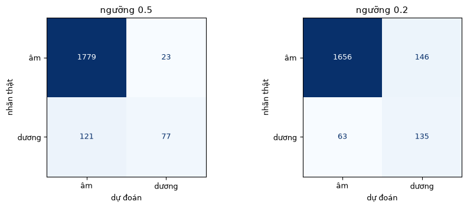
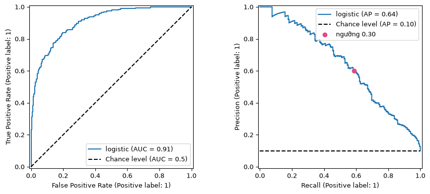
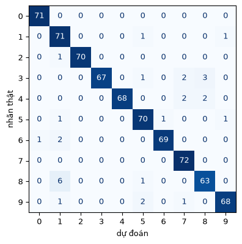
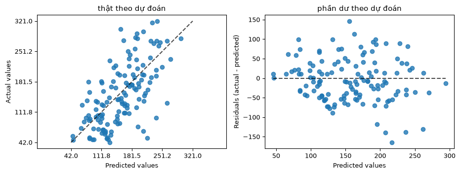
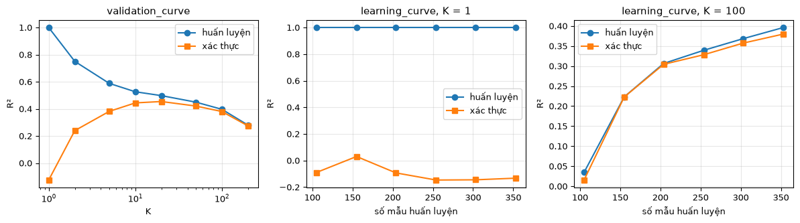

# Model evaluation · Dùng thư viện

> Ghi chú của người biên soạn: trang này do người biên soạn viết thêm. Trang dùng `sklearn.metrics` và `sklearn.model_selection` cho mọi việc trong bài [Đánh giá mô hình](ml/eval_vi), và đối chiếu kết quả với các hàm tự viết ở trang [Code từ đầu](ml/eval_code_vi).

## Cách dùng trang này

Các khối chạy lần lượt từ trên xuống và dùng chung biến. Cần `numpy`, `matplotlib`, `scikit-learn`.

| Trong bài | Trong scikit-learn |
| --- | --- |
| Ma trận nhầm lẫn | `confusion_matrix(y, y_pred)`, vẽ bằng `ConfusionMatrixDisplay` |
| Precision, recall, F1, $F_\beta$ | `precision_score`, `recall_score`, `f1_score`, `fbeta_score`; tất cả cùng lúc: `classification_report` |
| Đường ROC, AUC | `roc_curve`, `roc_auc_score`, vẽ bằng `RocCurveDisplay` |
| Đường PR, AP | `precision_recall_curve`, `average_precision_score`, `PrecisionRecallDisplay` |
| Macro, micro, weighted | tham số `average="macro" / "micro" / "weighted"` |
| MAE, MSE, RMSE, $R^2$ | `mean_absolute_error`, `mean_squared_error`, `root_mean_squared_error`, `r2_score` |
| Xác thực chéo (phân tầng) | `StratifiedKFold`, `cross_val_score`, `cross_validate` |
| Đường học, đường xác thực | `learning_curve`, `validation_curve` |
| Mốc cơ sở | `DummyClassifier`, `DummyRegressor` |

Lưu ý quy ước của scikit-learn: trong `confusion_matrix`, **hàng là nhãn thật, cột là dự đoán**, và các lớp được xếp theo thứ tự tăng dần. Với nhãn $\{0, 1\}$, ma trận là `[[TN, FP], [FN, TP]]`, tức **lớp âm nằm ở trên**, ngược với Hình E.2.

## 1. Dữ liệu và mô hình

Cùng cách sinh dữ liệu như trang Code từ đầu: 10% lớp dương, hai lớp chồng lấn một phần.

<!-- run -->
```python
import numpy as np
import matplotlib.pyplot as plt
from sklearn.linear_model import LogisticRegression
from sklearn.dummy import DummyClassifier
from sklearn import metrics as M

def make_data(n, pos_rate, rng):
    y = (rng.uniform(size=n) < pos_rate).astype(int)
    X = rng.normal(size=(n, 2)) + np.where(y[:, None] == 1, [1.6, 1.2], [0.0, 0.0])
    return X, y

rng = np.random.default_rng(0)
X_tr, y_tr = make_data(2000, 0.10, rng)
X_te, y_te = make_data(2000, 0.10, rng)

clf = LogisticRegression().fit(X_tr, y_tr)
s_te = clf.predict_proba(X_te)[:, 1]           # điểm số: xác suất lớp dương
y_pred = clf.predict(X_te)                     # nhãn với ngưỡng 0.5
dummy = DummyClassifier(strategy="most_frequent").fit(X_tr, y_tr)

print("ma trận nhầm lẫn [[TN, FP], [FN, TP]]:\n", M.confusion_matrix(y_te, y_pred))
tn, fp, fn, tp = M.confusion_matrix(y_te, y_pred).ravel()
print(f"TP={tp} FN={fn} FP={fp} TN={tn}")
print("accuracy mốc 'luôn đoán âm':", M.accuracy_score(y_te, dummy.predict(X_te)))
print(M.classification_report(y_te, y_pred, target_names=["âm (0)", "dương (1)"], digits=3))
```

<!-- output -->
```output
ma trận nhầm lẫn [[TN, FP], [FN, TP]]:
 [[1779   23]
 [ 121   77]]
TP=77 FN=121 FP=23 TN=1779
accuracy mốc 'luôn đoán âm': 0.901
              precision    recall  f1-score   support

      âm (0)      0.936     0.987     0.961      1802
   dương (1)      0.770     0.389     0.517       198

    accuracy                          0.928      2000
   macro avg      0.853     0.688     0.739      2000
weighted avg      0.920     0.928     0.917      2000
```
<!-- /output -->

`classification_report` in precision, recall, F1 cho **từng lớp**, coi lần lượt mỗi lớp là "dương". Dòng `dương (1)` là dòng cần đọc: recall chỉ 0.389. Dòng `accuracy` (0.928) chỉ hơn mốc "luôn đoán âm" (0.901) chưa tới 3 điểm phần trăm. Số liệu hơi khác trang Code từ đầu (77 so với 78 TP), vì `LogisticRegression` mặc định có kiểm soát L2 với `C=1`.

## 2. Các chỉ số ở một ngưỡng tự chọn

<small class="viz-ref">Mục E.4–E.5</small>

`predict` luôn dùng ngưỡng 0.5. Muốn ngưỡng khác, so `predict_proba` với ngưỡng đó.

<!-- run -->
```python
for t in [0.5, 0.2]:
    yp = (s_te >= t).astype(int)
    print(f"ngưỡng {t}: precision {M.precision_score(y_te, yp):.3f}  recall {M.recall_score(y_te, yp):.3f}  "
          f"F1 {M.f1_score(y_te, yp):.3f}  F2 {M.fbeta_score(y_te, yp, beta=2):.3f}")

fig, ax = plt.subplots(1, 2, figsize=(9, 3.6))
M.ConfusionMatrixDisplay.from_predictions(y_te, y_pred, display_labels=["âm", "dương"], ax=ax[0],
                                          cmap="Blues", colorbar=False)
ax[0].set_title("ngưỡng 0.5"); ax[0].set_xlabel("dự đoán"); ax[0].set_ylabel("nhãn thật")
M.ConfusionMatrixDisplay.from_predictions(y_te, (s_te >= 0.2).astype(int), display_labels=["âm", "dương"],
                                          ax=ax[1], cmap="Blues", colorbar=False)
ax[1].set_title("ngưỡng 0.2"); ax[1].set_xlabel("dự đoán"); ax[1].set_ylabel("nhãn thật")
fig.tight_layout()
```

<!-- output -->
```output
ngưỡng 0.5: precision 0.770  recall 0.389  F1 0.517  F2 0.432
ngưỡng 0.2: precision 0.480  recall 0.682  F1 0.564  F2 0.629
```

<div align=center></div>
<!-- /output -->

Kết quả trùng với trang Code từ đầu: hạ ngưỡng từ 0.5 xuống 0.2 đổi precision lấy recall, F1 và F2 cùng tăng.

## 3. Đường ROC, đường PR và chọn ngưỡng

<small class="viz-ref">Mục E.6–E.7 · hình E.7, E.8</small>

`precision_recall_curve` trả về các mảng precision, recall dài hơn mảng ngưỡng một phần tử (điểm cuối là recall 0, precision 1). Ta dùng nó để chọn ngưỡng nhỏ nhất vẫn giữ precision từ 0.6 trở lên, tức recall lớn nhất có thể khi precision ≥ 0.6.

<!-- run -->
```python
print(f"ROC-AUC {M.roc_auc_score(y_te, s_te):.6f}   AP {M.average_precision_score(y_te, s_te):.6f}")

prec, rec, thr = M.precision_recall_curve(y_te, s_te)
ok = np.where(prec[:-1] >= 0.6)[0]
k = ok[np.argmax(rec[ok])]
print(f"precision >= 0.6: ngưỡng {thr[k]:.3f}, precision {prec[k]:.3f}, recall {rec[k]:.3f}")

fig, ax = plt.subplots(1, 2, figsize=(9.4, 4))
M.RocCurveDisplay.from_predictions(y_te, s_te, ax=ax[0], name="logistic", plot_chance_level=True)
M.PrecisionRecallDisplay.from_predictions(y_te, s_te, ax=ax[1], name="logistic", plot_chance_level=True)
ax[1].scatter([rec[k]], [prec[k]], c="#e8487f", zorder=3, label=f"ngưỡng {thr[k]:.2f}")
ax[1].legend(loc="upper right")
fig.tight_layout()
```

<!-- output -->
```output
ROC-AUC 0.906938   AP 0.639657
precision >= 0.6: ngưỡng 0.301, precision 0.601, recall 0.586
```

<div align=center></div>
<!-- /output -->

Muốn mỗi lần báo động đúng ít nhất 60%, ngưỡng tốt nhất là 0.30, bắt được 58.6% ca dương. Đường PR và đường ROC tự vẽ mức đoán ngẫu nhiên khi đặt `plot_chance_level=True`.

Kiểm tra với hàm tự viết ở trang [Code từ đầu](ml/eval_code_vi): ta chép nguyên hàm `auc_pairs` sang đây và so với `roc_auc_score`.

<!-- run -->
```python
def auc_pairs(y, s):
    order = np.argsort(s, kind="mergesort")
    ranks = np.empty(len(s)); ranks[order] = np.arange(1, len(s) + 1)
    for v in np.unique(s[np.r_[np.diff(np.sort(s)) == 0, False]]):
        ranks[s == v] = ranks[s == v].mean()
    n1, n0 = y.sum(), len(y) - y.sum()
    return (ranks[y == 1].sum() - n1 * (n1 + 1) / 2) / (n1 * n0)

print("tự viết :", round(auc_pairs(y_te, s_te), 10))
print("sklearn :", round(M.roc_auc_score(y_te, s_te), 10))
s_round = np.round(s_te, 1)          # làm tròn: tạo rất nhiều điểm số bằng nhau
print("điểm số làm tròn, tự viết / sklearn:", round(auc_pairs(y_te, s_round), 10), round(M.roc_auc_score(y_te, s_round), 10))
```

<!-- output -->
```output
tự viết : 0.9069384186
sklearn : 0.9069384186
điểm số làm tròn, tự viết / sklearn: 0.8842545881 0.8842545881
```
<!-- /output -->

Hai cách tính trùng nhau đến chữ số thứ 10, kể cả khi có rất nhiều điểm số bằng nhau.

## 4. Nhiều lớp: chữ số viết tay

<small class="viz-ref">Mục E.8 · hình E.9</small>

Bộ `digits` của scikit-learn có 1797 ảnh chữ số 8×8. Hồi quy logistic đa lớp ([chương 15](ml/ch15_vi)) phân loại 10 chữ số. Ma trận nhầm lẫn cho biết chữ số nào hay bị nhầm với chữ số nào.

<!-- run -->
```python
from sklearn.datasets import load_digits
from sklearn.model_selection import train_test_split
from sklearn.pipeline import make_pipeline
from sklearn.preprocessing import StandardScaler

Xd, yd = load_digits(return_X_y=True)
Xd_tr, Xd_te, yd_tr, yd_te = train_test_split(Xd, yd, test_size=0.4, stratify=yd, random_state=0)
digit_clf = make_pipeline(StandardScaler(), LogisticRegression(C=0.05, max_iter=2000)).fit(Xd_tr, yd_tr)
yd_pred = digit_clf.predict(Xd_te)

for avg in ["macro", "weighted", "micro"]:
    print(f"F1 {avg:<8}: {M.f1_score(yd_te, yd_pred, average=avg):.4f}")
print(f"accuracy   : {M.accuracy_score(yd_te, yd_pred):.4f}")
C = M.confusion_matrix(yd_te, yd_pred)
off = C - np.diag(np.diag(C))
i, j = np.unravel_index(off.argmax(), off.shape)
print(f"cặp nhầm nhiều nhất: chữ số {i} bị đoán là {j} ({off[i, j]} lần)")
print("ROC-AUC macro, one-vs-rest:", round(M.roc_auc_score(yd_te, digit_clf.predict_proba(Xd_te), multi_class="ovr"), 4))

fig, ax = plt.subplots(figsize=(5, 4.4))
M.ConfusionMatrixDisplay.from_predictions(yd_te, yd_pred, ax=ax, cmap="Blues", colorbar=False)
ax.set_xlabel("dự đoán"); ax.set_ylabel("nhãn thật")
```

<!-- output -->
```output
F1 macro   : 0.9586
F1 weighted: 0.9585
F1 micro   : 0.9583
accuracy   : 0.9583
cặp nhầm nhiều nhất: chữ số 8 bị đoán là 1 (6 lần)
ROC-AUC macro, one-vs-rest: 0.9986
```

<div align=center></div>
<!-- /output -->

Mười lớp chữ số có số mẫu gần bằng nhau, nên macro-F1, weighted-F1 và accuracy gần như trùng nhau. Micro-F1 đúng bằng accuracy, như đã chứng minh ở [mục E.8](ml/eval_vi). Ma trận nhầm lẫn chỉ ra lỗi phổ biến nhất: chữ số 8 bị đọc thành 1. Với nhiều lớp, `roc_auc_score` cần `multi_class="ovr"`: tính AUC của từng lớp so với phần còn lại, rồi lấy trung bình.

## 5. Hồi quy

<small class="viz-ref">Mục E.9 · hình E.10</small>

Bộ `diabetes` của scikit-learn: dự đoán chỉ số tiến triển bệnh tiểu đường sau một năm từ 10 đặc trưng. `DummyRegressor` (luôn đoán trung bình tập huấn luyện) là mốc cơ sở.

<!-- run -->
```python
from sklearn.datasets import load_diabetes
from sklearn.linear_model import LinearRegression
from sklearn.dummy import DummyRegressor

Xr, yr = load_diabetes(return_X_y=True)
Xr_tr, Xr_te, yr_tr, yr_te = train_test_split(Xr, yr, test_size=0.3, random_state=0)
for name, reg in [("luôn đoán trung bình", DummyRegressor()), ("hồi quy tuyến tính", LinearRegression())]:
    yh = reg.fit(Xr_tr, yr_tr).predict(Xr_te)
    print(f"{name:<21} MAE {M.mean_absolute_error(yr_te, yh):6.2f}   RMSE {M.root_mean_squared_error(yr_te, yh):6.2f}"
          f"   R2 {M.r2_score(yr_te, yh):+.3f}")

fig, ax = plt.subplots(1, 2, figsize=(9.4, 3.6))
M.PredictionErrorDisplay.from_predictions(yr_te, yh, kind="actual_vs_predicted", ax=ax[0])
M.PredictionErrorDisplay.from_predictions(yr_te, yh, kind="residual_vs_predicted", ax=ax[1])
ax[0].set_title("thật theo dự đoán"); ax[1].set_title("phần dư theo dự đoán")
fig.tight_layout()
```

<!-- output -->
```output
luôn đoán trung bình  MAE  59.53   RMSE  71.42   R2 -0.000
hồi quy tuyến tính    MAE  44.62   RMSE  55.65   R2 +0.393
```

<div align=center></div>
<!-- /output -->

`DummyRegressor` có $R^2 \approx 0$, đúng như định nghĩa. Số in ra là `-0.000` chứ không đúng bằng 0, vì nó đoán trung bình của *tập huấn luyện*, còn $R^2$ so với trung bình của *tập kiểm tra*. Hồi quy tuyến tính giảm MAE từ 59.5 xuống 44.6 và có $R^2 = 0.39$: tốt hơn mốc rõ rệt, nhưng vẫn còn hơn nửa độ biến thiên chưa giải thích được. Đồ thị phần dư không có hình dạng rõ rệt, nên phần còn lại chủ yếu là nhiễu mà 10 đặc trưng này không nắm được.

## 6. Xác thực chéo và tránh rò rỉ dữ liệu

<small class="viz-ref">Mục E.1</small>

`cross_validate` nhận nhiều chỉ số cùng lúc qua tham số `scoring`. Đặt bước chuẩn hoá trong `Pipeline` thì nó được học lại **chỉ trên phần huấn luyện** của mỗi lần chia.

Thí nghiệm dưới đây cho thấy rò rỉ dữ liệu nguy hiểm thế nào. Ta tạo 100 mẫu với **10 000 đặc trưng hoàn toàn ngẫu nhiên**, nhãn cũng ngẫu nhiên, nên không mô hình nào có thể làm tốt hơn đoán mò (AUC 0.5). Sau đó ta chọn 20 đặc trưng "tốt nhất" bằng `SelectKBest`:

- **Sai**: chọn đặc trưng trên toàn bộ dữ liệu rồi mới xác thực chéo.
- **Đúng**: đặt bước chọn đặc trưng trong `Pipeline`.

<!-- run -->
```python
from sklearn.model_selection import StratifiedKFold, cross_validate, cross_val_score
from sklearn.feature_selection import SelectKBest, f_classif

cv = StratifiedKFold(n_splits=5, shuffle=True, random_state=0)
res = cross_validate(make_pipeline(StandardScaler(), LogisticRegression()), X_tr, y_tr, cv=cv,
                     scoring=["roc_auc", "average_precision", "f1", "recall"])
for k in ["test_roc_auc", "test_average_precision", "test_f1", "test_recall"]:
    print(f"{k[5:]:<18} {res[k].mean():.3f} ± {res[k].std():.3f}")

rng_n = np.random.default_rng(0)
Xn, yn = rng_n.normal(size=(100, 10_000)), rng_n.integers(0, 2, 100)
X_sel = SelectKBest(f_classif, k=20).fit_transform(Xn, yn)              # SAI: đã nhìn cả phần xác thực
leak = cross_val_score(LogisticRegression(), X_sel, yn, cv=cv, scoring="roc_auc")
pipe = make_pipeline(SelectKBest(f_classif, k=20), LogisticRegression())  # ĐÚNG
clean = cross_val_score(pipe, Xn, yn, cv=cv, scoring="roc_auc")
print(f"\nnhãn ngẫu nhiên, chọn đặc trưng trước khi chia: AUC {leak.mean():.3f}")
print(f"nhãn ngẫu nhiên, chọn đặc trưng trong Pipeline : AUC {clean.mean():.3f}")
```

<!-- output -->
```output
roc_auc            0.913 ± 0.011
average_precision  0.660 ± 0.046
f1                 0.550 ± 0.070
recall             0.443 ± 0.089

nhãn ngẫu nhiên, chọn đặc trưng trước khi chia: AUC 0.948
nhãn ngẫu nhiên, chọn đặc trưng trong Pipeline : AUC 0.404
```
<!-- /output -->

Phần đầu cho thấy vì sao nên báo cáo cả độ dao động: F1 và recall dao động khoảng ±0.07–0.09 giữa các phần, vì mỗi phần chỉ có khoảng 40 mẫu dương.

Phần thứ hai là một cảnh báo. Dữ liệu là **nhiễu thuần tuý**, vậy mà cách làm sai báo AUC **0.948**, trông như một mô hình xuất sắc. Lý do: trong 10 000 đặc trưng ngẫu nhiên, luôn có vài đặc trưng tình cờ tương quan với nhãn *trên chính 100 mẫu này*. Chọn chúng bằng toàn bộ dữ liệu nghĩa là đã nhìn trước đáp án của phần xác thực. Đặt bước chọn vào `Pipeline` thì AUC về lại vùng đoán mò (0.404; con số dao động quanh 0.5 vì chỉ có 100 mẫu).

## 7. Đường học và đường xác thực

<small class="viz-ref">Mục E.10–E.11 · hình E.12, E.13</small>

`validation_curve` vẽ điểm số theo một siêu tham số, còn `learning_curve` vẽ điểm số theo số mẫu huấn luyện. Ta dùng KNN hồi quy ([chương 9](ml/ch09_vi)) trên bộ `diabetes`, chấm bằng $R^2$. $K = 1$ là mô hình variance cao, $K$ lớn là mô hình bias cao.

<!-- run -->
```python
from sklearn.model_selection import KFold, learning_curve, validation_curve
from sklearn.neighbors import KNeighborsRegressor

kf = KFold(n_splits=5, shuffle=True, random_state=0)
knn = make_pipeline(StandardScaler(), KNeighborsRegressor())
Ks = [1, 2, 5, 10, 20, 50, 100, 200]
tr_s, va_s = validation_curve(knn, Xr, yr, param_name="kneighborsregressor__n_neighbors", param_range=Ks,
                              cv=kf, scoring="r2")
for K, a, b in zip(Ks, tr_s.mean(1), va_s.mean(1)):
    print(f"K={K:3d}: R2 huấn luyện {a:.3f}   xác thực {b:+.3f}")

fig, ax = plt.subplots(1, 3, figsize=(12, 3.4))
ax[0].semilogx(Ks, tr_s.mean(1), "o-", label="huấn luyện"); ax[0].semilogx(Ks, va_s.mean(1), "s-", label="xác thực")
ax[0].set_xlabel("K"); ax[0].set_title("validation_curve")
for a, K in zip(ax[1:], [1, 100]):
    sz, t, v = learning_curve(make_pipeline(StandardScaler(), KNeighborsRegressor(n_neighbors=K)), Xr, yr, cv=kf,
                              scoring="r2", train_sizes=np.linspace(0.3, 1.0, 6))
    a.plot(sz, t.mean(1), "o-", label="huấn luyện"); a.plot(sz, v.mean(1), "s-", label="xác thực")
    a.set_xlabel("số mẫu huấn luyện"); a.set_title(f"learning_curve, K = {K}")
    print(f"K={K}: với {sz[-1]} mẫu, R2 huấn luyện {t.mean(1)[-1]:.3f}, xác thực {v.mean(1)[-1]:+.3f}")
for a in ax: a.set_ylabel("R²"); a.grid(alpha=.3); a.legend()
fig.tight_layout()
```

<!-- output -->
```output
K=  1: R2 huấn luyện 1.000   xác thực -0.125
K=  2: R2 huấn luyện 0.750   xác thực +0.240
K=  5: R2 huấn luyện 0.588   xác thực +0.382
K= 10: R2 huấn luyện 0.526   xác thực +0.444
K= 20: R2 huấn luyện 0.498   xác thực +0.454
K= 50: R2 huấn luyện 0.450   xác thực +0.421
K=100: R2 huấn luyện 0.397   xác thực +0.380
K=200: R2 huấn luyện 0.280   xác thực +0.275
K=1: với 353 mẫu, R2 huấn luyện 1.000, xác thực -0.132
K=100: với 353 mẫu, R2 huấn luyện 0.396, xác thực +0.380
```

<div align=center></div>
<!-- /output -->

Đây là bức tranh bias–variance của [mục E.10–E.11](ml/eval_vi) trên dữ liệu thật:

- $K = 1$: $R^2$ huấn luyện bằng 1 (mỗi điểm là láng giềng gần nhất của chính nó), nhưng $R^2$ xác thực **âm**. Đây là variance cao, và đường học cho thấy thêm dữ liệu trong phạm vi 442 mẫu không cải thiện được bao nhiêu.
- $K = 100$: hai đường gần như trùng nhau (0.396 và 0.380). Đây là bias cao: mô hình quá mượt, có thêm dữ liệu cũng không giúp.
- $K$ khoảng 10–20 cho $R^2$ xác thực cao nhất (0.454). Con số này cao hơn $R^2 = 0.39$ của hồi quy tuyến tính ở mục 5, nhưng hai số đo trên hai cách chia khác nhau nên chỉ so sánh thô được.
