# Model evaluation

> Ghi chú của người biên soạn: bài này do người biên soạn viết thêm, không có trong sách *Machine Learning cơ bản*. Sách có nhắc tới sai số huấn luyện, sai số kiểm tra và xác thực chéo ở [chương 8](ml/ch08_vi). Bài này đi tiếp: đo chất lượng mô hình phân loại và hồi quy bằng những con số nào, đọc chúng ra sao, và khi nào một con số đẹp lại đang đánh lừa ta. Mọi hình trong bài đều vẽ từ số liệu thật bằng script `scripts/ml_extra/eval_figs.py`.

Huấn luyện xong một mô hình, câu hỏi tiếp theo luôn là: *mô hình này tốt đến đâu?* Câu trả lời không chỉ là một con số. Nó phụ thuộc vào ba thứ:

1. **Đo trên dữ liệu nào.** Đo trên dữ liệu đã dùng để học thì kết quả gần như luôn đẹp hơn thực tế.
2. **Đo bằng thước nào.** Một mô hình chẩn đoán bệnh có độ chính xác 99% vẫn có thể vô dụng.
3. **Sai kiểu gì thì đắt hơn.** Bỏ sót một ca ung thư và báo nhầm một người khoẻ là hai lỗi có giá rất khác nhau.

Bài gồm ba phần: chia dữ liệu (mục E.1), các chỉ số cho phân loại (E.2–E.8) và hồi quy (E.9), rồi đến cách chẩn đoán vì sao mô hình sai (E.10–E.11).

## E.1 Đo trên dữ liệu nào

Mục tiêu của học máy là **tổng quát hoá**: làm tốt trên dữ liệu *chưa từng thấy*. Vì vậy, mọi phép đo có ý nghĩa đều phải làm trên dữ liệu mà mô hình không được nhìn thấy khi học. Cách làm thông dụng là chia dữ liệu thành ba phần (Hình E.1a):

- **Tập huấn luyện** (training set): để học tham số mô hình, ví dụ trọng số $\mathbf{w}$.
- **Tập xác thực** (validation set): để so sánh các mô hình và chọn siêu tham số, ví dụ bậc đa thức, $\lambda$ hay $K$ trong KNN.
- **Tập kiểm tra** (test set): để báo cáo kết quả cuối cùng, chỉ dùng **một lần**.

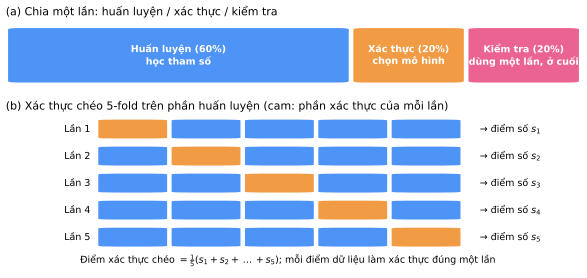

Hình E.1: (a) Chia dữ liệu thành ba phần. (b) Xác thực chéo 5-fold: mỗi lần lấy một phần (cam) làm tập xác thực, học trên bốn phần còn lại, rồi lấy trung bình năm điểm số.

Vì sao cần tới ba tập? Mỗi lần ta nhìn kết quả trên một tập rồi sửa mô hình theo nó, tập đó dần trở thành một phần của quá trình học. Nếu chọn siêu tham số trên tập kiểm tra, ta đã "học" cả tập kiểm tra, và con số báo cáo sẽ lạc quan hơn thực tế. Tập xác thực sinh ra để gánh vai trò đó, còn tập kiểm tra được giữ sạch đến phút cuối.

Khi dữ liệu ít, giữ riêng 20% để xác thực là lãng phí và kết quả dao động nhiều. **Xác thực chéo $K$-fold** (Hình E.1b, đã giới thiệu ở [mục 8.2.2](ml/ch08_vi)) dùng mọi điểm dữ liệu để xác thực đúng một lần. Với bài toán phân loại, nên dùng bản **phân tầng** (stratified): mỗi phần giữ tỉ lệ các lớp như trong toàn bộ dữ liệu. Nếu không, khi lớp dương hiếm, có phần sẽ không có mẫu dương nào.

> **Rò rỉ dữ liệu** (data leakage) là lỗi rất hay gặp: thông tin của tập xác thực hoặc tập kiểm tra lọt vào lúc huấn luyện. Ví dụ điển hình là chuẩn hoá dữ liệu ([mục 6.5](ml/ch06_vi)) bằng trung bình và độ lệch chuẩn tính trên **toàn bộ** dữ liệu rồi mới chia. Cách đúng là tính các thống kê này **chỉ trên tập huấn luyện**, rồi áp dụng nguyên như vậy cho các tập còn lại. Trong xác thực chéo, việc này phải làm lại ở **từng** lần chia. Các trang [Dùng thư viện](ml/eval_lib_vi) dùng `Pipeline` của scikit-learn để tự động làm đúng việc này.

## E.2 Ma trận nhầm lẫn

Xét bài toán phân loại nhị phân. Ta gọi lớp cần phát hiện là **lớp dương** (positive), ví dụ "có bệnh", "thư rác" hay "giao dịch gian lận". Lớp còn lại là **lớp âm** (negative). So nhãn dự đoán với nhãn thật, mỗi điểm dữ liệu rơi vào đúng một trong bốn ô của **ma trận nhầm lẫn** (confusion matrix, Hình E.2).

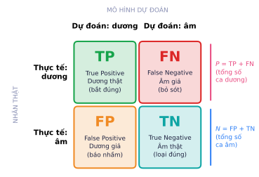

Hình E.2: Ma trận nhầm lẫn của bài toán nhị phân. Hàng là nhãn thật, cột là nhãn dự đoán. Hai ô xanh là đoán đúng, hai ô cam và đỏ là hai kiểu sai.

Tên bốn ô gồm hai phần. Chữ thứ hai (Positive/Negative) là điều **mô hình nói**. Chữ thứ nhất (True/False) cho biết mô hình **nói đúng hay sai**:

| Ô | Tên | Ý nghĩa | Ví dụ chẩn đoán bệnh |
| --- | --- | --- | --- |
| TP | True Positive, dương thật | Đoán dương, đúng | Người bệnh được phát hiện |
| FN | False Negative, âm giả | Đoán âm, sai | Người bệnh bị **bỏ sót** (lỗi loại II) |
| FP | False Positive, dương giả | Đoán dương, sai | Người khoẻ bị **báo nhầm** (lỗi loại I) |
| TN | True Negative, âm thật | Đoán âm, đúng | Người khoẻ được kết luận khoẻ |

Ký hiệu $P = \text{TP} + \text{FN}$ là số mẫu dương thật và $N = \text{FP} + \text{TN}$ là số mẫu âm thật. Mọi chỉ số ở các mục sau đều là tỉ số giữa các ô này.

## E.3 Accuracy và bẫy dữ liệu mất cân bằng

Chỉ số tự nhiên nhất là **độ chính xác** (accuracy), tức tỉ lệ đoán đúng:

$$
\text{accuracy} = \frac{\text{TP} + \text{TN}}{\text{TP} + \text{FN} + \text{FP} + \text{TN}}.
$$

Accuracy dễ hiểu và hợp lý khi các lớp có số lượng gần nhau. Nhưng nó gây hiểu lầm nghiêm trọng khi dữ liệu **mất cân bằng** (imbalanced). Xét 500 người được xét nghiệm, trong đó chỉ 5 người có bệnh (Hình E.3):

- **Mô hình A** không học gì, lúc nào cũng nói "khoẻ". Nó đúng với 495 người: accuracy **99%**. Nhưng nó không phát hiện được người bệnh nào.
- **Mô hình B** phát hiện được 4 trong 5 người bệnh, đổi lại báo nhầm 15 người khoẻ. Accuracy của nó chỉ **96.8%**, thấp hơn A.

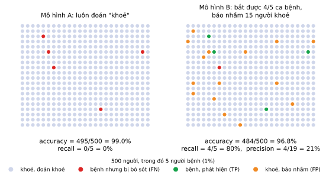

Hình E.3: Với 1% người bệnh, mô hình "luôn đoán khoẻ" có accuracy cao hơn một mô hình thật sự hữu ích.

Nếu chỉ nhìn accuracy, ta sẽ chọn A, một mô hình vô dụng. Bài học: **với dữ liệu mất cân bằng, phải nhìn riêng vào cách mô hình xử lý lớp hiếm.** Đó là việc của precision và recall.

> Mẹo kiểm tra nhanh: luôn so mô hình với một **mốc cơ sở** (baseline) ngớ ngẩn, ví dụ "luôn đoán lớp phổ biến nhất". Nếu mô hình không vượt mốc này rõ rệt thì con số đẹp chẳng có ý nghĩa gì. Trong scikit-learn, mốc này là `DummyClassifier`.

## E.4 Precision, recall và F1

Hai câu hỏi quan trọng nhất về lớp dương là:

- **Precision** (độ chuẩn xác): trong những mẫu mô hình *gọi là dương*, bao nhiêu mẫu dương thật?
- **Recall** (độ phủ, còn gọi là *sensitivity* hay *true positive rate*): trong những mẫu *thực sự dương*, mô hình tìm ra được bao nhiêu?

$$
\text{precision} = \frac{\text{TP}}{\text{TP} + \text{FP}}, \qquad
\text{recall} = \frac{\text{TP}}{\text{TP} + \text{FN}} = \frac{\text{TP}}{P}.
$$

Hai tỉ số có **cùng tử số** TP nhưng **khác mẫu số** (Hình E.4). Mẫu số của precision là cột "dự đoán dương" của ma trận nhầm lẫn, còn mẫu số của recall là hàng "thực tế dương".

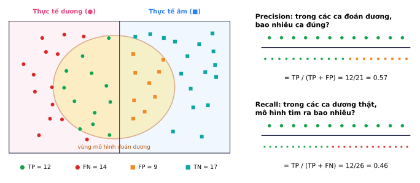

Hình E.4: Chấm tròn là mẫu dương thật, ô vuông là mẫu âm thật. Mô hình gọi mọi mẫu trong hình elip là dương. Precision so TP với mọi mẫu trong elip; recall so TP với mọi chấm tròn.

Ở Hình E.4, mô hình gọi 21 mẫu là dương, 12 mẫu trong đó đúng, nên precision là $12/21 = 0.57$. Có 26 mẫu dương thật, mô hình tìm ra 12, nên recall là $12/26 = 0.46$. Quay lại Hình E.3: mô hình A có recall bằng 0 (precision không xác định vì nó chẳng gọi ai là dương). Mô hình B có recall 80% và precision $4/19 = 21\%$. Hai con số này nói rõ điều accuracy che giấu.

Hai chỉ số này hay đi kèm hai chỉ số cho lớp âm:

- **Specificity** (độ đặc hiệu) $= \dfrac{\text{TN}}{\text{TN} + \text{FP}}$: tỉ lệ mẫu âm được nhận ra là âm.
- **FPR** (false positive rate, tỉ lệ báo nhầm) $= \dfrac{\text{FP}}{N} = 1 - \text{specificity}$. Ta sẽ dùng nó cho đường ROC ở mục E.6.

### Gộp thành một con số: F1 và F-beta

Khi cần **một** con số để so sánh mô hình, ta dùng **F1**, trung bình điều hoà (harmonic mean) của precision và recall:

$$
F_1 = \frac{2}{\dfrac{1}{\text{precision}} + \dfrac{1}{\text{recall}}} = \frac{2 \cdot \text{precision} \cdot \text{recall}}{\text{precision} + \text{recall}} = \frac{2\,\text{TP}}{2\,\text{TP} + \text{FP} + \text{FN}}.
$$

Vì sao không dùng trung bình cộng? Trung bình điều hoà bị kéo về phía số **nhỏ hơn**. Một mô hình gọi *mọi* mẫu là dương có recall 1. Ở ví dụ Hình E.3, precision của nó là 0.01. Trung bình cộng cho 0.505, nghe khá ổn, còn F1 chỉ là 0.02. F1 chỉ cao khi **cả hai** chỉ số đều cao.

Khi một loại lỗi đắt hơn, dùng **F$_\beta$**, trong đó recall được coi trọng gấp $\beta$ lần precision:

$$
F_\beta = (1 + \beta^2)\,\frac{\text{precision} \cdot \text{recall}}{\beta^2 \cdot \text{precision} + \text{recall}}.
$$

$F_2$ hợp với sàng lọc bệnh, nơi bỏ sót đắt hơn báo nhầm. $F_{0.5}$ hợp với lọc thư rác, nơi đẩy nhầm một thư quan trọng vào thùng rác đắt hơn để lọt một thư rác.

| Tình huống | Lỗi nào đắt hơn | Ưu tiên |
| --- | --- | --- |
| Sàng lọc ung thư, phát hiện gian lận | Bỏ sót (FN) | Recall, $F_2$ |
| Lọc thư rác, gợi ý nội dung | Báo nhầm (FP) | Precision, $F_{0.5}$ |
| Hai loại lỗi ngang nhau | | F1 |

## E.5 Ngưỡng quyết định

Phần lớn mô hình phân loại không trực tiếp đưa ra nhãn mà đưa ra một **điểm số** $s(\mathbf{x})$: xác suất trong hồi quy logistic ([chương 14](ml/ch14_vi)), $\mathbf{w}^T\mathbf{x} + b$ trong SVM ([chương 26](ml/ch26_vi)). Nhãn chỉ xuất hiện khi ta chọn một **ngưỡng** $t$:

$$
\hat{y} = \begin{cases} 1 & \text{nếu } s(\mathbf{x}) \ge t,\\ 0 & \text{ngược lại.} \end{cases}
$$

Ngưỡng 0.5 cho xác suất chỉ là một lựa chọn mặc định, không phải chân lý. Hình E.5 cho thấy điều gì xảy ra khi dịch ngưỡng. Ở đây điểm số của lớp âm và lớp dương có phân phối chuẩn, tâm ở $-1$ và $+1$, hai lớp có số lượng bằng nhau.

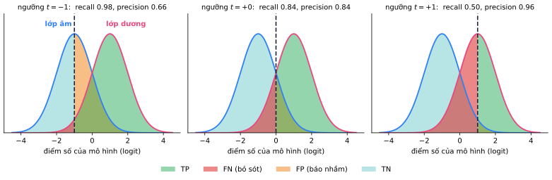

Hình E.5: Mọi mẫu bên phải đường nét đứt bị gọi là dương. Dịch ngưỡng sang phải thì phần FP (cam) co lại, nhưng phần FN (đỏ) phình ra.

| Ngưỡng $t$ | Recall | Precision |
| --- | --- | --- |
| $-1$ (dễ dãi) | 0.98 | 0.66 |
| $0$ | 0.84 | 0.84 |
| $+1$ (khắt khe) | 0.50 | 0.96 |

Đây là **sự đánh đổi precision–recall**. Ngưỡng thấp thì bắt được gần hết ca dương nhưng báo nhầm nhiều. Ngưỡng cao thì hầu như không nhầm nhưng bỏ sót nhiều. Không có ngưỡng nào tốt cho mọi bài toán. Hình E.6 vẽ cả ba chỉ số theo ngưỡng cho một mô hình logistic với 30% mẫu dương.

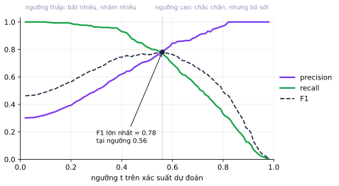

Hình E.6: Precision tăng và recall giảm khi nâng ngưỡng. F1 đạt lớn nhất là 0.78 tại ngưỡng 0.56, không phải 0.5.

Cách chọn ngưỡng đúng là làm trên **tập xác thực**, theo yêu cầu của bài toán. Ví dụ: "recall ít nhất 95%, và trong các ngưỡng thoả điều kiện đó thì lấy ngưỡng có precision cao nhất", hoặc "ngưỡng làm F1 lớn nhất", hoặc "ngưỡng làm tổng chi phí $c_{\text{FN}} \cdot \text{FN} + c_{\text{FP}} \cdot \text{FP}$ nhỏ nhất". Trang [Ví dụ áp dụng](ml/eval_app_vi) làm đúng việc này trên dữ liệu thật.

## E.6 Đường ROC và AUC

Precision, recall và F1 đều gắn với **một** ngưỡng. Muốn đánh giá bản thân **điểm số**, tức khả năng xếp hạng mẫu dương lên trên mẫu âm, mà chưa cần chọn ngưỡng, ta quét qua mọi ngưỡng. Với mỗi ngưỡng ta ghi lại một cặp:

$$
\text{TPR} = \frac{\text{TP}}{P} \;(\text{= recall}), \qquad \text{FPR} = \frac{\text{FP}}{N}.
$$

Vẽ các cặp $(\text{FPR}, \text{TPR})$ lên mặt phẳng, ta được **đường ROC** (receiver operating characteristic, Hình E.7).

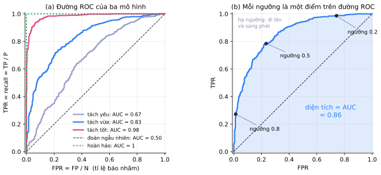

Hình E.7: (a) Hai lớp càng tách nhau thì đường ROC càng ôm sát góc trên bên trái. (b) Mỗi ngưỡng là một điểm trên đường; diện tích dưới đường là AUC.

Cách đọc đường ROC:

- Ngưỡng $+\infty$ (không gọi ai là dương) cho điểm $(0, 0)$. Ngưỡng $-\infty$ (gọi tất cả là dương) cho điểm $(1, 1)$. Hạ dần ngưỡng thì điểm đi từ $(0,0)$ lên $(1,1)$.
- **Góc $(0, 1)$** là mô hình hoàn hảo: bắt hết mẫu dương mà không báo nhầm mẫu âm nào.
- **Đường chéo** là đoán ngẫu nhiên: gọi một mẫu là dương với xác suất $q$ thì TPR = FPR = $q$, bất kể mẫu là gì.

**AUC** (area under the curve) là diện tích dưới đường ROC, gói cả đường thành một con số trong $[0, 1]$: 0.5 là ngẫu nhiên, 1 là hoàn hảo. AUC có một ý nghĩa rất đẹp:

$$
\text{AUC} = \Pr\big(s(\mathbf{x}^+) > s(\mathbf{x}^-)\big),
$$

tức xác suất để một mẫu dương chọn ngẫu nhiên được chấm điểm **cao hơn** một mẫu âm chọn ngẫu nhiên (hai mẫu bằng điểm thì tính một nửa). Vì vậy AUC chỉ phụ thuộc vào **thứ tự** của các điểm số. Nhân điểm số với 10 hay đưa qua một hàm đồng biến bất kỳ thì AUC không đổi. Trang [Code từ đầu](ml/eval_code_vi) kiểm tra rằng hai cách tính (diện tích hình thang và đếm cặp) cho đúng cùng một số.

Ở Hình E.7a, ba mô hình có AUC 0.67, 0.83 và 0.98. Một quy tắc thô thường dùng: AUC trên 0.9 là rất tốt, 0.8–0.9 là tốt, 0.7–0.8 là tạm được. Tuy vậy, mức nào là "tốt" còn tuỳ lĩnh vực.

## E.7 Đường precision–recall khi lớp dương hiếm

Đường ROC có một điểm yếu: FPR chia cho $N$, số mẫu âm. Khi mẫu âm rất nhiều, hàng trăm mẫu báo nhầm vẫn chỉ làm FPR nhích lên một chút, nên đường ROC trông vẫn đẹp. Trong khi đó, người dùng phải xử lý từng mẫu báo nhầm một.

**Đường precision–recall** (PR) vẽ precision theo recall khi quét ngưỡng. Precision chia cho số mẫu *được gọi là dương*, nên nó phạt nặng mỗi mẫu báo nhầm. Diện tích dưới đường PR thường được tính bằng **average precision** (AP):

$$
\text{AP} = \sum_k (R_k - R_{k-1})\, P_k,
$$

trong đó $P_k, R_k$ là precision và recall tại ngưỡng thứ $k$.

Hình E.8 là cùng một mô hình (cùng phân phối điểm số cho mỗi lớp) trên hai tập dữ liệu: một tập có 50% mẫu dương, một tập chỉ có 5%.

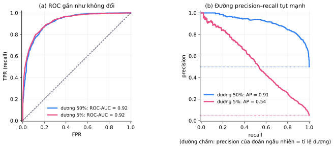

Hình E.8: Cùng một mô hình. ROC-AUC gần như không đổi (0.92 và 0.92), còn AP tụt từ 0.91 xuống 0.54 khi lớp dương chỉ còn 5%.

Không đường nào "sai". Hai đường trả lời hai câu hỏi khác nhau:

- **ROC-AUC** đo khả năng xếp hạng, không phụ thuộc tỉ lệ lớp. Nó hợp để so sánh mô hình giữa các tập dữ liệu có tỉ lệ lớp khác nhau.
- **PR và AP** đo mức hữu ích *trên tỉ lệ lớp thực tế*. Khi lớp dương hiếm và báo nhầm tốn chi phí (gian lận, bệnh hiếm, tìm kiếm), hãy báo cáo AP. Mốc của đoán ngẫu nhiên trên đường PR là precision bằng tỉ lệ mẫu dương (đường chấm trong Hình E.8b), không phải 0.5.

## E.8 Bài toán nhiều lớp

Với $C$ lớp, ma trận nhầm lẫn có kích thước $C \times C$. Phần tử hàng $i$, cột $j$ là số mẫu thuộc lớp $i$ bị đoán là lớp $j$. Đường chéo là các mẫu đoán đúng. Các ô ngoài đường chéo cho biết **lớp nào hay bị nhầm với lớp nào**. Đây thường là thông tin quý hơn mọi con số tổng hợp.

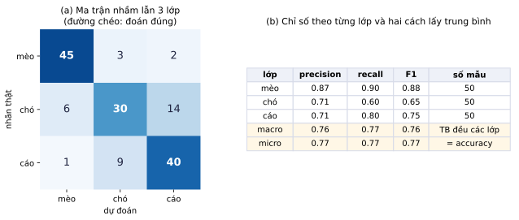

Hình E.9: (a) Ba lớp, mỗi lớp 50 ảnh; màu theo tỉ lệ trong từng hàng. 14 ảnh chó bị đoán là cáo: đây là cặp lớp khó nhất. (b) Precision, recall và F1 của từng lớp, tính bằng cách coi lớp đó là "dương" và mọi lớp khác là "âm".

Để có một con số chung, ta lấy trung bình các chỉ số theo lớp, theo một trong ba cách:

- **Macro**: trung bình cộng đều các lớp. Mọi lớp quan trọng như nhau, kể cả lớp hiếm.
- **Weighted**: trung bình có trọng số theo số mẫu của mỗi lớp.
- **Micro**: cộng dồn TP, FP, FN của mọi lớp rồi mới tính. Với bài toán mỗi mẫu có đúng một nhãn, micro-precision, micro-recall và micro-F1 đều **bằng accuracy**. Trong Hình E.9b, cả ba bằng 0.77.

Khi các lớp lệch nhau nhiều, macro-F1 là lựa chọn an toàn: nó không để các lớp đông che khuất một lớp hiếm bị đoán sai.

## E.9 Hồi quy: MAE, MSE, RMSE và $R^2$

Với hồi quy, ta đo độ lệch giữa giá trị thật $y_i$ và giá trị dự đoán $\hat{y}_i$, gọi là **phần dư** (residual) $r_i = y_i - \hat{y}_i$.

$$
\text{MAE} = \frac{1}{n}\sum_{i=1}^n |y_i - \hat{y}_i|, \qquad
\text{MSE} = \frac{1}{n}\sum_{i=1}^n (y_i - \hat{y}_i)^2, \qquad
\text{RMSE} = \sqrt{\text{MSE}}.
$$

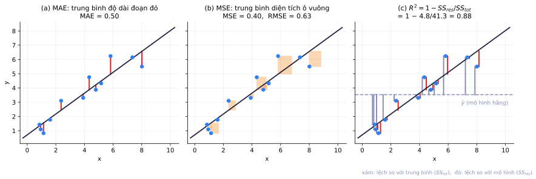

Hình E.10: (a) MAE là độ dài trung bình của các đoạn đỏ. (b) MSE là diện tích trung bình của các ô vuông dựng trên các đoạn đó. (c) $R^2$ so phần dư của mô hình (đỏ) với độ lệch so với giá trị trung bình (xám).

- **MAE** (mean absolute error) có cùng đơn vị với $y$ và dễ giải thích: "trung bình lệch bao nhiêu". Nó ít nhạy với điểm ngoại lai.
- **MSE** bình phương phần dư, nên một sai số lớn bị phạt rất nặng: sai 10 thì bằng 100 lần sai 1. Đây là hàm mất mát của hồi quy tuyến tính ([chương 7](ml/ch07_vi)) và dễ lấy đạo hàm.
- **RMSE** đưa MSE về lại đơn vị của $y$. Luôn có $\text{RMSE} \ge \text{MAE}$. Khi RMSE lớn hơn MAE nhiều, dữ liệu có vài sai số rất lớn đáng xem kỹ.

MAE, MSE và RMSE đều phụ thuộc vào đơn vị: RMSE bằng 2 là nhỏ nếu $y$ là giá nhà tính bằng tỉ đồng, nhưng là lớn nếu $y$ là nhiệt độ cơ thể. **Hệ số xác định** $R^2$ đưa về thang không đơn vị bằng cách so mô hình với mô hình đơn giản nhất, luôn đoán $\bar{y}$:

$$
R^2 = 1 - \frac{SS_{\text{res}}}{SS_{\text{tot}}} = 1 - \frac{\sum_i (y_i - \hat{y}_i)^2}{\sum_i (y_i - \bar{y})^2}.
$$

- $R^2 = 1$: dự đoán hoàn hảo.
- $R^2 = 0$: không hơn gì việc luôn đoán giá trị trung bình.
- $R^2 < 0$: **tệ hơn** cả việc đoán trung bình. Điều này hoàn toàn có thể xảy ra trên tập kiểm tra, khi mô hình quá khớp.

Ở Hình E.10, $SS_{\text{res}} = 4.8$, $SS_{\text{tot}} = 41.3$, nên $R^2 = 0.88$: mô hình giải thích được 88% độ biến thiên của $y$ quanh giá trị trung bình. Cùng dữ liệu đó có MAE = 0.50 và RMSE = 0.63.

> Nên báo cáo kèm một chỉ số có đơn vị (MAE hoặc RMSE) và $R^2$. Con số thứ nhất cho biết sai bao nhiêu theo đơn vị thực tế, con số thứ hai cho biết mô hình hơn mốc cơ sở bao nhiêu. Nên vẽ thêm **phần dư theo giá trị dự đoán**: nếu phần dư có hình dạng rõ (cong, loe rộng dần), mô hình đang bỏ sót một quy luật.

## E.10 Bias và variance

Các chỉ số trên cho biết mô hình sai *bao nhiêu*. Phân tích **bias–variance** cho biết sai *vì sao*. Hãy tưởng tượng ta lặp lại toàn bộ quá trình nhiều lần: mỗi lần lấy một tập huấn luyện mới từ cùng một nguồn, học một mô hình mới, rồi xem các mô hình đó dự đoán ra sao (Hình E.11).

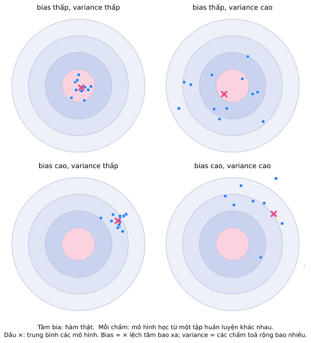

Hình E.11: Bias là độ lệch của <i>trung bình</i> các mô hình so với đích. Variance là độ toả của các mô hình quanh trung bình của chính chúng.

Giả sử dữ liệu sinh ra từ $y = f(x) + \varepsilon$, với nhiễu $\varepsilon$ có trung bình 0 và phương sai $\sigma^2$. Gọi $\hat{f}_\mathcal{D}$ là mô hình học được từ tập huấn luyện $\mathcal{D}$. Sai số bình phương kỳ vọng tại một điểm $x$, lấy kỳ vọng theo cả $\mathcal{D}$ lẫn nhiễu, tách được thành ba phần:

$$
\mathbb{E}\big[(y - \hat{f}_\mathcal{D}(x))^2\big] =
\underbrace{\big(\mathbb{E}_\mathcal{D}[\hat{f}_\mathcal{D}(x)] - f(x)\big)^2}_{\text{bias}^2}
+ \underbrace{\mathbb{E}_\mathcal{D}\Big[\big(\hat{f}_\mathcal{D}(x) - \mathbb{E}_\mathcal{D}[\hat{f}_\mathcal{D}(x)]\big)^2\Big]}_{\text{variance}}
+ \underbrace{\sigma^2}_{\text{nhiễu}}.
$$

**Chứng minh.** Viết gọn $\hat{f} = \hat{f}_\mathcal{D}(x)$ và $\bar{f} = \mathbb{E}_\mathcal{D}[\hat{f}]$. Ta có

$$
y - \hat{f} = \varepsilon + (f - \bar{f}) + (\bar{f} - \hat{f}).
$$

Bình phương rồi lấy kỳ vọng. Ba số hạng chéo đều bằng 0: $\varepsilon$ độc lập với $\mathcal{D}$ và có trung bình 0, còn $\mathbb{E}_\mathcal{D}[\bar{f} - \hat{f}] = 0$ theo định nghĩa của $\bar{f}$. Chỉ còn lại $\sigma^2 + (f - \bar{f})^2 + \mathbb{E}[(\bar{f} - \hat{f})^2]$. $\square$

- **Bias cao** (chưa khớp): mô hình quá đơn giản, nên trung bình của nó vẫn lệch khỏi hàm thật.
- **Variance cao** (quá khớp): mô hình quá linh hoạt, nên mỗi tập huấn luyện cho ra một mô hình rất khác. Nó đang học cả nhiễu.
- **Nhiễu** $\sigma^2$: phần không mô hình nào giảm được.

Hình E.12 là một mô phỏng thật. Ta lấy 400 tập huấn luyện, mỗi tập 20 điểm, từ $y = \sin(2\pi x) + \varepsilon$ với $\sigma = 0.3$, rồi khớp đa thức các bậc từ 0 đến 10.

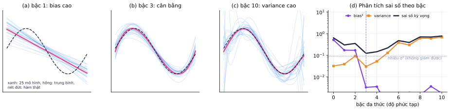

Hình E.12: (a–c) 25 trong 400 mô hình (xanh), trung bình của chúng (hồng) và hàm thật (nét đứt). (d) Khi bậc tăng, bias² giảm còn variance tăng; tổng của chúng nhỏ nhất ở bậc 3.

Bậc 1 cho các đường gần như giống nhau (variance thấp) nhưng đều sai hình dạng (bias cao). Bậc 10 cho trung bình bám sát hàm thật (bias gần 0) nhưng từng mô hình dao động lung tung (variance cao). Tổng sai số kỳ vọng có hình chữ U, đáy ở bậc 3 với giá trị 0.124, chỉ cao hơn mức nhiễu $\sigma^2 = 0.09$ một chút. Đây chính là đường sai số xác thực hình chữ U ở [chương 8](ml/ch08_vi), nay đã được tách thành hai nguyên nhân.

Muốn giảm bias thì dùng mô hình phức tạp hơn, thêm đặc trưng, hoặc giảm hệ số kiểm soát $\lambda$. Muốn giảm variance thì làm ngược lại, hoặc **thêm dữ liệu**, hoặc lấy trung bình nhiều mô hình (ý tưởng của bagging và random forest).

## E.11 Đường học

Ngoài đời, ta không thể lấy 400 tập huấn luyện để đo bias và variance. Công cụ thực tế là **đường học** (learning curve): vẽ sai số huấn luyện và sai số xác thực theo **số mẫu huấn luyện** (Hình E.13).

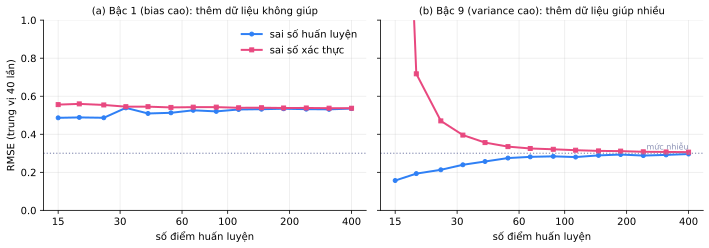

Hình E.13: (a) Mô hình bias cao: hai đường gặp nhau sớm ở mức cao, thêm dữ liệu không giúp. (b) Mô hình variance cao: khoảng cách lớn giữa hai đường thu hẹp dần khi thêm dữ liệu.

- **Hai đường sát nhau nhưng đều cao** (Hình E.13a, bậc 1: cả hai quanh 0.54 trong khi mức nhiễu là 0.3): mô hình bị bias cao. Thu thêm dữ liệu là lãng phí. Hãy dùng mô hình mạnh hơn.
- **Khoảng cách lớn giữa hai đường** (Hình E.13b, bậc 9: với 15 điểm, sai số huấn luyện 0.16 nhưng sai số xác thực 3.4): mô hình bị variance cao. Thêm dữ liệu giúp nhiều: với 400 điểm, hai đường gặp nhau ở 0.30–0.31, sát mức nhiễu. Kiểm soát (regularization) cũng giúp.

## E.12 Tóm tắt: chọn chỉ số nào

| Bài toán | Chỉ số chính | Nên kèm theo |
| --- | --- | --- |
| Phân loại, các lớp cân bằng | Accuracy | Ma trận nhầm lẫn |
| Phân loại, lớp dương hiếm | Recall, precision, F1 hoặc $F_\beta$ ở ngưỡng đã chọn | AP (đường PR), so với mốc "luôn đoán âm" |
| So sánh khả năng xếp hạng, chưa chọn ngưỡng | ROC-AUC | Đường ROC |
| Nhiều lớp | Macro-F1 hoặc accuracy | Ma trận nhầm lẫn $C \times C$, báo cáo theo lớp |
| Hồi quy | MAE hoặc RMSE, cùng $R^2$ | Đồ thị phần dư |
| Chẩn đoán nên làm gì tiếp | Đường học, đường xác thực | |

Danh sách kiểm tra trước khi báo cáo một con số:

1. Con số đo trên dữ liệu mô hình **chưa từng thấy**, và tập kiểm tra chỉ được dùng **một lần**.
2. Mọi bước tiền xử lý (chuẩn hoá, chọn đặc trưng) được học **chỉ trên tập huấn luyện**.
3. Mô hình đã được so với một **mốc cơ sở** đơn giản.
4. Chỉ số phù hợp với **chi phí thật** của từng loại lỗi, và ngưỡng được chọn trên **tập xác thực**.
5. Có báo cáo **độ dao động**, ví dụ trung bình ± độ lệch chuẩn qua các lần xác thực chéo, chứ không chỉ một con số.

---

**Học tiếp:** [Code từ đầu](ml/eval_code_vi) tự viết mọi chỉ số bằng NumPy · [Dùng thư viện](ml/eval_lib_vi) dùng `sklearn.metrics` · [Ví dụ áp dụng](ml/eval_app_vi) chọn mô hình và ngưỡng cho bài toán sàng lọc tiểu đường · [Mô phỏng](ml/eval_viz_vi) kéo ngưỡng và xem mọi chỉ số thay đổi cùng lúc.
