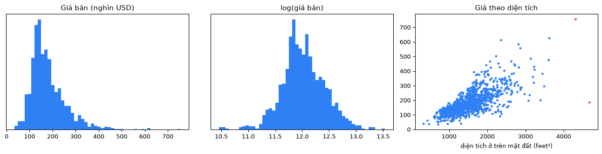
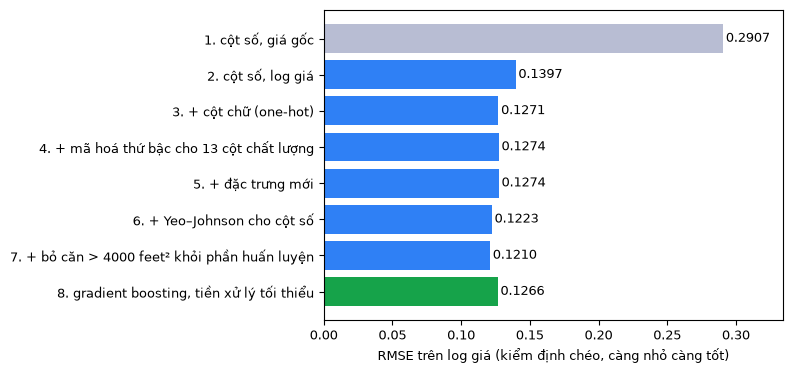

# Data preprocessing · Ví dụ áp dụng: giá nhà Ames

> Ghi chú của người biên soạn: trang này do người biên soạn viết thêm. Trang dựng từng bước một quy trình tiền xử lý đầy đủ cho bộ dữ liệu giá nhà Ames, áp dụng gần như mọi mục của bài [Tiền xử lý dữ liệu](ml/prep_vi), và đo xem mỗi bước đóng góp bao nhiêu.

## Bài toán

Bộ dữ liệu **Ames Housing** (Dean De Cock, *Journal of Statistics Education*, 2011) gồm 1460 căn nhà được bán ở thành phố Ames, bang Iowa (Mỹ) từ 2006 đến 2010. Mỗi căn có 79 đặc trưng: diện tích từng tầng, số phòng tắm, năm xây, khu phố, chất lượng bếp, có hồ bơi hay không, …. Mục tiêu là dự đoán giá bán. Tác giả tạo bộ dữ liệu này để thay thế bộ Boston Housing đã quá quen thuộc, và nó là một bài tập tiền xử lý rất tốt: có cột số và cột chữ, có ô trống mang nghĩa "không có", có cột thứ bậc, có giá lệch phải và vài ngoại lai.

Thước đo là **RMSE trên log giá** (căn bậc hai của trung bình bình phương $\log \hat y - \log y$). Nó đo sai số **tương đối**: RMSE 0.12 nghĩa là dự đoán lệch khoảng 12% theo kiểu điển hình.

Các khối chạy lần lượt từ trên xuống và dùng chung biến. Cần `numpy`, `pandas`, `matplotlib`, `scikit-learn`. Dữ liệu được tải từ OpenML (mã 42165) ở lần chạy đầu.

## 1. Đọc và khám phá dữ liệu

<small class="viz-ref">Mục D.1–D.2</small>

Việc đầu tiên là **tách tập kiểm tra** (20%) và cất đi. Mọi quyết định sau đó, kể cả việc nhìn dữ liệu, chỉ dùng tập huấn luyện.

<!-- run -->
```python
import numpy as np
import pandas as pd
import matplotlib.pyplot as plt
from scipy.stats import skew
from sklearn.datasets import fetch_openml
from sklearn.model_selection import train_test_split

ames = fetch_openml(data_id=42165, as_frame=True).frame.drop(columns="Id")
ames["MSSubClass"] = ames["MSSubClass"].astype(str)          # mã loại nhà: là số nhưng mang nghĩa định danh
y_all = ames.pop("SalePrice").astype(float)
X_tr, X_te, y_tr, y_te = train_test_split(ames, y_all, test_size=0.2, random_state=0)
print(f"huấn luyện {X_tr.shape}, kiểm tra {X_te.shape}")

num_cols = X_tr.select_dtypes("number").columns.tolist()
cat_cols = X_tr.columns.difference(num_cols).tolist()
print(f"{len(num_cols)} cột số, {len(cat_cols)} cột chữ")
miss = X_tr.isna().mean().sort_values(ascending=False)
print("tỉ lệ ô trống, 10 cột nhiều nhất:\n" + miss.head(10).round(3).to_string())
print(f"giá: trung vị {y_tr.median():,.0f} USD, độ lệch {skew(y_tr):.2f}; sau khi lấy log: {skew(np.log(y_tr)):.2f}")

fig, ax = plt.subplots(1, 3, figsize=(13, 3.4))
ax[0].hist(y_tr / 1000, bins=50, color="#2f80f5"); ax[0].set_title("Giá bán (nghìn USD)")
ax[1].hist(np.log(y_tr), bins=50, color="#2f80f5"); ax[1].set_title("log(giá bán)")
big = X_tr["GrLivArea"] > 4000
ax[2].scatter(X_tr["GrLivArea"], y_tr / 1000, s=6, c=np.where(big, "#e8487f", "#2f80f5"))
ax[2].set_xlabel("diện tích ở trên mặt đất (feet²)"); ax[2].set_title("Giá theo diện tích")
for a in ax[:2]: a.set_yticks([])
plt.tight_layout(); plt.show()
```

<!-- output -->
```output
huấn luyện (1168, 79), kiểm tra (292, 79)
35 cột số, 44 cột chữ
tỉ lệ ô trống, 10 cột nhiều nhất:
PoolQC          0.997
MiscFeature     0.958
Alley           0.939
Fence           0.817
FireplaceQu     0.472
LotFrontage     0.182
GarageYrBlt     0.050
GarageQual      0.050
GarageFinish    0.050
GarageType      0.050
giá: trung vị 163,000 USD, độ lệch 1.75; sau khi lấy log: 0.03
```

<div align=center></div>
<!-- /output -->

- 5 cột trống trên 45% số dòng, nhưng như sẽ thấy ngay dưới đây, phần lớn các ô đó không thật sự bị thiếu.
- Giá lệch phải (độ lệch 1.75); sau khi lấy log, gần như đối xứng (0.03).
- Ở hình bên phải, hai căn màu hồng có diện tích trên 4000 feet². Một căn bán 185 nghìn USD, thấp hơn nhiều so với xu hướng chung.

Đọc tài liệu mô tả của bộ dữ liệu, ta thấy phần lớn ô trống **không phải là thiếu**: `PoolQC` (chất lượng hồ bơi) trống vì nhà không có hồ bơi; `Alley`, `Fence`, `FireplaceQu`, các cột `Garage…` và `Bsmt…` cũng vậy. Đây là trường hợp "thiếu mang ý nghĩa" ở mục D.3: thay ô trống bằng nhóm "Không có", không điền giá trị phổ biến nhất. Chỉ `LotFrontage` (chiều dài mặt tiền) là thiếu thật.

## 2. Khung đánh giá

Ta đánh giá mỗi phiên bản bằng kiểm định chéo 5-fold lặp 3 lần trên tập huấn luyện. Vòng lặp tự viết cho phép, ở bước 7, bỏ ngoại lai **chỉ khỏi phần huấn luyện** của từng fold.

<!-- run -->
```python
from sklearn.model_selection import RepeatedKFold
from sklearn.pipeline import make_pipeline, Pipeline
from sklearn.compose import ColumnTransformer, TransformedTargetRegressor
from sklearn.impute import SimpleImputer
from sklearn.preprocessing import StandardScaler, OneHotEncoder, OrdinalEncoder, PowerTransformer, FunctionTransformer
from sklearn.linear_model import RidgeCV

ALPHAS = np.logspace(-1, 3, 30)
rkf = RepeatedKFold(n_splits=5, n_repeats=3, random_state=0)

def rmse_log(y, p):
    return float(np.sqrt(np.mean((np.log(np.maximum(p, 1)) - np.log(y)) ** 2)))

def evaluate(make_model, X=X_tr, y=y_tr, drop=None):
    """RMSE log trung bình qua các fold; drop(X) trả về mặt nạ các dòng huấn luyện cần bỏ."""
    scores = []
    for tr, va in rkf.split(X):
        Xa, ya = X.iloc[tr], y.iloc[tr]
        if drop is not None:
            keep = ~drop(Xa)
            Xa, ya = Xa[keep], ya[keep]
        scores.append(rmse_log(y.iloc[va], make_model().fit(Xa, ya).predict(X.iloc[va])))
    return float(np.mean(scores)), float(np.std(scores))

results = {}
def report(name, make_model, **kw):
    m, s = evaluate(make_model, **kw)
    results[name] = m
    print(f"{name:52s} RMSE log = {m:.4f} ± {s:.4f}")
```

## 3. Mốc xuất phát: chỉ dùng cột số

<small class="viz-ref">Mục D.3, D.6, D.7</small>

Phiên bản đơn giản nhất: chỉ lấy 35 cột số, điền trung vị, chuẩn hoá, hồi quy ridge (độ mạnh chính quy hoá chọn bằng `RidgeCV`). Sau đó chỉ đổi một điều: huấn luyện trên **log giá** thay vì giá (mục D.7).

<!-- run -->
```python
def numeric_only(log_target):
    pre = ColumnTransformer([("num", make_pipeline(SimpleImputer(strategy="median"), StandardScaler()), num_cols)])
    model = make_pipeline(pre, RidgeCV(alphas=ALPHAS))
    return (lambda: TransformedTargetRegressor(model, func=np.log, inverse_func=np.exp)) if log_target else (lambda: model)

report("1. cột số, giá gốc", numeric_only(False))
report("2. cột số, log giá", numeric_only(True))
```

<!-- output -->
```output
1. cột số, giá gốc                                   RMSE log = 0.2907 ± 0.2191
2. cột số, log giá                                   RMSE log = 0.1397 ± 0.0226
```
<!-- /output -->

Chỉ đổi biến mục tiêu sang log, RMSE log giảm từ 0.291 xuống 0.140, và độ lệch chuẩn giữa các fold giảm từ 0.219 xuống 0.023. Khi học trên giá gốc, ridge cực tiểu bình phương sai số **tuyệt đối**, nên nó cố khớp các căn đắt tiền; với căn rẻ, nó có thể dự đoán giá rất thấp, thậm chí âm, và sai số log ở đó bùng nổ. Học trên log giá thì hàm mất mát khớp đúng với thước đo.

## 4. Thêm cột chữ bằng one-hot

<small class="viz-ref">Mục D.3, D.5</small>

44 cột chữ: ô trống thành nhóm "Không có", rồi mã hoá one-hot. Nhóm có ít hơn 10 căn được gộp lại, để tránh các cột gần như toàn số 0. Với cột số, `MasVnrArea` (diện tích ốp đá) trống nghĩa là không ốp đá nên điền 0; `GarageYrBlt` trống vì không có ga-ra, điền trung vị và thêm cột chỉ báo.

<!-- run -->
```python
zero_cols = ["MasVnrArea"]
flag_cols = ["GarageYrBlt", "LotFrontage"]
other_num = [c for c in num_cols if c not in zero_cols + flag_cols]

def num_branch(scaler=StandardScaler):
    return [("zero", make_pipeline(SimpleImputer(strategy="constant", fill_value=0), scaler()), zero_cols),
            ("flag", make_pipeline(SimpleImputer(strategy="median", add_indicator=True), scaler()), flag_cols),
            ("num", make_pipeline(SimpleImputer(strategy="median"), scaler()), other_num)]

def onehot(cols):
    return make_pipeline(SimpleImputer(strategy="constant", fill_value="Không có"),
                         OneHotEncoder(handle_unknown="infrequent_if_exist", min_frequency=10))

def with_log(pre):
    return lambda: TransformedTargetRegressor(make_pipeline(pre, RidgeCV(alphas=ALPHAS)), func=np.log, inverse_func=np.exp)

pre3 = ColumnTransformer(num_branch() + [("cat", onehot(cat_cols), cat_cols)])
report("3. + cột chữ (one-hot)", with_log(pre3))
print("số cột sau tiền xử lý:", pre3.fit(X_tr).transform(X_tr.iloc[:2]).shape[1])
```

<!-- output -->
```output
3. + cột chữ (one-hot)                               RMSE log = 0.1271 ± 0.0229
số cột sau tiền xử lý: 270
```
<!-- /output -->

Thêm 44 cột chữ (thành 270 cột sau one-hot) giảm RMSE log từ 0.140 xuống 0.127. Ridge với α chọn bằng kiểm định chéo xử lý được nhiều cột như vậy mà không quá khớp.

## 5. Cột thứ bậc: mã hoá theo thứ tự đúng

<small class="viz-ref">Mục D.1, D.5</small>

Mười cột chất lượng và tình trạng dùng cùng một thang: Po (kém) < Fa (tạm) < TA (trung bình) < Gd (tốt) < Ex (xuất sắc), cộng thêm "Không có". Đây là biến **thứ bậc**: ta mã hoá chúng thành 0, 1, …, 5 theo đúng thứ tự này, để mô hình tuyến tính dùng **một** hệ số cho cả thang thay vì sáu hệ số rời rạc. Thêm ba cột thứ bậc khác với thang riêng.

<!-- run -->
```python
QUAL = ["Không có", "Po", "Fa", "TA", "Gd", "Ex"]
ord_scales = {c: QUAL for c in ["ExterQual", "ExterCond", "BsmtQual", "BsmtCond", "HeatingQC", "KitchenQual",
                                "FireplaceQu", "GarageQual", "GarageCond", "PoolQC"]}
ord_scales["BsmtExposure"] = ["Không có", "No", "Mn", "Av", "Gd"]
ord_scales["GarageFinish"] = ["Không có", "Unf", "RFn", "Fin"]
ord_scales["Functional"] = ["Sal", "Sev", "Maj2", "Maj1", "Mod", "Min2", "Min1", "Typ"]
ord_cols = list(ord_scales)
nom_cols = [c for c in cat_cols if c not in ord_cols]

ordinal = make_pipeline(SimpleImputer(strategy="constant", fill_value="Không có"),
                        OrdinalEncoder(categories=[ord_scales[c] for c in ord_cols],
                                       handle_unknown="use_encoded_value", unknown_value=-1),
                        StandardScaler())
pre4 = ColumnTransformer(num_branch() + [("ord", ordinal, ord_cols), ("cat", onehot(nom_cols), nom_cols)])
report("4. + mã hoá thứ bậc cho 13 cột chất lượng", with_log(pre4))
```

<!-- output -->
```output
4. + mã hoá thứ bậc cho 13 cột chất lượng            RMSE log = 0.1274 ± 0.0224
```
<!-- /output -->

Mã hoá thứ bậc **không** cải thiện ở đây (0.1274 so với 0.1271). Với 1168 căn và chính quy hoá ridge, one-hot đã đủ dữ liệu để tự học thứ tự Po < Fa < TA < Gd < Ex. Lợi ích của mã thứ bậc là mô hình gọn hơn (một hệ số thay vì sáu cho mỗi cột) và dễ diễn giải hơn; ta vẫn giữ nó.

## 6. Tạo đặc trưng và sửa phân phối lệch

<small class="viz-ref">Mục D.7, D.8</small>

Vài đặc trưng mới từ hiểu biết về nhà đất: **tổng diện tích** (tầng hầm + tầng 1 + tầng 2), **tuổi nhà** và **số năm từ lần sửa gần nhất** lúc bán, **tổng số phòng tắm** (phòng tắm nửa tính 0.5), **tổng diện tích hiên**. Các phép tính này **không học tham số** từ dữ liệu, nên đặt chúng ở bất kỳ đâu cũng không gây rò rỉ; ta vẫn đặt trong Pipeline để dữ liệu mới đi qua đúng các bước.

Sau đó thay `StandardScaler` của các cột số bằng `PowerTransformer` (Yeo–Johnson rồi chuẩn hoá), để giảm độ lệch của các cột diện tích.

<!-- run -->
```python
def add_features(df):
    df = df.copy()
    df["TotalSF"] = df[["TotalBsmtSF", "1stFlrSF", "2ndFlrSF"]].fillna(0).sum(axis=1)
    df["Age"] = df["YrSold"] - df["YearBuilt"]
    df["SinceRemod"] = df["YrSold"] - df["YearRemodAdd"]
    df["TotalBath"] = df["FullBath"] + 0.5 * df["HalfBath"] + df["BsmtFullBath"].fillna(0) + 0.5 * df["BsmtHalfBath"].fillna(0)
    df["PorchSF"] = df[["OpenPorchSF", "EnclosedPorch", "3SsnPorch", "ScreenPorch", "WoodDeckSF"]].sum(axis=1)
    return df

new_cols = ["TotalSF", "Age", "SinceRemod", "TotalBath", "PorchSF"]
other_num = [c for c in num_cols if c not in zero_cols + flag_cols] + new_cols
print("độ lệch của vài cột số:", {c: round(float(skew(add_features(X_tr)[c].dropna())), 2) for c in ["LotArea", "GrLivArea", "TotalSF", "PorchSF"]})

def pre5(scaler):
    return ColumnTransformer(num_branch(scaler) + [("ord", ordinal, ord_cols), ("cat", onehot(nom_cols), nom_cols)])

def model5(scaler):
    return lambda: TransformedTargetRegressor(
        make_pipeline(FunctionTransformer(add_features), pre5(scaler), RidgeCV(alphas=ALPHAS)), func=np.log, inverse_func=np.exp)

report("5. + đặc trưng mới", model5(StandardScaler))
report("6. + Yeo–Johnson cho cột số", model5(PowerTransformer))
```

<!-- output -->
```output
độ lệch của vài cột số: {'LotArea': 12.12, 'GrLivArea': 1.08, 'TotalSF': 0.93, 'PorchSF': 1.11}
5. + đặc trưng mới                                   RMSE log = 0.1274 ± 0.0227
6. + Yeo–Johnson cho cột số                          RMSE log = 0.1223 ± 0.0181
```
<!-- /output -->

- Năm đặc trưng mới không thay đổi gì (0.1274): mô hình tuyến tính tự cộng được `TotalBsmtSF + 1stFlrSF + 2ndFlrSF` từ các cột gốc. Đặc trưng tạo thêm chỉ có ích khi nó là một phép biến đổi **phi tuyến** mà mô hình không tự làm được.
- Yeo–Johnson thì có ích: RMSE log giảm xuống 0.122, và độ lệch chuẩn giữa các fold cũng giảm. `LotArea` có độ lệch 12.1; vài lô đất rất lớn có ảnh hưởng quá mức tới hệ số khi chỉ chuẩn hoá tuyến tính. Đây là "sửa phân phối lệch" của mục D.7, áp dụng cho đặc trưng.

## 7. Ngoại lai

<small class="viz-ref">Mục D.4 · hình D.2</small>

Ở hình bên phải của khối 1, vài căn có diện tích trên 4000 feet² nhưng giá thấp bất thường. Chính tác giả bộ dữ liệu khuyên bỏ các căn trên 4000 feet² khi dạy học, vì chúng là các giao dịch đặc biệt (bán một phần, bán cho người thân). Ta chỉ bỏ chúng khỏi **phần huấn luyện** của mỗi fold; phần kiểm định vẫn giữ nguyên, để không tự làm đẹp con số.

<!-- run -->
```python
print("số căn > 4000 feet² trong tập huấn luyện:", int((X_tr["GrLivArea"] > 4000).sum()))
report("7. + bỏ căn > 4000 feet² khỏi phần huấn luyện", model5(PowerTransformer), drop=lambda X: X["GrLivArea"] > 4000)
```

<!-- output -->
```output
số căn > 4000 feet² trong tập huấn luyện: 2
7. + bỏ căn > 4000 feet² khỏi phần huấn luyện        RMSE log = 0.1210 ± 0.0187
```
<!-- /output -->

Bỏ chỉ hai căn khỏi phần huấn luyện giảm RMSE log từ 0.1223 xuống 0.1210. Mô hình bình phương tối thiểu nhạy với ngoại lai như hình D.2b: căn rộng nhất nhưng rẻ kéo hệ số của diện tích xuống.

## 8. Mô hình cây cần ít tiền xử lý hơn

<small class="viz-ref">Mục D.3, D.5, D.6</small>

`HistGradientBoostingRegressor` ([Học tổ hợp](ml/ensemble_vi)) nhận ô trống trực tiếp, không cần co giãn, và xử lý cột chữ đã mã thứ tự như biến phân loại. Tiền xử lý chỉ còn: mã hoá cột chữ thành số nguyên, và (vẫn nên) lấy log giá.

<!-- run -->
```python
from sklearn.ensemble import HistGradientBoostingRegressor

def hgb():
    enc = ColumnTransformer([("cat", OrdinalEncoder(handle_unknown="use_encoded_value", unknown_value=-1,
                                                    encoded_missing_value=-1), cat_cols)],
                            remainder="passthrough", verbose_feature_names_out=False).set_output(transform="pandas")
    model = HistGradientBoostingRegressor(learning_rate=0.05, max_iter=600, max_leaf_nodes=15, min_samples_leaf=10,
                                          l2_regularization=1.0, categorical_features=cat_cols, random_state=0)
    return TransformedTargetRegressor(make_pipeline(FunctionTransformer(add_features), enc, model),
                                      func=np.log, inverse_func=np.exp)

report("8. gradient boosting, tiền xử lý tối thiểu", hgb, drop=lambda X: X["GrLivArea"] > 4000)
```

<!-- output -->
```output
8. gradient boosting, tiền xử lý tối thiểu           RMSE log = 0.1266 ± 0.0159
```
<!-- /output -->

Gradient boosting với gần như không có tiền xử lý đạt 0.127, ngang với ridge ở bước 3–5, nhưng thua ridge đã tiền xử lý kỹ (0.121). Bộ dữ liệu nhỏ (1168 căn) và giá phụ thuộc gần như tuyến tính vào diện tích và chất lượng, nên một mô hình tuyến tính được chuẩn bị dữ liệu tốt khó bị đánh bại.

## 9. Tổng kết và kiểm tra cuối cùng

Chọn mô hình ridge của bước 7, huấn luyện lại trên **toàn bộ** tập huấn luyện (trừ hai căn trên 4000 feet²), rồi đánh giá **một lần** trên tập kiểm tra đã cất từ đầu.

<!-- run -->
```python
names = list(results)
vals = [results[k] for k in names]
plt.figure(figsize=(8, 3.8))
plt.barh(range(len(names))[::-1], vals, color=["#b8bdd3"] + ["#2f80f5"] * (len(names) - 2) + ["#16a34a"])
for i, v in enumerate(vals):
    plt.text(v + 0.002, len(names) - 1 - i, f"{v:.4f}", va="center", fontsize=9)
plt.yticks(range(len(names))[::-1], names, fontsize=9)
plt.xlabel("RMSE trên log giá (kiểm định chéo, càng nhỏ càng tốt)")
plt.xlim(0, max(vals) * 1.15)
plt.tight_layout(); plt.show()

final = model5(PowerTransformer)()
keep = X_tr["GrLivArea"] <= 4000
final.fit(X_tr[keep], y_tr[keep])
p_te = final.predict(X_te)
err = np.log(p_te) - np.log(y_te)
print(f"RMSE log trên tập kiểm tra (292 căn): {rmse_log(y_te, p_te):.4f}")
worst = err.abs().sort_values(ascending=False).head(3).index
print("3 căn bị đoán sai nhiều nhất:")
print(pd.DataFrame({"diện tích": X_te.loc[worst, "GrLivArea"], "điều kiện bán": X_te.loc[worst, "SaleCondition"],
                    "giá thật": y_te[worst].round(0), "dự đoán": p_te[X_te.index.get_indexer(worst)].round(0)}).to_string())
small = (X_te["GrLivArea"] <= 4000).to_numpy()
print(f"RMSE log trên {int(small.sum())} căn ≤ 4000 feet²: {rmse_log(y_te[small], p_te[small]):.4f}")
print(f"sai số tương đối trung vị: {float(np.median(np.abs(p_te - y_te) / y_te)):.1%}")
print("α của ridge được chọn:", round(float(final.regressor_[-1].alpha_), 2))
```

<!-- output -->
```output
RMSE log trên tập kiểm tra (292 căn): 0.1657
3 căn bị đoán sai nhiều nhất:
      diện tích điều kiện bán  giá thật    dự đoán
1298       5642       Partial  160000.0  1334437.0
632        1411        Family   82500.0   180443.0
688        1419       Partial  392000.0   267875.0
RMSE log trên 290 căn ≤ 4000 feet²: 0.1092
sai số tương đối trung vị: 6.1%
α của ridge được chọn: 16.1
```

<div align=center></div>
<!-- /output -->

- RMSE log trên tập kiểm tra là 0.166, cao hơn hẳn 0.121 của kiểm định chéo. Nguyên nhân gần như chỉ là **một** căn: căn rộng 5642 feet², bán 160 nghìn USD trong một giao dịch `Partial` (bán khi nhà chưa xây xong). Mô hình dự đoán 1.33 triệu USD.
- Bỏ hai căn trên 4000 feet² khỏi tập kiểm tra, RMSE log là 0.109, và sai số tương đối trung vị là 6.1%. Đây là lý do tác giả bộ dữ liệu khuyên loại các căn này: chúng là giao dịch bất thường, không mô hình nào dự đoán được từ các đặc trưng sẵn có.
- Bài học: **luôn xem các sai số lớn nhất**. Một con số tổng hợp có thể bị một điểm duy nhất chi phối. Ở đây, thay vì bỏ căn đó đi cho đẹp số liệu, câu trả lời đúng là ghi rõ phạm vi của mô hình: nó dùng cho nhà dưới 4000 feet², bán trong điều kiện thông thường.
