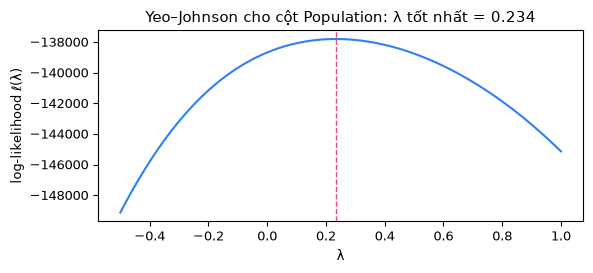

# Data preprocessing · Code từ đầu

> Ghi chú của người biên soạn: trang này do người biên soạn viết thêm. Trang tự viết bằng NumPy các bước trong bài [Tiền xử lý dữ liệu](ml/prep_vi): điền giá trị thiếu (trung bình, KNN), phát hiện ngoại lai, mã hoá one-hot và mã hoá theo mục tiêu, các bộ co giãn, biến đổi Yeo–Johnson, chọn đặc trưng bằng F-score và RFE, và một Pipeline nhỏ. Mỗi phần đều được đối chiếu với scikit-learn.

## Cách dùng trang này

Các khối chạy lần lượt từ trên xuống và dùng chung biến. Cần `numpy`, `scipy` và `matplotlib`; scikit-learn chỉ dùng để đối chiếu kết quả.

Mọi bộ biến đổi trên trang này có cùng giao diện với scikit-learn: `fit(X)` học tham số **chỉ** từ dữ liệu được truyền vào, còn `transform(X)` áp các tham số đó lên dữ liệu bất kỳ. Nhờ vậy, ở phần cuối ta ghép được chúng thành một Pipeline.

## 1. Điền giá trị thiếu

<small class="viz-ref">Mục D.3 · thuật toán D.1 · hình D.1</small>

Bộ điền đơn giản học một giá trị cho mỗi cột (trung bình, trung vị, hoặc giá trị phổ biến nhất), bỏ qua các ô `NaN`.

<!-- run -->
```python
import numpy as np
import matplotlib.pyplot as plt

class SimpleImputer:
    def __init__(self, strategy="mean"):
        self.strategy = strategy
    def fit(self, X, y=None):
        X = np.asarray(X, float)
        if self.strategy == "mean":
            self.fill_ = np.nanmean(X, axis=0)
        elif self.strategy == "median":
            self.fill_ = np.nanmedian(X, axis=0)
        else:                                            # most_frequent: giá trị nhỏ nhất nếu hoà
            self.fill_ = np.array([self._mode(c[~np.isnan(c)]) for c in X.T])
        return self
    @staticmethod
    def _mode(c):
        v, n = np.unique(c, return_counts=True)
        return v[np.argmax(n)]
    def transform(self, X):
        X = np.array(X, float)
        r, c = np.where(np.isnan(X))
        X[r, c] = self.fill_[c]
        return X
    def fit_transform(self, X, y=None):
        return self.fit(X).transform(X)

# dữ liệu của hình D.1: y bị thiếu nhiều hơn khi x lớn (MAR)
rng = np.random.default_rng(1)
n = 300
x = rng.normal(0, 1, n)
y_true = 0.8 * x + rng.normal(0, 0.6, n)
miss = rng.random(n) < 1 / (1 + np.exp(-(1.6 * x - 0.6)))
X = np.c_[x, np.where(miss, np.nan, y_true)]
print("số ô thiếu mỗi cột:", np.isnan(X).sum(0))

from sklearn.impute import SimpleImputer as SkSimple
for s in ["mean", "median", "most_frequent"]:
    mine = SimpleImputer(s).fit_transform(X)
    print(f"{s:14s} giá trị điền: {float(SimpleImputer(s).fit(X).fill_[1]):+.4f}   "
          f"khớp sklearn: {np.allclose(mine, SkSimple(strategy=s).fit_transform(X))}")
```

<!-- output -->
```output
số ô thiếu mỗi cột: [  0 109]
mean           giá trị điền: -0.3057   khớp sklearn: True
median         giá trị điền: -0.3614   khớp sklearn: True
most_frequent  giá trị điền: -2.8177   khớp sklearn: True
```
<!-- /output -->

Cả ba chiến lược khớp scikit-learn. Chiến lược `most_frequent` chỉ có nghĩa với cột rời rạc: ở đây mọi giá trị của $y$ đều khác nhau, nên "giá trị phổ biến nhất" là giá trị nhỏ nhất ($-2.82$), một lựa chọn vô nghĩa.

Bộ điền KNN theo thuật toán D.1. Khoảng cách giữa hai dòng chỉ tính trên các cột **cả hai** đều có, rồi phóng to theo tỉ lệ số cột dùng được:

$$
d(\mathbf{a}, \mathbf{b}) = \sqrt{\frac{d}{|c|} \sum_{k \in c} (a_k - b_k)^2}, \qquad c = \{k : a_k \text{ và } b_k \text{ đều quan sát được}\}.
$$

<!-- run -->
```python
def nan_euclidean(A, B):
    """Ma trận khoảng cách giữa các dòng của A và B, bỏ qua NaN."""
    d = A.shape[1]
    ma, mb = ~np.isnan(A), ~np.isnan(B)
    A0, B0 = np.nan_to_num(A), np.nan_to_num(B)
    # Σ_k∈c (a_k − b_k)² = Σ a²·[b có] + Σ b²·[a có] − 2 Σ a·b  (mọi tổng chỉ trên ô có ở cả hai)
    sq = (A0 ** 2) @ mb.T + ma @ (B0 ** 2).T - 2 * A0 @ B0.T
    cnt = ma.astype(float) @ mb.T                       # |c| cho từng cặp
    with np.errstate(divide="ignore", invalid="ignore"):
        D = np.sqrt(np.maximum(sq, 0) * d / cnt)
    D[cnt == 0] = np.nan
    return D

class KNNImputer:
    def __init__(self, k=5):
        self.k = k
    def fit(self, X, y=None):
        self.X_ = np.asarray(X, float).copy()
        return self
    def transform(self, X):
        X = np.array(X, float)
        out = X.copy()
        rows = np.where(np.isnan(X).any(1))[0]
        D = nan_euclidean(X[rows], self.X_)
        for a, i in enumerate(rows):
            for j in np.where(np.isnan(X[i]))[0]:
                donors = np.where(~np.isnan(self.X_[:, j]) & ~np.isnan(D[a]))[0]   # dòng có cột j
                nb = donors[np.argsort(D[a, donors], kind="stable")[: self.k]]
                out[i, j] = self.X_[nb, j].mean()
        return out
    def fit_transform(self, X, y=None):
        return self.fit(X).transform(X)

from sklearn.impute import KNNImputer as SkKNN
from sklearn.metrics.pairwise import nan_euclidean_distances

Xq = np.array([[1, np.nan, 3], [np.nan, 2, 0], [4, 5, np.nan]])
print("khoảng cách khớp sklearn:", np.allclose(nan_euclidean(Xq, Xq), nan_euclidean_distances(Xq, Xq)))

Z_knn = KNNImputer(5).fit_transform(X)
print("bộ điền KNN khớp sklearn:", np.allclose(Z_knn, SkKNN(n_neighbors=5).fit_transform(X)))

Z_mean = SimpleImputer("mean").fit_transform(X)
for name, Z in [("giá trị thật", np.c_[x, y_true]), ("điền trung bình", Z_mean), ("điền KNN", Z_knn)]:
    print(f"{name:16s} trung bình y {float(Z[:, 1].mean()):+.3f}   std y {float(Z[:, 1].std()):.3f}   "
          f"tương quan {float(np.corrcoef(Z.T)[0, 1]):.3f}")
```

<!-- output -->
```output
khoảng cách khớp sklearn: True
bộ điền KNN khớp sklearn: True
giá trị thật     trung bình y -0.073   std y 0.983   tương quan 0.807
điền trung bình  trung bình y -0.306   std y 0.754   tương quan 0.560
điền KNN         trung bình y -0.037   std y 0.936   tương quan 0.841
```
<!-- /output -->

Đây đúng là các con số của hình D.1. Điền trung bình làm độ lệch chuẩn giảm từ 0.98 xuống 0.75 và tương quan giảm từ 0.81 xuống 0.56; điền KNN giữ được cả hai. Trung bình của $y$ sau khi điền trung bình vẫn là $-0.31$, lệch xa giá trị thật $-0.07$, vì dữ liệu thiếu theo cơ chế MAR.

## 2. Phát hiện ngoại lai

<small class="viz-ref">Mục D.4 · hình D.2</small>

Ba quy tắc trên dữ liệu của hình D.2a: z-score dùng trung bình và độ lệch chuẩn; IQR dùng phân vị; z-score bền vững thay trung bình bằng trung vị và độ lệch chuẩn bằng $1.4826 \cdot \text{MAD}$. Hằng số 1.4826 làm cho MAD ước lượng đúng $\sigma$ khi dữ liệu là phân phối chuẩn.

<!-- run -->
```python
rng = np.random.default_rng(4)
v = np.r_[rng.normal(50, 8, 200), [95, 100, 105, 110, 200, 250, 300]]
is_out = np.r_[np.zeros(200, bool), np.ones(7, bool)]

def zscore_rule(v, t=3):
    return np.abs(v - v.mean()) / v.std() > t

def iqr_rule(v, k=1.5):
    q1, q3 = np.percentile(v, [25, 75])
    return (v < q1 - k * (q3 - q1)) | (v > q3 + k * (q3 - q1))

def robust_z_rule(v, t=3):
    med = np.median(v)
    mad = np.median(np.abs(v - med))
    return np.abs(v - med) / (1.4826 * mad) > t

for name, rule in [("z-score", zscore_rule), ("IQR", iqr_rule), ("z-score bền vững (MAD)", robust_z_rule)]:
    f = rule(v)
    print(f"{name:24s} gắn cờ {int(f.sum()):2d} điểm: bắt được {int((f & is_out).sum())}/7 ngoại lai, "
          f"gắn nhầm {int((f & ~is_out).sum())} điểm bình thường")
```

<!-- output -->
```output
z-score                  gắn cờ  3 điểm: bắt được 3/7 ngoại lai, gắn nhầm 0 điểm bình thường
IQR                      gắn cờ  9 điểm: bắt được 7/7 ngoại lai, gắn nhầm 2 điểm bình thường
z-score bền vững (MAD)   gắn cờ  7 điểm: bắt được 7/7 ngoại lai, gắn nhầm 0 điểm bình thường
```
<!-- /output -->

Bảy ngoại lai kéo độ lệch chuẩn lên, nên quy tắc z-score chỉ bắt được 3. Thay trung bình và độ lệch chuẩn bằng trung vị và MAD là đủ để bắt cả 7, mà không gắn nhầm điểm nào; quy tắc IQR bắt cả 7 nhưng gắn nhầm 2 điểm ở đuôi phân phối chuẩn.

## 3. Mã hoá biến phân loại

<small class="viz-ref">Mục D.5 · thuật toán D.2 · hình D.3</small>

Bộ mã hoá one-hot học **danh sách nhóm** của mỗi cột lúc `fit`. Nhóm chưa gặp lúc `transform` cho một dòng toàn số 0 (giống `handle_unknown="ignore"`).

<!-- run -->
```python
class OneHotEncoder:
    def fit(self, X, y=None):
        X = np.asarray(X, object)
        self.categories_ = [np.unique(col.astype(str)) for col in X.T]
        return self
    def transform(self, X):
        X = np.asarray(X, object)
        blocks = [(col.astype(str)[:, None] == cats[None, :]).astype(float)
                  for col, cats in zip(X.T, self.categories_)]
        return np.hstack(blocks)
    def fit_transform(self, X, y=None):
        return self.fit(X).transform(X)
    def feature_names(self, names):
        return [f"{n}={c}" for n, cats in zip(names, self.categories_) for c in cats]

train = np.array([["Hà Nội", "chung cư"], ["TP.HCM", "nhà phố"], ["Huế", "chung cư"], ["TP.HCM", "chung cư"]], object)
test = np.array([["Đà Nẵng", "nhà phố"]], object)                     # Đà Nẵng chưa từng gặp
enc = OneHotEncoder().fit(train)
print(enc.feature_names(["tp", "loại"]))
print(enc.transform(train))
print("dòng kiểm tra:", enc.transform(test))

from sklearn.preprocessing import OneHotEncoder as SkOH
sk = SkOH(handle_unknown="ignore", sparse_output=False).fit(train)
print("khớp sklearn:", np.allclose(enc.transform(test), sk.transform(test)), np.allclose(enc.transform(train), sk.transform(train)))
```

<!-- output -->
```output
['tp=Huế', 'tp=Hà Nội', 'tp=TP.HCM', 'loại=chung cư', 'loại=nhà phố']
[[0. 1. 0. 1. 0.]
 [0. 0. 1. 0. 1.]
 [1. 0. 0. 1. 0.]
 [0. 0. 1. 1. 0.]]
dòng kiểm tra: [[0. 0. 0. 0. 1.]]
khớp sklearn: True True
```
<!-- /output -->

Dòng kiểm tra ở "Đà Nẵng" có ba cột thành phố đều bằng 0: mô hình coi nó như một thành phố "trung bình". Chỉ cột "loại = nhà phố" được bật.

Mã hoá theo mục tiêu theo thuật toán D.2: $\text{enc}(c) = (n_c\,\bar y_c + m\,\bar y) / (n_c + m)$, với mã hoá chéo cho tập huấn luyện. Để so khớp với `TargetEncoder` của scikit-learn, ta dùng cùng cách chia fold (`KFold` có xáo trộn, cùng `random_state`).

<!-- run -->
```python
from sklearn.model_selection import KFold

class TargetEncoder:
    def __init__(self, m=10.0, cv=5, seed=0):
        self.m, self.cv, self.seed = m, cv, seed
    def _table(self, c, y):
        gm = y.mean()
        cats, inv = np.unique(c, return_inverse=True)
        n = np.bincount(inv, minlength=len(cats))
        s = np.bincount(inv, weights=y, minlength=len(cats))
        return dict(zip(cats, (s + self.m * gm) / (n + self.m))), gm
    def _apply(self, table, gm, c):
        return np.array([table.get(v, gm) for v in c])
    def fit(self, c, y):
        self.table_, self.mean_ = self._table(np.asarray(c), np.asarray(y, float))
        return self
    def transform(self, c):                       # cho dữ liệu MỚI: dùng bảng học từ toàn bộ train
        return self._apply(self.table_, self.mean_, np.asarray(c))
    def fit_transform(self, c, y):                # cho chính tập train: mã hoá chéo
        c, y = np.asarray(c), np.asarray(y, float)
        z = np.empty(len(c))
        for tr, va in KFold(self.cv, shuffle=True, random_state=self.seed).split(c):
            t, gm = self._table(c[tr], y[tr])
            z[va] = self._apply(t, gm, c[va])
        self.fit(c, y)
        return z

# 40 nhóm, cỡ nhóm từ 1 đến 300, mọi nhóm có cùng trung bình thật 3.0 (như hình D.3b)
rng = np.random.default_rng(2)
sizes = np.unique(np.round(np.geomspace(1, 300, 40)).astype(int))
c = np.repeat([f"g{i:02d}" for i in range(len(sizes))], sizes)
yt = rng.normal(3.0, 1.5, len(c))

te = TargetEncoder(m=10, cv=5, seed=0)
z = te.fit_transform(c, yt)
from sklearn.preprocessing import TargetEncoder as SkTE
sk = SkTE(target_type="continuous", smooth=10.0, cv=KFold(5, shuffle=True, random_state=0))
z_sk = sk.fit_transform(c[:, None], yt)[:, 0]
print("mã hoá chéo khớp sklearn:", np.allclose(z, z_sk))
print("bảng mã khớp sklearn:", np.allclose(te.transform(c), sk.transform(c[:, None])[:, 0]))
```

<!-- output -->
```output
mã hoá chéo khớp sklearn: True
bảng mã khớp sklearn: True
```
<!-- /output -->

Vì sao phải mã hoá chéo? Hãy thử với một cột **định danh duy nhất** cho mỗi dòng (như mã khách hàng), hoàn toàn không mang thông tin về mục tiêu:

<!-- run -->
```python
from sklearn.linear_model import LinearRegression

rng = np.random.default_rng(0)
ids = np.array([f"kh{i}" for i in range(400)])             # mỗi dòng một mã riêng
yy = rng.normal(0, 1, 400)                                  # mục tiêu ngẫu nhiên
tr, te_ = np.arange(300), np.arange(300, 400)

for name, m in [("không làm trơn, không chéo", 0.0)]:
    enc = TargetEncoder(m=m).fit(ids[tr], yy[tr])
    ztr = enc.transform(ids[tr])                             # SAI: mỗi dòng được mã bằng chính y của nó
    lr = LinearRegression().fit(ztr[:, None], yy[tr])
    print(f"{name}: R² train {lr.score(ztr[:, None], yy[tr]):.3f}   R² test {lr.score(enc.transform(ids[te_])[:, None], yy[te_]):.3f}")

enc = TargetEncoder(m=10.0)
ztr = enc.fit_transform(ids[tr], yy[tr])                     # ĐÚNG: mã hoá chéo
lr = LinearRegression().fit(ztr[:, None], yy[tr])
print(f"làm trơn + mã hoá chéo: R² train {lr.score(ztr[:, None], yy[tr]):.3f}   R² test {lr.score(enc.transform(ids[te_])[:, None], yy[te_]):.3f}")
```

<!-- output -->
```output
không làm trơn, không chéo: R² train 1.000   R² test -0.000
làm trơn + mã hoá chéo: R² train 0.018   R² test -0.000
```
<!-- /output -->

Mã hoá không chéo và không làm trơn cho $R^2 = 1$ trên tập huấn luyện: mỗi dòng được mã bằng đúng giá trị mục tiêu của nó, nên mô hình "học" được hoàn hảo một cột vô nghĩa. Trên tập kiểm tra, mọi mã đều là mã mới nên nhận trung bình toàn cục, và $R^2$ bằng 0. Với mã hoá chéo, ngay trên tập huấn luyện $R^2$ đã gần 0, tức là mô hình được báo đúng rằng cột này không có thông tin.

## 4. Co giãn và Yeo–Johnson

<small class="viz-ref">Mục D.6–D.7 · hình D.4, D.6</small>

<!-- run -->
```python
class StandardScaler:
    def fit(self, X, y=None):
        X = np.asarray(X, float)
        self.mean_, self.scale_ = X.mean(0), X.std(0)
        self.scale_[self.scale_ == 0] = 1.0                    # cột hằng: không chia cho 0
        return self
    def transform(self, X):
        return (np.asarray(X, float) - self.mean_) / self.scale_
    def fit_transform(self, X, y=None):
        return self.fit(X).transform(X)

class MinMaxScaler(StandardScaler):
    def fit(self, X, y=None):
        X = np.asarray(X, float)
        self.mean_, self.scale_ = X.min(0), X.max(0) - X.min(0)
        self.scale_[self.scale_ == 0] = 1.0
        return self

class RobustScaler(StandardScaler):
    def fit(self, X, y=None):
        X = np.asarray(X, float)
        q1, med, q3 = np.percentile(X, [25, 50, 75], axis=0)
        self.mean_, self.scale_ = med, q3 - q1
        self.scale_[self.scale_ == 0] = 1.0
        return self

# dữ liệu của hình D.4: thu nhập (4 người rất cao) và tuổi
rng = np.random.default_rng(0)
age = rng.uniform(22, 65, 300)
inc = np.exp(rng.normal(2.6, 0.45, 300)) + 0.25 * (age - 22)
inc[:4] = [180, 220, 260, 300]
XS = np.c_[inc, age]

from sklearn import preprocessing as skp
for Mine, Sk in [(StandardScaler, skp.StandardScaler), (MinMaxScaler, skp.MinMaxScaler), (RobustScaler, skp.RobustScaler)]:
    Z = Mine().fit_transform(XS)
    body = Z[4:, 0]
    print(f"{Mine.__name__:15s} khớp sklearn: {np.allclose(Z, Sk().fit_transform(XS))}   "
          f"296 người bình thường trải trên đoạn rộng {float(body.max() - body.min()):.2f}")
```

<!-- output -->
```output
StandardScaler  khớp sklearn: True   296 người bình thường trải trên đoạn rộng 1.18
MinMaxScaler    khớp sklearn: True   296 người bình thường trải trên đoạn rộng 0.11
RobustScaler    khớp sklearn: True   296 người bình thường trải trên đoạn rộng 2.99
```
<!-- /output -->

Biến đổi Yeo–Johnson với tham số $\lambda$:

$$
\psi_\lambda(x) = \begin{cases}
\big((x+1)^\lambda - 1\big)/\lambda & x \ge 0,\ \lambda \ne 0 \\
\log(x+1) & x \ge 0,\ \lambda = 0 \\
-\big((1-x)^{2-\lambda} - 1\big)/(2-\lambda) & x < 0,\ \lambda \ne 2 \\
-\log(1-x) & x < 0,\ \lambda = 2
\end{cases}
$$

$\lambda$ được chọn bằng hợp lý cực đại, giả sử $\psi_\lambda(x)$ có phân phối chuẩn. Log-likelihood (đã thay $\mu, \sigma^2$ bằng ước lượng của chúng) là

$$
\ell(\lambda) = -\frac{N}{2}\log \hat\sigma^2_\lambda + (\lambda - 1)\sum_i \operatorname{sign}(x_i)\log(|x_i| + 1),
$$

trong đó $\hat\sigma^2_\lambda$ là phương sai của $\psi_\lambda(x)$, còn số hạng thứ hai là log của đạo hàm $\psi_\lambda'(x)$ (Jacobian của phép đổi biến). Ta cực đại $\ell$ bằng `scipy.optimize.minimize_scalar` trên đoạn $[-2, 2]$.

<!-- run -->
```python
from scipy.optimize import minimize_scalar
from scipy.stats import skew

def yeo_johnson(x, lam):
    x = np.asarray(x, float)
    out = np.empty_like(x)
    p, q = x >= 0, x < 0
    out[p] = np.log1p(x[p]) if abs(lam) < 1e-12 else ((x[p] + 1) ** lam - 1) / lam
    out[q] = -np.log1p(-x[q]) if abs(lam - 2) < 1e-12 else -((1 - x[q]) ** (2 - lam) - 1) / (2 - lam)
    return out

def yj_loglik(lam, x):
    psi = yeo_johnson(x, lam)
    return -0.5 * len(x) * np.log(psi.var()) + (lam - 1) * np.sum(np.sign(x) * np.log1p(np.abs(x)))

from sklearn.datasets import fetch_california_housing
pop = fetch_california_housing().data[:, 4]                 # cột Population
res = minimize_scalar(lambda l: -yj_loglik(l, pop), bounds=(-2, 2), method="bounded", options={"xatol": 1e-8})
lam = res.x
pt = skp.PowerTransformer(method="yeo-johnson").fit(pop[:, None])
print(f"λ tự viết {lam:.4f}   λ sklearn {float(pt.lambdas_[0]):.4f}")
print(f"độ lệch: gốc {skew(pop):.3f}   log1p {skew(np.log1p(pop)):.3f}   Yeo–Johnson {skew(yeo_johnson(pop, lam)):.3f}")

lams = np.linspace(-0.5, 1.0, 151)
plt.figure(figsize=(6, 2.8))
plt.plot(lams, [yj_loglik(l, pop) for l in lams], color="#2f80f5")
plt.axvline(lam, color="#e8487f", ls="--", lw=1)
plt.xlabel("λ"); plt.ylabel("log-likelihood ℓ(λ)")
plt.title(f"Yeo–Johnson cho cột Population: λ tốt nhất = {lam:.3f}")
plt.tight_layout(); plt.show()
```

<!-- output -->
```output
λ tự viết 0.2335   λ sklearn 0.2335
độ lệch: gốc 4.935   log1p -1.044   Yeo–Johnson 0.111
```

<div align=center></div>
<!-- /output -->

Hàm $\ell(\lambda)$ lõm và có một cực đại duy nhất, nên tìm kiếm một chiều là đủ. Giá trị $\lambda = 0.23$ nằm giữa log ($\lambda = 0$) và không biến đổi ($\lambda = 1$), khớp với `PowerTransformer` tới bốn chữ số.

## 5. Chọn đặc trưng: F-score và RFE

<small class="viz-ref">Mục D.9 · thuật toán D.3 · hình D.8</small>

Với hồi quy, F-score của đặc trưng $j$ là thống kê kiểm định "hệ số góc bằng 0" của hồi quy tuyến tính một biến. Nó chỉ phụ thuộc vào hệ số tương quan $r_j$ giữa $x_j$ và $y$:

$$
F_j = \frac{r_j^2}{1 - r_j^2}\,(N - 2).
$$

<!-- run -->
```python
from sklearn.datasets import make_friedman1
from sklearn.feature_selection import f_regression

Xf, yf = make_friedman1(n_samples=800, n_features=10, noise=1.0, random_state=0)

def f_score(X, y):
    Xc, yc = X - X.mean(0), y - y.mean()
    r = (Xc * yc[:, None]).sum(0) / np.sqrt((Xc ** 2).sum(0) * (yc ** 2).sum())
    return r ** 2 / (1 - r ** 2) * (len(y) - 2)

F = f_score(Xf, yf)
print("F-score:", [round(float(f), 1) for f in F])
print("khớp sklearn:", np.allclose(F, f_regression(Xf, yf)[0]))
print("thứ hạng (cao → thấp):", (np.argsort(-F) + 1).tolist(), "   x3 xếp thứ", int(np.where(np.argsort(-F) == 2)[0][0]) + 1)
```

<!-- output -->
```output
F-score: [146.0, 146.7, 1.3, 491.9, 69.0, 3.3, 0.1, 0.0, 0.6, 1.8]
khớp sklearn: True
thứ hạng (cao → thấp): [4, 2, 1, 5, 6, 10, 3, 9, 7, 8]    x3 xếp thứ 7
```
<!-- /output -->

$x_3$ có ích nhưng xếp gần cuối, đúng như hình D.8a: F-score chỉ thấy quan hệ tuyến tính.

RFE theo thuật toán D.3, với độ quan trọng là $|w_j|$ của hồi quy tuyến tính trên dữ liệu đã chuẩn hoá. Ta bỏ một đặc trưng mỗi vòng và ghi lại thứ tự bị loại.

<!-- run -->
```python
def lstsq_fit(X, y):
    A = np.c_[np.ones(len(X)), X]
    return np.linalg.lstsq(A, y, rcond=None)[0]

def rfe(X, y, n_keep=1):
    S = list(range(X.shape[1]))
    ranking = np.ones(X.shape[1], int)
    while len(S) > n_keep:
        w = lstsq_fit(X[:, S], y)[1:]
        j = S[int(np.argmin(np.abs(w)))]                   # đặc trưng kém quan trọng nhất
        ranking[j] = len(S)                                # bị loại khi còn |S| đặc trưng
        S.remove(j)
    return ranking, S

Xfs = StandardScaler().fit_transform(Xf)
ranking, S = rfe(Xfs, yf, n_keep=5)
print("giữ lại:", [f"x{j + 1}" for j in sorted(S)])
print("thứ hạng:", ranking.tolist())

from sklearn.feature_selection import RFE
sk = RFE(LinearRegression(), n_features_to_select=5).fit(Xfs, yf)
# sklearn đánh hạng 1 cho đặc trưng được giữ, 2 cho đặc trưng bị loại sau cùng, …
print("thứ hạng sklearn:", sk.ranking_.tolist())
print("khớp sklearn:", np.array_equal(np.where(ranking > 1, ranking - 4, 1), sk.ranking_))
```

<!-- output -->
```output
giữ lại: ['x1', 'x2', 'x4', 'x5', 'x10']
thứ hạng: [1, 1, 8, 1, 1, 9, 6, 10, 7, 1]
thứ hạng sklearn: [1, 1, 4, 1, 1, 5, 2, 6, 3, 1]
khớp sklearn: True
```
<!-- /output -->

Thứ hạng khớp scikit-learn. RFE với hồi quy **tuyến tính** giữ $x_{10}$ (một đặc trưng nhiễu) thay vì $x_3$: mô hình tuyến tính không thấy được tác động hình chữ U của $x_3$, cũng như F-score. Hình D.8b dùng rừng ngẫu nhiên làm mô hình bên trong RFE, nên chọn đúng $x_1, \dots, x_5$. Phương pháp bọc chỉ tốt bằng mô hình mà nó bọc.

## 6. Một Pipeline nhỏ và rò rỉ dữ liệu

<small class="viz-ref">Mục D.10 · thuật toán D.4 · hình D.9, D.10</small>

Một Pipeline chỉ là một danh sách các bước. `fit` cho dữ liệu đi qua từng bước bằng `fit_transform`, rồi huấn luyện mô hình cuối; `predict` cho dữ liệu đi qua từng bước bằng `transform`.

<!-- run -->
```python
class SelectKBest:
    def __init__(self, k):
        self.k = k
    def fit(self, X, y):
        Xc, yc = X - X.mean(0), y - y.mean()
        r = (Xc * yc[:, None]).sum(0) / np.sqrt((Xc ** 2).sum(0) * (yc ** 2).sum())
        self.idx_ = np.argsort(-np.abs(r))[: self.k]       # k cột tương quan mạnh nhất với nhãn
        return self
    def transform(self, X):
        return X[:, self.idx_]
    def fit_transform(self, X, y):
        return self.fit(X, y).transform(X)

class Pipeline:
    def __init__(self, steps, model):
        self.steps, self.model = steps, model
    def fit(self, X, y):
        for s in self.steps:
            X = s.fit_transform(X, y)
        self.model.fit(X, y)
        return self
    def predict(self, X):
        for s in self.steps:
            X = s.transform(X)
        return self.model.predict(X)

def cross_val_acc(make, X, y, k=5, seed=0):
    idx = np.random.default_rng(seed).permutation(len(y))
    accs = []
    for f in np.array_split(idx, k):
        tr = np.setdiff1d(idx, f)
        accs.append(np.mean(make().fit(X[tr], y[tr]).predict(X[f]) == y[f]))
    return float(np.mean(accs))

class NearestCentroid:                                     # bộ phân loại đơn giản: tâm lớp gần nhất
    def fit(self, X, y):
        self.c_ = np.array([X[y == k].mean(0) for k in (0, 1)])
        return self
    def predict(self, X):
        return np.argmin(((X[:, None, :] - self.c_[None]) ** 2).sum(-1), axis=1)

leak, good = [], []
for s in range(20):
    rng = np.random.default_rng(s)
    X = rng.normal(size=(60, 5000))
    y = rng.permutation(np.repeat([0, 1], 30))                 # nhãn ngẫu nhiên
    Xsel = SelectKBest(20).fit_transform(X, y)                  # SAI: chọn trên cả 60 mẫu
    leak.append(cross_val_acc(NearestCentroid, Xsel, y, seed=s))
    good.append(cross_val_acc(lambda: Pipeline([SelectKBest(20)], NearestCentroid()), X, y, seed=s))
print(f"chọn đặc trưng trước, rồi CV:   accuracy {np.mean(leak):.3f}")
print(f"chọn đặc trưng trong Pipeline: accuracy {np.mean(good):.3f}")
```

<!-- output -->
```output
chọn đặc trưng trước, rồi CV:   accuracy 0.953
chọn đặc trưng trong Pipeline: accuracy 0.508
```
<!-- /output -->

Với một bộ phân loại khác (tâm lớp gần nhất thay cho hồi quy logistic ở hình D.9), kết luận vẫn vậy: cách làm sai báo accuracy rất cao trên dữ liệu hoàn toàn ngẫu nhiên, còn Pipeline cho con số gần 0.5, đúng với sự thật.
