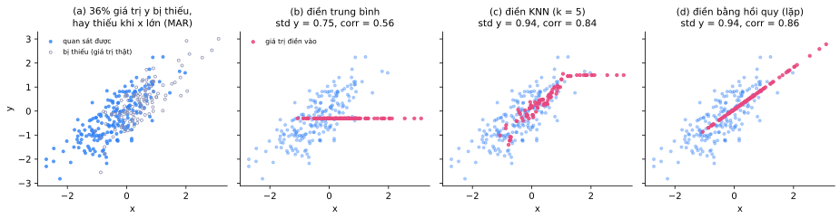
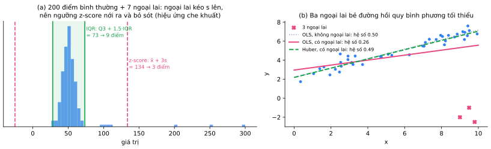
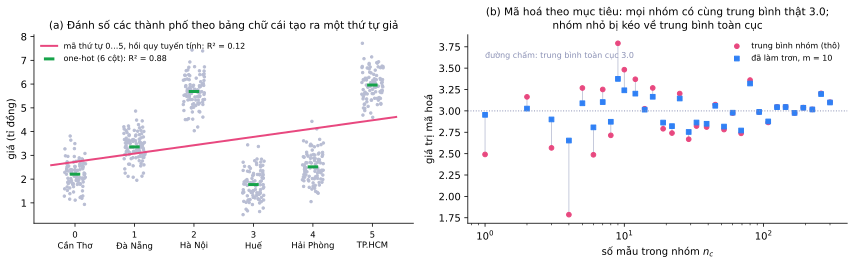
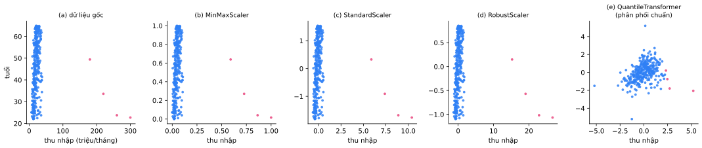
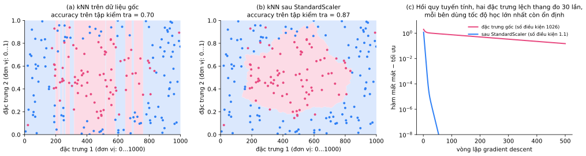
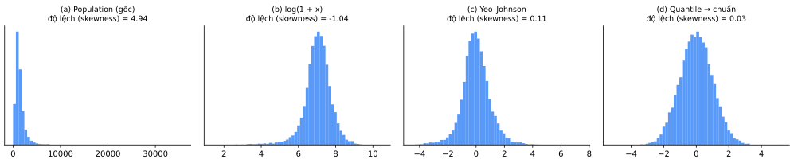
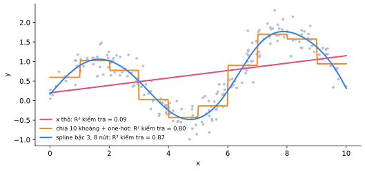
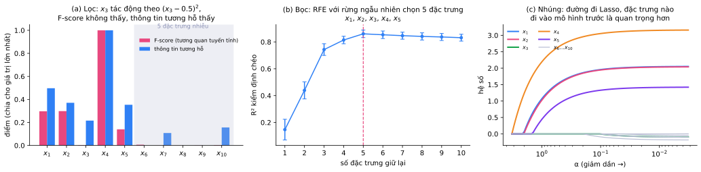
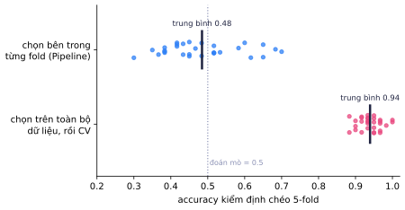
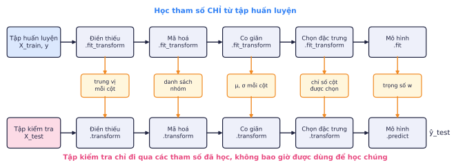

# Data preprocessing

> Ghi chú của người biên soạn: bài này do người biên soạn viết thêm, không có trong sách *Machine Learning cơ bản*. Bài mở rộng [chương 6](ml/ch06_vi) (Feature engineering), nhất là mục 6.5 về chuẩn hoá. Mọi hình trong bài đều vẽ từ số liệu thật bằng script `scripts/ml_extra/prep_figs.py`.

Các chương trước thường bắt đầu với một ma trận $\mathbf{X}$ gọn gàng: mọi phần tử là số thực, không ô nào trống, các cột có thang đo tương đương. Dữ liệu thật hiếm khi như vậy. Một bảng dữ liệu nhà đất có thể có cột diện tích bị bỏ trống, cột "quận" là chữ, cột giá có vài căn biệt thự đắt gấp trăm lần căn hộ bình thường. **Tiền xử lý** là các bước biến bảng dữ liệu thô thành ma trận số mà mô hình dùng được, và làm việc đó **mà không lừa chính mình** khi đánh giá mô hình.

Bài gồm các bước theo thứ tự thường gặp:

- **Khám phá** (D.2): nhìn dữ liệu trước khi làm gì khác.
- **Làm sạch**: điền giá trị thiếu (D.3), xử lý ngoại lai (D.4).
- **Biến đổi**: mã hoá biến phân loại (D.5), co giãn (D.6), sửa phân phối lệch (D.7), tạo đặc trưng mới (D.8).
- **Chọn đặc trưng** (D.9).
- **Ghép tất cả vào một Pipeline** để tránh rò rỉ dữ liệu (D.10). Đây là mục quan trọng nhất của bài.

## D.1 Các kiểu dữ liệu

Cách xử lý một cột phụ thuộc vào **kiểu** của nó. Thang đo cổ điển của Stevens (1946) chia làm bốn loại:

| Kiểu | Ý nghĩa | Ví dụ | Phép toán có nghĩa |
| --- | --- | --- | --- |
| Định danh (nominal) | các nhóm, không có thứ tự | thành phố, màu xe, nghề nghiệp | so sánh bằng, đếm |
| Thứ bậc (ordinal) | các nhóm có thứ tự, khoảng cách không rõ | trình độ học vấn; chất lượng "kém < trung bình < tốt" | so sánh lớn hơn, trung vị |
| Khoảng (interval) | số, hiệu có nghĩa, không có số 0 tuyệt đối | nhiệt độ °C, năm sinh | cộng, trừ, trung bình |
| Tỉ lệ (ratio) | số, có số 0 tuyệt đối | diện tích, thu nhập, tuổi | mọi phép toán, kể cả chia |

Hai kiểu đầu gọi chung là **biến phân loại** (categorical), hai kiểu sau là **biến số** (numerical). Mô hình chỉ làm việc với số, nên biến phân loại phải được **mã hoá** (D.5). Còn biến số thì thường phải được **co giãn** (D.6).

Một cột chứa số chưa chắc là biến số. Mã bưu chính 700000 không "lớn gấp đôi" mã 350000; năm xây nhà là biến khoảng nhưng "năm 2000 chia năm 1000" vô nghĩa. Ngược lại, cột chữ "tốt / khá / kém" thực ra mang thứ tự.

## D.2 Khám phá dữ liệu

Trước khi xử lý, hãy **nhìn** dữ liệu. Danh sách kiểm tra tối thiểu:

1. **Kích thước và kiểu từng cột**: bao nhiêu dòng, cột nào là số, cột nào là chữ, có cột nào kiểu sai (số bị đọc thành chữ vì có dấu phẩy) không.
2. **Phân tích một biến**: với biến số, xem histogram, min, max, trung vị, độ lệch. Với biến phân loại, đếm tần suất từng nhóm; nhóm nào chỉ có vài dòng.
3. **Giá trị thiếu**: tỉ lệ thiếu từng cột. Thiếu có ngẫu nhiên không, hay tập trung ở một nhóm nào đó?
4. **Giá trị bất thường**: tuổi âm, diện tích bằng 0, ngày tháng trong tương lai, giá trị đặc biệt kiểu `-999` hoặc `9999` thay cho "không biết".
5. **Phân tích hai biến**: đồ thị phân tán giữa từng đặc trưng và biến mục tiêu; ma trận tương quan giữa các đặc trưng (heatmap); bảng chéo cho hai biến phân loại.
6. **Trùng lặp**: các dòng giống hệt nhau. Nếu một dòng nằm ở cả tập huấn luyện lẫn tập kiểm tra, điểm kiểm tra sẽ bị thổi phồng.

Mọi quyết định khám phá dữ liệu nên được làm trên **tập huấn luyện**. Tách tập kiểm tra ra trước, rồi để yên đó (lý do ở D.10).

## D.3 Dữ liệu thiếu

### Vì sao dữ liệu bị thiếu

Rubin (1976) phân biệt ba cơ chế. Gọi $x$ là các cột quan sát được và $y$ là cột có ô trống:

- **MCAR** (missing completely at random): việc thiếu hoàn toàn ngẫu nhiên, không liên quan gì đến dữ liệu. Ví dụ: một số phiếu khảo sát bị thất lạc.
- **MAR** (missing at random): việc thiếu phụ thuộc vào các cột **quan sát được** $x$, nhưng không phụ thuộc vào chính giá trị $y$ khi đã biết $x$. Ví dụ: người lớn tuổi hay bỏ trống câu hỏi về mạng xã hội.
- **MNAR** (missing not at random): việc thiếu phụ thuộc vào chính giá trị bị thiếu. Ví dụ: người thu nhập cao hay không khai thu nhập.

Cơ chế quyết định cách xử lý nào là an toàn. Với MCAR, mọi cách đơn giản đều không gây lệch. Với MAR, **bỏ các dòng thiếu sẽ gây lệch**, nhưng điền giá trị dựa trên $x$ thì sửa được. Với MNAR, không phương pháp thuần thống kê nào sửa được hoàn toàn; cần hiểu biết về lĩnh vực.

Có một trường hợp nữa rất hay gặp: **thiếu mang ý nghĩa**. Trong dữ liệu nhà đất, ô "chất lượng hồ bơi" trống vì nhà **không có** hồ bơi. Khi đó không nên "điền" gì cả, mà nên coi "không có" là một nhóm riêng ([Ví dụ áp dụng](ml/prep_app_vi) gặp đúng tình huống này).

### Các cách xử lý

<div align=center></div>
<div align=center>Hình D.1: 300 điểm với tương quan thật 0.81 giữa x và y. 109 giá trị y (36%) bị xoá, với xác suất xoá tăng theo x (MAR). Chấm hồng là giá trị được điền vào.</div>

- **Bỏ dòng thiếu** (complete-case analysis). Đơn giản, nhưng mất dữ liệu, và gây lệch nếu dữ liệu không phải MCAR. Ở Hình D.1, trung bình thật của $y$ là $-0.07$, còn trung bình trên các dòng còn lại là $-0.31$: các dòng có $x$ lớn (nên $y$ lớn) bị bỏ nhiều hơn.
- **Điền trung bình, trung vị hoặc giá trị phổ biến nhất.** Nhanh, nhưng mọi ô trống nhận **cùng một** giá trị. Phương sai bị co lại và quan hệ với các cột khác bị phá vỡ: ở Hình D.1b, độ lệch chuẩn của $y$ giảm từ 0.98 xuống 0.75, tương quan giảm từ 0.81 xuống 0.56. Trung bình vẫn lệch như khi bỏ dòng ($-0.31$), vì ta điền đúng trung bình của các dòng còn lại.
- **Điền bằng K láng giềng gần nhất** (KNN imputation): tìm $K$ dòng giống dòng đang thiếu nhất theo các cột quan sát được, rồi lấy trung bình của chúng. Ở Hình D.1c, tương quan được giữ (0.84) và trung bình gần đúng hơn ($-0.04$). Nhưng KNN không ngoại suy được: với $x > 1$ hầu như mọi láng giềng đều bị thiếu $y$, nên các giá trị điền vào nằm ngang.
- **Điền bằng hồi quy, lặp nhiều vòng** (iterative imputation, còn gọi là MICE): dự đoán mỗi cột thiếu từ các cột khác bằng một mô hình hồi quy, lần lượt qua các cột và lặp vài vòng. Ở Hình D.1d, sai số điền (RMSE so với giá trị thật) là 0.56, nhỏ nhất trong ba cách (KNN 0.65, trung bình 1.12). Nhược điểm là các điểm điền vào nằm **đúng** trên đường hồi quy, nên vẫn thiếu phần nhiễu tự nhiên.

```
Thuật toán D.1: Điền giá trị thiếu bằng K láng giềng gần nhất
Input:  X_train (có ô trống); X cần điền; số láng giềng K
Output: X đã điền

for each dòng i của X, for each cột j bị thiếu ở dòng i do
    # chỉ xét các dòng huấn luyện có giá trị ở cột j
    D ← {r ∈ X_train : x_rj quan sát được}
    for each r ∈ D do
        # khoảng cách trên các cột mà cả i và r đều có
        c ← các cột quan sát được ở cả i và r
        d(i, r) ← sqrt( (số cột / |c|) · Σ_{k ∈ c} (x_ik − x_rk)² )
    N ← K dòng trong D có d(i, r) nhỏ nhất
    x_ij ← trung bình của x_rj, r ∈ N
```

Cách tính khoảng cách này bỏ qua các cột bị thiếu rồi phóng to theo tỉ lệ số cột dùng được. Nó là `nan_euclidean_distances` của scikit-learn. Vì dùng khoảng cách, nên các cột phải được **co giãn** trước (D.6).

**Thêm cột chỉ báo.** Bất kể điền bằng cách nào, có thể thêm một cột nhị phân "ô này từng bị thiếu" (`add_indicator=True`). Nếu việc thiếu mang thông tin (MNAR, hoặc thiếu có ý nghĩa), mô hình sẽ tự học được điều đó.

**Mô hình chấp nhận ô trống.** Một số mô hình cây như `HistGradientBoostingClassifier` của scikit-learn, XGBoost và LightGBM xử lý ô trống trực tiếp: ở mỗi nút, chúng học xem nên đưa các dòng thiếu sang nhánh trái hay phải ([Học tổ hợp](ml/ensemble_vi)).

## D.4 Giá trị ngoại lai

**Ngoại lai** (outlier) là điểm khác xa phần lớn dữ liệu. Nó có thể là **lỗi** (nhập 1700 m² thay vì 170 m²) hoặc là **thật nhưng hiếm** (một biệt thự). Lỗi thì sửa hoặc xoá. Còn điểm thật thì quyết định tuỳ mục đích: nếu mô hình phải dự đoán cả biệt thự, không được xoá chúng.

### Phát hiện ngoại lai

- **Quy tắc z-score**: coi là ngoại lai nếu $|x - \bar x| / s > 3$, với $\bar x, s$ là trung bình và độ lệch chuẩn mẫu.
- **Quy tắc IQR** (Tukey, 1977): với $Q_1, Q_3$ là phân vị 25% và 75%, và $\text{IQR} = Q_3 - Q_1$, coi là ngoại lai nếu nằm ngoài $[Q_1 - 1.5\,\text{IQR},\ Q_3 + 1.5\,\text{IQR}]$. Đây là "râu" của biểu đồ hộp.

<div align=center></div>
<div align=center>Hình D.2: (a) Vùng xanh là khoảng chấp nhận của quy tắc IQR, đường đứt hồng là ngưỡng z-score. (b) Ba ngoại lai ở góc phải dưới kéo lệch đường hồi quy bình phương tối thiểu; hồi quy Huber gần như không bị ảnh hưởng.</div>

Quy tắc z-score có một điểm yếu: chính các ngoại lai làm $\bar x$ và $s$ phình to. Ở Hình D.2a, 7 ngoại lai đẩy độ lệch chuẩn từ 8.0 lên 26.5, nên ngưỡng $\bar x + 3s$ lên tới 134 và chỉ bắt được 3 trong 7 ngoại lai. Đây là **hiệu ứng che khuất** (masking). Quy tắc IQR dùng phân vị, thứ gần như không bị ngoại lai ảnh hưởng, nên bắt được cả 7. Cái giá là nó cũng gắn cờ 2 điểm bình thường ở đuôi phân phối. Một cách bền vững khác là thay $\bar x, s$ bằng trung vị và **MAD** (trung vị của $|x_i - \text{trung vị}|$).

Với dữ liệu nhiều chiều, một điểm có thể bình thường ở từng cột nhưng bất thường khi xét kết hợp (cao 1.9 m và nặng 45 kg). Khi đó cần các phương pháp như Isolation Forest hay Local Outlier Factor, hoặc DBSCAN ([Phân cụm nâng cao](ml/cluster_vi), các điểm nhiễu).

### Xử lý ngoại lai

- **Xoá**, nếu chắc chắn là lỗi.
- **Cắt ngưỡng** (clipping, winsorizing): thay các giá trị vượt phân vị 1% và 99% bằng chính hai phân vị đó.
- **Biến đổi** để thu hẹp đuôi phân phối, ví dụ lấy log (D.7).
- **Dùng mô hình bền vững** (robust) thay vì sửa dữ liệu. Bình phương tối thiểu phạt sai số theo bình phương, nên một điểm xa có tiếng nói rất lớn: ở Hình D.2b, 3 ngoại lai kéo hệ số góc từ 0.50 xuống 0.26. Hàm mất mát **Huber** chỉ phạt bình phương khi sai số nhỏ, và phạt tuyến tính khi sai số lớn, nên cho hệ số 0.49. Mô hình cây cũng ít nhạy với ngoại lai ở **đặc trưng**, vì chúng chỉ quan tâm thứ tự các giá trị.

## D.5 Mã hoá biến phân loại

### Mã hoá thứ tự và one-hot

Cách đơn giản nhất là đánh số các nhóm: Cần Thơ → 0, Đà Nẵng → 1, …. Đây là **mã hoá thứ tự** (ordinal encoding). Nó đúng khi biến **thật sự** có thứ tự (kém < khá < tốt), nhưng sai với biến định danh: mô hình tuyến tính sẽ hiểu rằng "TP.HCM" (mã 5) bằng 5 lần "Đà Nẵng" (mã 1).

<div align=center></div>
<div align=center>Hình D.3: (a) Giá nhà ở 6 thành phố. Một đường thẳng theo mã 0…5 không thể đi qua các mức giá lên xuống. (b) Mã hoá theo mục tiêu với 40 nhóm có số mẫu từ 1 đến 300; mọi nhóm có cùng trung bình thật.</div>

**Mã hoá one-hot** thay một cột có $C$ nhóm bằng $C$ cột nhị phân; cột thứ $c$ bằng 1 khi dòng thuộc nhóm $c$. Không còn thứ tự giả, và mô hình tuyến tính học được một hệ số riêng cho mỗi nhóm. Ở Hình D.3a, $R^2$ tăng từ 0.12 (mã thứ tự) lên 0.88 (one-hot).

Vài lưu ý khi dùng one-hot:

- **Bẫy biến giả** (dummy variable trap): tổng $C$ cột one-hot luôn bằng 1, trùng với cột hệ số chặn, nên ma trận $\mathbf{X}^T\mathbf{X}$ suy biến. Với hồi quy tuyến tính không chính quy hoá, bỏ một cột (`drop="first"`). Có chính quy hoá ($\ell_2$) thì không cần.
- **Nhóm mới lúc dự đoán**: tập kiểm tra có thể chứa nhóm chưa từng gặp. `handle_unknown="ignore"` cho dòng đó toàn số 0.
- **Nhóm hiếm**: gộp các nhóm có ít hơn vài chục dòng thành một nhóm "khác" (`min_frequency`).
- **Quá nhiều nhóm** (high cardinality, ví dụ mã sản phẩm có hàng chục nghìn giá trị): one-hot tạo ra quá nhiều cột. Khi đó dùng mã hoá theo mục tiêu, hoặc **hashing** (băm tên nhóm vào một số cố định cột, chấp nhận va chạm).

Với mô hình **cây**, mã hoá thứ tự thường đủ tốt ngay cả cho biến định danh: cây có thể dùng nhiều lần chia để cô lập từng nhóm.

### Mã hoá theo mục tiêu

**Mã hoá theo mục tiêu** (target encoding) thay mỗi nhóm bằng **trung bình của biến mục tiêu** trong nhóm đó, ví dụ "TP.HCM" → giá nhà trung bình ở TP.HCM. Một cột duy nhất thay cho $C$ cột. Có hai vấn đề:

1. **Nhóm nhỏ thì trung bình nhiễu.** Một nhóm chỉ có 1 dòng sẽ được mã bằng đúng giá trị mục tiêu của dòng đó. Ta **làm trơn** bằng cách kéo trung bình nhóm về trung bình toàn cục $\bar y$:
$$
\text{enc}(c) = \frac{n_c\,\bar y_c + m\,\bar y}{n_c + m},
$$
với $n_c$ là số dòng của nhóm, $\bar y_c$ là trung bình mục tiêu trong nhóm, và $m$ là độ mạnh làm trơn. Nhóm có $n_c \gg m$ gần như giữ nguyên trung bình của mình; nhóm có $n_c \ll m$ gần như nhận $\bar y$. Ở Hình D.3b, trung bình thô của một nhóm 4 dòng lệch 1.21 so với giá trị thật; sau làm trơn với $m = 10$, độ lệch lớn nhất chỉ còn 0.37. Đây chính là ước lượng Bayes của trung bình nhóm, với tiên nghiệm có tâm ở $\bar y$.
2. **Rò rỉ mục tiêu.** Nếu mã hoá dòng $i$ bằng một trung bình **có chứa chính $y_i$**, cột mã hoá đã "nhìn thấy" đáp án. Mô hình sẽ dựa vào cột này quá nhiều, và trên tập kiểm tra thì sụp đổ. Cách sửa là **mã hoá chéo** (cross-fitting): chia tập huấn luyện thành $k$ phần; mã hoá mỗi phần bằng thống kê tính từ $k-1$ phần còn lại.

```
Thuật toán D.2: Mã hoá theo mục tiêu có làm trơn và mã hoá chéo
Input:  cột phân loại c_1, …, c_N; mục tiêu y_1, …, y_N; độ mạnh làm trơn m; số phần k
Output: cột mã hoá z cho tập huấn luyện; bảng mã enc dùng cho dữ liệu mới

function fit_enc(I)                                  # I: tập chỉ số các dòng
    ȳ ← trung bình y_i, i ∈ I
    for each nhóm g do
        n_g ← |{i ∈ I : c_i = g}|
        ȳ_g ← trung bình y_i, i ∈ I và c_i = g
        enc[g] ← (n_g·ȳ_g + m·ȳ) / (n_g + m)
    enc[nhóm chưa gặp] ← ȳ
    return enc

chia {1, …, N} thành k phần F_1, …, F_k
for j = 1 to k do
    enc_j ← fit_enc({1, …, N} \ F_j)                 # không dùng phần F_j
    for each i ∈ F_j do
        z_i ← enc_j[c_i]
enc ← fit_enc({1, …, N})                             # dùng cho tập kiểm tra
```

scikit-learn có `TargetEncoder` (từ phiên bản 1.3) làm đúng như vậy: `fit_transform` trên tập huấn luyện dùng mã hoá chéo, còn `transform` trên dữ liệu mới dùng bảng mã học từ toàn bộ tập huấn luyện.

## D.6 Co giãn đặc trưng

### Các phép co giãn

Mục [6.5](ml/ch06_vi) đã giới thiệu ba phép chuẩn hoá. Viết lại cùng hai phép bền vững với ngoại lai, cho một cột $x$:

| Phép biến đổi | Công thức | scikit-learn |
| --- | --- | --- |
| Đưa về $[0, 1]$ | $x' = \dfrac{x - \min x}{\max x - \min x}$ | `MinMaxScaler` |
| Chuẩn hoá (z-score) | $x' = \dfrac{x - \bar x}{s}$ | `StandardScaler` |
| Co giãn bền vững | $x' = \dfrac{x - \text{trung vị}}{Q_3 - Q_1}$ | `RobustScaler` |
| Về cùng norm (theo **dòng**) | $\mathbf{x}' = \mathbf{x} / \|\mathbf{x}\|_2$ | `Normalizer` |
| Theo phân vị | $x' = \Phi^{-1}(\hat F(x))$, với $\hat F$ là hàm phân phối thực nghiệm | `QuantileTransformer` |

Mọi đại lượng $\min, \max, \bar x, s$, trung vị, phân vị đều được tính **trên tập huấn luyện**, rồi dùng nguyên cho tập kiểm tra.

<div align=center></div>
<div align=center>Hình D.4: 300 người với thu nhập (lệch phải, có 4 người thu nhập rất cao, màu hồng) và tuổi. Hình dạng đám mây điểm không đổi qua ba phép tuyến tính (b–d), chỉ có thang đo thay đổi.</div>

Ba phép (b), (c), (d) đều là biến đổi tuyến tính, chỉ khác nhau ở cách chọn "tâm" và "độ rộng". Khác biệt nằm ở **ngoại lai**:

- **MinMaxScaler** dùng min và max, chính là các ngoại lai. 296 người bình thường bị dồn vào đoạn $[0, 0.11]$, trong khi cột tuổi trải đều trên $[0, 1]$.
- **StandardScaler** dùng $\bar x$ và $s$, cả hai đều bị ngoại lai kéo. 296 người bình thường nằm trong đoạn rộng 1.18.
- **RobustScaler** dùng trung vị và IQR, gần như không bị ngoại lai ảnh hưởng: đoạn rộng 2.99. Ngoại lai vẫn còn đó (lên tới 26.7), nhưng phần lớn dữ liệu có thang đo hợp lý.
- **QuantileTransformer** là phép **phi tuyến**: nó biến mỗi cột thành phân phối chuẩn, kéo ngoại lai về gần phần còn lại. Cái giá là khoảng cách giữa các điểm bị bóp méo.

### Mô hình nào cần co giãn

<div align=center></div>
<div align=center>Hình D.5: (a, b) Nhãn phụ thuộc cả hai đặc trưng (một hình tròn), nhưng đặc trưng 1 được đo bằng đơn vị lớn gấp 1000 lần. (c) Gradient descent cho hồi quy tuyến tính, trục tung theo thang log.</div>

- **Mô hình dựa trên khoảng cách** (kNN, K-means, SVM với kernel RBF, PCA): khoảng cách Euclid bị cột có thang đo lớn chi phối. Ở Hình D.5a, kNN gần như chỉ nhìn đặc trưng 1, nên ranh giới là các dải dọc, và accuracy chỉ 0.70. Sau `StandardScaler`, kNN thấy được hình tròn và đạt 0.87.
- **Mô hình học bằng gradient descent** (hồi quy tuyến tính và logistic, mạng nơ-ron): thang đo lệch nhau làm các đường mức của hàm mất mát thành elip rất dẹt ([chương 12](ml/ch12_vi), Gradient descent). Tốc độ học phải đủ nhỏ cho chiều dốc nhất, nên chiều thoải nhất đi rất chậm. Số vòng lặp tỉ lệ với **số điều kiện** $\kappa = \lambda_{\max} / \lambda_{\min}$ của ma trận $\frac{1}{N}\mathbf{X}^T\mathbf{X}$. Ở Hình D.5c, $\kappa$ = 1026 trên dữ liệu gốc và 1.1 sau co giãn. Với dữ liệu đã co giãn, GD đạt sai số 0.1% sau 19 vòng; với dữ liệu gốc, sau 500 vòng vẫn chưa tới.
- **Mô hình có chính quy hoá** (ridge, Lasso): mức phạt $\lambda\|\mathbf{w}\|$ phụ thuộc thang đo của từng hệ số. Không co giãn thì một cột đo bằng mét bị phạt khác một cột đo bằng milimét.
- **Mô hình cây** (cây quyết định, rừng ngẫu nhiên, gradient boosting) **không cần** co giãn: phép chia $x_j \le t$ chỉ phụ thuộc thứ tự các giá trị, và mọi phép co giãn đơn điệu đều giữ nguyên thứ tự.

## D.7 Biến đổi phân phối lệch

Nhiều biến số trong thực tế **lệch phải**: thu nhập, giá nhà, dân số, số lượt xem. Phần lớn giá trị nhỏ, một ít giá trị rất lớn. Với mô hình tuyến tính, biến lệch gây hai vấn đề. Thứ nhất, vài điểm ở đuôi có ảnh hưởng quá lớn (như ngoại lai). Thứ hai, quan hệ với mục tiêu thường **theo tỉ lệ** (tăng 10% dân số) chứ không theo hiệu (tăng 100 người).

- **Logarit** $x' = \log(1 + x)$ cho $x \ge 0$. Đơn giản và dễ diễn giải: hiệu trong thang log là tỉ lệ trong thang gốc.
- **Box–Cox** (cho $x > 0$) và **Yeo–Johnson** (cho mọi $x$) là các họ biến đổi lũy thừa có tham số $\lambda$. Với $x \ge 0$, Yeo–Johnson là
$$
x' = \begin{cases} \dfrac{(x + 1)^\lambda - 1}{\lambda} & \lambda \ne 0, \\[2mm] \log(x + 1) & \lambda = 0. \end{cases}
$$
$\lambda = 1$ không đổi gì, $\lambda = 0$ là logarit, $\lambda$ ở giữa là "nửa log". Tham số $\lambda$ được chọn bằng hợp lý cực đại, sao cho kết quả gần phân phối chuẩn nhất.
- **Biến đổi phân vị** (D.6) cho kết quả chuẩn nhất, nhưng không giữ khoảng cách tương đối.

<div align=center></div>
<div align=center>Hình D.6: Cột dân số của 20 640 khu dân cư California, từ 3 đến 35 682 người, trung vị 1166. Độ lệch 0 nghĩa là phân phối đối xứng.</div>

Ở Hình D.6, độ lệch giảm từ 4.94 xuống $-1.04$ sau khi lấy log: log hơi "quá tay", làm phân phối lệch trái. Yeo–Johnson chọn $\lambda = 0.23$, nằm giữa log và không biến đổi, cho độ lệch 0.11.

**Biến đổi biến mục tiêu.** Với bài toán hồi quy có mục tiêu lệch (giá nhà), thường huấn luyện trên $\log y$ rồi lấy $e^{\hat y}$ khi dự đoán. Sai số trên thang log là sai số **tương đối**: đoán lệch 10% một căn 1 tỉ và một căn 10 tỉ bị phạt như nhau. `TransformedTargetRegressor` của scikit-learn làm việc này tự động.

## D.8 Tạo đặc trưng

Mô hình tuyến tính chỉ học được quan hệ tuyến tính **với các đặc trưng nó được cho**. Để nó học được quan hệ phi tuyến, ta đưa cho nó các đặc trưng phi tuyến của $x$. Đây cũng là ý tưởng của mạng nơ-ron và kernel, chỉ khác là ở đây ta tự chọn các đặc trưng.

<div align=center></div>
<div align=center>Hình D.7: Cùng một mô hình hồi quy tuyến tính, ba bộ đặc trưng khác nhau. R² đo trên 2000 điểm kiểm tra.</div>

- **Rời rạc hoá** (binning, `KBinsDiscretizer`): chia trục $x$ thành các khoảng, rồi mã hoá one-hot. Mô hình tuyến tính trên các cột này là một **hàm bậc thang**: mỗi khoảng một hằng số. Ở Hình D.7, $R^2$ tăng từ 0.09 lên 0.80.
- **Spline** (`SplineTransformer`): thay các bậc thang bằng các đa thức bậc thấp nối trơn với nhau tại các nút. $R^2$ lên 0.87.
- **Đa thức và tương tác** (`PolynomialFeatures`): thêm $x_1^2$, $x_1 x_2$, …. Tích $x_1 x_2$ cho phép tác động của $x_1$ thay đổi theo $x_2$. Với biến phân loại, tương tác là **ghép nhóm** (feature crossing): "quận × loại nhà".
- **Tách thông tin có sẵn**: ngày tháng thành năm, tháng, thứ trong tuần, ngày lễ; địa chỉ thành quận; email thành tên miền. Với các đại lượng tuần hoàn như giờ trong ngày, dùng $(\sin(2\pi h / 24), \cos(2\pi h / 24))$ để 23 giờ và 0 giờ nằm cạnh nhau.
- **Tỉ số và hiệu** dựa trên hiểu biết lĩnh vực: giá trên mét vuông, tuổi nhà = năm bán − năm xây, số phòng trên số người.

Tạo đặc trưng tốt thường cải thiện mô hình nhiều hơn đổi thuật toán. Nhưng mỗi đặc trưng mới cũng là một cơ hội để quá khớp, nên cần đánh giá bằng kiểm định chéo.

## D.9 Chọn đặc trưng

Nhiều đặc trưng hơn không phải lúc nào cũng tốt hơn. Đặc trưng nhiễu làm mô hình dễ quá khớp, tốn thời gian huấn luyện, và khó diễn giải. **Chọn đặc trưng** giữ lại một tập con các cột. Khác với giảm chiều ([PCA, chương 21](ml/ch21_vi)), các cột được giữ nguyên nghĩa. Có ba họ phương pháp:

- **Lọc** (filter): chấm điểm từng đặc trưng **độc lập với mô hình**, rồi giữ $k$ đặc trưng điểm cao nhất. Nhanh, nhưng không thấy tương tác giữa các đặc trưng. Các điểm thông dụng:
  - **F-score** (ANOVA, `f_regression`, `f_classif`): đo quan hệ **tuyến tính** với mục tiêu.
  - **Chi bình phương** (`chi2`): cho đặc trưng không âm (đếm, one-hot) và mục tiêu phân loại.
  - **Thông tin tương hỗ** (mutual information, `mutual_info_regression`): đo mọi kiểu phụ thuộc, kể cả phi tuyến, bằng cách ước lượng $I(X; Y) = H(Y) - H(Y \mid X)$ qua láng giềng gần nhất.
- **Bọc** (wrapper): huấn luyện mô hình trên nhiều tập con và giữ tập con có điểm kiểm định chéo tốt nhất. Chọn tiến (forward selection) thêm dần từng đặc trưng; loại lùi (backward elimination) bỏ dần. **RFE** (recursive feature elimination) bỏ dần đặc trưng có độ quan trọng thấp nhất theo chính mô hình. Chính xác hơn lọc nhưng tốn hơn nhiều.
- **Nhúng** (embedded): việc chọn xảy ra **ngay trong lúc huấn luyện**. Lasso ($\ell_1$) đẩy hệ số của đặc trưng không cần thiết về đúng 0. Độ quan trọng đặc trưng của cây cũng thuộc loại này.

```
Thuật toán D.3: Loại đặc trưng đệ quy với kiểm định chéo (RFECV)
Input:  X (d cột), y; mô hình f có độ quan trọng đặc trưng; số fold k
Output: tập đặc trưng S*

for each fold (train, val) do
    S ← {1, …, d}
    while S không rỗng do
        huấn luyện f trên các cột S của train
        score[fold, |S|] ← điểm của f trên các cột S của val
        j ← đặc trưng có độ quan trọng nhỏ nhất trong S
        S ← S \ {j}
p* ← argmax_p  trung bình theo fold của score[·, p]
chạy lại vòng while trên toàn bộ dữ liệu, dừng khi |S| = p*;  S* ← S
```

<div align=center></div>
<div align=center>Hình D.8: Dữ liệu Friedman #1, 800 mẫu: $y = 10\sin(\pi x_1 x_2) + 20(x_3 - 0.5)^2 + 10x_4 + 5x_5 + \varepsilon$, cộng thêm 5 đặc trưng nhiễu $x_6, \dots, x_{10}$. Mọi $x_j$ phân phối đều trên $[0, 1]$.</div>

Hình D.8 cho thấy điểm mạnh và yếu của từng họ:

- **(a)** $x_3$ ảnh hưởng tới $y$ theo hình chữ U quanh 0.5, nên **tương quan tuyến tính** gần như bằng 0: F-score của $x_3$ chỉ là 1.3, thua cả đặc trưng nhiễu $x_6$ (3.3). Thông tin tương hỗ của $x_3$ là 0.058, cao hơn mọi đặc trưng nhiễu (lớn nhất 0.042).
- **(b)** RFE với rừng ngẫu nhiên tìm đúng 5 đặc trưng có ích. $R^2$ kiểm định chéo đạt 0.86 với 5 đặc trưng, rồi giảm nhẹ khi thêm nhiễu (0.83 với cả 10).
- **(c)** Lasso là mô hình tuyến tính, nên nó cũng "mù" với $x_3$ như F-score: hệ số của $x_3$ chỉ là $-0.09$ ngay cả khi α nhỏ nhất, cỡ như các đặc trưng nhiễu. Các đặc trưng $x_4$, $x_1$, $x_2$, $x_5$ đi vào mô hình trước tiên.

Bài học: phương pháp chọn đặc trưng mang theo giả định của mô hình mà nó dựa vào. Một đặc trưng bị loại bởi bộ lọc tuyến tính vẫn có thể rất có ích cho một mô hình phi tuyến.

## D.10 Rò rỉ dữ liệu và Pipeline

### Rò rỉ dữ liệu

**Rò rỉ dữ liệu** (data leakage) xảy ra khi thông tin mà mô hình **không thể có lúc dự đoán thật** lọt vào quá trình huấn luyện. Kết quả là điểm kiểm tra đẹp, còn mô hình triển khai thì kém. Có ba dạng thường gặp:

1. **Tiền xử lý trên toàn bộ dữ liệu trước khi chia.** Tính trung bình để điền giá trị thiếu, $\bar x, s$ để co giãn, hay chọn đặc trưng trên **cả** tập kiểm tra, rồi mới chia train/test hoặc kiểm định chéo. Tập kiểm tra đã góp phần quyết định cách biến đổi dữ liệu.
2. **Rò rỉ mục tiêu** (target leakage): một đặc trưng được ghi nhận **sau** khi biết kết quả. Ví dụ: dự đoán bệnh nhân có bị viêm phổi không, với một cột "đã dùng kháng sinh". Cột này dự đoán rất tốt, nhưng lúc cần dự đoán thì chưa có. Mã hoá theo mục tiêu không làm chéo (D.5) cũng là một dạng rò rỉ mục tiêu.
3. **Chia sai cấu trúc dữ liệu.** Với chuỗi thời gian, chia ngẫu nhiên cho mô hình "nhìn thấy tương lai"; phải chia theo thời gian. Với dữ liệu có nhóm (nhiều ảnh của cùng một bệnh nhân), cùng một nhóm không được nằm ở cả hai phía (`GroupKFold`).

Dạng 1 nghe có vẻ vô hại với các phép đơn giản như co giãn, và thường đúng là chênh lệch nhỏ. Nhưng với **chọn đặc trưng**, nó có thể biến một mô hình vô dụng thành một mô hình "xuất sắc":

<div align=center></div>
<div align=center>Hình D.9: 60 mẫu, 5000 đặc trưng ngẫu nhiên, nhãn gán ngẫu nhiên: không có gì để học, accuracy thật là 0.5. Chọn 20 đặc trưng tương quan với nhãn nhất bằng F-score, rồi hồi quy logistic. Mỗi chấm là một lần lặp với dữ liệu khác nhau (30 lần).</div>

Khi chọn đặc trưng trên **toàn bộ** 60 mẫu rồi mới kiểm định chéo, accuracy trung bình là 0.94. Trong 5000 cột ngẫu nhiên, luôn có vài chục cột tình cờ tương quan với nhãn trên **chính 60 mẫu này**, kể cả các mẫu sẽ làm fold kiểm định. Khi đặt bước chọn **bên trong** mỗi fold, accuracy là 0.48, đúng với sự thật là không học được gì. Ví dụ này phỏng theo mục 7.10.2 của *The Elements of Statistical Learning* (Hastie, Tibshirani và Friedman), nơi các tác giả gọi đây là cách làm kiểm định chéo **sai** và nói rằng nó từng xuất hiện trong nhiều bài báo khoa học.

### Pipeline

Nguyên tắc rất đơn giản: **mọi bước có học tham số từ dữ liệu đều là một phần của mô hình**. Trung vị để điền giá trị thiếu, danh sách nhóm của one-hot, $\bar x, s$ của phép co giãn, tập đặc trưng được chọn: tất cả được học từ tập huấn luyện, giống như trọng số $\mathbf{w}$.

<div align=center></div>
<div align=center>Hình D.10: Mỗi bước có hai thao tác. <code>fit</code> học tham số từ tập huấn luyện (ô vàng). <code>transform</code> áp dụng tham số đã học lên bất kỳ dữ liệu nào.</div>

```
Thuật toán D.4: Kiểm định chéo cho mô hình có tiền xử lý
Input:  X, y; các bước T_1, …, T_m (mỗi bước có fit, transform); mô hình f; số fold k
Output: điểm kiểm định chéo

for each fold (train, val) do
    Z_tr ← X[train];  Z_val ← X[val]
    for t = 1 to m do
        T_t.fit(Z_tr, y[train])                       # học tham số CHỈ từ train
        Z_tr ← T_t.transform(Z_tr)
        Z_val ← T_t.transform(Z_val)                  # áp tham số đã học lên val
    f.fit(Z_tr, y[train])
    score[fold] ← điểm của f.predict(Z_val) so với y[val]
return trung bình của score
```

Viết tay thuật toán D.4 dễ sai. Trong scikit-learn, `Pipeline` gói các bước và mô hình thành **một** đối tượng có `fit` và `predict`. Truyền đối tượng đó vào `cross_val_score` hay `GridSearchCV`, thư viện sẽ tự làm đúng thuật toán D.4. `ColumnTransformer` cho phép mỗi nhóm cột đi một nhánh riêng: cột số thì điền trung vị rồi co giãn, cột phân loại thì điền "thiếu" rồi one-hot. [Dùng thư viện](ml/prep_lib_vi) và [Ví dụ áp dụng](ml/prep_app_vi) dùng cả hai.

Lợi ích thêm của Pipeline là lúc triển khai, chỉ cần lưu **một** đối tượng. Dữ liệu mới đi qua đúng các bước, với đúng các tham số đã học lúc huấn luyện.

---

**Học tiếp:** [Code từ đầu](ml/prep_code_vi) tự viết các bộ điền giá trị thiếu, mã hoá, co giãn, Yeo–Johnson, RFE và một Pipeline nhỏ · [Dùng thư viện](ml/prep_lib_vi) dùng `SimpleImputer`, `KNNImputer`, `OneHotEncoder`, `TargetEncoder`, `PowerTransformer`, `ColumnTransformer`, `Pipeline` · [Ví dụ áp dụng](ml/prep_app_vi) xây quy trình tiền xử lý đầy đủ để dự đoán giá nhà Ames (Iowa) · [Mô phỏng](ml/prep_viz_vi) kéo ngoại lai và xem các bộ co giãn, kNN và cách điền giá trị thiếu thay đổi theo.
