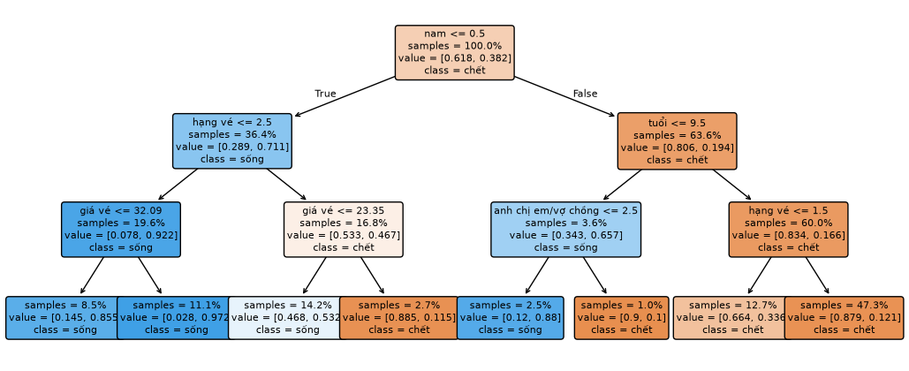

# Decision trees · Ví dụ áp dụng: ai sống sót trên tàu Titanic

> Ghi chú của người biên soạn: trang này do người biên soạn viết thêm. Dữ liệu là danh sách 1309 hành khách tàu Titanic (chuyến đi năm 1912), do Thomas Cason biên soạn từ *Encyclopedia Titanica*, tải từ [OpenML](https://www.openml.org/d/40945).

## Bài toán

Mỗi hành khách có hạng vé, giới tính, tuổi, số người thân đi cùng, giá vé và cảng lên tàu. Ta muốn dự đoán người đó có sống sót hay không, và quan trọng hơn: **hiểu** những yếu tố nào quyết định. Đây là đất diễn của cây quyết định: một cây nông có thể đọc như một bộ quy tắc.

Trang này cũng cho thấy một cái bẫy thật trong bộ dữ liệu: hai cột tiết lộ trước đáp án.

## 1. Dữ liệu

<!-- run -->
```python
import numpy as np
import pandas as pd
import matplotlib.pyplot as plt
from sklearn.datasets import fetch_openml
from sklearn.model_selection import train_test_split

raw = fetch_openml("titanic", version=1, as_frame=True).frame
y = raw["survived"].astype(int).to_numpy()
X = pd.DataFrame({
    "hạng vé": raw["pclass"].astype(float),
    "nam": (raw["sex"] == "male").astype(float),
    "tuổi": raw["age"].astype(float),
    "anh chị em/vợ chồng": raw["sibsp"].astype(float),
    "cha mẹ/con": raw["parch"].astype(float),
    "giá vé": raw["fare"].astype(float),
    "lên ở Cherbourg": (raw["embarked"] == "C").astype(float),
    "lên ở Queenstown": (raw["embarked"] == "Q").astype(float),
})
print("số hành khách:", len(y), "  tỉ lệ sống sót:", round(y.mean(), 3))
print("số giá trị thiếu:", X.isna().sum()[X.isna().sum() > 0].to_dict())
print("\ntỉ lệ sống sót theo giới tính và hạng vé:")
print(pd.crosstab([raw["sex"]], raw["pclass"], values=y, aggfunc="mean").round(2))

X_tr, X_te, y_tr, y_te = train_test_split(X, y, test_size=0.25, stratify=y, random_state=0)
```

<!-- output -->
```output
số hành khách: 1309   tỉ lệ sống sót: 0.382
số giá trị thiếu: {'tuổi': 263, 'giá vé': 1}

tỉ lệ sống sót theo giới tính và hạng vé:
pclass     1     2     3
sex                     
female  0.97  0.89  0.49
male    0.34  0.15  0.15
```
<!-- /output -->

Chỉ hai cột giới tính và hạng vé đã kể gần hết câu chuyện. Phụ nữ hạng nhất sống sót 97%, đàn ông hạng hai và ba chỉ 15%. Đây là quy tắc "phụ nữ và trẻ em lên xuồng trước", cộng với việc khoang hạng ba nằm sâu dưới tàu.

Từ phiên bản 1.3, cây quyết định của scikit-learn **tự xử lý giá trị thiếu**. Ở mỗi phép chia, các điểm thiếu giá trị được thử đưa sang nhánh trái rồi nhánh phải, và chọn bên cho độ lợi lớn hơn. Ta để nguyên `NaN` trong cột tuổi.

## 2. Chọn độ sâu và so với các mốc khác

<small class="viz-ref">Mục C.7</small>

<!-- run -->
```python
from sklearn.tree import DecisionTreeClassifier
from sklearn.model_selection import cross_val_score, StratifiedKFold
from sklearn.dummy import DummyClassifier
from sklearn.linear_model import LogisticRegression
from sklearn.pipeline import make_pipeline
from sklearn.impute import SimpleImputer
from sklearn.preprocessing import StandardScaler

cv = StratifiedKFold(10, shuffle=True, random_state=0)
print(f"mốc 'luôn đoán chết'  : {cross_val_score(DummyClassifier(), X_tr, y_tr, cv=cv).mean():.3f}")
print(f"mốc 'nữ sống, nam chết': {np.mean((X_tr['nam'] == 0) == y_tr):.3f}")
logit = make_pipeline(SimpleImputer(strategy="median"), StandardScaler(), LogisticRegression())
print(f"hồi quy logistic       : {cross_val_score(logit, X_tr, y_tr, cv=cv).mean():.3f}\n")

scores = {}
for d in [1, 2, 3, 4, 5, 6, 8, 10, None]:
    s = cross_val_score(DecisionTreeClassifier(max_depth=d, random_state=0), X_tr, y_tr, cv=cv)
    scores[d] = s
    print(f"cây max_depth={str(d):>4}: {s.mean():.3f} ± {s.std():.3f}")
```

<!-- output -->
```output
mốc 'luôn đoán chết'  : 0.618
mốc 'nữ sống, nam chết': 0.772
hồi quy logistic       : 0.777

cây max_depth=   1: 0.772 ± 0.043
cây max_depth=   2: 0.791 ± 0.024
cây max_depth=   3: 0.809 ± 0.039
cây max_depth=   4: 0.807 ± 0.042
cây max_depth=   5: 0.803 ± 0.037
cây max_depth=   6: 0.796 ± 0.041
cây max_depth=   8: 0.784 ± 0.027
cây max_depth=  10: 0.770 ± 0.036
cây max_depth=None: 0.770 ± 0.034
```
<!-- /output -->

- Quy tắc một dòng "nữ sống, nam chết" đã đạt 0.772, ngang hồi quy logistic (0.777). Đó là mốc thực sự cần vượt, chứ không phải 0.618.
- Cây độ sâu 3 tốt nhất (0.809). Cây không giới hạn tụt về 0.770, không hơn quy tắc một dòng: nó học thuộc từng hành khách.

## 3. Một cây đọc được

<small class="viz-ref">Mục C.1, C.8</small>

Ta lấy cây độ sâu 3: đủ nông để đọc, và (như ở trên) không thua cây sâu hơn bao nhiêu.

<!-- run -->
```python
from sklearn.tree import plot_tree, export_text

tree3 = DecisionTreeClassifier(max_depth=3, random_state=0).fit(X_tr, y_tr)
fig, ax = plt.subplots(figsize=(13, 5.2))
plot_tree(tree3, feature_names=list(X.columns), class_names=["chết", "sống"], filled=True, rounded=True,
          impurity=False, proportion=True, fontsize=8, ax=ax)
print(export_text(tree3, feature_names=list(X.columns), show_weights=True))
```

<!-- output -->
```output
|--- nam <= 0.50
|   |--- hạng vé <= 2.50
|   |   |--- giá vé <= 32.09
|   |   |   |--- weights: [12.00, 71.00] class: 1
|   |   |--- giá vé >  32.09
|   |   |   |--- weights: [3.00, 106.00] class: 1
|   |--- hạng vé >  2.50
|   |   |--- giá vé <= 23.35
|   |   |   |--- weights: [65.00, 74.00] class: 1
|   |   |--- giá vé >  23.35
|   |   |   |--- weights: [23.00, 3.00] class: 0
|--- nam >  0.50
|   |--- tuổi <= 9.50
|   |   |--- anh chị em/vợ chồng <= 2.50
|   |   |   |--- weights: [3.00, 22.00] class: 1
|   |   |--- anh chị em/vợ chồng >  2.50
|   |   |   |--- weights: [9.00, 1.00] class: 0
|   |--- tuổi >  9.50
|   |   |--- hạng vé <= 1.50
|   |   |   |--- weights: [83.00, 42.00] class: 0
|   |   |--- hạng vé >  1.50
|   |   |   |--- weights: [408.00, 56.00] class: 0
```

<div align=center></div>
<!-- /output -->

Đọc cây từ trên xuống, ta có một bộ quy tắc rất giống những gì sử sách ghi lại:

- **Phụ nữ hạng 1–2**: sống, 177 trên 192 người trong tập huấn luyện.
- **Phụ nữ hạng 3**: khó đoán hơn. Vé rẻ (≤ 23.35) thì khoảng một nửa sống. Vé đắt hơn, thường là gia đình đông người đi chung, thì 23 trên 26 người chết.
- **Bé trai dưới 9.5 tuổi**: sống, nếu đi cùng ít hơn 3 anh chị em. Gia đình đông con thì gần như không ai sống.
- **Đàn ông trưởng thành**: chết. Ở hạng 1 vẫn có 1/3 sống sót, ở hạng 2–3 chỉ 12%.

## 4. Kết quả trên tập kiểm tra

<small class="viz-ref">Mục E.2–E.4</small>

<!-- run -->
```python
from sklearn import metrics as M

deep = DecisionTreeClassifier(random_state=0).fit(X_tr, y_tr)
logit.fit(X_tr, y_tr)
for name, m in [("cây độ sâu 3", tree3), ("cây không giới hạn", deep), ("hồi quy logistic", logit)]:
    p = m.predict(X_te)
    extra = f"   ({m.get_n_leaves()} lá)" if hasattr(m, "get_n_leaves") else ""
    print(f"{name:<20} accuracy {M.accuracy_score(y_te, p):.3f}   recall(sống) {M.recall_score(y_te, p):.3f}"
          f"   precision(sống) {M.precision_score(y_te, p):.3f}{extra}")
print("\nđộ quan trọng (cây độ sâu 3):",
      {k: round(float(v), 3) for k, v in zip(X.columns, tree3.feature_importances_) if v > 0})
```

<!-- output -->
```output
cây độ sâu 3         accuracy 0.832   recall(sống) 0.696   precision(sống) 0.837   (8 lá)
cây không giới hạn   accuracy 0.759   recall(sống) 0.632   precision(sống) 0.705   (234 lá)
hồi quy logistic     accuracy 0.817   recall(sống) 0.696   precision(sống) 0.798

độ quan trọng (cây độ sâu 3): {'hạng vé': 0.228, 'nam': 0.605, 'tuổi': 0.079, 'anh chị em/vợ chồng': 0.043, 'giá vé': 0.044}
```
<!-- /output -->

Trên tập kiểm tra, cây độ sâu 3 với 8 lá (0.832) vượt cả hồi quy logistic (0.817) và bỏ xa cây không giới hạn có 234 lá (0.759). Giới tính chiếm 60% độ quan trọng, hạng vé 23%.

## 5. Cái bẫy: cột tiết lộ đáp án

<small class="viz-ref">Mục E.1</small>

Bộ dữ liệu gốc còn cột `boat` (số hiệu xuồng cứu sinh) và `body` (số hiệu thi thể được tìm thấy). Hai cột này chỉ được ghi **sau** thảm hoạ: có số xuồng gần như chắc chắn là sống, có số thi thể là chết. Nếu vô tình đưa chúng vào mô hình:

<!-- run -->
```python
X_leak = X.copy()
X_leak["có số xuồng"] = raw["boat"].notna().astype(float)
X_leak["có số thi thể"] = raw["body"].notna().astype(float)
Xl_tr, Xl_te = X_leak.loc[X_tr.index], X_leak.loc[X_te.index]
leak = DecisionTreeClassifier(max_depth=3, random_state=0).fit(Xl_tr, y_tr)
print(f"accuracy kiểm tra khi có cột rò rỉ: {leak.score(Xl_te, y_te):.3f}")
print(export_text(leak, feature_names=list(X_leak.columns), max_depth=2))
```

<!-- output -->
```output
accuracy kiểm tra khi có cột rò rỉ: 0.970
|--- có số xuồng <= 0.50
|   |--- nam <= 0.50
|   |   |--- giá vé <= 7.26
|   |   |   |--- class: 1
|   |   |--- giá vé >  7.26
|   |   |   |--- class: 0
|   |--- nam >  0.50
|   |   |--- lên ở Queenstown <= 0.50
|   |   |   |--- class: 0
|   |   |--- lên ở Queenstown >  0.50
|   |   |   |--- class: 0
|--- có số xuồng >  0.50
|   |--- giá vé <= 7.37
|   |   |--- giá vé <= 7.24
|   |   |   |--- class: 1
|   |   |--- giá vé >  7.24
|   |   |   |--- class: 0
|   |--- giá vé >  7.37
|   |   |--- nam <= 0.50
|   |   |   |--- class: 1
|   |   |--- nam >  0.50
|   |   |   |--- class: 1
```
<!-- /output -->

Accuracy nhảy lên 0.970, và câu hỏi đầu tiên của cây là "có số xuồng không?". Mô hình trông xuất sắc nhưng **vô dụng**: lúc cần dự đoán (trước hoặc trong khi tàu chìm), chưa ai biết hành khách sẽ lên xuồng nào. Đây là **rò rỉ dữ liệu** ([mục E.1](ml/eval_vi)) dưới dạng thường gặp nhất: một đặc trưng chỉ có được **sau** khi biết đáp án.

Cây quyết định có một lợi thế ở đây: vì đọc được, ta thấy ngay câu hỏi ở gốc là một câu hỏi vô lý. Với một mô hình hộp đen, rò rỉ kiểu này dễ lọt qua hơn nhiều. Khi một mô hình tốt bất ngờ, việc đầu tiên nên làm là xem nó dựa vào đặc trưng nào.
