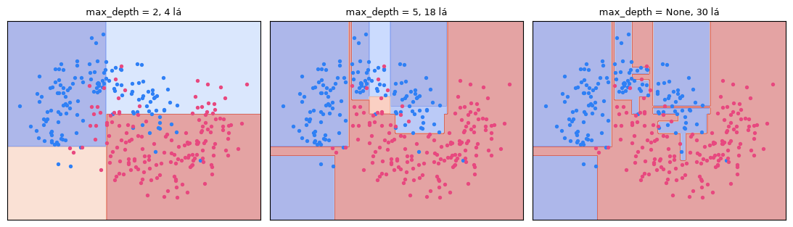
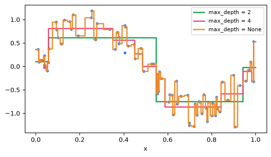

# Decision trees · Code từ đầu

> Ghi chú của người biên soạn: trang này do người biên soạn viết thêm. Trang tự viết bằng NumPy mọi bước trong bài [Cây quyết định](ml/tree_vi): entropy, Gini, độ lợi thông tin trên bảng *PlayTennis*, thuật toán CART cho phân loại và hồi quy, cắt tỉa trước và độ quan trọng của đặc trưng.

## Cách dùng trang này

Các khối chạy lần lượt từ trên xuống và dùng chung biến, giống các ô của một notebook. Chỉ cần `numpy` và `matplotlib`; khối cuối dùng `sklearn.datasets` để lấy dữ liệu. Trang [Dùng thư viện](ml/tree_lib_vi) đối chiếu kết quả với `DecisionTreeClassifier`.

## 1. Entropy, Gini và độ lợi thông tin trên bảng PlayTennis

<small class="viz-ref">Mục C.2–C.3 · bảng C.1</small>

Bảng 14 ngày kinh điển của Quinlan (1986): dựa vào thời tiết, có đi chơi tennis hay không. Ta tính độ lợi thông tin của từng thuộc tính ở nút gốc.

<!-- run -->
```python
import numpy as np
import matplotlib.pyplot as plt

cols = ["Outlook", "Temperature", "Humidity", "Wind"]
rows = """Sunny Hot High Weak No
Sunny Hot High Strong No
Overcast Hot High Weak Yes
Rain Mild High Weak Yes
Rain Cool Normal Weak Yes
Rain Cool Normal Strong No
Overcast Cool Normal Strong Yes
Sunny Mild High Weak No
Sunny Cool Normal Weak Yes
Rain Mild Normal Weak Yes
Sunny Mild Normal Strong Yes
Overcast Mild High Strong Yes
Overcast Hot Normal Weak Yes
Rain Mild High Strong No""".split("\n")
D = np.array([r.split() for r in rows])
A, y = D[:, :4], (D[:, 4] == "Yes").astype(int)

def entropy(y):
    p = np.bincount(y, minlength=2) / len(y)
    p = p[p > 0]
    return -np.sum(p * np.log2(p))

def gini(y):
    p = np.bincount(y, minlength=2) / len(y)
    return 1 - np.sum(p ** 2)

def info_gain(a, y, H=entropy):
    """Độ vẩn đục của nút cha trừ trung bình có trọng số của các nút con, mỗi giá trị của a là một nhánh."""
    return H(y) - sum((a == v).mean() * H(y[a == v]) for v in np.unique(a))

print(f"nút gốc: {y.sum()} Yes / {len(y) - y.sum()} No,  entropy {entropy(y):.3f},  Gini {gini(y):.3f}")
for j, c in enumerate(cols):
    print(f"{c:<12} độ lợi thông tin {info_gain(A[:, j], y):.3f}   độ giảm Gini {info_gain(A[:, j], y, gini):.3f}")
```

<!-- output -->
```output
nút gốc: 9 Yes / 5 No,  entropy 0.940,  Gini 0.459
Outlook      độ lợi thông tin 0.247   độ giảm Gini 0.116
Temperature  độ lợi thông tin 0.029   độ giảm Gini 0.019
Humidity     độ lợi thông tin 0.152   độ giảm Gini 0.092
Wind         độ lợi thông tin 0.048   độ giảm Gini 0.031
```
<!-- /output -->

Đúng như [mục C.3](ml/tree_vi): Outlook có độ lợi thông tin lớn nhất (0.247), rồi đến Humidity (0.152). Độ giảm Gini xếp hạng bốn thuộc tính theo **cùng thứ tự**, dù các con số khác.

## 2. ID3 dựng cả cây cho PlayTennis

<small class="viz-ref">Mục C.3 · hình C.4</small>

ID3 lặp lại đúng phép tính trên ở mỗi nút: chọn thuộc tính có độ lợi lớn nhất, chia nhánh theo từng giá trị, rồi đệ quy cho đến khi nút thuần khiết.

<!-- run -->
```python
def id3(idx, attrs, depth=0):
    yy = y[idx]
    pad = "    " * depth
    if len(np.unique(yy)) == 1 or not attrs:
        return f"{pad}→ {'Yes' if yy.mean() >= 0.5 else 'No'}  ({yy.sum()} Yes / {len(yy) - yy.sum()} No)\n"
    gains = {j: info_gain(A[idx, j], yy) for j in attrs}
    j = max(gains, key=gains.get)
    out = ""
    for v in np.unique(A[idx, j]):
        sub = idx[A[idx, j] == v]
        out += f"{pad}{cols[j]} = {v}:\n" + id3(sub, [k for k in attrs if k != j], depth + 1)
    return out

print(id3(np.arange(len(y)), [0, 1, 2, 3]))
```

<!-- output -->
```output
Outlook = Overcast:
    → Yes  (4 Yes / 0 No)
Outlook = Rain:
    Wind = Strong:
        → No  (0 Yes / 2 No)
    Wind = Weak:
        → Yes  (3 Yes / 0 No)
Outlook = Sunny:
    Humidity = High:
        → No  (0 Yes / 3 No)
    Humidity = Normal:
        → Yes  (2 Yes / 0 No)
```
<!-- /output -->

Cây phân loại đúng cả 14 ngày và không bao giờ hỏi Temperature. Thứ tự các nhánh khác với bài đọc chỉ vì `np.unique` sắp xếp giá trị theo bảng chữ cái.

## 3. CART: cây nhị phân cho thuộc tính liên tục

<small class="viz-ref">Mục C.4–C.5 · thuật toán C.1</small>

CART chỉ chia đôi: "$x_j \le t$?". Với mỗi thuộc tính, ta sắp xếp các giá trị rồi quét mọi ngưỡng ở giữa hai giá trị liên tiếp. Nhờ cộng dồn số mẫu mỗi lớp, mỗi lần quét chỉ mất $O(n)$ sau khi sắp xếp.

<!-- run -->
```python
class Node:
    def __init__(self, value, n, impurity):
        self.value, self.n, self.impurity = value, n, impurity      # value: tỉ lệ lớp 1 (phân loại) hoặc trung bình (hồi quy)
        self.feature = self.threshold = self.left = self.right = None
        self.gain = 0.0

def best_split(X, y, task, min_leaf):
    """Trả về (độ giảm vẩn đục có trọng số, đặc trưng, ngưỡng) tốt nhất, hoặc None."""
    n, d = X.shape
    best = None
    for j in range(d):
        o = np.argsort(X[:, j], kind="mergesort")
        xs, ys = X[o, j], y[o]
        k = np.arange(1, n)                              # k mẫu đầu sang trái
        cs, cq = np.cumsum(ys)[:-1], np.cumsum(ys ** 2)[:-1]
        if task == "cls":                                 # Gini của hai bên, y ∈ {0, 1}
            pl, pr = cs / k, (ys.sum() - cs) / (n - k)
            child = (k * 2 * pl * (1 - pl) + (n - k) * 2 * pr * (1 - pr)) / n
        else:                                             # MSE của hai bên
            sr, qr = ys.sum() - cs, (ys ** 2).sum() - cq
            child = ((cq - cs ** 2 / k) + (qr - sr ** 2 / (n - k))) / n
        ok = (xs[1:] > xs[:-1]) & (k >= min_leaf) & (n - k >= min_leaf)
        if not ok.any():
            continue
        i = np.argmin(np.where(ok, child, np.inf))
        if best is None or child[i] < best[0]:
            best = (child[i], j, (xs[i] + xs[i + 1]) / 2)
    return best

def impurity(y, task):
    if task == "cls":
        p = y.mean(); return 2 * p * (1 - p)
    return y.var()

def build(X, y, task="cls", max_depth=None, min_leaf=1, depth=0):
    node = Node(y.mean(), len(y), impurity(y, task))
    if node.impurity < 1e-12 or (max_depth is not None and depth >= max_depth) or len(y) < 2 * min_leaf:
        return node
    b = best_split(X, y, task, min_leaf)
    if b is None:
        return node
    node.gain = node.impurity - b[0]
    node.feature, node.threshold = b[1], b[2]
    m = X[:, node.feature] <= node.threshold
    node.left = build(X[m], y[m], task, max_depth, min_leaf, depth + 1)
    node.right = build(X[~m], y[~m], task, max_depth, min_leaf, depth + 1)
    return node

def predict(node, X):
    out = np.empty(len(X))
    for i, x in enumerate(X):
        nd = node
        while nd.left is not None:
            nd = nd.left if x[nd.feature] <= nd.threshold else nd.right
        out[i] = nd.value
    return out

def n_leaves(node):
    return 1 if node.left is None else n_leaves(node.left) + n_leaves(node.right)

def show(node, names, depth=0):
    pad = "    " * depth
    if node.left is None:
        return f"{pad}→ P(lớp 1) = {node.value:.2f}  (n = {node.n})\n"
    return (f"{pad}{names[node.feature]} ≤ {node.threshold:.2f}?  (n = {node.n}, Gini {node.impurity:.3f})\n"
            + show(node.left, names, depth + 1) + show(node.right, names, depth + 1))
```

Thử trên dữ liệu "hai nửa trăng" (two moons), có nhiễu:

<!-- run -->
```python
def moons(n, noise, rng):
    t = np.pi * rng.uniform(size=n); c = rng.integers(0, 2, n)
    X = np.c_[np.where(c, 1 - np.cos(t), np.cos(t)), np.where(c, 0.5 - np.sin(t), np.sin(t))]
    return X + rng.normal(0, noise, X.shape), c

rng = np.random.default_rng(0)
X_tr, y_tr = moons(300, 0.3, rng)
X_te, y_te = moons(2000, 0.3, rng)

tree2 = build(X_tr, y_tr, max_depth=2)
print(show(tree2, ["x1", "x2"]))
for d in [1, 2, 3, 4, 6, 8, 12, None]:
    t = build(X_tr, y_tr, max_depth=d)
    acc = lambda X, y: np.mean((predict(t, X) >= 0.5) == y)
    print(f"max_depth={str(d):>4}: {n_leaves(t):3d} lá   accuracy huấn luyện {acc(X_tr, y_tr):.3f}   kiểm tra {acc(X_te, y_te):.3f}")
```

<!-- output -->
```output
x1 ≤ -0.00?  (n = 300, Gini 0.498)
    x2 ≤ -0.19?  (n = 101, Gini 0.224)
        → P(lớp 1) = 0.67  (n = 6)
        → P(lớp 1) = 0.09  (n = 95)
    x2 ≤ 0.36?  (n = 199, Gini 0.386)
        → P(lớp 1) = 0.92  (n = 136)
        → P(lớp 1) = 0.35  (n = 63)

max_depth=   1:   2 lá   accuracy huấn luyện 0.783   kiểm tra 0.681
max_depth=   2:   4 lá   accuracy huấn luyện 0.853   kiểm tra 0.818
max_depth=   3:   8 lá   accuracy huấn luyện 0.903   kiểm tra 0.860
max_depth=   4:  13 lá   accuracy huấn luyện 0.930   kiểm tra 0.875
max_depth=   6:  24 lá   accuracy huấn luyện 0.983   kiểm tra 0.855
max_depth=   8:  29 lá   accuracy huấn luyện 0.997   kiểm tra 0.838
max_depth=  12:  30 lá   accuracy huấn luyện 1.000   kiểm tra 0.836
max_depth=None:  30 lá   accuracy huấn luyện 1.000   kiểm tra 0.836
```
<!-- /output -->

Ở gốc, nhát cắt tốt nhất là $x_1 \le 0$ (in ra `-0.00` vì ngưỡng là một số âm rất gần 0). Accuracy kiểm tra tăng đến độ sâu 4 (0.875, 13 lá) rồi giảm dần. Từ độ sâu 12 trở đi, cây đã mọc hết cỡ: 30 lá, đúng 100% trên tập huấn luyện nhưng chỉ 0.836 trên tập kiểm tra.

Vẽ vùng quyết định của ba cây:

<!-- run -->
```python
def plot_region(ax, model_fn, X, y, title):
    xx, yy = np.meshgrid(np.linspace(-1.8, 2.8, 250), np.linspace(-1.4, 1.9, 250))
    z = model_fn(np.c_[xx.ravel(), yy.ravel()]).reshape(xx.shape)
    ax.contourf(xx, yy, z, levels=np.linspace(0, 1, 11), cmap="coolwarm", alpha=0.45)
    ax.scatter(*X[y == 0].T, s=8, c="#2f80f5"); ax.scatter(*X[y == 1].T, s=8, c="#e8487f")
    ax.set_title(title, fontsize=9); ax.set_xticks([]); ax.set_yticks([])

fig, axes = plt.subplots(1, 3, figsize=(11, 3.2))
for ax, d in zip(axes, [2, 5, None]):
    t = build(X_tr, y_tr, max_depth=d)
    plot_region(ax, lambda G: predict(t, G), X_tr, y_tr, f"max_depth = {d}, {n_leaves(t)} lá")
fig.tight_layout()
```

<!-- output -->
<div align=center></div>
<!-- /output -->

Cây độ sâu 2 chỉ vẽ được vài hình chữ nhật thô. Cây không giới hạn có những ô hẹp kéo dài để ôm từng điểm nhiễu.

## 4. Cây hồi quy

<small class="viz-ref">Mục C.6 · hình C.6</small>

Cùng hàm `build`, chỉ đổi `task="reg"`: độ vẩn đục là phương sai, giá trị ở lá là trung bình $y$.

<!-- run -->
```python
x = np.sort(rng.uniform(0, 1, 80)); yr = np.sin(2 * np.pi * x) + rng.normal(0, 0.25, 80)
xt = np.sort(rng.uniform(0, 1, 1000)); yt = np.sin(2 * np.pi * xt) + rng.normal(0, 0.25, 1000)
xs = np.linspace(0, 1, 500)
fig, ax = plt.subplots(figsize=(6.4, 3.4))
ax.scatter(x, yr, s=10, c="#2f80f5")
for d, c in [(2, "#16a34a"), (4, "#e8487f"), (None, "#f08a24")]:
    t = build(x[:, None], yr, task="reg", max_depth=d)
    rmse_tr = np.sqrt(np.mean((predict(t, x[:, None]) - yr) ** 2))
    rmse_te = np.sqrt(np.mean((predict(t, xt[:, None]) - yt) ** 2))
    print(f"max_depth={str(d):>4}: {n_leaves(t):3d} lá   RMSE huấn luyện {rmse_tr:.3f}   kiểm tra {rmse_te:.3f}")
    ax.step(xs, predict(t, xs[:, None]), where="mid", color=c, lw=1.8, label=f"max_depth = {d}")
ax.legend(fontsize=8); ax.set_xlabel("x")
```

<!-- output -->
```output
max_depth=   2:   4 lá   RMSE huấn luyện 0.307   kiểm tra 0.380
max_depth=   4:  15 lá   RMSE huấn luyện 0.212   kiểm tra 0.298
max_depth=None:  80 lá   RMSE huấn luyện 0.000   kiểm tra 0.344
```

<div align=center></div>
<!-- /output -->

Cây không giới hạn có 80 lá cho 80 điểm, tức **mỗi điểm một lá**: RMSE huấn luyện bằng 0, nhưng RMSE kiểm tra (0.344) cao hơn cây độ sâu 4 (0.298). Mức nhiễu của dữ liệu là 0.25.

## 5. Cắt tỉa trước bằng số mẫu tối thiểu ở lá

<small class="viz-ref">Mục C.7 · hình C.7</small>

Thay vì giới hạn độ sâu, ta có thể cấm lá có ít hơn `min_leaf` mẫu. Cây không còn tạo được những ô nhỏ xíu quanh một điểm nhiễu.

<!-- run -->
```python
res = []
for ml in [1, 2, 3, 5, 8, 12, 20, 30, 50]:
    t = build(X_tr, y_tr, min_leaf=ml)
    res.append((ml, n_leaves(t), np.mean((predict(t, X_tr) >= .5) == y_tr), np.mean((predict(t, X_te) >= .5) == y_te)))
    print(f"min_leaf={ml:2d}: {res[-1][1]:3d} lá   huấn luyện {res[-1][2]:.3f}   kiểm tra {res[-1][3]:.3f}")
```

<!-- output -->
```output
min_leaf= 1:  30 lá   huấn luyện 1.000   kiểm tra 0.836
min_leaf= 2:  28 lá   huấn luyện 0.963   kiểm tra 0.837
min_leaf= 3:  24 lá   huấn luyện 0.963   kiểm tra 0.872
min_leaf= 5:  20 lá   huấn luyện 0.957   kiểm tra 0.890
min_leaf= 8:  18 lá   huấn luyện 0.950   kiểm tra 0.893
min_leaf=12:  14 lá   huấn luyện 0.913   kiểm tra 0.873
min_leaf=20:  10 lá   huấn luyện 0.873   kiểm tra 0.806
min_leaf=30:   7 lá   huấn luyện 0.847   kiểm tra 0.820
min_leaf=50:   5 lá   huấn luyện 0.847   kiểm tra 0.820
```
<!-- /output -->

Yêu cầu mỗi lá có ít nhất 5–8 mẫu đưa accuracy kiểm tra lên 0.89, cao hơn cả cách giới hạn độ sâu tốt nhất ở mục 3 (0.875). Đặt `min_leaf` quá lớn thì cây lại chưa khớp.

## 6. Độ quan trọng của đặc trưng

<small class="viz-ref">Mục C.8</small>

Độ quan trọng (theo độ giảm vẩn đục) của đặc trưng $j$ là tổng $n_{\text{nút}} \cdot \Delta\text{Gini}$ qua mọi nút chia theo $j$, chuẩn hoá để tổng bằng 1. Ta thêm vào dữ liệu ba đặc trưng nhiễu để xem cây có bị lừa không.

<!-- run -->
```python
def importances(node, d):
    imp = np.zeros(d)
    def walk(nd):
        if nd.left is None:
            return
        imp[nd.feature] += nd.n * nd.gain
        walk(nd.left); walk(nd.right)
    walk(node)
    return imp / imp.sum()

X_noise = np.c_[X_tr, rng.normal(size=(len(X_tr), 3))]
names = ["x1", "x2", "nhiễu 1", "nhiễu 2", "nhiễu 3"]
for label, kw in [("cây đầy đủ", {}), ("max_depth = 4", {"max_depth": 4})]:
    imp = importances(build(X_noise, y_tr, **kw), 5)
    print(f"{label:<14}", "  ".join(f"{n} {v:.3f}" for n, v in zip(names, imp)))
```

<!-- output -->
```output
cây đầy đủ     x1 0.623  x2 0.341  nhiễu 1 0.000  nhiễu 2 0.023  nhiễu 3 0.013
max_depth = 4  x1 0.622  x2 0.362  nhiễu 1 0.000  nhiễu 2 0.016  nhiễu 3 0.000
```
<!-- /output -->

Trên bộ dữ liệu này, cây gần như không bị lừa: ba đặc trưng nhiễu cộng lại chỉ nhận khoảng 4% độ quan trọng trong cây đầy đủ, và 1.6% trong cây độ sâu 4. Phần nhỏ đó đến từ các nút sâu, nơi chỉ còn vài điểm, và một đặc trưng nhiễu dễ tình cờ tách được chúng. Khi cây sâu hơn và có nhiều đặc trưng nhiễu hơn, phần này lớn dần. Trang [Dùng thư viện](ml/tree_lib_vi) so sánh với độ quan trọng hoán vị.
