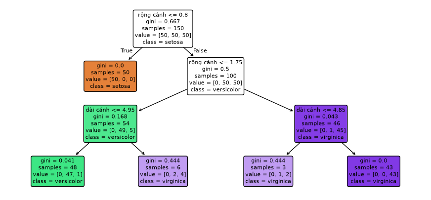
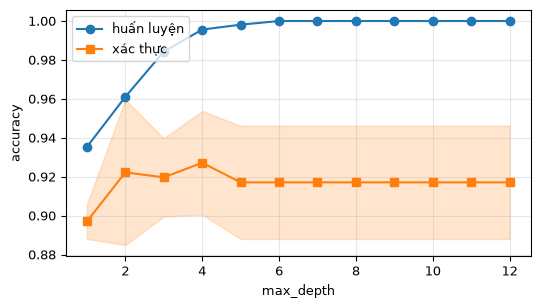
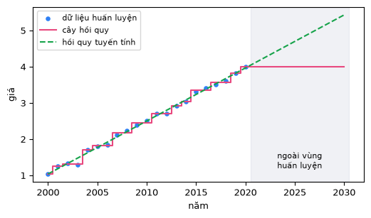

# Decision trees · Dùng thư viện

> Ghi chú của người biên soạn: trang này do người biên soạn viết thêm. Trang dùng `DecisionTreeClassifier` và `DecisionTreeRegressor` của scikit-learn cho các ý trong bài [Cây quyết định](ml/tree_vi): vẽ và in cây, chọn độ sâu và $\alpha$ cắt tỉa bằng xác thực chéo, so sánh hai cách đo độ quan trọng của đặc trưng.

## Cách dùng trang này

Các khối chạy lần lượt từ trên xuống và dùng chung biến. Cần `numpy`, `matplotlib`, `scikit-learn`.

| Trong bài | Trong scikit-learn |
| --- | --- |
| Gini / entropy | `criterion="gini"` (mặc định) / `"entropy"`; hồi quy: `"squared_error"` |
| Cắt tỉa trước | `max_depth`, `min_samples_leaf`, `min_samples_split`, `max_leaf_nodes`, `min_impurity_decrease` |
| Cắt tỉa sau theo độ phức tạp, $\alpha$ | `ccp_alpha`; dãy $\alpha$: `cost_complexity_pruning_path(X, y)` |
| In và vẽ cây | `export_text(tree)`, `plot_tree(tree)` |
| Độ quan trọng theo độ giảm vẩn đục | `tree.feature_importances_` |
| Độ quan trọng hoán vị | `sklearn.inspection.permutation_importance` |

## 1. Cây cho hoa Iris: in ra và vẽ

<small class="viz-ref">Mục C.1, C.5</small>

<!-- run -->
```python
import numpy as np
import matplotlib.pyplot as plt
from sklearn.datasets import load_iris
from sklearn.tree import DecisionTreeClassifier, export_text, plot_tree

iris = load_iris()
names = ["dài đài", "rộng đài", "dài cánh", "rộng cánh"]
clf = DecisionTreeClassifier(max_depth=3, random_state=0).fit(iris.data, iris.target)
print(export_text(clf, feature_names=names, class_names=list(iris.target_names), show_weights=True))
print("accuracy huấn luyện:", round(clf.score(iris.data, iris.target), 3))

fig, ax = plt.subplots(figsize=(11, 5))
plot_tree(clf, feature_names=names, class_names=list(iris.target_names), filled=True, rounded=True,
          impurity=True, fontsize=8, ax=ax)
```

<!-- output -->
```output
|--- rộng cánh <= 0.80
|   |--- weights: [50.00, 0.00, 0.00] class: setosa
|--- rộng cánh >  0.80
|   |--- rộng cánh <= 1.75
|   |   |--- dài cánh <= 4.95
|   |   |   |--- weights: [0.00, 47.00, 1.00] class: versicolor
|   |   |--- dài cánh >  4.95
|   |   |   |--- weights: [0.00, 2.00, 4.00] class: virginica
|   |--- rộng cánh >  1.75
|   |   |--- dài cánh <= 4.85
|   |   |   |--- weights: [0.00, 1.00, 2.00] class: virginica
|   |   |--- dài cánh >  4.85
|   |   |   |--- weights: [0.00, 0.00, 43.00] class: virginica

accuracy huấn luyện: 0.973
```

<div align=center></div>
<!-- /output -->

Câu hỏi đầu tiên, "độ rộng cánh hoa ≤ 0.80?", tách riêng toàn bộ 50 bông setosa. Ba tầng câu hỏi đủ để phân loại đúng 97.3% số hoa. Trong hình, `filled=True` tô màu mỗi nút theo lớp đa số, màu càng đậm thì nút càng thuần khiết.

## 2. Chọn độ sâu bằng xác thực chéo

<small class="viz-ref">Mục C.7 · hình C.5</small>

Bộ *Breast Cancer Wisconsin* (569 khối u, 30 đặc trưng). `validation_curve` tính accuracy huấn luyện và xác thực cho từng độ sâu.

<!-- run -->
```python
from sklearn.datasets import load_breast_cancer
from sklearn.model_selection import train_test_split, validation_curve, StratifiedKFold, GridSearchCV

Xb, yb = load_breast_cancer(return_X_y=True)
Xb_tr, Xb_te, yb_tr, yb_te = train_test_split(Xb, yb, test_size=0.3, stratify=yb, random_state=0)
cv = StratifiedKFold(5, shuffle=True, random_state=0)
depths = list(range(1, 13))
tr, va = validation_curve(DecisionTreeClassifier(random_state=0), Xb_tr, yb_tr, param_name="max_depth",
                          param_range=depths, cv=cv)
for d, a, b in zip(depths, tr.mean(1), va.mean(1)):
    print(f"max_depth={d:2d}: huấn luyện {a:.3f}   xác thực {b:.3f} ± {va.std(1)[d - 1]:.3f}")

fig, ax = plt.subplots(figsize=(6, 3.2))
ax.plot(depths, tr.mean(1), "o-", label="huấn luyện"); ax.plot(depths, va.mean(1), "s-", label="xác thực")
ax.fill_between(depths, va.mean(1) - va.std(1), va.mean(1) + va.std(1), alpha=.2, color="C1")
ax.set_xlabel("max_depth"); ax.set_ylabel("accuracy"); ax.legend(); ax.grid(alpha=.3)
```

<!-- output -->
```output
max_depth= 1: huấn luyện 0.935   xác thực 0.897 ± 0.009
max_depth= 2: huấn luyện 0.961   xác thực 0.922 ± 0.037
max_depth= 3: huấn luyện 0.984   xác thực 0.920 ± 0.020
max_depth= 4: huấn luyện 0.996   xác thực 0.927 ± 0.027
max_depth= 5: huấn luyện 0.998   xác thực 0.917 ± 0.029
max_depth= 6: huấn luyện 1.000   xác thực 0.917 ± 0.029
max_depth= 7: huấn luyện 1.000   xác thực 0.917 ± 0.029
max_depth= 8: huấn luyện 1.000   xác thực 0.917 ± 0.029
max_depth= 9: huấn luyện 1.000   xác thực 0.917 ± 0.029
max_depth=10: huấn luyện 1.000   xác thực 0.917 ± 0.029
max_depth=11: huấn luyện 1.000   xác thực 0.917 ± 0.029
max_depth=12: huấn luyện 1.000   xác thực 0.917 ± 0.029
```

<div align=center></div>
<!-- /output -->

Từ độ sâu 6, cây đã mọc hết cỡ (accuracy huấn luyện 1.000) nên các dòng sau giống hệt nhau. Accuracy xác thực cao nhất ở độ sâu 4 (0.927), nhưng chênh lệch giữa độ sâu 2 đến 12 (0.917–0.927) nhỏ hơn độ dao động giữa các lần chia (±0.02–0.04). Trên bộ dữ liệu này, độ sâu không quá quan trọng.

## 3. Cắt tỉa theo độ phức tạp

<small class="viz-ref">Mục C.7 · hình C.6</small>

`cost_complexity_pruning_path` trả về dãy $\alpha$ mà ở đó cây bị tỉa thêm một nhánh. Ta chọn $\alpha$ bằng `GridSearchCV`, rồi đánh giá một lần trên tập kiểm tra.

<!-- run -->
```python
path = DecisionTreeClassifier(random_state=0).cost_complexity_pruning_path(Xb_tr, yb_tr)
alphas = path.ccp_alphas[:-1]                 # bỏ α cuối: cây chỉ còn gốc
print(f"{len(alphas)} giá trị α, từ {alphas[0]:.4f} đến {alphas[-1]:.4f}")

grid = GridSearchCV(DecisionTreeClassifier(random_state=0), {"ccp_alpha": alphas}, cv=cv).fit(Xb_tr, yb_tr)
full = DecisionTreeClassifier(random_state=0).fit(Xb_tr, yb_tr)
pruned = grid.best_estimator_
print(f"α tốt nhất: {grid.best_params_['ccp_alpha']:.4f}   accuracy xác thực chéo {grid.best_score_:.3f}")
for name, m in [("cây đầy đủ", full), ("cây đã tỉa", pruned)]:
    print(f"{name}: {m.get_n_leaves():2d} lá, độ sâu {m.get_depth()}, accuracy kiểm tra {m.score(Xb_te, yb_te):.3f}")
```

<!-- output -->
```output
11 giá trị α, từ 0.0000 đến 0.0265
α tốt nhất: 0.0196   accuracy xác thực chéo 0.925
cây đầy đủ: 16 lá, độ sâu 6, accuracy kiểm tra 0.906
cây đã tỉa:  4 lá, độ sâu 3, accuracy kiểm tra 0.901
```
<!-- /output -->

Cắt tỉa giảm cây từ 16 lá xuống 4 lá mà accuracy kiểm tra gần như giữ nguyên (0.901 so với 0.906; trên 171 khối u, chênh lệch này chưa tới một khối u). Một cây 4 lá có thể in ra một trang giấy và giải thích cho bác sĩ. Đây thường là lý do chính để cắt tỉa: được một mô hình **đơn giản hơn nhiều** với cùng độ chính xác.

## 4. Hai cách đo độ quan trọng của đặc trưng

<small class="viz-ref">Mục C.8</small>

`feature_importances_` cộng độ giảm vẩn đục trên **tập huấn luyện**. `permutation_importance` đo trên **tập kiểm tra**: xáo trộn ngẫu nhiên một cột rồi xem accuracy giảm bao nhiêu. Ta thêm vào dữ liệu hai cột nhiễu: một cột số ngẫu nhiên và một cột "mã bệnh nhân" ngẫu nhiên có 500 giá trị khác nhau.

<!-- run -->
```python
from sklearn.inspection import permutation_importance

rng = np.random.default_rng(0)
cancer = load_breast_cancer()
add = lambda X: np.c_[X, rng.normal(size=len(X)), rng.integers(0, 500, len(X))]
Xn_tr, Xn_te = add(Xb_tr), add(Xb_te)
fnames = list(cancer.feature_names) + ["NHIỄU (số ngẫu nhiên)", "NHIỄU (mã ngẫu nhiên)"]

deep = DecisionTreeClassifier(random_state=0).fit(Xn_tr, yb_tr)
mdi = deep.feature_importances_
perm = permutation_importance(deep, Xn_te, yb_te, n_repeats=30, random_state=0)
order = np.argsort(-mdi)[:8]
print(f"{'đặc trưng':<26}{'theo độ giảm Gini':>18}{'hoán vị (tập kiểm tra)':>26}")
for j in sorted(set(order) | {30, 31}, key=lambda j: -mdi[j]):
    print(f"{fnames[j]:<26}{mdi[j]:>18.3f}{perm.importances_mean[j]:>18.3f} ± {perm.importances_std[j]:.3f}")
```

<!-- output -->
```output
đặc trưng                  theo độ giảm Gini    hoán vị (tập kiểm tra)
worst perimeter                        0.746             0.075 ± 0.018
worst concave points                   0.099             0.121 ± 0.018
worst radius                           0.041             0.007 ± 0.008
mean texture                           0.027             0.010 ± 0.010
area error                             0.021             0.143 ± 0.025
worst smoothness                       0.020             0.038 ± 0.012
mean perimeter                         0.009             0.002 ± 0.003
mean concave points                    0.008            -0.006 ± 0.007
NHIỄU (số ngẫu nhiên)                  0.000             0.000 ± 0.000
NHIỄU (mã ngẫu nhiên)                  0.000             0.000 ± 0.000
```
<!-- /output -->

Hai cột nhiễu không được cây này dùng tới, nên cả hai cách đều cho 0. Điều đáng chú ý là hai cách **xếp hạng rất khác nhau**:

- Theo độ giảm Gini, `worst perimeter` chiếm tới 75% độ quan trọng, chỉ vì nó được chọn ở **gốc**, nơi có nhiều dữ liệu nhất nên độ giảm lớn nhất.
- Theo hoán vị, xáo trộn `area error` làm accuracy kiểm tra giảm nhiều nhất (0.143), còn `worst perimeter` chỉ đứng thứ ba (0.075).

Lý do: bộ dữ liệu có nhiều đặc trưng **tương quan mạnh** với nhau (`worst perimeter`, `worst radius`, `worst area` gần như đo cùng một thứ). Cây chọn một đặc trưng trong nhóm, và độ quan trọng theo độ giảm Gini dồn hết vào đặc trưng đó. Khi đọc độ quan trọng của đặc trưng, hãy nhớ: nó mô tả **mô hình này**, không phải mối quan hệ nhân quả trong dữ liệu.

## 5. Cây hồi quy và việc không ngoại suy được

<small class="viz-ref">Mục C.6 · hình C.4</small>

Dữ liệu tăng tuyến tính theo thời gian. Học trên các năm 2000–2020, rồi dự đoán đến 2030.

<!-- run -->
```python
from sklearn.tree import DecisionTreeRegressor
from sklearn.linear_model import LinearRegression

rng = np.random.default_rng(1)
year = np.arange(2000, 2021).astype(float)
price = 1.0 + 0.15 * (year - 2000) + rng.normal(0, 0.12, len(year))
future = np.arange(2000, 2031).astype(float)
reg_tree = DecisionTreeRegressor(max_depth=4).fit(year[:, None], price)
reg_lin = LinearRegression().fit(year[:, None], price)
for y_ in [2020, 2025, 2030]:
    print(f"năm {y_}: cây {reg_tree.predict([[y_]])[0]:.2f}   tuyến tính {reg_lin.predict([[y_]])[0]:.2f}")

fig, ax = plt.subplots(figsize=(6, 3.2))
ax.scatter(year, price, s=14, c="#2f80f5", label="dữ liệu huấn luyện")
ax.step(future, reg_tree.predict(future[:, None]), where="mid", color="#e8487f", label="cây hồi quy")
ax.plot(future, reg_lin.predict(future[:, None]), "--", color="#16a34a", label="hồi quy tuyến tính")
ax.axvspan(2020.5, 2030.5, color="#8a90b4", alpha=.12); ax.text(2025.5, 1.2, "ngoài vùng\nhuấn luyện", ha="center", fontsize=8)
ax.set_xlabel("năm"); ax.set_ylabel("giá"); ax.legend(fontsize=8)
```

<!-- output -->
```output
năm 2020: cây 4.00   tuyến tính 3.97
năm 2025: cây 4.00   tuyến tính 4.70
năm 2030: cây 4.00   tuyến tính 5.43
```

<div align=center></div>
<!-- /output -->

Trong vùng huấn luyện, cây và hồi quy tuyến tính dự đoán gần như nhau (4.00 và 3.97 cho năm 2020). Ra ngoài vùng đó, cây đứng yên ở 4.00, giá trị của lá ngoài cùng, trong khi xu hướng thật vẫn tăng. Đây là lý do các mô hình dựa trên cây (kể cả random forest và gradient boosting) cần cẩn thận với dữ liệu có xu hướng theo thời gian. Một cách thường dùng là cho cây học **độ thay đổi** thay vì giá trị tuyệt đối.
