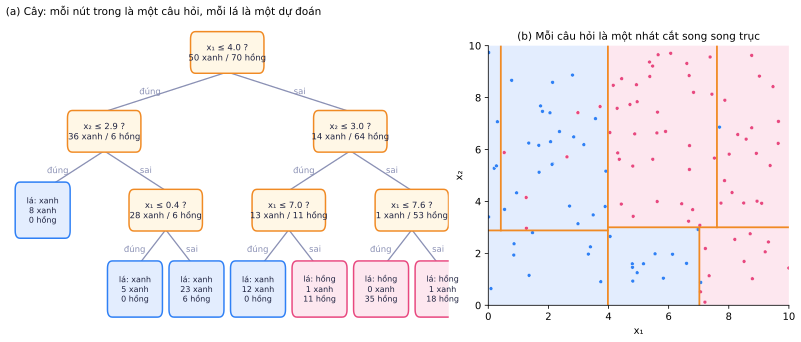
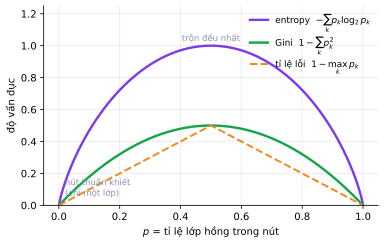
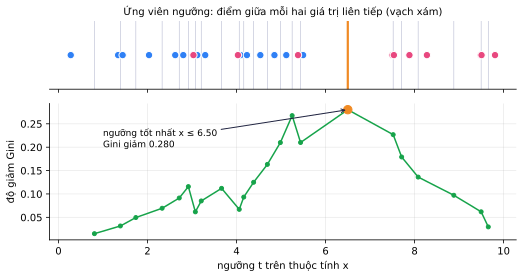
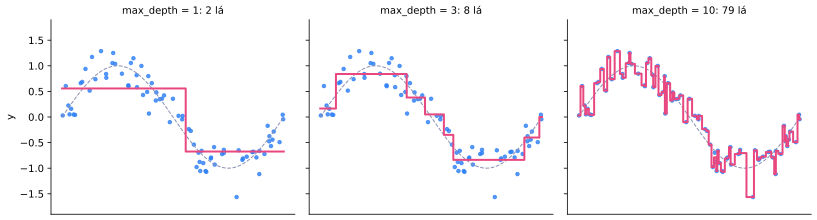
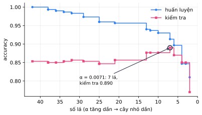

# Decision trees

> Ghi chú của người biên soạn: bài này do người biên soạn viết thêm, không có trong sách *Machine Learning cơ bản*. Mọi hình trong bài đều vẽ từ số liệu thật bằng script `scripts/ml_extra/tree_figs.py`. Bài tiếp theo, [Học tổ hợp](ml/ensemble_vi), ghép nhiều cây thành random forest và gradient boosting.

Các mô hình trong sách, từ hồi quy tuyến tính đến SVM, đều học một hàm số liên tục của đặc trưng: $\mathbf{w}^T\mathbf{x} + b$, hàm sigmoid, hàm nhân. **Cây quyết định** (decision tree) đi theo một hướng rất khác: nó học một chuỗi **câu hỏi có/không**, giống cách một bác sĩ chẩn đoán hay trò chơi "hai mươi câu hỏi".

Cây quyết định có ba ưu điểm khiến nó có mặt ở khắp nơi:

1. **Dễ hiểu.** Một cây nông có thể in ra giấy và giải thích cho người không biết học máy.
2. **Ít cần tiền xử lý.** Không cần chuẩn hoá đặc trưng, và dùng được cả đặc trưng dạng số lẫn dạng hạng mục.
3. **Là viên gạch của các mô hình mạnh nhất cho dữ liệu dạng bảng.** Random forest, XGBoost và LightGBM đều là tổ hợp của nhiều cây.

## C.1 Cây quyết định là gì

Một cây quyết định gồm:

- **Nút trong**, mỗi nút là một câu hỏi về **một** đặc trưng, ví dụ "$x_1 \le 4.0$?".
- **Nhánh**: mỗi câu trả lời dẫn tới một nút con.
- **Lá**, mỗi lá là một dự đoán: một nhãn (phân loại) hoặc một con số (hồi quy).

Để dự đoán cho một điểm mới, ta đi từ gốc xuống, trả lời từng câu hỏi, đến khi gặp lá (Hình C.1a).

<div align=center></div>
<div align=center>Hình C.1: (a) Một cây độ sâu 3 học từ 120 điểm. Mỗi nút ghi số điểm mỗi lớp đi qua nó. (b) Mỗi câu hỏi là một nhát cắt song song với một trục; 7 lá ứng với 7 hình chữ nhật.</div>

Nhìn từ góc độ hình học (Hình C.1b), câu hỏi "$x_j \le t$?" là một nhát cắt **song song với trục** $x_j$. Cây chia không gian đặc trưng thành các **hình hộp chữ nhật**, mỗi hộp ứng với một lá và mang một dự đoán hằng. Cây trong hình có 7 lá và phân loại đúng 93.3% số điểm huấn luyện.

Câu hỏi còn lại là: **chọn câu hỏi nào ở mỗi nút?** Số cây có thể có lớn tới mức không thể thử hết, nên mọi thuật toán thực tế đều dựng cây theo kiểu **tham lam** (greedy): từ gốc xuống, ở mỗi nút chọn câu hỏi tốt nhất *ngay lúc đó* rồi không bao giờ xét lại. Để làm vậy, ta cần một thước đo cho "tốt".

## C.2 Độ vẩn đục của một nút

Một câu hỏi tốt chia dữ liệu thành các nhóm **thuần khiết** hơn, tức mỗi nhóm chủ yếu thuộc một lớp. Gọi $p_k$ là tỉ lệ điểm thuộc lớp $k$ trong một nút. Ba thước đo **độ vẩn đục** (impurity) thông dụng là:

$$
\text{Entropy: } H = -\sum_{k} p_k \log_2 p_k, \qquad
\text{Gini: } G = 1 - \sum_{k} p_k^2, \qquad
\text{Tỉ lệ lỗi: } E = 1 - \max_k p_k.
$$

<div align=center></div>
<div align=center>Hình C.2: Ba thước đo độ vẩn đục cho bài toán hai lớp. Cả ba bằng 0 khi nút thuần khiết và lớn nhất khi hai lớp trộn đều.</div>

- **Entropy** đến từ lý thuyết thông tin: số bit trung bình cần để mã hoá nhãn của một điểm trong nút. Nút trộn đều hai lớp cần 1 bit; nút thuần khiết cần 0 bit.
- **Gini** là xác suất để hai điểm lấy ngẫu nhiên (có hoàn lại) trong nút có nhãn **khác nhau**. Gini không cần tính logarit nên nhanh hơn, và là mặc định của scikit-learn.
- **Tỉ lệ lỗi** trông tự nhiên nhất nhưng hiếm khi được dùng để chọn phép chia, vì nó không đủ nhạy. Ví dụ: một nút có 400 điểm lớp A và 400 điểm lớp B. Phép chia thứ nhất cho hai nút (300 A, 100 B) và (100 A, 300 B). Phép chia thứ hai cho (200 A, 400 B) và (200 A, 0 B). Cả hai đều có tỉ lệ lỗi trung bình 25% sau khi chia, nên tỉ lệ lỗi coi chúng tốt ngang nhau. Nhưng phép chia thứ hai tạo ra một nút **hoàn toàn thuần khiết**, không cần chia tiếp nữa. Gini phân biệt được: Gini trung bình sau phép chia thứ nhất là 0.375, sau phép chia thứ hai là 0.333. Lý do là Gini và entropy là các hàm **cong** (lõm) của $p$, còn tỉ lệ lỗi chỉ là đường gấp khúc.

Trong thực tế, Gini và entropy hầu như luôn chọn cùng một phép chia; chọn cái nào không quan trọng.

## C.3 Chọn câu hỏi: độ lợi thông tin

Giả sử nút cha có $N$ điểm, và một câu hỏi chia nó thành các nút con có $N_1, N_2, \dots$ điểm. **Độ lợi** của câu hỏi là độ vẩn đục giảm được, với các nút con tính theo trung bình có trọng số:

$$
\text{Gain} = I(\text{cha}) - \sum_{m} \frac{N_m}{N}\, I(\text{con}_m),
$$

trong đó $I$ là entropy hoặc Gini. Khi $I$ là entropy, đại lượng này có tên **độ lợi thông tin** (information gain). Ở mỗi nút, thuật toán chọn câu hỏi có độ lợi lớn nhất.

### Ví dụ: PlayTennis

Bảng C.1 là ví dụ kinh điển của Quinlan (1986): 14 ngày, mỗi ngày có 4 thuộc tính thời tiết, và nhãn là có đi chơi tennis hay không.

<div align=center>Bảng C.1: Dữ liệu PlayTennis.</div>

| Ngày | Outlook | Temperature | Humidity | Wind | Play |
| --- | --- | --- | --- | --- | --- |
| 1 | Sunny | Hot | High | Weak | No |
| 2 | Sunny | Hot | High | Strong | No |
| 3 | Overcast | Hot | High | Weak | Yes |
| 4 | Rain | Mild | High | Weak | Yes |
| 5 | Rain | Cool | Normal | Weak | Yes |
| 6 | Rain | Cool | Normal | Strong | No |
| 7 | Overcast | Cool | Normal | Strong | Yes |
| 8 | Sunny | Mild | High | Weak | No |
| 9 | Sunny | Cool | Normal | Weak | Yes |
| 10 | Rain | Mild | Normal | Weak | Yes |
| 11 | Sunny | Mild | Normal | Strong | Yes |
| 12 | Overcast | Mild | High | Strong | Yes |
| 13 | Overcast | Hot | Normal | Weak | Yes |
| 14 | Rain | Mild | High | Strong | No |

Ở gốc có 9 Yes và 5 No, nên entropy là

$$
H(\text{gốc}) = -\tfrac{9}{14}\log_2\tfrac{9}{14} - \tfrac{5}{14}\log_2\tfrac{5}{14} \approx 0.940.
$$

Thử câu hỏi "Outlook là gì?". Ba nhánh là Sunny (2 Yes, 3 No), Overcast (4 Yes, 0 No) và Rain (3 Yes, 2 No), với entropy lần lượt 0.971, 0 và 0.971. Vậy

$$
\text{Gain(Outlook)} = 0.940 - \tfrac{5}{14}(0.971) - \tfrac{4}{14}(0) - \tfrac{5}{14}(0.971) \approx 0.247.
$$

Tính tương tự cho ba thuộc tính còn lại: Humidity 0.152, Wind 0.048, Temperature 0.029 (các phép tính nằm ở trang [Code từ đầu](ml/tree_code_vi)). Outlook thắng, nên nó là câu hỏi ở gốc. Nhánh Overcast đã thuần khiết, thành lá "Yes". Hai nhánh còn lại lặp lại đúng quá trình này với dữ liệu của riêng chúng. Kết quả là cây của thuật toán **ID3**:

- Outlook = Overcast → **Yes**
- Outlook = Sunny → hỏi Humidity: High → **No**, Normal → **Yes**
- Outlook = Rain → hỏi Wind: Strong → **No**, Weak → **Yes**

Cây này phân loại đúng cả 14 ngày, chỉ dùng 3 trong 4 thuộc tính. Temperature không bao giờ được hỏi.

> **Bẫy của độ lợi thông tin.** Nếu thêm cột "Ngày" (giá trị 1 đến 14) vào bảng, câu hỏi "Ngày là gì?" chia dữ liệu thành 14 nút, mỗi nút một điểm, đều thuần khiết. Độ lợi đạt tối đa (0.940), nhưng câu hỏi này vô dụng với một ngày mới. Thuật toán **C4.5** sửa lỗi này bằng **tỉ số độ lợi** (gain ratio): chia độ lợi cho entropy của chính phép chia, phạt những câu hỏi có quá nhiều nhánh. **CART** tránh vấn đề bằng cách chỉ cho phép chia **đôi**.

## C.4 Đặc trưng liên tục và phép chia nhị phân

Với đặc trưng dạng số như tuổi hay thu nhập, câu hỏi có dạng "$x_j \le t$?". Ngưỡng $t$ nào cũng chỉ cần thử ở **giữa hai giá trị liên tiếp** của $x_j$ trong dữ liệu: dịch $t$ trong khoảng giữa hai giá trị đó không làm thay đổi phép chia. Với $n$ điểm, mỗi đặc trưng có nhiều nhất $n - 1$ ngưỡng ứng viên (Hình C.3).

<div align=center></div>
<div align=center>Hình C.3: 24 điểm trên một đặc trưng, 23 ngưỡng ứng viên. Độ giảm Gini lớn nhất (0.280, từ Gini 0.486 ở nút cha) đạt tại $x \le 6.50$.</div>

Quét từng ngưỡng rồi đếm lại từ đầu thì tốn $O(n^2)$. Mẹo: **sắp xếp** các điểm theo $x_j$, rồi đi từ trái sang phải. Mỗi bước chỉ chuyển **một** điểm từ bên phải sang bên trái, nên số điểm mỗi lớp ở hai bên cập nhật trong $O(1)$. Tổng chi phí là $O(n \log n)$ cho mỗi đặc trưng ở mỗi nút.

**CART** (Classification And Regression Trees; Breiman và cộng sự, 1984) chỉ dùng phép chia nhị phân, kể cả cho đặc trưng hạng mục. Đây là thuật toán mà scikit-learn cài đặt.

## C.5 Thuật toán CART

Ghép các phần trên lại, ta có thuật toán dựng cây đệ quy:

```
Thuật toán C.1: CART
Input:  tập dữ liệu S; độ sâu tối đa d_max; số mẫu tối thiểu ở lá n_min
Output: cây quyết định

function Grow(S, depth):
    if depth = d_max or |S| < 2·n_min or I(S) = 0 then
        return Leaf(giá trị dự đoán từ S)      # đa số (phân loại) / trung bình (hồi quy)
    best ← None
    for each đặc trưng j do
        sắp xếp S theo x_j
        for each ngưỡng t giữa hai giá trị liên tiếp do
            L ← {x ∈ S : x_j ≤ t},  R ← S \ L
            if |L| ≥ n_min and |R| ≥ n_min then
                gain ← I(S) − (|L|·I(L) + |R|·I(R)) / |S|
                if gain > gain của best then best ← (j, t, L, R)
    if best = None then return Leaf(S)
    return Node(j, t, Grow(L, depth + 1), Grow(R, depth + 1))
```

Với $n$ điểm và $d$ đặc trưng, mỗi tầng của cây tốn $O(d\, n \log n)$. Một cây cân bằng có $O(\log n)$ tầng.

## C.6 Cây hồi quy

Với hồi quy, chỉ cần đổi hai chỗ:

- **Giá trị ở lá** là trung bình $y$ của các điểm trong lá. Đây là hằng số làm sai số bình phương nhỏ nhất.
- **Độ vẩn đục** là phương sai của $y$ trong nút, tức MSE khi dự đoán bằng trung bình. Độ lợi của phép chia là MSE giảm được.

<div align=center></div>
<div align=center>Hình C.4: Cây hồi quy là một hàm bậc thang. Độ sâu 1 có 2 bậc, độ sâu 3 có 8 bậc và bám được hình sin, độ sâu 10 bám theo từng điểm nhiễu.</div>

Cây hồi quy có một điểm yếu ít khi được nhắc: nó **không ngoại suy được**. Ngoài vùng dữ liệu huấn luyện, dự đoán là hằng số bằng giá trị của lá ngoài cùng. Một cây học giá nhà từ 2000 đến 2020 sẽ đoán giá năm 2030 bằng giá năm 2020.

## C.7 Quá khớp và cắt tỉa

Nếu để cây mọc đến khi mọi lá thuần khiết, nó sẽ khớp **hoàn hảo** dữ liệu huấn luyện. Với dữ liệu có nhiễu, điều đó có nghĩa là học thuộc cả nhiễu (Hình C.5).

<div align=center></div>
<div align=center>Hình C.5: Dữ liệu hai nửa trăng có nhiễu, 300 điểm huấn luyện và 300 điểm kiểm tra. Độ sâu 1 chưa khớp; độ sâu 4 cho accuracy kiểm tra cao nhất (0.88); cây không giới hạn đạt 100% trên tập huấn luyện nhưng chỉ 0.853 trên tập kiểm tra.</div>

Có hai cách chống quá khớp.

**Cắt tỉa trước** (pre-pruning): dừng sớm khi dựng cây, bằng các siêu tham số `max_depth` (độ sâu tối đa), `min_samples_leaf` (số mẫu tối thiểu ở lá), `min_samples_split`, `max_leaf_nodes` hay `min_impurity_decrease`. Cách này đơn giản và nhanh, nhưng có thể dừng quá sớm: một phép chia trông vô ích có thể mở đường cho các phép chia rất tốt ở tầng dưới. Bài toán XOR là ví dụ điển hình: không có nhát cắt đơn lẻ nào giảm được độ vẩn đục, nhưng hai nhát cắt liên tiếp tách được hoàn toàn.

**Cắt tỉa sau** (post-pruning): dựng cây đầy đủ rồi tỉa bớt. CART dùng **cắt tỉa theo độ phức tạp** (cost-complexity pruning). Với mỗi $\alpha \ge 0$, ta tìm cây con $T$ của cây đầy đủ làm nhỏ nhất

$$
R_\alpha(T) = R(T) + \alpha\,|T|,
$$

trong đó $R(T)$ là tổng độ vẩn đục (hoặc tỉ lệ lỗi) có trọng số ở các lá, còn $|T|$ là số lá. Giống suy giảm trọng số ở [chương 8](ml/ch08_vi): $\alpha = 0$ giữ nguyên cây đầy đủ, $\alpha$ càng lớn thì cây càng nhỏ. Breiman và cộng sự chứng minh rằng khi $\alpha$ tăng dần, các cây tối ưu tạo thành một **dãy lồng nhau**, mỗi cây là cây trước bị tỉa đi một nhánh. Vì vậy ta chỉ cần xét hữu hạn giá trị $\alpha$, rồi chọn $\alpha$ bằng xác thực chéo.

<div align=center></div>
<div align=center>Hình C.6: Dãy cây khi tăng α, từ cây đầy đủ 42 lá đến cây 2 lá. Cây 7 lá ở α = 0.0071 cho accuracy kiểm tra 0.890, cao hơn cây đầy đủ (0.853).</div>

## C.8 Ưu điểm, nhược điểm và độ quan trọng của đặc trưng

**Độ quan trọng của đặc trưng** (feature importance) theo độ giảm vẩn đục: với mỗi đặc trưng $j$, cộng $N_{\text{nút}} \cdot \text{Gain}$ của mọi nút chia theo $j$, rồi chuẩn hoá để tổng bằng 1. Con số này rẻ và tiện, nhưng có thiên lệch: đặc trưng có nhiều giá trị khác nhau (liên tục, hoặc nhiều hạng mục) có nhiều ngưỡng để thử, nên dễ "tình cờ" được chọn hơn, nhất là ở các nút sâu ít dữ liệu. Trang [Code từ đầu](ml/tree_code_vi) cho thấy ba đặc trưng nhiễu thuần tuý vẫn nhận được một phần độ quan trọng khác 0 trong cây đầy đủ, dù chúng không mang chút thông tin nào. Một cách đáng tin hơn là **độ quan trọng hoán vị** (permutation importance), có ở trang [Dùng thư viện](ml/tree_lib_vi).

| Ưu điểm | Nhược điểm |
| --- | --- |
| Dễ diễn giải khi cây nông | Cây sâu thì không còn dễ đọc |
| Không cần chuẩn hoá; bất biến với mọi phép biến đổi đơn điệu của từng đặc trưng | Ranh giới luôn song song trục: một đường chéo đơn giản cần rất nhiều bậc thang |
| Dùng được cả đặc trưng số lẫn hạng mục; mô tả được tương tác giữa các đặc trưng | Không ngoại suy được (hồi quy) |
| Dự đoán nhanh: chỉ $O(\text{độ sâu})$ phép so sánh | **Không ổn định**: dữ liệu thay đổi một chút, cây có thể thay đổi hoàn toàn |

Nhược điểm cuối cùng là quan trọng nhất. Hình C.7 là bốn cây học từ bốn mẫu bootstrap (lấy có hoàn lại) của cùng một tập dữ liệu.

<div align=center></div>
<div align=center>Hình C.7: Bốn cây đầy đủ học từ bốn mẫu bootstrap của cùng 200 điểm. Vùng quyết định khác nhau rõ rệt, nhất là ở vùng hai lớp chồng lấn.</div>

Theo ngôn ngữ ở [mục E.10](ml/eval_vi): một cây sâu có **bias thấp nhưng variance rất cao**. Đây vừa là điểm yếu, vừa là cơ hội. Lấy trung bình nhiều mô hình có variance cao nhưng ít tương quan với nhau là cách giảm variance rất hiệu quả. Đó chính là ý tưởng của bagging và random forest trong bài [Học tổ hợp](ml/ensemble_vi).

## C.9 Tóm tắt

- Cây quyết định chia không gian đặc trưng thành các hình hộp bằng các câu hỏi "$x_j \le t$?" và dự đoán một hằng số trong mỗi hộp.
- Cây được dựng tham lam từ gốc: ở mỗi nút chọn phép chia làm giảm độ vẩn đục (Gini, entropy hoặc phương sai) nhiều nhất.
- Cây để mọc tự do sẽ quá khớp. Kiểm soát bằng cắt tỉa trước (`max_depth`, `min_samples_leaf`) hoặc cắt tỉa sau theo độ phức tạp ($\alpha$), chọn bằng xác thực chéo.
- Một cây đơn lẻ dễ hiểu nhưng không ổn định. Sức mạnh thật sự của cây đến khi ghép nhiều cây lại.

---

**Học tiếp:** [Code từ đầu](ml/tree_code_vi) tự viết ID3 và CART bằng NumPy · [Dùng thư viện](ml/tree_lib_vi) dùng `DecisionTreeClassifier`, vẽ và cắt tỉa cây · [Ví dụ áp dụng](ml/tree_app_vi) cây dễ đọc cho bài toán Titanic · [Mô phỏng](ml/tree_viz_vi) tự dựng cây và xem vùng quyết định thay đổi.
