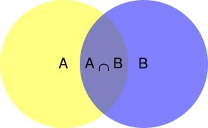

# Chương 1 Nền tảng toán học

> Ghi chú của người biên soạn: trang này dịch từ sách *Deep Learning 500 câu hỏi* (深度学习500问) do **Tan Jiyong (谈继勇)** chủ biên cùng cộng đồng đóng góp ([bản gốc](https://github.com/scutan90/DeepLearning-500-questions/tree/master/ch01_数学基础), [mã nguồn](https://github.com/scutan90/DeepLearning-500-questions), giấy phép [GPL-3.0](https://www.gnu.org/licenses/gpl-3.0.html); phần dịch cũng theo GPL-3.0). Số câu hỏi giữ như bản gốc. Chỗ bản gốc sai hoặc thiếu đã được sửa ngay trong bài và ghi ở ô **Biên tập**; ô **Lý thuyết** dẫn sang bài học tương ứng trên site.

Học sâu cần những kiến thức toán nào? Phần toán trong học sâu khó ở chỗ nào? Người mới bắt đầu thường hỏi như vậy. Các danh sách gợi ý trên mạng và trong sách hay liệt kê cả một loạt môn: giải tích, đại số tuyến tính, xác suất, hàm biến phức, tính toán số, lý thuyết tối ưu, lý thuyết thông tin… Các môn này đều có liên quan, nhưng nếu học theo đúng phạm vi đó thì tốn rất nhiều thời gian và dễ chán. Chương này chọn ra một số khái niệm toán cơ bản dễ nhầm lẫn và giới thiệu chúng, giúp bạn phân biệt rõ mối quan hệ giữa chúng.

## 1.1 Vector và ma trận

**Lý thuyết:** [Toán · Chương 1 Ôn tập Đại số tuyến tính](math/ch01_vi)

### 1.1.1 Số vô hướng, vector, ma trận và tensor liên hệ với nhau thế nào?

**Lý thuyết:** [Học sâu · 2.1 Thao tác với Dữ liệu](dl/ch02_s1_vi)

**Số vô hướng (scalar)**
Một số vô hướng là một số đơn lẻ, khác với phần lớn các đối tượng khác trong đại số tuyến tính (thường là mảng gồm nhiều số). Số vô hướng được viết in nghiêng và thường đặt tên bằng chữ thường, ví dụ $x$.

**Vector**
Một vector là một dãy số có thứ tự. Nhờ chỉ số trong dãy, ta xác định được từng số riêng lẻ. Vector thường được đặt tên bằng chữ thường in đậm, ví dụ $\mathbf{x}$. Các phần tử của vector viết in nghiêng kèm chỉ số dưới: phần tử thứ nhất của $\mathbf{x}$ là $x_1$, phần tử thứ hai là $x_2$, cứ thế tiếp tục. Ta cũng ghi rõ kiểu của các phần tử (số thực, số phức…), chẳng hạn $\mathbf{x} \in \mathbb{R}^n$.

**Ma trận (matrix)**
Ma trận là một mảng số hai chiều, mỗi phần tử được xác định bởi hai chỉ số (hàng, cột). Trong học máy, ma trận dữ liệu thường được hiểu như một bảng: mỗi hàng là một đối tượng (mẫu), mỗi cột là một đặc trưng, mỗi đặc trưng nhận giá trị số. Ma trận thường được đặt tên bằng chữ hoa in đậm, ví dụ $\mathbf{A}$.

**Tensor**
Đôi khi ta cần mảng có nhiều hơn hai trục tọa độ. Nói chung, một mảng mà các phần tử được sắp trên một lưới đều nhiều chiều được gọi là tensor. Ta dùng $\mathsf{A}$ để chỉ tensor "A"; phần tử có tọa độ $(i,j,k)$ của tensor $\mathsf{A}$ được viết là $\mathsf{A}_{i,j,k}$.

**Quan hệ giữa bốn khái niệm**

> Số vô hướng là tensor bậc 0, vector là tensor bậc 1, ma trận là tensor bậc 2. Một ví dụ dễ hình dung:
> Số vô hướng giống như biết chiều dài của một cây gậy nhưng không biết gậy chỉ về đâu.
> Vector giống như biết cả chiều dài lẫn việc gậy chỉ về phía trước hay phía sau.
> Tensor giống như biết chiều dài, biết gậy chỉ về phía trước hay sau, và còn biết gậy lệch lên/xuống, sang trái/phải bao nhiêu.

### 1.1.2 Tensor và ma trận khác nhau thế nào?

- Về mặt đại số, tensor là sự mở rộng của vector và ma trận. Vector có thể xem như một "bảng" một chiều (các thành phần xếp thành một hàng), ma trận là "bảng" hai chiều (các thành phần xếp theo hàng và cột), còn tensor bậc $n$ là "bảng" $n$ chiều. Định nghĩa chặt chẽ của tensor dùng ánh xạ (đa) tuyến tính.
- Về mặt hình học, tensor (và vector) là một đại lượng hình học thực sự: nó không phụ thuộc vào việc chọn hệ tọa độ. Khi đổi hệ tọa độ, các thành phần của nó biến đổi theo một quy tắc xác định, còn bản thân đối tượng thì không đổi. Ma trận chỉ là bảng các thành phần của một tensor bậc 2 trong một hệ tọa độ cụ thể.
- Một tensor bậc 2 trong không gian ba chiều có thể viết dưới dạng ma trận $3\times 3$.
- Số biểu diễn một số vô hướng và mảng ba thành phần biểu diễn một vector trong không gian ba chiều cũng có thể xem lần lượt là ma trận $1\times 1$ và $1\times 3$.

> **Biên tập:** bản gốc viết "ma trận là một đại lượng hình học thực sự, không đổi khi đổi hệ tọa độ" và "tensor có thể biểu diễn bằng ma trận 3×3". Cả hai câu đều đúng cho *tensor* (bậc 2, trong không gian ba chiều) chứ không đúng cho ma trận nói chung, nên đã sửa lại. Trong thực hành học sâu (PyTorch, NumPy), "tensor" chỉ đơn giản là mảng nhiều chiều, không kèm quy tắc đổi tọa độ.

### 1.1.3 Kết quả phép nhân ma trận với vector

**Lý thuyết:** [Toán · 1.3 Phép nhân hai ma trận](math/ch01_vi?id=_13-phép-nhân-hai-ma-trận)

Nếu dùng quy ước tổng Einstein (Einstein summation convention), tích của hai ma trận $\mathbf{A}$, $\mathbf{B}$ là ma trận $\mathbf{C}$ được viết:

$$
c_{ij} = a_{ik}\,b_{kj} \tag{1.1}
$$

trong đó $a_{ik}$, $b_{kj}$, $c_{ij}$ lần lượt là phần tử của $\mathbf{A}, \mathbf{B}, \mathbf{C}$. Chỉ số $k$ xuất hiện hai lần là một biến câm (dummy variable): ta lấy tổng theo mọi giá trị của nó, tức là $c_{ij} = \sum_k a_{ik} b_{kj}$.

Phép nhân ma trận với vector là trường hợp riêng của phép nhân hai ma trận, khi $\mathbf{B}$ là ma trận $n \times 1$: $\mathbf{y} = \mathbf{A}\mathbf{x}$ với $y_i = \sum_k a_{ik} x_k$.

### 1.1.4 Tổng hợp các chuẩn của vector và ma trận

**Lý thuyết:** [Toán · 1.14 Chuẩn](math/ch01_vi?id=_114-chuẩn)

**Chuẩn (norm) của vector**
Xét vector $\mathbf{a}=[-5, 6, 8, -10]$ và một vector bất kỳ $\mathbf{x}=(x_1,x_2,\dots,x_N)$. Các chuẩn khác nhau được tính như sau:

- Chuẩn 1 của vector: tổng giá trị tuyệt đối các phần tử. Với $\mathbf{a}$ ở trên, kết quả là 29.

$$
\Vert\mathbf{x}\Vert_1=\sum_{i=1}^N\vert{x_i}\vert
$$

- Chuẩn 2 của vector: căn bậc hai của tổng bình phương các phần tử. Với $\mathbf{a}$, kết quả là 15.

$$
\Vert\mathbf{x}\Vert_2=\sqrt{\sum_{i=1}^N{\vert{x_i}\vert}^2}
$$

- "Chuẩn âm vô cùng" của vector: giá trị tuyệt đối nhỏ nhất trong các phần tử. Với $\mathbf{a}$, kết quả là 5.

$$
\Vert\mathbf{x}\Vert_{-\infty}=\min_i{|{x_i}|}
$$

- Chuẩn vô cùng (chuẩn max) của vector: giá trị tuyệt đối lớn nhất trong các phần tử. Với $\mathbf{a}$, kết quả là 10.

$$
\Vert\mathbf{x}\Vert_{+\infty}=\max_i{|{x_i}|}
$$

- Chuẩn $p$ của vector ($p \ge 1$):

$$
L_p=\Vert\mathbf{x}\Vert_p=\left(\sum_{i=1}^{N}|{x_i}|^p\right)^{1/p}
$$

> **Biên tập:** "chuẩn âm vô cùng" là giới hạn của biểu thức trên khi $p \to -\infty$, nhưng nó **không** phải là một chuẩn (không thỏa bất đẳng thức tam giác; một vector khác 0 có thể có giá trị bằng 0). Công thức chuẩn $p$ chỉ cho một chuẩn khi $p \ge 1$.

**Chuẩn của ma trận**

Xét ma trận $\mathbf{A}=\begin{bmatrix}-1 & 2 & -3\\ 4 & -6 & 6\end{bmatrix}$ và một ma trận bất kỳ $\mathbf{A}_{m\times n}$ có phần tử $a_{ij}$.

Chuẩn ma trận *cảm sinh* (induced norm) từ chuẩn vector được định nghĩa là

$$
\Vert{\mathbf{A}}\Vert_p :=\sup_{\mathbf{x}\neq 0}\frac{\Vert{\mathbf{A}\mathbf{x}}\Vert_p}{\Vert{\mathbf{x}}\Vert_p}
$$

Chọn chuẩn vector khác nhau sẽ được chuẩn ma trận khác nhau.

- **Chuẩn 1 của ma trận (chuẩn cột)**: lấy tổng giá trị tuyệt đối trên từng cột, rồi lấy giá trị lớn nhất (tổng cột lớn nhất). Với $\mathbf{A}$ ở trên, tổng các cột là $[5,8,9]$, kết quả là 9.

$$
\Vert \mathbf{A}\Vert_1=\max_{1\le j\le n}\sum_{i=1}^m|{a_{ij}}|
$$

- **Chuẩn 2 của ma trận (chuẩn phổ)**: căn bậc hai của trị riêng lớn nhất của $\mathbf{A}^T\mathbf{A}$, cũng chính là giá trị suy biến lớn nhất của $\mathbf{A}$. Với $\mathbf{A}$, kết quả là 10.0623.

$$
\Vert \mathbf{A}\Vert_2=\sqrt{\lambda_{\max}(\mathbf{A}^T \mathbf{A})}
$$

trong đó $\lambda_{\max}(\mathbf{A}^T \mathbf{A})$ là trị riêng lớn nhất của $\mathbf{A}^T \mathbf{A}$ (ma trận này nửa xác định dương nên mọi trị riêng đều không âm).

- **Chuẩn vô cùng của ma trận (chuẩn hàng)**: lấy tổng giá trị tuyệt đối trên từng hàng, rồi lấy giá trị lớn nhất (tổng hàng lớn nhất). Với $\mathbf{A}$, tổng các hàng là $[6, 16]$, kết quả là 16.

$$
\Vert \mathbf{A}\Vert_{\infty}=\max_{1\le i \le m}\sum_{j=1}^n |{a_{ij}}|
$$

Các "chuẩn" dưới đây không phải chuẩn cảm sinh mà được tính trực tiếp trên các phần tử hoặc các giá trị suy biến:

- **Chuẩn kernel (nuclear norm)**: tổng các giá trị suy biến của ma trận (lấy từ phân tích SVD). Chuẩn này dùng để biểu diễn tính hạng thấp: cực tiểu hóa chuẩn hạt nhân là xấp xỉ lồi của việc cực tiểu hóa hạng. Với $\mathbf{A}$, kết quả là 10.9287.
- **"Chuẩn" L0 của ma trận**: số phần tử khác 0. Nó thường dùng để đo độ thưa: L0 càng nhỏ thì càng nhiều phần tử bằng 0, ma trận càng thưa. Với $\mathbf{A}$, kết quả là 6. (L0 không phải chuẩn thật, vì không thỏa $\Vert c\mathbf{A}\Vert = |c|\,\Vert\mathbf{A}\Vert$.)
- **Chuẩn L1 của ma trận (theo phần tử)**: tổng giá trị tuyệt đối mọi phần tử. Nó là xấp xỉ lồi tốt nhất của L0, nên cũng dùng để biểu diễn độ thưa. Với $\mathbf{A}$, kết quả là 22.
- **Chuẩn Frobenius (chuẩn F)**: căn bậc hai của tổng bình phương mọi phần tử. Ưu điểm của nó là bình phương của nó là hàm lồi khả vi, dễ lấy đạo hàm, dễ tính. Với $\mathbf{A}$, kết quả là 10.0995.

$$
\Vert \mathbf{A}\Vert_F=\sqrt{\sum_{i=1}^m\sum_{j=1}^n{| a_{ij}|}^2}
$$

- **Chuẩn L2,1 của ma trận**: tính chuẩn 2 của từng cột, rồi lấy tổng (chuẩn 1) của các kết quả đó. Dễ thấy nó nằm giữa L1 và L2: thưa theo cột nhưng mượt trong mỗi cột. Với $\mathbf{A}$, kết quả là 17.1559.
- **Chuẩn $p$ theo phần tử (entrywise $p$-norm)**:

$$
\Vert \mathbf{A}\Vert_{p,\text{entry}}=\left(\sum_{i=1}^m\sum_{j=1}^n{| a_{ij}|}^p\right)^{1/p}
$$

> **Biên tập:** bản gốc gọi chuẩn F là "chuẩn L2 của ma trận" và dùng cùng ký hiệu $\Vert \mathbf{A}\Vert_p$ cho cả chuẩn cảm sinh lẫn chuẩn theo phần tử. Trong tài liệu toán, $\Vert\mathbf{A}\Vert_2$ thường là chuẩn phổ (giá trị suy biến lớn nhất), khác chuẩn F; chuẩn F là chuẩn $p=2$ *theo phần tử*. Các giá trị số trong câu này đã được kiểm lại bằng NumPy.

### 1.1.5 Làm sao kiểm tra một ma trận là xác định dương?

**Lý thuyết:** [Toán · 1.13 Ma trận xác định dương](math/ch01_vi?id=_113-ma-trận-xác-định-dương)

Với một ma trận **đối xứng** thực $\mathbf{A}$ cỡ $n\times n$, các điều kiện sau tương đương nhau và đều có nghĩa là $\mathbf{A}$ xác định dương ($\mathbf{x}^T\mathbf{A}\mathbf{x} > 0$ với mọi $\mathbf{x}\neq \mathbf{0}$):

- Mọi định thức con chính góc trái trên (leading principal minors) đều dương (tiêu chuẩn Sylvester);
- Tồn tại ma trận khả nghịch $\mathbf{C}$ sao cho $\mathbf{A} = \mathbf{C}^T\mathbf{C}$;
- Chỉ số quán tính dương bằng $n$;
- $\mathbf{A}$ tương đẳng (congruent) với ma trận đơn vị $\mathbf{E}$ (dạng chuẩn tắc là $\mathbf{E}$);
- Mọi phần tử trên đường chéo của dạng chính tắc đều dương;
- Mọi trị riêng đều dương;
- $\mathbf{A}$ là ma trận Gram (ma trận metric) của một cơ sở nào đó.

> **Biên tập:** đã thêm điều kiện "đối xứng". Các tiêu chí trên (nhất là tiêu chí trị riêng và Sylvester) chỉ áp dụng cho ma trận đối xứng (hoặc Hermitian).

## 1.2 Đạo hàm và đạo hàm riêng

**Lý thuyết:** [Toán · Chương 2 Giải tích ma trận](math/ch02_vi)

### 1.2.1 Tính đạo hàm và đạo hàm riêng

**Định nghĩa đạo hàm**

Đạo hàm (derivative) là giới hạn của tỉ số giữa biến thiên của hàm số và biến thiên của biến độc lập khi biến thiên này tiến tới 0. Ý nghĩa hình học của nó là hệ số góc tiếp tuyến tại điểm đó; ý nghĩa vật lý là tốc độ thay đổi (tức thời) tại thời điểm đó.

*Lưu ý*: với hàm một biến, chỉ có một biến độc lập thay đổi, tức là chỉ có một hướng thay đổi, vì vậy hàm một biến không cần khái niệm đạo hàm riêng. Trong vật lý có vận tốc trung bình và vận tốc tức thời. Vận tốc trung bình là

$$
v=\frac{s}{t}
$$

trong đó $v$ là vận tốc trung bình, $s$ là quãng đường, $t$ là thời gian. Công thức này có thể viết lại thành

$$
\bar{v}=\frac{\Delta s}{\Delta t}=\frac{s(t_0+\Delta t)-s(t_0)}{\Delta t}
$$

trong đó $\Delta s$ là quãng đường giữa hai điểm, còn $\Delta t$ là thời gian cần để đi hết quãng đường đó. Khi $\Delta t$ tiến tới 0 ($\Delta t \to 0$), tức là khoảng thời gian rất ngắn, vận tốc trung bình trở thành vận tốc tức thời tại thời điểm $t_0$:

$$
v(t_0)=\lim_{\Delta t \to 0}{\bar{v}}=\lim_{\Delta t \to 0}{\frac{\Delta s}{\Delta t}}=\lim_{\Delta t \to 0}{\frac{s(t_0+\Delta t)-s(t_0)}{\Delta t}}
$$

Thực ra biểu thức trên chính là đạo hàm tại $t=t_0$ của hàm quãng đường $s$ theo thời gian $t$. Tổng quát, nếu giới hạn của tốc độ thay đổi trung bình tồn tại, tức là tồn tại

$$
\lim_{\Delta x \to 0}{\frac{\Delta y}{\Delta x}}=\lim_{\Delta x \to 0}{\frac{f(x_0+\Delta x)-f(x_0)}{\Delta x}}
$$

thì giới hạn này được gọi là đạo hàm của hàm $y=f(x)$ tại điểm $x_0$, ký hiệu $f'(x_0)$, $y'\vert_{x=x_0}$, $\frac{dy}{dx}\vert_{x=x_0}$ hoặc $\frac{df(x)}{dx}\vert_{x=x_0}$.

Nói nôm na, đạo hàm là hệ số góc của tiếp tuyến với đường cong tại một điểm.

**Đạo hàm riêng**

Đã nói đến đạo hàm riêng (partial derivative) thì phải có ít nhất hai biến độc lập. Lấy ví dụ hàm hai biến $z=f(x,y)$: từ đạo hàm sang đạo hàm riêng là đi từ đường cong sang mặt cong. Tại một điểm trên đường cong chỉ có một tiếp tuyến, nhưng tại một điểm trên mặt cong có vô số tiếp tuyến. Đạo hàm riêng là tốc độ thay đổi của hàm nhiều biến dọc theo một trục tọa độ.

*Lưu ý*: nói trực quan, đạo hàm riêng là tốc độ thay đổi của hàm tại một điểm theo chiều dương của một trục tọa độ.

Giả sử hàm $z=f(x,y)$ xác định trong một lân cận của điểm $(x_0,y_0)$. Khi cố định $y=y_0$, $z$ trở thành hàm một biến $f(x,y_0)$ của $x$. Nếu hàm một biến này khả vi tại $x=x_0$, tức là giới hạn

$$
\lim_{\Delta x \to 0}{\frac{f(x_0+\Delta x,y_0)-f(x_0,y_0)}{\Delta x}}=A
$$

tồn tại, thì $A$ được gọi là đạo hàm riêng theo biến $x$ của hàm $z=f(x,y)$ tại điểm $(x_0,y_0)$, ký hiệu $f_x(x_0,y_0)$, $\frac{\partial z}{\partial x}\big\vert_{(x_0,y_0)}$, $\frac{\partial f}{\partial x}\big\vert_{(x_0,y_0)}$ hoặc $z_x\big\vert_{(x_0,y_0)}$.

Khi tính đạo hàm riêng, ta coi biến còn lại là hằng số và lấy đạo hàm như bình thường. Ví dụ đạo hàm riêng của $z=3x^2+xy$ theo $x$ là $z_x=6x+y$; lúc này $y$ đóng vai trò hệ số của $x$.

Ý nghĩa hình học của đạo hàm riêng tại $(x_0,y_0)$: đó là hệ số góc của tiếp tuyến với giao tuyến giữa mặt $z=f(x,y)$ và mặt phẳng $y=y_0$ (với $f_x$) hoặc mặt phẳng $x=x_0$ (với $f_y$), tại điểm đó.

### 1.2.2 Đạo hàm và đạo hàm riêng khác nhau thế nào?

Về bản chất, đạo hàm và đạo hàm riêng không khác nhau: nếu giới hạn tồn tại, cả hai đều là giới hạn của tỉ số giữa biến thiên của hàm số và biến thiên của biến độc lập khi biến thiên này tiến tới 0.

> - Hàm một biến: mỗi $x$ cho một $y$, chỉ có một đạo hàm.
> - Hàm hai biến: mỗi cặp $(x, y)$ cho một $z$, có hai đạo hàm: đạo hàm của $z$ theo $x$ và đạo hàm của $z$ theo $y$, gọi là các đạo hàm riêng.
> - Khi tính đạo hàm riêng theo một biến, coi biến kia là hằng số và chỉ lấy đạo hàm theo biến đang xét; như vậy việc tính đạo hàm riêng quy về tính đạo hàm của hàm một biến.

## 1.3 Trị riêng và vector riêng

**Lý thuyết:** [Toán · 1.11 Trị riêng và vector riêng](math/ch01_vi?id=_111-trị-riêng-và-vector-riêng) · [Toán · 1.12 Chéo hoá ma trận](math/ch01_vi?id=_112-chéo-hoá-ma-trận) · [Học máy · 20.2 Phân tích giá trị suy biến](ml/ch20_vi?id=_202-phân-tích-giá-trị-suy-biến)

### 1.3.1 Phân tích trị riêng và vector riêng

- Phân tích trị riêng (eigendecomposition) cho ta các trị riêng (eigenvalues) và vector riêng (eigenvectors).
- Nói một cách hình ảnh: vector riêng cho biết một "hướng đặc trưng" của phép biến đổi là gì, còn trị riêng cho biết theo hướng đó phép biến đổi co giãn bao nhiêu, tức là hướng đó "quan trọng" đến đâu.

Một vector $\mathbf{v} \neq \mathbf{0}$ là vector riêng của ma trận vuông $\mathbf{A}$ khi và chỉ khi

$$
\mathbf{A}\mathbf{v} = \lambda \mathbf{v}
$$

trong đó $\lambda$ là trị riêng ứng với vector riêng $\mathbf{v}$. Phân tích trị riêng viết ma trận dưới dạng

$$
\mathbf{A}=\mathbf{Q}\mathbf{\Lambda} \mathbf{Q}^{-1}
$$

trong đó $\mathbf{Q}$ là ma trận có các cột là các vector riêng của $\mathbf{A}$, $\mathbf{\Lambda}$ là ma trận đường chéo, mỗi phần tử trên đường chéo là một trị riêng. Theo quy ước, ta thường sắp các trị riêng từ lớn đến nhỏ; các vector riêng tương ứng mô tả các hướng biến đổi của ma trận, từ hướng chính đến hướng phụ. Nói cách khác, thông tin của ma trận $\mathbf{A}$ được biểu diễn qua các trị riêng và vector riêng của nó.

> **Biên tập:** không phải ma trận vuông nào cũng phân tích được như trên. Cần $\mathbf{A}$ chéo hóa được (có $n$ vector riêng độc lập tuyến tính). Với ma trận đối xứng thực, ta luôn có $\mathbf{A} = \mathbf{Q}\mathbf{\Lambda}\mathbf{Q}^T$ với $\mathbf{Q}$ trực giao. Bản gốc dùng ký hiệu $\sum$ (dấu tổng) cho ma trận đường chéo; ở đây đổi thành $\mathbf{\Lambda}$.

### 1.3.2 Giá trị suy biến và trị riêng liên hệ với nhau thế nào?

Mọi ma trận $\mathbf{A}$ cỡ $m\times n$ đều có phân tích giá trị suy biến (SVD)

$$
\mathbf{A} = \mathbf{U}\mathbf{\Sigma}\mathbf{V}^T,
$$

trong đó $\mathbf{U}$ ($m\times m$) và $\mathbf{V}$ ($n\times n$) là ma trận trực giao, các cột của chúng gọi là vector suy biến trái và phải; $\mathbf{\Sigma}$ là ma trận "đường chéo" cỡ $m\times n$ chứa các giá trị suy biến $\sigma_1\ge\sigma_2\ge\dots\ge 0$.

Giá trị suy biến và trị riêng gắn với nhau như sau. Lấy chuyển vị của $\mathbf{A}$ nhân với $\mathbf{A}$ rồi tìm trị riêng của $\mathbf{A}^T\mathbf{A}$:

$$
(\mathbf{A}^T\mathbf{A})\mathbf{v}_i = \lambda_i \mathbf{v}_i
$$

Các vector riêng $\mathbf{v}_i$ chính là các vector suy biến phải (cột của $\mathbf{V}$), và

$$
\sigma_i = \sqrt{\lambda_i}, \qquad \mathbf{u}_i=\frac{1}{\sigma_i}\mathbf{A}\mathbf{v}_i \quad (\sigma_i > 0)
$$

với $\sigma_i$ là giá trị suy biến và $\mathbf{u}_i$ là vector suy biến trái. Thật vậy, từ $\mathbf{A}=\mathbf{U}\mathbf{\Sigma}\mathbf{V}^T$ suy ra $\mathbf{A}^T\mathbf{A} = \mathbf{V}\mathbf{\Sigma}^T\mathbf{\Sigma}\mathbf{V}^T$, đây chính là phân tích trị riêng của $\mathbf{A}^T\mathbf{A}$ với các trị riêng $\sigma_i^2$; và $\mathbf{A}\mathbf{V} = \mathbf{U}\mathbf{\Sigma}$ cho $\mathbf{A}\mathbf{v}_i = \sigma_i \mathbf{u}_i$.

Giá trị suy biến cũng được sắp từ lớn đến nhỏ trong $\mathbf{\Sigma}$, và với nhiều ma trận thực tế chúng giảm rất nhanh: trong nhiều trường hợp, tổng của 10%, thậm chí 1% giá trị suy biến lớn nhất đã chiếm hơn 99% tổng tất cả các giá trị suy biến. Nghĩa là ta có thể dùng $r$ giá trị suy biến lớn nhất ($r$ nhỏ hơn nhiều so với $m, n$) để xấp xỉ ma trận, gọi là SVD cắt ngọn (truncated SVD):

$$
\mathbf{A}_{m\times n}\approx \mathbf{U}_{m \times r}\mathbf{\Sigma}_{r\times r}\mathbf{V}_{n \times r}^T
$$

Tích ba ma trận bên phải là một ma trận gần với $\mathbf{A}$; $r$ càng gần hạng của $\mathbf{A}$ thì kết quả càng gần $\mathbf{A}$ (khi $r$ bằng hạng thì bằng đúng $\mathbf{A}$). Theo định lý Eckart–Young, đây là xấp xỉ hạng $r$ tốt nhất theo chuẩn F.

> **Biên tập:** bản gốc nhắc tới "vector suy biến phải ở trên" mà chưa từng giới thiệu SVD, viết $u_i = \frac{1}{\sigma_i}AV$ (đúng ra là $\mathbf{A}\mathbf{v}_i$), để lại ghi chú nháp "người chứng minh cũng không đưa ra chứng minh", và nói "$r$ càng gần $n$". Đã bổ sung định nghĩa SVD, phần chứng minh ngắn và sửa các chỗ trên.

## 1.4 Phân phối xác suất và biến ngẫu nhiên

**Lý thuyết:** [Toán · 3.1 Xác suất](math/ch03_vi?id=_31-xác-suất)

### 1.4.1 Vì sao học máy cần dùng xác suất?

Xác suất của một sự kiện đo khả năng xảy ra của sự kiện đó. Trong một lần thử ngẫu nhiên, việc một sự kiện xảy ra hay không mang tính tình cờ, nhưng những phép thử ngẫu nhiên có thể lặp lại nhiều lần trong cùng điều kiện thường cho thấy quy luật số lượng rõ ràng.

Học máy phải xử lý cả những đại lượng không chắc chắn lẫn những đại lượng ngẫu nhiên. Tính không chắc chắn và tính ngẫu nhiên có thể đến từ nhiều nguồn; ta dùng lý thuyết xác suất để định lượng chúng.

Lý thuyết xác suất đóng vai trò cốt lõi trong học máy, vì thiết kế của các thuật toán học máy thường dựa trên các giả định xác suất về dữ liệu.

> Ví dụ, trong khóa học Machine Learning của Andrew Ng, giả định của Naive Bayes là một ví dụ về độc lập có điều kiện. Thuật toán này đưa ra một giả định về nội dung email để phân biệt thư rác: dù email có phải thư rác hay không, xác suất từ $x$ xuất hiện trong email độc lập có điều kiện với từ $y$. Rõ ràng đây là một giả định rất mạnh, không đúng trong mọi trường hợp, vì có những từ gần như luôn đi cùng nhau. Tuy vậy, giả định đơn giản này ít ảnh hưởng tới kết quả cuối cùng và giúp ta phân loại thư rác rất nhanh.

### 1.4.2 Biến thông thường và biến ngẫu nhiên khác nhau thế nào?

**Lý thuyết:** [Toán · 3.1.1 Biến ngẫu nhiên](math/ch03_vi?id=_311-biến-ngẫu-nhiên)

**Biến ngẫu nhiên** (random variable)

Biến ngẫu nhiên là một hàm nhận giá trị thực, gán cho mỗi kết quả (mỗi điểm mẫu) của một hiện tượng ngẫu nhiên một con số. Hiện tượng ngẫu nhiên là hiện tượng mà trong cùng điều kiện không phải lúc nào cũng cho cùng một kết quả. Ví dụ: số hành khách chờ ở trạm xe buýt trong một khoảng thời gian, số cuộc gọi tổng đài nhận được trong một khoảng thời gian, đều là các biến ngẫu nhiên.

Biến ngẫu nhiên khác biến mờ (fuzzy variable) ở bản chất của sự không chắc chắn: với biến ngẫu nhiên, sau khi phép thử diễn ra thì kết quả là xác định; còn với biến mờ, ngay cả kết quả đo được vẫn không rõ ràng, tức là mang tính mơ hồ.

**Biến thông thường và biến ngẫu nhiên khác nhau ở đâu:**
Nói một cách nôm na: khi một biến nhận một giá trị với xác suất nhỏ hơn 1 (có nhiều giá trị khả dĩ), nó là biến ngẫu nhiên; khi biến ngẫu nhiên nhận một giá trị với xác suất bằng 1, nó suy biến thành một biến (hằng) thông thường.

> Ví dụ:
> Nếu biến $x$ bằng 100 với xác suất 1, thì $x=100$ là xác định, không thay đổi nữa, trừ khi có phép tính tiếp theo.
> Nếu biến $x$ bằng 100 với xác suất khác 1, chẳng hạn bằng 50 với xác suất 0.5 và bằng 100 với xác suất 0.5, thì biến này thay đổi tùy điều kiện, nó là biến ngẫu nhiên; xác suất nhận giá trị 50 hay 100 đều là 0.5, tức 50%.

### 1.4.3 Biến ngẫu nhiên liên hệ với phân phối xác suất thế nào?

Một biến ngẫu nhiên chỉ cho biết những trạng thái có thể xảy ra; ta còn cần một phân phối xác suất đi kèm để chỉ rõ khả năng của từng trạng thái. Cách mô tả khả năng xảy ra của từng trạng thái của một biến ngẫu nhiên (hoặc một nhóm biến ngẫu nhiên) được gọi là **phân phối xác suất (probability distribution)**.

Biến ngẫu nhiên chia thành biến ngẫu nhiên rời rạc và biến ngẫu nhiên liên tục.

Hàm mô tả phân phối xác suất tương ứng là:

- Hàm khối xác suất (Probability Mass Function, PMF): mô tả phân phối của biến ngẫu nhiên rời rạc, thường ký hiệu bằng chữ hoa $P$.
- Hàm mật độ xác suất (Probability Density Function, PDF): mô tả phân phối của biến ngẫu nhiên liên tục, thường ký hiệu bằng chữ thường $p$.

### 1.4.4 Biến ngẫu nhiên rời rạc và hàm khối xác suất

PMF ánh xạ mỗi trạng thái mà biến ngẫu nhiên có thể nhận tới xác suất để biến ngẫu nhiên nhận trạng thái đó. (Theo cách viết của sách *Deep Learning* của Goodfellow và cộng sự, biến ngẫu nhiên viết bằng chữ đứng $\mathrm{x}$, giá trị của nó viết bằng chữ nghiêng $x$.)

- Thông thường, $P(x)$ là xác suất để $\mathrm{x}=x$.
- Đôi khi, để tránh nhầm lẫn, ta ghi rõ tên biến ngẫu nhiên: $P(\mathrm{x}=x)$.
- Đôi khi ta định nghĩa biến ngẫu nhiên trước rồi chỉ ra phân phối mà nó tuân theo: $\mathrm{x} \sim P(\mathrm{x})$.

PMF có thể áp dụng đồng thời cho nhiều biến ngẫu nhiên, gọi là phân phối xác suất đồng thời (joint probability distribution): $P(\mathrm{x}=x,\mathrm{y}=y)$ là xác suất để $\mathrm{x}=x$ và $\mathrm{y}=y$ cùng xảy ra, có thể viết gọn là $P(x,y)$.

Nếu hàm $P$ là PMF của biến ngẫu nhiên $\mathrm{x}$ thì nó phải thỏa ba điều kiện:

- Miền xác định của $P$ phải là tập mọi trạng thái có thể của $\mathrm{x}$.
- $\forall x\in\mathrm{x},\ 0 \leq P(x) \leq 1$.
- $\sum_{x\in\mathrm{x}} P(x)=1$. Tính chất này gọi là tính chuẩn hóa (normalized).

### 1.4.5 Biến ngẫu nhiên liên tục và hàm mật độ xác suất

Nếu hàm $p$ là PDF của $\mathrm{x}$ thì nó phải thỏa các điều kiện:

- Miền xác định của $p$ phải là tập mọi trạng thái có thể của $\mathrm{x}$.
- $\forall x\in\mathrm{x},\ p(x)\ge 0$. Lưu ý ta **không** đòi hỏi $p(x)\le 1$, vì $p(x)$ không phải xác suất của trạng thái đó mà là một mật độ (độ lớn tương đối). Muốn có xác suất cụ thể thì phải lấy tích phân.
- $\int p(x)\,dx=1$: tích phân trên toàn miền vẫn bằng 1, tổng xác suất vẫn là 1.

Chú ý: PDF $p(x)$ không trực tiếp cho xác suất của một trạng thái cụ thể mà cho mật độ; xác suất để $x$ rơi vào một khoảng vô cùng nhỏ có độ rộng $\delta x$ là $p(x)\,\delta x$. Vì vậy ta không tính được xác suất của một trạng thái cụ thể (nó bằng 0), mà chỉ tính được xác suất để $x$ rơi vào một khoảng $[a,b]$, bằng $\int_{a}^{b}p(x)\,dx$.

### 1.4.6 Hiểu xác suất có điều kiện qua ví dụ

**Lý thuyết:** [Toán · 3.1.4 Xác suất có điều kiện](math/ch03_vi?id=_314-xác-suất-có-điều-kiện)

Công thức xác suất có điều kiện:

$$
P(A|B) = \frac{P(A\cap B)}{P(B)}, \quad P(B) > 0
$$

Giải thích: với hai sự kiện (tập con) $A$ và $B$ trong cùng một không gian mẫu $\Omega$, nếu biết một phần tử được chọn ngẫu nhiên từ $\Omega$ thuộc $B$, thì xác suất để **chính phần tử đó** cũng thuộc $A$ được gọi là xác suất có điều kiện của $A$ khi biết $B$. Biểu đồ Venn của xác suất có điều kiện ở Hình 1.1.

Hình 1.1 Biểu đồ Venn minh họa xác suất có điều kiện

Từ biểu đồ Venn có thể thấy rõ: khi $B$ đã xảy ra, xác suất để $A$ xảy ra bằng $P(A\cap B)$ chia cho $P(B)$.

Ví dụ: một cặp vợ chồng có hai con, biết rằng có ít nhất một con là con gái. Hỏi xác suất cả hai con đều là con gái là bao nhiêu? (Câu này từng gặp cả trong phỏng vấn lẫn bài thi viết.)

- **Liệt kê**: biết có ít nhất một con gái thì không gian mẫu còn lại là {trai–gái, gái–gái, gái–trai}, nên xác suất cả hai là con gái là $1/3$.
- **Dùng công thức**: không gian mẫu đầy đủ của hai con là {gái–gái, trai–gái, gái–trai, trai–trai}, mỗi trường hợp xác suất $1/4$. Gọi $G$ = "cả hai là gái", $H$ = "có ít nhất một gái". Ta có $P(G \cap H) = P(G) = 1/4$, $P(H) = 1 - P(\text{trai–trai}) = 3/4$, nên $P(G|H) = \frac{1/4}{3/4} = 1/3$.

Chỗ dễ hiểu nhầm là coi "trai–gái" và "gái–trai" là một trường hợp; thực ra chúng khác nhau, giống như "chị–em trai" và "anh–em gái" là hai trường hợp khác nhau.

> **Biên tập:** bản gốc giải thích xác suất có điều kiện là "nếu phần tử chọn ra thuộc $B$ thì xác suất *phần tử chọn tiếp theo* thuộc $A$", điều này sai: cả hai điều kiện nói về cùng một phần tử. Bản gốc còn viết $P(\text{gái}|\text{gái})$, dễ hiểu nhầm thành "biết con đầu là gái" (khi đó đáp án là $1/2$); đã viết lại rõ điều kiện "có ít nhất một con gái".

### 1.4.7 Xác suất đồng thời và xác suất biên: khác và giống nhau thế nào?

**Lý thuyết:** [Toán · 3.1.2 Xác suất đồng thời](math/ch03_vi?id=_312-xác-suất-đồng-thời) · [Toán · 3.1.3 Xác suất biên](math/ch03_vi?id=_313-xác-suất-biên)

**Khác nhau:**
Xác suất đồng thời: là xác suất dạng $P(X=a,Y=b)$, gồm nhiều điều kiện và mọi điều kiện cùng thỏa. Trong một phân phối nhiều biến, xác suất đồng thời là xác suất để nhiều biến ngẫu nhiên cùng thỏa các điều kiện riêng của chúng.
Xác suất biên: là xác suất của một sự kiện, không quan tâm tới các sự kiện khác. Xác suất biên có dạng $P(X=a)$, $P(Y=b)$, chỉ liên quan đến một biến ngẫu nhiên.

**Liên hệ:**
Từ phân phối đồng thời có thể suy ra phân phối biên (lấy tổng hoặc tích phân theo các biến còn lại: $P(X=a) = \sum_b P(X=a, Y=b)$), nhưng nếu chỉ biết các phân phối biên thì nói chung không suy ra được phân phối đồng thời (trừ khi biết các biến độc lập).

### 1.4.8 Quy tắc chuỗi của xác suất có điều kiện

Từ định nghĩa xác suất có điều kiện suy ra ngay quy tắc nhân: với hai sự kiện $A, B$ và $P(A) > 0$,

$$
P(AB) = P(B|A)P(A)
$$

Mở rộng:

$$
P(ABC)=P(C|AB)P(B|A)P(A)
$$

Tổng quát, bằng quy nạp: nếu $P(A_1A_2\dots A_{n-1})>0$ thì

$$
\begin{aligned}
P(A_1A_2\dots A_n)&=P(A_n|A_1\dots A_{n-1})\,P(A_{n-1}|A_1\dots A_{n-2})\cdots P(A_2|A_1)\,P(A_1) \\
&=P(A_1)\prod_{i=2}^{n}P(A_i|A_1A_2\dots A_{i-1})
\end{aligned}
$$

Như vậy, mọi phân phối đồng thời của nhiều biến ngẫu nhiên đều có thể phân tích thành tích các xác suất có điều kiện, mỗi thừa số chỉ ứng với một biến.

### 1.4.9 Độc lập và độc lập có điều kiện

**Lý thuyết:** [Toán · 3.1.6 Biến ngẫu nhiên độc lập](math/ch03_vi?id=_316-biến-ngẫu-nhiên-độc-lập)

**Độc lập**
Hai biến ngẫu nhiên $x$ và $y$ độc lập (independent) nếu phân phối đồng thời của chúng viết được thành tích của hai thừa số, một thừa số chỉ chứa $x$, thừa số kia chỉ chứa $y$: $P(x, y) = P(x)P(y)$.

Một điều kiện có thể làm cho các sự kiện vốn không độc lập trở nên độc lập, và cũng có thể làm cho các sự kiện vốn độc lập mất tính độc lập.
Ví dụ: $P(X,Y)=P(X)P(Y)$, tức $X$ và $Y$ độc lập. Khi biết thêm $Z$, có thể xảy ra

$$
P(X,Y|Z) \neq P(X|Z)P(Y|Z)
$$

(chẳng hạn $X$, $Y$ là kết quả hai lần tung đồng xu độc lập và $Z$ = "hai lần cho kết quả giống nhau": biết $Z$ và biết $X$ thì suy ra được $Y$).

Khi các sự kiện độc lập, xác suất đồng thời bằng tích các xác suất. Đây là một tính chất toán học rất đẹp, nhưng tiếc là độc lập không điều kiện khá hiếm gặp, vì trong đa số trường hợp các sự kiện ảnh hưởng lẫn nhau.

**Độc lập có điều kiện**
Khi biết $Z$, $X$ và $Y$ độc lập có điều kiện khi và chỉ khi

$$
X\perp Y\mid Z \iff P(X,Y|Z) = P(X|Z)P(Y|Z)
$$

Quan hệ giữa $X$ và $Y$ đi qua $Z$ chứ không trực tiếp.

> **Ví dụ** Xét các sự kiện:
> $X$: ngày mai mưa;
> $Y$: hôm nay mặt đất ướt;
> $Z$: hôm nay có mưa hay không.
> $Z$ ảnh hưởng tới cả $X$ và $Y$, nhưng khi đã biết $Z$ thì tình trạng mặt đất hôm nay không cho thêm thông tin gì về việc ngày mai có mưa hay không.

## 1.5 Các phân phối xác suất thường gặp

**Lý thuyết:** [Toán · 3.2 Một vài phân phối thường gặp](math/ch03_vi?id=_32-một-vài-phân-phối-thường-gặp)

### 1.5.1 Phân phối Bernoulli

**Lý thuyết:** [Toán · 3.2.1 Phân phối Bernoulli](math/ch03_vi?id=_321-phân-phối-bernoulli) · [Toán · 3.2.2 Phân phối categorical](math/ch03_vi?id=_322-phân-phối-categorical)

**Phân phối Bernoulli** (phân phối 0–1) là phân phối của một biến ngẫu nhiên nhị phân, được điều khiển bởi một tham số $\phi \in [0,1]$; $\phi$ là xác suất để biến ngẫu nhiên bằng 1. Các tính chất chính:

$$
\begin{aligned}
P(\mathrm{x}=1) &= \phi \\
P(\mathrm{x}=0) &= 1-\phi  \\
\text{Hàm khối xác suất: } P(\mathrm{x}=x) &= \phi^x(1-\phi)^{1-x}
\end{aligned}
$$

Kỳ vọng và phương sai:

$$
\begin{aligned}
\mathbb{E}_{\mathrm{x}}[\mathrm{x}] &= \phi \\
\mathrm{Var}_{\mathrm{x}}(\mathrm{x}) &= \phi{(1-\phi)}
\end{aligned}
$$

**Phạm vi dùng**: phân phối Bernoulli phù hợp để mô hình hóa biến ngẫu nhiên **rời rạc** nhị phân.

**Phân phối Multinoulli**, còn gọi là **phân phối categorical**, là phân phối của một biến ngẫu nhiên rời rạc có $k$ trạng thái, thường dùng để biểu diễn **phân phối của nhãn lớp**, với $k$ hữu hạn. Phân phối Multinoulli được tham số hóa bởi vector $\mathbf{p}\in[0,1]^{k-1}$, mỗi thành phần $p_i$ là xác suất của trạng thái thứ $i$, và $p_k=1-\mathbf{1}^T\mathbf{p}$. Ở đây $\mathbf{1}^T$ là chuyển vị của vector toàn số 1, nên $\mathbf{1}^T\mathbf{p}$ chính là tổng xác suất của $k-1$ trạng thái đầu. Có thể viết lại $p_k=1-\sum_{i=1}^{k-1}p_i$ (cần thêm điều kiện $\mathbf{1}^T\mathbf{p} \le 1$).

Bổ sung phân phối nhị thức và phân phối đa thức:

Phân phối nhị thức (binomial distribution): nói nôm na là tung đồng xu nhiều lần. Đó là phân phối của số lần thành công trong **$n$ phép thử Bernoulli độc lập**.

Phân phối đa thức (multinomial distribution) là mở rộng của phân phối nhị thức. Phân phối nhị thức làm $n$ phép thử Bernoulli, mỗi phép thử chỉ có hai kết quả. Nếu vẫn làm $n$ phép thử độc lập nhưng mỗi phép thử có $m$ kết quả loại trừ nhau, với xác suất có tổng bằng 1, thì phân phối của bộ số lần xuất hiện $(X_1, \dots, X_m)$ của từng kết quả là phân phối đa thức.

> **Biên tập:** sửa chỉ số trong $p_k=1-\sum_{i=1}^{k-1}p_i$ (bản gốc viết $\sum_{0}^{k-1}$) và diễn đạt lại định nghĩa phân phối đa thức: nó là phân phối đồng thời của số lần xuất hiện của *mọi* kết quả, không phải "xác suất một kết quả xuất hiện $X$ lần".

### 1.5.2 Phân phối Gauss

**Lý thuyết:** [Toán · 3.2.3 Phân phối chuẩn một chiều](math/ch03_vi?id=_323-phân-phối-chuẩn-một-chiều) · [Toán · 3.2.4 Phân phối chuẩn nhiều chiều](math/ch03_vi?id=_324-phân-phối-chuẩn-nhiều-chiều)

Phân phối Gauss còn gọi là phân phối chuẩn (normal distribution), có hàm mật độ xác suất:

$$
\mathcal{N}(x;\mu,\sigma^2) = \sqrt{\frac{1}{2\pi\sigma^2}}\exp\left ( -\frac{1}{2\sigma^2}(x-\mu)^2 \right )
$$

trong đó $\mu$ và $\sigma$ lần lượt là kỳ vọng và độ lệch chuẩn. Tọa độ $x$ của đỉnh là $\mu$, độ rộng của đỉnh do $\sigma$ điều khiển; hàm đạt cực đại tại $x=\mu$ và có điểm uốn tại $x=\mu\pm\sigma$.

Với phân phối chuẩn, xác suất rơi vào các khoảng $\pm1\sigma$, $\pm2\sigma$, $\pm3\sigma$ quanh kỳ vọng lần lượt là 68.27%, 95.45%, 99.73%. Ba con số này nên nhớ.

Khi $\mu=0,\sigma=1$, phân phối Gauss trở thành phân phối chuẩn tắc:

$$
\mathcal{N}(x;0,1) = \sqrt{\frac{1}{2\pi}}\exp\left ( -\frac{1}{2}x^2 \right )
$$

Để tính hàm mật độ hiệu quả hơn, có thể tham số hóa bằng độ chính xác (precision) $\beta$:

$$
\mathcal{N}(x;\mu,\beta^{-1})=\sqrt{\frac{\beta}{2\pi}}\exp\left(-\frac{1}{2}\beta(x-\mu)^2\right)
$$

trong đó $\beta=\frac{1}{\sigma^2}\in(0,\infty)$ điều khiển độ chính xác của phân phối.

### 1.5.3 Khi nào nên dùng phân phối chuẩn?

Hỏi: khi nào nên dùng phân phối chuẩn?
Đáp: khi thiếu hiểu biết tiên nghiệm về phân phối trên tập số thực và không biết nên chọn dạng nào, mặc định chọn phân phối chuẩn thường là lựa chọn an toàn, vì:

1. Định lý giới hạn trung tâm cho biết tổng (hoặc trung bình) của nhiều biến ngẫu nhiên độc lập xấp xỉ phân phối chuẩn. Trong thực tế, nhiều hệ thống phức tạp có thể được mô hình hóa thành nhiễu có phân phối chuẩn, ngay cả khi hệ thống đó có thể phân rã thành các phần có cấu trúc.
2. Trong mọi phân phối trên $\mathbb{R}$ có cùng phương sai, phân phối chuẩn có độ bất định (entropy) lớn nhất. Nói cách khác, phân phối chuẩn là phân phối đưa ít hiểu biết tiên nghiệm nhất vào mô hình.

Mở rộng của phân phối chuẩn:
Phân phối chuẩn có thể mở rộng sang $\mathbb{R}^n$, gọi là **phân phối chuẩn nhiều chiều**, với tham số là một ma trận đối xứng xác định dương $\mathbf{\Sigma}$:

$$
\mathcal{N}(\mathbf{x};\boldsymbol{\mu},\mathbf{\Sigma})=\sqrt{\frac{1}{(2\pi)^n\det(\mathbf{\Sigma})}}\exp\left(-\frac{1}{2}(\mathbf{x}-\boldsymbol{\mu})^T\mathbf{\Sigma}^{-1}(\mathbf{x}-\boldsymbol{\mu})\right)
$$

Để tính mật độ chuẩn nhiều chiều hiệu quả hơn, dùng ma trận độ chính xác $\boldsymbol{\beta} = \mathbf{\Sigma}^{-1}$:

$$
\mathcal{N}(\mathbf{x};\boldsymbol{\mu},\boldsymbol{\beta}^{-1}) = \sqrt{\frac{\det(\boldsymbol{\beta})}{(2\pi)^n}}\exp\left(-\frac{1}{2}(\mathbf{x}-\boldsymbol{\mu})^T\boldsymbol{\beta}(\mathbf{x}-\boldsymbol{\mu})\right)
$$

> **Biên tập:** sửa ba lỗi của bản gốc: định lý giới hạn trung tâm nói về *tổng* nhiều biến độc lập chứ không phải "nhiều biến độc lập đều xấp xỉ chuẩn"; vế trái của công thức chuẩn tắc phải là $\mathcal{N}(x;0,1)$; công thức theo ma trận độ chính xác bị đặt $(2\pi)^n$ ra ngoài dấu căn và ở tử số, đúng ra là $\sqrt{\det(\boldsymbol\beta)/(2\pi)^n}$.

### 1.5.4 Phân phối mũ

Trong học sâu, ta thường cần một phân phối có điểm biên sắc nhọn tại $x=0$. Phân phối mũ (exponential distribution) đáp ứng điều đó:

$$
p(x;\lambda)=\lambda\, \mathbf{1}_{x\geq 0}\exp(-\lambda{x})
$$

Phân phối mũ dùng hàm chỉ thị $\mathbf{1}_{x\geq 0}$ để xác suất bằng 0 khi $x$ âm.

### 1.5.5 Phân phối Laplace

Một phân phối có liên hệ chặt chẽ là phân phối Laplace (Laplace distribution). Nó cho phép ta đặt đỉnh nhọn của khối xác suất tại một điểm $\mu$ bất kỳ:

$$
\text{Laplace}(x;\mu,\gamma)=\frac{1}{2\gamma}\exp\left(-\frac{|x-\mu|}{\gamma}\right)
$$

### 1.5.6 Phân phối Dirac và phân phối thực nghiệm

Phân phối Dirac đảm bảo toàn bộ khối xác suất tập trung tại một điểm. Phân phối Dirac được định nghĩa qua hàm delta Dirac $\delta$ (còn gọi là **hàm xung đơn vị**):

$$
p(x)=\delta(x-\mu), \quad \text{với } \delta(x-\mu) = 0 \text{ khi } x\neq \mu
$$

$$
\int_{a}^{b}\delta(x-\mu)\,dx = 1, \quad a < \mu < b
$$

Phân phối Dirac thường là một thành phần của phân phối thực nghiệm (empirical distribution):

$$
\hat{p}(\mathbf{x})=\frac{1}{m}\sum_{i=1}^{m}\delta(\mathbf{x}-{\mathbf{x}}^{(i)})
$$

trong đó $m$ điểm $\mathbf{x}^{(1)},\dots,\mathbf{x}^{(m)}$ là tập dữ liệu cho trước. **Phân phối thực nghiệm** gán khối xác suất $\frac{1}{m}$ cho mỗi điểm này.

Khi huấn luyện mô hình trên tập huấn luyện, có thể coi phân phối thực nghiệm thu được từ tập huấn luyện chính là **nguồn lấy mẫu**.

**Phạm vi dùng**: hàm delta Dirac phù hợp để định nghĩa phân phối thực nghiệm của biến ngẫu nhiên **liên tục**.

> **Biên tập:** bản gốc viết $p(x)=\delta(x-\mu),\ x\neq\mu$, đọc như thể $p(x)$ chỉ xác định khi $x \neq \mu$. Ý đúng là $\delta(x-\mu)$ bằng 0 ở mọi điểm $x\neq\mu$ và có tích phân bằng 1.

## 1.6 Kỳ vọng, phương sai, hiệp phương sai và hệ số tương quan

**Lý thuyết:** [Toán · 3.1.7 Kỳ vọng](math/ch03_vi?id=_317-kỳ-vọng) · [Toán · 3.1.8 Phương sai](math/ch03_vi?id=_318-phương-sai) · [Toán · 3.1.9 Ma trận hiệp phương sai](math/ch03_vi?id=_319-ma-trận-hiệp-phương-sai)

### 1.6.1 Kỳ vọng

Trong xác suất và thống kê, kỳ vọng toán học (hay giá trị trung bình, gọi tắt là kỳ vọng) là tổng của mọi kết quả có thể của phép thử nhân với xác suất của chúng. Nó phản ánh giá trị trung bình mà biến ngẫu nhiên nhận.

- Tính tuyến tính: $\mathbb{E}(ax+by+c) = a\mathbb{E}(x)+b\mathbb{E}(y)+c$
- Dạng tổng quát: $\mathbb{E}\left(\sum_{i=1}^{n}a_ix_i+c\right) = \sum_{i=1}^{n}a_i\mathbb{E}(x_i)+c$
- Kỳ vọng của hàm số: cho $f(x)$ là một hàm của $x$, kỳ vọng của $f(x)$ là
    - Trường hợp rời rạc: $\mathbb{E}(f(x))=\sum_{k=1}^{n}{f(x_k)P(x_k)}$
    - Trường hợp liên tục: $\mathbb{E}(f(x))=\int_{-\infty}^{+\infty}{f(x)p(x)\,dx}$

> Lưu ý:
>
> - Với $f$ là **hàm lồi**, kỳ vọng của hàm lớn hơn hoặc bằng hàm của kỳ vọng (bất đẳng thức Jensen): $\mathbb{E}(f(x))\geqslant f(\mathbb{E}(x))$. Với $f$ lõm thì bất đẳng thức đổi chiều.
> - Nói chung, kỳ vọng của tích không bằng tích các kỳ vọng.
> - Nếu $X$ và $Y$ độc lập thì $\mathbb{E}(XY)=\mathbb{E}(X)\mathbb{E}(Y)$.

> **Biên tập:** bản gốc phát biểu Jensen cho mọi hàm $f$, thiếu điều kiện $f$ lồi. Công thức tổng quát cũng đã sửa: hằng số $c$ chỉ cộng một lần, không nằm trong tổng.

### 1.6.2 Phương sai

Trong xác suất, phương sai đo mức độ lệch giữa biến ngẫu nhiên và kỳ vọng (giá trị trung bình) của nó. Phương sai là một kỳ vọng đặc biệt, được định nghĩa là

$$
\mathrm{Var}(x) = \mathbb{E}\left((x-\mathbb{E}(x))^2\right)
$$

> Tính chất của phương sai:
>
> 1) $\mathrm{Var}(x) = \mathbb{E}(x^2) -\mathbb{E}(x)^2$
> 2) Phương sai của hằng số bằng 0;
> 3) Phương sai không có tính tuyến tính: $\mathrm{Var}(ax+b) = a^2\mathrm{Var}(x)$;
> 4) Nếu $X$ và $Y$ độc lập: $\mathrm{Var}(aX+bY)=a^2\mathrm{Var}(X)+b^2\mathrm{Var}(Y)$.

### 1.6.3 Hiệp phương sai

Hiệp phương sai đo mức độ tương quan tuyến tính giữa hai biến (và cả thang đo của chúng). Hiệp phương sai của hai biến ngẫu nhiên được định nghĩa là

$$
\mathrm{Cov}(x,y)=\mathbb{E}\left((x-\mathbb{E}(x))(y-\mathbb{E}(y))\right)
$$

Phương sai là một hiệp phương sai đặc biệt: khi $x=y$ thì $\mathrm{Cov}(x,x)=\mathrm{Var}(x)$.

> Tính chất của hiệp phương sai:
>
> 1) Hiệp phương sai của hai biến độc lập bằng 0. Điều ngược lại không đúng: hiệp phương sai bằng 0 chưa chắc độc lập (ví dụ $x$ đối xứng quanh 0 và $y=x^2$).
> 2) Công thức song tuyến tính:
>
> $$
> \mathrm{Cov}\left(\sum_{i=1}^{m}{a_ix_i}, \sum_{j=1}^{n}{b_jy_j}\right) = \sum_{i=1}^{m} \sum_{j=1}^{n}{a_ib_j\,\mathrm{Cov}(x_i,y_j)}
> $$
>
> 3) Trường hợp đặc biệt:
>
> $$
> \mathrm{Cov}(a+bx, c+dy) = bd\,\mathrm{Cov}(x, y)
> $$

> **Biên tập:** bản gốc viết $\mathrm{Cov}(x_iy_i)$ trong công thức song tuyến tính; đúng phải là $\mathrm{Cov}(x_i,y_j)$.

### 1.6.4 Hệ số tương quan

Hệ số tương quan là đại lượng đo mức độ tương quan **tuyến tính** giữa các biến. Hệ số tương quan của hai biến ngẫu nhiên được định nghĩa là

$$
\mathrm{Corr}(x,y) = \frac{\mathrm{Cov}(x,y)}{\sqrt{\mathrm{Var}(x)\mathrm{Var}(y)}}
$$

> Tính chất của hệ số tương quan:
> 1) Bị chặn: hệ số tương quan nằm trong khoảng $[-1,1]$, có thể xem như hiệp phương sai không thứ nguyên.
> 2) Càng gần 1, tương quan dương (tuyến tính) càng mạnh; càng gần $-1$, tương quan âm càng mạnh. Bằng 0 nghĩa là hai biến không có tương quan **tuyến tính** (vẫn có thể phụ thuộc phi tuyến).

## Tài liệu tham khảo

[1] Ian Goodfellow, Yoshua Bengio, Aaron Courville. *Deep Learning* (bản tiếng Trung). Posts & Telecom Press, 2017.

[2] Chu Chí Hoa (Zhou Zhihua). *Machine Learning* (机器学习). Nhà xuất bản Đại học Thanh Hoa, 2016.

[3] Khoa Toán, Đại học Đồng Tế. *Toán cao cấp* (高等数学), bản thứ 7. Nhà xuất bản Giáo dục Đại học, 2014.

[4] Thịnh Sậu (Sheng Zhou) và cộng sự. *Xác suất và thống kê toán* (概率论与数理统计), bản thứ 4. Nhà xuất bản Giáo dục Đại học, 2008.
