# Chương 3 Nền tảng học sâu

> Ghi chú của người biên soạn: trang này dịch từ sách *Deep Learning 500 câu hỏi* (深度学习500问) do **Tan Jiyong (谈继勇)** chủ biên cùng cộng đồng đóng góp ([bản gốc](https://github.com/scutan90/DeepLearning-500-questions/tree/master/ch03_深度学习基础), [mã nguồn](https://github.com/scutan90/DeepLearning-500-questions), giấy phép [GPL-3.0](https://www.gnu.org/licenses/gpl-3.0.html); phần dịch cũng theo GPL-3.0). Số câu hỏi giữ như bản gốc. Chỗ bản gốc sai hoặc thiếu đã được sửa ngay trong bài và ghi ở ô **Biên tập**; ô **Lý thuyết** dẫn sang bài học tương ứng trên site.

## 3.1 Khái niệm cơ bản

**Lý thuyết:** [Học sâu · Chương 1 Giới thiệu](dl/ch01_vi) · [Học máy · Chương 16 Multilayer perceptron and backpropagation](ml/ch16_vi)

### 3.1.1 Mạng neuron gồm những thành phần nào?

**Lý thuyết:** [Học máy · 13.4 Mô hình mạng neuron đầu tiên](ml/ch13_vi?id=_134-mô-hình-mạng-neuron-đầu-tiên) · [Học máy · 16.1 Giới thiệu](ml/ch16_vi?id=_161-giới-thiệu)

Có rất nhiều loại mạng neuron, trong đó quan trọng nhất là perceptron đa tầng. Để mô tả mạng neuron cho chi tiết, ta bắt đầu từ mạng đơn giản nhất.

**Perceptron**

Mô hình neuron cơ bản trong perceptron đa tầng gọi là perceptron, do *Frank Rosenblatt* phát minh năm 1957.

Một perceptron đơn giản như hình dưới:

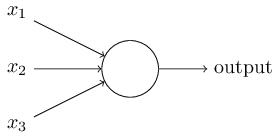

trong đó $x_1$, $x_2$, $x_3$ là đầu vào của perceptron, đầu ra của nó là:

$$
\text{output} = \begin{cases}
0, & \text{nếu } \sum_i w_i x_i \leqslant \text{threshold} \\
1, & \text{nếu } \sum_i w_i x_i > \text{threshold}
\end{cases}
$$

Có thể hình dung perceptron như một cơ chế bỏ phiếu có trọng số. Chẳng hạn 3 giám khảo chấm điểm một ca sĩ lần lượt là $4$, $1$, $-3$ điểm, trọng số của 3 giám khảo lần lượt là $1, 3, 2$, thì điểm cuối cùng của ca sĩ là $4 \times 1 + 1 \times 3 + (-3) \times 2 = 1$. Theo luật thi, ngưỡng (threshold) là $3$: chỉ khi tổng điểm lớn hơn $3$ thì ca sĩ mới được đi tiếp. Đối chiếu với perceptron, ca sĩ này bị loại, vì:

$$
\sum_i w_i x_i = 1 < \text{threshold}=3, \quad \text{output} = 0
$$

Thay threshold bằng $-b$, đầu ra trở thành:

$$
\text{output} = \begin{cases}
0, & \text{nếu } \mathbf{w} \cdot \mathbf{x} + b \leqslant 0 \\
1, & \text{nếu } \mathbf{w} \cdot \mathbf{x} + b > 0
\end{cases}
$$

Chọn $\mathbf{w}$ và $b$ phù hợp, một perceptron đơn lẻ có thể biểu diễn cổng NAND như sau (trọng số $-2, -2$, hệ số điều chỉnh $3$):

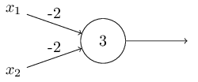

Khi đầu vào là $0$, $1$, đầu ra của perceptron là $0 \times (-2) + 1 \times (-2) + 3 = 1 > 0$, tức là 1.

Perceptron phức tạp hơn được ghép từ nhiều perceptron đơn giản:

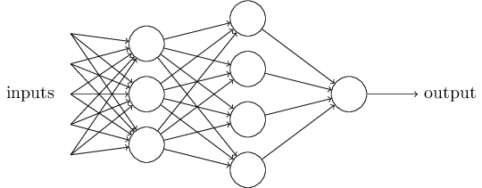

**Perceptron đa tầng**

Perceptron đa tầng (multilayer perceptron, MLP) là mở rộng của perceptron. Đặc điểm chính của nó là có nhiều tầng neuron; khi có nhiều tầng ẩn, nó cũng được gọi là mạng neuron sâu. Trong MLP kết nối đầy đủ, mỗi neuron ở tầng thứ $i$ được nối với mọi neuron ở tầng thứ $i-1$.

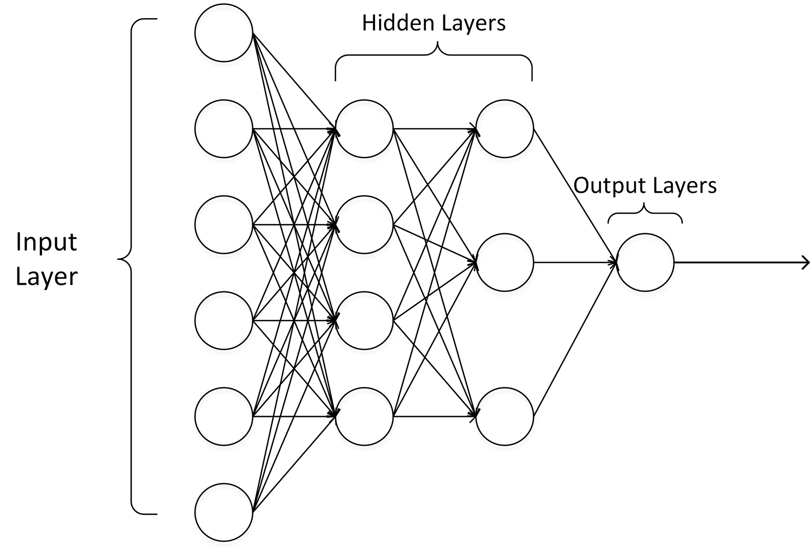

Tầng đầu ra có thể có nhiều hơn $1$ neuron. Tầng ẩn có thể chỉ có $1$ tầng, cũng có thể có nhiều tầng. Ví dụ một mạng neuron có tầng đầu ra gồm nhiều neuron:

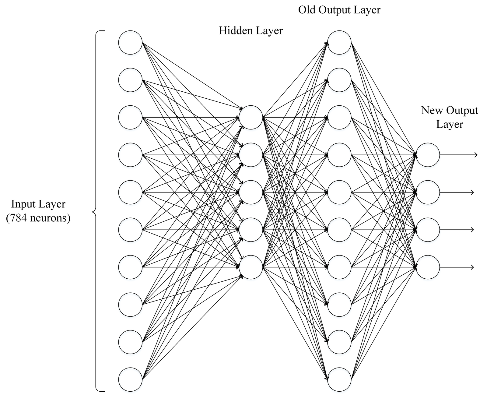

> **Biên tập:** bản gốc viết "đặt $\mathbf{x}$ và $b$ phù hợp" (đúng ra là $\mathbf{w}$ và $b$, vì $\mathbf{x}$ là đầu vào) và coi mọi MLP đều là "mạng neuron sâu". Một MLP chỉ có một tầng ẩn thường được gọi là mạng nông; đã sửa lại cho rõ.

### 3.1.2 Mạng neuron có những cấu trúc mô hình thường gặp nào?

Hình dưới gồm phần lớn các mô hình thường gặp:

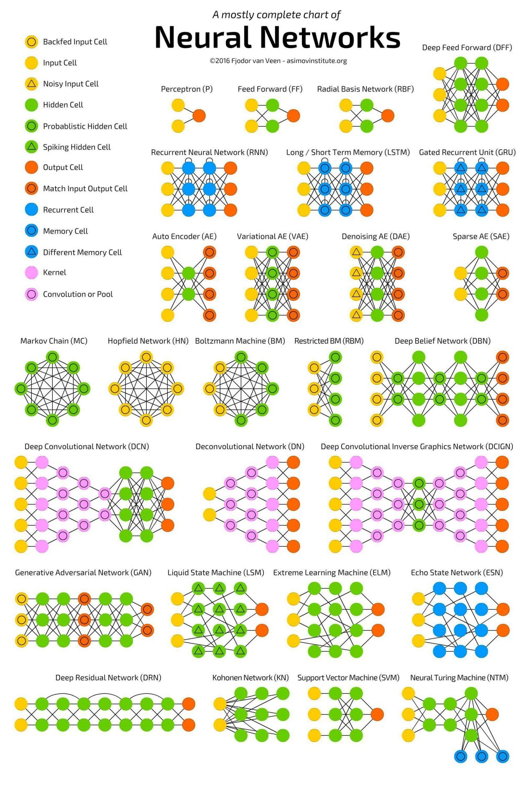

### 3.1.3 Chọn nền tảng phát triển học sâu thế nào?

Các nền tảng (framework) học sâu mã nguồn mở hiện có gồm Caffe, PyTorch, MXNet, CNTK, Theano, TensorFlow, Keras, fastai… Chọn nền tảng nào cho phù hợp? Dưới đây là vài tiêu chí để tham khảo.

**Tiêu chí 1: Mức độ dễ tích hợp với nền tảng lập trình và kỹ năng hiện có**

Chủ yếu là kinh nghiệm và tài nguyên tích lũy trước đó, như ngôn ngữ lập trình, định dạng lưu trữ tập dữ liệu đang dùng…

**Tiêu chí 2: Mức độ gắn kết với hệ sinh thái học máy và xử lý dữ liệu liên quan**

Nghiên cứu học sâu không tách rời các gói xử lý dữ liệu, trực quan hóa, suy luận thống kê… Trước khi dựng mô hình, có sẵn công cụ tiền xử lý dữ liệu thuận tiện không? Sau khi dựng mô hình, có công cụ thuận tiện để trực quan hóa, suy luận thống kê, phân tích dữ liệu không?

**Tiêu chí 3: Yêu cầu và khả năng hỗ trợ về lượng dữ liệu và phần cứng**

Lượng dữ liệu trong các bài toán học sâu khác nhau là khác nhau, nên ta có thể phải tính đến tính toán phân tán, tính toán trên nhiều GPU. Ví dụ, người làm xử lý ảnh thường phải chia tệp ảnh và tác vụ tính toán ra nhiều máy để thực hiện. Các nền tảng học sâu đều phát triển rất nhanh, khả năng hỗ trợ tính toán phân tán của mỗi nền tảng cũng liên tục thay đổi.

**Tiêu chí 4: Độ trưởng thành của nền tảng**

Độ trưởng thành là một tiêu chí khá chủ quan, có thể gồm: cộng đồng có sôi nổi không; có dễ trao đổi với các nhà phát triển không; đà ứng dụng hiện nay ra sao.

**Tiêu chí 5: Nền tảng có dùng được cho nhiều việc khác không?**

Có nền tảng được phát triển riêng cho nghiên cứu và ứng dụng học sâu, có nền tảng được tối ưu mạnh cho tính toán phân tán, GPU… Liệu có dùng các nền tảng/phần mềm này cho việc khác được không? Chẳng hạn có phần mềm học sâu dùng được để giải bài toán tối ưu dạng toàn phương; có nền tảng dễ mở rộng để dùng cho học tăng cường.

> **Biên tập:** danh sách framework của bản gốc đã cũ: Theano (2017), CNTK (2019) và Caffe đã ngừng phát triển; MXNet đã ngừng hoạt động (2023). Hiện nay các lựa chọn chính là PyTorch (phổ biến nhất trong nghiên cứu), JAX và TensorFlow/Keras. Các khóa trên site dùng PyTorch.

### 3.1.4 Vì sao cần biểu diễn sâu?

1. Mạng neuron sâu học đặc trưng theo từng bậc: các neuron ở tầng nông học trực tiếp từ dữ liệu đầu vào những đặc trưng đơn giản, mức thấp như cạnh, kết cấu (texture)…; các tầng sâu dựa trên đặc trưng đã học ở tầng nông để học tiếp các đặc trưng bậc cao hơn, tức là học thông tin ngữ nghĩa ở mức sâu.
2. Mạng sâu có tương đối ít đơn vị ẩn trên mỗi tầng nhưng nhiều tầng; nếu một mạng nông muốn cho cùng kết quả tính toán thì số đơn vị phải tăng theo cấp số mũ.

### 3.1.5 Vì sao mạng neuron sâu khó huấn luyện?

**Lý thuyết:** [Học sâu · 5.4.1 Tiêu biến và Bùng nổ Gradient](dl/ch05_s4_vi?id=_541-tiêu-biến-và-bùng-nổ-gradient)

1. Tiêu biến gradient (vanishing gradient)

    Tiêu biến gradient là hiện tượng khi nhìn từ sau ra trước qua các tầng ẩn, gradient càng lúc càng nhỏ, nghĩa là các tầng phía trước học chậm hơn hẳn các tầng phía sau, nên việc học bị kẹt lại, trừ khi gradient lớn lên.

    Nguyên nhân tiêu biến gradient đến từ nhiều yếu tố, ví dụ cách khởi tạo tham số, vùng bão hòa của hàm kích hoạt… Trong mạng sâu, gradient tính được ở mỗi neuron được truyền về tầng trước; gradient mà neuron ở tầng nông nhận được chịu ảnh hưởng của gradient mọi tầng phía sau (là tích của nhiều thừa số). Nếu các thừa số này rất nhỏ, khi số tầng tăng, thông tin cập nhật sẽ suy giảm theo cấp số mũ, và gradient tiêu biến. Hình dưới là tốc độ học của các tầng ẩn khác nhau:

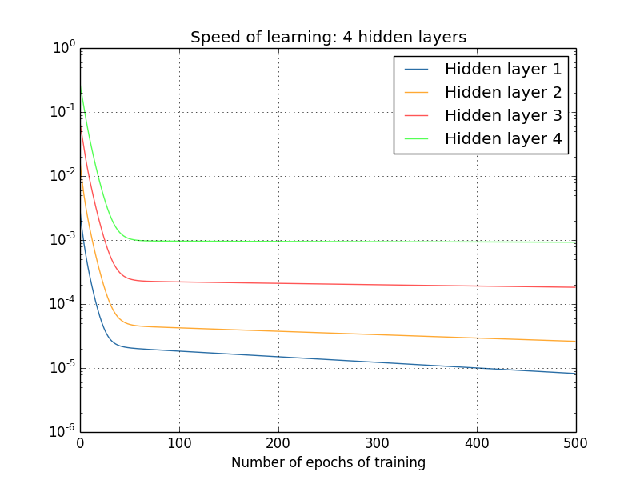

2. Bùng nổ gradient (exploding gradient)

    Trong mạng sâu hoặc mạng neuron hồi tiếp (Recurrent Neural Network, RNN), gradient có thể tích lũy liên tục trong quá trình cập nhật và trở nên rất lớn, khiến trọng số bị cập nhật mạnh và mạng mất ổn định; trong trường hợp cực đoan, trọng số thậm chí bị tràn số, thành $\text{NaN}$ và không cập nhật được nữa.

3. Ma trận trọng số bị suy biến làm giảm số bậc tự do hiệu dụng của mô hình.

    Sự suy biến trong không gian tham số làm việc học chậm lại và giảm số chiều hiệu dụng của mô hình: các bậc tự do khả dụng của mạng đóng góp không đồng đều vào chuẩn của gradient. Khi số ma trận được nhân với nhau (tức độ sâu của mạng) tăng lên, tích của chúng ngày càng suy biến. Trong mạng phi tuyến có biên bão hòa cứng (như mạng ReLU), quá trình suy biến này diễn ra nhanh hơn khi độ sâu tăng. Bài báo năm 2014 của Duvenaud và cộng sự trực quan hóa quá trình này:

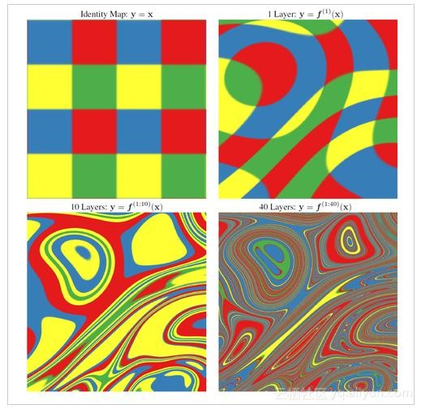

Khi độ sâu tăng, không gian đầu vào (hình góc trên bên trái) bị bóp méo thành những sợi ngày càng mảnh tại mỗi điểm; chỉ còn một hướng trực giao với sợi ảnh hưởng tới đầu ra của mạng. Theo hướng này, mạng trở nên cực kỳ nhạy với thay đổi.

> **Biên tập:** bản gốc liệt kê "độ lớn tốc độ học" là một nguyên nhân của tiêu biến gradient. Tốc độ học chỉ nhân với gradient khi cập nhật, không làm gradient nhỏ đi khi lan truyền ngược, nên đã bỏ khỏi danh sách nguyên nhân.

### 3.1.6 Học sâu khác học máy thế nào?

**Học máy**: dùng máy tính cùng kiến thức xác suất, thống kê…, đưa dữ liệu vào để máy tính học được tri thức mới. Quá trình học máy là dùng dữ liệu huấn luyện để tối ưu hàm mục tiêu.

**Học sâu**: là một loại học máy đặc biệt, có năng lực và độ linh hoạt cao. Nó học cách biểu diễn thế giới thành một cấu trúc phân cấp lồng nhau, mỗi biểu diễn gắn với những đặc trưng đơn giản hơn, và các biểu diễn trừu tượng được dùng để tính các biểu diễn trừu tượng hơn nữa.

Học máy truyền thống cần định nghĩa đặc trưng thủ công để trích xuất thông tin mục tiêu một cách có chủ đích, nên phụ thuộc nhiều vào đặc thù bài toán và kinh nghiệm của chuyên gia thiết kế đặc trưng. Học sâu thì học các đặc trưng đơn giản từ dữ liệu lớn trước, rồi dần học được đặc trưng sâu, phức tạp và trừu tượng hơn, không phụ thuộc vào kỹ thuật đặc trưng thủ công; đó là một lý do lớn khiến học sâu được ưa chuộng trong thời đại dữ liệu lớn.

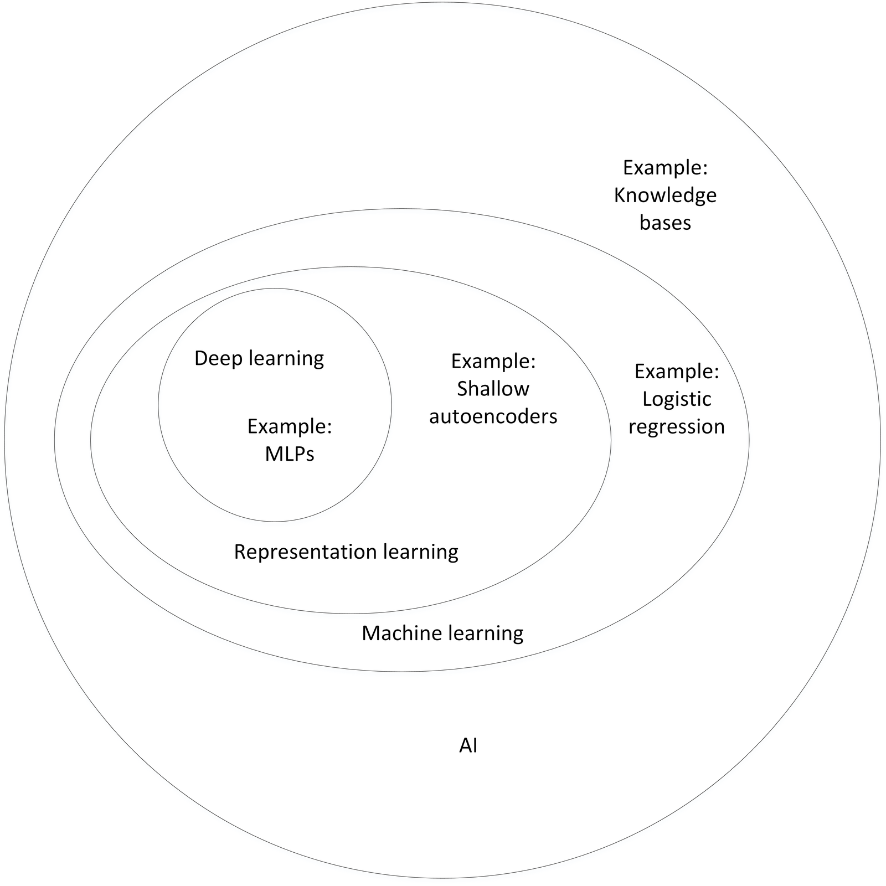

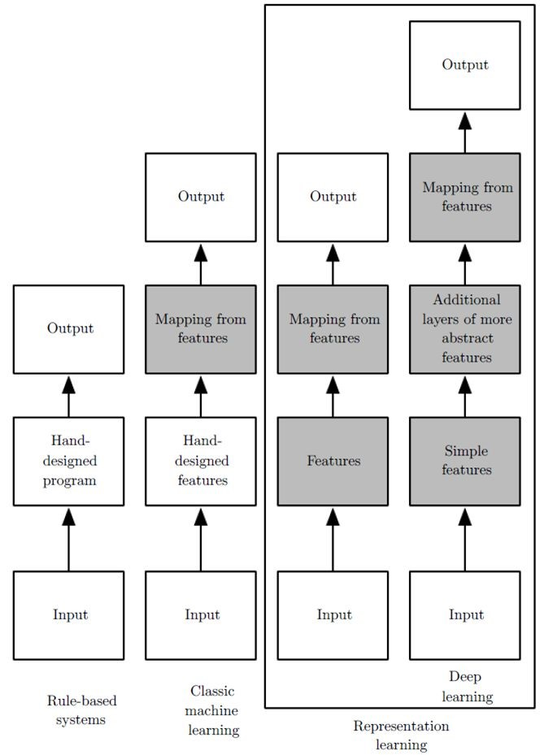

## 3.2 Các phép tính trong mạng

**Lý thuyết:** [Học máy · 16.4 Lan truyền ngược](ml/ch16_vi?id=_164-lan-truyền-ngược) · [Học sâu · Chương 7 Mạng Neuron Tích chập](dl/ch07_vi)

### 3.2.1 Lan truyền thuận và lan truyền ngược là gì?

Tính toán trong mạng neuron chủ yếu có hai loại: lan truyền thuận (forward propagation, FP) đi từ đầu vào của mỗi tầng, tính lần lượt qua từng tầng để ra kết quả; lan truyền ngược (backward propagation, BP) đi từ đầu ra của mạng, tính gradient từ tầng sâu về tầng nông để cập nhật tham số.

**Lan truyền thuận**

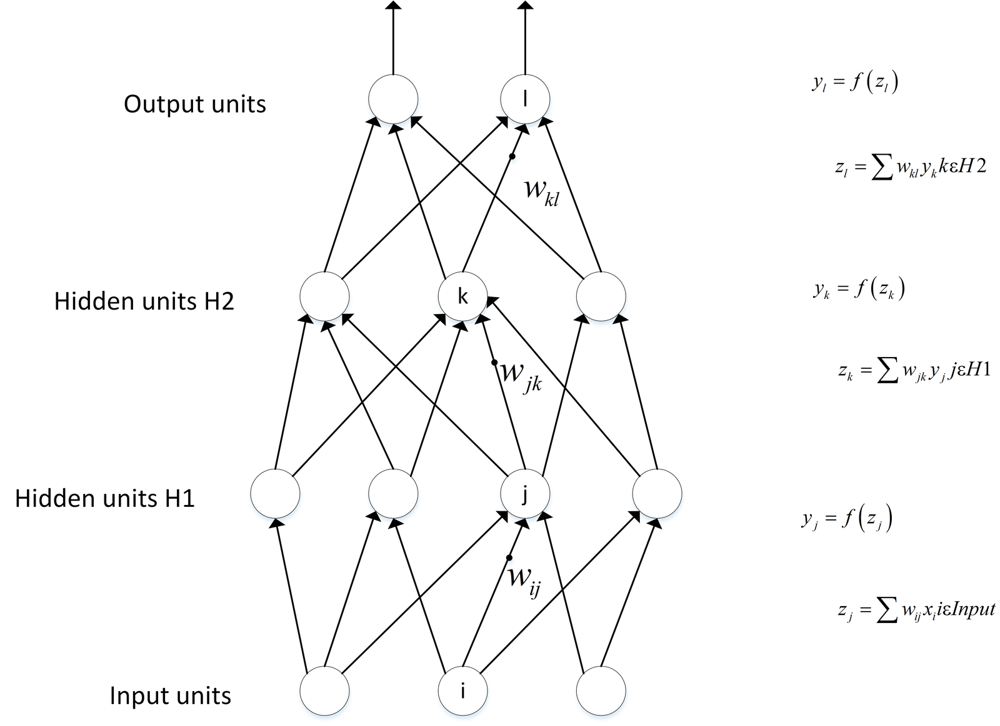

Giả sử các nút $i, j, k, \dots$ ở tầng trước nối với nút $w$ ở tầng này, thì giá trị của nút $w$ tính thế nào? Lấy tổng có trọng số của các nút $i, j, k, \dots$ ở tầng trước với trọng số kết nối tương ứng, cộng thêm hệ số điều chỉnh (bias, trong hình lược đi cho đơn giản), rồi đưa qua một hàm phi tuyến (hàm kích hoạt) như ReLU, sigmoid…; kết quả là đầu ra của nút $w$.

Cứ tính như vậy qua từng tầng, ta được kết quả ở tầng đầu ra.

**Lan truyền ngược**

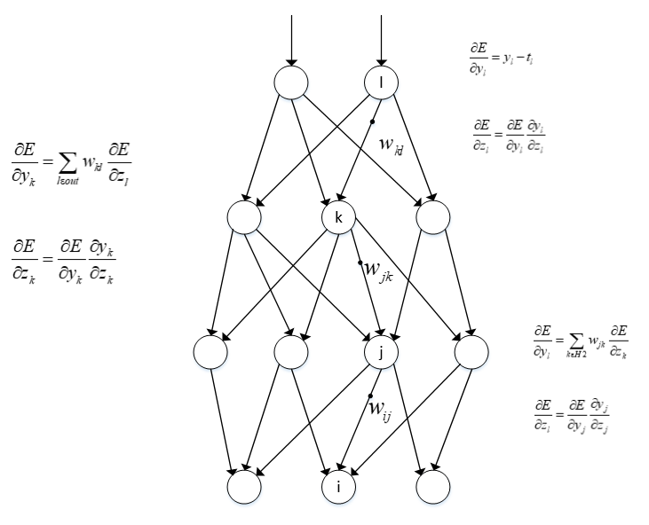

Kết quả lan truyền thuận (ví dụ cho bài toán phân loại) luôn có sai số. Làm sao giảm sai số? Thuật toán được dùng rộng rãi nhất là hạ gradient (gradient descent), mà muốn có gradient thì phải tính đạo hàm riêng. Dưới đây giải thích theo ký hiệu trong hình.

Gọi $z_l$ là tổng có trọng số đi vào nút $l$, $y_l = f(z_l)$ là đầu ra của nút, $t_l$ là giá trị thật, và sai số là $E = \frac{1}{2}\sum_l (y_l - t_l)^2$. Khi đó:

- Ở tầng đầu ra: $\frac{\partial E}{\partial y_l} = y_l - t_l$, và $\frac{\partial E}{\partial z_l} = \frac{\partial E}{\partial y_l} \frac{\partial y_l}{\partial z_l}$, trong đó $\frac{\partial y_l}{\partial z_l} = f'(z_l)$ là đạo hàm của hàm kích hoạt (bằng 1 nếu tầng đầu ra dùng kích hoạt tuyến tính).
- Ở tầng ẩn phía trước (nút $k$ nối tới các nút $l$ với trọng số $w_{lk}$): $\frac{\partial E}{\partial y_k} = \sum_l w_{lk}\frac{\partial E}{\partial z_l}$, rồi $\frac{\partial E}{\partial z_k} = \frac{\partial E}{\partial y_k} f'(z_k)$.
- Lặp lại như vậy cho tới tầng đầu vào. Gradient theo một trọng số là $\frac{\partial E}{\partial w_{lk}} = \frac{\partial E}{\partial z_l}\, y_k$.

Sau đó điều chỉnh các trọng số theo gradient, rồi lặp lại lan truyền thuận và lan truyền ngược nhiều lần cho tới khi được kết quả đủ tốt.

> **Biên tập:** đoạn công thức của bản gốc bị lẫn ký hiệu (viết $\frac{\partial E}{\partial x_i} = \frac{\partial E}{\partial y_j}\frac{\partial y_j}{\partial z_j}$ và $\frac{\partial z_j}{\partial x_i} = w_i j$) và thiếu bước cộng gradient từ các nút phía sau. Đã viết lại đầy đủ ba bước của quy tắc chuỗi.

### 3.2.2 Tính đầu ra của mạng neuron thế nào?

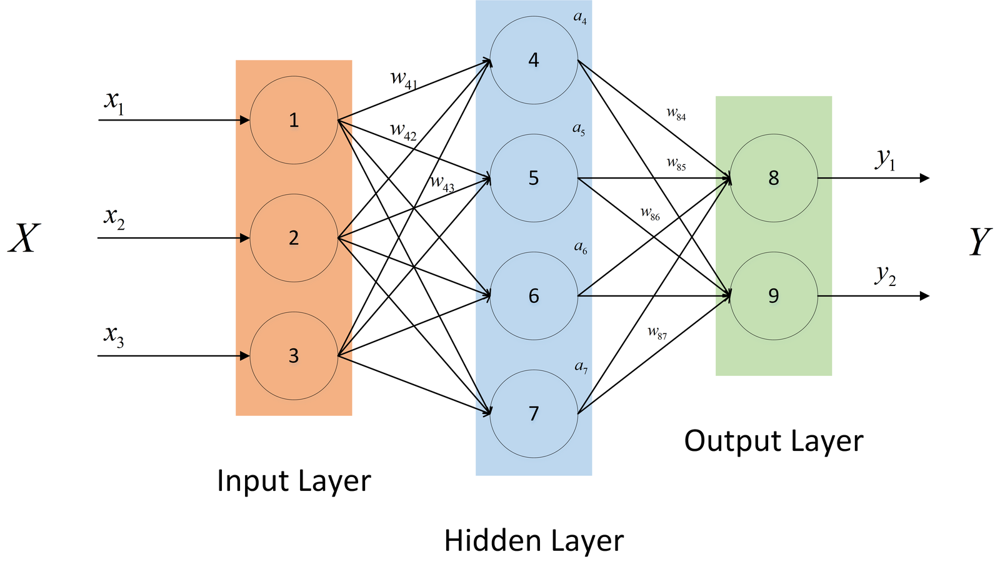

Như hình trên, tầng đầu vào có ba nút, đánh số 1, 2, 3; tầng ẩn có 4 nút, đánh số 4, 5, 6, 7; tầng đầu ra có hai nút, đánh số 8, 9. Ví dụ nút ẩn 4 nối với cả ba nút đầu vào 1, 2, 3, trọng số trên các kết nối lần lượt là $w_{41}, w_{42}, w_{43}$.

Để tính đầu ra của nút 4, trước hết phải có đầu ra của mọi nút phía trước nó (tức nút 1, 2, 3). Nút 1, 2, 3 thuộc tầng đầu vào, nên đầu ra của chúng chính là vector đầu vào: $x_1, x_2, x_3$.

$$
a_4 = \sigma(\mathbf{w}^T \mathbf{a}) = \sigma(w_{41}x_1 + w_{42}x_2 + w_{43}x_3 + w_{4b})
$$

trong đó $w_{4b}$ là hệ số điều chỉnh của nút 4.

Tương tự, ta tính được đầu ra $a_5, a_6, a_7$ của các nút 5, 6, 7.

Đầu ra $y_1$ của nút 8 ở tầng đầu ra:

$$
y_1 = \sigma(\mathbf{w}^T \mathbf{a}) = \sigma(w_{84}a_4 + w_{85}a_5 + w_{86}a_6 + w_{87}a_7 + w_{8b})
$$

trong đó $w_{8b}$ là hệ số điều chỉnh của nút 8.

Tương tự ta tính được $y_2$. Như vậy đã tính xong mọi nút ở tầng đầu ra: với vector đầu vào $(x_1, x_2, x_3)$, mạng cho vector đầu ra $(y_1, y_2)$. Có thể thấy số chiều của vector đầu ra bằng số neuron ở tầng đầu ra.

> **Biên tập:** sửa lỗi gõ trong công thức của $a_4$ (bản gốc viết $w_{41}x_4$, $w_{43}a_3$) và "vector đầu vào $x_1,\dots,x_4$" (mạng chỉ có ba đầu vào).

### 3.2.3 Tính đầu ra của mạng neuron tích chập thế nào?

**Lý thuyết:** [Học sâu · 7.2.1 Phép Tương quan Chéo](dl/ch07_s2_vi?id=_721-phép-tương-quan-chéo) · [Học sâu · 7.3 Đệm và Sải bước](dl/ch07_s3_vi) · [Học sâu · 7.4 Nhiều Kênh Đầu vào và Nhiều Kênh Đầu ra](dl/ch07_s4_vi)

Giả sử có một ảnh $5\times 5$, dùng một bộ lọc (filter) $3\times 3$ để tích chập, muốn được một ánh xạ đặc trưng (feature map) $3\times 3$, như hình dưới:

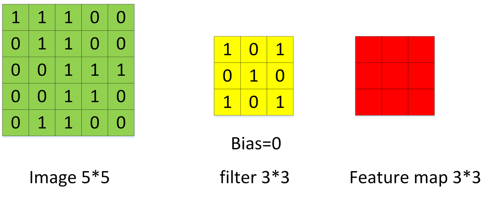

$x_{i,j}$ là phần tử ở hàng $i$ cột $j$ của ảnh; $w_{m,n}$ là trọng số ở hàng $m$ cột $n$ của bộ lọc; $w_b$ là hệ số điều chỉnh của bộ lọc; $a_{i,j}$ là phần tử ở hàng $i$ cột $j$ của ánh xạ đặc trưng; $f$ là hàm kích hoạt, ở đây lấy ví dụ ReLU.

Công thức tích chập:

$$
a_{i,j} = f\left(\sum_{m=0}^2 \sum_{n=0}^2 w_{m,n} x_{i+m, j+n} + w_b \right)
$$

Với sải bước (stride) bằng $1$, phần tử $a_{0,0}$ của ánh xạ đặc trưng được tính như sau:

$$
\begin{aligned}
a_{0,0} &= f\left(\sum_{m=0}^2 \sum_{n=0}^2 w_{m,n} x_{m,n} + w_b \right) \\
&= \text{relu}(w_{0,0} x_{0,0} + w_{0,1} x_{0,1} + w_{0,2} x_{0,2} + w_{1,0} x_{1,0} + w_{1,1} x_{1,1} \\
&\qquad + w_{1,2} x_{1,2} + w_{2,0} x_{2,0} + w_{2,1} x_{2,1} + w_{2,2} x_{2,2} + 0) \\
&= \text{relu}(1 + 0 + 1 + 0 + 1 + 0 + 0 + 0 + 1) \\
&= 4
\end{aligned}
$$

Quá trình tính được minh họa như sau:

Cứ thế tính ra toàn bộ ánh xạ đặc trưng, được $\begin{bmatrix}4&3&4\\2&4&3\\2&3&4\end{bmatrix}$ (xem ô Biên tập bên dưới về hàng thứ hai của ảnh).

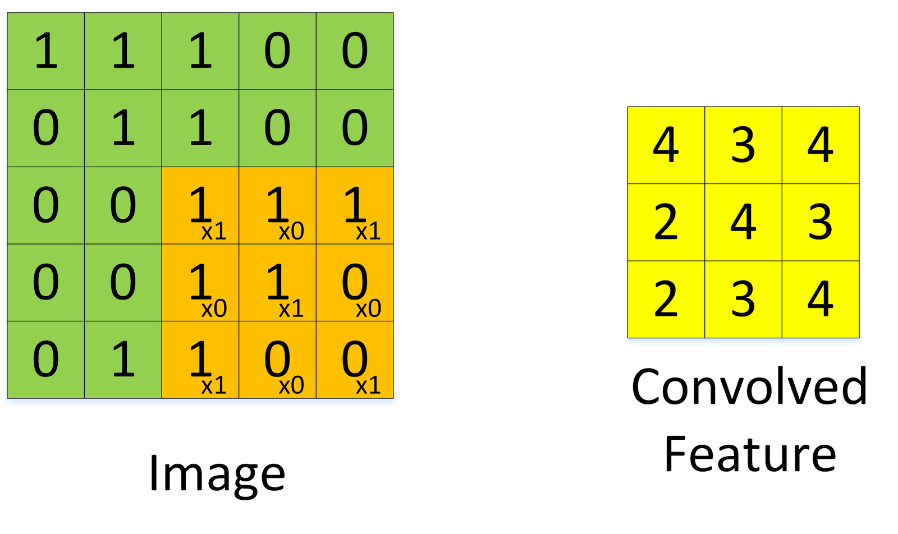

Khi sải bước bằng 2, ánh xạ đặc trưng là $\begin{bmatrix}4&4\\2&4\end{bmatrix}$:

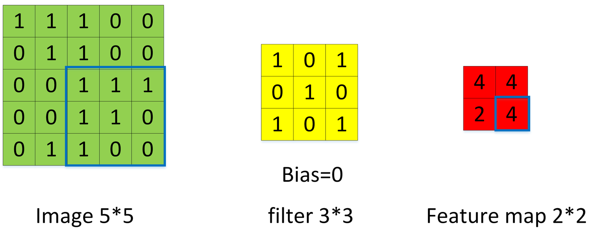

Chú ý: kích thước ảnh, sải bước và kích thước ánh xạ đặc trưng sau tích chập liên hệ với nhau theo công thức:

$$
W_2 = \left\lfloor \frac{W_1 - F + 2P}{S} \right\rfloor + 1, \qquad
H_2 = \left\lfloor \frac{H_1 - F + 2P}{S} \right\rfloor + 1
$$

trong đó $W_2$ là chiều rộng ánh xạ đặc trưng sau tích chập; $W_1$ là chiều rộng ảnh trước tích chập; $F$ là chiều rộng bộ lọc; $P$ là số vòng đệm 0 (zero padding), tức là thêm mấy vòng số 0 quanh ảnh gốc: $P = 1$ thì thêm $1$ vòng; $S$ là sải bước; $H_2$ là chiều cao ánh xạ đặc trưng sau tích chập; $H_1$ là chiều cao ảnh trước tích chập.

Ví dụ: ảnh rộng $W_1 = 5$, bộ lọc rộng $F=3$, đệm $P=0$, sải bước $S=2$, thì

$$
W_2 = (W_1 - F + 2P)/S + 1 = (5-3+0)/2 + 1 = 2
$$

nghĩa là ánh xạ đặc trưng rộng 2. Tương tự, chiều cao cũng là 2.

Nếu ảnh trước tích chập có độ sâu (số kênh) $D$ thì bộ lọc cũng phải có độ sâu $D$. Công thức tích chập với độ sâu lớn hơn 1:

$$
a_{i,j} = f\left(\sum_{d=0}^{D-1} \sum_{m=0}^{F-1} \sum_{n=0}^{F-1} w_{d,m,n} x_{d,i+m,j+n} + w_b\right)
$$

trong đó $D$ là độ sâu; $F$ là kích thước bộ lọc; $w_{d,m,n}$ là trọng số ở kênh $d$, hàng $m$, cột $n$ của bộ lọc; $x_{d,i,j}$ là pixel ở kênh $d$, hàng $i$, cột $j$ của ảnh; các ký hiệu khác như trên.

Mỗi tầng tích chập có thể có nhiều bộ lọc. Mỗi bộ lọc tích chập với ảnh gốc cho ra một ánh xạ đặc trưng, nên độ sâu (số lượng) ánh xạ đặc trưng sau tích chập bằng số bộ lọc. Hình dưới minh họa một tầng tích chập có hai bộ lọc: đầu vào $5\times5\times3$ (thành $7\times7\times3$ sau khi đệm một vòng 0), qua hai bộ lọc $3\times3\times3$ với sải bước $2$, cho đầu ra $3\times3\times2$.

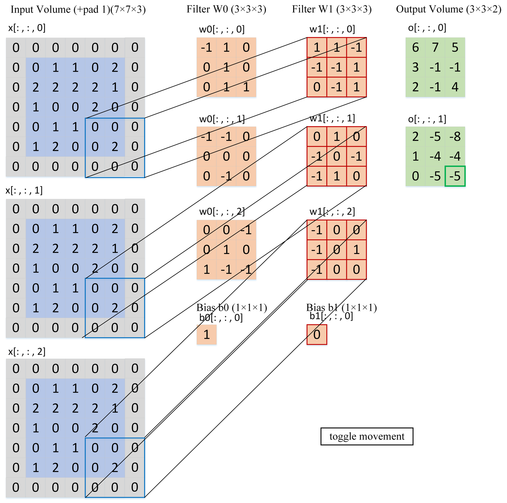

Trên đây là cách tính của tầng tích chập. Nó thể hiện hai ý tưởng *kết nối cục bộ* và *chia sẻ trọng số*: mỗi neuron chỉ nối với một phần neuron của tầng trước (theo quy tắc tích chập), và trọng số của bộ lọc giống nhau cho mọi vị trí ở tầng trước. Tầng tích chập có hai bộ lọc $3\times3\times3$ chỉ có $(3 \times 3 \times 3+1) \times 2 = 56$ tham số, và số tham số không phụ thuộc vào số neuron ở tầng trước. So với mạng kết nối đầy đủ, số tham số giảm đi rất nhiều.

> **Biên tập:** bản gốc ghi đầu vào của ví dụ hai bộ lọc là $7\times7\times3$ *và* đệm 1; với đầu vào $7\times7$, đệm 1, sải bước 2 thì đầu ra là $4\times4$, không phải $3\times3$. Ví dụ gốc (cs231n) có đầu vào $5\times5\times3$, hình vẽ đã gồm phần đệm. Công thức kích thước bổ sung phép làm tròn xuống, và $H_1$ là chiều *cao* (bản gốc ghi "chiều rộng"). Ánh xạ đặc trưng được tính lại bằng NumPy: kết quả trong hình ($[[4,3,4],[2,4,3],[2,3,4]]$) ứng với ảnh có hàng thứ hai là $0\,1\,1\,1\,0$ (ví dụ gốc), còn hình vẽ ảnh đầu vào ghi nhầm hàng này là $0\,1\,1\,0\,0$ (với ảnh vẽ nhầm đó, kết quả sẽ là $[[4,3,3],[2,3,3],[2,3,4]]$).

### 3.2.4 Tính đầu ra của tầng gộp thế nào?

**Lý thuyết:** [Học sâu · 7.5 Gộp](dl/ch07_s5_vi)

Tầng gộp (pooling) chủ yếu dùng để giảm mẫu (downsampling): bỏ bớt các giá trị không quan trọng trong ánh xạ đặc trưng, làm giảm kích thước ánh xạ đặc trưng, nhờ đó giảm khối lượng tính toán và số tham số của các tầng phía sau. Có nhiều cách gộp, phổ biến nhất là gộp cực đại (max pooling): lấy giá trị lớn nhất trong một vùng $n\times n$ làm giá trị sau khi gộp. Hình dưới là gộp cực đại $2\times 2$:

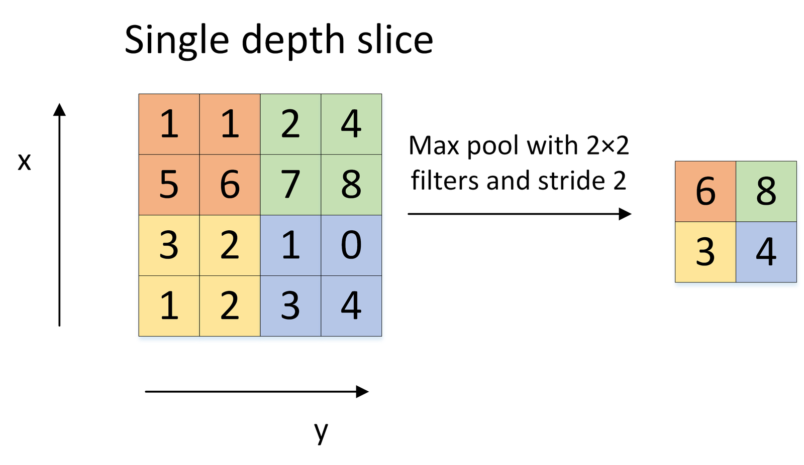

Ngoài gộp cực đại, còn hay dùng gộp trung bình (average pooling): lấy trung bình các giá trị trong vùng.

Với ánh xạ đặc trưng có độ sâu $D$, mỗi kênh được gộp độc lập, nên sau khi gộp độ sâu vẫn là $D$.

> **Biên tập:** bản thân tầng gộp không có tham số; nó giảm số tham số của các tầng *phía sau* (nhất là tầng kết nối đầy đủ) vì đầu vào của chúng nhỏ đi.

### 3.2.5 Hiểu lan truyền ngược qua một ví dụ

**Lý thuyết:** [Học máy · 16.4 Lan truyền ngược](ml/ch16_vi?id=_164-lan-truyền-ngược) · [Học máy · Chương 16 · Code từ đầu](ml/ch16_code_vi)

Một mạng neuron ba tầng điển hình như sau:

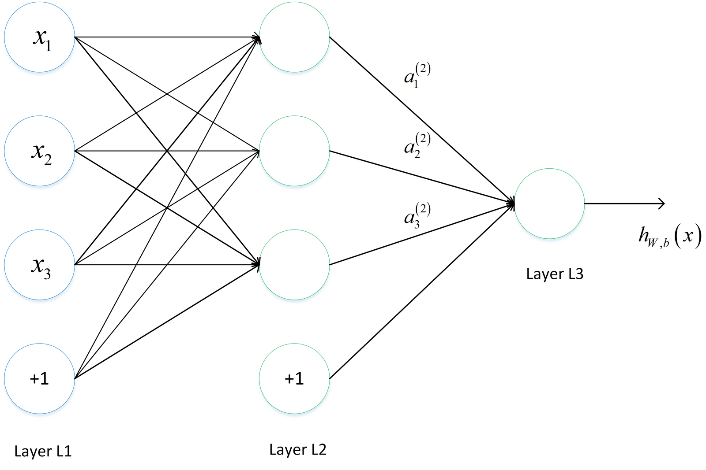

trong đó tầng $L_1$ là tầng đầu vào, $L_2$ là tầng ẩn, $L_3$ là tầng đầu ra.

Giả sử tập đầu vào là $D=\{x_1, x_2, \dots, x_n\}$ và tập đầu ra là $\{y_1, y_2, \dots, y_n\}$.

Nếu đầu vào và đầu ra giống nhau, đó là mô hình tự mã hóa (autoencoder). Nếu dữ liệu gốc được ánh xạ sang thứ khác, ta được đầu ra khác đầu vào.

Xét mạng như sau:

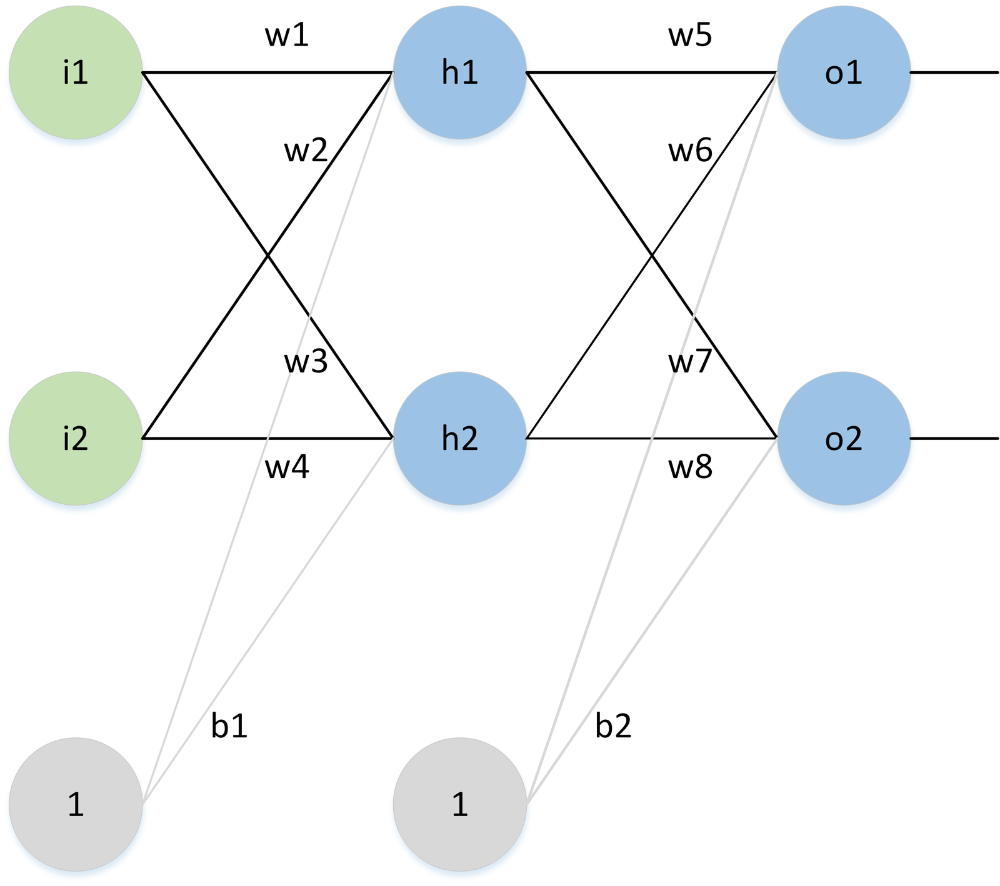

Tầng đầu vào gồm các neuron $i_1, i_2$ và hệ số điều chỉnh $b_1$; tầng ẩn gồm $h_1, h_2$ và hệ số điều chỉnh $b_2$; tầng đầu ra là $o_1, o_2$; $w_i$ là trọng số giữa các tầng; hàm kích hoạt là sigmoid. Giá trị khởi tạo của các tham số như hình dưới:

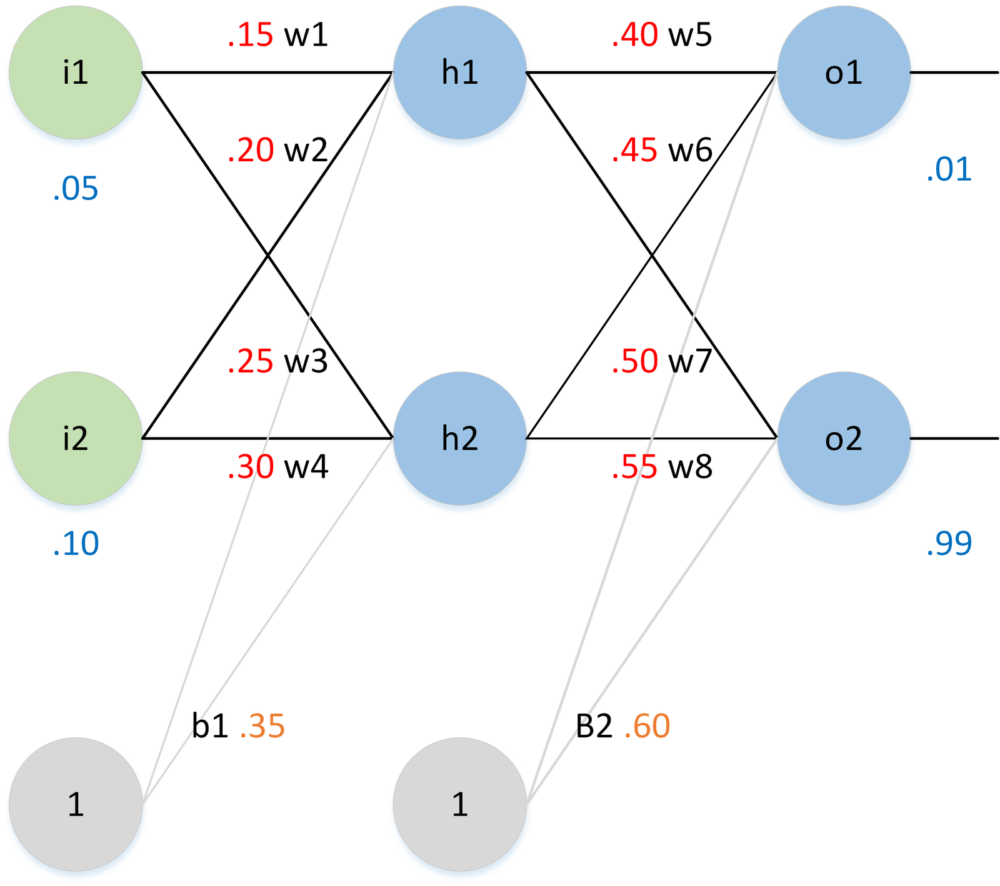

trong đó:

- Dữ liệu đầu vào $i_1=0.05,\ i_2 = 0.10$;
- Đầu ra mong muốn $o_1=0.01,\ o_2=0.99$;
- Trọng số ban đầu $w_1=0.15, w_2=0.20, w_3=0.25, w_4=0.30, w_5=0.40, w_6=0.45, w_7=0.50, w_8=0.55$; hệ số điều chỉnh $b_1 = 0.35$, $b_2 = 0.60$;
- Mục tiêu: với đầu vào $i_1, i_2$ ($0.05$ và $0.10$), làm cho đầu ra càng gần đầu ra mong muốn $o_1, o_2$ ($0.01$ và $0.99$) càng tốt.

**Lan truyền thuận**

1. Tầng đầu vào → tầng ẩn

Tổng có trọng số đi vào neuron $h_1$:

$$
\begin{aligned}
net_{h1} &= w_1 i_1 + w_2 i_2 + b_1 \cdot 1 \\
&= 0.15 \times 0.05 + 0.2 \times 0.1 + 0.35 \times 1 = 0.3775
\end{aligned}
$$

Đầu ra của neuron $h_1$ (hàm kích hoạt sigmoid):

$$
out_{h1} = \frac{1}{1 + e^{-net_{h1}}} = \frac{1}{1 + e^{-0.3775}} = 0.593269992
$$

Tương tự, đầu ra của neuron $h_2$ ($net_{h2} = 0.25\times0.05 + 0.30\times 0.10 + 0.35 = 0.3925$):

$$
out_{h2} = 0.596884378
$$

2. Tầng ẩn → tầng đầu ra

Giá trị của neuron $o_1$:

$$
\begin{aligned}
net_{o1} &= w_5 \cdot out_{h1} + w_6 \cdot out_{h2} + b_2 \cdot 1 \\
&= 0.4 \times 0.593269992 + 0.45 \times 0.596884378 + 0.6 \times 1 = 1.105905967
\end{aligned}
$$

$$
out_{o1} = \frac{1}{1 + e^{-net_{o1}}} = \frac{1}{1 + e^{-1.105905967}} = 0.75136507
$$

Tương tự $out_{o2} = 0.772928465$. Lan truyền thuận kết thúc: đầu ra là $[0.75136507,\ 0.772928465]$, còn cách xa giá trị thật $[0.01,\ 0.99]$. Giờ ta lan truyền ngược sai số, cập nhật trọng số và tính lại đầu ra.

**Lan truyền ngược**

1. Tính sai số tổng

Sai số tổng (dùng sai số bình phương):

$$
E_{total} = \sum \frac{1}{2}(target - output)^2
$$

Có hai đầu ra, nên tính riêng sai số của $o_1$ và $o_2$ rồi cộng lại:

$$
E_{o1} = \frac{1}{2}(target_{o1} - out_{o1})^2 = \frac{1}{2}(0.01 - 0.75136507)^2 = 0.274811083
$$

$$
E_{o2} = 0.023560026, \qquad E_{total} = E_{o1} + E_{o2} = 0.298371109
$$

2. Cập nhật trọng số từ tầng ẩn tới tầng đầu ra

Lấy $w_5$ làm ví dụ. Muốn biết $w_5$ ảnh hưởng bao nhiêu tới sai số tổng, ta lấy đạo hàm riêng của sai số tổng theo $w_5$ (quy tắc chuỗi):

$$
\frac{\partial E_{total}}{\partial w_5} = \frac{\partial E_{total}}{\partial out_{o1}} \cdot \frac{\partial out_{o1}}{\partial net_{o1}} \cdot \frac{\partial net_{o1}}{\partial w_5}
$$

Hình dưới cho thấy trực quan sai số được lan truyền ngược như thế nào:

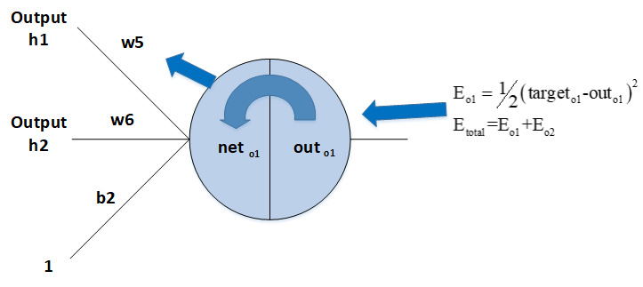

Tính từng thừa số:

$$
\begin{aligned}
\frac{\partial E_{total}}{\partial out_{o1}} &= -(target_{o1} - out_{o1}) = 0.74136507 \\
\frac{\partial out_{o1}}{\partial net_{o1}} &= out_{o1}(1 - out_{o1}) = 0.186815602 \\
\frac{\partial net_{o1}}{\partial w_5} &= out_{h1} = 0.593269992
\end{aligned}
$$

Nhân lại: $\frac{\partial E_{total}}{\partial w_5} = 0.74136507 \times 0.186815602 \times 0.593269992 = 0.082167041$.

Với tốc độ học $\eta = 0.5$, trọng số mới là $w_5^{+} = w_5 - \eta \frac{\partial E_{total}}{\partial w_5} = 0.4 - 0.5 \times 0.082167041 = 0.35891648$. Các trọng số $w_6, w_7, w_8$ được cập nhật theo cùng cách.

3. Cập nhật trọng số từ tầng đầu vào tới tầng ẩn

Với $w_1$, khác biệt là $out_{h1}$ ảnh hưởng tới *cả hai* đầu ra, nên phải cộng hai nhánh:

$$
\frac{\partial E_{total}}{\partial w_1} = \left(\sum_{k \in \{o1, o2\}} \frac{\partial E_{k}}{\partial net_{k}} \cdot w_{k,h1}\right) \cdot out_{h1}(1-out_{h1}) \cdot i_1 = 0.000438568
$$

nên $w_1^{+} = 0.15 - 0.5 \times 0.000438568 = 0.149780716$. Sau khi cập nhật mọi trọng số, chạy lại lan truyền thuận; lặp lại nhiều lần thì sai số tổng giảm dần.

> **Biên tập:** bản gốc dừng ở công thức quy tắc chuỗi, chưa tính ra gradient. Phần cập nhật $w_5$ và $w_1$ được bổ sung theo ví dụ gốc của Matt Mazur (bài "A Step by Step Backpropagation Example", mà ví dụ này lấy từ đó), và mọi số đã được kiểm lại bằng NumPy. Đã sửa thêm: $e^{1.1059}$ → $e^{-1.1059}$; $out_{o1}$ bản gốc ghi hai giá trị khác nhau (0.75136079 và 0.75136507), đúng là 0.75136507; ghi rõ $b_1, b_2$ (bản gốc chỉ có trong hình).

### 3.2.6 Mạng neuron "sâu hơn" có ý nghĩa gì?

Tiền đề: trong một giới hạn nhất định.

- Với cùng số neuron, mạng sâu có năng lực (capacity) lớn hơn: tổ hợp theo tầng cho không gian biểu diễn tăng theo cấp số mũ, ghép được nhiều kiểu cấu trúc con hơn, nên dễ học và biểu diễn các loại đặc trưng.
- Nhiều tầng ẩn hơn nghĩa là các phép biến đổi phi tuyến do hàm kích hoạt mang lại được lồng nhau nhiều lớp hơn, nên dựng được những ánh xạ phức tạp hơn.

## 3.3 Siêu tham số

**Lý thuyết:** [Học máy · 8.2 Xác thực](ml/ch08_vi?id=_82-xác-thực) · [Học sâu · 3.6.3 Lựa chọn Mô hình](dl/ch03_s6_vi?id=_363-lựa-chọn-mô-hình)

### 3.3.1 Siêu tham số là gì?

**Siêu tham số** (hyperparameter): trong học máy, siêu tham số là tham số được đặt giá trị trước khi bắt đầu quá trình học, chứ không phải tham số học được qua huấn luyện. Thông thường cần tối ưu siêu tham số, chọn cho mô hình một bộ siêu tham số tốt nhất để cải thiện hiệu quả học.

Siêu tham số thường:

1. Xác định những khái niệm ở mức cao hơn của mô hình, như độ phức tạp hay khả năng học.
2. Không học trực tiếp được từ dữ liệu trong quá trình huấn luyện thông thường, phải định nghĩa trước.
3. Có thể quyết định bằng cách thử nhiều giá trị, huấn luyện nhiều mô hình và chọn giá trị cho kết quả kiểm định tốt hơn.

Cụ thể, các siêu tham số như tốc độ học (learning rate), số vòng lặp hạ gradient (iterations), số tầng ẩn (hidden layers), số đơn vị mỗi tầng ẩn, hàm kích hoạt (activation function)… đều phải đặt theo tình huống thực tế. Những con số này thực chất điều khiển giá trị cuối cùng của tham số $W$ và $b$, nên chúng được gọi là siêu tham số.

### 3.3.2 Tìm giá trị tốt nhất của siêu tham số thế nào?

Khi dùng thuật toán học máy, luôn có vài siêu tham số khó chỉnh, ví dụ độ lớn suy giảm trọng số (weight decay), độ rộng kernel Gauss… Các tham số này phải đặt thủ công và ảnh hưởng lớn tới kết quả. Các cách đặt siêu tham số thường gặp:

1. Đoán và kiểm tra: chọn tham số theo kinh nghiệm hoặc trực giác, rồi lặp lại.
2. Tìm kiếm lưới (grid search): để máy thử một bộ giá trị phân bố đều trong một khoảng.
3. Tìm kiếm ngẫu nhiên (random search): để máy chọn ngẫu nhiên một bộ giá trị.
4. Tối ưu Bayes (Bayesian optimization): xây mô hình xác suất (thường là quá trình Gauss) cho quan hệ giữa siêu tham số và kết quả, rồi chọn điểm thử tiếp theo hứa hẹn nhất. Khó khăn là bản thân thuật toán này cũng có những tham số riêng phải chọn.
5. Phương pháp của MITIE: tối ưu cục bộ xuất phát từ một điểm đoán tốt. Nó dùng thuật toán BOBYQA với điểm khởi đầu được chọn kỹ. Vì BOBYQA chỉ tìm cực tiểu cục bộ gần nhất, thành công của cách này phụ thuộc nhiều vào điểm xuất phát. Với MITIE ta biết một điểm xuất phát tốt, nhưng đó không phải giải pháp chung, vì thường ta không biết điểm tốt nằm đâu. Mặt tích cực là cách này rất hợp để tìm cực tiểu cục bộ.
6. Phương pháp tối ưu toàn cục LIPO (đề xuất năm 2017): không có tham số cần chỉnh, và đã được kiểm chứng là tốt hơn tìm kiếm ngẫu nhiên.

> **Biên tập:** mục 5–6 được dịch từ bài blog của Davis King (tác giả dlib, "A Global Optimization Algorithm Worth Using", 2017); đã bỏ câu "lát nữa tôi sẽ bàn thêm" còn sót lại từ bài blog, và viết lại ý của tối ưu Bayes cho rõ.

### 3.3.3 Quy trình chung khi tìm siêu tham số?

1. Chia tập dữ liệu thành tập huấn luyện, tập kiểm định (validation) và tập kiểm tra (test).
2. Trên tập huấn luyện, tối ưu tham số của mô hình theo chỉ số hiệu năng.
3. Trên tập kiểm định, tìm siêu tham số của mô hình theo chỉ số hiệu năng.
4. Lặp xen kẽ bước 2 và bước 3, cuối cùng chốt tham số và siêu tham số, rồi đánh giá mô hình trên tập kiểm tra.

Quá trình tìm kiếm cần một thuật toán tìm kiếm, thường là: tìm kiếm lưới, tìm kiếm ngẫu nhiên, tìm kiếm heuristic, tìm kiếm Bayes.

## 3.4 Hàm kích hoạt

**Lý thuyết:** [Học máy · 16.3 Hàm kích hoạt](ml/ch16_vi?id=_163-hàm-kích-hoạt)

### 3.4.1 Vì sao cần hàm kích hoạt phi tuyến?

**Vì sao cần hàm kích hoạt?**

1. Hàm kích hoạt đóng vai trò quan trọng để mô hình học và biểu diễn những hàm phi tuyến rất phức tạp.
2. Hàm kích hoạt đưa yếu tố phi tuyến vào mạng. Nếu không có hàm kích hoạt, tín hiệu đầu ra chỉ là một hàm tuyến tính của đầu vào. Hàm tuyến tính là đa thức bậc một, độ phức tạp hạn chế, khả năng học ánh xạ phức tạp từ dữ liệu rất kém. Không có hàm kích hoạt, mạng neuron không học và mô phỏng được các dạng dữ liệu phức tạp như ảnh, video, âm thanh, giọng nói…
3. Hàm kích hoạt (cùng với phép biến đổi tuyến tính trước nó) biến không gian đặc trưng hiện tại sang một không gian khác qua một ánh xạ phi tuyến, giúp dữ liệu dễ phân loại hơn.

**Vì sao hàm kích hoạt phải phi tuyến?**

1. Nếu mạng toàn các thành phần tuyến tính, tổ hợp của các hàm tuyến tính vẫn là tuyến tính, không khác gì một bộ phân loại tuyến tính duy nhất. Khi đó không thể dùng tính phi tuyến để xấp xỉ một hàm bất kỳ.
2. Dùng hàm kích hoạt phi tuyến làm mạng mạnh hơn, học được những thứ phức tạp, dữ liệu dạng bảng phức tạp, và biểu diễn được những ánh xạ phi tuyến bất kỳ giữa đầu vào và đầu ra.

> **Biên tập:** ý 3 của bản gốc viết "qua một ánh xạ *tuyến tính*", mâu thuẫn với chính câu hỏi; đã sửa thành phi tuyến.

### 3.4.2 Các hàm kích hoạt thường gặp và đồ thị

1. Hàm sigmoid

   Định nghĩa: $f(x) = \frac{1}{1 + e^{-x}}$, miền giá trị $(0,1)$.

   Đồ thị:

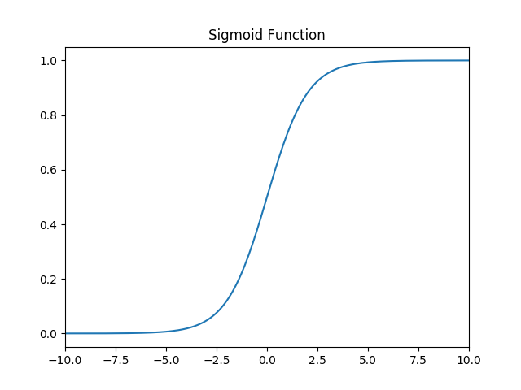

2. Hàm tanh

   Định nghĩa: $f(x) = \tanh(x) = \frac{e^x - e^{-x}}{e^x + e^{-x}}$, miền giá trị $(-1,1)$.

   Đồ thị:

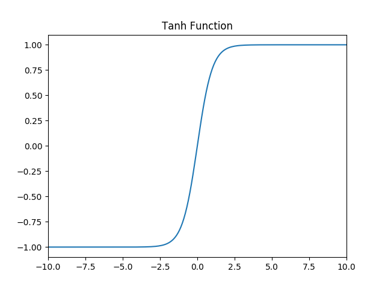

3. Hàm ReLU

   Định nghĩa: $f(x) = \max(0, x)$, miền giá trị $[0,+\infty)$.

   Đồ thị:

4. Hàm Leaky ReLU

   Định nghĩa: $f(x) = \begin{cases} ax, & x<0 \\ x, & x \ge 0 \end{cases}$, miền giá trị $(-\infty,+\infty)$. Trong thực tế $a$ thường nhỏ, ví dụ $0.01$.

   Đồ thị ($a = 0.5$):

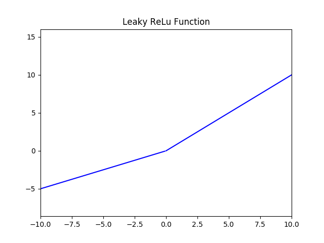

5. Hàm SoftPlus

   Định nghĩa: $f(x) = \ln( 1 + e^x)$, miền giá trị $(0,+\infty)$.

   Đồ thị:

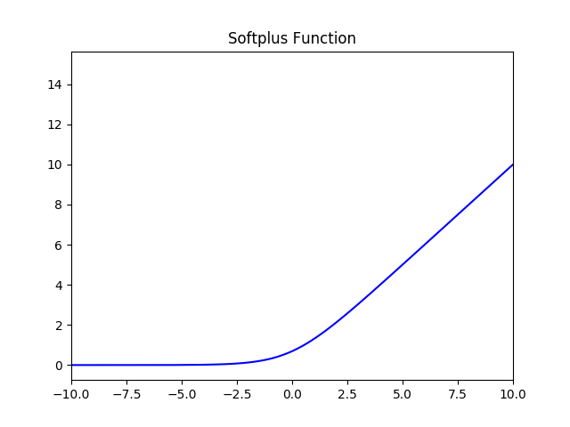

6. Hàm softmax

   Định nghĩa: $\sigma(\mathbf{z})_j = \frac{e^{z_j}}{\sum_{k=1}^K e^{z_k}}$.

   Softmax chủ yếu dùng ở đầu ra của mạng phân loại nhiều lớp.

### 3.4.3 Đạo hàm của các hàm kích hoạt thường gặp?

| Hàm | Biểu thức | Đạo hàm | Ghi chú |
| --- | --- | --- | --- |
| Sigmoid | $f(x)=\frac{1}{1+e^{-x}}$ | $f'(x)=\frac{1}{1+e^{-x}}\left( 1- \frac{1}{1+e^{-x}} \right)=f(x)(1-f(x))$ | Khi $x=10$ hoặc $x=-10$, $f'(x) \approx 0$; khi $x=0$, $f'(x) =0.25$ |
| Tanh | $f(x)=\tanh(x)=\frac{e^x-e^{-x}}{e^x+e^{-x}}$ | $f'(x)=1-\tanh^2(x)$ | Khi $x=10$ hoặc $x=-10$, $f'(x) \approx 0$; khi $x=0$, $f'(x) =1$ |
| ReLU | $f(x)=\max(0,x)$ | $f'(x)=\begin{cases} 0, & x<0 \\ 1, & x>0 \\ \text{không xác định}, & x=0\end{cases}$ | Trong thực tế, tại $x=0$ thường quy ước đạo hàm bằng 0 (hoặc 1) |

> **Biên tập:** bản gốc ghi đạo hàm của tanh là $-(\tanh(x))^2$; đúng là $1-\tanh^2(x)$ (khớp với ghi chú $f'(0)=1$ ở cùng dòng).

### 3.4.4 Hàm kích hoạt có những tính chất nào?

1. Phi tuyến: khi hàm kích hoạt phi tuyến, mạng hai tầng đã xấp xỉ được hầu hết các hàm (định lý xấp xỉ phổ quát). Hàm kích hoạt đồng nhất $f(x)=x$ không có tính chất này, và nếu MLP dùng hàm đồng nhất thì cả mạng tương đương với mạng một tầng.
2. Khả vi: cần khi phương pháp tối ưu dựa trên gradient.
3. Đơn điệu: khi hàm kích hoạt đơn điệu, hàm mất mát của mạng một tầng được cho là lồi (điều này chỉ đúng với một số tổ hợp hàm kích hoạt và hàm mất mát).
4. $f(x)\approx x$ gần gốc tọa độ: nếu hàm kích hoạt có tính chất này và tham số được khởi tạo ngẫu nhiên với giá trị nhỏ, huấn luyện mạng sẽ hiệu quả; nếu không, phải chọn giá trị khởi tạo cẩn thận hơn.
5. Miền giá trị: khi đầu ra của hàm kích hoạt bị chặn, tối ưu dựa trên gradient ổn định hơn, vì biểu diễn đặc trưng chịu ảnh hưởng rõ hơn từ các trọng số hữu hạn; khi đầu ra không bị chặn, huấn luyện hiệu quả hơn, nhưng thường cần tốc độ học nhỏ hơn.

### 3.4.5 Chọn hàm kích hoạt thế nào?

Chọn một hàm kích hoạt phù hợp không dễ, phải tính nhiều yếu tố. Thông thường, nếu không chắc hàm nào tốt hơn, cứ thử hết rồi đánh giá trên tập kiểm định, hàm nào tốt hơn thì dùng.

Các lựa chọn thường gặp:

1. Nếu đầu ra là 0/1 (phân loại nhị phân), tầng đầu ra dùng sigmoid, mọi đơn vị khác dùng ReLU.
2. Nếu chưa chắc nên dùng hàm nào ở tầng ẩn, thường dùng ReLU. Đôi khi cũng dùng tanh, nhưng một ưu điểm của ReLU là: với đầu vào dương, đạo hàm của nó luôn bằng 1, không tiến về 0.
3. Sigmoid: hầu như chỉ dùng ở tầng đầu ra của bài toán phân loại nhị phân.
4. Tanh: ở tầng ẩn, tanh hầu như luôn tốt hơn sigmoid (đầu ra có trung bình gần 0).
5. ReLU: hàm mặc định phổ biến nhất; nếu không chắc nên dùng hàm nào, dùng ReLU hoặc Leaky ReLU, rồi thử các hàm khác.
6. Nếu gặp nhiều neuron "chết" (luôn ra 0), có thể dùng Leaky ReLU.

> **Biên tập:** bản gốc ghi ưu điểm của ReLU là "đạo hàm bằng 0 khi đầu vào âm", đây lại chính là nhược điểm (gây neuron chết). Ý đúng (theo bài giảng của Andrew Ng mà mục này dựa vào) là đạo hàm không tiến về 0 ở miền dương. Câu "tanh tốt, hợp với hầu hết mọi trường hợp" cũng được viết lại đúng ý: tanh tốt hơn sigmoid ở tầng ẩn.

### 3.4.6 ReLU có những ưu điểm gì?

1. Trên phần lớn miền đầu vào, đạo hàm (độ dốc) của ReLU khác xa 0; khi cài đặt chỉ là một câu lệnh if-else, còn sigmoid cần tính hàm mũ. Trong thực tế, mạng dùng ReLU thường học nhanh hơn mạng dùng sigmoid hay tanh.
2. Đạo hàm của sigmoid và tanh tiến về 0 ở vùng bão hòa dương và âm, gây tiêu biến gradient; còn ReLU và Leaky ReLU có đạo hàm là hằng số ở miền dương, nên không gây tiêu biến gradient ở đó.
3. Cần lưu ý: khi ReLU rơi vào miền âm, gradient bằng 0 và neuron không được huấn luyện; điều này tạo ra tính thưa. Leaky ReLU không gặp vấn đề này.

### 3.4.7 Khi nào có thể dùng hàm kích hoạt tuyến tính?

1. Ở tầng đầu ra của bài toán hồi quy (đầu ra là số thực bất kỳ), thường dùng kích hoạt tuyến tính.
2. Một số tầng ẩn có thể dùng kích hoạt tuyến tính (ví dụ tầng nén chiều, tầng chiếu).
3. Nhìn chung, kích hoạt tuyến tính ít được dùng.

> **Biên tập:** bản gốc viết "tầng đầu ra phần lớn dùng kích hoạt tuyến tính", đúng cho hồi quy nhưng không đúng cho phân loại (sigmoid/softmax); đã thêm ngữ cảnh.

### 3.4.8 Vì sao ReLU (bằng 0 khi $x<0$) vẫn là hàm kích hoạt phi tuyến?

Đồ thị ReLU như sau:

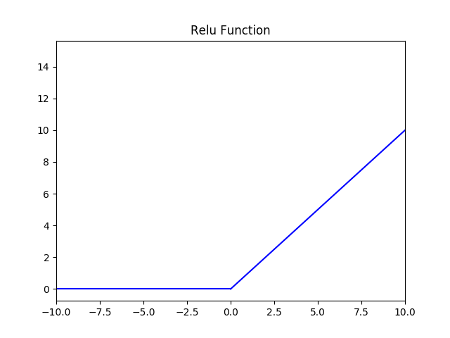

Từ đồ thị có thể thấy các đặc điểm:

1. Ức chế một phía;
2. Biên kích thích tương đối rộng;
3. Kích hoạt thưa.

Nhìn đồ thị, ReLU là một hàm tuyến tính từng khúc: biến mọi giá trị âm thành 0, giữ nguyên giá trị dương; đó là ức chế một phía. Hàm gồm hai khúc tuyến tính có độ dốc khác nhau nên tổng thể là phi tuyến: tổ hợp nhiều ReLU xấp xỉ được mọi hàm liên tục bằng các khúc tuyến tính.

Nhờ ức chế một phía mà các neuron trong mạng có tính kích hoạt thưa.

**Kích hoạt thưa**: về mặt tín hiệu, mỗi lúc neuron chỉ phản ứng có chọn lọc với một phần nhỏ tín hiệu đầu vào, phần lớn tín hiệu bị chặn lại; điều này giúp học chính xác hơn, trích đặc trưng thưa tốt hơn và nhanh hơn. Khi $x<0$, ReLU bão hòa cứng; khi $x>0$ thì không bão hòa. ReLU giữ cho gradient không suy giảm khi $x>0$, nhờ đó giảm nhẹ tiêu biến gradient.

### 3.4.9 Định nghĩa và vai trò của softmax

**Lý thuyết:** [Học máy · 15.2 Hàm softmax](ml/ch15_vi?id=_152-hàm-softmax)

Softmax là hàm có dạng:

$$
P(i) = \frac{\exp(\theta_i^T x)}{\sum_{k=1}^{K} \exp(\theta_k^T x)}
$$

trong đó $\theta_i$ và $x$ là vector cột, $\theta_i^T x$ có thể thay bằng một hàm $f_i(x)$ bất kỳ của $x$.

Hàm softmax làm cho $P(i)$ nằm trong $[0,1]$ (và các $P(i)$ cộng lại bằng 1). Trong bài toán phân loại, $\theta$ là tham số cần tìm, thường bằng cách cực đại hóa xác suất $P(y)$ của lớp đúng trên dữ liệu huấn luyện.

Nhưng có nhiều cách đưa giá trị về $[0,1]$, vì sao lại dùng hàm mũ cơ số $e$? Hãy xem hàm logistic:

$$
P(i) = \frac{1}{1+\exp(-\theta_i^T x)}
$$

Hàm này làm cho $P(i)$ tiến về 0 khi đối số tiến về âm vô cùng và tiến về 1 khi đối số tiến về dương vô cùng. Tương tự, softmax dùng hàm mũ để "phân cực": lớp có điểm cao nhất được đẩy về gần 1, các lớp khác gần 0. Điều này thuận tiện cho bài toán nhiều lớp ($P(i)$ có thể coi là xác suất mẫu thuộc lớp $i$). Có thể nói hàm softmax là một tổng quát hóa của hàm logistic.

Softmax nhận đầu vào (thường gọi là logits hoặc logit scores), đưa chúng về khoảng 0 đến 1 và chuẩn hóa cho tổng bằng 1. Nghĩa là đầu ra của softmax là một phân phối xác suất trên các lớp. Nó là hàm kích hoạt đầu ra tiêu chuẩn cho mạng dự đoán bài toán nhiều lớp.

> **Biên tập:** mẫu số trong công thức của bản gốc dùng $\theta_i$ (nên mọi số hạng giống nhau); đúng là $\theta_k$.

### 3.4.10 Áp dụng softmax cho phân loại nhiều lớp thế nào?

Trong phân loại nhiều lớp, softmax ánh xạ đầu ra của nhiều neuron vào khoảng $(0,1)$, có thể hiểu như xác suất, từ đó thực hiện phân loại nhiều lớp.

Giả sử có một mảng $V$, $V_i$ là phần tử thứ $i$, thì giá trị softmax của phần tử này là

$$
S_i = \frac{e^{V_i}}{\sum_j e^{V_j}}
$$

Trong hình dưới, mạng gồm tầng đầu vào, hai tầng đặc trưng, rồi bộ phân loại softmax cho ra xác suất của từng lớp; ở đây có ba lớp, nên cuối cùng ta có xác suất của $y=0, y=1, y=2$.

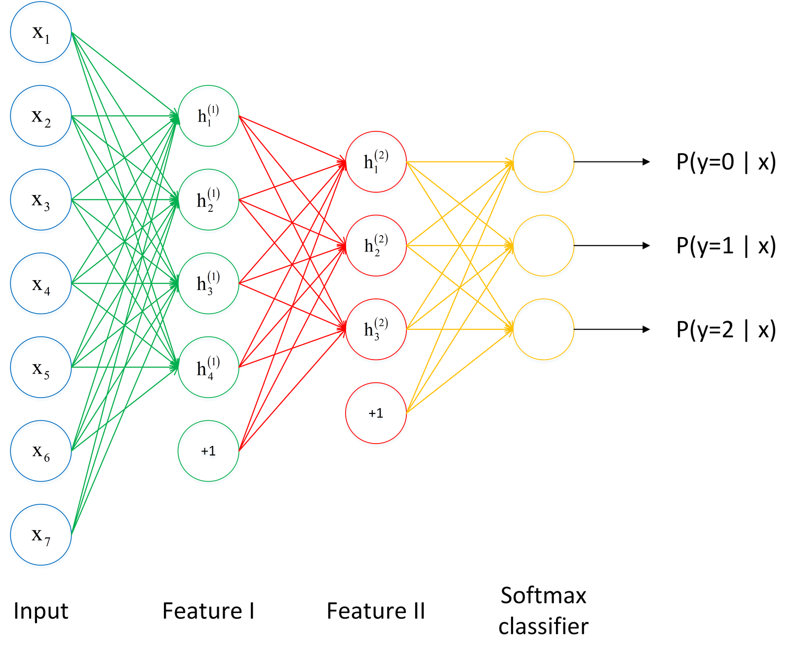

Hình tiếp theo: ba đầu vào qua softmax cho ra mảng $[0.05,\ 0.10,\ 0.85]$, đó là tác dụng của softmax.

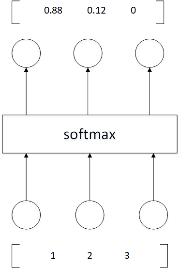

Quá trình ánh xạ trực quan hơn như hình dưới:

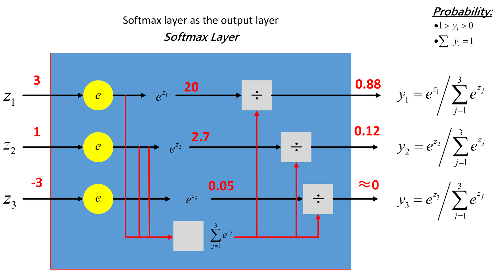

Nói đơn giản, các đầu ra ban đầu $3, 1, -3$ qua softmax được ánh xạ thành các giá trị trong $(0,1)$ là khoảng $0.88,\ 0.12,\ 0.002$, có tổng bằng $1$ (thỏa tính chất của xác suất), nên có thể hiểu là xác suất. Khi chọn nút đầu ra, ta chọn nút có xác suất lớn nhất làm dự đoán.

### 3.4.11 Hàm mất mát entropy chéo: định nghĩa và đạo hàm

**Lý thuyết:** [Học máy · 14.2 Hàm mất mát và phương pháp tối ưu](ml/ch14_vi?id=_142-hàm-mất-mát-và-phương-pháp-tối-ưu) · [Học máy · 15.3.1 Entropy chéo](ml/ch15_vi?id=_1531-entropy-chéo)

(*Người đóng góp: Hoàng Khâm Kiến – Đại học Công nghệ Hoa Nam*)

Đầu ra của neuron là $a = \sigma(z)$, trong đó $z=\sum_j w_{j}x_{j}+b$ là tổng có trọng số của đầu vào. Hàm mất mát entropy chéo (cross-entropy) là

$$
C=-\frac{1}{n}\sum_x\left[y\ln a+(1-y)\ln(1-a)\right]
$$

trong đó $n$ là số dữ liệu huấn luyện, tổng lấy trên mọi đầu vào huấn luyện $x$, $y$ là đầu ra mong muốn tương ứng.

Nhìn biểu thức, chưa rõ nó giải quyết được vấn đề học chậm hay không. Thậm chí việc coi nó là một hàm mất mát cũng chưa hiển nhiên! Trước khi bàn về học chậm, hãy xem vì sao entropy chéo có thể coi là một hàm mất mát.

Có hai lý do.

Thứ nhất, nó không âm, $C \ge 0$: mọi số hạng trong tổng đều không dương, vì $a \in (0,1)$ nên $\ln a$ và $\ln(1-a)$ đều âm, và trước tổng có dấu trừ.

Thứ hai, nếu với mọi đầu vào huấn luyện $x$, đầu ra thực của neuron gần với giá trị mong muốn, thì entropy chéo gần 0.

Giả sử $y = 0$ và $a \approx 0$, đó là kết quả ta muốn. Số hạng thứ nhất biến mất vì $y = 0$, số hạng thứ hai là $-\ln(1-a) \approx 0$. Ngược lại, khi $y = 1$ và $a \approx 1$ cũng vậy. Do đó khoảng cách giữa đầu ra thực và đầu ra mong muốn càng nhỏ thì entropy chéo càng nhỏ. (Ở đây giả sử nhãn chỉ là 0 hoặc 1, đúng với bài toán phân loại.)

Tóm lại, entropy chéo không âm và tiến về 0 khi neuron dự đoán tốt. Đó là những tính chất ta muốn ở một hàm mất mát; hàm mất mát bình phương cũng có các tính chất này. Nhưng entropy chéo có thêm một ưu điểm so với mất mát bình phương: nó tránh được hiện tượng học chậm. Để thấy điều đó, hãy tính đạo hàm riêng của entropy chéo theo trọng số. Thay $a=\sigma(z)$ vào và áp dụng quy tắc chuỗi hai lần:

$$
\begin{aligned}
\frac{\partial C}{\partial w_{j}}&=-\frac{1}{n}\sum \frac{\partial }{\partial w_{j}}\left[y\ln a+(1-y)\ln(1-a)\right]\\
&=-\frac{1}{n}\sum \frac{\partial }{\partial a}\left[y\ln a+(1-y)\ln(1-a)\right]\cdot\frac{\partial a}{\partial w_{j}}\\
&=-\frac{1}{n}\sum \left(\frac{y}{a}-\frac{1-y}{1-a}\right)\cdot\frac{\partial a}{\partial w_{j}}\\
&=-\frac{1}{n}\sum \left(\frac{y}{\sigma(z)}-\frac{1-y}{1-\sigma(z)}\right)\frac{\partial \sigma(z)}{\partial w_{j}}\\
&=-\frac{1}{n}\sum \left(\frac{y}{\sigma(z)}-\frac{1-y}{1-\sigma(z)}\right)\sigma'(z)\,x_{j}
\end{aligned}
$$

Từ định nghĩa $\sigma(z)=\frac{1}{1+e^{-z}}$, biến đổi một chút ta có $\sigma'(z)=\sigma(z)(1-\sigma(z))$. Rút gọn được:

$$
\frac{\partial C}{\partial w_{j}}=\frac{1}{n}\sum x_{j}\left(\sigma(z)-y\right)
$$

Đây là một công thức đẹp. Nó cho biết tốc độ học của trọng số được điều khiển bởi $\sigma(z)-y$, tức sai số ở đầu ra. Sai số càng lớn, học càng nhanh, đúng như trực giác. Đặc biệt, hàm mất mát này tránh được hiện tượng học chậm do thừa số $\sigma'(z)$ gây ra trong công thức tương ứng của mất mát bình phương: với entropy chéo, $\sigma'(z)$ bị triệt tiêu, nên ta không cần lo nó trở nên rất nhỏ. Sự triệt tiêu này là "phép màu" của entropy chéo. Thực ra cũng không có gì thần kỳ: như sẽ thấy, entropy chéo chỉ là một lựa chọn có tính chất này.

Bằng cách tương tự, ta tính được đạo hàm riêng theo hệ số điều chỉnh. Phần chi tiết không trình bày ở đây, bạn có thể dễ dàng kiểm tra:

$$
\frac{\partial C}{\partial b}=\frac{1}{n}\sum \left(\sigma(z)-y\right)
$$

Một lần nữa, công thức này tránh được hiện tượng học chậm do thừa số $\sigma'(z)$ như trong mất mát bình phương.

> **Biên tập:** đoạn này dịch từ chương 3 sách *Neural Networks and Deep Learning* của Michael Nielsen. Sửa "$C > 0$" thành "$C \ge 0$", và lý do số hạng âm là vì $a \in (0,1)$ (bản gốc viết "miền xác định của hàm log là $(0,1)$").

### 3.4.12 Vì sao tanh hội tụ nhanh hơn sigmoid?

(*Người đóng góp: Hoàng Khâm Kiến – Đại học Công nghệ Hoa Nam*)

Xét đạo hàm của hai hàm:

$$
\tanh'(x)=1-\tanh^{2}(x)\in (0,1], \qquad s'(x)=s(x)(1-s(x))\in \left(0,\tfrac{1}{4}\right]
$$

Từ hai công thức trên, tanh ít bị tiêu biến gradient hơn sigmoid, nên tanh hội tụ nhanh hơn sigmoid. (Ngoài ra đầu ra của tanh có trung bình gần 0, giúp tầng sau học dễ hơn.)

(*Người đóng góp: Cáo Tuyền Khải – Đại học Công nghệ Hoa Nam*)

Chú ý: tiêu biến gradient (gradient vanishing) hay bùng nổ gradient (gradient explosion) là kết quả tổng hợp của hàm kích hoạt **và trọng số hiện tại**. Gọi $\sigma(\cdot)$ là hàm kích hoạt bất kỳ, đầu ra tầng $k+1$ là $f_{k+1}=\sigma(Wf_k)$; lấy đạo hàm được $\frac {\partial f_{k+1}}{\partial f_k}=\mathrm{diag}(\sigma'(Wf_k))\,W$. Kết quả đạo hàm chịu ảnh hưởng đồng thời của trọng số $W$ và đạo hàm của hàm kích hoạt $\sigma'(\cdot)$. Với sigmoid $\sigma(x)=\frac {1}{1+e^{-x}}$, đạo hàm $\sigma'(x)=\frac{1}{1+e^{-x}}\left(1-\frac{1}{1+e^{-x}}\right)$ luôn nằm trong $(0, 1/4]$; khi lan truyền gradient bằng quy tắc chuỗi, nhân liên tiếp sẽ làm kết quả tiến về 0. Nhưng nếu trọng số $W$ đủ lớn để tích $\frac {\partial f_{k+1}}{\partial f_k}$ lớn hơn 1, thì nhân liên tiếp không gây tiêu biến gradient.

Tóm lại, khi bàn về tốc độ hội tụ của hàm kích hoạt hay về tiêu biến/bùng nổ gradient, phải xét đồng thời ảnh hưởng của độ lớn trọng số $W$.

> **Biên tập:** bản gốc lẫn ký hiệu $h_t$ và $f_k$ trong cùng một công thức; đã thống nhất thành $f_k$. Đạo hàm của tanh nằm trong $(0,1]$ (đạt 1 tại 0), không phải $(0,1)$.

### 3.4.13 Kéo lại trong lớp, đẩy xa giữa các lớp: Center Loss

(*Người đóng góp: Lý Thế Hiên – Đại học California, Berkeley*)

Trong các bài toán thị giác máy tính, nhờ đơn giản, hiệu quả và dễ hiểu theo nghĩa xác suất, tổ hợp Cross Entropy Loss (mất mát entropy chéo) + Softmax được dùng rộng rãi, nhất là cho phân loại. Trong cách dùng này, có thể hiểu quá trình học như sau: các ảnh giống nhau hơn (cùng lớp/cùng vật thể) có "khoảng cách gần hơn" trong không gian đặc trưng, ngược lại thì "xa hơn". Nói cách khác, mô hình học một biểu diễn đặc trưng có khoảng cách trong lớp (intra-class distance) nhỏ và khoảng cách giữa các lớp (inter-class distance) lớn. Center Loss giúp học loại đặc trưng có tính phân biệt này một cách hiệu quả. Khác với softmax loss thông thường, Center Loss học một "tâm đặc trưng" cho mỗi lớp và cực tiểu hóa khoảng cách trong lớp. Công thức:

$$
L_{C} = \frac{1}{2}\sum^{m}_{i=1}\Vert x_{i}-c_{y_{i}}\Vert^{2}_{2}
$$

trong đó $x_{i}$ là đặc trưng ngay trước tầng kết nối đầy đủ cuối (FC), $c_{y_{i}}$ là tâm đặc trưng của lớp $y_{i}$, $m$ là kích thước mini-batch. Có thể thấy mục tiêu của $L_{C}$ là cực tiểu hóa khoảng cách bình phương từ mỗi đặc trưng tới tâm lớp của nó, tức cực tiểu hóa khoảng cách trong lớp. Công thức cập nhật:

$$
\frac{\partial L_{C}}{\partial x_{i}}=x_{i}-c_{y_{i}}
$$

$$
\Delta{c_{j}} = \frac{\sum^{m}_{i=1}\delta(y_{i}=j)\cdot(c_{j}-x_{i})}{1+\sum^{m}_{i=1}\delta(y_{i}=j)}
$$

trong đó $\delta(\text{điều kiện})= 1$ nếu điều kiện đúng, $0$ nếu sai.

Có thể kết hợp với softmax, cân bằng hai tín hiệu giám sát: softmax kéo xa các lớp, Center Loss thu nhỏ khoảng cách trong lớp. Ví dụ:

$$
\begin{aligned}
L &= L_{S} + \lambda L_{C} \\
&= -\sum^{m}_{i=1}\log\frac{e^{W_{y_i}^{T}x_{i}+b_{y_{i}}}}{\sum^{n}_{j=1}e^{W^{T}_{j}x_{i}+b_{j}}} + \frac{\lambda}{2}\sum^{m}_{i=1}\Vert x_{i}-c_{y_{i}}\Vert^{2}_{2}
\end{aligned}
$$

với $n$ là số lớp.

Dù vậy, Center Loss vẫn có hạn chế. Các tâm đặc trưng là tham số thêm, không được tối ưu cùng tham số mô hình theo cách thông thường, mà được cập nhật bằng một ước lượng trung bình trượt theo từng bước (như công thức $\Delta c_j$ ở trên). Khi số lớp lớn, mỗi mini-batch có thể không đủ mẫu của từng lớp để ước lượng tâm cho tốt. Ngoài ra phải cân bằng hai loại mất mát bằng hệ số $\lambda$ (và tốc độ cập nhật tâm), việc tìm các siêu tham số này khá tốn kém.

> **Biên tập:** bản gốc đánh số mục này trùng là 3.4.12 (kèm dòng "3.4.13" trơ trọi); đã đánh số lại thành 3.4.13. Mẫu số của softmax trong công thức kết hợp phải lấy tổng theo các lớp $j=1..n$ (bản gốc lấy tổng theo mẫu $i$), tử số dùng $W_{y_i}$.

## 3.5 Kích thước batch

**Lý thuyết:** [Học máy · 12.6 Stochastic gradient descent](ml/ch12_vi?id=_126-stochastic-gradient-descent) · [Học sâu · 12.5 Hạ Gradient Ngẫu nhiên theo Minibatch](dl/ch12_s5_vi)

### 3.5.1 Vì sao cần batch size?

Việc chọn batch trước hết quyết định hướng đi xuống của gradient.

Nếu tập dữ liệu nhỏ, có thể dùng toàn bộ tập dữ liệu (full batch). Lợi ích:

1. Hướng tính từ toàn bộ dữ liệu đại diện tốt hơn cho tổng thể, nên chỉ chính xác hơn về phía cực trị.
2. Gradient của các trọng số khác nhau chênh lệch rất lớn, nên khó chọn một tốc độ học chung. Học với toàn bộ dữ liệu cho phép dùng Rprop: chỉ dựa vào dấu của gradient và cập nhật riêng từng trọng số.

Với tập dữ liệu lớn hơn, dùng toàn bộ dữ liệu có hại:

1. Dữ liệu tăng quá lớn trong khi bộ nhớ có hạn, nên nạp tất cả cùng lúc ngày càng không khả thi.
2. Nếu lặp theo kiểu Rprop trên từng batch, do khác biệt lấy mẫu giữa các batch, các lần điều chỉnh gradient triệt tiêu lẫn nhau, không hiệu chỉnh được. Vì thế về sau mới có giải pháp thỏa hiệp RMSProp.

### 3.5.2 Chọn giá trị batch size

Nếu mỗi lần chỉ huấn luyện một mẫu, tức batch size = 1 (hạ gradient ngẫu nhiên thuần túy). Với neuron tuyến tính và hàm mất mát bình phương trung bình, mặt sai số là một paraboloid, mặt cắt là hình elip. Với mạng nhiều tầng, phi tuyến, cục bộ mặt sai số vẫn xấp xỉ paraboloid. Khi đó, mỗi lần cập nhật đi theo hướng gradient của từng mẫu riêng lẻ, mỗi mẫu kéo một ngả, khó hội tụ.

Nếu batch size bằng cả tập dữ liệu hay bằng 1 đều có nhược điểm, có thể chọn một batch size vừa phải không?

Có: đó là hạ gradient theo mini-batch (mini-batch learning). Nếu dữ liệu đủ nhiều, gradient tính từ một nửa (thậm chí ít hơn nhiều) dữ liệu gần như giống gradient tính từ toàn bộ dữ liệu.

### 3.5.3 Trong phạm vi hợp lý, tăng batch size có lợi gì?

1. Tận dụng bộ nhớ tốt hơn, phép nhân ma trận lớn song song hóa hiệu quả hơn.
2. Số lần lặp cần cho một epoch (qua hết tập dữ liệu) giảm, nên tốc độ xử lý cùng lượng dữ liệu nhanh hơn.
3. Trong một giới hạn nhất định, batch size càng lớn thì hướng đi xuống càng chính xác, dao động khi huấn luyện càng nhỏ.

### 3.5.4 Tăng batch size một cách mù quáng có hại gì?

1. Tận dụng bộ nhớ tốt hơn, nhưng dung lượng bộ nhớ có thể không đủ.
2. Số lần lặp cho một epoch giảm, nhưng mỗi epoch chỉ cập nhật tham số ít lần hơn, nên để đạt cùng độ chính xác cần nhiều epoch hơn; tổng thời gian có thể tăng lên nhiều, tham số được hiệu chỉnh chậm hơn.
3. Khi batch size tăng tới một mức nào đó, hướng đi xuống gần như không còn thay đổi (thêm dữ liệu vào batch không cho thêm thông tin).

### 3.5.5 Rốt cuộc điều chỉnh batch size ảnh hưởng thế nào tới kết quả huấn luyện?

Các kết luận dưới đây rút ra từ một thí nghiệm cụ thể (mạng nhỏ trên MNIST), dùng làm định hướng:

1. Batch size quá nhỏ, mô hình hoạt động rất kém (sai số tăng vọt).
2. Batch size tăng thì xử lý cùng lượng dữ liệu nhanh hơn.
3. Batch size tăng thì số epoch cần để đạt cùng độ chính xác tăng lên.
4. Vì hai yếu tố trên mâu thuẫn nhau, batch size tăng tới một mức nào đó thì đạt tối ưu về thời gian.
5. Vì độ chính xác hội tụ cuối cùng rơi vào các cực trị cục bộ khác nhau, batch size tăng tới một mức nào đó thì đạt tối ưu về độ chính xác hội tụ.

## 3.6 Chuẩn hóa

**Lý thuyết:** [Học máy · D.6 Co giãn đặc trưng](ml/prep_vi?id=d6-co-giãn-đặc-trưng)

### 3.6.1 Chuẩn hóa nghĩa là gì?

1. Thống nhất phân phối thống kê của các mẫu. Đưa dữ liệu về $[0, 1]$ hay $[-1, 1]$ là đưa các đặc trưng về cùng một thang đo.
2. Dù để mô hình hóa hay để tính toán, trước hết đơn vị đo phải thống nhất. Mạng neuron huấn luyện (tính xác suất) và dự đoán dựa trên phân phối thống kê của mẫu; hàm sigmoid cho giá trị trong $(0, 1)$, đầu ra của nút cuối cùng cũng vậy, nên thường phải chuẩn hóa đầu ra (nhãn) của mẫu.
3. Nếu mọi đầu vào đều dương (như khi chuẩn hóa về $[0, 1]$), thì gradient của mọi trọng số nối với cùng một neuron ở tầng ẩn thứ nhất có cùng dấu, nên các trọng số này chỉ có thể cùng tăng hoặc cùng giảm, khiến việc học chậm (đi theo đường zíc zắc).
4. Ngoài ra dữ liệu thường có mẫu bất thường (ngoại lai); chúng làm tăng thời gian huấn luyện và có thể khiến mạng không hội tụ. Để tránh điều đó, thuận tiện cho xử lý về sau và tăng tốc học, có thể chuẩn hóa đầu vào sao cho trung bình của mọi mẫu gần 0, hoặc nhỏ so với độ lệch chuẩn.

> **Biên tập:** bản gốc viết "chuẩn hóa về $0$–$1$ là phân phối xác suất thống kê, về $-1$–$1$ là phân phối tọa độ thống kê", cách nói không có nghĩa chính xác; đã diễn đạt lại. Ý 3 là lý do nên đưa dữ liệu về trung bình 0 (chứ không chỉ về $[0,1]$).

### 3.6.2 Vì sao phải chuẩn hóa?

1. Thuận tiện cho xử lý dữ liệu về sau; chuẩn hóa tránh được một số vấn đề số học không cần thiết.
2. Giúp thuật toán hội tụ nhanh hơn.
3. Thống nhất đơn vị đo (thứ nguyên). Các đặc trưng có tiêu chuẩn đánh giá khác nhau, cần đưa về không thứ nguyên để thống nhất tiêu chuẩn. Đây là nhu cầu ở mức ứng dụng.
4. Tránh neuron bão hòa. Nghĩa là gì? Khi đầu ra kích hoạt của neuron gần 0 hoặc 1 thì bão hòa; ở vùng này gradient gần như bằng 0, nên khi lan truyền ngược, gradient cục bộ gần 0, thực chất "giết chết" gradient.
5. Đảm bảo các giá trị nhỏ trong dữ liệu không bị các giá trị lớn lấn át.

### 3.6.3 Vì sao chuẩn hóa giúp tìm nghiệm tối ưu nhanh hơn?

**Lý thuyết:** [Học máy · 12.3 Gradient descent cho hàm nhiều biến](ml/ch12_vi?id=_123-gradient-descent-cho-hàm-nhiều-biến)

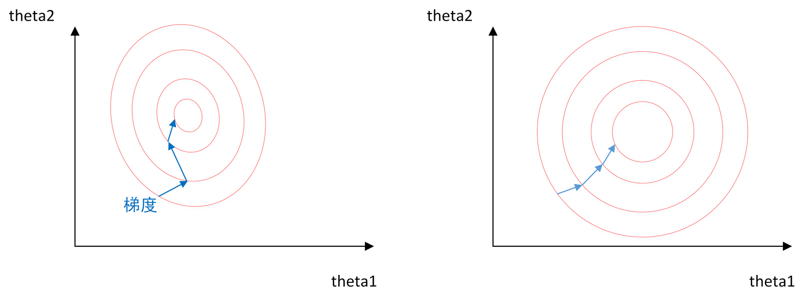

Hình trên so sánh quá trình tìm nghiệm tối ưu khi dữ liệu chưa và đã chuẩn hóa (các vòng tròn là đường đồng mức). Hình trái: chưa chuẩn hóa; hình phải: đã chuẩn hóa.

Khi dùng hạ gradient, rất có thể thuật toán đi theo đường zíc zắc (vuông góc với đường đồng mức), cần rất nhiều vòng lặp mới hội tụ; còn hình phải đã chuẩn hóa hai đặc trưng, đường đồng mức gần tròn, hạ gradient hội tụ nhanh hơn.

Vì vậy, nếu mô hình học máy dùng hạ gradient để tìm nghiệm tối ưu, chuẩn hóa thường rất cần thiết; nếu không, rất khó hội tụ, thậm chí không hội tụ.

### 3.6.4 Minh họa 3D khi chưa chuẩn hóa

Ví dụ:

Giả sử $w_1$ nằm trong khoảng $[-10, 10]$, còn $w_2$ trong khoảng $[-100, 100]$, mỗi bước gradient tiến 1 đơn vị. Khi đó theo hướng $w_1$ mỗi bước tương đương tiến $1/20$ khoảng, còn theo hướng $w_2$ chỉ là $1/200$! Theo một nghĩa nào đó, bước đi theo $w_2$ nhỏ hơn, và trong quá trình tìm kiếm $w_1$ "đi" nhanh hơn $w_2$.

Kết quả là quá trình tìm kiếm thiên về hướng $w_1$, đi thành đường hình chữ "L" hoặc zíc zắc.

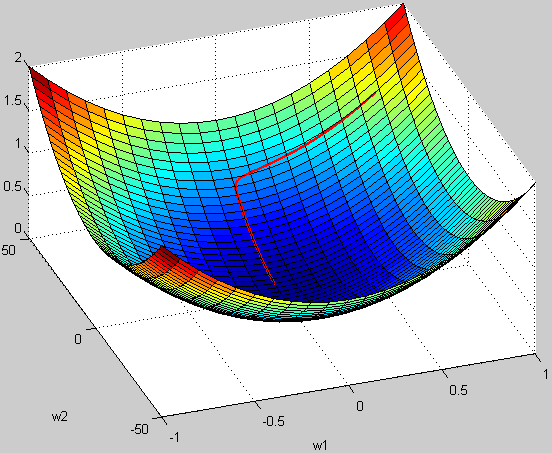

### 3.6.5 Có những kiểu chuẩn hóa nào?

1. Chuẩn hóa tuyến tính (min–max)

$$
x^{\prime} = \frac{x-\min(x)}{\max(x) - \min(x)}
$$

Phạm vi dùng: phù hợp khi giá trị khá tập trung.

Nhược điểm: nếu max và min không ổn định (ví dụ có ngoại lai), kết quả chuẩn hóa dễ không ổn định, kéo theo kết quả về sau cũng không ổn định.

2. Chuẩn hóa theo độ lệch chuẩn (z-score)

$$
x^{\prime} = \frac{x-\mu}{\sigma}
$$

Ý nghĩa: dữ liệu sau khi xử lý có trung bình 0 và độ lệch chuẩn 1, trong đó $\mu$ là trung bình, $\sigma$ là độ lệch chuẩn của toàn bộ dữ liệu mẫu.

3. Chuẩn hóa phi tuyến

Phạm vi dùng: thường dùng khi dữ liệu phân tán mạnh, có giá trị rất lớn, có giá trị rất nhỏ. Dùng một hàm toán học để ánh xạ giá trị gốc, ví dụ $\log$, hàm mũ, arctan…

> **Biên tập:** bản gốc viết dữ liệu sau z-score "tuân theo phân phối chuẩn tắc". Z-score chỉ dời và co giãn, nên hình dạng phân phối giữ nguyên; dữ liệu chỉ có trung bình 0 và độ lệch chuẩn 1, chưa chắc có phân phối chuẩn.

### 3.6.6 Vai trò của chuẩn hóa đáp ứng cục bộ

Chuẩn hóa đáp ứng cục bộ (Local Response Normalization, LRN) là một kỹ thuật nhằm tăng độ chính xác của học sâu, thường đặt sau tầng kích hoạt hoặc tầng gộp.

LRN được đề xuất trong AlexNet: nó tạo cơ chế cạnh tranh giữa các neuron lân cận, làm cho giá trị đáp ứng lớn trở nên tương đối lớn hơn và ức chế các neuron có đáp ứng nhỏ, qua đó tăng khả năng tổng quát hóa của mô hình.

> **Biên tập:** về sau (VGG, 2014) người ta thấy LRN gần như không cải thiện kết quả mà tốn thêm tính toán; từ khi có batch normalization, LRN hầu như không còn được dùng.

### 3.6.7 Hiểu chuẩn hóa đáp ứng cục bộ

LRN mô phỏng hiện tượng ức chế bên (lateral inhibition) trong sinh học: neuron hoạt động mạnh ức chế các neuron lân cận. Công thức:

$$
b_{x,y}^i = a_{x,y}^i \Big/ \left(k + \alpha \sum_{j=\max(0, i-n/2)}^{\min(N-1, i+n/2)}\left(a_{x,y}^j\right)^2 \right)^\beta
$$

trong đó:

1) $a$: đầu ra của tầng tích chập (gồm tích chập và gộp), là một mảng bốn chiều [batch, height, width, channel].

- batch: số ảnh trong batch (mỗi phần tử là một ảnh).
- height: chiều cao ảnh.
- width: chiều rộng ảnh.
- channel: số kênh; có thể hiểu là số neuron đầu ra sau tích chập của một ảnh, hay độ sâu của ảnh sau xử lý.

2) $a_{x,y}^i$ là một vị trí $[a,b,c,d]$ trong mảng đầu ra, có thể hiểu là điểm ở một chiều cao và chiều rộng nào đó trong một kênh của một ảnh: điểm ở độ cao $b$, độ rộng $c$, kênh $d$ của ảnh thứ $a$.

3) $N$: số kênh (channel).

4) $a$, $n/2$, $k$ lần lượt tương ứng với input, depth_radius, bias của hàm trong TensorFlow. Các tham số $k, n, \alpha, \beta$ đều là siêu tham số, AlexNet dùng $k=2, n=5, \alpha=10^{-4}, \beta=0.75$.

5) $\sum$: tổng được lấy theo hướng kênh, tức là tổng bình phương của các điểm cùng vị trí trên $n/2$ kênh phía trước (nhỏ nhất là kênh 0) và $n/2$ kênh phía sau (lớn nhất là kênh $N-1$), tổng cộng $n+1$ điểm. Chú thích trong tài liệu của hàm cũng nói rõ: coi input như $d$ ma trận 3 chiều, tức coi số kênh là số ma trận, và cộng theo hướng kênh.

Sơ đồ đơn giản:

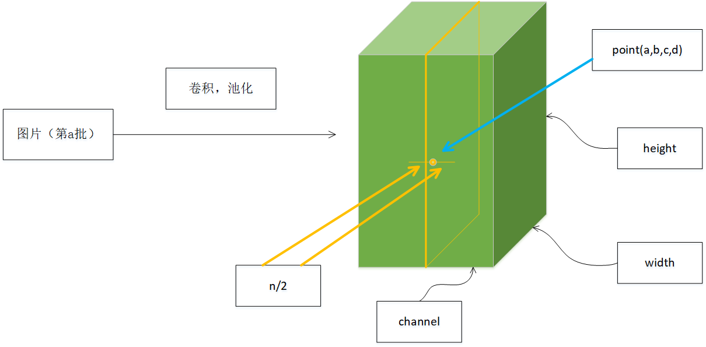

### 3.6.8 Batch Normalization là gì?

**Lý thuyết:** [d2l (tiếng Anh) · 8.5 Batch Normalization](https://d2l.ai/chapter_convolutional-modern/batch-norm.html) ↗

Trước đây khi huấn luyện mạng neuron, người ta chỉ chuẩn hóa dữ liệu ở tầng đầu vào, không chuẩn hóa ở các tầng giữa. Nhưng dù dữ liệu đầu vào đã chuẩn hóa, sau các phép nhân ma trận và biến đổi phi tuyến kiểu $\sigma(WX+b)$, phân phối dữ liệu rất có thể thay đổi, và qua nhiều tầng của mạng sâu, sự thay đổi càng lớn. Nếu chuẩn hóa cả ở giữa mạng thì có cải thiện việc huấn luyện không? Câu trả lời là có.

Phương pháp chuẩn hóa ở các tầng giữa để huấn luyện tốt hơn này là chuẩn hóa theo batch, Batch Normalization (BN).

### 3.6.9 Ưu điểm của batch normalization

1. Bớt phải chọn tham số thủ công. Trong một số trường hợp có thể bỏ dropout và số hạng điều chuẩn L2, hoặc dùng hệ số L2 nhỏ hơn;
2. Giảm yêu cầu về tốc độ học: có thể dùng tốc độ học ban đầu lớn, mà thuật toán vẫn hội tụ nhanh;
3. Không cần dùng LRN nữa, vì bản thân BN là một tầng chuẩn hóa (LRN có trong AlexNet);
4. Có tác dụng điều chuẩn, giảm quá khớp phần nào: thống kê của mỗi batch là ngẫu nhiên nên BN thêm nhiễu vào huấn luyện. (Bài báo gốc cũng nhận xét rằng xáo trộn dữ liệu kỹ hơn để một mẫu không thường xuyên rơi vào cùng batch giúp tăng thêm khoảng 1% độ chính xác.)
5. Giảm tiêu biến gradient, tăng tốc hội tụ, tăng độ chính xác khi huấn luyện.

> **Biên tập:** ý 4 của bản gốc ("phá vỡ phân phối dữ liệu ban đầu… ngăn một mẫu thường xuyên được chọn") gộp hai ý khác nhau của bài báo BN; đã tách thành tác dụng điều chuẩn của BN và nhận xét về xáo trộn dữ liệu.

### 3.6.10 Các bước của thuật toán batch normalization

Quá trình BN khi huấn luyện:

Đầu vào: đầu ra của tầng trước trên một batch $\mathcal{B} = \{x_1, x_2, \dots, x_m\}$, tham số học được $\gamma, \beta$.

Các bước:

1. Tính trung bình của batch

$$
\mu_{\mathcal{B}} = \frac{1}{m} \sum_{i=1}^m x_i
$$

trong đó $m$ là kích thước batch.

2. Tính phương sai của batch

$$
\sigma_{\mathcal{B}}^2 = \frac{1}{m} \sum_{i=1}^m (x_i - \mu_{\mathcal{B}})^2
$$

3. Chuẩn hóa

$$
\hat x_i = \frac{x_i - \mu_{\mathcal{B}}}{\sqrt{\sigma_{\mathcal{B}}^2 + \epsilon}}
$$

trong đó $\epsilon$ là một số rất nhỏ để tránh chia cho 0.

4. Khôi phục (co giãn và dịch)

$$
y_i = \gamma \hat x_i + \beta
$$

trong đó $\gamma, \beta$ là tham số học được.

Chú ý: trên đây là quá trình BN khi huấn luyện. Khi dùng mô hình để dự đoán, thường chỉ có một mẫu, không có trung bình $\mu_{\mathcal{B}}$ và phương sai $\sigma_{\mathcal{B}}^2$ của batch. Khi đó trung bình được lấy bằng trung bình của các $\mu_{\mathcal{B}}$ qua mọi batch huấn luyện, còn phương sai lấy bằng ước lượng không chệch $\frac{m}{m-1}\mathbb{E}[\sigma_{\mathcal{B}}^2]$. Trong thực tế (PyTorch, TensorFlow), hai đại lượng này được ước lượng bằng trung bình trượt (moving average) trong lúc huấn luyện.

> **Biên tập:** bản gốc có ba lỗi ở công thức chuẩn hóa: tử số là $x_i + \mu$ (đúng là $x_i - \mu$), $\epsilon$ đặt ngoài dấu căn, và gọi $\sigma^2$ là "độ lệch chuẩn" (đó là phương sai). Ký hiệu $\mu_\beta$ dễ nhầm với tham số $\beta$ nên đổi thành $\mu_{\mathcal{B}}$.

### 3.6.11 So sánh batch normalization và group normalization

| Tên | Đặc điểm |
| --- | --- |
| Batch Normalization (BN) | Giúp nhiều loại mạng huấn luyện được. Nhưng chuẩn hóa theo chiều batch gây ra vấn đề: khi batch nhỏ, thống kê của batch ước lượng không chính xác nên sai số của BN tăng nhanh. Khi huấn luyện mạng lớn hoặc chuyển đặc trưng sang các bài toán thị giác (phát hiện đối tượng, phân vùng, video), bộ nhớ hạn chế buộc phải dùng BN với batch nhỏ. |
| Group Normalization (GN) | GN chia các kênh thành nhóm, tính trung bình và phương sai trong từng nhóm để chuẩn hóa. Phép tính của GN không phụ thuộc kích thước batch, và độ chính xác ổn định với mọi kích thước batch. |
| So sánh | Với ResNet-50 huấn luyện trên ImageNet, khi batch size bằng 2, GN có tỉ lệ lỗi thấp hơn BN 10.6%; với batch size thông thường, GN tương đương BN và tốt hơn các biến thể chuẩn hóa khác. GN cũng chuyển tự nhiên từ tiền huấn luyện sang tinh chỉnh. Trên phát hiện đối tượng, phân vùng (COCO) và phân loại video (Kinetics), GN vượt các đối thủ, cho thấy GN có thể thay thế BN hiệu quả trong nhiều bài toán. |

### 3.6.12 So sánh Weight Normalization và Batch Normalization

Weight Normalization (WN) và Batch Normalization đều là phương pháp tái tham số hóa (reparameterization), chỉ khác cách làm.

Weight Normalization chuẩn hóa trọng số $W$ của mạng, nên mới gọi là chuẩn hóa trọng số: viết $\mathbf{w} = \frac{g}{\Vert\mathbf{v}\Vert}\mathbf{v}$, tách độ lớn $g$ khỏi hướng $\mathbf{v}$;

Batch Normalization chuẩn hóa dữ liệu đầu vào của một tầng.

So với BN, WN có ba ưu điểm:

1. WN tăng tốc hội tụ bằng cách viết lại trọng số $W$, không phụ thuộc mini-batch, nên dùng được cho RNN (LSTM). (BN không dùng trực tiếp cho RNN được, vì: 1) chuỗi mà RNN xử lý có độ dài thay đổi; 2) RNN tính theo từng bước thời gian, nếu dùng BN thì phải lưu trung bình và phương sai của mini-batch ở mỗi bước, vừa chậm vừa tốn bộ nhớ.)

2. BN tính trung bình và phương sai trên một mini-batch chứ không trên toàn tập huấn luyện, nên tương đương thêm nhiễu vào việc tính gradient. Vì vậy BN không hợp với các bài toán nhạy với nhiễu như học tăng cường hay mô hình sinh (GAN, VAE). Ngược lại, WN viết lại trọng số $W$ qua vô hướng $g$ và vector $\mathbf{v}$, không dùng thống kê của batch, nên đưa vào ít nhiễu hơn BN.

3. Không cần thêm bộ nhớ để lưu trung bình và phương sai của mini-batch; chi phí tính toán thêm cho lan truyền thuận và ngược cũng rất nhỏ, nên nhanh hơn BN. Nhưng WN không có tác dụng giữ đầu ra mỗi tầng trong một phạm vi cố định như BN, nên khi dùng WN phải đặc biệt chú ý chọn giá trị khởi tạo.

> **Biên tập:** bản gốc viết "vector $\mathbf{v}$ là cố định"; thực ra cả $g$ và $\mathbf{v}$ đều là tham số học được. Điều làm WN ít nhiễu hơn là nó không dùng thống kê theo batch.

### 3.6.13 Khi nào nên dùng batch normalization?

(*Người đóng góp: Hoàng Khâm Kiến – Đại học Công nghệ Hoa Nam*)

Trong CNN, BN nên đặt trước phép biến đổi phi tuyến (hàm kích hoạt). Khi huấn luyện mà hội tụ rất chậm, hoặc gặp bùng nổ gradient khiến không huấn luyện được, có thể thử dùng BN. Ngoài ra, trong trường hợp thông thường cũng có thể thêm BN để tăng tốc huấn luyện, tăng độ chính xác.

BN hợp nhất khi mỗi mini-batch khá lớn và phân phối dữ liệu giữa các batch gần nhau. Trước khi huấn luyện phải xáo trộn (shuffle) dữ liệu kỹ, nếu không kết quả sẽ kém đi nhiều. Ngoài ra, do BN phải thống kê moment bậc một và bậc hai của từng mini-batch khi chạy, nên không hợp với cấu trúc mạng động và RNN (với RNN thường dùng Layer Normalization).

## 3.7 Tiền huấn luyện và tinh chỉnh

**Lý thuyết:** [d2l (tiếng Anh) · 14.2 Fine-Tuning](https://d2l.ai/chapter_computer-vision/fine-tuning.html) ↗

### 3.7.1 Vì sao tiền huấn luyện không giám sát giúp được học sâu?

Mạng sâu có các vấn đề:

1. Mạng càng sâu càng cần nhiều mẫu huấn luyện. Nếu học có giám sát thì cần lượng lớn mẫu có nhãn, nếu không, ít mẫu dễ gây quá khớp. Mạng sâu có nhiều đặc trưng, kéo theo các vấn đề về số mẫu, điều chuẩn và chọn đặc trưng.
2. Tối ưu tham số của mạng nhiều tầng là bài toán không lồi bậc cao, thường hội tụ về nghiệm cục bộ kém;
3. Khuếch tán (tiêu biến) gradient: gradient tính bằng lan truyền ngược giảm mạnh khi đi về các tầng đầu, khiến tham số các tầng đầu đóng góp ít và cập nhật chậm.

**Cách giải quyết:**

Huấn luyện tham lam từng tầng: tiền huấn luyện không giám sát (unsupervised pre-training), tức là huấn luyện tầng ẩn thứ nhất, rồi tầng thứ hai… cuối cùng dùng các tham số đã huấn luyện làm giá trị khởi tạo cho toàn mạng.

Sau tiền huấn luyện thường đạt được nghiệm cục bộ tốt hơn.

> **Biên tập:** tiền huấn luyện tham lam từng tầng (thời RBM, autoencoder, khoảng 2006–2012) nay hiếm dùng: ReLU, khởi tạo tốt, BN và kết nối tắt đủ để huấn luyện trực tiếp mạng rất sâu. "Tiền huấn luyện" ngày nay thường là huấn luyện cả mạng trên tập dữ liệu lớn (có giám sát hoặc tự giám sát) rồi tinh chỉnh.

### 3.7.2 Tinh chỉnh mô hình (fine-tuning) là gì?

Dùng tham số của người khác, mạng đã sửa đổi và dữ liệu của mình để huấn luyện, cho tham số thích nghi với dữ liệu của mình; quá trình đó thường gọi là tinh chỉnh (fine-tuning).

**Ví dụ về tinh chỉnh:**

CNN đã đạt tiến bộ rất lớn trong nhận dạng ảnh. Muốn dùng CNN cho tập dữ liệu của mình, ta thường gặp vấn đề: tập dữ liệu không lớn lắm, thường không quá 10 nghìn ảnh, thậm chí ít hơn, mỗi lớp chỉ vài chục hoặc hơn chục ảnh. Khi đó, huấn luyện trực tiếp một mạng trên dữ liệu này không khả thi, vì một yếu tố then chốt cho thành công của học sâu là tập huấn luyện lớn có nhãn. Nếu chỉ dùng chút dữ liệu trong tay, dù mạng tốt đến đâu cũng khó đạt hiệu năng cao. Lúc này, ý tưởng tinh chỉnh giải quyết tốt vấn đề: lấy mô hình đã huấn luyện trên ImageNet (như CaffeNet, VGGNet, ResNet), tinh chỉnh rồi áp dụng cho tập dữ liệu của mình.

### 3.7.3 Khi tinh chỉnh, tham số mạng có được cập nhật không?

Có.

1. Tinh chỉnh tương đương huấn luyện tiếp, khác huấn luyện trực tiếp ở cách khởi tạo.
2. Huấn luyện trực tiếp thì khởi tạo theo cách mà định nghĩa mạng chỉ định.
3. Tinh chỉnh thì khởi tạo bằng tệp tham số đã có.

(Có thể chọn đóng băng một số tầng, xem câu 3.7.4.)

### 3.7.4 Ba trạng thái của mô hình khi tinh chỉnh

1. Trạng thái một: chỉ dự đoán, không huấn luyện.
Đặc điểm: tương đối nhanh, đơn giản; rất hiệu quả cho các dự án đã có mô hình huấn luyện xong, giờ chỉ cần gán nhãn cho dữ liệu mới.

2. Trạng thái hai: huấn luyện, nhưng chỉ huấn luyện tầng phân loại cuối.
Đặc điểm: phần trích đặc trưng của mô hình đã đáp ứng yêu cầu, chỉ cần học lại tầng phân loại cho các lớp của bài toán mới (thường ít lớp hơn).

3. Trạng thái ba: huấn luyện toàn bộ, cả tầng phân loại lẫn các tầng tích chập phía trước.
Đặc điểm: khác trạng thái hai không nhiều; tốn thời gian và tài nguyên GPU hơn, nhưng rất hợp để tinh chỉnh ra mô hình mình muốn, độ chính xác dự đoán thường cao hơn trạng thái hai đáng kể.

## 3.8 Khởi tạo trọng số và hệ số điều chỉnh

**Lý thuyết:** [Học sâu · 5.4.2 Khởi tạo Tham số](dl/ch05_s4_vi?id=_542-khởi-tạo-tham-số) · [Học sâu · 5.4.1.3 Phá vỡ Tính Đối xứng](dl/ch05_s4_vi?id=_5413-phá-vỡ-tính-Đối-xứng)

### 3.8.1 Khởi tạo toàn bộ bằng 0

**Bẫy khởi tạo**: khởi tạo mọi trọng số bằng 0.

**Nguyên nhân**: ta không biết giá trị cuối cùng của từng trọng số, nhưng nếu dữ liệu đã được chuẩn hóa hợp lý, có thể cho rằng khoảng một nửa trọng số dương, một nửa âm. Nếu khởi tạo mọi trọng số bằng 0, mọi neuron trong một tầng tính ra cùng một đầu ra, nhận cùng một gradient khi lan truyền ngược, và được cập nhật giống hệt nhau. Tổng quát hơn, nếu mọi trọng số được khởi tạo bằng cùng một giá trị, mạng sẽ đối xứng và các neuron trong một tầng không bao giờ trở nên khác nhau.

**Hình dung**: hãy tưởng tượng hạ gradient như đi xuống núi, nhưng bạn đứng trên sống một dãy núi thẳng tắp, hai bên là hai sườn đối xứng. Do đối xứng, gradient tại chỗ bạn đứng chỉ hướng dọc theo sống núi, không bao giờ hướng xuống một sườn; đi một bước thì tình hình vẫn y nguyên. Kết quả là bạn chỉ có thể đi dọc sống núi, không bao giờ xuống được thung lũng ở hai bên.

> **Biên tập:** bản gốc gọi đây là "bẫy khởi tạo hệ số điều chỉnh" (đúng ra là trọng số; hệ số điều chỉnh khởi tạo bằng 0 thì không sao, xem 3.8.6), và hình ảnh leo núi "chỉ hội tụ được tới một cực đại trong thung lũng" bị lẫn lộn chiều; đã viết lại theo chiều hạ gradient.

### 3.8.2 Khởi tạo toàn bộ bằng cùng một giá trị

Bẫy khởi tạo: khởi tạo mọi trọng số bằng cùng một giá trị.
Lấy ví dụ một mạng ba tầng, cấu trúc như sau:

Biểu thức của nó:

$$
a_1^{(2)} = f(W_{11}^{(1)} x_1 + W_{12}^{(1)} x_2 + W_{13}^{(1)} x_3 + b_1^{(1)})
$$

$$
a_2^{(2)} = f(W_{21}^{(1)} x_1 + W_{22}^{(1)} x_2 + W_{23}^{(1)} x_3 + b_2^{(1)})
$$

$$
a_3^{(2)} = f(W_{31}^{(1)} x_1 + W_{32}^{(1)} x_2 + W_{33}^{(1)} x_3 + b_3^{(1)})
$$

$$
h_{W,b}(x) = a_1^{(3)} = f(W_{11}^{(2)} a_1^{(2)} + W_{12}^{(2)} a_2^{(2)} + W_{13}^{(2)} a_3^{(2)} + b_1^{(2)})
$$

Nếu mọi trọng số bằng nhau, thì trong mạng nhiều tầng, từ tầng thứ hai trở đi mọi neuron trong một tầng có cùng giá trị, tức là $a_1=a_2=a_3=\dots$; đã giống nhau thì cũng như chỉ có một neuron. Vì sao vậy?

Trong thuật toán lan truyền ngược, đạo hàm riêng theo trọng số và hệ số điều chỉnh là

$$
\frac{\partial}{\partial W_{ij}^{(l)}} J(W,b;x,y) = a_j^{(l)} \delta_i^{(l+1)}, \qquad
\frac{\partial}{\partial b_{i}^{(l)}} J(W,b;x,y) = \delta_i^{(l+1)}
$$

với $\delta$ được tính bởi

$$
\delta_i^{(l)} = \left(\sum_{j=1}^{s_{l+1}} W_{ji}^{(l)} \delta_j^{(l+1)} \right) f^{\prime}(z_i^{(l)})
$$

Nếu dùng sigmoid:

$$
f^{\prime}(z_i^{(l)}) = a_i^{(l)}(1-a_i^{(l)})
$$

Thay hai công thức sau vào, có thể thấy các đạo hàm riêng theo những trọng số tương ứng là như nhau. Cứ lặp lại thì vẫn như nhau, lặp mãi vẫn như nhau…, cuối cùng các trọng số (và hệ số điều chỉnh) vẫn bằng nhau.

> **Biên tập:** bỏ một dòng công thức bị dán lỗi trong bản gốc ($xa_1^{(2)} = \dots$) và sửa chỉ số $s_{t+1}$ thành $s_{l+1}$ (số neuron ở tầng $l+1$).

### 3.8.3 Khởi tạo bằng số ngẫu nhiên nhỏ

Khởi tạo trọng số bằng các số rất nhỏ là cách phổ biến để phá vỡ tính đối xứng. Ý tưởng là: lúc đầu các neuron đều ngẫu nhiên và khác nhau, nên chúng tính ra những cập nhật khác nhau và trở thành những bộ phận khác nhau của mạng. Cài đặt một ma trận trọng số có thể trông như `W = 0.01 * np.random.randn(D, H)`, trong đó `randn` lấy mẫu từ phân phối Gauss chuẩn tắc (trung bình 0, phương sai 1). Với cách này, vector trọng số của mỗi neuron được khởi tạo là một vector ngẫu nhiên lấy từ phân phối Gauss nhiều chiều, nên các neuron "chỉ" về những hướng ngẫu nhiên trong không gian đầu vào. Cũng có thể lấy số nhỏ từ phân phối đều; trong thực tế điều này dường như không ảnh hưởng nhiều tới kết quả cuối.

Lưu ý: số càng nhỏ không có nghĩa là càng tốt. Ví dụ, nếu trọng số của một tầng rất nhỏ, thì khi lan truyền ngược, gradient truyền về tầng trước cũng rất nhỏ (vì gradient theo đầu vào của một tầng tỉ lệ với trọng số của tầng đó). Qua nhiều tầng, "tín hiệu gradient" bị giảm mạnh, có thể thành vấn đề với mạng sâu.

> **Biên tập:** mục 3.8.3–3.8.6 dịch từ ghi chú khóa CS231n (Stanford). Bỏ một câu chú thích dở dang lẫn tiếng Anh của người dịch bản gốc; nói rõ "gradient tỉ lệ với trọng số" là gradient theo *đầu vào* của tầng.

### 3.8.4 Chuẩn hóa phương sai bằng $1/\sqrt n$

Vấn đề của cách trên là phương sai đầu ra của neuron khởi tạo ngẫu nhiên tăng theo số đầu vào. Có thể chuẩn hóa phương sai đầu ra của mỗi neuron về 1 bằng cách chia vector trọng số cho căn bậc hai của số đầu vào. Tức là kinh nghiệm (heuristic) được khuyên dùng là khởi tạo vector trọng số của mỗi neuron như sau: `w = np.random.randn(n) / sqrt(n)`, trong đó $n$ là số đầu vào. Điều này đảm bảo mọi neuron trong mạng lúc đầu có phân phối đầu ra xấp xỉ nhau, và thực nghiệm cho thấy hội tụ nhanh hơn.

Ghi chú thêm: với ReLU, khởi tạo He dùng `np.random.randn(n) * sqrt(2/n)`; khởi tạo Xavier (Glorot) dùng phương sai $\frac{2}{n_{in}+n_{out}}$. Xem mục lý thuyết ở trên.

### 3.8.5 Khởi tạo thưa (Sparse Initialization)

Một cách khác để xử lý phương sai chưa được chuẩn hóa là đặt mọi ma trận trọng số bằng 0, nhưng để phá vỡ đối xứng, mỗi neuron được nối ngẫu nhiên (với trọng số lấy từ một phân phối Gauss nhỏ như trên) tới một số cố định neuron ở tầng dưới. Số kết nối điển hình của một neuron có thể chỉ khoảng 10.

### 3.8.6 Khởi tạo hệ số điều chỉnh

Khởi tạo hệ số điều chỉnh bằng 0 là được và rất phổ biến, vì tính bất đối xứng đã do các trọng số ngẫu nhiên nhỏ tạo ra. Với ReLU, có người thích đặt mọi hệ số điều chỉnh bằng một hằng số nhỏ như 0.01, vì như vậy mọi đơn vị ReLU đều được kích hoạt ngay từ đầu và nhận, truyền được gradient. Tuy nhiên chưa rõ điều này có cải thiện ổn định hay không (thực tế có kết quả cho thấy còn tệ hơn), nên thông thường người ta đơn giản khởi tạo hệ số điều chỉnh bằng 0.

## 3.9 Tốc độ học

**Lý thuyết:** [Học sâu · 12.11 Lập lịch Tốc độ học](dl/ch12_s11_vi)

### 3.9.1 Vai trò của tốc độ học

Trong học máy, học có giám sát định nghĩa một mô hình và ước lượng tham số tối ưu từ dữ liệu huấn luyện. Hạ gradient là thuật toán tối ưu được dùng rộng rãi để cực tiểu hóa sai số của mô hình. Hạ gradient lặp nhiều lần, mỗi bước giảm hàm mất mát (cost) để ước lượng tham số mô hình. Tốc độ học (learning rate) điều khiển tiến độ học của mô hình trong quá trình lặp.

Hạ gradient cơ bản dùng một tốc độ học cố định, cả quá trình tối ưu cập nhật với bước cố định. Tốt hơn là: giai đoạn đầu dùng tốc độ học lớn, bước dài, để đi xuống nhanh; giai đoạn sau giảm dần tốc độ học, bước ngắn lại, giúp thuật toán hội tụ và tiến gần nghiệm tối ưu hơn. Vì vậy, cách cập nhật tốc độ học trở thành mối quan tâm của các nhà nghiên cứu.

Các cách giảm tốc độ học thường dùng: giảm theo từng khúc hằng, giảm theo đa thức, giảm theo hàm mũ, giảm theo hàm mũ tự nhiên, giảm theo cosin, giảm theo cosin tuyến tính, giảm theo cosin tuyến tính có nhiễu.

### 3.9.2 Các tham số thường gặp khi giảm tốc độ học

(Tên tham số theo API `tf.train.*_decay` của TensorFlow 1.x.)

| Tên tham số | Ý nghĩa |
| --- | --- |
| learning_rate | Tốc độ học ban đầu |
| global_step | Số bước toàn cục dùng để tính mức giảm, không âm |
| decay_steps | Số bước giảm, phải dương, quyết định chu kỳ giảm |
| decay_rate | Tỉ lệ giảm |
| end_learning_rate | Tốc độ học cuối cùng thấp nhất |
| cycle | Sau khi giảm, tốc độ học có tăng lại không |
| alpha | Tốc độ học nhỏ nhất (tính theo tỉ lệ) |
| num_periods | Số chu kỳ của phần cosin |
| initial_variance | Phương sai ban đầu của nhiễu |
| variance_decay | Mức giảm phương sai của nhiễu |

### 3.9.3 Giảm theo từng khúc hằng

Giảm theo từng khúc hằng (piecewise constant) cần định nghĩa trước các khoảng số bước huấn luyện, mỗi khoảng dùng một tốc độ học hằng số khác nhau. Thường lúc đầu tốc độ học lớn hơn, sau đó nhỏ dần; độ dài các khoảng tùy theo lượng dữ liệu, dữ liệu càng nhiều thì khoảng càng ngắn. Hình dưới là đồ thị tốc độ học khi giảm từng khúc hằng: trục hoành là số bước huấn luyện, trục tung là tốc độ học.

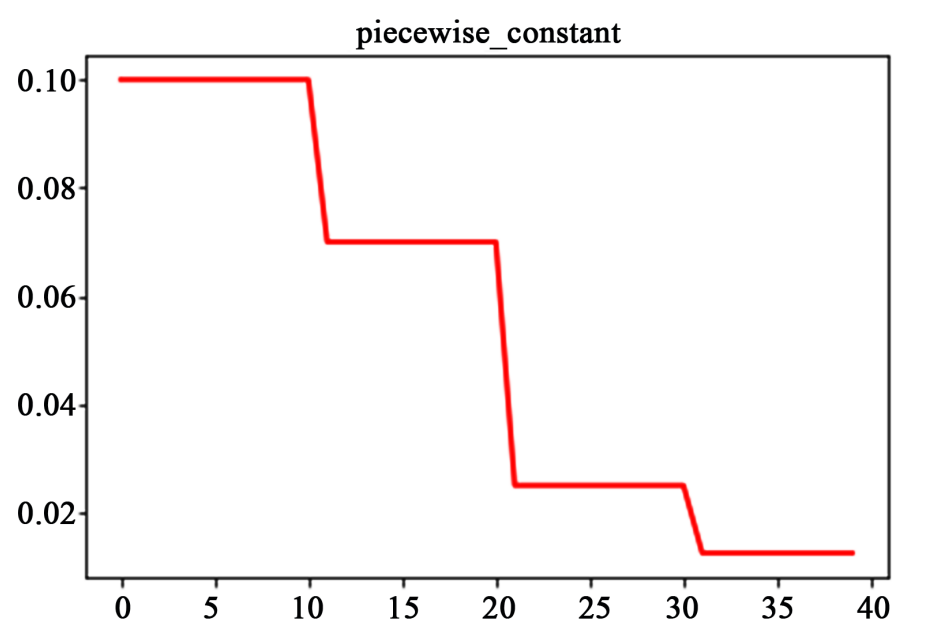

### 3.9.4 Giảm theo hàm mũ

Cập nhật tốc độ học theo hàm mũ của số bước huấn luyện:

$$
\text{decayed\_lr} = \text{learning\_rate} \times \text{decay\_rate}^{\frac{\text{global\_step}}{\text{decay\_steps}}}
$$

Cách này đơn giản, trực tiếp, hội tụ nhanh, là cách giảm tốc độ học hay dùng nhất. Trong hình dưới, đường màu xanh lá là giảm theo hàm mũ, đường đỏ là giảm theo từng khúc hằng (giữ nguyên tốc độ học trong mỗi khoảng).

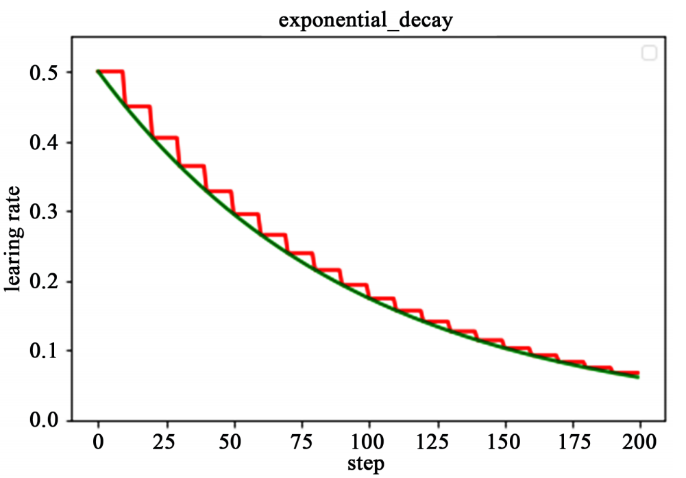

### 3.9.5 Giảm theo hàm mũ tự nhiên

Tương tự giảm theo hàm mũ, nhưng viết với cơ số $e$:

$$
\text{decayed\_lr} = \text{learning\_rate} \times e^{-\text{decay\_rate} \cdot \frac{\text{global\_step}}{\text{decay\_steps}}}
$$

Bản gốc cho rằng cách này giảm nhanh hơn nên thường dùng cho các mạng tương đối dễ huấn luyện, để hội tụ nhanh. Hình dưới so sánh ba cách: đường đỏ dạng bậc thang là giảm từng khúc hằng, đường xanh dương là giảm theo hàm mũ, đường xanh lá là giảm theo hàm mũ tự nhiên; có thể thấy rõ giảm theo hàm mũ tự nhiên giảm mạnh hơn.

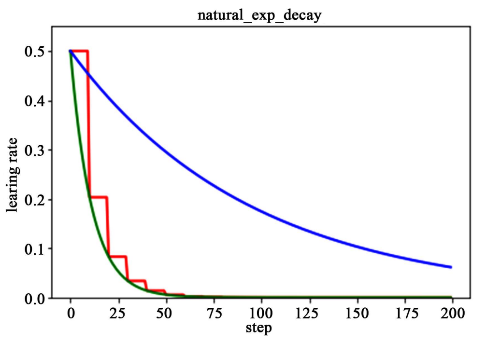

> **Biên tập:** công thức của bản gốc là $e^{-\text{decay\_rate}/\text{global\_step}}$ (chia cho số bước), khiến tốc độ học *tăng* dần theo thời gian. Công thức đúng (như `tf.train.natural_exp_decay`) là $e^{-\text{decay\_rate}\cdot \text{global\_step}/\text{decay\_steps}}$. Hai cách thực ra cùng một họ: giảm theo hàm mũ với decay_rate $=r$ tương đương giảm theo hàm mũ tự nhiên với decay_rate $=-\ln r$; vì vậy cách nào giảm nhanh hơn chỉ phụ thuộc giá trị decay_rate được chọn, không phụ thuộc cơ số (ví dụ với decay_rate = 0.5, $e^{-0.5} \approx 0.61 > 0.5$ nên giảm theo hàm mũ tự nhiên lại *chậm* hơn).

### 3.9.6 Giảm theo đa thức

Cho trước tốc độ học ban đầu và tốc độ học thấp nhất, tốc độ học được giảm dần từ giá trị ban đầu xuống giá trị thấp nhất theo một đa thức:

$$
\text{global\_step}=\min(\text{global\_step},\ \text{decay\_steps})
$$

$$
\begin{aligned}
\text{decayed\_lr} &=(\text{learning\_rate}-\text{end\_learning\_rate}) \times \left( 1-\frac{\text{global\_step}}{\text{decay\_steps}}\right)^{\text{power}} \\
&\quad + \text{end\_learning\_rate}
\end{aligned}
$$

Có hai cơ chế: một là sau khi giảm tới tốc độ học thấp nhất thì dùng giá trị thấp nhất đó tới hết quá trình huấn luyện; hai là tăng tốc độ học trở lại, dùng bội của decay_steps, lấy bội đầu tiên lớn hơn global_step, như công thức dưới. Cách này giúp tránh việc ở giai đoạn sau tốc độ học quá nhỏ khiến mạng cứ dao động quanh một cực tiểu cục bộ; tăng tốc độ học ở giai đoạn sau có thể giúp thoát khỏi cực tiểu cục bộ.

$$
\text{decay\_steps} = \text{decay\_steps} \times \left\lceil \frac{\text{global\_step}}{\text{decay\_steps}}\right\rceil
$$

Trong hình dưới, đường đỏ là tốc độ học giảm tới mức thấp nhất rồi giữ nguyên; đường xanh lá là tốc độ học giảm tới mức thấp nhất rồi tăng lên, giảm xuống lặp lại theo chu kỳ.

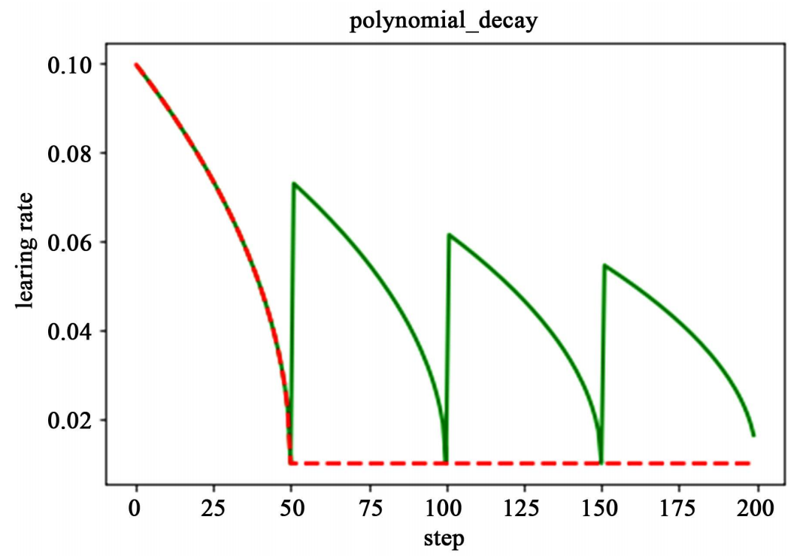

### 3.9.7 Giảm theo cosin

Giảm theo cosin dùng hàm cosin để giảm tốc độ học; đồ thị giống hàm cosin. Cơ chế cập nhật:

$$
\text{global\_step}=\min(\text{global\_step},\ \text{decay\_steps})
$$

$$
\text{cosine\_decay}=0.5 \times \left( 1+\cos\left( \pi \cdot \frac{\text{global\_step}}{\text{decay\_steps}}\right)\right)
$$

$$
\text{decayed}=(1-\alpha) \times \text{cosine\_decay}+\alpha
$$

$$
\text{decayed\_lr}=\text{learning\_rate} \times \text{decayed}
$$

Trong hình dưới, đường đỏ là giảm cosin chuẩn, tốc độ học giảm từ giá trị ban đầu xuống mức thấp nhất rồi giữ nguyên. Đường xanh dương là giảm theo cosin tuyến tính (tích của phần cosin với một phần giảm tuyến tính). Đường xanh lá là giảm theo cosin tuyến tính có thêm nhiễu.

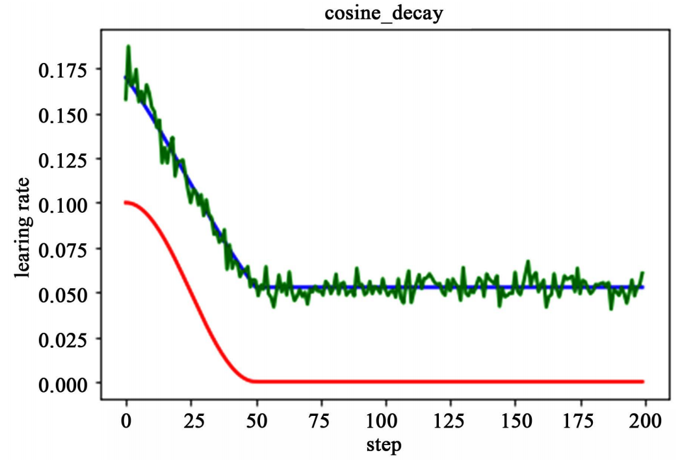

## 3.12 Các câu hỏi về dropout

**Lý thuyết:** [Học sâu · 5.6 Dropout](dl/ch05_s6_vi) · [Học sâu · 3.7 Suy giảm Trọng số](dl/ch03_s7_vi) · [Học máy · 8.3 Cơ chế kiểm soát](ml/ch08_vi?id=_83-cơ-chế-kiểm-soát)

> **Biên tập:** bản gốc không có mục 3.10 và 3.11; số mục được giữ nguyên để tiện đối chiếu.

### 3.12.1 Vì sao cần điều chuẩn?

Mạng học sâu có thể bị quá khớp, tức phương sai cao. Có hai cách giải quyết: điều chuẩn (regularization), hoặc chuẩn bị thêm dữ liệu. Thêm dữ liệu là cách rất đáng tin cậy, nhưng không phải lúc nào bạn cũng có đủ dữ liệu huấn luyện, hoặc chi phí thu thập rất cao. Điều chuẩn thường giúp tránh quá khớp, giảm sai số của mạng. Vì vậy, nếu nghi ngờ mạng neuron quá khớp dữ liệu (phương sai cao), thứ đầu tiên nên nghĩ tới thường là điều chuẩn.

> **Biên tập:** bản gốc lặp lại gần như nguyên văn cùng một đoạn hai lần; đã gộp lại.

### 3.12.2 Vì sao điều chuẩn giúp tránh quá khớp?

**Lý thuyết:** [Học sâu · 3.6.2 Dưới khớp hay Quá khớp?](dl/ch03_s6_vi?id=_362-dưới-khớp-hay-quá-khớp) · [Học máy · E.10 Bias và variance](ml/eval_vi?id=e10-bias-và-variance)

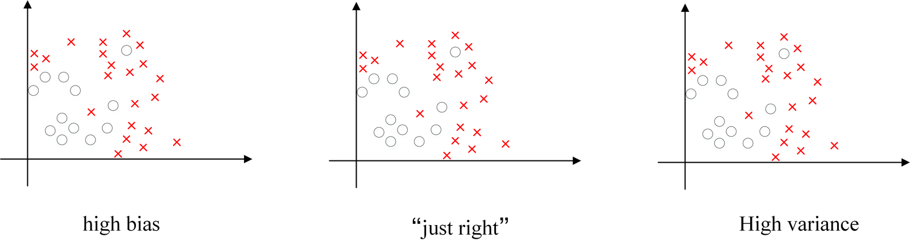
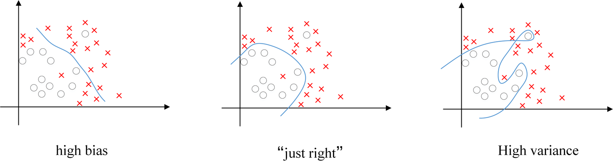

Hình trái là độ chệch cao (dưới khớp), hình phải là phương sai cao (quá khớp), hình giữa là vừa đủ (just right).

Điều chuẩn L2 thêm $\frac{\lambda}{2m}\sum_l \Vert W^{[l]}\Vert_F^2$ vào hàm mất mát. Khi $\lambda$ đủ lớn, hạ gradient bị kéo về các trọng số nhỏ, nhiều đơn vị ẩn gần như bị "tắt", mạng thực chất trở nên đơn giản hơn, dịch từ trạng thái quá khớp (phải) về phía dưới khớp (trái); chọn $\lambda$ vừa phải thì được trạng thái ở giữa. Thêm nữa, với tanh, trọng số nhỏ làm $z = Wa + b$ nhỏ, nên hàm kích hoạt hoạt động trong vùng gần tuyến tính; mạng có các tầng gần tuyến tính thì không vẽ được ranh giới quyết định quá phức tạp, do đó khó quá khớp.

> **Biên tập:** bản gốc chỉ có hai hình và một câu chú thích, chưa trả lời câu hỏi; đã bổ sung lời giải thích theo bài giảng của Andrew Ng (khóa *Improving Deep Neural Networks*), nơi các hình này xuất phát.

### 3.12.3 Hiểu điều chuẩn dropout

Dropout xóa ngẫu nhiên các đơn vị trong mạng. Vì sao nó lại có tác dụng điều chuẩn mạnh như vậy?

Hiểu trực quan: một đơn vị không thể dựa vào bất kỳ đặc trưng (đầu vào) nào, vì đầu vào đó có thể bị xóa bất cứ lúc nào. Vì thế đơn vị buộc phải dàn trải trọng số, gán cho mỗi đầu vào một chút trọng số thay vì dồn vào một vài đầu vào. Dàn trải trọng số làm co chuẩn bình phương của trọng số, tác dụng tương tự điều chuẩn L2. Kết quả của dropout là nén trọng số và tạo hiệu ứng điều chuẩn chống quá khớp; khác với L2 ở chỗ mức phạt với từng trọng số không giống nhau, tùy vào độ lớn của kích hoạt nhân với trọng số đó.

### 3.12.4 Chọn tỉ lệ dropout

1. Qua kiểm định chéo, tỉ lệ dropout bằng 0.5 cho các nút ẩn thường cho kết quả tốt nhất, vì với 0.5 số cấu trúc mạng con mà dropout sinh ra là nhiều nhất.
2. Dropout cũng có thể dùng như một cách thêm nhiễu, tác động trực tiếp lên đầu vào. Khi đó tỉ lệ giữ lại ở tầng đầu vào nên gần 1 hơn (ví dụ 0.8) để đầu vào không thay đổi quá nhiều.
3. Ràng buộc chuẩn của vector trọng số $w$ vào một quả cầu (max-norm regularization, $\Vert w\Vert_2 \le c$) rất có ích khi huấn luyện với dropout.
4. Bán kính $c$ của quả cầu là một tham số cần chỉnh, có thể chọn bằng tập kiểm định.
5. Dropout tự nó đã tốt, nhưng kết hợp dropout, max-norm, tốc độ học lớn giảm dần và động lượng cao còn tốt hơn; ví dụ max-norm ngăn tham số "nổ tung" khi dùng tốc độ học lớn.
6. Dùng tham số tiền huấn luyện cũng giúp huấn luyện với dropout. Khi tinh chỉnh một mạng tiền huấn luyện bằng dropout với xác suất giữ lại $p$, cần nhân các trọng số tiền huấn luyện với $1/p$ để giá trị kỳ vọng của đầu ra không đổi.

> **Biên tập:** mục này tóm tắt bài báo dropout của Srivastava và cộng sự (2014). Ở ý 6, bản gốc viết "khi dùng dropout phải nhân mọi tham số với $1/p$" mà không nói rõ ngữ cảnh: đó là quy tắc cho trọng số *tiền huấn luyện*. Với "inverted dropout" (cách PyTorch cài đặt), đầu ra được chia cho $p$ ngay khi huấn luyện, nên lúc dự đoán không cần nhân gì thêm.

### 3.12.5 Dropout có nhược điểm gì?

Nhược điểm lớn của dropout là hàm mất mát $J$ không còn được định nghĩa rõ ràng: mỗi vòng lặp lại xóa ngẫu nhiên một số nút, nên rất khó kiểm tra lại hiệu năng của hạ gradient. Với một hàm mất mát $J$ định nghĩa rõ ràng, $J$ phải giảm sau mỗi vòng lặp; nhưng hàm $J$ đang tối ưu thực ra không được định nghĩa rõ, hoặc khó tính, nên ta mất công cụ gỡ lỗi là vẽ đồ thị $J$ theo số vòng lặp. Cách thường làm là tắt dropout (đặt keep-prob bằng 1), chạy code và kiểm tra $J$ giảm đơn điệu, rồi mới bật dropout và hy vọng dropout không đưa thêm lỗi vào code. Bạn cũng có thể thử các cách khác, dù chưa có thống kê về hiệu quả của chúng, và dùng chúng cùng với dropout.

## 3.13 Các phương pháp tăng cường dữ liệu thường dùng trong học sâu?

**Lý thuyết:** [d2l (tiếng Anh) · 14.1 Image Augmentation](https://d2l.ai/chapter_computer-vision/image-augmentation.html) ↗

(*Người đóng góp: Hoàng Khâm Kiến – Đại học Công nghệ Hoa Nam*)

- Color Jittering: tăng cường theo màu: thay đổi độ sáng, độ bão hòa, độ tương phản của ảnh;
- PCA Jittering: thực hiện PCA trên giá trị RGB của các pixel trong toàn tập huấn luyện (tính ma trận hiệp phương sai $3\times3$, phân tích ra trị riêng và vector riêng), rồi cộng vào mỗi ảnh một lượng nhiễu theo các hướng thành phần chính, với biên độ tỉ lệ với trị riêng (cách AlexNet dùng);
- Random Scale: biến đổi tỉ lệ;
- Random Crop: cắt ngẫu nhiên một vùng ảnh rồi phóng to/thu nhỏ (nội suy); gồm Scale Jittering (dùng trong VGG và ResNet) hoặc biến đổi tỉ lệ và tỉ lệ khung hình;
- Horizontal/Vertical Flip: lật ngang/dọc;
- Shift: dịch chuyển;
- Rotation/Reflection: xoay/phản chiếu;
- Noise: thêm nhiễu Gauss, làm mờ;
- Label Shuffle: tăng cường cho dữ liệu mất cân bằng lớp (lấy mẫu lại sao cho mỗi lớp có số mẫu như nhau).

> **Biên tập:** mô tả PCA Jittering của bản gốc ("tính trung bình và độ lệch chuẩn theo ba kênh RGB, rồi tính ma trận hiệp phương sai trên toàn tập…") chưa nói được cách tạo ảnh mới; đã viết lại theo bài báo AlexNet. "Rotation/Reflection" là xoay/phản chiếu, bản gốc dịch nhầm thành "xoay/biến đổi affine".

## 3.14 Hiểu Internal Covariate Shift thế nào?

**Lý thuyết:** [Học sâu · 4.7.1.1 Dịch chuyển Hiệp biến](dl/ch04_s7_vi?id=_4711-dịch-chuyển-hiệp-biến) · [d2l (tiếng Anh) · 8.5 Batch Normalization](https://d2l.ai/chapter_convolutional-modern/batch-norm.html) ↗

(*Người đóng góp: Hoàng Khâm Kiến – Đại học Công nghệ Hoa Nam*)

Vì sao huấn luyện mạng neuron sâu lại khó? Một nguyên nhân quan trọng là mạng sâu gồm rất nhiều tầng chồng lên nhau, và mỗi lần tham số của một tầng thay đổi thì phân phối đầu vào của các tầng phía trên cũng thay đổi. Qua nhiều tầng chồng lên nhau, phân phối đầu vào của các tầng cao thay đổi rất mạnh, khiến các tầng cao phải liên tục thích nghi lại với cập nhật tham số của các tầng thấp. Để huấn luyện tốt, ta phải đặt tốc độ học, khởi tạo trọng số và chiến lược cập nhật tham số rất cẩn thận.

Google gọi hiện tượng này là Internal Covariate Shift (ICS). ICS là gì?

Ai cũng biết một giả định kinh điển của học máy thống kê là "dữ liệu ở miền nguồn (source domain) và miền đích (target domain) có cùng phân phối". Nếu không cùng phân phối thì nảy sinh các bài toán học máy mới, như học chuyển giao (transfer learning) hay thích ứng miền (domain adaptation). Covariate shift là một nhánh của bài toán phân phối không đồng nhất: miền nguồn và miền đích có cùng xác suất có điều kiện $P(y\mid x)$ nhưng khác xác suất biên $P(x)$.

Nghĩ kỹ sẽ thấy, với đầu ra của các tầng trong mạng, do đã qua các phép biến đổi trong tầng, phân phối của chúng rõ ràng khác phân phối tín hiệu đầu vào tương ứng, và khác biệt tăng theo độ sâu; nhưng nhãn (label) mà chúng "chỉ ra" thì vẫn không đổi. Điều này khớp với định nghĩa covariate shift. Vì đây là phân tích tín hiệu giữa các tầng bên trong mạng, nên mới có chữ "internal".

**ICS gây ra vấn đề gì?**

Nói gọn: dữ liệu đầu vào của mỗi neuron không còn "độc lập cùng phân phối".

Thứ nhất, tham số tầng trên phải liên tục thích nghi với phân phối đầu vào mới, làm chậm việc học.

Thứ hai, thay đổi ở đầu vào tầng dưới có thể có xu hướng tăng hoặc giảm, đẩy tầng trên vào vùng bão hòa, khiến việc học dừng quá sớm.

Thứ ba, cập nhật của mỗi tầng ảnh hưởng tới các tầng khác, nên chiến lược cập nhật tham số của mỗi tầng phải hết sức thận trọng.

> **Biên tập:** ICS là cách giải thích của bài báo BN gốc (Ioffe & Szegedy, 2015). Santurkar và cộng sự (2018, "How Does Batch Normalization Help Optimization?") cho thấy BN không thực sự giảm ICS, mà hiệu quả của nó chủ yếu đến từ việc làm mặt hàm mất mát trơn hơn. Khi phỏng vấn nên nhắc cả hai cách nhìn.

## Tài liệu tham khảo

[1] Rosenblatt, F. The perceptron: A probabilistic model for information storage and organization in the brain. *Psychological Review*, 1958, 65(6): 386–408.

[2] Duvenaud D, Rippel O, Adams R P, et al. Avoiding pathologies in very deep networks. arXiv, 2014: 202–210.

[3] Rumelhart D E, Hinton G E, Williams R J. Learning representations by back-propagating errors. *Cognitive modeling*, 1988, 5(3): 1.

[4] Hecht-Nielsen R. Theory of the backpropagation neural network. In: *Neural networks for perception*. Academic Press, 1992: 65–93.

[5] Felice M. Which deep learning network is best for you? *CIO*, 2017.

[6] Conneau A, Schwenk H, Barrault L, et al. Very deep convolutional networks for natural language processing. arXiv:1606.01781, 2016.

[7] Ba J, Caruana R. Do deep nets really need to be deep? *NIPS*, 2014: 2654–2662.

[8] Nielsen M A. *Neural networks and deep learning*. Determination Press, 2015.

[9] Goodfellow I, Bengio Y, Courville A. *Deep learning*. MIT Press, 2016.

[10] Chu Chí Hoa (Zhou Zhihua). *Machine Learning* (机器学习). Nhà xuất bản Đại học Thanh Hoa, 2016.

[11] Kim J, Kwon Lee J, Mu Lee K. Accurate image super-resolution using very deep convolutional networks. *CVPR*, 2016: 1646–1654.

[12] Chen Y, Lin Z, Zhao X, et al. Deep learning-based classification of hyperspectral data. *IEEE JSTARS*, 2014, 7(6): 2094–2107.

[13] Domhan T, Springenberg J T, Hutter F. Speeding up automatic hyperparameter optimization of deep neural networks by extrapolation of learning curves. *IJCAI*, 2015.

[14] Maclaurin D, Duvenaud D, Adams R. Gradient-based hyperparameter optimization through reversible learning. *ICML*, 2015: 2113–2122.

[15] Srivastava R K, Greff K, Schmidhuber J. Training very deep networks. *NIPS*, 2015: 2377–2385.

[16] Bergstra J, Bengio Y. Random search for hyper-parameter optimization. *JMLR*, 2012, 13(Feb): 281–305.

[17] Ngiam J, Khosla A, Kim M, et al. Multimodal deep learning. *ICML*, 2011: 689–696.

[18] Deng L, Yu D. Deep learning: methods and applications. *Foundations and Trends in Signal Processing*, 2014, 7(3–4): 197–387.

[19] Erhan D, Bengio Y, Courville A, et al. Why does unsupervised pre-training help deep learning? *JMLR*, 2010, 11(Feb): 625–660.

[20] Dong C, Loy C C, He K, et al. Learning a deep convolutional network for image super resolution. *ECCV*, 2014: 184–199.

[21] Trịnh Trạch Vũ, Lương Bác Văn, Cố Tư Vũ. *TensorFlow: thực chiến framework học sâu của Google* (TensorFlow：实战Google深度学习框架), bản 2. Nhà xuất bản Công nghiệp Điện tử, 2018.

[22] Tiêu Lý Thành. *Tối ưu và nhận dạng trong học sâu* (深度学习优化与识别). Nhà xuất bản Đại học Thanh Hoa, 2017.

[23] Ngô Ngạn Thành. *Mạng neuron và học sâu* (神经网络与深度学习). Nhà xuất bản Công nghiệp Điện tử, 2016.

[24] Wei W G H, Liu T, Song A, et al. An Adaptive Natural Gradient Method with Adaptive Step Size in Multilayer Perceptrons. *Chinese Automation Congress*, 2018: 1593–1597.

[25] Feng Y, Li Y. An Overview of Deep Learning Optimization Methods and Learning Rate Attenuation Methods. *Hans Journal of Data Mining*, 2018, 8(4): 186–200.
