# Chương 6 Mạng neuron hồi tiếp (RNN)

> Ghi chú của người biên soạn: trang này dịch từ sách *Deep Learning 500 câu hỏi* (深度学习500问) do **Tan Jiyong (谈继勇)** chủ biên cùng cộng đồng đóng góp ([bản gốc](https://github.com/scutan90/DeepLearning-500-questions/tree/master/ch06_循环神经网络(RNN)), [mã nguồn](https://github.com/scutan90/DeepLearning-500-questions), giấy phép [GPL-3.0](https://www.gnu.org/licenses/gpl-3.0.html); phần dịch cũng theo GPL-3.0). Số câu hỏi giữ như bản gốc. Chỗ bản gốc sai hoặc thiếu đã được sửa ngay trong bài và ghi ở ô **Biên tập**; ô **Lý thuyết** dẫn sang bài học tương ứng trên site.

## 6.1 Vì sao cần RNN?

**Lý thuyết:** [d2l (tiếng Anh) · 9.1 Làm việc với chuỗi](https://d2l.ai/chapter_recurrent-neural-networks/sequence.html) ↗

Dữ liệu chuỗi thời gian là dữ liệu thu thập ở các thời điểm khác nhau, phản ánh trạng thái hay mức độ thay đổi theo thời gian của một sự vật, hiện tượng. Một mạng neuron thông thường, khi đủ dữ liệu huấn luyện và mô hình tốt, với $x$ cho trước sẽ cho ra $y$ mong muốn. Nó thường xử lý từng đầu vào riêng lẻ, đầu vào trước và sau hoàn toàn không liên quan. Nhưng trong thực tế, một số nhiệm vụ cần xử lý tốt thông tin chuỗi, tức đầu vào trước và sau có liên hệ với nhau. Ví dụ:

Khi hiểu nghĩa một câu, hiểu riêng lẻ từng từ là không đủ; ta cần xử lý cả chuỗi từ nối với nhau. Khi xử lý video, ta cũng không thể chỉ phân tích từng khung hình riêng lẻ, mà phải phân tích cả chuỗi khung hình. Để giải quyết các bài toán tương tự, xử lý tốt hơn thông tin dạng chuỗi, RNN (Recurrent Neural Network, mạng neuron hồi tiếp) ra đời.

## 6.2 Minh họa cấu trúc cơ bản của RNN

**Lý thuyết:** [d2l (tiếng Anh) · 9.4 Mạng neuron hồi tiếp](https://d2l.ai/chapter_recurrent-neural-networks/rnn.html) ↗

### 6.2.1 Cấu trúc mạng một tầng cơ bản

Trước khi tìm hiểu sâu RNN, xem cấu trúc mạng một tầng cơ bản nhất: đầu vào là $x$, qua phép biến đổi $Wx+b$ và hàm kích hoạt $f$ cho đầu ra $y$:

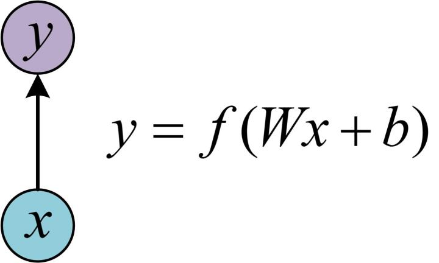

### 6.2.2 Minh họa cấu trúc RNN kinh điển

Trong thực tế ta gặp rất nhiều dữ liệu dạng chuỗi, như:

- Bài toán xử lý ngôn ngữ tự nhiên: $x_1$ có thể coi là từ thứ nhất, $x_2$ là từ thứ hai, cứ thế tiếp tục.
- Xử lý giọng nói: khi đó $x_1, x_2, x_3, \dots$ là tín hiệu âm thanh của từng khung.
- Bài toán chuỗi thời gian: ví dụ giá cổ phiếu mỗi ngày.

Một chuỗi như hình dưới:

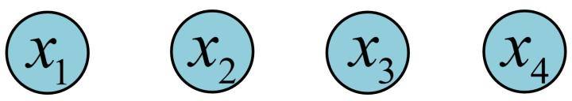

Như đã nói, dữ liệu chuỗi như vậy khó mô hình hóa bằng mạng neuron thông thường. Vì thế RNN đưa vào trạng thái ẩn $h$ (hidden state); $h$ trích đặc trưng từ dữ liệu chuỗi rồi chuyển thành đầu ra.

Để dễ hiểu, trước hết tính $h_1$:

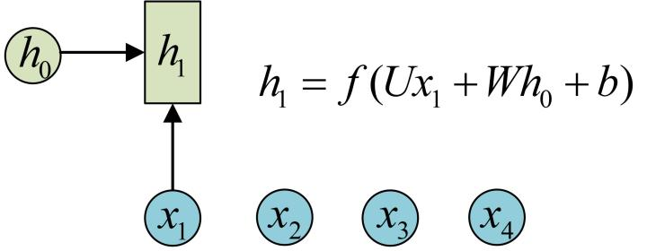

Chú ý: trong hình, hình tròn là vector, mũi tên là phép biến đổi trên vector.

Trong RNN, mỗi bước dùng cùng các tham số $U, W, b$; $h_2$ được tính tương tự $h_1$:

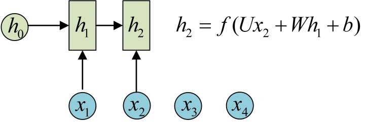

$h_3$, $h_4$ cũng tính tương tự:

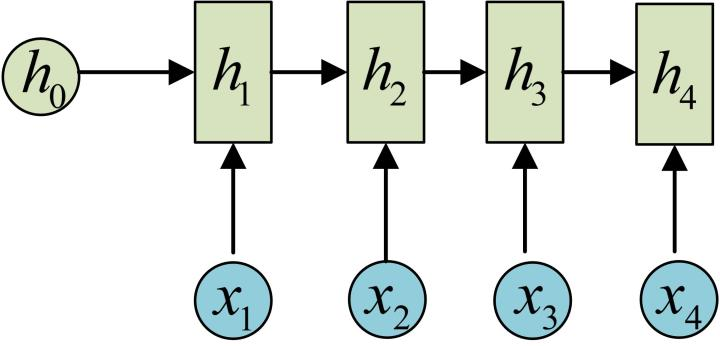

Tiếp theo tính đầu ra $y_1$ của RNN, dùng softmax làm hàm kích hoạt; theo $y=f(Wx+b)$ được $y_1$:

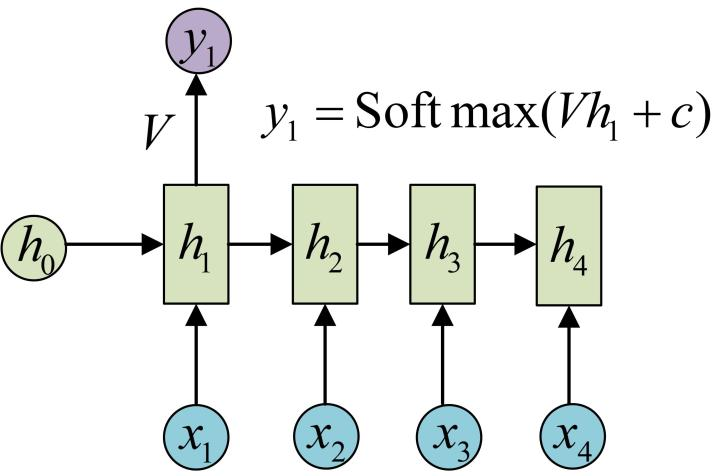

Dùng cùng tham số $V, c$ như $y_1$, được cấu trúc đầu ra $y_1, y_2, y_3, y_4$:

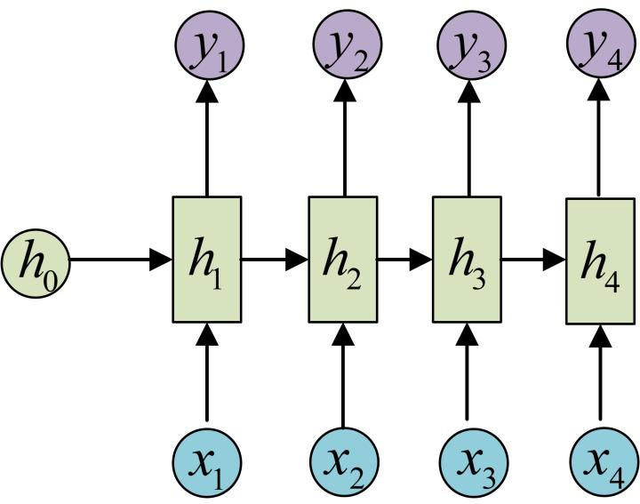

Trên đây là cấu trúc RNN kinh điển nhất, đầu vào là $x_1, x_2, x_3, x_4$, đầu ra là $y_1, y_2, y_3, y_4$ (thực tế chuỗi có thể dài tới $x_n, y_n$; ở đây chỉ vẽ 4 bước cho dễ hiểu). Từ cấu trúc trên có thể thấy đầu vào và đầu ra của RNN có độ dài bằng nhau.

### 6.2.3 Cấu trúc vector-to-sequence

Đôi khi bài toán có đầu vào là một giá trị đơn, đầu ra là một chuỗi. Khi đó có hai cách mô hình hóa chính:

Cách một: chỉ đưa đầu vào vào một bước của chuỗi, ví dụ bước đầu tiên:

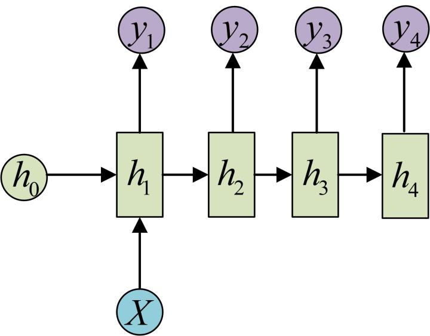

Cách hai: đưa thông tin đầu vào $X$ vào mọi bước:

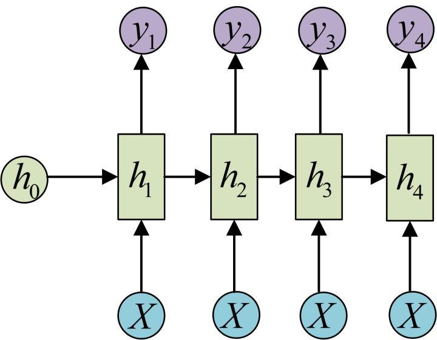

### 6.2.4 Cấu trúc sequence-to-vector

Đôi khi bài toán có đầu vào là một chuỗi, đầu ra là một giá trị đơn; khi đó thường chỉ biến đổi đầu ra ở bước cuối của chuỗi:

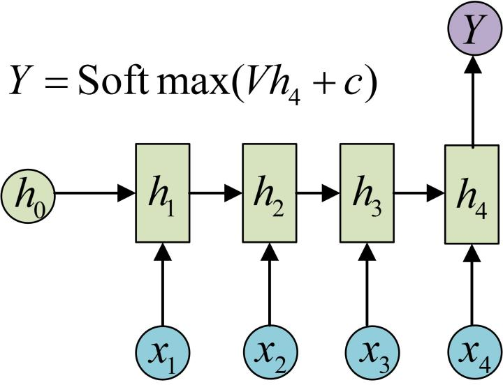

### 6.2.5 Cấu trúc Encoder–Decoder

**Lý thuyết:** [d2l (tiếng Anh) · 10.7 Seq2seq](https://d2l.ai/chapter_recurrent-modern/seq2seq.html) ↗

RNN sequence-to-sequence nguyên thủy yêu cầu hai chuỗi dài bằng nhau, nhưng phần lớn bài toán có chuỗi dài khác nhau; ví dụ trong dịch máy, câu ngôn ngữ nguồn và câu ngôn ngữ đích thường không dài bằng nhau.

Các bước mô hình hóa:

**Bước một**: mã hóa dữ liệu đầu vào thành một vector ngữ cảnh $c$; phần này gọi là Encoder. Có nhiều cách để có $c$: đơn giản nhất là lấy trạng thái ẩn cuối cùng của Encoder làm $c$; cũng có thể biến đổi trạng thái ẩn cuối cùng để được $c$, hoặc biến đổi tất cả các trạng thái ẩn. Minh họa:

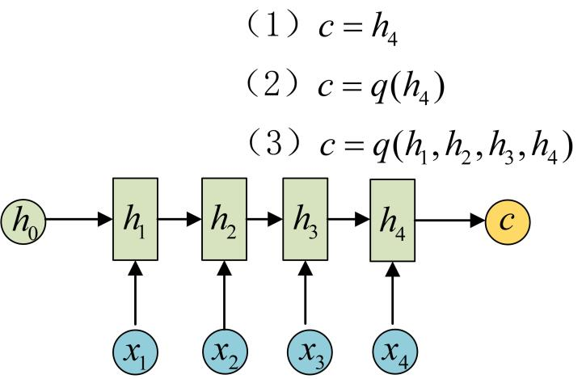

**Bước hai**: dùng một mạng RNN khác (gọi là Decoder) để giải mã nó. Cách một là dùng $c$ ở bước một làm trạng thái khởi đầu của Decoder, như hình dưới:

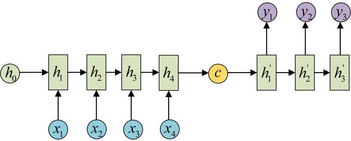

Cách hai là đưa $c$ vào mọi bước của Decoder, như hình dưới:

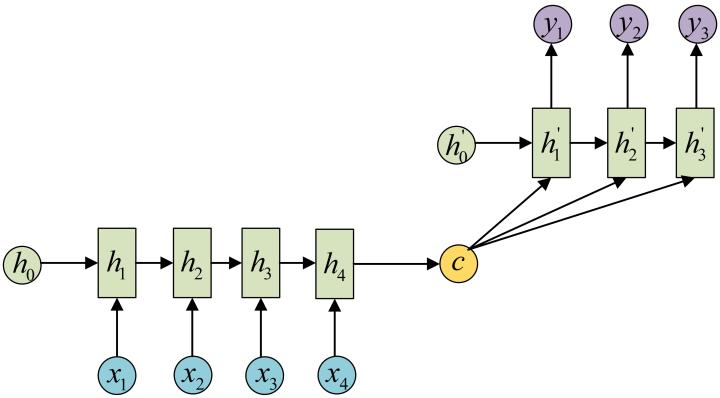

### 6.2.6 Ba cấu trúc trên dùng trong những tình huống nào?

| Cấu trúc | Minh họa | Ví dụ ứng dụng |
| --- | :-: | --- |
| 1 vs N |  | 1. Sinh văn bản từ ảnh: đầu vào là đặc trưng ảnh, đầu ra là một câu 2. Sinh giọng nói hoặc nhạc từ ảnh: đầu vào là đặc trưng ảnh, đầu ra là một đoạn giọng nói hoặc nhạc |
| N vs 1 |  | 1. Đưa vào một đoạn văn bản, xác định thể loại 2. Đưa vào một câu, xác định cảm xúc (tích cực/tiêu cực) 3. Đưa vào một đoạn video, xác định thể loại |
| N vs M |  | 1. Dịch máy: đầu vào là chuỗi văn bản một ngôn ngữ, đầu ra là chuỗi văn bản ngôn ngữ khác 2. Tóm tắt văn bản: đầu vào là chuỗi văn bản, đầu ra là tóm tắt 3. Đọc hiểu: đầu vào là bài văn, đầu ra là câu trả lời 4. Nhận dạng giọng nói: đầu vào là chuỗi tín hiệu giọng nói, đầu ra là chuỗi chữ |

### 6.2.7 Minh họa cơ chế attention trong RNN

**Lý thuyết:** [d2l (tiếng Anh) · 11.4 Bahdanau attention](https://d2l.ai/chapter_attention-mechanisms-and-transformers/bahdanau-attention.html) ↗

Trong cấu trúc Encoder–Decoder chung ở trên, Encoder mã hóa toàn bộ chuỗi đầu vào thành một đặc trưng ngữ nghĩa thống nhất $c$ rồi mới giải mã, nên $c$ phải chứa mọi thông tin của chuỗi gốc, và độ dài (dung lượng) của nó trở thành nút cổ chai hạn chế hiệu năng. Ví dụ trong dịch máy, khi câu cần dịch dài, một $c$ có thể không chứa nổi chừng ấy thông tin, làm độ chính xác của bản dịch giảm. Cơ chế attention (tập trung) giải quyết điều này bằng cách đưa vào một $c$ khác nhau ở mỗi bước thời gian.

Trong Decoder có attention, có nhiều $c$ khác nhau; mỗi $c$ tự chọn thông tin ngữ cảnh khớp nhất với đầu ra hiện tại, như hình dưới:

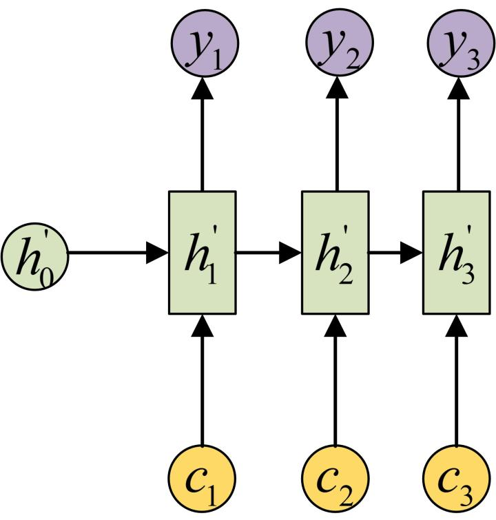

**Ví dụ**: chuỗi đầu vào là "我爱中国" ("tôi yêu Trung Quốc"), cần dịch sang tiếng Anh.

Gọi $a_{ij}$ là mức liên quan giữa trạng thái $h_j$ ở bước $j$ của Encoder và bước $i$ khi giải mã. $a_{ij}$ được học từ mô hình, phụ thuộc trạng thái ẩn ở bước $i-1$ của Decoder và trạng thái ẩn ở bước $j$ của Encoder. Ví dụ cách tính $a_{3j}$:

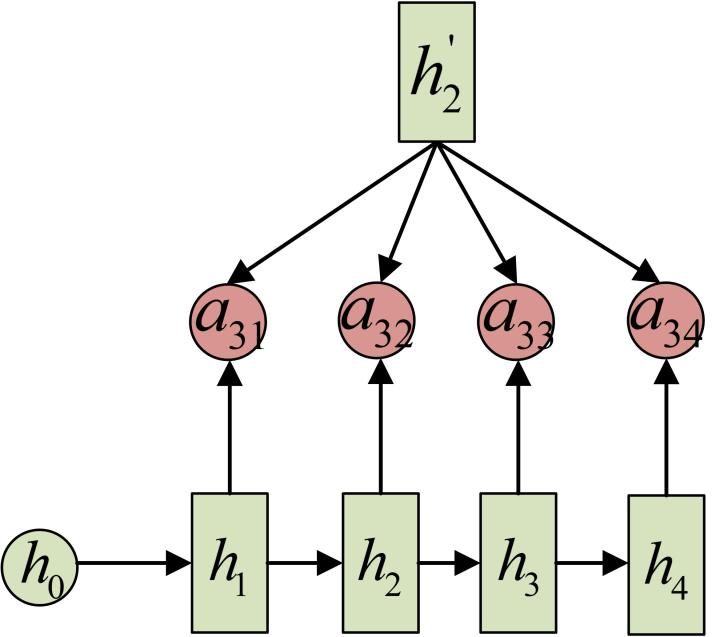

Cuối cùng, thông tin ngữ cảnh $c_i$ đưa vào bước $i$ của Decoder là tổng có trọng số $a_{ij}$ của mọi $h_j$: $c_i = \sum_j a_{ij} h_j$.

Minh họa:

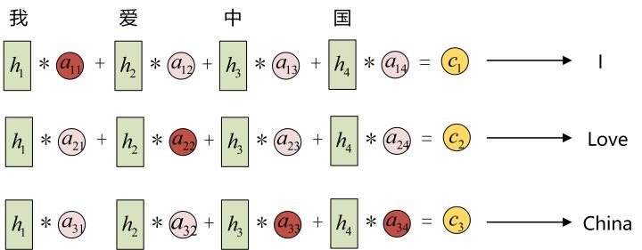

Trong Encoder, $h_1, h_2, h_3, h_4$ lần lượt đại diện cho thông tin của "我" (tôi), "爱" (yêu), "中", "国" (Trung Quốc). Khi dịch, $c_1$ sẽ chọn thông tin ngữ cảnh liên quan nhất tới "我", như hình trên sẽ ưu tiên $a_{11}$; tương tự $c_2$ ưu tiên $a_{22}$ có độ liên quan lớn, $c_3$ ưu tiên $a_{33}, a_{34}$ có độ liên quan lớn. Đó là cơ chế attention.

## 6.3 Đặc điểm điển hình của RNN?

1. RNN chủ yếu dùng để xử lý dữ liệu chuỗi. Với mạng neuron truyền thống, từ tầng đầu vào tới tầng ẩn rồi tầng đầu ra, các tầng thường kết nối đầy đủ, còn các neuron trong cùng tầng không nối với nhau. Nhưng mạng truyền thống không xử lý được quan hệ trước–sau giữa các dữ liệu. Ví dụ để dự đoán từ tiếp theo của câu, thường cần thông tin ngữ nghĩa của các từ trước đó, vì các từ trong câu có liên hệ ngữ nghĩa.
2. Trong RNN, đầu ra của đơn vị hiện tại còn phụ thuộc đầu ra của các bước trước, nên gọi là mạng neuron hồi tiếp. Cụ thể, đơn vị hiện tại lưu thông tin của các bước trước và dùng nó để tính đầu ra hiện tại. Các nút của tầng ẩn được nối với nhau qua thời gian: đầu ra hiện tại của tầng ẩn do vector đầu vào ở thời điểm hiện tại và trạng thái tầng ẩn ở thời điểm trước cùng quyết định.
3. Trong sơ đồ RNN chuẩn, mỗi mũi tên là một phép biến đổi, tức các mũi tên mang trọng số.
4. Trong RNN chuẩn, các neuron tầng ẩn (qua các bước thời gian) cũng nối với nhau bằng trọng số, và trọng số được chia sẻ giữa các bước.
5. Về lý thuyết, RNN xử lý được chuỗi dài bất kỳ. Nhưng trong thực tế, để giảm độ phức tạp, người ta thường chỉ lan truyền ngược qua một số bước gần nhất (BPTT cắt ngọn). **Hình dưới là một RNN điển hình**:

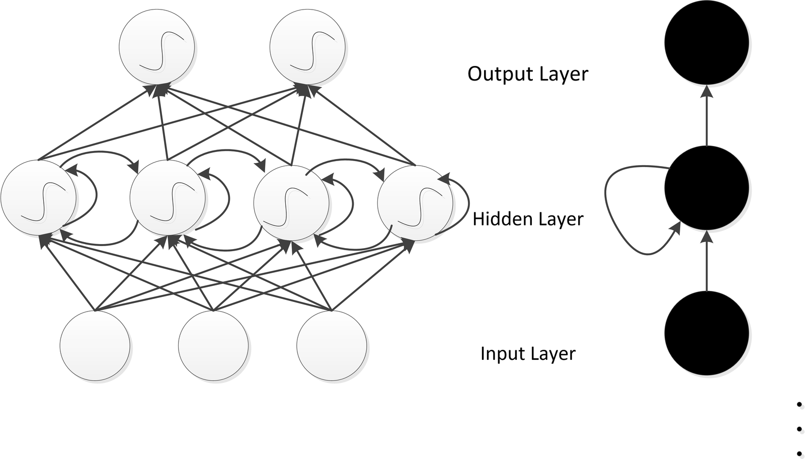

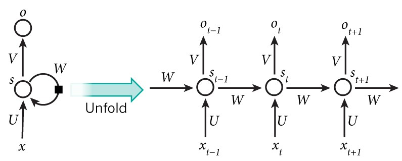

Đơn vị đầu vào (Input units): tập đầu vào $\{x_0,x_1,\dots,x_t,x_{t+1},\dots\}$,

Đơn vị đầu ra (Output units): tập đầu ra $\{y_0,y_1,\dots,y_t,y_{t+1},\dots\}$,

Đơn vị ẩn (Hidden units): tập trạng thái $\{s_0,s_1,\dots,s_t,s_{t+1},\dots\}$.

**Đặc điểm truyền thông tin trong hình:**

1. Có một luồng thông tin một chiều từ đơn vị đầu vào tới đơn vị ẩn.
2. Có một luồng thông tin một chiều từ đơn vị ẩn tới đơn vị đầu ra.
3. Trong một số trường hợp, RNN phá vỡ giới hạn thứ hai, đưa thông tin từ đơn vị đầu ra quay về đơn vị ẩn; gọi là "Back Projections".
4. Trong một số trường hợp, đầu vào của tầng ẩn còn gồm trạng thái tầng ẩn ở thời điểm trước, tức các nút trong tầng ẩn có thể tự nối với chính nó hoặc nối với nhau.
5. Đầu ra của đơn vị (cell) hiện tại do đầu vào ở thời điểm hiện tại và trạng thái tầng ẩn ở thời điểm trước cùng quyết định.

## 6.4 CNN và RNN khác nhau thế nào?

| Loại | Mô tả |
| --- | --- |
| Giống nhau | 1. Đều là mở rộng của mạng neuron truyền thống. 2. Lan truyền thuận để ra kết quả, lan truyền ngược để cập nhật mô hình. 3. Mỗi tầng có thể có nhiều neuron theo chiều ngang, và có thể nối nhiều tầng theo chiều dọc. |
| Khác nhau | 1. CNN mở rộng theo không gian: neuron tích chập với đặc trưng; RNN mở rộng theo thời gian: neuron tính toán với đầu ra của nhiều bước thời gian. 2. RNN mô tả được đầu ra của các trạng thái liên tục theo thời gian, có khả năng ghi nhớ; CNN dùng cho đầu ra tĩnh. |

## 6.5 RNN và mạng truyền thẳng (FNN) khác nhau thế nào?

1. Khác với mạng neuron truyền thẳng (FNN) truyền thống, RNN có vòng lặp có hướng, xử lý được quan hệ trước–sau giữa các đầu vào.
2. RNN ghi nhớ được thông tin của các bước trước.
   **Cấu trúc vòng lặp có hướng như hình dưới**:

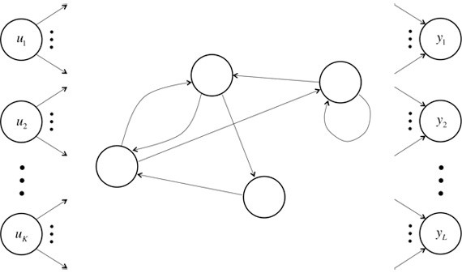

## 6.6 Huấn luyện RNN và huấn luyện mạng neuron truyền thống giống và khác nhau ở đâu?

**Lý thuyết:** [d2l (tiếng Anh) · 9.7 BPTT](https://d2l.ai/chapter_recurrent-neural-networks/bptt.html) ↗

**Giống nhau**:

1. RNN và mạng neuron truyền thống đều dùng thuật toán lan truyền ngược sai số (Back Propagation, BP).

**Khác nhau**:

1. Các tham số $W, U, V$ của RNN được chia sẻ giữa các bước (xem mục 6.2), còn tham số giữa các tầng của mạng truyền thống không liên quan trực tiếp với nhau.
2. Với RNN, khi dùng hạ gradient, đầu ra của mỗi bước không chỉ phụ thuộc mạng ở bước hiện tại mà còn phụ thuộc trạng thái mạng ở một số bước trước đó.

## 6.7 Vì sao khi huấn luyện RNN, mất mát dao động rất mạnh?

**Lý thuyết:** [d2l (tiếng Anh) · 9.5 Cắt gradient](https://d2l.ai/chapter_recurrent-neural-networks/rnn-scratch.html) ↗

Vì đặc tính "bộ nhớ" của RNN ảnh hưởng tới các bước sau, gradient lúc lớn lúc nhỏ (gradient đi qua tích của nhiều ma trận Jacobian, có thể bùng nổ đột ngột), trong khi tốc độ học không tự điều chỉnh theo được, nên mất mát khi huấn luyện RNN dao động lên xuống. Để giải quyết, khi huấn luyện có thể đặt một ngưỡng: khi độ lớn gradient vượt ngưỡng thì cắt bớt, dùng ngưỡng đó làm độ lớn gradient (cắt gradient, gradient clipping), tránh dao động mạnh.

## 6.8 Quá trình tính đầu ra (lan truyền thuận) của RNN chuẩn

Ký hiệu $x$ là đầu vào, $h$ là đơn vị ẩn, $o$ là đầu ra, $L$ là hàm mất mát, $y$ là nhãn của tập huấn luyện. Chỉ số $t$ là trạng thái ở thời điểm $t$; $V, U, W$ là trọng số, các kết nối cùng loại có cùng trọng số. Lấy hình dưới làm ví dụ cho lan truyền thuận của RNN chuẩn:

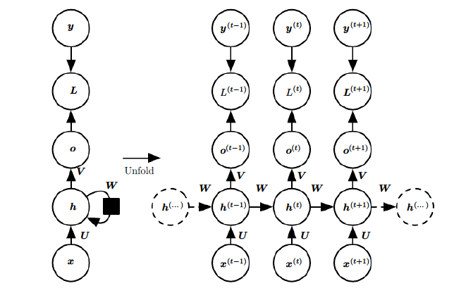

Ở thời điểm $t$:

$$
h^{(t)}=\phi(Ux^{(t)}+Wh^{(t-1)}+b)
$$

trong đó $\phi(\cdot)$ là hàm kích hoạt, thường chọn tanh, $b$ là hệ số điều chỉnh.

Đầu ra ở thời điểm $t$:

$$
o^{(t)}=Vh^{(t)}+c
$$

Dự đoán của mô hình:

$$
\widehat{y}^{(t)}=\sigma(o^{(t)})
$$

trong đó $\sigma$ là hàm kích hoạt; RNN thường dùng cho phân loại nên ở đây thường dùng softmax.

## 6.9 Suy ra thuật toán BPTT

BPTT (back-propagation through time, lan truyền ngược qua thời gian) là phương pháp thường dùng để huấn luyện RNN. Bản chất vẫn là thuật toán BP, nhưng vì RNN xử lý dữ liệu chuỗi thời gian nên phải lan truyền ngược theo thời gian, do đó có tên này. Ý tưởng trung tâm của BPTT giống BP: đi theo hướng ngược gradient của các tham số cần tối ưu, liên tục tìm điểm tốt hơn tới khi hội tụ. Có ba tham số cần tối ưu là $U, V, W$. Khác với BP, việc tối ưu $W$ và $U$ phải truy ngược dữ liệu lịch sử, còn $V$ thì đơn giản hơn, chỉ cần quan tâm hiện tại; vì vậy ta tính đạo hàm riêng theo $V$ trước:

$$
\frac{\partial L^{(t)}}{\partial V}=\frac{\partial L^{(t)}}{\partial o^{(t)}}\cdot \frac{\partial o^{(t)}}{\partial V}
$$

Mất mát của RNN cộng dồn theo thời gian, nên không thể chỉ tính đạo hàm riêng tại thời điểm $t$:

$$
L=\sum_{t=1}^{n}L^{(t)}
$$

$$
\frac{\partial L}{\partial V}=\sum_{t=1}^{n}\frac{\partial L^{(t)}}{\partial o^{(t)}}\cdot \frac{\partial o^{(t)}}{\partial V}
$$

Đạo hàm riêng theo $W$ và $U$ phức tạp hơn vì liên quan tới dữ liệu lịch sử. Để đơn giản, giả sử chỉ có ba thời điểm; khi đó tại thời điểm thứ ba, đạo hàm riêng của $L$ theo $W$ và theo $U$ lần lượt là:

$$
\begin{aligned}
\frac{\partial L^{(3)}}{\partial W}=\ &\frac{\partial L^{(3)}}{\partial o^{(3)}}\frac{\partial o^{(3)}}{\partial h^{(3)}}\frac{\partial h^{(3)}}{\partial W}+\frac{\partial L^{(3)}}{\partial o^{(3)}}\frac{\partial o^{(3)}}{\partial h^{(3)}}\frac{\partial h^{(3)}}{\partial h^{(2)}}\frac{\partial h^{(2)}}{\partial W} \\
&+\frac{\partial L^{(3)}}{\partial o^{(3)}}\frac{\partial o^{(3)}}{\partial h^{(3)}}\frac{\partial h^{(3)}}{\partial h^{(2)}}\frac{\partial h^{(2)}}{\partial h^{(1)}}\frac{\partial h^{(1)}}{\partial W}
\end{aligned}
$$

$$
\begin{aligned}
\frac{\partial L^{(3)}}{\partial U}=\ &\frac{\partial L^{(3)}}{\partial o^{(3)}}\frac{\partial o^{(3)}}{\partial h^{(3)}}\frac{\partial h^{(3)}}{\partial U}+\frac{\partial L^{(3)}}{\partial o^{(3)}}\frac{\partial o^{(3)}}{\partial h^{(3)}}\frac{\partial h^{(3)}}{\partial h^{(2)}}\frac{\partial h^{(2)}}{\partial U} \\
&+\frac{\partial L^{(3)}}{\partial o^{(3)}}\frac{\partial o^{(3)}}{\partial h^{(3)}}\frac{\partial h^{(3)}}{\partial h^{(2)}}\frac{\partial h^{(2)}}{\partial h^{(1)}}\frac{\partial h^{(1)}}{\partial U}
\end{aligned}
$$

(ở đây $\frac{\partial h^{(k)}}{\partial W}$ là đạo hàm "trực tiếp", coi $h^{(k-1)}$ là hằng.) Có thể thấy đạo hàm riêng theo $W$ hay $U$ tại một thời điểm phải truy ngược thông tin của mọi thời điểm trước đó. Từ hai công thức trên suy ra công thức tổng quát của đạo hàm riêng của $L$ tại thời điểm $t$ theo $W$ và $U$:

$$
\frac{\partial L^{(t)}}{\partial W}=\sum_{k=1}^{t}\frac{\partial L^{(t)}}{\partial o^{(t)}}\frac{\partial o^{(t)}}{\partial h^{(t)}}\left(\prod_{j=k+1}^{t}\frac{\partial h^{(j)}}{\partial h^{(j-1)}}\right)\frac{\partial h^{(k)}}{\partial W}
$$

$$
\frac{\partial L^{(t)}}{\partial U}=\sum_{k=1}^{t}\frac{\partial L^{(t)}}{\partial o^{(t)}}\frac{\partial o^{(t)}}{\partial h^{(t)}}\left(\prod_{j=k+1}^{t}\frac{\partial h^{(j)}}{\partial h^{(j-1)}}\right)\frac{\partial h^{(k)}}{\partial U}
$$

Đạo hàm riêng tổng thể là cộng các đạo hàm trên theo từng thời điểm.

## 6.9b Vì sao RNN bị tiêu biến gradient?

**Lý thuyết:** [Học sâu · 5.4.1 Tiêu biến và Bùng nổ Gradient](dl/ch05_s4_vi?id=_541-tiêu-biến-và-bùng-nổ-gradient) · [Ôn tập · 3.4.12 Vì sao tanh hội tụ nhanh hơn sigmoid?](qa/ch03_vi?id=_3412-vì-sao-tanh-hội-tụ-nhanh-hơn-sigmoid)

> **Biên tập:** bản gốc đánh số mục này trùng là 6.9; ở đây ghi 6.9b để giữ thứ tự.

Trước hết xem đồ thị của hàm tanh và đạo hàm của nó:

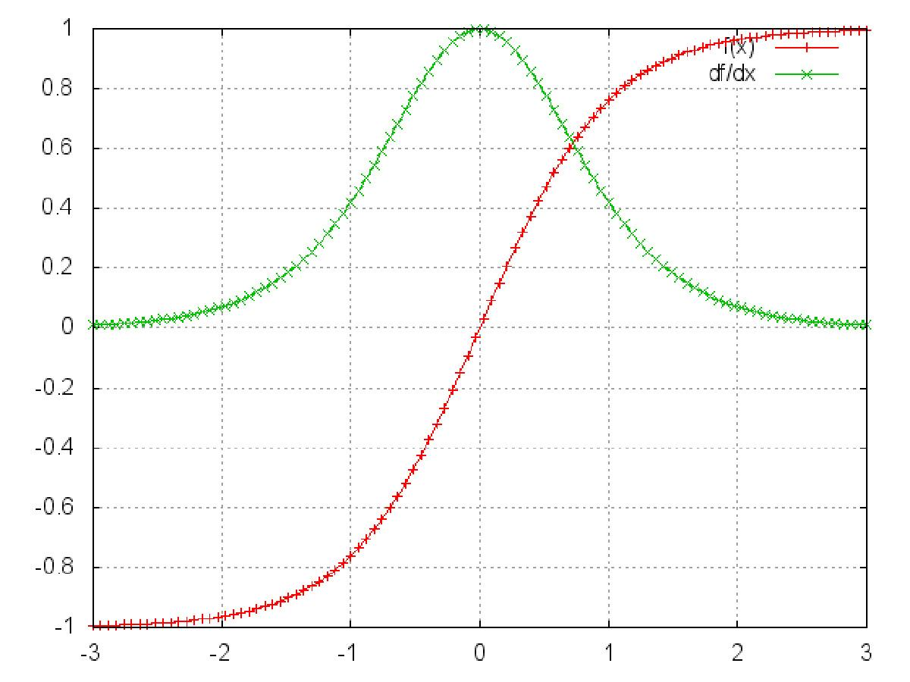

Đồ thị của hàm sigmoid và đạo hàm của nó:

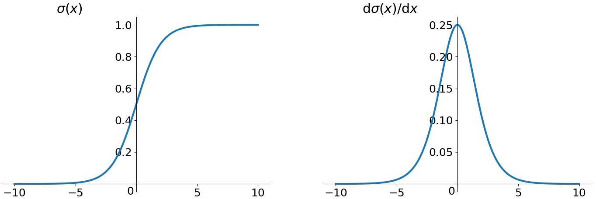

Quan sát hình trên, đạo hàm của sigmoid nằm trong $(0, 0.25]$, của tanh nằm trong $(0, 1]$; giá trị lớn nhất của cả hai đều không vượt quá 1.

Từ công thức suy ra ở mục 6.9, hàm kích hoạt của RNN nằm lồng bên trong. Nếu chọn hàm kích hoạt là tanh hoặc sigmoid, đưa nó vào và tách riêng phần tích liên tiếp ở giữa:

$$
\prod_{j=k+1}^{t}{\frac{\partial{h^{(j)}}}{\partial{h^{(j-1)}}}} = \prod_{j=k+1}^{t}\mathrm{diag}\left(\tanh'(\cdot)\right) W
$$

$$
\prod_{j=k+1}^{t}{\frac{\partial{h^{(j)}}}{\partial{h^{(j-1)}}}} = \prod_{j=k+1}^{t}\mathrm{diag}\left(\mathrm{sigmoid}'(\cdot)\right) W
$$

**Hiện tượng tiêu biến gradient**: theo công thức trên, phép nhân liên tiếp kéo theo nhân liên tiếp các đạo hàm của hàm kích hoạt; nếu dùng tanh hoặc sigmoid thì đó là phép nhân của một loạt số nhỏ hơn 1, càng nhân càng nhỏ. Khi chuỗi thời gian càng dài, tích của các số nhỏ làm gradient nhỏ dần tới gần 0; đó là hiện tượng "tiêu biến gradient". (Ngược lại, nếu $W$ có trị riêng lớn thì tích có thể bùng nổ.)

Trong thực tế, thường ưu tiên tanh, vì so với sigmoid, gradient của tanh lớn hơn, hội tụ nhanh hơn và gây tiêu biến gradient chậm hơn.

## 6.10 Giải quyết tiêu biến gradient trong RNN thế nào?

Tiêu biến gradient mô tả ở mục trước xảy ra do dùng dữ liệu lịch sử quá dài; nhưng đặc điểm của RNN chính là tận dụng dữ liệu lịch sử để có thêm thông tin. Các cách giải quyết chính:

1. Chọn hàm kích hoạt tốt hơn, như ReLU. Đạo hàm của ReLU bằng 0 ở bên trái và bằng 1 ở bên phải, tránh được "tiêu biến gradient" do hàm kích hoạt. Nhưng đạo hàm luôn bằng 1 dễ gây "bùng nổ gradient"; đặt ngưỡng phù hợp (cắt gradient) và khởi tạo $W$ cẩn thận (ví dụ ma trận đơn vị như IRNN) giải quyết được vấn đề này.

2. Thêm tầng chuẩn hóa. Với RNN, chuẩn hóa theo batch (BN) khó dùng trực tiếp (xem câu 3.6.12); thường dùng chuẩn hóa theo tầng (Layer Normalization). Chuẩn hóa giúp hội tụ nhanh hơn, giảm nhạy với khởi tạo trọng số, cho phép dùng tốc độ học lớn hơn.

3. Thay đổi cấu trúc lan truyền: cấu trúc LSTM (hoặc GRU) giải quyết hiệu quả vấn đề này. Phần sau sẽ giới thiệu LSTM.

> **Biên tập:** bản gốc đánh số trùng (hai mục "2") và đề xuất thêm tầng BN cho RNN. BN dùng cho RNN không thuận lợi (độ dài chuỗi thay đổi, thống kê khác nhau ở mỗi bước); Layer Normalization là lựa chọn chuẩn. Đã bổ sung cắt gradient và khởi tạo cho trường hợp dùng ReLU.

## 6.11 LSTM

**Lý thuyết:** [d2l (tiếng Anh) · 10.1 LSTM](https://d2l.ai/chapter_recurrent-modern/lstm.html) ↗

### 6.11.1 LSTM ra đời vì sao?

RNN gặp khó khăn lớn khi xử lý phụ thuộc dài hạn (giữa các nút cách xa nhau trên chuỗi thời gian), vì tính liên hệ giữa các nút xa nhau phải nhân nhiều ma trận Jacobian, gây tiêu biến hoặc bùng nổ gradient. Để giải quyết, các nhà nghiên cứu đã đề xuất nhiều cách, ví dụ ESN (Echo State Network), thêm đơn vị rò rỉ (Leaky Units)… Thành công và phổ biến nhất là RNN có cổng (Gated RNN), trong đó LSTM là loại nổi tiếng nhất. Đơn vị rò rỉ thiết kế hệ số trọng số trên kết nối để RNN tích lũy được liên hệ dài hạn giữa các nút xa nhau; còn RNN có cổng tổng quát hóa ý tưởng này, cho phép hệ số đó thay đổi theo thời gian, và cho phép mạng quên thông tin đã tích lũy.

### 6.11.2 Minh họa khác biệt giữa RNN chuẩn và LSTM

Mọi RNN đều có dạng chuỗi các mô-đun mạng lặp lại. Trong RNN chuẩn, mô-đun lặp lại này có cấu trúc rất đơn giản, ví dụ một tầng tanh, như hình dưới:

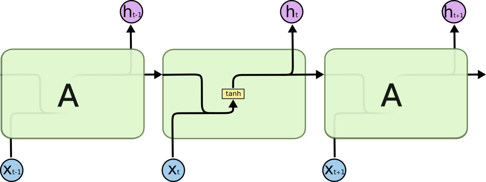

LSTM cũng có cấu trúc như vậy, nhưng mô-đun lặp lại có cấu trúc khác: thay vì một tầng mạng duy nhất, nó có bốn tầng, tương tác với nhau theo một cách rất đặc biệt.

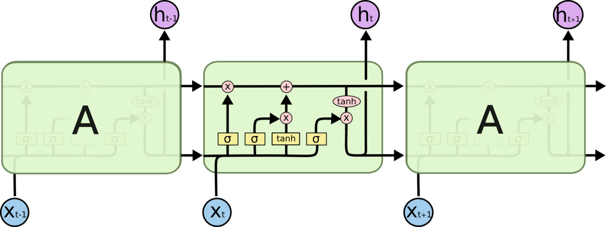

Chú ý: ý nghĩa các ký hiệu trong hình như sau:

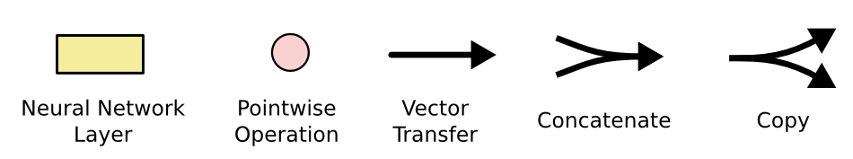

Trong hình trên, mỗi đường đen mang một vector, từ đầu ra của một nút tới đầu vào của các nút khác. Hình tròn màu hồng là phép toán theo từng phần tử (pointwise), như cộng vector; hình chữ nhật màu vàng là tầng mạng neuron được học. Các đường nhập lại là ghép vector, đường tách ra là nội dung được sao chép rồi gửi tới các vị trí khác nhau.

### 6.11.3 Minh họa ý tưởng cốt lõi của LSTM

Chìa khóa của LSTM là trạng thái tế bào (cell state), đường nằm ngang chạy suốt phía trên hình. Trạng thái tế bào giống băng chuyền: chạy thẳng trên toàn chuỗi, chỉ có một vài tương tác tuyến tính nhỏ. Thông tin dễ dàng truyền trên đó mà không đổi. Minh họa:

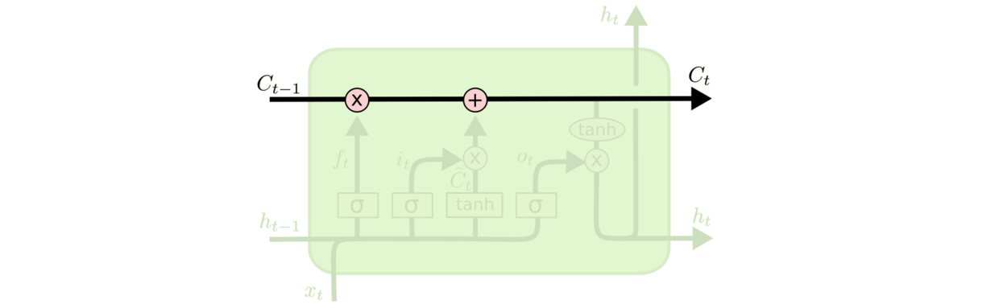

LSTM có khả năng bỏ bớt hoặc thêm thông tin vào trạng thái tế bào nhờ các cấu trúc được thiết kế kỹ gọi là "cổng". Cổng là cách cho thông tin đi qua có chọn lọc. Mỗi cổng gồm một tầng sigmoid và một phép nhân theo từng phần tử. Minh họa:

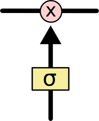

LSTM có ba cổng: cổng quên, cổng vào và cổng ra, để bảo vệ và điều khiển trạng thái tế bào.

**Cổng quên**

Đối tượng tác động: trạng thái tế bào.

Vai trò: quên có chọn lọc thông tin trong trạng thái tế bào.

Thao tác: cổng đọc $h_{t-1}$ và $x_t$, cho ra một số trong khoảng 0 tới 1 cho mỗi phần tử của trạng thái tế bào $C_{t-1}$: 1 nghĩa là "giữ hoàn toàn", 0 nghĩa là "bỏ hoàn toàn": $f_t=\sigma(W_f\cdot[h_{t-1},x_t]+b_f)$. Minh họa:

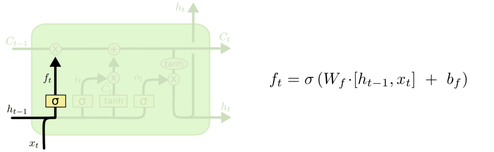

**Cổng vào**

Đối tượng tác động: trạng thái tế bào.

Vai trò: ghi có chọn lọc thông tin mới vào trạng thái tế bào.

Thao tác:

Bước một: tầng sigmoid gọi là "tầng cổng vào" quyết định giá trị nào sẽ được cập nhật: $i_t=\sigma(W_i\cdot[h_{t-1},x_t]+b_i)$.

Bước hai: một tầng tanh tạo vector giá trị ứng viên mới $\tilde{C}_t=\tanh(W_C\cdot[h_{t-1},x_t]+b_C)$ để thêm vào trạng thái. Minh họa:

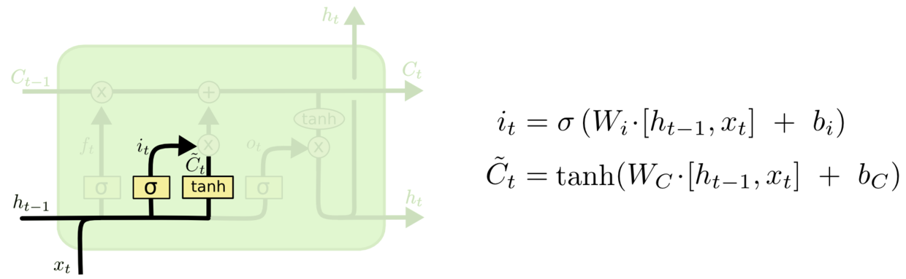

Bước ba: cập nhật $C_{t-1}$ thành $C_{t}$. Nhân trạng thái cũ với $f_t$ để bỏ thông tin đã quyết định bỏ, rồi cộng $i_t * \tilde{C}_t$ để được trạng thái tế bào mới, mỗi phần tử thay đổi theo mức ta quyết định cập nhật: $C_t = f_t * C_{t-1} + i_t * \tilde{C}_t$. Minh họa:

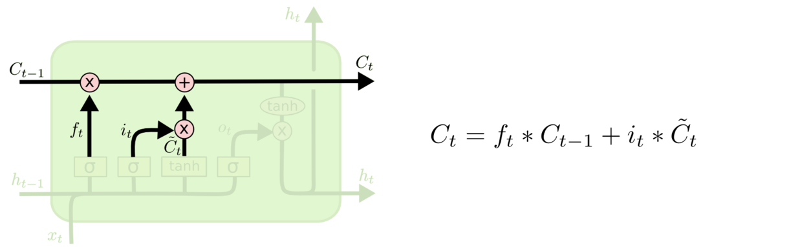

**Cổng ra**

Đối tượng tác động: trạng thái ẩn $h_t$.

Vai trò: quyết định xuất ra giá trị nào.

Thao tác:

Bước một: dùng một tầng sigmoid để quyết định phần nào của trạng thái tế bào sẽ được xuất ra: $o_t=\sigma(W_o\cdot[h_{t-1},x_t]+b_o)$.

Bước hai: đưa trạng thái tế bào qua tanh, rồi nhân với đầu ra của cổng sigmoid, cuối cùng chỉ xuất ra phần ta đã quyết định: $h_t = o_t * \tanh(C_t)$.

Minh họa:

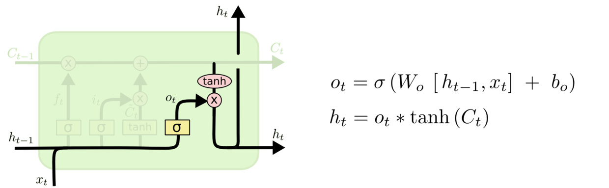

(Vì $C_t$ được cập nhật bằng phép cộng, $\frac{\partial C_t}{\partial C_{t-1}} = f_t$; khi cổng quên gần 1, gradient truyền qua nhiều bước mà gần như không suy giảm. Đây là lý do LSTM giảm được tiêu biến gradient.)

### 6.11.4 Các biến thể phổ biến của LSTM

**Thêm kết nối peephole**

Gers và cộng sự đề xuất thêm kết nối peephole vào LSTM thông thường, để các tầng cổng nhận cả trạng thái tế bào làm đầu vào. Minh họa:

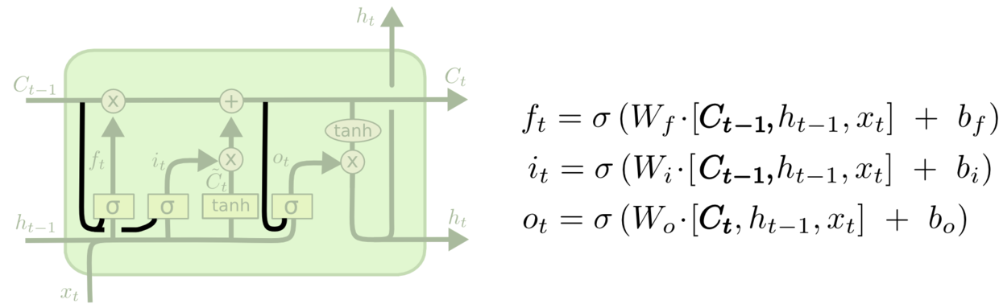

**Quyết định cổng quên và cổng vào cùng lúc**

Thay vì quyết định riêng cái gì cần quên và cái gì cần thêm, biến thể này quyết định cùng lúc (chỉ thêm thông tin mới vào chỗ vừa quên: dùng $1-f_t$ thay cho $i_t$). Minh họa:

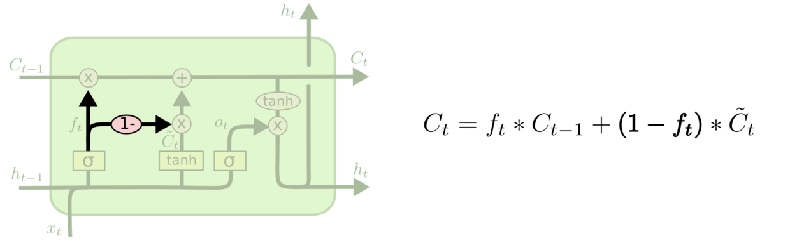

**Gated Recurrent Unit**

Gated Recurrent Unit (GRU) do Kyunghyun Cho và cộng sự đề xuất: gộp cổng quên và cổng vào thành một cổng cập nhật duy nhất, đồng thời gộp trạng thái tế bào và trạng thái ẩn, cùng một số thay đổi khác. Minh họa:

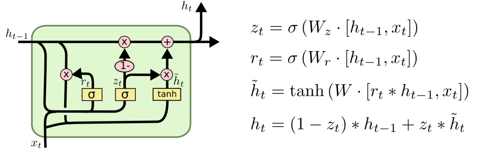

Mô hình cuối cùng đơn giản hơn LSTM chuẩn, và cũng là biến thể rất phổ biến.

## 6.12 LSTM và GRU khác nhau thế nào?

**Lý thuyết:** [d2l (tiếng Anh) · 10.2 GRU](https://d2l.ai/chapter_recurrent-modern/gru.html) ↗

Khác biệt giữa LSTM và GRU như hình:

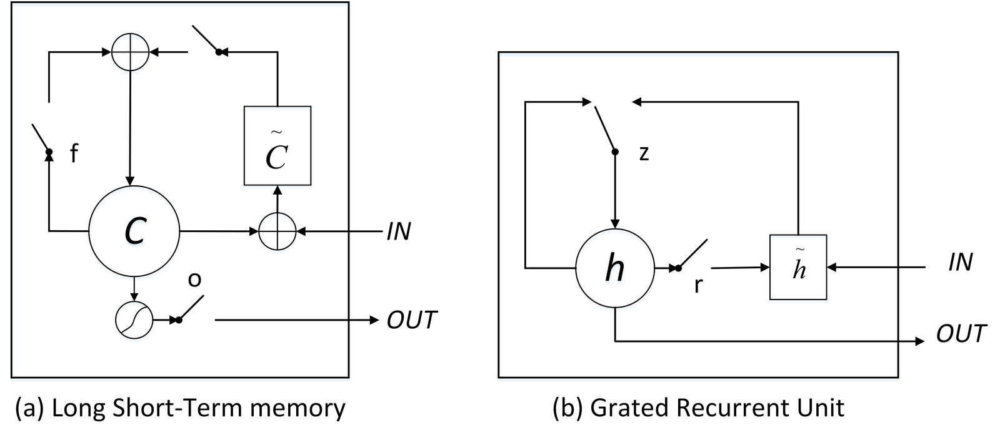

Từ hình có thể thấy cấu trúc hai mạng rất giống nhau, **khác nhau ở**:

1. Bộ nhớ mới (new memory) đều được tính từ trạng thái trước và đầu vào, nhưng GRU có một reset gate điều khiển lượng trạng thái trước được đưa vào, còn LSTM không có cổng tương tự ở bước này;
2. Cách tạo trạng thái mới khác nhau: LSTM có hai cổng khác nhau là cổng quên (f gate) và cổng vào (i gate), còn GRU chỉ có một cổng cập nhật (z gate);
3. LSTM điều chỉnh được trạng thái mới tạo ra qua cổng ra (o gate), còn GRU không điều chỉnh gì ở đầu ra.

(Hệ quả: GRU có ít tham số hơn khoảng 1/4, huấn luyện nhanh hơn; trong nhiều bài toán hai mạng cho kết quả tương đương.)

## 6.13 Ứng dụng điển hình của RNN trong NLP?

**(1) Mô hình ngôn ngữ và sinh văn bản (Language Modeling and Generating Text)**

Cho một chuỗi từ, cần dự đoán khả năng xuất hiện của mỗi từ dựa trên các từ trước đó. Mô hình ngôn ngữ đánh giá được khả năng một câu là đúng: khả năng càng cao, câu càng đúng. Ứng dụng khác là dùng mô hình sinh để dự đoán xác suất từ tiếp theo, rồi lấy mẫu theo xác suất đầu ra để sinh văn bản mới.

**(2) Dịch máy (Machine Translation)**

Dịch máy là biến một câu ngôn ngữ nguồn thành câu cùng nghĩa ở ngôn ngữ đích, ví dụ biến câu tiếng Anh thành câu tiếng Trung cùng nghĩa. Khác biệt then chốt với mô hình ngôn ngữ là phải đưa vào hết chuỗi câu nguồn rồi mới xuất ra, tức khi xuất từ đầu tiên đã cần thông tin từ toàn bộ chuỗi đầu vào.

**(3) Nhận dạng giọng nói (Speech Recognition)**

Nhận dạng giọng nói là, cho một tín hiệu sóng âm, dự đoán câu (trong một ngôn ngữ chỉ định) ứng với sóng âm đó và tính xác suất của câu đó.

**(4) Sinh mô tả ảnh (Generating Image Descriptions)**

Giống mạng tích chập, RNN đã được dùng để tự động sinh mô tả cho ảnh chưa gán nhãn. Kết hợp CNN với RNN cũng được dùng cho việc tự động sinh mô tả ảnh.

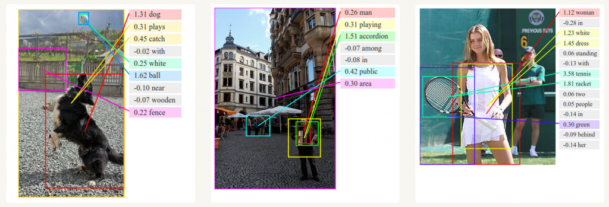

## 6.14 Các mô hình mở rộng và cải tiến thường gặp của RNN

> **Biên tập:** bản gốc đánh số mục này trùng là 6.13 (và có hai mục 6.13.4); ở đây đánh lại thành 6.14.x.

### 6.14.1 Simple RNN (SRN)

1. SRN (mạng Elman) là mạng ba tầng, có thêm các đơn vị ngữ cảnh ở tầng ẩn. Trong hình dưới, $y$ là tầng ẩn, $u$ là đơn vị ngữ cảnh. Kết nối giữa nút ngữ cảnh và nút tầng ẩn là cố định, trọng số cũng cố định (sao chép, trọng số 1). Mỗi nút ngữ cảnh ứng một–một với một nút tầng ẩn, và giá trị của nó là xác định.
2. Ở mỗi bước, lan truyền thuận như mạng truyền thẳng chuẩn, rồi dùng thuật toán học để học. Mỗi nút ngữ cảnh lưu đầu ra ở bước trước của nút tầng ẩn mà nó nối tới, tức lưu "ngữ cảnh phía trước", và tác động lên trạng thái nút tầng ẩn tương ứng ở bước hiện tại; tức đầu vào của tầng ẩn do đầu ra của tầng đầu vào và trạng thái của chính nó ở bước trước quyết định. Vì vậy SRN giải được bài toán dự đoán trên dữ liệu chuỗi mà perceptron nhiều tầng (MLP) chuẩn không giải được.
Cấu trúc SRN như hình dưới:

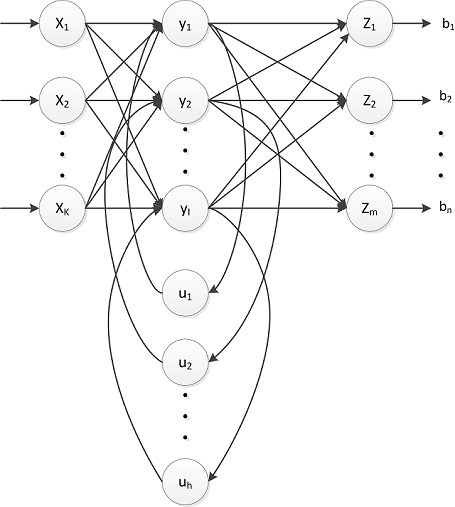

### 6.14.2 RNN hai chiều (Bidirectional RNN)

**Lý thuyết:** [d2l (tiếng Anh) · 10.4 RNN hai chiều](https://d2l.ai/chapter_recurrent-modern/bi-rnn.html) ↗

RNN hai chiều chồng hai RNN lên nhau: đầu ra ở thời điểm hiện tại (bước $t$) không chỉ phụ thuộc phần chuỗi trước mà còn phụ thuộc phần chuỗi sau. Ví dụ để dự đoán một từ bị thiếu trong câu, cần ngữ cảnh cả hai phía của từ đó. RNN hai chiều khá đơn giản, gồm hai RNN chồng lên nhau; đầu ra do RNN chiều thuận và RNN chiều ngược cùng quyết định. Như hình dưới:

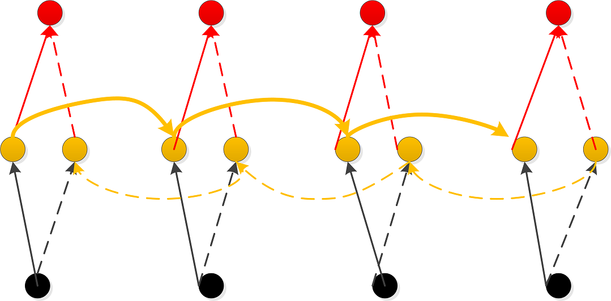

### 6.14.3 RNN sâu (Deep RNN)

**Lý thuyết:** [d2l (tiếng Anh) · 10.3 RNN sâu](https://d2l.ai/chapter_recurrent-modern/deep-rnn.html) ↗

RNN sâu giống RNN hai chiều ở chỗ cũng chồng nhiều tầng RNN, nên mỗi bước có nhiều tầng mạng. Mạng có năng lực biểu diễn và học mạnh hơn, nhưng phức tạp hơn và cần nhiều dữ liệu huấn luyện hơn. Cấu trúc RNN sâu như hình dưới:

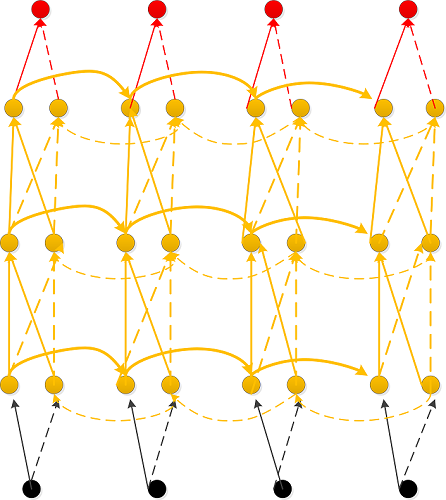

### 6.14.4 Mạng trạng thái vọng (Echo State Network, ESN)

**Đặc điểm của ESN**:

1. Cấu trúc cốt lõi là một "bể chứa" (reservoir) sinh ngẫu nhiên và giữ cố định. Bể chứa là cấu trúc hồi tiếp quy mô lớn, kết nối thưa sinh ngẫu nhiên (độ thưa SD thường 1%–5%, SD là tỉ lệ số neuron nối với nhau trên tổng số neuron $N$ của bể chứa);
2. Ma trận trọng số từ bể chứa tới tầng đầu ra là phần duy nhất cần điều chỉnh;
3. Chỉ cần hồi quy tuyến tính đơn giản là huấn luyện xong mạng.

**Ý tưởng cơ bản của ESN**:

Dùng một mạng hồi tiếp kết nối ngẫu nhiên quy mô lớn thay cho tầng giữa của mạng neuron kinh điển, từ đó đơn giản hóa việc huấn luyện.
Các tham số của mạng gồm:
(1) $W$: ma trận trọng số kết nối giữa các nút trong bể chứa (cho thấy các neuron trong bể chứa nối với nhau);
(2) $W_{in}$: ma trận trọng số kết nối từ tầng đầu vào tới bể chứa;
(3) $W_{back}$: ma trận trọng số phản hồi từ tầng đầu ra về bể chứa (cho thấy bể chứa nhận phản hồi từ tầng đầu ra);
(4) $W_{out}$: ma trận trọng số từ tầng đầu vào, bể chứa và tầng đầu ra tới tầng đầu ra (cho thấy tầng đầu ra không chỉ nối với bể chứa mà còn với tầng đầu vào và chính nó);
(5) $W_{outbias}$: hệ số điều chỉnh của tầng đầu ra.

Cấu trúc ESN như hình dưới:

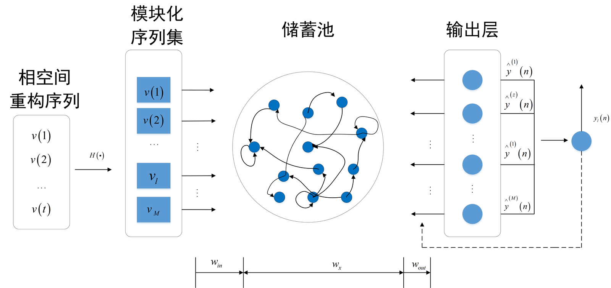

> **Biên tập:** bản gốc gắn nhầm chú thích "các neuron trong bể chứa nối với nhau" cho $W_{in}$; chú thích đó thuộc về $W$.

### 6.14.5 Gated Recurrent Unit (GRU)

GRU là một biến thể của RNN thông thường, cải tiến chủ yếu ở hai mặt:

1. Lấy câu làm ví dụ: dữ liệu ở các từ khác nhau trong chuỗi ảnh hưởng khác nhau tới trạng thái ẩn hiện tại; cổng cho phép mạng tự học xem mỗi trạng thái trước ảnh hưởng tới hiện tại bao nhiêu (ví dụ thông tin quá xa và không liên quan thì giảm trọng số).

2. Khi có sai số, nó có thể do một hoặc vài từ trước đó cùng gây ra, nên cần cập nhật trọng số ứng với các từ đó. Cấu trúc GRU như hình dưới. Trước hết, từ vector từ hiện tại (word vector) và trạng thái ẩn trước (hidden state), GRU tính cổng cập nhật (update gate) và cổng đặt lại (reset gate). Rồi từ cổng đặt lại, vector từ hiện tại và trạng thái ẩn trước, tính nội dung bộ nhớ mới (new memory content): $\tilde{h}_t = \tanh(W x_t + r_t \odot U h_{t-1})$. Khi cổng đặt lại gần 0, nội dung bộ nhớ mới bỏ qua toàn bộ bộ nhớ trước đó. Bộ nhớ cuối cùng do trạng thái ẩn trước và nội dung bộ nhớ mới cùng quyết định, theo cổng cập nhật: $h_t = z_t \odot h_{t-1} + (1-z_t)\odot \tilde{h}_t$.

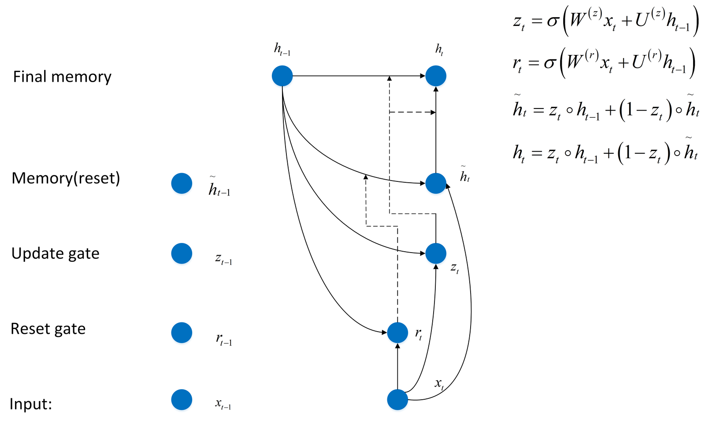

> **Biên tập:** bản gốc viết "khi reset gate bằng 1 thì bộ nhớ mới bỏ qua mọi bộ nhớ trước"; đúng là khi reset gate bằng **0** (reset gate nhân với trạng thái cũ). Đã thêm công thức để rõ nghĩa.

### 6.14.6 LSTM hai chiều (Bidirectional LSTM)

1. Giống RNN hai chiều, LSTM hai chiều có hai tầng LSTM: một tầng xử lý thông tin quá khứ, một tầng xử lý thông tin tương lai.
2. Trong LSTM hai chiều, LSTM chiều thuận cho trạng thái ẩn chiều thuận, LSTM chiều ngược cho trạng thái ẩn chiều ngược; trạng thái ẩn hiện tại là tổ hợp (thường là ghép) của hai trạng thái này.

### 6.14.7 LSTM xếp chồng (Stacked LSTM)

1. Giống RNN sâu, LSTM xếp chồng chồng nhiều tầng LSTM để có mô hình phức tạp hơn.
2. Khác LSTM hai chiều, LSTM xếp chồng chỉ dùng thông tin của các bước trước.

### 6.14.8 Clockwork RNN (CW-RNN)

CW-RNN là phiên bản cải tiến của RNN, được điều khiển bởi tần số đồng hồ. Nó chia tầng ẩn thành vài khối (nhóm, Group/Module), mỗi nhóm xử lý đầu vào theo tần số đồng hồ riêng. Để giảm độ phức tạp của RNN, CW-RNN giảm số tham số, đồng thời cải thiện hiệu năng và tăng tốc huấn luyện. CW-RNN giải quyết phụ thuộc dài hạn bằng cách cho các mô-đun tầng ẩn chạy ở các tần số đồng hồ khác nhau. Thời gian được rời rạc hóa, các nhóm tầng ẩn hoạt động ở các thời điểm khác nhau; do đó không phải mọi nhóm đều hoạt động ở mỗi bước, giúp tăng tốc huấn luyện. Ngoài ra, neuron ở nhóm có chu kỳ nhỏ không nối tới neuron ở nhóm có chu kỳ lớn; chỉ neuron chu kỳ lớn mới nối tới neuron chu kỳ nhỏ (kết nối và truyền thông tin giữa các nhóm có hướng). Nhóm chu kỳ lớn chạy chậm, nhóm chu kỳ nhỏ chạy nhanh, nên là neuron chậm nối tới neuron nhanh, chiều ngược lại thì không.

CW-RNN có cấu trúc giống SRN, cũng gồm tầng đầu vào (Input), tầng ẩn (Hidden), tầng đầu ra (Output), với kết nối thuận từ đầu vào tới tầng ẩn, từ tầng ẩn tới đầu ra. Khác SRN ở chỗ neuron tầng ẩn được chia thành $g$ nhóm, mỗi nhóm có $k$ neuron, và mỗi nhóm được gán một chu kỳ đồng hồ $T_i\in\{T_1,T_2,\dots,T_g\}$. Các neuron trong một nhóm nối đầy đủ với nhau, còn kết nối hồi tiếp từ nhóm $j$ tới nhóm $i$ chỉ tồn tại khi $T_j$ lớn hơn (hoặc bằng) $T_i$. Như hình dưới, sắp các nhóm theo chu kỳ tăng dần từ trái sang phải, $T_1<T_2<\dots<T_g$, thì kết nối đi từ phải sang trái. Ví dụ tầng ẩn có 256 nút, chia bốn nhóm với chu kỳ [1, 2, 4, 8], mỗi nhóm 256/4 = 64 nút. Nhóm thứ nhất (nhanh nhất) nhận kết nối từ cả bốn nhóm, nên ma trận kết nối hồi tiếp của nó là $64\times256$; nhóm thứ hai nhận từ ba nhóm chậm hơn hoặc bằng nó: $64\times192$; nhóm thứ ba: $64\times128$; nhóm thứ tư (chậm nhất) chỉ nhận từ chính nó: $64\times64$. Điều này giải thích ý ở đoạn trên: nhóm chậm nối tới nhóm nhanh, ngược lại thì không.

**Cấu trúc CW-RNN như hình dưới**:

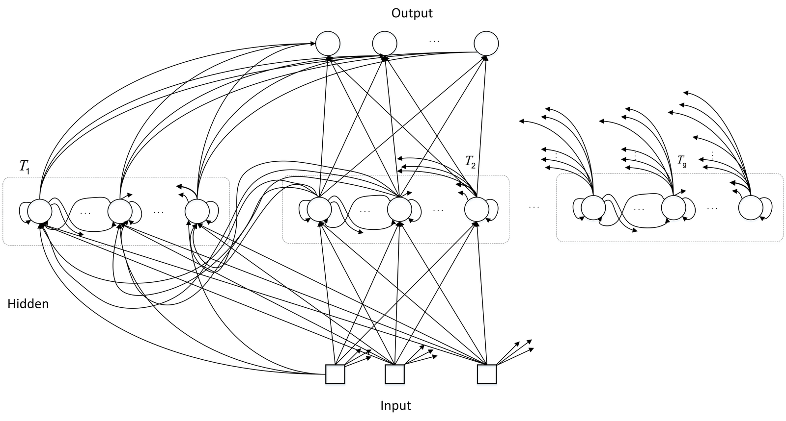

> **Biên tập:** ví dụ của bản gốc ghi nhóm 1 có ma trận $64\times64$ và nhóm 4 có $64\times256$, ngược với quy tắc "nhóm chậm nối tới nhóm nhanh" vừa nêu; đã sửa lại (ma trận hồi tiếp của CW-RNN là ma trận khối tam giác trên).

### 6.14.9 CNN-LSTM

1. Để tận dụng ưu điểm của cả CNN và LSTM, người ta đề xuất CNN-LSTM. Trong mô hình này, CNN trích xuất đặc trưng của đối tượng, LSTM dùng để dự đoán. Nhờ đặc tính tích chập, CNN nắm bắt nhanh và chính xác đặc trưng của đối tượng; ưu điểm của LSTM là nắm bắt được phụ thuộc dài hạn giữa các dữ liệu. (Ví dụ: nhận dạng hành động trong video, mô tả ảnh.)

## Tài liệu tham khảo

[1] Hà Chi Nguyên. https://zhuanlan.zhihu.com/p/28054589

[2] http://colah.github.io/posts/2015-08-Understanding-LSTMs/

[3] https://blog.csdn.net/zhaojc1995/article/details/80572098

[4] Graves A. Supervised Sequence Labelling with Recurrent Neural Networks. *Studies in Computational Intelligence*, 2008, 385.

[5] Graves A. Generating Sequences With Recurrent Neural Networks. arXiv, 2013.

[6] Greff K, Srivastava R K, Koutník J, et al. LSTM: A Search Space Odyssey. *IEEE Transactions on Neural Networks & Learning Systems*, 2017, 28(10): 2222–2232.

[7] Lanchantin J, Singh R, Wang B, et al. Deep Motif Dashboard: Visualizing and Understanding Genomic Sequences Using Deep Neural Networks. *Pacific Symposium on Biocomputing*, 2016, 22: 254.

[8] Pascanu R, Mikolov T, Bengio Y. On the difficulty of training Recurrent Neural Networks. 2012.

[9] Hochreiter S. The Vanishing Gradient Problem During Learning Recurrent Neural Nets and Problem Solutions. *International Journal of Uncertainty, Fuzziness and Knowledge-Based Systems*, 1998, 6(2).

[10] Dyer C, Kuncoro A, Ballesteros M, et al. Recurrent Neural Network Grammars. *NAACL-HLT*, 2016.

[11] Mulder W D, Bethard S, Moens M F. A survey on the application of recurrent neural networks to statistical language modeling. 2015.

[12] Graves A. Generating Sequences With Recurrent Neural Networks. arXiv, 2013.

[13] Zhang B, Xiong D, Su J. Neural Machine Translation with Deep Attention. *IEEE Transactions on Pattern Analysis and Machine Intelligence*, 2018.

[14] <https://github.com/xuanyuansen/scalaLSTM>

[15] Goodfellow I, Bengio Y, Courville A. *Deep Learning*. MIT Press, 2016.

[16] http://colah.github.io/posts/2015-08-Understanding-LSTMs/

[17] Greff K, Srivastava R K, Koutník J, et al. LSTM: A Search Space Odyssey. *IEEE Transactions on Neural Networks & Learning Systems*, 2017, 28(10): 2222–2232.

[18] Yao K, Cohn T, Vylomova K, et al. Depth-Gated Recurrent Neural Networks. 2015.

[19] Koutník J, Greff K, Gomez F, et al. A Clockwork RNN. *ICML*, 2014: 1863–1871.

[20] Gers F A, Schmidhuber J. Recurrent nets that time and count. *IJCNN*, 2000.

[21] Li S, Wu C, Hai L, et al. FPGA Acceleration of Recurrent Neural Network Based Language Model. *FCCM*, 2015.

[22] Mikolov T, Kombrink S, Burget L, et al. Extensions of recurrent neural network language model. *ICASSP*, 2011.

[23] Graves A. Generating Sequences With Recurrent Neural Networks. arXiv, 2013.

[24] Sutskever I, Vinyals O, Le Q V. Sequence to Sequence Learning with Neural Networks. 2014.

[25] Liu B, Lane I. Joint Online Spoken Language Understanding and Language Modeling with Recurrent Neural Networks. 2016.

[26] Graves A, Mohamed A R, Hinton G. Speech recognition with deep recurrent neural networks. *ICASSP*, 2013.

[27] https://cs.stanford.edu/people/karpathy/deepimagesent/

[28] Cho K, Van Merriënboer B, Gulcehre C, et al. Learning phrase representations using RNN encoder-decoder for statistical machine translation. arXiv:1406.1078, 2014.
