# Chương 8 Phát hiện đối tượng

> Ghi chú của người biên soạn: trang này dịch từ sách *Deep Learning 500 câu hỏi* (深度学习500问) do **Tan Jiyong (谈继勇)** chủ biên cùng cộng đồng đóng góp ([bản gốc](https://github.com/scutan90/DeepLearning-500-questions/tree/master/ch08_目标检测), [mã nguồn](https://github.com/scutan90/DeepLearning-500-questions), giấy phép [GPL-3.0](https://www.gnu.org/licenses/gpl-3.0.html); phần dịch cũng theo GPL-3.0). Số câu hỏi giữ như bản gốc. Chỗ bản gốc sai hoặc thiếu đã được sửa ngay trong bài và ghi ở ô **Biên tập**; ô **Lý thuyết** dẫn sang bài học tương ứng trên site.

> **Biên tập:** chương này tổng hợp các thuật toán phát hiện đối tượng tới khoảng năm 2019 (R-CNN → Mask R-CNN, SSD, YOLO v1–v3, RetinaNet…). Nhiều đoạn chép từ blog và bản dịch các bài viết tiếng Anh, có chỗ còn giữ giọng ghi chép cá nhân ("tôi thử thấy…"); bản dịch giữ ý, đổi sang giọng trung tính. Ảnh của mục CBNet và mmdetection bị thiếu ngay trong repo gốc nên không hiển thị được; các ảnh chỉ chứa công thức được gõ lại thành công thức. Các mục 8.5.2–8.5.8 bản gốc chỉ có tiêu đề, người biên tập viết bổ sung. Từ sau 2019, lĩnh vực có thêm các hướng lớn: bộ phát hiện không dùng anchor (FCOS, CenterNet), bộ phát hiện dựa trên Transformer (DETR và các biến thể), các phiên bản YOLO mới (v5–v11), và phát hiện từ vựng mở dùng mô hình ngôn ngữ–hình ảnh (OWL-ViT, Grounding DINO). Các hướng này được trình bày ở mục 8.9 do người biên tập viết thêm, cập nhật tới 2026.

## 8.1 Khái niệm cơ bản

### 8.1.1 Phát hiện đối tượng là gì?

**Lý thuyết:** [d2l (tiếng Anh) · 14.3 Phát hiện đối tượng và hộp bao](https://d2l.ai/chapter_computer-vision/bounding-box.html) ↗

Nhiệm vụ của phát hiện đối tượng (Object Detection) là tìm mọi đối tượng (vật thể) quan tâm trong ảnh, xác định lớp và vị trí của chúng; đây là một trong những bài toán cốt lõi của thị giác máy tính. Vì các vật thể có ngoại hình, hình dạng, tư thế khác nhau, lại thêm nhiễu do ánh sáng, che khuất… khi chụp, phát hiện đối tượng luôn là một trong những bài toán thách thức nhất của thị giác máy tính.

Trong thị giác máy tính, nhận dạng ảnh có bốn nhóm nhiệm vụ lớn:

- **Phân loại (Classification):** trả lời "là gì?", tức cho một ảnh hay một đoạn video, phán đoán trong đó có đối tượng thuộc lớp nào.
- **Định vị (Localization):** trả lời "ở đâu?", tức xác định vị trí của đối tượng đó.
- **Phát hiện (Detection):** trả lời "là gì? ở đâu?", tức xác định vị trí của các đối tượng và biết chúng là gì.
- **Phân vùng (Segmentation):** gồm phân vùng thể hiện (instance-level) và phân vùng cảnh (scene-level), trả lời "mỗi điểm ảnh thuộc đối tượng hay cảnh nào".

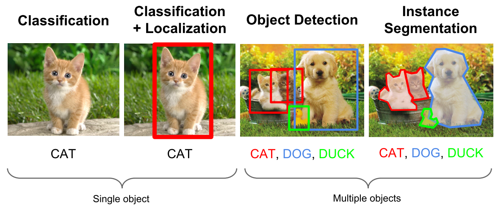

Hình 8.1 Bốn nhóm nhiệm vụ nhận dạng ảnh (nguồn: bài giảng CS231n 2016, bài 8)

### 8.1.2 Phát hiện đối tượng cần giải quyết những vấn đề cốt lõi nào?

**Lý thuyết:** [d2l (tiếng Anh) · 14.5 Phát hiện đa tỉ lệ](https://d2l.ai/chapter_computer-vision/multiscale-object-detection.html) ↗

Ngoài phân loại ảnh, các vấn đề cốt lõi mà phát hiện đối tượng phải giải quyết là:

1. Đối tượng có thể xuất hiện ở bất kỳ vị trí nào trong ảnh.
2. Đối tượng có nhiều kích thước khác nhau.
3. Đối tượng có nhiều hình dạng khác nhau.

### 8.1.3 Các thuật toán phát hiện đối tượng được phân loại thế nào?

**Lý thuyết:** [d2l (tiếng Anh) · 14.8 Các mạng R-CNN](https://d2l.ai/chapter_computer-vision/rcnn.html) ↗ · [d2l (tiếng Anh) · 14.7 SSD](https://d2l.ai/chapter_computer-vision/ssd.html) ↗

Các thuật toán phát hiện đối tượng dựa trên học sâu chủ yếu chia hai loại:

**1. Thuật toán hai giai đoạn (two-stage)**

Trước hết sinh vùng đề xuất (region proposal, RP: một khung chọn sẵn có thể chứa vật cần phát hiện), rồi dùng mạng neuron tích chập phân loại mẫu.

Các bước: trích đặc trưng → sinh RP → phân loại / hồi quy vị trí.

Các thuật toán hai giai đoạn thường gặp: R-CNN, SPP-Net, Fast R-CNN, Faster R-CNN, R-FCN…

**2. Thuật toán một giai đoạn (one-stage)**

Không dùng RP, trích đặc trưng trong mạng rồi dự đoán thẳng lớp và vị trí của vật.

Các bước: trích đặc trưng → phân loại / hồi quy vị trí.

Các thuật toán một giai đoạn thường gặp: OverFeat, YOLOv1, YOLOv2, YOLOv3, SSD, RetinaNet…

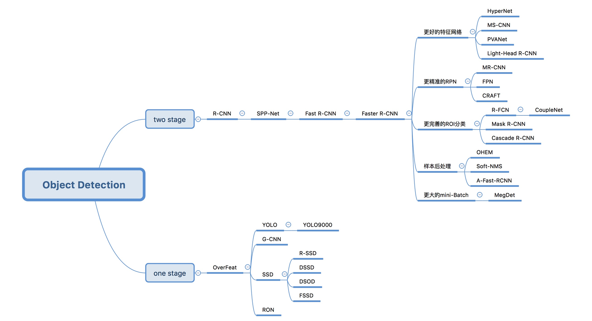

Hình 8.2 Sơ đồ tư duy các thuật toán phát hiện đối tượng: nhánh trên là hai giai đoạn (R-CNN → SPP-Net → Fast R-CNN → Faster R-CNN và các cải tiến), nhánh dưới là một giai đoạn (OverFeat, YOLO, SSD và các biến thể).

### 8.1.4 Phát hiện đối tượng có những ứng dụng nào?

**Lý thuyết:** [d2l (tiếng Anh) · 14.3 Phát hiện đối tượng và hộp bao](https://d2l.ai/chapter_computer-vision/bounding-box.html) ↗

Phát hiện đối tượng có giá trị thực tiễn và triển vọng ứng dụng rất lớn. Các lĩnh vực ứng dụng gồm phát hiện khuôn mặt, phát hiện người đi bộ, phát hiện xe, phát hiện đường trong ảnh chụp từ máy bay hay vệ tinh, phát hiện vật cản trong ảnh từ camera trên xe, phát hiện tổn thương trong ảnh y tế… Trong lĩnh vực an ninh còn có thể phát hiện động mũ bảo hộ, dây an toàn, phát hiện chuyển động, phát hiện xâm nhập khu vực, trông coi đồ vật…

### Bổ sung: IoU và mAP là gì?

**Lý thuyết:** [Học máy · E.4 Precision, recall và F1](ml/eval_vi?id=e4-precision-recall-và-f1) · [Học máy · E.7 Đường precision–recall khi lớp dương hiếm](ml/eval_vi?id=e7-Đường-precisionrecall-khi-lớp-dương-hiếm) · [d2l (tiếng Anh) · 14.4 Hộp neo](https://d2l.ai/chapter_computer-vision/anchor.html) ↗

> **Biên tập:** bản gốc ghi trong danh sách việc cần làm (TODO) cuối chương là "kiến thức cơ bản: mAP, IoU, NMS" và "các chỉ số đánh giá" nhưng chưa viết. Mục này do người biên tập bổ sung vì các mục sau dùng liên tục.

**IoU (Intersection over Union, tỉ số giao trên hợp)** đo mức trùng nhau của hai hộp $A$ và $B$:

$$
\mathrm{IoU}(A,B)=\frac{|A\cap B|}{|A\cup B|}\in[0,1].
$$

Một dự đoán được coi là đúng (true positive) nếu đúng lớp và có IoU với một hộp thật (ground truth) chưa được ghép lớn hơn ngưỡng (thường 0.5); mỗi hộp thật chỉ ghép với một dự đoán, dự đoán thừa tính là sai (false positive).

**AP (Average Precision)** của một lớp: sắp mọi dự đoán của lớp đó theo điểm tin cậy giảm dần, vẽ đường precision–recall, rồi lấy diện tích dưới đường (sau khi làm đường precision không tăng). **mAP** là trung bình AP trên mọi lớp. PASCAL VOC dùng ngưỡng IoU 0.5 (viết AP50); COCO lấy trung bình AP trên 10 ngưỡng IoU từ 0.5 tới 0.95 bước 0.05 (viết AP hay AP@[.5:.95]), ngoài ra báo cáo AP75 và AP theo kích thước vật (AP_S, AP_M, AP_L cho vật nhỏ, vừa, lớn). AR (Average Recall) tương tự cho recall.

## 8.2 Các thuật toán phát hiện hai giai đoạn

### 8.2.1 R-CNN

**Lý thuyết:** [d2l (tiếng Anh) · 14.8 Các mạng R-CNN](https://d2l.ai/chapter_computer-vision/rcnn.html) ↗ · [Học máy · Chương 26 Support vector machine (SVM)](ml/ch26_vi) · [Ôn tập · 14.4.1 Tinh chỉnh (fine-tune) là gì?](qa/ch14_vi?id=_1441-tinh-chỉnh-fine-tune-là-gì)

**R-CNN có những điểm mới nào?**

1. Dùng CNN (ConvNet) tính vector đặc trưng cho các vùng đề xuất (region proposals). Chuyển từ đặc trưng dựa trên kinh nghiệm (SIFT, HOG) sang đặc trưng học từ dữ liệu (bản đồ đặc trưng của CNN), tăng khả năng biểu diễn mẫu của đặc trưng.
2. Huấn luyện trước có giám sát trên tập lớn (ILSVRC) rồi tinh chỉnh (fine-tuning) trên tập nhỏ (PASCAL), giải quyết việc tập nhỏ khó huấn luyện, thậm chí quá khớp.

Ghi chú: ILSVRC chính là cuộc thi ImageNet nổi tiếng, dữ liệu rất lớn; tập PASCAL (gồm phát hiện đối tượng, phân vùng ảnh…) thì tương đối nhỏ.

**Giới thiệu R-CNN**

R-CNN (Girshick và cộng sự, 2014) là thế hệ đầu của họ R-CNN, thực ra không dùng nhiều tư tưởng "học sâu", mà kết hợp "học sâu" với kiến thức "thị giác máy tính" truyền thống. Ví dụ bước thứ hai và thứ tư trong quy trình của R-CNN thực chất là kỹ thuật thị giác máy tính truyền thống: dùng tìm kiếm chọn lọc (selective search) để trích vùng đề xuất, dùng SVM để phân loại.

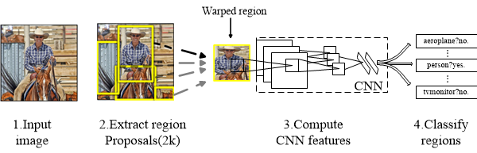

Hình 8.3 Quy trình R-CNN: 1. ảnh đầu vào; 2. trích khoảng 2000 vùng đề xuất; 3. tính đặc trưng CNN; 4. phân loại vùng.

Trong bài báo gốc, quy trình R-CNN chỉ có 4 bước; chỉ nhìn hình trên thì khó hiểu sâu cơ chế xử lý của R-CNN, nên dưới đây bổ sung lời giải thích theo hình:

1. **Mô hình huấn luyện sẵn.** Chọn một mạng neuron đã huấn luyện sẵn (pre-trained), như AlexNet, VGG.
2. **Huấn luyện lại.** Dùng các lớp đối tượng cần phát hiện để huấn luyện lại (re-train, tinh chỉnh) mạng, thay tầng kết nối đầy đủ cuối bằng tầng có số lớp mới.
3. **Trích vùng đề xuất và tính đặc trưng CNN.** Dùng thuật toán tìm kiếm chọn lọc (Selective Search) trích mọi vùng đề xuất (khoảng 2000 vùng mỗi ảnh), biến đổi (resize/warp) chúng về kích thước cố định để thỏa yêu cầu đầu vào của CNN (do giới hạn của tầng kết nối đầy đủ), rồi lưu bản đồ đặc trưng xuống đĩa.

   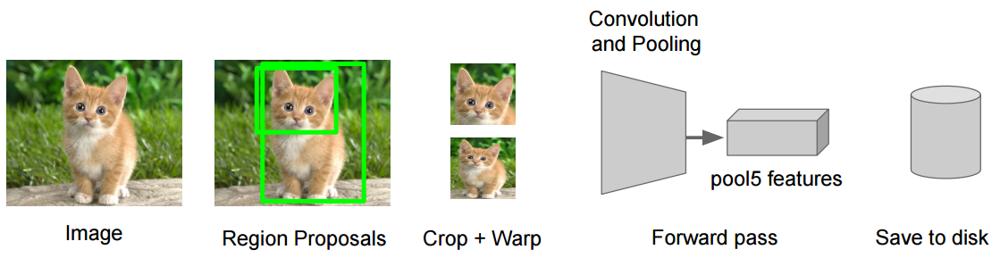

4. **Huấn luyện SVM.** Dùng đặc trưng để huấn luyện SVM phân biệt đối tượng với nền (mỗi lớp một SVM nhị phân).
5. **Hồi quy hộp bao (Bounding boxes Regression).** Huấn luyện một mô hình hồi quy tuyến tính cho ra các hệ số hiệu chỉnh vị trí hộp.

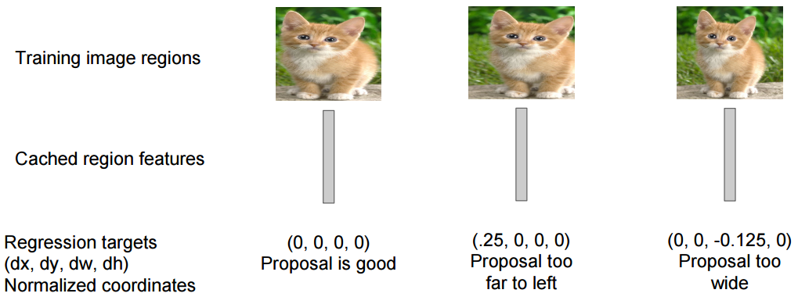

Hình 8.4 Hồi quy hộp bao: mục tiêu hồi quy $(d_x, d_y, d_w, d_h)$ là độ lệch đã chuẩn hóa giữa vùng đề xuất và hộp thật.

**Kết quả thực nghiệm của R-CNN**

R-CNN đạt mAP 58.5% trên tập kiểm tra VOC 2007, vượt mọi thuật toán phát hiện đối tượng thời đó.

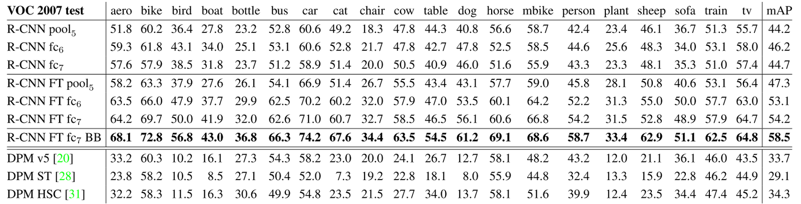

Hình 8.5 Kết quả R-CNN trên VOC 2007 (dòng R-CNN FT fc7 BB: 58.5%)

> **Biên tập:** con số 58.5% là với mạng AlexNet; cùng bài báo, dùng VGG-16 thì đạt 66.0%. Bản gốc mô tả bước 5 là "bộ phân loại hồi quy tuyến tính"; đây là mô hình hồi quy (ridge regression), không phải bộ phân loại.

### 8.2.2 Fast R-CNN

**Lý thuyết:** [d2l (tiếng Anh) · 14.8 Các mạng R-CNN](https://d2l.ai/chapter_computer-vision/rcnn.html) ↗ · [Học sâu · 7.5 Gộp](dl/ch07_s5_vi)

**Fast R-CNN có những điểm mới nào?**

1. Chỉ trích đặc trưng một lần cho cả ảnh, tránh việc trích đặc trưng lặp lại thừa thãi như R-CNN.
2. Thay tầng max pooling cuối bằng tầng RoI pooling, đồng thời đưa dữ liệu vùng đề xuất vào để trích đặc trưng của từng vùng.
3. Cuối mạng Fast R-CNN dùng các tầng kết nối đầy đủ song song, cho ra cùng lúc kết quả phân loại và hồi quy hộp, huấn luyện đa nhiệm vụ đầu-cuối (trừ bước trích vùng đề xuất), và không cần thêm không gian lưu đặc trưng (đặc trưng của R-CNN phải lưu xuống đĩa để huấn luyện SVM và hồi quy hộp bao).
4. Dùng SVD phân rã các tầng kết nối đầy đủ song song ở cuối mạng, giảm độ phức tạp tính toán, tăng tốc phát hiện.

**Giới thiệu Fast R-CNN**

Fast R-CNN (Girshick, 2015) cải tiến từ R-CNN và SPPnet. Điểm mới của SPPnet là tính bản đồ đặc trưng dùng chung (shared feature map) cho cả ảnh, rồi ánh xạ từng vùng đề xuất lên bản đồ đặc trưng dùng chung đó để có vector đặc trưng tương ứng (tức không phải tính lại bản đồ đặc trưng). Tất nhiên SPPnet cũng có nhược điểm: giống R-CNN, huấn luyện nhiều giai đoạn (multiple-stage pipeline), tốc độ vẫn chưa đủ "nhanh", đặc trưng vẫn phải lưu xuống đĩa.

Fast R-CNN áp vùng đề xuất trực tiếp lên bản đồ đặc trưng, dùng RoI pooling biến chúng thành khối đặc trưng kích thước cố định. Dưới đây là sơ đồ Fast R-CNN:

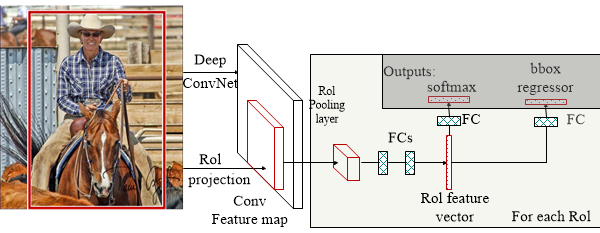

Hình 8.6 Sơ đồ Fast R-CNN

**Chi tiết tầng RoI Pooling**

Vì Fast R-CNN dùng tầng kết nối đầy đủ, nên dùng RoI Pooling để biến các RoI kích thước khác nhau thành kích thước cố định.

RoI Pooling là một loại tầng gộp, dành riêng cho RoI; đặc điểm là kích thước bản đồ đặc trưng đầu vào không cố định nhưng kích thước đầu ra cố định (ví dụ 7x7).

**RoI là gì?**

RoI là viết tắt của Region of Interest (vùng quan tâm), thường chỉ một khung trên ảnh; ở đây là các khung đề xuất do Selective Search trích ra.

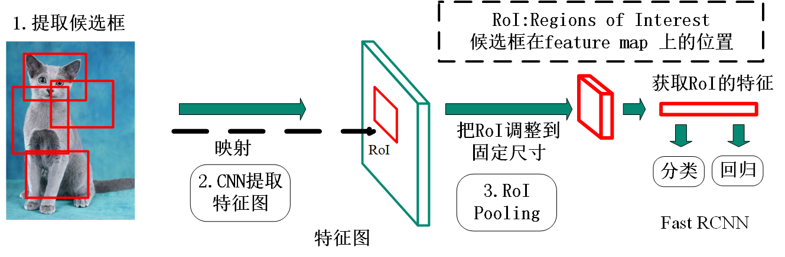

Hình 8.7 Luồng xử lý RoI trong Fast R-CNN. Chữ trong hình: 1. 提取候选框 = trích khung đề xuất; 2. CNN提取特征图 = CNN trích bản đồ đặc trưng (特征图); 映射 = ánh xạ khung lên bản đồ đặc trưng (RoI: vị trí của khung đề xuất trên bản đồ đặc trưng); 3. RoI Pooling, 把RoI调整到固定尺寸 = đưa RoI về kích thước cố định; 获取RoI的特征 = lấy đặc trưng của RoI; 分类 / 回归 = phân loại / hồi quy.

Thường mỗi ảnh có rất nhiều khung chữ nhật (trong Faster R-CNN là đầu ra của RPN), nên ở đây ta gộp trên nhiều RoI.

**Đầu vào của RoI Pooling**

Đầu vào gồm hai phần:

1. **Bản đồ đặc trưng (feature map):** bản đồ đặc trưng ở hình trên; trong Fast R-CNN nó nằm trước RoI Pooling, trong Faster R-CNN nó là bản đồ đặc trưng dùng chung với RPN, thường gọi là "share_conv".
2. **RoIs:** ma trận $N\times5$ biểu diễn mọi RoI, trong đó $N$ là số RoI, cột đầu là chỉ số ảnh trong batch, bốn cột còn lại là tọa độ góc trên trái và góc dưới phải.

Trong Fast R-CNN, RoI là đầu ra của Selective Search; trong Faster R-CNN là đầu ra của RPN, một loạt khung đề xuất. Đáng chú ý: tọa độ RoI tính theo **ảnh gốc** (đầu vào ban đầu của mạng), không theo bản đồ đặc trưng. Cách hiểu tọa độ RoI thường gây nhầm lẫn: rốt cuộc tính theo ảnh nào? Thực ra dễ hiểu: biết kích thước ảnh gốc và tọa độ khung do Selective Search trích ra, thì theo "quan hệ ánh xạ" suy ra được kích thước bản đồ đặc trưng và tọa độ ánh xạ của khung trên bản đồ đặc trưng. Cách tính chỉ là một phép chia tỉ lệ, trình bày ở dưới. Nên cũng có thể hiểu RoI là các khung đề xuất trên ảnh gốc.

Ghi chú: các hộp có thể chứa vật do Selective Search trích ra thường gọi là vùng đề xuất (region proposals) hay vùng quan tâm (RoI).

**Thao tác cụ thể của RoI Pooling**

1. Từ ảnh đầu vào, ánh xạ RoI tới vị trí tương ứng trên bản đồ đặc trưng. Quy tắc ánh xạ rất đơn giản: chia mỗi tọa độ cho "tỉ lệ giữa kích thước ảnh đầu vào và kích thước bản đồ đặc trưng" (tức sải bước tổng, ví dụ 16 hay 32), được tọa độ hộp trên bản đồ đặc trưng.
2. Chia vùng sau khi ánh xạ thành các ô (section) cùng kích thước (số ô bằng kích thước đầu ra).
3. Gộp cực đại (max pooling) trên từng ô.

Như vậy từ các hộp kích thước khác nhau, ta được bản đồ đặc trưng kích thước cố định. Đáng nói là kích thước bản đồ đặc trưng đầu ra không phụ thuộc vào kích thước RoI hay kích thước bản đồ đặc trưng tích chập. Lợi ích lớn nhất của RoI Pooling là tăng mạnh tốc độ xử lý (mọi RoI dùng chung một lần tính tích chập).

**Đầu ra của RoI Pooling**

Đầu ra là batch vector, với batch bằng số RoI, mỗi vector có kích thước channel × w × h; quá trình RoI Pooling chính là ánh xạ từng hộp chữ nhật kích thước khác nhau thành hộp kích thước cố định (w × h).

**Ví dụ RoI Pooling**

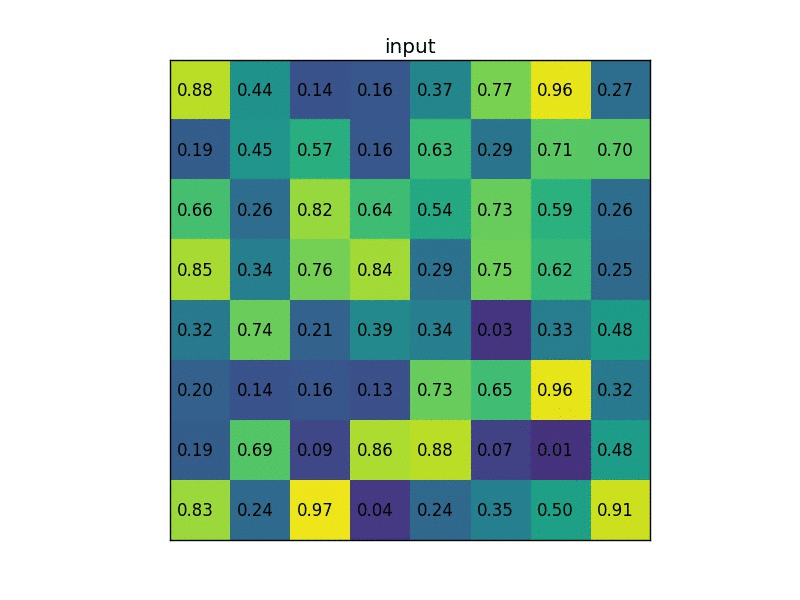

Hình 8.8 Ví dụ động: RoI trên bản đồ đặc trưng $8\times8$ được chia thành $2\times2$ ô, lấy giá trị lớn nhất trong mỗi ô.

### 8.2.3 Faster R-CNN

**Lý thuyết:** [d2l (tiếng Anh) · 14.8 Các mạng R-CNN](https://d2l.ai/chapter_computer-vision/rcnn.html) ↗ · [d2l (tiếng Anh) · 14.4 Hộp neo](https://d2l.ai/chapter_computer-vision/anchor.html) ↗

**Faster R-CNN có những điểm mới nào?**

Fast R-CNN dựa vào phương pháp đề xuất vùng bên ngoài như tìm kiếm chọn lọc. Nhưng các thuật toán này chạy trên CPU và rất chậm. Khi kiểm tra, Fast R-CNN cần 2.3 giây cho một dự đoán, trong đó 2 giây dùng để sinh 2000 RoI. Faster R-CNN (Ren và cộng sự, 2015) dùng thiết kế giống Fast R-CNN, chỉ thay phương pháp đề xuất vùng bằng một mạng sâu bên trong. Mạng đề xuất vùng (RPN) mới sinh RoI hiệu quả hơn, chạy với tốc độ 10 mili giây mỗi ảnh.

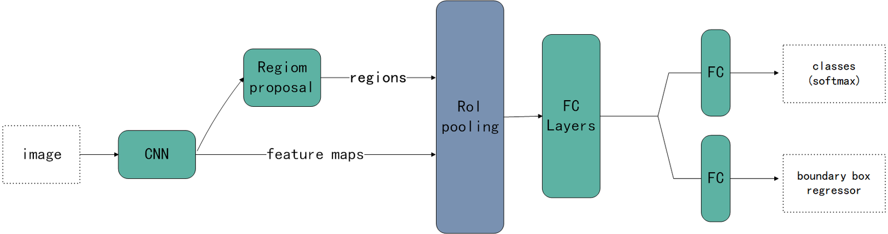

Hình 8.9 Sơ đồ Faster R-CNN

Sơ đồ của Faster R-CNN giống Fast R-CNN, chỉ khác là dùng mạng sâu bên trong (RPN) thay cho phương pháp đề xuất vùng bên ngoài.

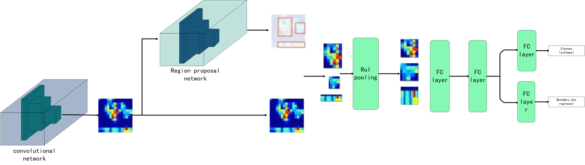

Hình 8.10 Kiến trúc chi tiết của Faster R-CNN

**Mạng đề xuất vùng**

Mạng đề xuất vùng (RPN) nhận bản đồ đặc trưng đầu ra của mạng tích chập đầu tiên. Nó trượt một kernel 3×3 trên bản đồ đặc trưng, dùng mạng tích chập (như mạng ZF dưới đây) để dựng các vùng đề xuất không phụ thuộc lớp. Các mạng sâu khác (như VGG hay ResNet) trích đặc trưng đầy đủ hơn, nhưng phải đánh đổi tốc độ. Mạng ZF cuối cùng cho ra 256 giá trị, đưa vào hai tầng kết nối đầy đủ độc lập để dự đoán hộp bao và hai điểm "có vật" (objectness), đo hộp có chứa vật hay không. Thực ra có thể dùng một bộ hồi quy tính một điểm objectness duy nhất, nhưng cho gọn, Faster R-CNN dùng bộ phân loại chỉ hai lớp: có vật và không có vật.

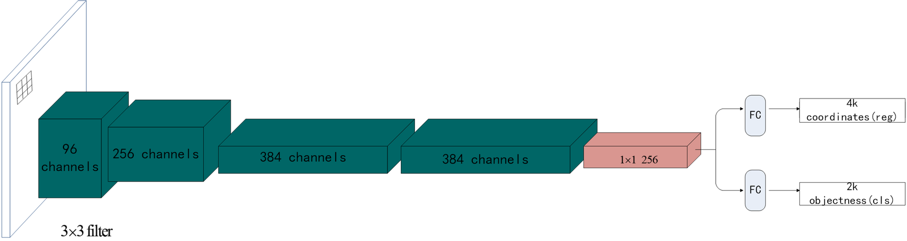

Hình 8.11 RPN trên mạng ZF: kernel $3\times3$ trượt trên bản đồ đặc trưng, đặc trưng 256 chiều đi vào hai nhánh: $2k$ điểm objectness và $4k$ tọa độ.

Tại mỗi vị trí trên bản đồ đặc trưng, RPN dự đoán $k$ lần. Vì vậy RPN cho ra $4\times k$ tọa độ và $2\times k$ điểm ở mỗi vị trí. Hình dưới là bản đồ đặc trưng 8×8 với một kernel 3×3, cuối cùng cho $8\times8\times3$ RoI ($k=3$). Hình bên phải là 3 vùng đề xuất tại một vị trí.

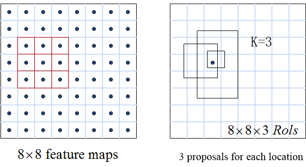

Hình 8.12 Bản đồ đặc trưng $8\times8$, mỗi vị trí 3 đề xuất, tổng $8\times8\times3$ RoI

Ta muốn các đề xuất đa dạng về hình dạng và kích thước. Vì vậy Faster R-CNN không tạo hộp ngẫu nhiên, mà dự đoán các độ lệch (như $\delta x, \delta y$) so với các hộp tham chiếu gọi là **hộp neo** (anchor) đặt tại mỗi vị trí. Ta giới hạn giá trị của các độ lệch này, nên dự đoán vẫn gần với hộp neo.

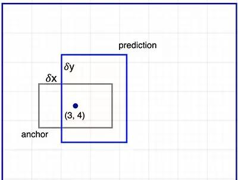

Hình 8.13 Dự đoán là độ lệch $(\delta x, \delta y)$ so với hộp neo

Để có $k$ dự đoán tại mỗi vị trí, cần $k$ hộp neo lấy vị trí đó làm tâm. Mỗi dự đoán gắn với một hộp neo cụ thể, nhưng mọi vị trí dùng chung các hộp neo cùng hình dạng.

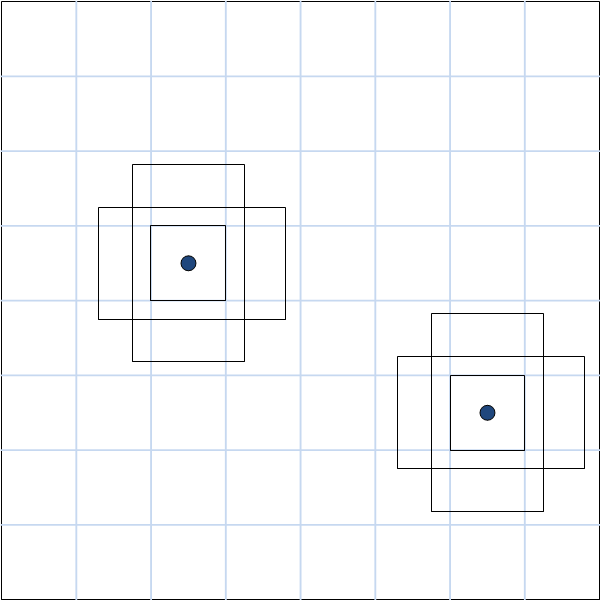

Hình 8.14 Mọi vị trí dùng chung một bộ hình dạng hộp neo

Các hộp neo được chọn cẩn thận để đa dạng, bao được các vật thật có tỉ lệ và tỉ lệ khung hình khác nhau. Nhờ vậy ta dẫn dắt huấn luyện ban đầu bằng các phỏng đoán tốt hơn, và cho mỗi dự đoán chuyên về một hình dạng cụ thể. Chiến lược này làm huấn luyện giai đoạn đầu ổn định và dễ hơn.

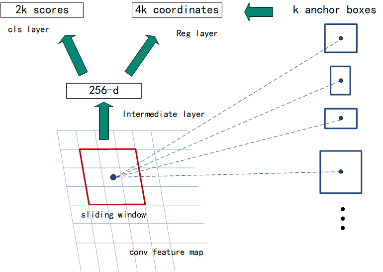

Hình 8.15 RPN với $k$ hộp neo: lớp phân loại cho $2k$ điểm, lớp hồi quy cho $4k$ tọa độ

Faster R-CNN dùng nhiều hộp neo hơn. Nó đặt 9 hộp neo: 3 kích thước × 3 tỉ lệ khung hình. Mỗi vị trí dùng 9 hộp neo, sinh ra $2\times9$ điểm objectness và $4\times9$ tọa độ.

> **Biên tập:** bản gốc viết ngược câu chú thích của sơ đồ: "Faster R-CNN dùng phương pháp đề xuất vùng bên ngoài thay cho mạng sâu bên trong"; đúng là ngược lại. Câu "dự đoán độ lệch so với hộp tham chiếu ở góc trên trái gọi là neo" cũng sai (dịch hỏng từ blog tiếng Anh): hộp neo đặt *tâm* tại mỗi vị trí của bản đồ đặc trưng.

### 8.2.4 R-FCN

**Lý thuyết:** [d2l (tiếng Anh) · 14.8 Các mạng R-CNN](https://d2l.ai/chapter_computer-vision/rcnn.html) ↗ · [d2l (tiếng Anh) · 14.11 Mạng tích chập hoàn toàn](https://d2l.ai/chapter_computer-vision/fcn.html) ↗

**R-FCN có những điểm mới nào?**

R-FCN (Dai và cộng sự, 2016) vẫn thuộc nhóm hai giai đoạn: RPN + R-FCN.

1. Tích chập hoàn toàn (fully convolutional).
2. Bản đồ điểm nhạy vị trí (position-sensitive score maps).

> our region-based detector is **fully convolutional** with almost all computation shared on the entire image. To achieve this goal, we propose **position-sensitive score maps** to address a dilemma between translation-invariance in image classification and translation-variance in object detection.

(Bộ phát hiện dựa trên vùng của chúng tôi là **tích chập hoàn toàn**, gần như mọi tính toán được chia sẻ trên cả ảnh. Để làm được, chúng tôi đề xuất **bản đồ điểm nhạy vị trí**, giải quyết mâu thuẫn giữa tính bất biến tịnh tiến của phân loại ảnh và tính biến đổi theo tịnh tiến của phát hiện đối tượng.)

Mạng xương sống của R-FCN: ResNet. ResNet-101 + R-FCN đạt 83.6% trên tập kiểm tra PASCAL VOC 2007. Vừa tăng mAP, vừa tăng tốc phát hiện.

Giả sử ta chỉ có một bản đồ đặc trưng dùng để phát hiện mắt phải. Có dùng nó định vị khuôn mặt được không? Được. Vì mắt phải nằm ở góc trên trái của ảnh khuôn mặt, ta có thể dựa vào đó để định vị cả khuôn mặt. Nếu có thêm các bản đồ đặc trưng phát hiện mắt trái, mũi hay miệng, ta có thể kết hợp các kết quả để định vị khuôn mặt tốt hơn. Giờ nhìn lại vấn đề: trong Faster R-CNN, bộ phát hiện dùng nhiều tầng kết nối đầy đủ để dự đoán. Có 2000 RoI thì chi phí rất cao. R-FCN tăng tốc bằng cách giảm khối lượng việc cần làm cho mỗi RoI. Các bản đồ đặc trưng dựa trên vùng nói trên độc lập với RoI, có thể tính riêng ngoài từng RoI. Phần việc còn lại đơn giản, nên R-FCN nhanh hơn Faster R-CNN.

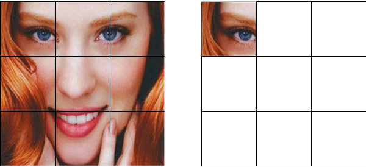

Hình 8.16 Phát hiện khuôn mặt từ các bộ phận

Giờ xem bản đồ đặc trưng $M$ kích thước 5×5, bên trong có một hình vuông xanh. Ta chia hình vuông đều thành 3×3 vùng. Rồi tạo từ $M$ một bản đồ đặc trưng mới để phát hiện góc trên trái (TL) của hình vuông, như hình bên phải dưới đây. Chỉ ô lưới màu vàng [2,2] được kích hoạt.

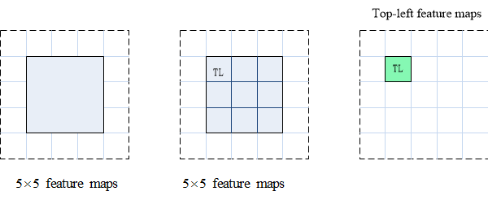

Hình 8.17 Bản đồ đặc trưng phát hiện phần trên trái của vật

Ta chia hình vuông thành 9 phần, từ đó tạo 9 bản đồ đặc trưng, mỗi bản đồ phát hiện vùng tương ứng của vật. Các bản đồ này gọi là bản đồ điểm nhạy vị trí (position-sensitive score map), vì mỗi bản đồ phát hiện (chấm điểm) một vùng con của vật.

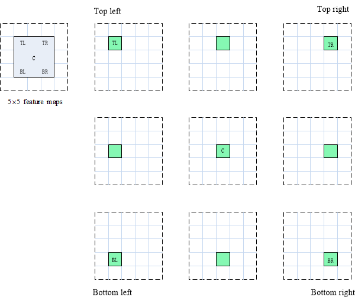

Hình 8.18 Sinh 9 bản đồ điểm

Trong hình dưới, hình chữ nhật đỏ nét đứt là RoI được đề xuất. Ta chia nó thành 3×3 vùng và hỏi mỗi vùng có xác suất bao nhiêu chứa phần tương ứng của vật, ví dụ xác suất vùng trên trái của RoI chứa mắt trái. Kết quả lưu thành mảng bỏ phiếu 3×3 (vote array), như hình bên phải. Ví dụ `vote_array[0][0]` chứa điểm cho việc vùng trên trái có chứa phần tương ứng của vật hay không.

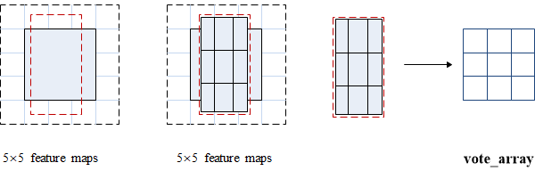

Hình 8.19 Chia RoI thành $3\times3$ vùng và lấy mảng bỏ phiếu

Áp RoI lên các bản đồ điểm, cho ra một mảng 3x3. Quá trình ánh xạ bản đồ điểm và RoI vào mảng bỏ phiếu gọi là gộp RoI nhạy vị trí (position-sensitive RoI pooling). Quá trình này rất giống RoI pooling đã nói ở trên.

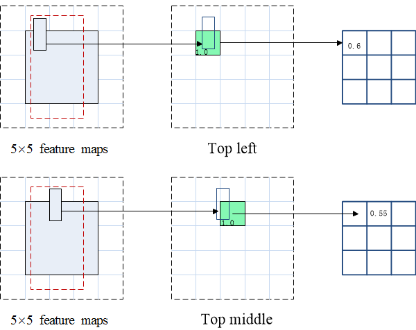

Hình 8.20 Gộp RoI nhạy vị trí

Đặt từng phần của RoI lên bản đồ điểm tương ứng để tính $V[i][j]$. Tính xong mọi giá trị của gộp RoI nhạy vị trí, điểm của lớp là trung bình điểm của mọi phần tử.

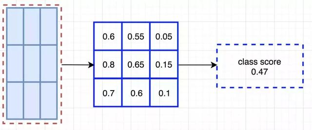

Hình 8.21 Điểm lớp là trung bình 9 giá trị bỏ phiếu

Giả sử có $C$ lớp cần phát hiện. Ta mở rộng thành $C+1$ lớp, thêm một lớp nền (không phải vật). Mỗi lớp có 3×3 bản đồ điểm, nên tổng cộng $(C+1)\times3\times3$ bản đồ điểm. Dùng bản đồ điểm của từng lớp để dự đoán điểm của lớp đó. Sau đó áp softmax lên các điểm để tính xác suất mỗi lớp. Dưới đây là sơ đồ luồng dữ liệu, với $k=3$.

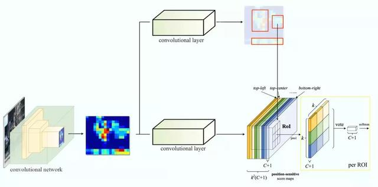

Hình 8.22 Luồng dữ liệu của R-FCN

> **Biên tập:** con số 83.6% của R-FCN là khi huấn luyện trên COCO + VOC 2007 + VOC 2012; chỉ dùng VOC 07+12 thì đạt 80.5%.

### 8.2.5 FPN

**Lý thuyết:** [d2l (tiếng Anh) · 14.5 Phát hiện đa tỉ lệ](https://d2l.ai/chapter_computer-vision/multiscale-object-detection.html) ↗ · [Ôn tập · Bổ sung: ResNet và DenseNet](qa/ch04_vi?id=bổ-sung-resnet-và-densenet)

**FPN có những điểm mới nào?**

1. Đặc trưng nhiều tầng.
2. Hợp nhất đặc trưng.

FPN (Feature Pyramid Network, Lin và cộng sự, 2017) giải quyết vấn đề đa tỉ lệ trong phát hiện đối tượng: chỉ bằng thay đổi cách nối mạng đơn giản, gần như không tăng khối lượng tính của mô hình gốc, mà tăng mạnh hiệu năng phát hiện vật nhỏ (small object).

Trong phát hiện đối tượng, với khối lượng tính có hạn, độ sâu của mạng (tương ứng vùng tiếp nhận) và sải bước thường mâu thuẫn nhau; các mạng thường dùng có sải bước khá lớn (như 32), mà vật nhỏ trong ảnh có khi còn nhỏ hơn sải bước, dẫn tới hiệu năng phát hiện vật nhỏ giảm mạnh. Các cách truyền thống giải quyết vấn đề này gồm:

1. **Kim tự tháp ảnh (image pyramid)**, tức huấn luyện và kiểm tra đa tỉ lệ. Nhưng cách này tính nhiều, tốn thời gian.
2. **Phân tầng đặc trưng**, tức mỗi tầng dự đoán kết quả phát hiện ở tỉ lệ tương ứng, như thuật toán SSD. Cách này ép các tầng khác nhau học cùng thông tin ngữ nghĩa, nhưng thực ra độ sâu khác nhau ứng với đặc trưng ngữ nghĩa ở mức khác nhau: tầng nông có độ phân giải cao, học nhiều đặc trưng chi tiết; tầng sâu có độ phân giải thấp, học nhiều đặc trưng ngữ nghĩa.

Vì vậy thách thức chính của phát hiện vật đa tỉ lệ hiện nay là:

1. Làm sao học được biểu diễn đặc trưng đa tỉ lệ có ngữ nghĩa mạnh?
2. Làm sao thiết kế biểu diễn đặc trưng chung để giải nhiều bài toán con trong phát hiện, như đề xuất vật (object proposal), định vị hộp (box localization), phân vùng thể hiện (instance segmentation)?
3. Làm sao tính biểu diễn đặc trưng đa tỉ lệ hiệu quả?

Mạng FPN sửa trực tiếp trên mạng Faster R-CNN: mỗi bản đồ đặc trưng ở một độ phân giải được cộng từng phần tử (element-wise) với bản đồ đặc trưng ở độ phân giải kế sau đã phóng to hai lần. Nhờ cách nối này, bản đồ đặc trưng dùng để dự đoán ở mỗi tầng đều hợp nhất đặc trưng từ nhiều độ phân giải, nhiều mức ngữ nghĩa khác nhau; các bản đồ đặc trưng đã hợp nhất ở mỗi độ phân giải phát hiện vật có kích thước tương ứng. Như vậy bảo đảm mỗi tầng đều có độ phân giải phù hợp và đặc trưng ngữ nghĩa mạnh (rich semantic). Đồng thời, vì cách này chỉ thêm các kết nối giữa tầng trên mạng gốc, trong ứng dụng thực tế gần như không tăng thời gian và khối lượng tính. Tác giả thử áp dụng FPN vào Faster R-CNN, đạt độ chính xác mô hình đơn tốt nhất (state-of-the-art) trên COCO. Với RPN, FPN tăng recall trung bình (average recall, AR) thêm 8.0 điểm; với bước phát hiện đối tượng sau đó, trên COCO, FPN tăng AP (average precision) thêm 2.3 điểm, và AP theo kiểu PASCAL (AP50) thêm 3.8 điểm.

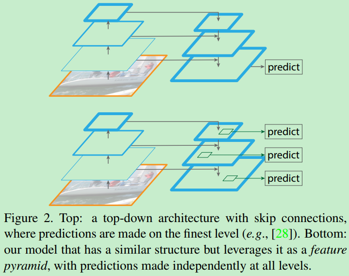

Hình 8.23 Trên: kiến trúc từ trên xuống có kết nối tắt, chỉ dự đoán ở tầng mịn nhất; dưới: FPN, dự đoán độc lập ở mọi tầng.

Thuật toán FPN gồm ba mô-đun chính:

1. Bottom-up pathway (đường từ dưới lên)
2. Lateral connections (kết nối ngang)
3. Top-down pathway (đường từ trên xuống)

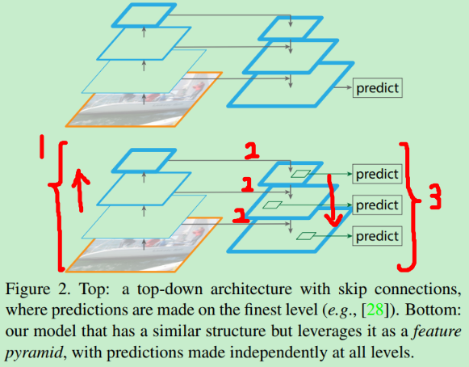

Hình 8.24 Ba mô-đun của FPN: (1) từ dưới lên, (2) kết nối ngang, (3) từ trên xuống

**Đường từ dưới lên (bottom-up pathway)**

FPN cải tiến từ Faster R-CNN với mạng xương sống ResNet, chủ yếu áp dụng trong hai mô-đun của Faster R-CNN: RPN (sinh hộp đề xuất) và Fast R-CNN (phát hiện đối tượng).

Trong đó RPN và Fast R-CNN lần lượt quan tâm tới recall và precision, ở đây chỉ số so sánh lần lượt là Average Recall (AR) và Average Precision (AP).

Ghi chú: bottom-up là từ dưới lên, top-down là từ trên xuống. "Dưới" là mức thấp (low-level), "trên" là mức cao (high-level), lần lượt ứng với đặc trưng mức thấp (tầng nông) và đặc trưng ngữ nghĩa mức cao (tầng sâu).

Đường từ dưới lên là quá trình lan truyền xuôi của mạng tích chập. Trong lan truyền xuôi, kích thước bản đồ đặc trưng có thể thay đổi ở một số tầng. Một số tầng có hệ số tỉ lệ (scale) bằng 2, nên bản đồ đặc trưng tầng sau bằng một nửa tầng trước, từ quan hệ này tạo thành kim tự tháp đặc trưng (feature pyramid, hierarchy).

Còn nhiều tầng cho bản đồ đặc trưng cùng kích thước (tích chập không co giãn); tác giả xếp các tầng này vào cùng một giai đoạn (stage). Với kim tự tháp đặc trưng, tác giả định nghĩa mỗi giai đoạn là một mức kim tự tháp (pyramid level).

Tác giả lấy đầu ra của tầng cuối mỗi giai đoạn làm bản đồ đặc trưng, làm vậy cho mọi giai đoạn là tạo thành kim tự tháp đặc trưng.

Cụ thể, với ResNet-101, tác giả dùng đầu ra kích hoạt của khối phần dư cuối mỗi giai đoạn. Ký hiệu đầu ra các khối này là $\{C_2, C_3, C_4, C_5\}$, ứng với đầu ra của conv2, conv3, conv4 và conv5, và chú ý sải bước của chúng so với ảnh đầu vào là $\{4, 8, 16, 32\}$ điểm ảnh. Vì bộ nhớ, conv1 không được đưa vào kim tự tháp.

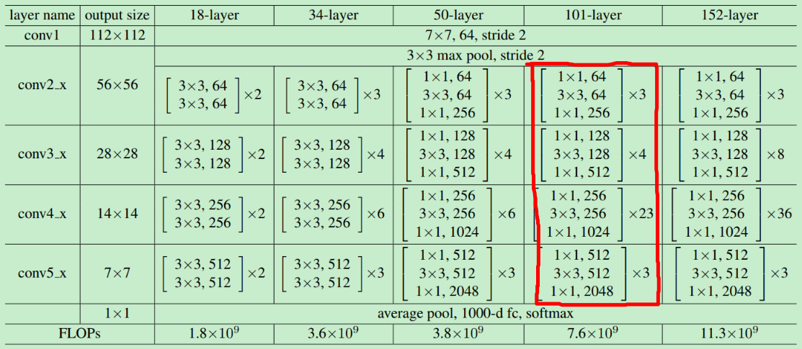

Hình 8.25 Các giai đoạn conv2_x đến conv5_x của ResNet

**Đường từ trên xuống và kết nối ngang**

Đường từ trên xuống (top-down pathway) là quá trình tăng mẫu (upsampling). Còn kết nối ngang (lateral connection) hợp nhất (merge) kết quả tăng mẫu với bản đồ đặc trưng cùng kích thước sinh ra từ đường từ dưới lên.

Ghi chú: hệ số tăng mẫu là 2, để khớp với hệ số giảm mẫu bằng 2 của tích chập trước đó. Tăng mẫu là phóng to, giảm mẫu là thu nhỏ.

Thao tác cụ thể như hình dưới: bản đồ đặc trưng đã tăng mẫu (2x up) được cộng từng điểm (element-wise addition) với bản đồ đặc trưng cùng kích thước của đường từ dưới lên; trong đó đặc trưng từ dưới lên phải qua một tầng tích chập 1x1 trước, để giảm số kênh (reduce channel dimensions).

Ghi chú: giảm số kênh để số kênh của bản đồ đặc trưng từ dưới lên khớp với của bản đồ đặc trưng từ trên xuống; lại vì hai bản đồ cùng kích thước nên cộng được từng vị trí tương ứng.

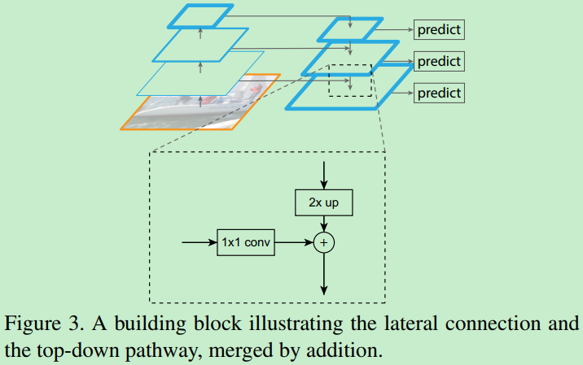

Hình 8.26 Khối kết nối ngang và đường từ trên xuống, hợp nhất bằng phép cộng

> **Biên tập:** (1) bản gốc nói FPN "tăng 3.8 điểm AP trên tập VOC"; bài báo FPN chỉ thí nghiệm trên COCO, con số 3.8 là AP theo kiểu PASCAL (AP50) đo trên COCO. (2) Bản gốc nói mạng xương sống là ResNet-101; bài báo dùng cả ResNet-50 và ResNet-101.

### 8.2.6 Mask R-CNN

**Lý thuyết:** [d2l (tiếng Anh) · 14.8 Các mạng R-CNN](https://d2l.ai/chapter_computer-vision/rcnn.html) ↗ · [d2l (tiếng Anh) · 14.11 Mạng tích chập hoàn toàn](https://d2l.ai/chapter_computer-vision/fcn.html) ↗

**Mask R-CNN có những điểm mới nào?**

1. Mạng xương sống: ResNeXt-101 + FPN.
2. Thay RoI Pooling bằng RoI Align.

Mask R-CNN (He và cộng sự, 2017) là thuật toán phân vùng thể hiện (instance segmentation), về cơ bản là phân vùng thêm trên nền phát hiện đối tượng. Mask R-CNN về cơ bản là Faster R-CNN + FCN, cụ thể hơn là ResNeXt + RPN + RoI Align + Fast R-CNN + FCN.

Hình 8.27 Khung Mask R-CNN

**Các bước của Mask R-CNN**

1. Đưa vào ảnh cần xử lý và làm tiền xử lý tương ứng (hoặc ảnh đã tiền xử lý);
2. Đưa vào mạng neuron đã huấn luyện sẵn (ResNeXt…) để có bản đồ đặc trưng;
3. Đặt một số hộp neo tại mỗi điểm của bản đồ đặc trưng, được nhiều RoI ứng viên;
4. Đưa các RoI ứng viên vào mạng RPN để phân loại nhị phân (tiền cảnh hay nền) và hồi quy hộp (BB), lọc bớt một phần RoI ứng viên;
5. Làm RoI Align trên các RoI còn lại (tức trước hết khớp điểm ảnh của ảnh gốc với bản đồ đặc trưng, rồi khớp bản đồ đặc trưng với đặc trưng kích thước cố định);
6. Phân loại các RoI này (phân loại $N$ lớp), hồi quy hộp và sinh mặt nạ (MASK, chạy một FCN trong mỗi RoI).

**RoI Pooling và RoI Align khác nhau thế nào?**

RoI Align là cách tổng hợp đặc trưng vùng được đề xuất trong Mask R-CNN, giải quyết tốt vấn đề lệch vùng (mis-alignment) do hai lần lượng tử hóa trong RoI Pooling. Thực nghiệm cho thấy trong bài toán phát hiện, thay RoI Pooling bằng RoI Align cũng tăng độ chính xác của mô hình.

Trong các khung phát hiện hai giai đoạn thường gặp (như Fast R-CNN, Faster R-CNN, R-FCN), RoI Pooling có tác dụng dựa vào tọa độ của khung đề xuất để gộp vùng tương ứng trên bản đồ đặc trưng thành bản đồ đặc trưng kích thước cố định, cho các bước phân loại và hồi quy hộp sau đó. Vì vị trí của khung đề xuất thường do mô hình hồi quy ra, nói chung là số thực, mà bản đồ đặc trưng sau gộp lại yêu cầu kích thước cố định, nên RoI Pooling có hai lần lượng tử hóa:

- lượng tử hóa biên của khung đề xuất thành tọa độ nguyên;
- chia đều vùng đã lượng tử hóa thành $k\times k$ ô (bin), rồi lượng tử hóa biên của từng ô.

Thực ra qua hai lần lượng tử hóa đó, khung đề xuất đã lệch một đoạn so với vị trí hồi quy ban đầu; độ lệch này ảnh hưởng tới độ chính xác của phát hiện hay phân vùng. Bài báo gọi đó là "vấn đề lệch (misalignment)".

Dùng một ví dụ trực quan phân tích cụ thể vấn đề lệch vùng trên. Như hình dưới, đây là một khung phát hiện Faster R-CNN. Đưa vào ảnh $800\times 800$, trên ảnh có một hộp bao $665\times 665$ (bao một con chó). Sau khi mạng xương sống trích đặc trưng, sải bước của bản đồ đặc trưng là 32. Vì vậy cạnh của ảnh và của hộp bao đều bằng 1/32 lúc đầu. 800 chia hết cho 32 thành 25. Nhưng 665 chia 32 được 20.78, có phần thập phân, nên RoI Pooling lượng tử hóa thẳng thành 20. Tiếp theo cần gộp đặc trưng trong hộp về kích thước $7\times 7$, nên chia đều hộp trên thành $7\times 7$ ô chữ nhật. Rõ ràng mỗi ô có cạnh $20/7 \approx 2.86$, lại có phần thập phân, nên RoI Pooling lượng tử hóa lần nữa thành 2. Qua hai lần lượng tử hóa, vùng ứng viên đã lệch khá rõ (phần màu xanh lá trong hình). Quan trọng hơn, độ lệch 0.1 điểm ảnh trên bản đồ đặc trưng này, phóng về ảnh gốc là 3.2 điểm ảnh. Vậy độ lệch 0.78 ở lần lượng tử hóa đầu đã là khoảng 25 điểm ảnh trên ảnh gốc, chênh lệch không nhỏ.

Hình 8.28 Hai lần lượng tử hóa của RoI Pooling: $665/32 = 20.78 \to 20$, $20/7 = 2.86 \to 2$

Để khắc phục nhược điểm trên của RoI Pooling, tác giả đề xuất cách cải tiến RoI Align (hình dưới).

Hình 8.29 RoI Align giữ tọa độ số thực, không lượng tử hóa

Ý tưởng của RoI Align rất đơn giản: bỏ lượng tử hóa, dùng nội suy song tuyến tính (bilinear interpolation) để lấy giá trị ảnh tại các điểm có tọa độ số thực, nhờ đó biến cả quá trình tổng hợp đặc trưng thành một phép toán liên tục. Đáng chú ý, khi thực hiện cụ thể, RoI Align không chỉ đơn giản bổ sung các điểm tọa độ trên biên vùng ứng viên rồi gộp, mà thiết kế lại một quy trình khá thanh lịch, như hình dưới:

1. Duyệt từng vùng ứng viên, giữ biên số thực, không lượng tử hóa.
2. Chia vùng ứng viên thành $k\times k$ ô, biên mỗi ô cũng không lượng tử hóa.
3. Trong mỗi ô tính bốn vị trí tọa độ cố định, dùng nội suy song tuyến tính tính giá trị ở bốn vị trí đó, rồi gộp cực đại (hoặc trung bình).

Giải thích thêm về bước 3: vị trí cố định là các vị trí xác định theo quy tắc cố định trong mỗi ô chữ nhật (bin). Ví dụ nếu số điểm lấy mẫu là 1 thì là tâm của ô. Nếu số điểm lấy mẫu là 4 thì là tâm của bốn ô vuông nhỏ khi chia đều ô đó làm bốn. Rõ ràng tọa độ các điểm lấy mẫu thường là số thực, nên phải dùng nội suy để có giá trị. Trong thí nghiệm, tác giả thấy đặt số điểm lấy mẫu là 4 cho hiệu năng tốt nhất, đặt bằng 1 thì hiệu năng cũng gần như vậy. Thực ra số điểm lấy mẫu của RoI Align không nhiều bằng số điểm RoI Pooling duyệt, nhưng lại cho hiệu năng tốt hơn, chủ yếu nhờ giải quyết vấn đề lệch. Đáng nói thêm, theo kinh nghiệm của người viết bản gốc, RoI Align tăng hiệu quả trên VOC 2007 không rõ bằng trên COCO. Phân tích thì nguyên nhân là COCO có nhiều vật nhỏ hơn, mà vật nhỏ chịu ảnh hưởng của lệch vùng nhiều hơn (ví dụ cùng lệch 0.5 điểm ảnh, với vật lớn thì không đáng kể, nhưng với vật nhỏ thì sai số ảnh hưởng lớn hơn nhiều).

Hình 8.30 RoI Align: nội suy song tuyến tính tại các điểm lấy mẫu trong mỗi ô

> **Biên tập:** bản gốc nói độ lệch 0.8 trên bản đồ đặc trưng là "gần 30 điểm ảnh" trên ảnh gốc; tính đúng là $0.78\times32 \approx 25$ điểm ảnh ($20.78 - 20 = 0.78$). Bước 3 của bản gốc ghi "đặt một số RoI định trước" — đúng là đặt hộp neo; các RoI là đầu ra của RPN.

### 8.2.7 DetNet

**Lý thuyết:** [Ôn tập · 14.4.5 Huấn luyện từ đầu (train from scratch) trong phát hiện đối tượng thế nào?](qa/ch14_vi?id=_1445-huấn-luyện-từ-đầu-train-from-scratch-trong-phát-hiện-đối-tượng-thế-nào) · [Ôn tập · 5.4 Có những loại kernel tích chập nào?](qa/ch05_vi?id=_54-có-những-loại-kernel-tích-chập-nào)

> Phần này do Minh Kỳ (明奇, Đại học Công nghệ Bắc Kinh) đóng góp cho bản gốc.

DetNet (Li và cộng sự, ECCV 2018) xuất phát từ nhận xét: các mạng xương sống dùng cho phát hiện đều được dẫn ra từ bài toán phân loại, nên tác giả muốn nghiên cứu một mạng xương sống chuyên cho phát hiện, và thiết kế DetNet; ý tưởng khá mới.

**1. Giới thiệu**

Nhiều mạng xương sống được đề xuất để thi phân loại ImageNet rồi mới đem sang phát hiện; rất ít mạng xương sống được <u>thiết kế riêng cho phát hiện</u>.

**Phát hiện khác phân loại rõ rệt:** (1) không chỉ phân loại mà còn phải định vị chính xác; (2) các bộ phát hiện gần đây đều dựa trên cấu trúc kiểu FPN, thêm đặc trưng đa tỉ lệ vào mạng phân loại để phát hiện vật có kích thước thay đổi. Hai điểm này bổ trợ nhau, cùng giúp mạng chuyển từ phân loại sang phát hiện. Ví dụ phân loại là một khâu của phát hiện nên không thể thiếu, nhưng đặc trưng mức cao nhất mà phân loại truyền thống dùng lại không đủ chi tiết để định vị, nên nhiều mạng gần đây dùng cấu trúc kiểu FPN để xử lý thay đổi kích thước, chuyển khá tốt từ phân loại sang phát hiện.

**2. DetNet**

**2.1 Động cơ**

Điểm mấu chốt là **độ phân giải**: giải thích tầm quan trọng của việc giữ độ phân giải với cả vật lớn và vật nhỏ. Vì vậy DetNet cũng bắt đầu từ việc giữ độ phân giải để giải bài toán nhận dạng vật đa tỉ lệ.

- **Vật lớn khó nhìn rõ (weak visibility of large objects):** ở các tầng sâu như P6 (FPN), P7 (RetinaNet), biên của vật lớn không rõ, khó định vị chính xác.
- **Vật nhỏ không nhìn thấy (invisibility of small objects):** vật nhỏ rất dễ mất khi giảm mẫu. Chỉ cần tránh giảm mẫu là không mất vật, nhưng làm vậy lại khiến khả năng trừu tượng hóa không đủ.

**2.2 Thiết kế DetNet**

Giữ độ phân giải có hai vấn đề phiền: (1) tốn bộ nhớ, tính nhiều; (2) giảm mẫu ít đi làm đặc trưng trừu tượng ở tầng cao không đủ cho phân loại. Thiết kế dưới đây cân nhắc cả thời gian lẫn thông tin trừu tượng mức cao.

Kích thước các giai đoạn đa tỉ lệ của DetNet như hình dưới; có thể thấy so với hai cách kia, DetNet không giảm mẫu thêm sau P4, giữ nguyên độ phân giải.

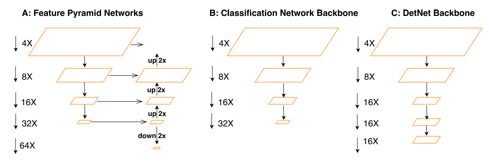

Hình 8.31 A: FPN; B: mạng xương sống phân loại; C: DetNet (giữ sải bước 16 từ giai đoạn 4 trở đi)

Chi tiết cài đặt như hình dưới:

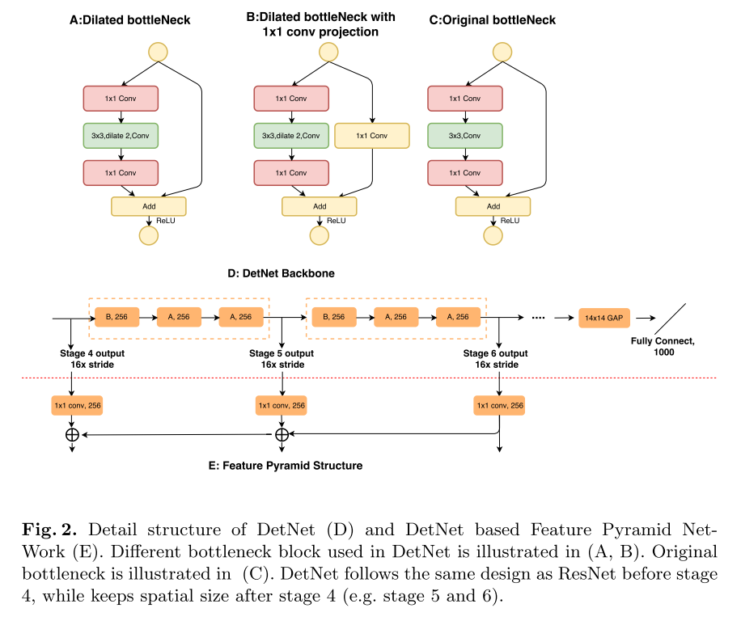

Hình 8.32 Khối bottleneck của DetNet (A, B: có tích chập giãn; C: bottleneck gốc) và cấu trúc DetNet

- Mạng xương sống là ResNet-50, cải tiến thành DetNet-59.
- Cải tiến khối bottleneck: ngoài khối C truyền thống còn có hai khối A, B dùng tích chập giãn thay tích chập thường (khối B có thêm phép chiếu $1\times1$ ở nhánh tắt). A, B là các khối cơ bản mới.
- Để giảm chi phí thời gian và bộ nhớ do giữ độ phân giải, số kênh cố định là 256 (đáng suy nghĩ: giảm mẫu và tích chập giãn đều có thể làm mất thông tin).
- DetNet cũng có thể ghép thêm cấu trúc FPN theo cách tương tự.

**3. Thực nghiệm**

Không đi vào chi tiết cấu hình huấn luyện và kiểm tra.

**3.1 Kết quả chính**

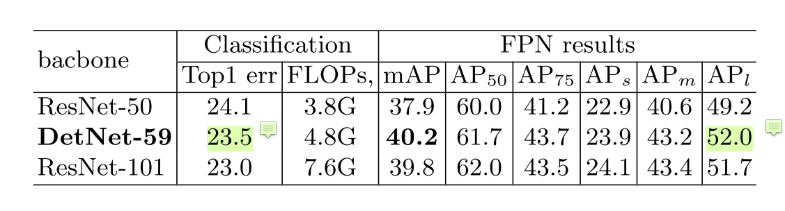

Hình 8.33 So sánh mạng xương sống: ResNet-50, DetNet-59, ResNet-101 (phân loại ImageNet và phát hiện với FPN)

- Trên nền FPN, vật lớn tăng điểm rõ rệt, đồng thời nhờ độ phân giải cao, vật nhỏ cũng tăng khá.
- Vùng tiếp nhận lớn nhờ tích chập giãn giúp phân loại cũng không kém.

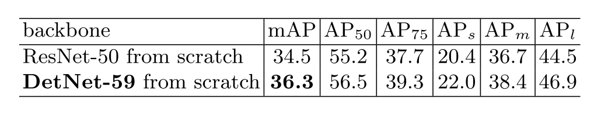

Hình 8.34 Huấn luyện từ đầu: DetNet-59 vẫn hơn ResNet-50

**3.2 Phân tích kết quả**

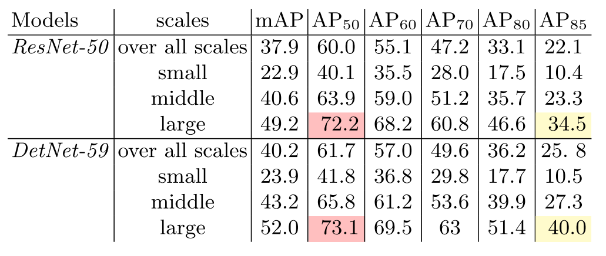

Hình 8.35 AP ở các ngưỡng IoU, theo kích thước vật

- Ở AP50 cao hơn 1.7; ở AP85 cao hơn 3.7. Có thể thấy hiệu năng phát hiện thực sự tăng, nhất là ở ngưỡng IoU cao (định vị chính xác).
- Về định vị, vật lớn tăng nhiều hơn vật nhỏ. Tác giả cho rằng độ phân giải cao đã giải quyết vấn đề biên vật lớn mờ. Một cách giải thích khác: vật nhỏ tăng ít hơn vì tích chập giãn và giảm mẫu đều có thể làm mất vật nhỏ; tích chập giãn lấy mẫu rời rạc nên không mất hẳn như giảm mẫu, nhưng cũng chưa giải quyết tận gốc.

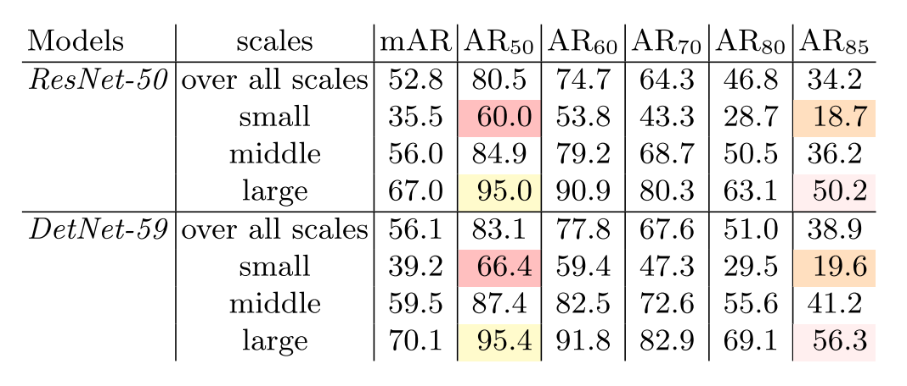

Hình 8.36 AR ở các ngưỡng IoU, theo kích thước vật

- Chỉ số AR cũng cho kết luận tương tự.
- AR50 cho thấy recall của vật nhỏ tốt hơn, khớp với phân tích ở trên: so với giảm mẫu, tích chập giãn mất ít thông tin hơn. Vật lớn tuy tăng không nhiều nhưng đã rất cao; tác giả cho rằng DetNet giỏi tìm vị trí vật chính xác hơn, thấy ở chỉ số AR85 cao.
- AR85 cho thấy vật lớn ít bị bỏ sót, nghĩa là DetNet tốt với vật lớn như VGG. Còn với vật nhỏ, kết quả chỉ bình thường; tác giả cho rằng không cần quá cao vì cấu trúc FPN đã tận dụng rất tốt cho vật nhỏ.

**3.3 Thảo luận**

- **Về giai đoạn (stage):** để nghiên cứu ảnh hưởng của mạng xương sống tới phát hiện, trước hết xem vai trò của các giai đoạn. Bốn giai đoạn đầu giống ResNet, nhưng P5, P6 thì khác: không thay đổi kích thước, khác với giai đoạn theo nghĩa truyền thống, nên cần định nghĩa lại. DetNet theo cách tương tự ResNet: dù không đổi kích thước nhưng vẫn giữ vị trí của khối A, B, khối B mở đầu một giai đoạn mới (cách định nghĩa này hơi gượng). Như hình dưới, phần mới thêm vẫn được coi là thuộc P5.

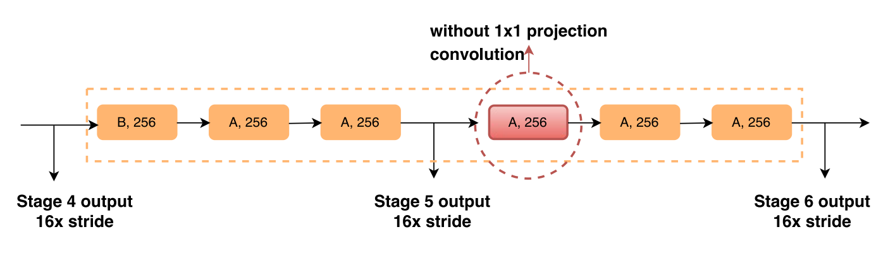

Hình 8.37 Giai đoạn 4–6 của DetNet; khối B (đỏ) có phép chiếu $1\times1$

Tác giả kiểm chứng bằng thí nghiệm: thay các khối từ P6 trở đi bằng khối A như hình trên rồi so kết quả như hình dưới. Thấy rằng thêm khối B vẫn tốt hơn. (Nhưng "giai đoạn" ở đây rất khác nghĩa truyền thống, nên nhiều tính chất không so sánh được; chỉ thay đổi khối B cũng khó kết luận gì.)

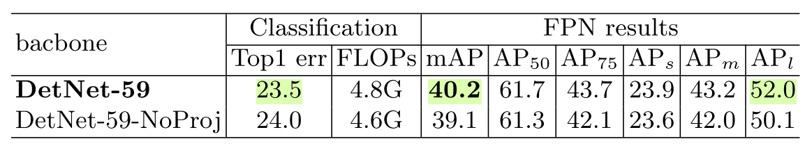

Hình 8.38 DetNet-59 so với DetNet-59 không có phép chiếu $1\times1$ (NoProj)

> **Biên tập:** bản gốc ghi "ở AP80 cao hơn 3.7"; theo bảng của bài báo (Hình 8.35), AP80 tăng 3.1 (33.1 → 36.2), con số 3.7 là ở AP85 (22.1 → 25.8). Đã sửa.

### 8.2.8 CBNet

**Lý thuyết:** [Ôn tập · Bổ sung: ResNet và DenseNet](qa/ch04_vi?id=bổ-sung-resnet-và-densenet) · [d2l (tiếng Anh) · 14.5 Phát hiện đa tỉ lệ](https://d2l.ai/chapter_computer-vision/multiscale-object-detection.html) ↗

Phần này giới thiệu một mạng đạt hiệu năng mô hình đơn cao nhất trên COCO thời đó, mAP 53.3; bài báo đăng trên arXiv ngày 3/9/2019, tên đầy đủ là *CBNet: A Novel Composite Backbone Network Architecture for Object Detection* (Liu và cộng sự).

> **Biên tập:** các hình của mục này (CBNet-1 tới CBNet-8) không có trong repo gốc nên không hiển thị được; bản dịch giữ lời mô tả và bỏ chỗ đặt hình.

**1. Giới thiệu**

Trên danh nghĩa là mô hình đơn, thực chất là hợp nhất đặc trưng của nhiều mô hình, chỉ hơi khác chiến lược đa mô hình thật sự. Điểm xuất phát của tác giả: thiết kế mô hình mới thường phải huấn luyện trước trên ImageNet, khá phiền. Vì vậy đề xuất Composite Backbone Network (CBNet), dựng mạng bằng cách ghép nhiều bản của mạng kinh điển; một mặt trích được đặc trưng hiệu quả hơn, mặt khác dùng thẳng được tham số huấn luyện sẵn (như ResNet, ResNeXt…), đơn giản và hiệu quả.

**2. Phương pháp**

**2.1 Kiến trúc CBNet:** mô hình dùng $K$ ($K>1$) mạng xương sống cùng cấu trúc nối chặt với nhau. Hai mạng xương sống gọi là Dual-Backbone (DB), ba mạng gọi là Triple-Backbone (TB); $L$ là số giai đoạn của mạng xương sống, ở đây đặt thống nhất $L=5$. Khác với các công trình trước, đầu ra của từng giai đoạn ở mạng xương sống trước được đưa (qua kết nối hợp thành) vào giai đoạn tương ứng của mạng xương sống sau để tái sử dụng, nhằm có đặc trưng tốt hơn (vì sao hiệu quả thì khó nói).

**2.2 Các cách ghép khác:** các cấu trúc tương tự trong công trình liên quan đều na ná: hoặc đưa giai đoạn của mạng trước ra sau, hoặc đưa về giai đoạn trước một bậc, mỗi kiểu một bài báo với cách giải thích riêng; kiểu thứ tư khác hẳn, giống DenseNet, nhưng kết nối dày đặc cộng nhiều mạng xương sống chắc chắn rất tốn bộ nhớ. Nhìn rộng ra, cấu trúc nhiều mạng xương sống giống ghép nhiều mô hình (ensemble), so với mô hình đơn có phần không công bằng.

**3. Thực nghiệm**

- **Kết quả:** trên COCO có tăng điểm. Nhưng cũng thấy xu hướng chung là ghép ba tầng tăng không bằng ghép hai, cho thấy không gian cải thiện đặc trưng của phần này có hạn; phần nào thực sự tạo ra hiệu quả thì khó nói. Nghiên cứu theo số mạng xương sống càng cho thấy điều này: độ dốc giảm dần.
- **So sánh các cách ghép:** so với các mạng ghép khác, tác giả chỉ lập luận ở mức sử dụng đặc trưng, mà điều này vốn khó định nghĩa thế nào là dùng tốt. Nếu phải giải thích, đại khái là đưa đặc trưng ngữ nghĩa mức cao ở cuối mạng xương sống về phía trước để tăng cường, giống một kiểu lan truyền FPN theo chiều ngang.
- **Số mạng xương sống:** chậm là tất yếu: FPN + ResNeXt chạy 8 fps, thêm thành hai mạng xương sống còn 5.5 fps; nếu bỏ hai giai đoạn đầu của mạng xương sống ghép thêm thì tiết kiệm được một phần tham số, đạt 6.9 fps mà độ chính xác giảm không nhiều (nhưng tốc độ tổng thể đã quá thấp nên thí nghiệm này ít ý nghĩa).
- **Chia sẻ trọng số:** chia sẻ trọng số hay không khác biệt không lớn, giảm chưa tới một điểm, đổi lại số tham số giảm.
- **Hiệu quả tăng cường đặc trưng:** bản đồ kích hoạt cho thấy phản hồi tốt hơn, tức trích được đặc trưng hiệu quả hơn, nhạy hơn với vật.

## 8.3 Các thuật toán phát hiện một giai đoạn

**Lý thuyết:** [d2l (tiếng Anh) · 14.7 SSD](https://d2l.ai/chapter_computer-vision/ssd.html) ↗

Phần này tổng quan các bộ phát hiện một lần nhìn (single-shot, gồm họ SSD và họ YOLO). Ta sẽ phân tích FPN để hiểu bản đồ đặc trưng đa tỉ lệ tăng độ chính xác thế nào, nhất là với vật nhỏ, vốn thường bị bộ phát hiện một giai đoạn phát hiện kém. Sau đó phân tích Focal loss và RetinaNet, xem chúng giải quyết mất cân bằng lớp khi huấn luyện ra sao.

### 8.3.1 SSD

**Lý thuyết:** [d2l (tiếng Anh) · 14.7 SSD](https://d2l.ai/chapter_computer-vision/ssd.html) ↗ · [d2l (tiếng Anh) · 14.4 Hộp neo](https://d2l.ai/chapter_computer-vision/anchor.html) ↗

**SSD có những điểm mới nào?**

1. Dựa trên hộp neo của Faster R-CNN, đề xuất hộp tiên nghiệm (prior box) tương tự.
2. Dự đoán ở nhiều tỉ lệ từ các bản đồ đặc trưng có tỉ lệ khác nhau (đặc trưng đa tỉ lệ), và tách rõ dự đoán theo tỉ lệ khung hình.

Khác với họ R-CNN ở trên, SSD (Liu và cộng sự, 2016) là phương pháp một giai đoạn. SSD dùng mạng VGG16 để trích đặc trưng (giống CNN dùng trong Faster R-CNN), thay các tầng kết nối đầy đủ phía sau bằng tầng tích chập, thêm các tầng tích chập tự thiết kế, và cuối cùng phát hiện trực tiếp bằng tích chập. Đặt hộp tiên nghiệm với tỉ lệ và tỉ lệ khung hình khác nhau trên nhiều bản đồ đặc trưng để phát hiện bằng bản đồ đặc trưng đa tỉ lệ: các bản đồ đặc trưng lớn ở phía trước bắt được thông tin vật nhỏ, các bản đồ đặc trưng nhỏ ở phía sau bắt được vật lớn, nhờ đó tăng độ chính xác phát hiện và định vị. Hình dưới là cấu trúc mạng SSD.

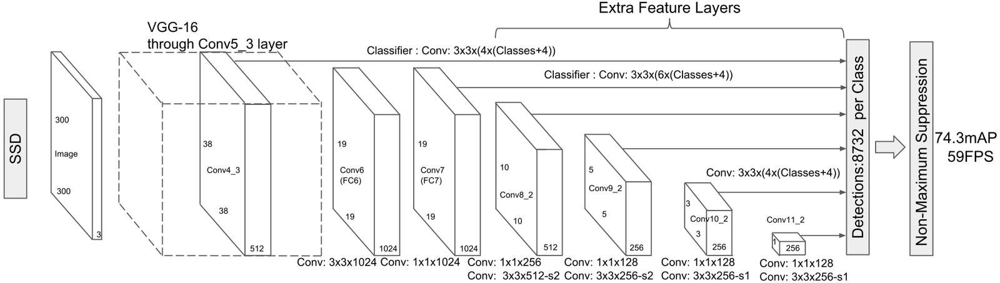

Hình 8.39 Cấu trúc SSD300: VGG-16 tới conv5_3, các tầng đặc trưng bổ sung, 8732 dự đoán mỗi lớp, rồi NMS (74.3 mAP, 59 FPS)

**1. Đặt default box thế nào?**

Khái niệm default box của SSD hơi giống anchor của Faster R-CNN. Khác Faster R-CNN chỉ đặt anchor trên tầng đặc trưng cuối, SSD đặt default box trên nhiều tầng đặc trưng, được default box ở nhiều tỉ lệ. Trên mỗi ô của bản đồ đặc trưng đặt các default box với tỉ lệ khung hình khác nhau, thường chọn trong $\{1, 2, 3, 1/2, 1/3\}$, đôi khi thêm một box tỉ lệ khung hình 1 nhưng kích thước đặc biệt. Như hình dưới, mỗi ô của bản đồ đặc trưng 8x8 và 4x4 đặt 4 default box khác nhau. Bài báo gốc với đầu vào 300x300 đặt 4, 6, 6, 6, 4, 4 default box trên mỗi ô của các bản đồ đặc trưng conv4_3, conv7, conv8_2, conv9_2, conv10_2, conv11_2. Các bản đồ này có kích thước 38x38, 19x19, 10x10, 5x5, 3x3, 1x1, nên tổng cộng có $38\times38\times4+19\times19\times6+10\times10\times6+5\times5\times6+3\times3\times4+1\times1\times4=8732$ default box. Đưa một ảnh 300x300 vào mạng sẽ dự đoán 8732 hộp bao cho 8732 default box này.

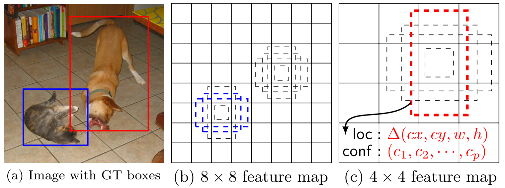

Hình 8.40 (a) Ảnh với hộp thật; (b) bản đồ đặc trưng $8\times8$; (c) bản đồ đặc trưng $4\times4$, mỗi default box dự đoán độ lệch vị trí và điểm của mọi lớp.

**2. Ghép hộp tiên nghiệm thế nào?**

Khi huấn luyện, SSD chỉ cần ảnh và hộp thật (ground truth) của mỗi đối tượng. Ghép hộp tiên nghiệm với hộp thật theo hai nguyên tắc:

1. Với mỗi hộp thật trong ảnh, tìm hộp tiên nghiệm có IoU lớn nhất với nó; hộp dự đoán của hộp tiên nghiệm đó được ghép với hộp thật.
2. Với mỗi hộp tiên nghiệm còn lại chưa ghép với hộp thật nào ở bước 1, tìm hộp thật có IoU lớn nhất với nó; nếu IoU lớn hơn một ngưỡng (thường 0.5) thì ghép.

Ghép theo hai nguyên tắc này, hộp dự đoán của hộp tiên nghiệm được ghép là mẫu dương, chưa được ghép là mẫu âm. Dù một hộp thật có thể ghép với nhiều hộp tiên nghiệm, số hộp thật vẫn rất ít so với số hộp tiên nghiệm, nên ghép như trên vẫn cho mẫu âm nhiều hơn hẳn mẫu dương. Để cân bằng (thường giữ tỉ lệ dương:âm khoảng 1:3), SSD dùng khai phá mẫu âm khó (hard negative mining): sắp các mẫu âm theo mất mát phân loại giảm dần (tức theo điểm tin cậy của lớp nền tăng dần), lấy top-k mẫu âm có điểm nền thấp nhất (khó nhất) làm mẫu âm huấn luyện.

**3. Có kết quả phát hiện thế nào?**

Cuối cùng, trên mỗi tầng đặc trưng đã chọn, dùng kernel 3x3 dự đoán điểm của các lớp và vị trí hộp cho từng default box. Mỗi box cần dự đoán độ tin cậy cho từng lớp (giả sử có $c$ lớp tính cả nền, ví dụ tập 20 lớp thì $c=21$) và vị trí hộp dự đoán (4 giá trị: tọa độ tâm và chiều rộng, cao), nên mỗi box cần dự đoán $c+4$ giá trị. Vì vậy với một tầng đặc trưng đã chọn, số kernel của tầng đó là $(c+4)\times$ số default box của tầng. Cuối cùng ghép nối kết quả tích chập của mọi tầng. Với mỗi hộp dự đoán, lấy độ tin cậy lớp lớn nhất; nếu lớn hơn ngưỡng tin cậy thì lớp tương ứng là lớp của hộp, nếu không thì loại hộp. Các hộp giữ lại được giải mã theo hộp tiên nghiệm tương ứng để có tham số vị trí thật (chú ý tránh hộp vượt ra ngoài ảnh), rồi sắp giảm dần theo độ tin cậy, lấy top-k hộp, cuối cùng làm NMS loại các hộp trùng nhau nhiều, được kết quả phát hiện.

Ưu điểm của SSD là tương đối nhanh, cả quá trình chỉ một bước: trước hết lấy mẫu dày đặc tại các vị trí khác nhau trên ảnh theo nhiều tỉ lệ và tỉ lệ khung hình, rồi dùng CNN trích đặc trưng và phân loại, hồi quy trực tiếp. Nhưng lấy mẫu dày đặc đồng đều gây mất cân bằng mẫu dương–âm, huấn luyện khó hơn, làm độ chính xác giảm phần nào. Ngoài ra SSD phát hiện vật nhỏ không tốt bằng vật lớn, vì khi mạng sâu dần, thông tin vật nhỏ bị mất ở bản đồ đặc trưng tầng cao; tăng kích thước ảnh đầu vào hợp lý có thể cải thiện phát hiện vật nhỏ.

> **Biên tập:** bản gốc mô tả khai phá mẫu âm khó là "sắp giảm dần theo độ tin cậy lớp nền, lấy top-k có độ tin cậy *nhỏ*", tự mâu thuẫn (sắp giảm dần thì top-k là các giá trị lớn); đã viết lại cho đúng: chọn các mẫu âm có điểm nền thấp nhất, tức mất mát lớn nhất.

### 8.3.2 DSSD

**Lý thuyết:** [d2l (tiếng Anh) · 14.10 Tích chập chuyển vị](https://d2l.ai/chapter_computer-vision/transposed-conv.html) ↗ · [Ôn tập · 3.6.8 Batch Normalization là gì?](qa/ch03_vi?id=_368-batch-normalization-là-gì)

**DSSD có những điểm mới nào?**

1. Mạng xương sống: thay VGG trong SSD bằng ResNet, tăng khả năng trích đặc trưng.
2. Thêm tầng giải tích chập (deconvolution), bổ sung nhiều thông tin ngữ cảnh.

Để giải quyết việc SSD khó phát hiện vật nhỏ, DSSD (Fu và cộng sự, 2017) đổi mạng cơ sở của SSD từ VGG-16 sang ResNet-101, tăng khả năng trích đặc trưng; sau đó theo ý tưởng của FPN, dùng cấu trúc giải tích chập đưa đặc trưng sâu của ảnh ra, hợp nhất với thông tin tầng nông, liên kết quan hệ ngữ nghĩa giữa các tầng, và thiết kế mô-đun dự đoán, dùng đặc trưng hợp nhất từ các tầng để dự đoán lớp vật.

DSSD có hai cấu trúc đặc biệt: mô-đun dự đoán (Prediction module) và mô-đun giải tích chập (Deconvolution module). Mô-đun dự đoán tăng độ chính xác bằng cách cải thiện từng nhiệm vụ con, và ngăn gradient chảy thẳng vào mạng chính ResNet. Mô-đun giải tích chập thêm ba tầng Batch Normalization và ba tầng tích chập 3×3, trong đó các tầng tích chập có vai trò đệm, ngăn gradient tác động quá mạnh lên mạng chính, bảo đảm mạng ổn định.

Mô hình SSD và DSSD như hình dưới:

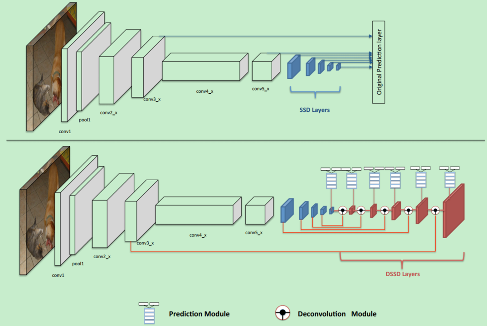

Hình 8.41 Trên: SSD; dưới: DSSD với các mô-đun dự đoán và mô-đun giải tích chập

**Mô-đun dự đoán**

SSD rút hàm dự đoán trực tiếp và riêng rẽ từ nhiều tầng tích chập, số dự đoán lên tới hơn 7000 (8732), khối lượng tính gradient cũng lớn. Phương pháp MS-CNN chỉ ra rằng cải thiện mạng con của từng nhiệm vụ giúp tăng độ chính xác. Theo ý này, DSSD thêm một mô-đun phần dư sau mỗi tầng dự đoán, và so sánh nhiều phương án, như hình dưới. Kết quả cho thấy thêm mô-đun dự đoán phần dư, độ chính xác trên ảnh độ phân giải cao tăng rõ so với SSD gốc.

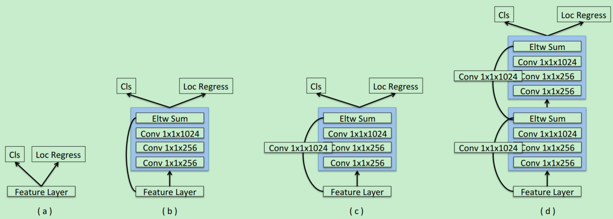

Hình 8.42 Các phương án mô-đun dự đoán: (a) SSD gốc; (b)–(d) thêm khối phần dư

**Mô-đun giải tích chập**

Để hợp nhất bản đồ đặc trưng tầng nông với thông tin của tầng giải tích chập, tác giả đưa vào mô-đun giải tích chập như hình dưới. Lấy cảm hứng từ bài *Learning to Refine Object Segments*, tác giả cho rằng cấu trúc phân rã của mô-đun giải tích chập dùng để tinh chỉnh mạng đạt độ chính xác ngang mạng phức tạp mà hiệu quả hơn. Tác giả sửa đổi vài chỗ: một, thêm tầng chuẩn hóa theo batch sau mỗi tầng tích chập; hai, dùng tầng giải tích chập có học thay cho tăng mẫu song tuyến tính đơn giản; ba, thử các cách kết hợp khác nhau: cộng từng phần tử (element-wise sum) và nhân từng phần tử (element-wise product); thực nghiệm cho thấy nhân từng phần tử cho độ chính xác tốt hơn.

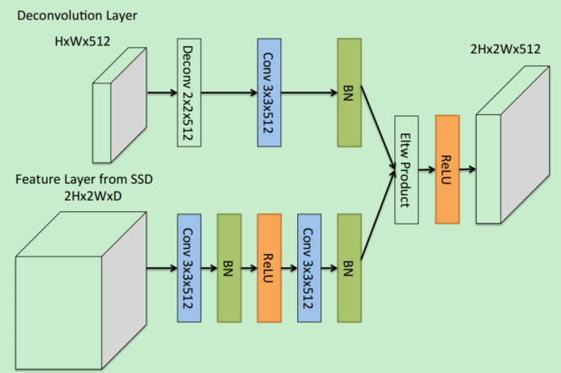

Hình 8.43 Mô-đun giải tích chập của DSSD

### 8.3.3 YOLOv1

**Lý thuyết:** [d2l (tiếng Anh) · 14.3 Phát hiện đối tượng và hộp bao](https://d2l.ai/chapter_computer-vision/bounding-box.html) ↗ · [Học máy · E.9 Hồi quy: MAE, MSE, RMSE và $R^2$](ml/eval_vi?id=e9-hồi-quy-mae-mse-rmse-và-r2r2r2)

**YOLOv1 có những điểm mới nào?**

1. Lấy cả ảnh làm đầu vào, hồi quy trực tiếp vị trí hộp bao và lớp ở tầng đầu ra.
2. Nhanh, là công trình tiên phong của phát hiện một giai đoạn.

**Giới thiệu YOLOv1**

YOLO (*You Only Look Once: Unified, Real-Time Object Detection*, Redmon và cộng sự, 2016) là công trình tiên phong của phát hiện một giai đoạn. Các phương pháp phát hiện trước đó trước hết phải sinh nhiều hộp tiên nghiệm có thể chứa vật, rồi dùng bộ phân loại phán đoán hộp tương ứng có chứa vật không và xác suất hay độ tin cậy về lớp của vật, đồng thời cần hậu xử lý sửa hộp, cuối cùng lọc các hộp có độ tin cậy thấp và trùng nhau nhiều theo một số tiêu chí để có kết quả. Cách sinh vùng đề xuất rồi mới phát hiện này dù có độ chính xác tương đối cao nhưng chạy chậm.

YOLO sáng tạo ở chỗ coi phát hiện vật trực tiếp là bài toán hồi quy (regression problem), gộp hai giai đoạn đề xuất và phát hiện làm một. Chỉ nhìn một lần là biết trong ảnh có vật gì và ở đâu. Hình dưới là sơ đồ của các hệ phát hiện vật.

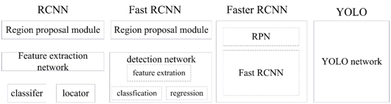

Hình 8.44 R-CNN, Fast R-CNN, Faster R-CNN và YOLO

Thực ra YOLO cũng không thực sự bỏ vùng đề xuất, mà chia thẳng ảnh đầu vào thành $7\times7=49$ ô lưới, mỗi ô dự đoán hai hộp, tổng cộng $49\times2=98$ hộp. Có thể hiểu gần đúng là chọn thô 98 vùng đề xuất trên ảnh đầu vào, phủ kín ảnh, rồi dùng hồi quy dự đoán hộp bao cho 98 vùng đó.

**1. Cấu trúc mạng thế nào?**

Mạng YOLO học theo cấu trúc mạng phân loại GoogLeNet, nhưng dùng tầng tích chập 1x1 và 3x3 thay cho mô-đun Inception. Như hình dưới, mạng phát hiện gồm 24 tầng tích chập và 2 tầng kết nối đầy đủ. Tầng tích chập trích đặc trưng ảnh, tầng kết nối đầy đủ dự đoán vị trí và xác suất lớp.

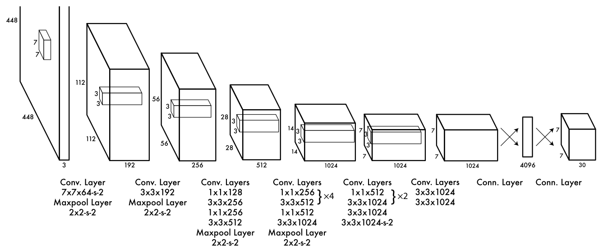

Hình 8.45 Cấu trúc mạng YOLOv1

**2. Đầu vào, đầu ra và hàm mất mát của YOLO là gì?**

Như trên, YOLO chia ảnh đầu vào thành lưới 7x7, đầu ra cuối là tensor $7\times7\times k$. Cuối mạng YOLO là hai tầng kết nối đầy đủ, mà tầng kết nối đầy đủ cần đầu vào kích thước cố định, nên YOLO cần ảnh đầu vào kích thước cố định; bài báo dùng 448x448.

YOLO chia ảnh đầu vào thành lưới 7x7, mỗi ô dự đoán 2 hộp. Nếu tâm hộp thật của một vật rơi vào ô nào, thì trong ô đó, hộp có IoU lớn nhất với hộp thật chịu trách nhiệm dự đoán vật đó. Mỗi hộp dự đoán 5 giá trị: tâm $x, y$ của hộp (so với biên của ô chứa nó), chiều rộng $w$ và cao $h$ (tỉ lệ so với chiều rộng, cao của ảnh đầu vào), và điểm tin cậy (confidence score). Mỗi ô còn dự đoán $c$ xác suất lớp có điều kiện (vector $c$ chiều: biết có vật trong ô, xác suất vật thuộc từng lớp; $c$ lớp không gồm nền). Bài báo dùng $c=20$, nên mỗi ô dự đoán $2\times5+20=30$ giá trị, gom thành một vector 30 chiều.

Để cân bằng mất mát tọa độ hộp và mất mát phân loại, hàm mất mát thiết kế như sau ($S=7$ ô mỗi chiều, $B=2$ hộp mỗi ô):

$$
\begin{aligned}
L =\ & \lambda_{coord}\sum_{i=0}^{S^2}\sum_{j=0}^{B}\mathbb 1_{ij}^{obj}\Big[(x_i-\hat x_i)^2+(y_i-\hat y_i)^2\Big]
+\lambda_{coord}\sum_{i=0}^{S^2}\sum_{j=0}^{B}\mathbb 1_{ij}^{obj}\Big[\big(\sqrt{w_i}-\sqrt{\hat w_i}\big)^2+\big(\sqrt{h_i}-\sqrt{\hat h_i}\big)^2\Big]\\
&+\sum_{i=0}^{S^2}\sum_{j=0}^{B}\mathbb 1_{ij}^{obj}\big(C_i-\hat C_i\big)^2
+\lambda_{noobj}\sum_{i=0}^{S^2}\sum_{j=0}^{B}\mathbb 1_{ij}^{noobj}\big(C_i-\hat C_i\big)^2
+\sum_{i=0}^{S^2}\mathbb 1_{i}^{obj}\sum_{c\in classes}\big(p_i(c)-\hat p_i(c)\big)^2
\end{aligned}
$$

Hàm mất mát gồm bốn phần: dự đoán tọa độ (hai số hạng đầu), độ tin cậy của hộp có vật (số hạng thứ ba), độ tin cậy của hộp không có vật (số hạng thứ tư), và dự đoán lớp (số hạng cuối). $\mathbb 1_{ij}^{obj}$ bằng 1 nếu hộp $j$ của ô $i$ chịu trách nhiệm cho một vật; $\mathbb 1_{i}^{obj}$ bằng 1 nếu có tâm vật rơi vào ô $i$.

Vì các hộp kích thước khác nhau nhạy với sai lệch khác nhau (hộp nhỏ nhạy hơn), để cân bằng, tác giả khéo léo lấy **căn bậc hai** của $w, h$ rồi mới tính mất mát L2. YOLO coi trọng dự đoán tọa độ hơn, nên gán trọng số lớn hơn cho mất mát tọa độ, ký hiệu $\lambda_{coord}$; khi huấn luyện trên PASCAL VOC, $\lambda_{coord}=5$; phần lỗi phân loại có trọng số 1.

Độ tin cậy của một hộp định nghĩa là: confidence = xác suất hộp có chứa một vật $\Pr(object)$ × IoU giữa hộp và hộp thật của vật đó; nếu hộp có vật thì $\Pr(object)=1$, ngược lại bằng 0. Vì phần lớn ô trong ảnh không có vật, độ tin cậy của các hộp trong đó được đặt về 0; các ô không có vật nhiều hơn hẳn ô có vật, đóng góp nhiều hơn vào cập nhật gradient, làm mạng mất ổn định. Để cân bằng, mất mát YOLO gán trọng số nhỏ hơn cho lỗi độ tin cậy của hộp không có vật, ký hiệu $\lambda_{noobj}$, và trọng số lớn hơn cho hộp có vật. Khi huấn luyện trên PASCAL VOC, $\lambda_{noobj}=0.5$, trọng số lỗi độ tin cậy của hộp có vật là 1.

**3. YOLO dự đoán thế nào?**

Cuối cùng YOLO dùng triệt tiêu không cực đại (NMS) để lấy ra các vật và hộp tương ứng khả năng cao nhất.

Đưa một ảnh vào mạng YOLO được tensor 7×7×30, biểu diễn hai hộp có thể có của mỗi ô, độ tin cậy của từng hộp, và xác suất vật thuộc các lớp. Từ đó tính được điểm của việc vật thuộc lớp $i$ và nằm trong hộp $j$:

$$
\mathrm{Score}_{ij} = \Pr(class_i \mid object)\times \mathrm{confidence}_j
$$

Mỗi ô có 20 xác suất lớp có điều kiện và 2 độ tin cậy hộp, tương đương 40 điểm mỗi ô; 7x7 ô có 1960 điểm, mỗi lớp có $1960/20=98$ điểm, tức 98 hộp ứng viên.

**Các bước NMS:**

1. Đặt một ngưỡng điểm (score) và một ngưỡng IoU.
2. Với mỗi lớp, xét mọi hộp ứng viên của lớp đó:
   1. loại các hộp có điểm thấp hơn ngưỡng điểm;
   2. trong các hộp còn lại, chọn hộp có điểm lớn nhất, thêm vào danh sách đầu ra và bỏ khỏi tập ứng viên;
   3. tính IoU giữa hộp vừa chọn với từng hộp còn lại; hộp nào có IoU lớn hơn ngưỡng IoU thì loại;
   4. lặp lại bước 2–3 cho tới khi không còn hộp ứng viên; danh sách đầu ra là mọi hộp dự đoán của lớp đó.
3. Quay lại bước 2 xử lý lớp tiếp theo.

YOLO gộp nhận dạng và định vị làm một, cấu trúc gọn, phát hiện nhanh; bản Fast YOLO nhanh hơn đạt 155 FPS. So với họ R-CNN, cả quy trình YOLO đều thấy toàn bộ ảnh, nên tận dụng tốt thông tin ngữ cảnh khi phát hiện, ít dự đoán nhầm vật trên nền. Đồng thời YOLO học được đặc trưng tổng quát hóa cao, chuyển được đặc trưng học ở một miền sang miền khác nhưng liên quan; ví dụ YOLO huấn luyện trên ảnh tự nhiên vẫn cho kết quả khá trên tranh vẽ.

Vì lưới của YOLO khá thưa, mỗi ô chỉ dự đoán 2 hộp, độ chính xác tổng thể chưa cao, hơi thấp hơn Fast R-CNN (63.4% so với 70.0% mAP trên VOC 2007). Nó phát hiện vật nhỏ kém, nhất là vật nhỏ dày đặc.

> **Biên tập:** (1) bản gốc nói YOLO "lấy **trung bình** $w, h$ rồi tính mất mát L2"; đúng là lấy **căn bậc hai** (xem công thức: chênh lệch tuyệt đối như nhau thì hộp nhỏ chịu mất mát lớn hơn). (2) Bước 3 của NMS trong bản gốc viết hộp có IoU dưới ngưỡng thì "thêm ngay vào danh sách đầu ra"; như vậy hai hộp không trùng hộp lớn nhất nhưng trùng nhau vẫn cùng được giữ. NMS tham lam đúng là lặp: mỗi vòng chỉ chọn hộp điểm cao nhất còn lại. (3) Công thức mất mát và công thức điểm trong bản gốc là ảnh (có chú thích chữ Trung), bản dịch gõ lại. (4) Gọi YOLO là "tiên phong" của phát hiện một giai đoạn là cách nói phổ biến, nhưng chính bản gốc cũng xếp OverFeat (2013) vào nhóm một giai đoạn.

### 8.3.4 YOLOv2

**Lý thuyết:** [d2l (tiếng Anh) · 14.4 Hộp neo](https://d2l.ai/chapter_computer-vision/anchor.html) ↗ · [Học máy · Chương 10 $K$-means clustering](ml/ch10_vi) · [Ôn tập · 3.6.8 Batch Normalization là gì?](qa/ch03_vi?id=_368-batch-normalization-là-gì)

**YOLOv2 có những điểm mới nào?**

YOLOv1 dù nhanh nhưng định vị chưa đủ chính xác, recall cũng thấp. Để tăng độ chính xác định vị và recall, YOLOv2 (Redmon và Farhadi, 2017) đưa ra một số chiến lược cải tiến trên nền YOLOv1, như hình dưới; có thể thấy một số cải tiến tăng mAP hiệu quả.

1. Huấn luyện trước phân loại ở độ phân giải lớn.
2. Mạng mới: Darknet-19.
3. Thêm anchor.

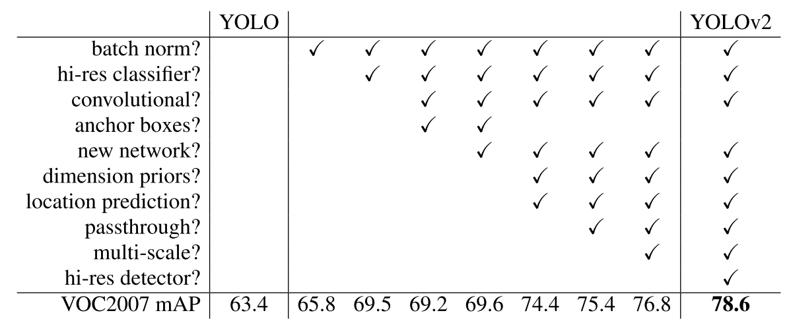

Hình 8.46 Từ YOLO tới YOLOv2: mAP trên VOC 2007 tăng từ 63.4 lên 78.6 qua từng cải tiến

**Giới thiệu YOLOv2**

**(1) Batch Normalization**

YOLOv2 thêm tầng Batch Normalization (BN) sau mỗi tầng tích chập, bỏ dropout. BN có tác dụng điều chuẩn nhất định, tăng tốc hội tụ, chống quá khớp. YOLOv2 nhờ BN tăng mAP 2%.

**(2) Bộ phân loại độ phân giải cao (High Resolution Classifier)**

Phần lớn mô hình phát hiện hiện nay dùng mô hình phân loại phổ biến (như VGG, ResNet) huấn luyện sẵn trên ImageNet để trích đặc trưng, mà các mạng này phần lớn huấn luyện với ảnh nhỏ hơn 256x256; độ phân giải thấp ảnh hưởng tới khả năng phát hiện. YOLOv2 nâng độ phân giải ảnh đầu vào lên 448x448; để mạng thích nghi với độ phân giải mới, YOLOv2 trước hết tinh chỉnh mạng trên ImageNet ở độ phân giải 448x448 trong 10 epoch. Nhờ đầu vào độ phân giải cao, mAP của YOLOv2 tăng khoảng 4%.

**(3) Tích chập với hộp neo (Convolutional With Anchor Boxes)**

YOLOv1 dùng tầng kết nối đầy đủ dự đoán trực tiếp hộp, mất nhiều thông tin không gian, định vị không chuẩn. YOLOv2 bỏ tầng kết nối đầy đủ của YOLOv1, dùng hộp neo để dự đoán hộp; đồng thời để có bản đồ đặc trưng độ phân giải cao hơn, YOLOv2 bỏ thêm một tầng gộp. Vì vật trong ảnh thường nằm ở giữa ảnh, nếu bản đồ đặc trưng có đúng một ô ở giữa thì dùng ô đó dự đoán các vật có tâm rơi vào sẽ dễ hơn. Nên ta muốn bản đồ đặc trưng có chiều rộng, cao lẻ. YOLOv2 thu gọn mạng, dùng đầu vào 416x416, sải bước giảm mẫu tổng là 32, được bản đồ đặc trưng 13x13; mỗi ô của bản đồ 13x13 dự đoán 5 hộp neo, mỗi hộp neo dự đoán vị trí hộp, độ tin cậy và một bộ xác suất lớp. Dùng hộp neo, YOLOv2 dự đoán được $13\times13\times5=845$ hộp; recall tăng từ 81% lên 88%, mAP giảm từ 69.5% xuống 69.2%. Recall tăng 7%, độ chính xác giảm 0.3%.

**(4) Phân cụm kích thước (Dimension Clusters)**

Trong Faster R-CNN và SSD, hộp tiên nghiệm được đặt tay, mang tính chủ quan. YOLOv2 dùng thuật toán k-means phân cụm các hộp trong tập huấn luyện, lấy IoU giữa các hộp làm độ đo khoảng cách ($d = 1 - \mathrm{IoU}$). Cân nhắc giữa độ phức tạp mô hình và recall, cuối cùng chọn 5 tâm cụm, được 5 hộp tiên nghiệm; thấy rằng có ít hộp bè ngang mà nhiều hộp cao gầy. Thí nghiệm so sánh cho thấy hộp tiên nghiệm từ phân cụm có IoU trung bình cao hơn hộp chọn tay, giúp mô hình dễ học hơn.

**(5) Mạng mới: Darknet-19**

YOLOv2 dùng Darknet-19, cấu trúc như hình dưới, gồm 19 tầng tích chập và 5 tầng max pooling, chủ yếu dùng tích chập 3x3 và 1x1; tích chập 1x1 nén số kênh của bản đồ đặc trưng để giảm khối lượng tính và tham số; sau mỗi tầng tích chập có BN để hội tụ nhanh và chống quá khớp. Cuối cùng dùng gộp trung bình toàn cục (global avg pool) để dự đoán. Dùng Darknet-19, mAP không tăng đáng kể nhưng khối lượng tính giảm (5.58 tỉ phép tính so với 30.69 tỉ của VGG-16).

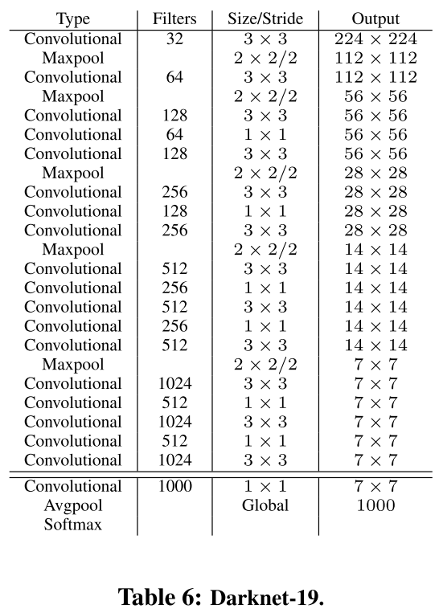

Hình 8.47 Cấu trúc Darknet-19

**(6) Dự đoán vị trí trực tiếp (Direct location prediction)**

Faster R-CNN dùng hộp neo để dự đoán độ lệch của hộp so với hộp tiên nghiệm; vì độ lệch không bị ràng buộc, hộp dự đoán ở mỗi vị trí có thể rơi vào bất kỳ đâu trong ảnh, làm mô hình mất ổn định, huấn luyện lâu hơn. YOLOv2 theo cách của YOLOv1, dự đoán tọa độ so với vị trí của ô lưới, nên giá trị thật nằm trong 0 tới 1. Mạng cho kết quả dự đoán qua hàm sigmoid để đầu ra nằm trong 0 tới 1. Gọi $c_x, c_y$ là độ lệch của ô lưới so với góc trên trái ảnh, $p_w, p_h$ là chiều rộng và cao của hộp tiên nghiệm; khi đó tọa độ tâm $(b_x, b_y)$ và chiều rộng, cao $b_w, b_h$ của hộp dự đoán (tính trên bản đồ đặc trưng) là:

$$
b_x=\sigma(t_x)+c_x,\qquad b_y=\sigma(t_y)+c_y,\qquad b_w=p_w e^{t_w},\qquad b_h=p_h e^{t_h}
$$

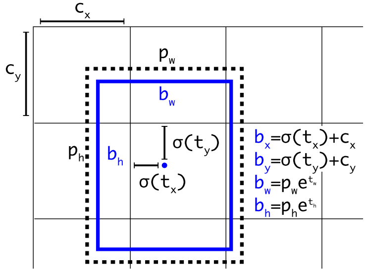

Hình 8.48 Hộp dự đoán so với hộp tiên nghiệm (nét đứt) và ô lưới

YOLOv2 kết hợp phân cụm kích thước, ràng buộc vị trí hộp dự đoán, giúp mô hình huấn luyện ổn định hơn; cách này tăng mAP khoảng 5%.

**(7) Đặc trưng mịn (Fine-Grained Features)**

YOLOv2 học SSD dùng bản đồ đặc trưng đa tỉ lệ để phát hiện, đề xuất tầng passthrough nối bản đồ đặc trưng độ phân giải cao với bản đồ độ phân giải thấp, nhờ đó phát hiện đa tỉ lệ. YOLOv2 lấy đầu vào của tầng max pool cuối của Darknet-19, được bản đồ đặc trưng 26x26x512. Qua tích chập 1x1x64 để giảm số chiều, được 26x26x64; rồi qua tầng passthrough thành 13x13x256 (lấy mỗi vùng 2x2 của bản đồ gốc ghép thành kênh mới, tức kích thước giảm 4 lần, số kênh tăng 4 lần), rồi nối với bản đồ 13x13x1024 thành 13x13x1280, cuối cùng dự đoán trên bản đồ này. Dùng đặc trưng mịn, hiệu năng YOLOv2 tăng 1%.

**(8) Huấn luyện đa tỉ lệ (Multi-Scale Training)**

Mạng Darknet-19 trong YOLOv2 chỉ có tầng tích chập và tầng gộp nên không giới hạn kích thước ảnh đầu vào. YOLOv2 huấn luyện với đầu vào đa tỉ lệ: cứ 10 batch lại chọn ngẫu nhiên kích thước ảnh mới; vì sải bước giảm mẫu tổng của Darknet-19 là 32, kích thước ảnh thường chọn bội của 32 trong $\{320, 352, \dots, 608\}$. Huấn luyện đa tỉ lệ giúp thích nghi với ảnh nhiều kích thước: ảnh độ phân giải thấp thì mAP hơi giảm nhưng nhanh hơn; ảnh độ phân giải cao thì mAP cao hơn nhưng chậm hơn.

YOLOv2 học nhiều mẹo của các phương pháp phát hiện khác, như hộp neo của Faster R-CNN, phát hiện đa tỉ lệ của SSD. Ngoài ra YOLOv2 có nhiều mẹo trong thiết kế mạng, vừa giữ tốc độ vừa tăng độ chính xác; huấn luyện đa tỉ lệ còn cho một mô hình dùng được với nhiều kích thước đầu vào, tự do cân bằng tốc độ và độ chính xác.

**Huấn luyện YOLOv2**

Huấn luyện YOLOv2 gồm ba giai đoạn.

- Giai đoạn một: huấn luyện trước Darknet-19 trên tập phân loại ImageNet, đầu vào $224\times 224$, 160 epoch.
- Giai đoạn hai: đổi đầu vào thành $448\times 448$, tinh chỉnh tiếp mô hình phân loại trên ImageNet 10 epoch; lúc này độ chính xác top-1 là 76.5%, top-5 là 93.3%.
- Giai đoạn ba: sửa mô hình phân loại Darknet-19 thành mô hình phát hiện, tinh chỉnh tiếp trên tập phát hiện. Sửa mạng gồm: bỏ tầng tích chập cuối, tầng global avgpooling và tầng softmax, thêm ba tầng tích chập $3\times 3 \times 1024$, thêm một tầng passthrough, cuối cùng dùng tầng tích chập $1\times 1$ cho kết quả dự đoán.

> **Biên tập:** bản gốc ghi ba tầng tích chập $3\times3\times2014$ (lỗi gõ, đúng là 1024). Câu "phù hợp đặc điểm người đi bộ" sau kết quả phân cụm trong bản gốc không có trong bài báo, đã bỏ. Số phép tính của Darknet-19 do người biên tập bổ sung theo bài báo.

### 8.3.5 YOLO9000

**Lý thuyết:** [Toán · Chương 3 Ôn tập Xác suất](math/ch03_vi) · [Học máy · 15.2 Hàm softmax](ml/ch15_vi?id=_152-hàm-softmax)

Trang dự án: http://pjreddie.com/yolo9000/

YOLO9000 là một phương pháp huấn luyện kết hợp trên nền YOLOv2, cho mô hình phát hiện được hơn 9000 lớp. YOLOv2 trộn tập phát hiện và tập phân loại: dùng tập phát hiện với nhãn lớp và nhãn vị trí để mô hình học dự đoán vị trí và phân loại, dùng tập phân loại với nhãn lớp để mở rộng thêm số lớp vật mô hình nhận được, đồng thời tăng độ bền vững.

**1. YOLO9000 tổ chức dữ liệu thế nào?**

YOLO9000 dựa vào quan hệ bao hàm giữa các lớp, dựng một cấu trúc cây WordTree để tổ chức tập COCO và ImageNet.

Cách sinh WordTree:

1. Trước hết duyệt các danh từ lớp trong ImageNet.
2. Với mỗi danh từ, tìm trên WordNet (một cơ sở dữ liệu ngôn ngữ về khái niệm và quan hệ giữa các khái niệm) đường ngắn nhất từ vị trí của nó tới nút gốc (đặt nút gốc là vật thể vật lý, physical object); vì phần lớn từ đồng nghĩa trong WordNet chỉ có một đường, nên trước hết thêm mọi từ trên đường đó vào cây.
3. Lần lượt xét các danh từ còn lại, lấy đường ngắn nhất tới nút gốc, thêm các từ trên đường đó chưa có trong cây vào cây.

Tập dữ liệu sau khi trộn tạo thành một WordTree 9418 lớp. Mô hình WordTree như hình dưới. Ngoài ra, vì COCO quá ít dữ liệu so với ImageNet, để cân bằng hai tập, tác giả lấy mẫu lại (oversampling) COCO để tỉ lệ dữ liệu COCO : ImageNet gần 1 : 4.

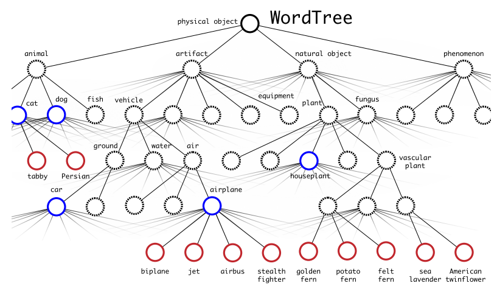

Hình 8.49 WordTree: các lớp tổ chức theo cây, gốc là "physical object"

Nhãn của vật được mã hóa thành một vector độ dài 9418: các vị trí ứng với những từ nằm trên đường từ danh từ của vật tới nút gốc trong WordTree bằng 1, các vị trí khác bằng 0 (mã hóa nhiều-một, multi-hot).

**2. YOLO9000 huấn luyện kết hợp thế nào?**

YOLO9000 dùng cấu trúc YOLOv2, số hộp neo đổi từ 5 xuống 3; với mỗi hộp neo dự đoán vị trí $x, y, w, h$, độ tin cậy, và xác suất vật thuộc từng lớp trong 9418 lớp, nên mỗi hộp neo dự đoán $4+1+9418=9423$ giá trị. Mỗi ô dự đoán $3\times9423=28269$ giá trị. Khi huấn luyện, gặp ảnh từ tập phát hiện thì lan truyền ngược với đầy đủ mất mát YOLOv2; gặp ảnh từ tập phân loại thì chỉ lan truyền ngược phần mất mát phân loại.

**3. YOLO9000 dự đoán thế nào?**

Trong WordTree, các con của mỗi nút thuộc cùng một nhóm; làm softmax riêng trên từng nhóm con theo tầng, được xác suất của từng từ con khi biết từ cha. Muốn biết xác suất thuộc một lớp, ta tính xác suất có điều kiện của nút lớp đó: tìm đường từ danh từ lớp đó tới nút gốc trong WordTree, nhân các xác suất của các nút trên đường. Khi dự đoán, YOLOv2 cho độ tin cậy, vị trí hộp và một cây xác suất; đi từ gốc xuống, mỗi lần theo nhánh có xác suất cao nhất, cho tới khi xác suất xuống dưới một ngưỡng; nút cuối cùng tới được là lớp dự đoán.

YOLO9000 dùng WordTree trộn tập phát hiện và tập phân loại, huấn luyện kết hợp trên đó, phát hiện thời gian thực được hơn 9000 lớp vật, rất ấn tượng. YOLO9000 nhận dạng động vật đặc biệt tốt, nhưng với các lớp như quần áo hay thiết bị thì không tốt lắm, có thể do phân bố dữ liệu trong tập phát hiện (COCO có nhiều động vật nhưng không có quần áo).

> **Biên tập:** bản gốc gọi cách mã hóa nhãn là "one-hot" nhưng ngay sau đó mô tả nhiều vị trí bằng 1; đúng ra là mã hóa nhiều-một (multi-hot).

### 8.3.6 YOLOv3

**Lý thuyết:** [Ôn tập · Bổ sung: ResNet và DenseNet](qa/ch04_vi?id=bổ-sung-resnet-và-densenet) · [d2l (tiếng Anh) · 14.5 Phát hiện đa tỉ lệ](https://d2l.ai/chapter_computer-vision/multiscale-object-detection.html) ↗

YOLOv3 (Redmon và Farhadi, 2018) tổng kết các thử nghiệm cải tiến trên nền YOLOv2, có cái thành công, có cái không tăng hiệu năng. Hai điểm đáng nói: một là dùng mô hình phần dư, làm mạng sâu hơn; hai là dùng kiến trúc FPN để phát hiện đa tỉ lệ.

**YOLOv3 có những điểm mới nào?**

1. Cấu trúc mạng mới: Darknet-53.
2. Kết hợp FPN.
3. Dùng hồi quy logistic (sigmoid độc lập cho từng lớp) thay softmax làm bộ phân loại, cho phép một vật có nhiều nhãn.

**1. YOLOv3 cải tiến cấu trúc mạng thế nào?**

YOLOv3 thêm khối phần dư vào Darknet-19 cũ và làm mạng sâu hơn; mạng sau cải tiến có 53 tầng tích chập, gọi là Darknet-53, cấu trúc như hình dưới (lấy đầu vào 256x256 làm ví dụ).

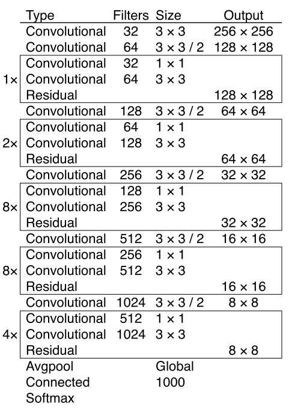

Hình 8.50 Cấu trúc Darknet-53

Để so sánh hiệu năng của Darknet-53 với các mạng khác, tác giả dùng TitanX, cùng thiết lập thí nghiệm, đưa ảnh 256x256 vào các mô hình phân loại có mạng cơ sở Darknet-19, ResNet-101, ResNet-152 và Darknet-53; kết quả như hình dưới. Có thể thấy Darknet-53 tốt hơn ResNet-101 mà nhanh gấp 1.5 lần; Darknet-53 tương đương ResNet-152 mà nhanh gần gấp đôi. Chú ý Darknet-53 đạt số phép tính dấu phẩy động mỗi giây cao nhất so với các mạng khác, cho thấy cấu trúc của nó tận dụng GPU tốt hơn.

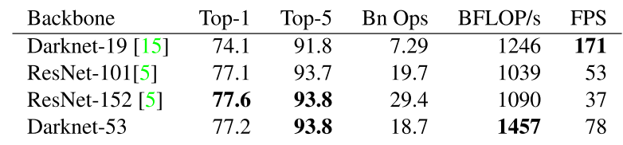

Hình 8.51 So sánh Darknet-53 với Darknet-19, ResNet-101, ResNet-152

**2. YOLOv3 phát hiện đa tỉ lệ thế nào?**

YOLOv3 học ý tưởng của FPN, trích đặc trưng ở nhiều tỉ lệ. So với YOLOv2, YOLOv3 lấy bản đồ đặc trưng ở 3 tỉ lệ cuối, không chỉ dự đoán độc lập trên từng bản đồ, mà còn tăng mẫu bản đồ nhỏ lên bằng kích thước bản đồ lớn hơn, ghép nối với nó rồi dự đoán tiếp. Dùng ý tưởng phân cụm kích thước để có 9 hộp neo, chia đều 9 hộp neo cho 3 bản đồ đặc trưng. Hình dưới là sơ đồ mạng có thêm phần trích đặc trưng đa tỉ lệ (ví dụ đầu vào 256x256 trên COCO 80 lớp):

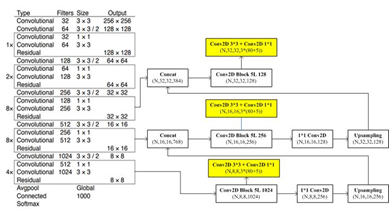

Hình 8.52 YOLOv3 với ba nhánh dự đoán đa tỉ lệ

Từ YOLOv1 tới YOLOv2, YOLO9000, YOLOv3, YOLO trải qua ba thế hệ thay đổi: giữ ưu thế tốc độ, liên tục cải tiến cấu trúc mạng, đồng thời học các mẹo của những thuật toán phát hiện tốt khác, lần lượt đưa vào cơ chế hộp neo, đưa FPN vào để phát hiện đa tỉ lệ…

### 8.3.7 RetinaNet

**Lý thuyết:** [Học máy · 15.3.1 Entropy chéo](ml/ch15_vi?id=_1531-entropy-chéo) · [Học máy · E.3 Accuracy và bẫy dữ liệu mất cân bằng](ml/eval_vi?id=e3-accuracy-và-bẫy-dữ-liệu-mất-cân-bằng) · [Ôn tập · 14.2.4 Thứ tự quan trọng của siêu tham số](qa/ch14_vi?id=_1424-thứ-tự-quan-trọng-của-siêu-tham-số)

**Bối cảnh nghiên cứu**

- Bộ phát hiện hai giai đoạn (như Faster R-CNN, FPN) chính xác nhưng tương đối chậm.
- Bộ phát hiện một giai đoạn (như YOLO, SSD) nhanh nhưng độ chính xác bình thường.

Bảng 8.1 So sánh hai nhóm bộ phát hiện (thời điểm 2017)

| | Một giai đoạn | Hai giai đoạn |
|---|---|---|
| Thuật toán tiêu biểu | YOLOv1, SSD, YOLOv2, YOLOv3 | R-CNN, SPPNet, Fast R-CNN, Faster R-CNN |
| Độ chính xác | thấp | cao |
| Tốc độ | nhanh | chậm |

Tác giả RetinaNet (Lin và cộng sự, 2017) tìm hiểu vì sao bộ phát hiện một giai đoạn kém chính xác, và thấy vấn đề chính là mất cân bằng giữa lớp dương và lớp âm (mất cân bằng giữa mẫu dễ và mẫu khó).

> We discover that the extreme foreground-background class imbalance encountered during training of dense detectors is the central cause.

(Chúng tôi phát hiện sự mất cân bằng cực đoan giữa tiền cảnh và nền gặp khi huấn luyện bộ phát hiện dày đặc là nguyên nhân trung tâm.)

Tác giả đề xuất thiết kế lại mất mát entropy chéo chuẩn (cross entropy loss) để giải quyết mất cân bằng lớp (class imbalance), tức Focal Loss.

> We propose to address this class imbalance by reshaping the standard cross entropy loss such that it down-weights the loss assigned to well-classified examples. Our novel Focal Loss focuses training on a sparse set of hard examples and prevents the vast number of easy negatives from overwhelming the detector during training.

(Chúng tôi đề xuất giải quyết mất cân bằng lớp bằng cách định hình lại mất mát entropy chéo chuẩn để giảm trọng số mất mát của các mẫu đã phân loại tốt. Focal Loss mới tập trung huấn luyện vào một tập thưa các mẫu khó và ngăn số lượng khổng lồ mẫu âm dễ lấn át bộ phát hiện khi huấn luyện.)

Bộ phát hiện một giai đoạn kết hợp Focal Loss gọi là RetinaNet; trên COCO, mAP của nó ngang mạng kim tự tháp đặc trưng (FPN) hay Mask R-CNN.

**Hỏi: Mất cân bằng lớp (class imbalance) là gì?**

Đáp: số mẫu âm lớn hơn rất nhiều số mẫu dương; ví dụ vùng chứa vật (mẫu dương) rất ít, vùng không chứa vật (mẫu âm) rất nhiều. Bộ phát hiện ban đầu sinh ra cả một loạt hộp (bbox), trong khi một ảnh thông thường chỉ có vài vật. Nghĩa là tuyệt đại đa số hộp thuộc về nền.

**Hỏi: Mất cân bằng lớp gây ra vấn đề gì?**

Đáp: vì phần lớn là mẫu âm dễ (thuộc nền), quá trình huấn luyện không học đủ thông tin của các mẫu có lớp; hơn nữa mẫu âm dễ quá nhiều có thể lấn át tác dụng của các mẫu có lớp (mỗi mẫu âm dễ vẫn sinh ra một lượng mất mát nhỏ, xem đường xanh dương ở hình dưới; số lượng lớn khiến chúng chiếm phần lớn mất mát, chi phối hướng cập nhật gradient, che lấp thông tin quan trọng).

> This imbalance causes two problems: (1) training is inefficient as most locations are easy negatives that contribute no useful learning signal; (2) en masse, the easy negatives can overwhelm training and lead to degenerate models.

(Sự mất cân bằng gây hai vấn đề: (1) huấn luyện kém hiệu quả vì phần lớn vị trí là mẫu âm dễ, không đóng góp tín hiệu học hữu ích; (2) gộp lại, mẫu âm dễ có thể lấn át việc huấn luyện và dẫn tới mô hình suy biến.)

Nói đơn giản, số hộp bùng nổ. Chính vì hộp thuộc nền quá nhiều, nếu bộ phân loại đơn giản xếp mọi hộp vào nền thì độ chính xác (accuracy) vẫn rất cao. Thế là việc huấn luyện bộ phân loại thất bại, bộ phân loại thất bại thì độ chính xác phát hiện đương nhiên thấp.

**Hỏi: Vì sao bộ phát hiện hai giai đoạn không gặp mất cân bằng lớp?**

Đáp: vì giai đoạn RPN đã giảm số vùng ứng viên (còn khoảng 1–2 nghìn), và ở giai đoạn phân loại có thể cố định tỉ lệ tiền cảnh : nền (foreground-to-background ratio) là 1:3, hoặc dùng OHEM (online hard example mining) để cân bằng số lượng tiền cảnh và nền.

**RetinaNet có những điểm mới nào?**

**Tổng quan:**

- Mất mát mới: đề xuất hàm Focal Loss giải quyết mất cân bằng lớp:

$$
FL(p_t) = -(1-p_t)^\gamma \log(p_t)
$$

- Bộ phát hiện mới: RetinaNet = ResNet + FPN + hai mạng con + Focal Loss.

Focal Loss tập trung huấn luyện vào mẫu khó (hard examples).

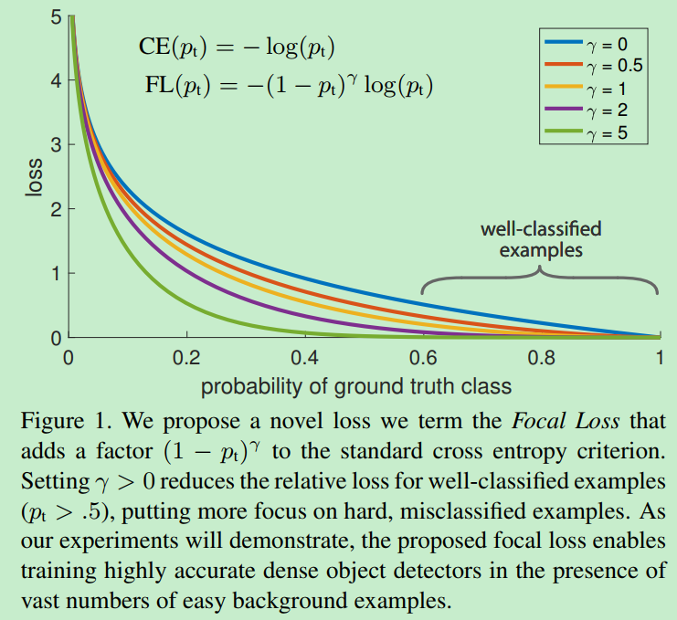

Hình 8.53 Focal Loss với các giá trị $\gamma$; $\gamma=0$ là entropy chéo. Với $\gamma>0$, mất mát của các mẫu đã phân loại tốt ($p_t>0.5$) giảm mạnh.

Kết hợp Focal Loss với mạng xương sống ResNet-101-FPN thành RetinaNet (bộ phát hiện một giai đoạn); RetinaNet đạt 39.1 AP trên COCO test-dev, tốc độ khoảng 5 FPS.

So RetinaNet với các bộ phát hiện tốt nhất thời đó, nó đạt cân bằng tốc độ–độ chính xác tốt nhất:

Hình 8.54 Thời gian suy luận so với AP trên COCO test-dev

**Chi tiết:**

Tác giả đề xuất một hàm mất mát mới, muốn mẫu khó đóng góp nhiều hơn vào mất mát, để mạng thiên về học từ các mẫu đó.

Tác giả lấy phân loại nhị phân làm ví dụ.

**Hàm entropy chéo CE**

Trước hết là mất mát entropy chéo thường dùng:

$$
\mathrm{CE}(p,y)=
\begin{cases}
-\log(p) & \text{nếu } y=1\\
-\log(1-p) & \text{ngược lại}
\end{cases}
\tag{1}
$$

Ở đây $y=+1$ hoặc $y=-1$, $p\in[0,1]$ là xác suất mô hình ước lượng cho $y=+1$. Tác giả định nghĩa $p_t$ là:

$$
p_t=
\begin{cases}
p & \text{nếu } y=1\\
1-p & \text{ngược lại}
\end{cases}
\tag{2}
$$

nên $\mathrm{CE}(p,y)=\mathrm{CE}(p_t)=-\log(p_t)$.

**Entropy chéo cân bằng**

Muốn kiểm soát đóng góp của mất cân bằng lớp vào mất mát thì thêm một trọng số; ý tưởng ban đầu của tác giả như sau, với mẫu thuộc lớp thiểu số thì tăng $\alpha$:

$$
\mathrm{CE}(p_t)=-\alpha_t\log(p_t)
\tag{3}
$$

Nhưng cách này có vấn đề: nó chỉ cân bằng giữa mẫu dương và mẫu âm, chưa phân biệt mẫu dễ và mẫu khó; theo lời tác giả:

> While α balances the importance of positive/negative examples, it does not differentiate between easy/hard examples. Instead, we propose to reshape the loss function to down-weight easy examples and thus focus training on hard negatives.

(Dù α cân bằng tầm quan trọng của mẫu dương/âm, nó không phân biệt mẫu dễ/khó. Thay vào đó, chúng tôi định hình lại hàm mất mát để giảm trọng số mẫu dễ, nhờ đó tập trung huấn luyện vào mẫu âm khó.)

Hỏi: vì sao công thức (3) chỉ giải quyết mất cân bằng dương–âm?

Đáp: thêm hệ số $\alpha_t$, định nghĩa giống $p_t$: nhãn là 1 thì $\alpha_t=\alpha$; nhãn là $-1$ thì $\alpha_t=1-\alpha$, $\alpha$ trong khoảng 0 tới 1. Nên có thể đặt $\alpha$ (nói chung nếu lớp 1 có nhiều mẫu hơn hẳn lớp $-1$ thì chọn $\alpha$ trong 0–0.5 để tăng trọng số lớp $-1$) để điều chỉnh tỉ trọng đóng góp của mẫu dương và âm vào mất mát tổng. Hệ số này không phụ thuộc mẫu dễ hay khó.

**Focal Loss**

Tác giả trước hết thêm vào mất mát entropy chéo một hệ số điều biến (modulating factor):

$$
(1-p_t)^\gamma
$$

$$
FL(p_t)=-(1-p_t)^\gamma\log(p_t)
\tag{4}
$$

Rõ ràng mẫu càng dễ phân loại thì $p_t$ càng lớn ($p_t\to1$), hệ số điều biến càng gần 0, đóng góp vào mất mát càng nhỏ; tương tự, mẫu càng khó thì $p_t$ càng nhỏ, hệ số điều biến gần 1, mất mát gần như không bị ảnh hưởng.

Hỏi: vì sao $p_t$ càng lớn thì FL càng nhỏ?

Đáp: theo công thức (4), cả hai thừa số $-\log(p_t)$ và $(1-p_t)^\gamma$ đều giảm khi $p_t$ tăng, nên FL giảm khi $p_t$ tăng. Khi $p_t$ rất lớn (gần 1), FL rất nhỏ; khi $p_t$ rất nhỏ (gần 0), FL rất lớn.

Ghi chú: ở đây có siêu tham số $\gamma$ (focusing parameter).

$\gamma$ khuếch đại tác dụng của hệ số điều biến.

Ví dụ trong bài báo: khi $p_t=0.9$, focal loss có hệ số điều biến bằng 1/100 mất mát CE, tức giảm thêm mất mát của mẫu phân loại đúng.

> For instance, with γ = 2, an example classified with pt = 0.9 would have 100× lower loss compared with CE and with pt ≈ 0.968 it would have 1000× lower loss. This in turn increases the importance of correcting misclassified examples (whose loss is scaled down by at most 4× for pt ≤ .5 and γ = 2).

(Ví dụ, với γ = 2, mẫu phân loại với $p_t$ = 0.9 có mất mát thấp hơn CE 100 lần, với $p_t$ ≈ 0.968 thì thấp hơn 1000 lần. Điều này làm tăng tầm quan trọng của việc sửa các mẫu phân loại sai (mất mát của chúng bị giảm nhiều nhất 4 lần khi $p_t$ ≤ 0.5 và γ = 2).)

Trong thực tế, tác giả dùng công thức dưới, kết hợp (3) và (4), vừa điều chỉnh trọng số mẫu dương–âm, vừa điều chỉnh trọng số mẫu dễ–khó:

$$
FL(p_t)=-\alpha_t(1-p_t)^\gamma\log(p_t)
\tag{5}
$$

Hai tham số $\alpha$ và $\gamma$ cùng điều khiển; trong thực nghiệm khoảng chọn $\alpha$ khá rộng, nói chung khi tăng $\gamma$ thì cần giảm $\alpha$ một chút; tác giả thấy $\alpha=0.25$, $\gamma=2$ cho kết quả tốt nhất.

**Bộ phát hiện RetinaNet**

RetinaNet gồm một mạng xương sống và hai mạng con (subnet) cho hai nhiệm vụ riêng (thuộc bộ phát hiện một giai đoạn). Mạng xương sống tính bản đồ đặc trưng; mạng con thứ nhất phân loại vật (object classification), mạng con thứ hai hồi quy hộp (bounding box regression).

**Mạng xương sống kim tự tháp đặc trưng (Feature Pyramid Network Backbone)**

Hình 8.55 (a) ResNet; (b) kim tự tháp đặc trưng xây trên ResNet

**Hộp neo (Anchor), mạng con phân loại (Classification Subnet), mạng con hồi quy hộp (Box Regression Subnet)**

Trên mỗi mức P3–P7 của kim tự tháp, mỗi vị trí đặt $A=9$ hộp neo (3 tỉ lệ × 3 tỉ lệ khung hình). Mạng con phân loại gồm bốn tầng tích chập $3\times3$ 256 kênh rồi một tầng cho $K\times A$ đầu ra (xác suất của $K$ lớp cho mỗi hộp neo, dùng sigmoid); mạng con hồi quy có cấu trúc giống hệt nhưng cho $4\times A$ đầu ra.

Hình 8.56 Kiến trúc RetinaNet: (a) ResNet, (b) kim tự tháp đặc trưng, (c) mạng con phân loại, (d) mạng con hồi quy hộp

Những điểm cần chú ý của cấu trúc RetinaNet:

1. Khi huấn luyện, mọi mẫu ở mọi mức FPN đều dùng để tính Focal Loss, cộng các mất mát lại để huấn luyện (chuẩn hóa bằng số hộp neo dương).
2. Khi kiểm tra, mỗi mức FPN chỉ lấy 1000 mẫu điểm cao nhất để làm NMS.
3. Phần đầu (head, phần c và d trong hình) dùng chung tham số giữa các mức, nhưng nhánh phân loại và nhánh hồi quy không dùng chung tham số.
4. Độ lệch của tầng tích chập cuối nhánh phân loại khởi tạo bằng $-\log\big((1-\pi)/\pi\big)$ với $\pi=0.01$ (tức $\approx -4.6$), để lúc đầu mọi hộp neo được dự đoán là nền với xác suất 0.99, tránh mất mát của lượng lớn mẫu nền làm mất ổn định ở vòng đầu.

(Phần tổng kết trên tham khảo bài của tác giả Trương Lỗi (张磊_0503) trên Jianshu: <https://www.jianshu.com/p/204d9ad9507f>.)

**Kết quả thực nghiệm**

Bảng 1 trong bài báo là một số kết quả thí nghiệm về RetinaNet và Focal Loss. (a) thêm tham số $\alpha$ vào entropy chéo, $\alpha=0.5$ là entropy chéo truyền thống; thấy $\alpha=0.75$ cho kết quả tốt nhất, AP tăng 0.9. (b) so các giá trị $\gamma$ và $\alpha$; thấy khi $\gamma$ tăng, AP tăng khá rõ. (d) so với OHEM: Focal Loss tốt nhất hơn OHEM tốt nhất 3.2 AP. Ở đây OHEM 1:3 nghĩa là ép tỉ lệ dương–âm 1:3 trên minibatch lấy bằng OHEM; so sánh cho thấy việc ép này không tăng AP. (e) thêm so sánh thời gian chạy, có thể xem cùng Hình 8.54: tốc độ cũng có ưu thế. Chú ý ở đây RetinaNet-101-800 có AP 37.8; khi kéo dài thời gian huấn luyện 1.5 lần và dùng dao động tỉ lệ (scale jitter), AP tăng lên 39.1, đó là nguồn gốc con số 39.1 AP cao nhất trong toàn bài và trong Bảng 2.

Hình 8.57 Thí nghiệm cắt bỏ (ablation) của RetinaNet và Focal Loss

Hình 8.58 So sánh với các bộ phát hiện tốt nhất thời đó trên COCO test-dev

> **Biên tập:** (1) công thức FL trong bản gốc bị dính chữ lặp ("$FL(p_t)=-(1-p_t)^\gamma\log(p_t)FL(pt)=−(1−pt)γlog(pt)$"), và các công thức (1)–(5) bản gốc để dạng ảnh; đã gõ lại. (2) Câu trả lời "FL tỉ lệ nghịch với $p_t$ trong log và tỉ lệ thuận với $1-p_t$" trong bản gốc diễn đạt lỏng; đã viết lại. (3) Đáng chú ý: giá trị tốt nhất $\alpha=0.25$ lại **giảm** trọng số của mẫu dương (lớp thiểu số), ngược trực giác của entropy chéo cân bằng; bài báo giải thích vì hệ số $(1-p_t)^\gamma$ đã giảm rất mạnh mất mát của mẫu âm dễ. (4) Mục hộp neo, mạng con phân loại và hồi quy trong bản gốc chỉ có tiêu đề; người biên tập bổ sung một đoạn ngắn theo bài báo. (5) Bảng so sánh một/hai giai đoạn bản gốc để dạng ảnh chữ Trung, đã chép lại thành bảng.

### 8.3.8 RFBNet

**Lý thuyết:** [Ôn tập · 5.4 Có những loại kernel tích chập nào?](qa/ch05_vi?id=_54-có-những-loại-kernel-tích-chập-nào) · [Ôn tập · 4.6 GoogLeNet](qa/ch04_vi?id=_46-googlenet)

**RFBNet có những điểm mới nào?**

1. Đề xuất mô-đun RF block (RFB).

RFBNet (Liu và Huang, ECCV 2018) muốn dùng một số mẹo để bộ phát hiện dùng mô hình nhẹ đạt cân bằng tốt giữa tốc độ và độ chính xác. Lấy cảm hứng từ cấu trúc vùng tiếp nhận (Receptive Fields, RFs) trong thị giác người, tác giả đề xuất mô-đun RF block (RFB) mới, để kiểm chứng quan hệ giữa kích thước, hướng của vùng tiếp nhận với việc tăng tính phân biệt và độ bền của đặc trưng. RFBNet dựng trên SSD với mạng xương sống VGG16, chủ yếu thêm tầng tích chập giãn (dilated convolution) trên nền Inception, nhờ đó mở rộng hiệu quả vùng tiếp nhận (receptive field). Vì cải tiến trên SSD nên tốc độ vẫn khá nhanh, độ chính xác cũng được bảo đảm phần nào.

**Giới thiệu RFB**

RFB là một mô-đun tích chập nhiều nhánh giống Inception, cấu trúc bên trong gồm hai thành phần: tầng tích chập nhiều nhánh và tầng tích chập giãn. Như hình dưới:

Hình 8.59 Mô-đun RFB: các nhánh kernel $1\times1$, $3\times3$, $5\times5$ kèm tích chập giãn tỉ lệ 1, 3, 5, mô phỏng vùng tiếp nhận của thị giác người

**1. Tầng tích chập nhiều nhánh**

Theo định nghĩa của RF, dùng kernel nhiều kích thước tốt hơn kích thước cố định. Thiết kế cụ thể: 1. cấu trúc thắt cổ chai: tích chập 1x1 giảm số kênh, rồi một tích chập $n\times n$; 2. thay tích chập 5x5 bằng hai tích chập 3x3 để giảm tham số và có tầng phi tuyến sâu hơn; một số chỗ dùng $1\times n$ và $n\times1$ thay $n\times n$; thiết kế nối tắt theo ResNet và Inception-ResNet V2; 3. vì đầu ra của tích chập thường có sải bước 2 hoặc giảm số kênh, nhánh nối tắt dùng một tích chập 1x1 không có kích hoạt phi tuyến.

**2. Tầng tích chập giãn**

Lấy cảm hứng từ DeepLab: giữ số tham số mà vẫn có vùng tiếp nhận rộng, lấy được đặc trưng độ phân giải cao hơn. Hình dưới là hai cấu trúc RFB: RFB và RFB-s. Mỗi nhánh là một tích chập thường theo sau là một tích chập giãn, khác nhau chủ yếu ở kích thước và hệ số giãn. (a) RFB: tổng thể học theo ý tưởng của Inception, khác chủ yếu ở chỗ thêm 3 tầng tích chập giãn (như 3x3 conv, rate=1); đây cũng là một cách chính để RFBNet mở rộng vùng tiếp nhận. (b) RFB-s: so với RFB có hai cải tiến: dùng tích chập 3x3 thay 5x5, và dùng 1x3, 3x1 thay 3x3, chủ yếu để giảm khối lượng tính, giống cách các bản Inception sau cải tiến cấu trúc Inception.

Hình 8.60 (a) RFB; (b) RFB-s

Cấu trúc tổng thể của RFBNet300 như hình dưới, cơ bản giống SSD. RFBNet khác SSD ở chỗ: 1. trên mạng chính dùng hai khối RFB thay hai tầng thêm vào ban đầu; 2. conv4_3 và conv7_fc trước khi nối với tầng dự đoán thì lần lượt nối qua RFB-s và RFB.

Hình 8.61 Cấu trúc RFBNet300

### 8.3.9 M2Det

**Lý thuyết:** [d2l (tiếng Anh) · 14.5 Phát hiện đa tỉ lệ](https://d2l.ai/chapter_computer-vision/multiscale-object-detection.html) ↗ · [Ôn tập · 12.5 Có những mô hình mạng kinh điển nào đáng học?](qa/ch12_vi?id=_125-có-những-mô-hình-mạng-kinh-điển-nào-đáng-học)

**M2Det có những điểm mới nào?**

1. Đề xuất mạng kim tự tháp đặc trưng nhiều mức (MLFPN) để dựng kim tự tháp đặc trưng hiệu quả hơn, phát hiện vật ở nhiều tỉ lệ.

Kiến trúc tổng thể của M2Det (Zhao và cộng sự, AAAI 2019) như dưới. M2Det dùng mạng xương sống và mạng kim tự tháp đặc trưng nhiều mức (MLFPN) trích đặc trưng từ ảnh đầu vào, rồi giống SSD, từ đặc trưng đã học sinh các hộp dày đặc và điểm lớp, cuối cùng là NMS cho kết quả. MLFPN gồm ba mô-đun: mô-đun hợp nhất đặc trưng (FFM), mô-đun hình chữ U rút gọn (TUM) và mô-đun tổng hợp đặc trưng theo tỉ lệ (SFAM). FFMv1 hợp nhất bản đồ đặc trưng của mạng xương sống, làm giàu ngữ nghĩa cho đặc trưng cơ sở. Mỗi TUM sinh một bộ đặc trưng đa tỉ lệ, rồi các TUM và FFMv2 nối xen kẽ trích đặc trưng nhiều mức, nhiều tỉ lệ. Ngoài ra SFAM tổng hợp đặc trưng thành kim tự tháp đặc trưng nhiều mức bằng phép ghép theo tỉ lệ và cơ chế chú ý thích ứng. Dưới đây giới thiệu chi tiết ba mô-đun lõi và cấu hình mạng của M2Det.

Hình 8.62 Kiến trúc M2Det

**FFM**

FFM hợp nhất đặc trưng ở các mức khác nhau trong M2Det, điều then chốt để dựng kim tự tháp đặc trưng nhiều mức cuối cùng. Chúng dùng tích chập 1x1 nén kênh của đặc trưng đầu vào, rồi ghép nối để tổng hợp các bản đồ đặc trưng. Đặc biệt, vì FFMv1 nhận hai bản đồ đặc trưng ở hai tỉ lệ khác nhau của mạng xương sống, nó dùng một phép tăng mẫu để đưa đặc trưng sâu về cùng tỉ lệ trước khi ghép. Còn FFMv2 nhận đặc trưng cơ sở và bản đồ đặc trưng lớn nhất của TUM trước (hai bản đồ cùng tỉ lệ), tạo đặc trưng hợp nhất cho TUM kế tiếp. Chi tiết cấu trúc FFMv1 và FFMv2 lần lượt ở hình (a) và (b) dưới.

Hình 8.63 (a) FFMv1; (b) FFMv2; (c) TUM

**TUM**

TUM khác FPN và RetinaNet: dùng cấu trúc hình chữ U rút gọn, như hình (c) trên. Bộ mã hóa là một chuỗi tích chập 3x3 sải bước 2, còn bộ giải mã lấy đầu ra của các tầng này làm tập đặc trưng tham chiếu, trong khi FPN gốc chọn đầu ra tầng cuối mỗi giai đoạn của mạng xương sống ResNet. Ngoài ra, sau tầng tăng mẫu của nhánh giải mã thêm tầng tích chập 1x1 và phép cộng từng phần tử để tăng khả năng học và giữ đặc trưng trơn. Mọi đầu ra của bộ giải mã trong mỗi TUM tạo thành đặc trưng đa tỉ lệ của mức hiện tại. Nhìn tổng thể, đầu ra của các TUM xếp chồng tạo thành đặc trưng nhiều mức, nhiều tỉ lệ: TUM đầu chủ yếu cho đặc trưng nông, TUM giữa cho đặc trưng mức trung, TUM sau cho đặc trưng sâu.

**SFAM**

SFAM tổng hợp các đặc trưng nhiều mức, nhiều tỉ lệ do TUM sinh ra thành kim tự tháp đặc trưng nhiều mức, như hình dưới. Giai đoạn đầu của SFAM ghép nối các đặc trưng cùng tỉ lệ theo chiều kênh. Kim tự tháp đặc trưng tổng hợp biểu diễn được thành $X = [X_1,X_2,\dots,X_i,\dots,X_L]$, trong đó

$$
X_i = \mathrm{Concat}(X_{1i}, X_{2i}, \dots, X_{Li}) \in \mathbb R^{W_i \times H_i \times C}
$$

là đặc trưng ở tỉ lệ lớn thứ $i$. Ở đây mỗi tỉ lệ trong kim tự tháp tổng hợp đều chứa đặc trưng từ nhiều mức độ sâu. Nhưng phép ghép đơn giản chưa đủ tốt. Ở giai đoạn hai, đưa vào mô-đun chú ý theo kênh để đặc trưng tập trung vào những kênh có ích nhất. Theo khối SE, dùng gộp trung bình toàn cục để sinh thống kê kênh $z\in\mathbb R^C$ ở bước "nén" (squeeze).

Hình 8.64 SFAM: ghép đặc trưng cùng tỉ lệ rồi đánh lại trọng số kênh kiểu SE

## 8.4 Phát hiện khuôn mặt

**Lý thuyết:** [d2l (tiếng Anh) · 14.3 Phát hiện đối tượng và hộp bao](https://d2l.ai/chapter_computer-vision/bounding-box.html) ↗

Lĩnh vực phát hiện đối tượng có thể chia thành phát hiện khuôn mặt và phát hiện đối tượng tổng quát; khuôn mặt thường có thuật toán chuyên biệt (gồm phát hiện, nhận dạng khuôn mặt, nhận dạng thuộc tính khuôn mặt…), khác phát hiện (nhận dạng) đối tượng tổng quát ở mức nào đó; điều này chủ yếu do tính đặc thù của khuôn mặt (có khi rất nhỏ, đặc trưng giữa các khuôn mặt không rõ rệt, bị che khuất…). Phần dưới giới thiệu phát hiện khuôn mặt.

### 8.4.1 Hiện nay các phương pháp phát hiện khuôn mặt được phân loại thế nào?

**Lý thuyết:** [Học máy · T.5 Boosting và AdaBoost](ml/ensemble_vi?id=t5-boosting-và-adaboost)

Phương pháp phát hiện khuôn mặt hiện nay gồm hai nhóm: thuật toán truyền thống và thuật toán dựa trên học sâu. Thuật toán truyền thống chia 4 loại:

1. phương pháp dựa trên tri thức;
2. phương pháp dựa trên mô hình;
3. phương pháp dựa trên đặc trưng;
4. phương pháp dựa trên ngoại hình (ví dụ bộ phát hiện Viola–Jones dùng đặc trưng Haar và AdaBoost dạng tầng).

Vì sách này tập trung vào học sâu, phần dưới chủ yếu giới thiệu các phương pháp dựa trên học sâu.

Năm 2006 Hinton và cộng sự đưa khái niệm học sâu (Deep Learning) trở lại tâm điểm: tổ hợp đặc trưng mức thấp thành đặc trưng trừu tượng mức cao hơn. Sau đó các nhà nghiên cứu áp dụng học sâu vào phát hiện khuôn mặt, chủ yếu là các nghiên cứu dựa trên mạng neuron tích chập (CNN), như phát hiện khuôn mặt bằng CNN dạng tầng (Cascade CNN), bằng CNN đa nhiệm vụ (MTCNN), Facebox…, tăng mạnh độ bền vững của phát hiện khuôn mặt. Tất nhiên các thuật toán phát hiện tổng quát như Faster R-CNN, YOLO, SSD cũng được dùng cho khuôn mặt, kết quả khá, nhưng vẫn kém thuật toán chuyên cho khuôn mặt. Phần dưới chủ yếu giới thiệu phát hiện khuôn mặt dựa trên học sâu; phát hiện tổng quát dựa trên học sâu đã nói ở 8.2 và 8.3.

### 8.4.2 Phát hiện khuôn mặt nhiều kích thước khác nhau trong ảnh thế nào?

**Lý thuyết:** [d2l (tiếng Anh) · 14.5 Phát hiện đa tỉ lệ](https://d2l.ai/chapter_computer-vision/multiscale-object-detection.html) ↗

Thuật toán truyền thống xử lý khuôn mặt nhiều kích thước chủ yếu bằng hai chiến lược:

1. co giãn kích thước ảnh (kim tự tháp ảnh, Hình 8.65);
2. co giãn kích thước cửa sổ trượt (Hình 8.66).

Hình 8.65 Kim tự tháp ảnh

Hình 8.66 Co giãn cửa sổ trượt

Thuật toán dựa trên học sâu cũng có hai chiến lược, nhưng hơi khác truyền thống, gồm:

1. Co giãn kích thước ảnh. (Cũng có thể co giãn cửa sổ trượt, nhưng với học sâu, phát hiện bằng cửa sổ trượt rất chậm vì tích chập bị tính lặp nhiều lần, nên dùng mạng tích chập hoàn toàn (FCN); dùng FCN thì không cần cửa sổ trượt nữa.)
2. Dùng hộp neo (như Hình 8.67; đừng nhầm với Hình 8.66, ở đây là từ bản đồ đặc trưng dự đoán vùng hộp neo trên ảnh gốc, mô tả cụ thể trong Facebox).

Hình 8.67 Hộp neo

### 8.4.3 Đặt kích thước khuôn mặt nhỏ nhất thuật toán phát hiện được thế nào?

**Lý thuyết:** [Học sâu · 7.3.2 Sải bước](dl/ch07_s3_vi?id=_732-sải-bước)

Chủ yếu xem cửa sổ nhỏ nhất của cửa sổ trượt và của hộp neo.

**(1) Cách cửa sổ trượt**

Giả sử dùng cửa sổ trượt 12×12, không co giãn ảnh gốc thì phát hiện được khuôn mặt nhỏ nhất 12×12 trong ảnh gốc. Nhưng thường yêu cầu khuôn mặt nhỏ nhất $a=40$ hay $a=80$; huấn luyện CNN với đầu vào lớn như vậy không thực tế, rất chậm, và lần sau yêu cầu khuôn mặt nhỏ nhất $30\times30$ lại phải huấn luyện lại. Thường vẫn dùng đầu vào 12×12; để thỏa khuôn mặt nhỏ nhất $a$, chỉ cần co ảnh gốc khi phát hiện: $w' = w\times12/a$.

**(2) Cách hộp neo**

Nguyên lý tương tự: chủ yếu xem hộp neo nhỏ nhất, có thể đặt khuôn mặt nhỏ nhất bằng cách co giãn ảnh đầu vào.

### 8.4.4 Định vị khuôn mặt thế nào?

**Lý thuyết:** [d2l (tiếng Anh) · 14.11 Mạng tích chập hoàn toàn](https://d2l.ai/chapter_computer-vision/fcn.html) ↗ · [Học sâu · 7.2.6 Ánh xạ Đặc trưng và Vùng Tiếp nhận](dl/ch07_s2_vi?id=_726-Ánh-xạ-Đặc-trưng-và-vùng-tiếp-nhận)

**(1) Cách cửa sổ trượt**

Cửa sổ trượt xác định khuôn mặt cuối cùng dựa vào vị trí các cửa sổ mà bộ phân loại nhận là khuôn mặt.

Hình 8.68 Cửa sổ trượt

**(2) Cách FCN**

FCN xác định vị trí khuôn mặt bằng cách ánh xạ bản đồ đặc trưng về ảnh gốc. Ánh xạ từ bản đồ đặc trưng về khung khuôn mặt trên ảnh gốc phải xem bản đồ đặc trưng nhỏ hơn ảnh gốc bao nhiêu lần (chủ yếu xem sải bước của tích chập và tầng gộp). Giả sử điểm $(2,3)$ trên bản đồ đặc trưng, tính thô tỉ lệ co là 8 lần, thì điểm trên ảnh gốc là $(16,24)$; nếu FCN huấn luyện với đầu vào 12×12, vị trí khung trên ảnh gốc là $(16,24,12,12)$. Tất nhiên đây chỉ là vị trí ước lượng; khi dựng mạng phải thêm dự đoán hồi quy khung, tức một phép tịnh tiến và co giãn so với khung trên ảnh gốc.

**(3) Cách hộp neo**

Ánh xạ từ bản đồ đặc trưng về các cửa sổ (hộp neo) trên ảnh gốc, xác định vị trí khuôn mặt cuối cùng từ nhiều hộp đó.

### 8.4.5 Từ nhiều khung của một khuôn mặt, xác định khung cuối cùng thế nào?

**Lý thuyết:** [d2l (tiếng Anh) · 14.4 Hộp neo](https://d2l.ai/chapter_computer-vision/anchor.html) ↗

Hình 8.69 Dùng NMS để có vị trí khuôn mặt cuối cùng

NMS có rất nhiều phiên bản cải tiến. NMS gốc nhất là xét giao của hai khung: nếu IoU lớn hơn ngưỡng đặt trước thì xóa một khung. Vậy chọn xóa khung nào? Vì mô hình cho ra xác suất, thường ưu tiên xóa khung có xác suất nhỏ hơn.

### 8.4.6 Phát hiện khuôn mặt bằng CNN dạng tầng (Cascade CNN)

**Lý thuyết:** [Học máy · T.5 Boosting và AdaBoost](ml/ensemble_vi?id=t5-boosting-và-adaboost) · [Ôn tập · 3.4.9 Định nghĩa và vai trò của softmax](qa/ch03_vi?id=_349-Định-nghĩa-và-vai-trò-của-softmax)

**1. Khung cấu trúc của Cascade CNN là gì?**

Hình 8.70 Quy trình Cascade CNN: 12-net → 12-calibration-net → 24-net → 24-calibration-net → 48-net → 48-calibration-net

Cấu trúc dạng tầng (Li và cộng sự, CVPR 2015) có 6 CNN: 3 CNN phân loại nhị phân khuôn mặt/không phải khuôn mặt, 3 CNN hiệu chỉnh khung vùng khuôn mặt. Cho một ảnh, 12-net quét dày đặc cả ảnh, loại hơn 90% cửa sổ. Các cửa sổ còn lại đi vào 12-calibration-net để chỉnh kích thước và vị trí, gần với đối tượng thật. Tiếp theo đưa vào NMS loại các cửa sổ trùng nhau nhiều. Các mạng sau làm tương tự.

**2. Nguyên lý mô-đun hiệu chỉnh khuôn mặt của Cascade CNN là gì?**

Mạng này hiệu chỉnh cửa sổ, dùng ba biến độ lệch: $x_n$: độ tịnh tiến ngang, $y_n$: độ tịnh tiến dọc, $s_n$: tỉ lệ co giãn. Trong cửa sổ ứng viên $(x,y,w,h)$, $(x,y)$ là tọa độ góc trên trái, $(w,h)$ là chiều rộng và cao.

Ta chỉnh tọa độ cửa sổ thành:

$$
\left(x-\frac{x_n w}{s_n},\ y-\frac{y_n h}{s_n},\ \frac{w}{s_n},\ \frac{h}{s_n}\right)
$$

Trong công trình này có $N=5\times3\times3=45$ mẫu hiệu chỉnh. Ba tham số của vector độ lệch nhận các giá trị:

$$
s_n\in\{0.83,\ 0.91,\ 1.0,\ 1.10,\ 1.21\},\qquad x_n\in\{-0.17,\ 0,\ 0.17\},\qquad y_n\in\{-0.17,\ 0,\ 0.17\}
$$

Mạng hiệu chỉnh cho ra điểm tin cậy $c_n$ của từng mẫu trong 45 mẫu; ba tham số độ lệch cuối cùng là trung bình của các mẫu có điểm vượt ngưỡng $t$:

$$
[s, x, y] = \frac{1}{Z}\sum_{n=1}^{N}[s_n, x_n, y_n]\,I(c_n>t),\qquad
Z = \sum_{n=1}^{N} I(c_n>t),\qquad
I(c_n>t)=\begin{cases}1, & c_n>t\\ 0, & \text{ngược lại.}\end{cases}
$$

**3. Chuẩn bị mẫu huấn luyện thế nào?**

- **Mẫu khuôn mặt (dương):** cắt từ các ảnh có gán khung khuôn mặt (bài báo dùng tập AFLW), đưa về kích thước đầu vào của từng mạng (12, 24, 48). Mẫu cho mạng hiệu chỉnh tạo bằng cách dịch và co giãn khung khuôn mặt thật theo đúng 45 mẫu, lấy chỉ số mẫu làm nhãn.
- **Mẫu không phải khuôn mặt (âm):** cắt ngẫu nhiên từ ảnh không chứa khuôn mặt. Với 24-net và 48-net, mẫu âm lấy từ các cửa sổ mà tầng trước nhận nhầm là khuôn mặt (khai phá mẫu âm khó), để mỗi tầng học đúng những gì tầng trước còn sai.

**4. Lợi ích của dạng tầng**

Nguyên lý và lợi ích của dạng tầng:

- Mạng ở giai đoạn đầu có thể khá đơn giản, ngưỡng phân biệt đặt rộng một chút, như vậy vừa giữ recall cao vừa loại được lượng lớn cửa sổ không phải khuôn mặt;
- Mạng ở giai đoạn cuối, để bảo đảm hiệu năng, thường thiết kế phức tạp hơn, nhưng vì chỉ phải xử lý các cửa sổ còn lại nên vẫn bảo đảm hiệu suất;
- Ý tưởng dạng tầng giúp ta kết hợp các bộ phân loại hiệu năng kém, đồng thời vẫn bảo đảm hiệu suất nhất định.

> **Biên tập:** mục "chuẩn bị mẫu huấn luyện" bản gốc chỉ có hai tiêu đề con trống ("mẫu khuôn mặt:", "mẫu không phải khuôn mặt:"); người biên tập bổ sung theo bài báo Cascade CNN. Công thức lấy trung bình độ lệch trong bản gốc là ảnh, đã gõ lại.

### 8.4.7 Phát hiện khuôn mặt bằng CNN đa nhiệm vụ (MTCNN)

**Lý thuyết:** [Ôn tập · 14.2.4 Thứ tự quan trọng của siêu tham số](qa/ch14_vi?id=_1424-thứ-tự-quan-trọng-của-siêu-tham-số) · [d2l (tiếng Anh) · 14.3 Phát hiện đối tượng và hộp bao](https://d2l.ai/chapter_computer-vision/bounding-box.html) ↗

Hình 8.71 Quy trình MTCNN (Zhang và cộng sự, 2016): kim tự tháp ảnh → P-Net → R-Net → O-Net, mỗi tầng có NMS và hồi quy khung

Hình 8.72 R-Net: đầu vào $24\times24\times3$, ba đầu ra: phân loại khuôn mặt (2), hồi quy khung (4), định vị điểm mốc khuôn mặt (10)

Hình 8.73 O-Net: đầu vào $48\times48\times3$, cùng ba đầu ra

**Hỏi:** MTCNN có ba mạng con P-Net, R-Net, O-Net. (1) Ba kích thước đầu vào trong mô hình nghĩa là cùng một ảnh được đổi về các kích thước khác nhau rồi đưa vào từng mạng, hay là cùng một ảnh đi lần lượt qua ba mạng với kích thước đầu vào khác nhau? (2) Mỗi mạng đều có ba đầu ra (phân loại khuôn mặt; hộp bao; điểm mốc khuôn mặt), ba đầu ra này tương ứng với nhau thế nào trong mạng?

**Đáp:** để phát hiện khuôn mặt nhiều kích thước, trước hết dựng kim tự tháp ảnh, cho đi qua P-Net (mạng tích chập hoàn toàn, đầu vào $12\times12$), cho ra lớp khuôn mặt và hộp bao (dự đoán hộp bao là để tịnh tiến và co giãn khung ánh xạ từ bản đồ đặc trưng về ảnh gốc cho chính xác hơn). Ánh xạ các khung được nhận là khuôn mặt về vị trí trên ảnh gốc để cắt ra các mảnh (patch); mỗi mảnh được đổi kích thước về $24\times24$ rồi đưa vào R-Net, R-Net phân loại lại có phải khuôn mặt không và dự đoán khung chính xác hơn. Cuối cùng các mảnh R-Net nhận là khuôn mặt được đổi về $48\times48$ đưa vào O-Net, làm tương tự R-Net. Vậy câu trả lời cho (1) là cách thứ hai: các mạng xử lý nối tiếp, mỗi mạng nhận các mảnh cắt từ ảnh gốc theo kết quả của mạng trước, đổi về kích thước riêng của nó. Về (2): ba đầu ra là ba nhánh song song sau cùng một phần thân chung (học đa nhiệm vụ); điểm mốc (5 điểm, 10 tọa độ) chủ yếu dùng ở O-Net, mục đích là giúp mô hình bền vững hơn khi tập huấn luyện có hạn.

Chú ý thêm: phải lưu tỉ lệ co của từng mức kim tự tháp ảnh, để ánh xạ hộp bao về ảnh gốc ban đầu. Cũng cần chú ý cách ánh xạ từ bản đồ đặc trưng về ảnh gốc (xem 8.4.4).

> **Biên tập:** đoạn hỏi–đáp trên vốn là câu hỏi của một độc giả còn sót trong bản gốc ("tôi muốn hỏi…"); bản dịch giữ dạng hỏi–đáp và trả lời rõ hai ý. Bản gốc có hai hình đều là R-Net (8.4.10 và 8.4.11 giống nhau), thiếu hình P-Net; bản dịch bỏ hình trùng. P-Net: đầu vào $12\times12\times3$, ba tầng tích chập, cho bản đồ $1\times1$ với cùng ba đầu ra.

### 8.4.8 Facebox

**Lý thuyết:** [Ôn tập · 4.6 GoogLeNet](qa/ch04_vi?id=_46-googlenet) · [d2l (tiếng Anh) · 14.7 SSD](https://d2l.ai/chapter_computer-vision/ssd.html) ↗

Hình 8.74 Kiến trúc FaceBoxes (Zhang và cộng sự, 2017): RDCL rồi MSCL

**(1) Rapidly Digested Convolutional Layers (RDCL)**

Ở phần đầu mạng, dùng RDCL để thu nhỏ nhanh bản đồ đặc trưng. Nguyên tắc thiết kế chính:

- Sải bước của Conv1, Pool1, Conv2 và Pool2 lần lượt là 4, 2, 2 và 2. Như vậy sải bước của cả RDCL là 32, thu nhỏ bản đồ đặc trưng rất nhanh.
- Kernel tích chập (hay gộp) quá lớn thì chậm, quá nhỏ thì không đủ thông tin. Sau khi cân nhắc, bài báo đặt kích thước kernel của Conv1, Pool1, Conv2 và Pool2 lần lượt là 7x7, 3x3, 5x5, 3x3.
- Dùng CReLU (ghép $\mathrm{ReLU}(x)$ với $\mathrm{ReLU}(-x)$) để giảm một nửa số kernel mà vẫn giữ số chiều đầu ra.

**(2) Multiple Scale Convolutional Layers (MSCL)**

Ở phần sau mạng, dùng MSCL để phát hiện tốt hơn khuôn mặt nhiều tỉ lệ. Nguyên tắc thiết kế chính:

- Giống SSD, phát hiện ở nhiều tầng khác nhau của mạng;
- Dùng mô-đun Inception. Vì Inception có nhiều nhánh tích chập khác nhau, vùng tiếp nhận càng đa dạng hơn.

**(3) Chiến lược làm dày hộp neo (anchor densification strategy)**

Để mật độ hộp neo cân bằng, với các hộp neo có mật độ chưa đủ (hộp nhỏ được đặt thưa so với kích thước của nó), nhân bản chúng bằng cách dịch tâm quanh mỗi vị trí, như hình dưới:

Hình 8.75 Làm dày hộp neo gấp 2, 3, 4 lần

## 8.5 Tổng hợp các mẹo của phát hiện đối tượng

### 8.5.1 Tăng cường dữ liệu (Data Augmentation)

**Lý thuyết:** [d2l (tiếng Anh) · 14.1 Tăng cường ảnh](https://d2l.ai/chapter_computer-vision/image-augmentation.html) ↗ · [Học máy · E.11 Đường học](ml/eval_vi?id=e11-Đường-học) · [Ôn tập · 13.1 Giải quyết bài toán ít mẫu huấn luyện thế nào?](qa/ch13_vi?id=_131-giải-quyết-bài-toán-ít-mẫu-huấn-luyện-thế-nào)

> Phần này do Minh Kỳ (明奇, Đại học Công nghệ Bắc Kinh) đóng góp cho bản gốc. Đây là ghi chép đọc bài tổng quan về tăng cường dữ liệu đăng trên *Journal of Big Data* (Shorten và Khoshgoftaar, 2019), kèm nhận xét riêng của người ghi.

**1. Giới thiệu**

- **Tăng cường dữ liệu và quá khớp.** Cách kiểm tra quá khớp: vẽ đường mất mát; nếu mất mát trên tập huấn luyện giảm mãi mà trên tập kiểm định lại tăng thì là quá khớp.

Hình 8.76 Trái: dấu hiệu quá khớp; phải: hội tụ mong muốn của lỗi huấn luyện và lỗi kiểm tra

- **Mục đích của tăng cường dữ liệu.** Nhờ tăng cường dữ liệu có được biểu diễn dữ liệu phong phú hơn, nhờ đó thu hẹp khoảng cách giữa tập kiểm định, tập huấn luyện và tập kiểm tra cuối cùng, giúp mạng học tốt hơn phân phối dữ liệu của tập cần chuyển giao. Theo người ghi, điều này cũng cho thấy mạng không thực sự hiểu dữ liệu mà ghi nhớ phân phối dữ liệu.

- **Các phương pháp tăng cường dữ liệu:**
  1. Biến đổi dữ liệu: gồm biến đổi hình học, biến đổi không gian màu, xóa ngẫu nhiên, huấn luyện đối kháng, chuyển phong cách thần kinh…
  2. Lấy mẫu lại: chủ yếu tổng hợp mẫu mới, như trộn ảnh (mixup), tăng cường trong không gian đặc trưng, sinh ảnh bằng GAN. Xem sơ đồ:

Hình 8.77 Phân loại các phương pháp tăng cường dữ liệu ảnh

**2. Các kỹ thuật tăng cường dữ liệu ảnh**

**2.1 Tăng cường dựa trên thao tác ảnh cơ bản**

- **Biến đổi hình học.** Nếu biểu diễn tiềm ẩn của tập dữ liệu quan sát và tách được, thì biến đổi hình học đơn giản đã cho hiệu quả tốt. Với tập dữ liệu phức tạp như ảnh y tế, dữ liệu ít mà tập huấn luyện và tập kiểm tra lệch nhau nhiều, dùng hợp lý các phép tăng cường như biến đổi hình học là then chốt.
  - **Lật:** tác giả nhắc tới việc cân nhắc tính phổ quát. Nhưng phép biến đổi này không "an toàn" với dữ liệu chữ số (lật có thể đổi nhãn, như 6 và 9).
  - **Không gian màu:** chủ yếu nhắc tới biến đổi trên các kênh RGB, tách ảnh ba kênh, biến đổi histogram… (có thể tham khảo thêm *A Preliminary Study on Data Augmentation of Deep Learning for Image Classification*).
  - **Cắt:** thường khi ảnh đầu vào không đồng kích thước thì cắt theo tâm. Cắt ở mức nào đó giống tịnh tiến. Tùy biên độ cắt, phép này có thể không an toàn.
  - **Xoay:** xoay góc lớn có thể không an toàn với tập chữ số.
  - **Tịnh tiến:** cũng cần thiết kế hợp lý. Ví dụ phát hiện khuôn mặt ở nhà ga chỉ cần phát hiện ở giữa thì có thể thêm tăng cường tịnh tiến phù hợp. Phần trống sau tịnh tiến điền 0, 255, hoặc nhiễu Gauss.
  - **Thêm nhiễu:** cộng nhiễu ngẫu nhiên phân phối Gauss vào điểm ảnh.

- **Biến đổi không gian màu.** Vì ảnh thật chắc chắn có sai lệch ánh sáng, tăng cường ánh sáng rất cần thiết (nhưng một bài về luồng quang học ở IJCV chỉ ra tăng cường ánh sáng bằng mô hình 3D rất khó học, nên tăng cường ánh sáng không hiệu quả bằng hình học, có lẽ vì **độ phức tạp của ánh sáng cao hơn, số mẫu còn xa mới đủ**). Biến đổi màu rất đa dạng, như giới hạn điểm ảnh, biến đổi ma trận điểm ảnh, đảo giá trị điểm ảnh…; ảnh xám so với ảnh màu giảm nhiều thời gian tính, nhưng theo thực nghiệm kết quả giảm đôi chút, rõ ràng vì số chiều đặc trưng bị giảm; còn thử ánh xạ RGB sang không gian màu khác để học, như YUV, CMY, HSV.

  Ngoài nhược điểm tốn bộ nhớ và thời gian tính, biến đổi màu cũng có thể không an toàn, ví dụ thông tin then chốt để nhận dạng khuôn mặt là màu vàng, trắng, đen, mà tăng cường ra nhiều màu đỏ, xanh lá, xanh dương thì mất thông tin. Tăng cường bằng biến đổi màu là khớp độ lệch từ góc độ không gian màu; hiệu quả có hạn có thể vì nhiều lý do: 1. sự đa dạng hình học thật đơn giản hơn màu; 2. màu biến đổi đa dạng hơn, tăng cường không đủ nên học không tốt, dưới khớp ở không gian màu; 3. **biến đổi không an toàn**.

- **Thực nghiệm**

Hình 8.78 Kết quả các phép tăng cường trên Caltech101 (Taylor và Nitschke)

**Cắt ngẫu nhiên** cho kết quả tốt nhất.

**2.2 Biến đổi hình học so với biến đổi quang học**

- **Bộ lọc kernel:** kernel lọc được dùng rộng rãi trong xử lý ảnh, ở đây dùng để tăng cường. Còn nhắc tới một phương pháp tăng cường có tác dụng điều chuẩn là PatchShuffle: tráo ngẫu nhiên giá trị điểm ảnh trong một mảnh, tăng khả năng chống nhiễu và tránh quá khớp. Bài báo chỉ ra còn ít công trình dùng tăng cường bằng bộ lọc, vì cách này thực chất giống cơ chế của CNN; làm vậy có khi không bằng thêm tầng cho CNN.

- **Trộn ảnh:** chính là phương pháp lấy mẫu SamplePairing, lấy trung bình cộng hai ảnh.

Hình 8.79 SamplePairing: trộn hai mảnh ảnh bằng trung bình cường độ điểm ảnh

Còn có cách trộn phi tuyến như dưới:

Hình 8.80 Trộn ảnh phi tuyến

và trộn ảnh bằng cắt ghép ngẫu nhiên:

Hình 8.81 Trộn ảnh bằng cắt và ghép mảnh ngẫu nhiên

Các cách trộn này rất phản trực giác nên khó giải thích. Chỉ có thể nói chúng có thể tăng độ bền với đặc trưng mức thấp như đường nét, cạnh. Thực ra có phần chưa nắm được điểm mấu chốt.

- **Xóa ngẫu nhiên:** giống ý tưởng cutout, dùng mặt nạ che để mạng bền vững hơn khi có che khuất. Phần cần thiết kế tay gồm kích thước mặt nạ và cách sinh. Đây là cách khá hiệu quả. Cách này cũng cần cân nhắc độ an toàn của tăng cường, ví dụ số 8 của MNIST bị cắt mất một phần có thể thành số khác.

Hình 8.82 Xóa ngẫu nhiên trong bài toán phát hiện: theo ảnh, theo vật, theo cả ảnh và vật

- **Kết hợp các phép tăng cường:** các phép tăng cường kết hợp thường biến thiên liên tục, làm dung lượng tập dữ liệu tăng nhanh, với lĩnh vực dữ liệu ít thì dễ quá khớp, nên cần thuật toán tìm kiếm hợp lý để thiết kế tập huấn luyện phù hợp.

**2.3 Tăng cường dữ liệu dựa trên học sâu**

- **Tăng cường trong không gian đặc trưng:** nội suy trong không gian đặc trưng dựa trên phương pháp lấy mẫu tăng của SMOTE (cho bài toán mất cân bằng lớp); về thực nghiệm hiệu quả không thật nổi bật.
- **Huấn luyện đối kháng:** huấn luyện với mẫu đối kháng tăng độ bền, nhưng trong ứng dụng thực tế mức tăng chưa chắc rõ, vì mẫu đối kháng tự nhiên không nhiều đến vậy. Còn các cuộc thi tấn công đối kháng của NIPS phần nhiều đánh vào chiến lược học của mạng neuron, tấn công bằng gradient, thiên về tấn công nhân tạo, ý nghĩa với việc tăng hiệu năng phát hiện nói chung không lớn, mà thiên về các tình huống yêu cầu an ninh cao.
- **Tăng cường dữ liệu bằng GAN.**
- **Chuyển phong cách thần kinh:** người ghi cho rằng hiệu quả không tốt phổ biến, có lẽ chỉ hiệu quả với các miền cụ thể (như ngày và đêm), hiệu quả thực tế có hạn.
- **Học meta để tăng cường dữ liệu:**
  - Neural augmentation
  - Smart Augmentation

  Hai cách na ná nhau: lấy mẫu ngẫu nhiên các ảnh cùng lớp, chồng theo kênh rồi cho ra ảnh hợp nhất, dùng hạ gradient để giảm khác biệt trong lớp của ảnh đầu ra (không xét quan hệ giữa các lớp, có lẽ cũng khó xử lý).

Hình 8.83 Mạng tăng cường (augmentation network) trong Smart Augmentation

- **AutoAugment:** phương pháp tăng cường tự học đầu tiên của Google, đi theo hướng NAS dùng RL + RNN tìm trong không gian tăng cường; bài tăng cường cho phát hiện công bố sau cũng tương tự. Vấn đề là **không gian tìm kiếm quá lớn**, tái hiện việc tìm kiếm phụ thuộc nhiều vào phần cứng (phòng thí nghiệm thường khó đáp ứng). (Về sau RandAugment (Cubuk và cộng sự, 2020) cho thấy chỉ cần chọn ngẫu nhiên $N$ phép biến đổi với cùng độ mạnh $M$ là đạt kết quả tương đương, gần như không cần tìm kiếm.)

**3. Các cân nhắc khi thiết kế tăng cường dữ liệu ảnh**

**3.1 Tăng cường lúc kiểm tra (test-time augmentation)**

Nhiều bài báo chỉ ra làm cùng phép tăng cường ở giai đoạn kiểm tra cho kết quả tốt hơn, có thể quy về tính nhất quán giữa huấn luyện và kiểm tra. Tất nhiên cách này tốn thời gian, chỉ dùng ở các lĩnh vực then chốt đòi độ chính xác như ảnh y tế.

**3.2 Học theo giáo trình (curriculum learning)**

Quan điểm do nhóm Bengio đưa ra ở ICML những năm trước, thực sự hợp lý: ngay từ đầu đã tăng cường nhiều dễ làm mạng không hội tụ. Phép tăng cường học từ một tập dữ liệu cũng có thể chuyển sang tập khác.

**3.3 Ảnh hưởng của độ phân giải**

Ảnh độ phân giải cao như HD (1920×1080×3) hay 4K (3840×2160×3) cần nhiều xử lý và bộ nhớ hơn để huấn luyện CNN sâu. Nhưng các mô hình thế hệ sau có xu hướng dùng ảnh độ phân giải cao như vậy, vì giảm mẫu thường dùng trong mô hình làm mất thông tin, khiến nhận dạng ảnh khó hơn. Các nhà nghiên cứu thấy tập hợp mô hình huấn luyện cùng lúc trên ảnh độ phân giải cao và thấp tốt hơn bất kỳ mô hình đơn lẻ nào. Một thí nghiệm (không ghi nguồn ở đây) huấn luyện trên ảnh 256×256 và 512×512 có lỗi top-5 lần lượt 7.96% và 7.42%; gộp lại, lỗi top-5 giảm còn 6.97%. Cùng với sự phát triển của mạng siêu phân giải, phóng ảnh lên độ phân giải cao hơn rồi huấn luyện có thể cho bộ phân loại tốt và bền vững hơn.

**3.4 Kích thước tập dữ liệu cuối cùng**

Tăng cường dữ liệu chia thành tăng cường trực tuyến và ngoại tuyến. Cách đầu tăng cường khi nạp dữ liệu, có thể tốn thêm bộ nhớ (hiện nay thường là tăng cường ngẫu nhiên, giữ nguyên dung lượng tập dữ liệu). Ngoài ra tác giả nêu một điểm khá thú vị: tập dữ liệu hiện nay, nhất là sau tăng cường, rất lớn; một tập con đủ nhỏ mà hiệu năng giảm không nhiều sẽ hiệu quả hơn nhiều.

**3.5 Dùng tăng cường dữ liệu giảm mất cân bằng lớp**

Đây cũng là điểm đáng học. Dùng tăng cường để phần nào giải quyết mất cân bằng lớp. Nhưng phải thiết kế cẩn thận, nếu không sẽ làm quá khớp các lớp hay tình huống đã học tốt.

### 8.5.2 OHEM

**Lý thuyết:** [Học máy · E.3 Accuracy và bẫy dữ liệu mất cân bằng](ml/eval_vi?id=e3-accuracy-và-bẫy-dữ-liệu-mất-cân-bằng) · [d2l (tiếng Anh) · 14.8 Các mạng R-CNN](https://d2l.ai/chapter_computer-vision/rcnn.html) ↗

> **Biên tập:** mục 8.5.2 tới 8.5.8 bản gốc chỉ có tiêu đề; nội dung dưới do người biên tập viết.

OHEM (Online Hard Example Mining, Shrivastava và cộng sự, 2016) chọn mẫu khó ngay trong lúc huấn luyện. Với mỗi ảnh, chạy lan truyền xuôi trên **mọi** RoI (thường vài nghìn), tính mất mát của từng RoI, sắp giảm dần rồi chỉ lấy $B$ RoI có mất mát lớn nhất (ví dụ 128) để lan truyền ngược. Trước khi chọn, làm NMS trên các RoI theo mất mát để tránh chọn nhiều RoI gần như trùng nhau. So với tỉ lệ dương:âm cố định 1:3, OHEM tự tập trung vào những vùng mô hình đang sai, không cần đặt tay ngưỡng hay tỉ lệ; nó tăng mAP của Fast R-CNN khoảng 2–3 điểm trên VOC. Focal Loss (8.3.7) có thể coi là phiên bản "mềm" của ý tưởng này: thay vì bỏ hẳn mẫu dễ, nó giảm trọng số của chúng một cách liên tục.

### 8.5.3 Các biến thể NMS: Soft-NMS, Polygon NMS, Inclined NMS, ConvNMS, Yes-Net NMS, Softer-NMS

**Lý thuyết:** [d2l (tiếng Anh) · 14.4 Hộp neo](https://d2l.ai/chapter_computer-vision/anchor.html) ↗

NMS chuẩn (mục 8.3.3) xóa hẳn mọi hộp có IoU với hộp điểm cao nhất vượt ngưỡng; khi hai vật thật đứng sát nhau (người trong đám đông), hộp của vật thứ hai bị xóa nhầm. Các biến thể:

- **Soft-NMS** (Bodla và cộng sự, 2017): không xóa mà giảm điểm theo mức trùng, ví dụ $s_i \leftarrow s_i\,e^{-\mathrm{IoU}(M, b_i)^2/\sigma}$ (dạng Gauss) hoặc $s_i \leftarrow s_i(1-\mathrm{IoU})$ khi IoU vượt ngưỡng (dạng tuyến tính); không cần huấn luyện lại, tăng khoảng 1 AP trên COCO.
- **Softer-NMS** (He và cộng sự, 2019): mạng dự đoán thêm phương sai (độ bất định) của từng tọa độ hộp; hộp cuối là trung bình có trọng số của các hộp trùng nhau, trọng số tỉ lệ nghịch với phương sai, nhờ đó định vị chính xác hơn.
- **Polygon NMS / Inclined NMS:** cho hộp xoay hoặc tứ giác bất kỳ (văn bản trong ảnh, ảnh vệ tinh như DOTA), tính IoU giữa các đa giác thay vì hình chữ nhật thẳng.
- **ConvNMS, Yes-Net và các NMS học được** (như GossipNet, Hosang và cộng sự, 2017): thay quy tắc tay bằng một mạng học cách giữ hay bỏ hộp.

Về sau, DETR (2020) và các biến thể dùng ghép cặp một–một (thuật toán Hungary) khi huấn luyện nên bỏ hẳn được NMS.

### 8.5.4 Huấn luyện và kiểm tra đa tỉ lệ (Multi-Scale Training/Testing)

**Lý thuyết:** [d2l (tiếng Anh) · 14.5 Phát hiện đa tỉ lệ](https://d2l.ai/chapter_computer-vision/multiscale-object-detection.html) ↗ · [Ôn tập · 14.3.4 Huấn luyện mạng với kích thước batch cực đoan thế nào?](qa/ch14_vi?id=_1434-huấn-luyện-mạng-với-kích-thước-batch-cực-đoan-thế-nào)

- **Huấn luyện đa tỉ lệ:** mỗi vòng lặp (hoặc mỗi vài vòng) chọn ngẫu nhiên kích thước ảnh đầu vào trong một tập (ví dụ cạnh ngắn trong $\{480, 512, \dots, 800\}$, hay bội của 32 như YOLOv2), để mô hình gặp vật ở nhiều kích thước hơn; đây là một dạng tăng cường dữ liệu.
- **Kiểm tra đa tỉ lệ:** chạy mô hình trên nhiều kích thước của cùng ảnh (thường kèm lật ngang), gộp mọi hộp rồi làm NMS (hoặc gộp có trọng số). Thường tăng 1–2 AP nhưng thời gian suy luận nhân lên theo số tỉ lệ.
- **SNIP / SNIPER** (Singh và Davis, 2018): khi huấn luyện với kim tự tháp ảnh, ở mỗi tỉ lệ chỉ tính gradient cho các vật có kích thước (sau co giãn) nằm trong khoảng hợp với mạng đã huấn luyện sẵn, tránh bắt mạng học vật quá nhỏ hay quá lớn ở tỉ lệ đó.

### 8.5.5 Thiết lập quan hệ giữa vật nhỏ và ngữ cảnh

**Lý thuyết:** [Học sâu · 7.2.6 Ánh xạ Đặc trưng và Vùng Tiếp nhận](dl/ch07_s2_vi?id=_726-Ánh-xạ-Đặc-trưng-và-vùng-tiếp-nhận) · [Ôn tập · 5.4 Có những loại kernel tích chập nào?](qa/ch05_vi?id=_54-có-những-loại-kernel-tích-chập-nào)

Vật nhỏ chiếm ít điểm ảnh, bản thân nó ít thông tin; nhìn thêm vùng xung quanh giúp nhận ra nó (một chấm nhỏ trên mặt nước nhiều khả năng là thuyền, trên trời là chim hay máy bay). Các cách đưa ngữ cảnh vào:

- **Mở rộng vùng gộp:** ngoài RoI còn gộp thêm đặc trưng trên một vùng lớn hơn quanh nó (ví dụ gấp 1.5–2 lần) rồi ghép lại, như ION, các bộ phát hiện khuôn mặt nhỏ (Tiny Faces, Hu và Ramanan 2017).
- **Hợp nhất đặc trưng nhiều tầng:** FPN, DSSD đưa ngữ nghĩa và vùng tiếp nhận lớn của tầng sâu xuống tầng nông có độ phân giải cao.
- **Tích chập giãn:** mở rộng vùng tiếp nhận mà không giảm độ phân giải (DetNet, RFBNet).
- Ngoài ra, giữ độ phân giải cao (ảnh đầu vào lớn, cắt ảnh thành ô nhỏ khi suy luận như SAHI) và đặt hộp neo nhỏ, dày (như Facebox) cũng là cách thường dùng cho vật nhỏ.

### 8.5.6 Tham khảo mạng quan hệ (relation network)

**Lý thuyết:** [d2l (tiếng Anh) · 11.6 Tự chú ý](https://d2l.ai/chapter_attention-mechanisms-and-transformers/self-attention-and-positional-encoding.html) ↗

Relation Networks for Object Detection (Hu và cộng sự, CVPR 2018) cho các vật được phát hiện "nhìn" nhau qua một mô-đun quan hệ: đặc trưng của mỗi RoI được cập nhật bằng tổng có trọng số đặc trưng của mọi RoI khác, trọng số tính từ cả độ giống về ngoại hình (giống tự chú ý) lẫn quan hệ hình học (vị trí, kích thước tương đối). Mô-đun khả vi, cắm được vào đầu phát hiện; tác giả còn dùng nó thay NMS bằng một bước khử trùng học được (duplicate removal). Đây là một trong những bước đầu đưa cơ chế chú ý vào phát hiện, trước khi DETR dùng hẳn Transformer.

### 8.5.7 Kết hợp GAN

**Lý thuyết:** [Ôn tập · 7.5.2 Siêu phân giải và hoàn thiện ảnh](qa/ch07_vi?id=_752-siêu-phân-giải-và-hoàn-thiện-ảnh) · [Ôn tập · 7.3b.1 Dịch ảnh là gì?](qa/ch07_vi?id=_73b1-dịch-ảnh-là-gì)

GAN được dùng trong phát hiện theo vài hướng:

- **Siêu phân giải vật nhỏ:** Perceptual GAN (Li và cộng sự, 2017) học biến đặc trưng của vật nhỏ thành đặc trưng "giống vật lớn", bộ phân biệt phân biệt đặc trưng sinh ra với đặc trưng của vật lớn thật.
- **Sinh mẫu khó:** A-Fast-RCNN (Wang và cộng sự, 2017) dùng một mạng đối kháng sinh mặt nạ che khuất và biến dạng trên bản đồ đặc trưng, tạo các mẫu khó mà bộ phát hiện phải học vượt qua.
- **Tăng cường và thích nghi miền:** sinh ảnh ở miền mới (đêm, mưa, sương mù) bằng CycleGAN để huấn luyện bộ phát hiện bền vững hơn (xem 7.5.1).

### 8.5.8 Kết hợp cơ chế chú ý (attention)

**Lý thuyết:** [d2l (tiếng Anh) · 11 Cơ chế chú ý và Transformer](https://d2l.ai/chapter_attention-mechanisms-and-transformers/index.html) ↗ · [Ôn tập · 12.5 Có những mô hình mạng kinh điển nào đáng học?](qa/ch12_vi?id=_125-có-những-mô-hình-mạng-kinh-điển-nào-đáng-học)

- **Chú ý theo kênh và không gian** trong mạng xương sống hay cổ mạng: khối SE (SENet), CBAM, chú ý theo kênh trong SFAM của M2Det, giúp mạng nhấn đặc trưng có ích và nén nhiễu nền.
- **Chú ý không cục bộ (non-local)** (Wang và cộng sự, 2018): mỗi vị trí tổng hợp đặc trưng từ mọi vị trí khác, nắm quan hệ xa.
- **Phát hiện dựa trên Transformer:** DETR (Carion và cộng sự, 2020) dùng bộ mã hóa–giải mã Transformer với một tập "truy vấn đối tượng" cố định, mỗi truy vấn cho ra một hộp; huấn luyện bằng ghép cặp một–một nên không cần hộp neo lẫn NMS. Deformable DETR, DINO cải thiện tốc độ hội tụ và phát hiện vật nhỏ; các bộ phát hiện tốt nhất hiện nay trên COCO phần lớn thuộc họ này (xem 8.9.2).

### 8.5.9 Các mẹo huấn luyện (Bag of Freebies)

**Lý thuyết:** [Ôn tập · 14.3.3 Có những chiến lược điều chỉnh tốc độ học nào?](qa/ch14_vi?id=_1433-có-những-chiến-lược-điều-chỉnh-tốc-độ-học-nào) · [Ôn tập · 14.3.4 Huấn luyện mạng với kích thước batch cực đoan thế nào?](qa/ch14_vi?id=_1434-huấn-luyện-mạng-với-kích-thước-batch-cực-đoan-thế-nào) · [Học sâu · 12.11 Lập lịch Tốc độ học](dl/ch12_s11_vi)

> Phần này do Minh Kỳ (明奇, Đại học Công nghệ Bắc Kinh) đóng góp cho bản gốc.

Giới thiệu bài *Bag of Freebies for Training Object Detection Neural Networks* do Amazon đăng trên arXiv ngày 4/2/2019 (Zhang và cộng sự; trước đó Amazon đã có bài về các mẹo huấn luyện cho phân loại ở CVPR).

**1. Giới thiệu**

Xem kết quả trước như hình dưới. Thực ra mức tăng 5% nói trong phần tóm tắt là của YOLOv3 (một giai đoạn); điều đó cho thấy bộ phát hiện một giai đoạn không có bước RoI Pooling nên nhiều tính chất kém hai giai đoạn, vì vậy các mẹo rất cần; ngược lại, hai giai đoạn có cấu trúc tốt hơn, một số bất biến mà các mẹo mang lại thì mạng tự học được, nên các mẹo ít tác dụng hơn.

Hình 8.84 mAP trước và sau khi dùng các mẹo: Faster R-CNN (ResNet-101) +1.7%, Faster R-CNN (ResNet-50) +1.1%, YOLOv3 +5%

**2. Các mẹo "miễn phí"** (không tăng chi phí suy luận)

Đề xuất một cách trộn ảnh dựa trên mixup giữ được tính nhất quán thị giác, cùng một số chiến lược xử lý dữ liệu và huấn luyện.

**2.1 Mixup nhất quán thị giác cho phát hiện đối tượng**

Trước hết là mixup trong phân loại ảnh: có tác dụng điều chuẩn khi huấn luyện; áp vào ảnh như hình dưới, lấy tổ hợp lồi của giá trị điểm ảnh hai ảnh để được ảnh tổng hợp; nhãn one-hot cũng trộn tương tự để có nhãn mới.

Hình 8.85 Mixup trong phân loại: $0.9\times$ ảnh A $+\ 0.1\times$ ảnh B, nhãn trộn theo cùng tỉ lệ

Chi tiết kỹ thuật:

- Khác phân loại phải đổi kích thước, để ảnh phát hiện không méo, tác giả chồng trực tiếp hai ảnh, lấy chiều rộng và cao lớn nhất, chỗ trống tô xám, không co giãn.
- Hệ số trộn lấy từ phân phối Beta với tham số khá lớn (như Beta(1.5, 1.5)), tác giả nói như vậy ảnh trộn nhất quán thị giác hơn; mất mát là tổng mất mát các vật của hai ảnh, trọng số lần lượt là hệ số trộn.

Hình 8.86 Mixup trong phát hiện: giữ hộp của cả hai ảnh

**2.2 Làm mượt nhãn ở đầu phân loại**

Làm mượt nhãn (label smoothing) hay dùng ở phần phân loại của phát hiện, lần đầu đề xuất trong Inception v3. Nếu có nhãn sai hay không chính xác, mạng tin nhãn quá mức sẽ sai theo. Để tăng khả năng tổng quát hóa, tránh lỗi này, khi tính mất mát với nhãn one-hot, vị trí lớp đúng nhân với hệ số $(1-\varepsilon)$, $\varepsilon$ nhỏ như 0.05, tức đưa vào 0.95; các lớp không phải nhãn vốn là 0, nay chia đều phần $\varepsilon$ còn lại. Hướng tối ưu của mạng không đổi nhưng mượt hơn nhãn 0–1:

$$
q_i=\begin{cases}1-\varepsilon & \text{nếu } i=y,\\ \varepsilon/(K-1) & \text{ngược lại,}\end{cases}
$$

với $K$ là số lớp. Công thức này chỉ cải tiến công thức làm mượt nhãn gốc một chút: chia $\varepsilon$ cho số lớp còn lại.

**2.3 Tiền xử lý dữ liệu**

Chính là tăng cường dữ liệu, không có gì khác. Chia làm biến đổi hình học và biến đổi màu như phân loại; khác nhau ở chỗ có phải đổi nhãn (hộp) hay không. Nhưng chia đơn giản như vậy thì quá thô so với thế giới thật. Hiếm hoi Google có bài học cách tăng cường cho phát hiện, nhưng cũng chỉ thêm các phép tăng cường chỉ áp lên vùng hộp (bbox_only), hiệu quả bình thường; tính hợp lý và hiệu quả thực tế còn phải bàn.

Tác giả cho rằng việc RPN sinh đề xuất ở bộ phát hiện hai giai đoạn đã là một kiểu cắt ngẫu nhiên đầu vào, nên với hai giai đoạn không cần tăng cường bằng cắt; dù hai giai đoạn có một số bất biến, dùng thêm tăng cường cắt nói chung vẫn tốt hơn.

**2.4 Đổi lịch huấn luyện**

Về chiến lược huấn luyện: giảm tốc độ học theo cosin + khởi động (warmup).

**2.5 BatchNorm đồng bộ (Synchronized Batch Normalization)**

Chuẩn hóa đồng bộ giữa nhiều card: thống kê BN tính trên batch gộp của mọi GPU, cần nhiều GPU mới dùng được.

**2.6 Huấn luyện với kích thước ngẫu nhiên cho bộ phát hiện một giai đoạn**

Huấn luyện đa tỉ lệ: sau một số vòng lặp thì đổi sang một kích thước khác. Ví dụ là khoảng kích thước của YOLOv3.

> **Biên tập:** bản gốc nói làm mượt nhãn "lần đầu đề xuất trong Inception v2"; đúng là trong bài *Rethinking the Inception Architecture* (Szegedy và cộng sự, 2016), tức Inception v3. Các nhận xét bỡn cợt trong bản gốc (về phần cứng, về tác giả) đã được diễn đạt lại trung tính.

## 8.6 Các tập dữ liệu phát hiện đối tượng thường dùng

### 8.6.1 PASCAL VOC

**Lý thuyết:** [d2l (tiếng Anh) · 14.6 Tập dữ liệu phát hiện đối tượng](https://d2l.ai/chapter_computer-vision/object-detection-dataset.html) ↗

VOC là tập dữ liệu hay dùng cho phát hiện đối tượng, tổ chức thi hằng năm từ 2005, ban đầu chỉ có 4 lớp, tới 2007 mở rộng thành 20 lớp; có hai phiên bản thường dùng: 2007 và 2012. Giới học thuật thường báo cáo hai cấu hình: dùng trainval 2007 (khoảng 5k ảnh) cộng trainval 2012 (khoảng 11.5k ảnh), tổng khoảng 16.5k ảnh, để huấn luyện và test 2007 để kiểm tra; hoặc dùng trainval + test 2007 (khoảng 10k ảnh) cộng trainval 2012 để huấn luyện và test 2012 (nộp lên máy chủ đánh giá) để kiểm tra.

> **Biên tập:** bản gốc ghi "trainval 2012 có 16k ảnh"; trainval 2012 có 11 540 ảnh, con số khoảng 16.5k là của trainval 2007 + 2012 gộp lại (thường viết "07+12").

### 8.6.2 MS COCO

**Lý thuyết:** [d2l (tiếng Anh) · 14.6 Tập dữ liệu phát hiện đối tượng](https://d2l.ai/chapter_computer-vision/object-detection-dataset.html) ↗

COCO là tập dữ liệu do nhóm Microsoft công bố, dùng cho nhận dạng + phân vùng + mô tả ảnh (recognition + segmentation + captioning). Tập thu thập nhiều ảnh cảnh đời thường chứa vật thông dụng, có gán nhãn thể hiện ở mức điểm ảnh để đánh giá chính xác hơn các thuật toán phát hiện và phân vùng, nhằm thúc đẩy nghiên cứu hiểu cảnh. Dựa trên tập này, mỗi năm có một cuộc thi, nay gồm các nhiệm vụ trung tâm của thị giác máy như phát hiện, phân vùng, nhận dạng điểm mốc, chú thích…, là một trong những cuộc thi học thuật có ảnh hưởng nhất kể từ ImageNet Challenge.

So với ImageNet, COCO ưu tiên các ảnh mà vật xuất hiện cùng cảnh của nó, tức ảnh không mang tính biểu tượng (non-iconic images). Những ảnh này phản ánh ngữ nghĩa thị giác, hợp hơn với yêu cầu của bài toán hiểu ảnh. Còn ảnh mang tính biểu tượng (iconic images, vật lớn ở giữa ảnh) thì hợp hơn với các bài toán ngữ nghĩa nông như phân loại ảnh.

Bài toán phát hiện của COCO có 80 lớp; quy mô bản 2014 chia train/val/test lần lượt 80k/40k/40k; cách chia phổ biến trong giới học thuật là dùng train và tập con 35k của val để huấn luyện (trainval35k), phần val còn lại (5k) để kiểm tra (minival), đồng thời nộp kết quả lên máy chủ đánh giá chính thức (test-dev). Ngoài ra COCO giữ lại một phần dữ liệu test để làm tập đánh giá cho cuộc thi. (Từ bản 2017, cách chia này được chuẩn hóa thành train2017 ≈ 118k ảnh và val2017 = 5k ảnh.)

### 8.6.3 Google Open Images

**Lý thuyết:** [d2l (tiếng Anh) · 14.6 Tập dữ liệu phát hiện đối tượng](https://d2l.ai/chapter_computer-vision/object-detection-dataset.html) ↗

Open Images là tập dữ liệu do nhóm Google công bố. Bản Open Images V4 (2018) có 1.9 triệu ảnh, 600 lớp, 15.4 triệu hộp bao, là tập dữ liệu có nhãn vị trí vật lớn nhất thời đó. Phần lớn hộp bao do người gán nhãn chuyên nghiệp vẽ tay, bảo đảm độ chính xác và nhất quán. Ngoài ra ảnh rất đa dạng, thường là cảnh phức tạp có nhiều vật (trung bình 8 vật mỗi ảnh).

### 8.6.4 ImageNet

**Lý thuyết:** [Ôn tập · 12.5 Có những mô hình mạng kinh điển nào đáng học?](qa/ch12_vi?id=_125-có-những-mô-hình-mạng-kinh-điển-nào-đáng-học)

ImageNet là một dự án nhận dạng cho hệ thống thị giác máy tính, là cơ sở dữ liệu nhận dạng ảnh lớn nhất thế giới hiện nay. ImageNet do các nhà khoa học máy tính ở Stanford (nhóm của Lý Phi Phi, Fei-Fei Li) xây dựng, mô phỏng hệ thống nhận thức của con người, nhận ra vật từ ảnh. Tài liệu của ImageNet chi tiết, có nhóm chuyên duy trì, rất tiện dùng, được dùng rất rộng trong các bài nghiên cứu thị giác máy tính, gần như trở thành tập dữ liệu "chuẩn" để kiểm tra hiệu năng thuật toán trong lĩnh vực ảnh của học sâu. ImageNet có hơn 14 triệu ảnh, phủ hơn 2 vạn lớp; trong đó hơn một triệu ảnh có nhãn lớp rõ ràng và nhãn vị trí vật trong ảnh.

### 8.6.5 DOTA

**Lý thuyết:** [d2l (tiếng Anh) · 14.6 Tập dữ liệu phát hiện đối tượng](https://d2l.ai/chapter_computer-vision/object-detection-dataset.html) ↗

DOTA là tập dữ liệu thường dùng cho phát hiện vật trên ảnh viễn thám, chụp từ trên không, gồm 2806 ảnh, kích thước khoảng 4k x 4k, có 15 lớp với tổng 188 282 thể hiện, trong đó 14 lớp chính (small vehicle và large vehicle đều là lớp con của vehicle). Cách gán nhãn là tứ giác hình dạng và hướng bất kỳ xác định bởi bốn điểm. Ảnh chụp từ trên không khác tập dữ liệu truyền thống, có đặc điểm riêng như: biến đổi tỉ lệ lớn hơn; vật nhỏ dày đặc; hướng của vật bất định. Dữ liệu chia 1/2 huấn luyện, 1/6 kiểm định, 1/3 kiểm tra. Hiện đã công bố tập huấn luyện và kiểm định, kích thước ảnh từ 800x800 tới 4000x4000.

## 8.7 Các công cụ gán nhãn thường dùng cho phát hiện đối tượng

### 8.7.1 LabelImg

**Lý thuyết:** [d2l (tiếng Anh) · 14.6 Tập dữ liệu phát hiện đối tượng](https://d2l.ai/chapter_computer-vision/object-detection-dataset.html) ↗

LabelImg là công cụ gán nhãn ảnh mã nguồn mở, nhãn dùng được cho phân loại và phát hiện; viết bằng Python, giao diện Qt, đơn giản dễ dùng. Nhãn lưu thành tệp XML theo định dạng PASCAL VOC (cũng là định dạng ImageNet dùng). Ngoài ra nó hỗ trợ định dạng YOLO (và CreateML).

> **Biên tập:** bản gốc nói LabelImg hỗ trợ định dạng COCO; LabelImg không xuất COCO mà xuất PASCAL VOC, YOLO và CreateML. Dự án LabelImg đã ngừng phát triển (nay thuộc Label Studio).

### 8.7.2 labelme

**Lý thuyết:** [d2l (tiếng Anh) · 14.9 Phân vùng ngữ nghĩa](https://d2l.ai/chapter_computer-vision/semantic-segmentation-and-dataset.html) ↗

labelme là công cụ gán nhãn ảnh/video mã nguồn mở, nhãn dùng được cho phát hiện, phân vùng và phân loại; lấy cảm hứng từ công cụ gán nhãn mã nguồn mở LabelMe của MIT. Đặc điểm của labelme:

- hỗ trợ các thành phần gán nhãn ảnh: hình chữ nhật, đa giác, hình tròn, đường, điểm (rectangle, polygons, circle, lines, points);
- hỗ trợ gán nhãn video;
- tùy biến giao diện;
- xuất định dạng VOC cho phân vùng ngữ nghĩa/thể hiện;
- xuất định dạng COCO cho phân vùng thể hiện.

### 8.7.3 Labelbox

Labelbox là một nhà cung cấp dịch vụ tạo, quản lý và duy trì tập dữ liệu cho ứng dụng học máy, có một công cụ gán nhãn miễn phí một phần, gồm giao diện gán nhãn phân loại và phân vùng ảnh, văn bản, âm thanh và video; phần gán nhãn ảnh, video có các tính năng:

- thành phần gán nhãn: hình chữ nhật, đa giác, đường, điểm, bút vẽ, siêu điểm ảnh… (bounding box, polygons, lines, points, brush, superpixels);
- nhãn dùng được cho phân loại, phân vùng, phát hiện…;
- xuất dữ liệu theo JSON / CSV / WKT / COCO / Pascal VOC…;
- hỗ trợ ảnh dạng lát (Tiled Imagery, bản đồ);
- hỗ trợ gán nhãn video (lúc viết là "sắp cập nhật").

### 8.7.4 RectLabel

RectLabel là ứng dụng gán nhãn ảnh trên macOS (trả phí, có bản dùng thử), nhãn dùng được cho phát hiện, phân vùng và phân loại. Tính năng, đặc điểm:

- thành phần: hình chữ nhật, đa giác, đường cong Bézier bậc ba, đường thẳng và điểm, bút vẽ, siêu điểm ảnh;
- có thể chỉ gán nhãn cả ảnh mà không vẽ;
- dùng được bút vẽ và siêu điểm ảnh;
- xuất ra định dạng YOLO, KITTI, COCO JSON và CSV;
- đọc ghi định dạng PASCAL VOC XML;
- tự gán nhãn ảnh bằng mô hình Core ML;
- chuyển video thành các khung ảnh.

> **Biên tập:** bản gốc gọi RectLabel là "công cụ trực tuyến miễn phí"; RectLabel là ứng dụng macOS trả phí.

### 8.7.5 CVAT

CVAT là công cụ gán nhãn video/ảnh tương tác mã nguồn mở chạy trên web, thiết kế và cài đặt lại dự án Video Annotation Tool của California. Nhóm OpenCV (Intel) dùng công cụ này để gán nhãn hàng triệu vật với thuộc tính khác nhau, nhiều quyết định về giao diện (UI, UX) dựa trên phản hồi của các nhóm gán nhãn chuyên nghiệp. Tính năng:

- nội suy hộp bao giữa các khung chính (keyframe);
- gán nhãn tự động (dùng mô hình học sâu của TensorFlow Object Detection API và định dạng Intel OpenVINO IR).

### 8.7.6 VIA

VGG Image Annotator (VIA) là phần mềm gán nhãn thủ công đơn giản, độc lập, cho ảnh, âm thanh và video. VIA chạy trong trình duyệt web, không cần cài đặt hay thiết lập gì. Trang chạy được như ứng dụng ngoại tuyến trên phần lớn trình duyệt hiện đại.

- Hỗ trợ các vùng gán nhãn: hình chữ nhật, hình tròn, ellipse, đa giác, điểm và đường gấp khúc.

### 8.7.7 Các công cụ gán nhãn khác

- liblabel: công cụ gán nhãn ngữ nghĩa/thể hiện (semantic/instance) gọn nhẹ viết bằng MATLAB.
- ImageTagger: một nền tảng gán nhãn ảnh mã nguồn mở.
- Anno-Mage: công cụ gán nhãn ảnh bán tự động dùng mô hình học sâu, mô hình huấn luyện sẵn là RetinaNet huấn luyện trên MS COCO.

Tất nhiên còn có các công ty gán nhãn dữ liệu, có thể có nhiều chức năng gán nhãn hơn, ví dụ gán nhãn phát hiện vật 3D (3D Bounding box Labelling), gán nhãn đám mây điểm LiDAR (LIDAR 3D Point Cloud Labeling)…

> **Biên tập:** bản gốc đánh số trùng hai mục 8.7.6; mục cuối đánh lại là 8.7.7. Các công cụ được dùng nhiều hiện nay còn có Label Studio, Roboflow Annotate và các công cụ gán nhãn bán tự động dựa trên mô hình SAM (Segment Anything).

## 8.8 Các công cụ và framework phát hiện đối tượng

**Lý thuyết:** [Ôn tập · 12.2.1 PyTorch là gì?](qa/ch12_vi?id=_1221-pytorch-là-gì) · [Ôn tập · 14.4.5 Huấn luyện từ đầu (train from scratch) trong phát hiện đối tượng thế nào?](qa/ch14_vi?id=_1445-huấn-luyện-từ-đầu-train-from-scratch-trong-phát-hiện-đối-tượng-thế-nào)

> Phần này do Minh Kỳ (明奇, Đại học Công nghệ Bắc Kinh) đóng góp cho bản gốc.

Dù nhiều thuật toán có công bố mã chính thức hoặc có người tái hiện trên GitHub, nhưng vì môi trường cài đặt khác nhau, framework cài đặt khác nhau (PyTorch, C++, Caffe, TensorFlow, MXNet…), mỗi lần đổi thuật toán lại phải cài môi trường mới, mã giữa các thuật toán khó chuyển qua lại, rất bất tiện. Vì vậy để gom các thuật toán vào một kho mã, các công ty lớn đưa ra giải pháp riêng, như Detectron của Facebook, mmdetection của SenseTime, SimpleDet… Trong đó Detectron sớm nhất nên nhiều người dùng nhất, tiếp theo là mmdetection mới nổi lên ở Trung Quốc gần đây; dưới đây giới thiệu bộ công cụ này.

**1. Giới thiệu**

Đặc điểm của mmdetection:

- Thiết kế mô-đun: tách các phần của các mạng khác nhau, các mô-đun tái sử dụng được và độc lập cao (rất tiện, ghép tùy ý).
- Dùng bộ nhớ hiệu quả.
- Đạt kết quả tốt nhất (SOTA).

**2. Các framework được hỗ trợ**

- Bộ phát hiện một giai đoạn: SSD, RetinaNet, FCOS, FSAF.
- Bộ phát hiện hai giai đoạn: Faster R-CNN, R-FCN, Mask R-CNN, Mask Scoring R-CNN, Grid R-CNN.
- Bộ phát hiện nhiều giai đoạn: Cascade R-CNN, Hybrid Task Cascade.
- Các mô-đun và phương pháp chung: soft-NMS, DCN, OHEM, huấn luyện từ đầu (Train from Scratch), M2Det, GN, HRNet, Libra R-CNN.

**3. Kiến trúc**

Biểu diễn mô hình được chia thành các mô-đun: Backbone (ResNet…), Neck (FPN), DenseHead (AnchorHead), RoIExtractor, RoIHead (BBoxHead/MaskHead).

> **Biên tập:** hình kiến trúc mmdetection không có trong repo gốc. Detectron đã được thay bằng Detectron2 (2019); các thư viện phổ biến hiện nay gồm Detectron2, MMDetection (bản 3.x), Ultralytics (YOLOv8 trở đi) và các mô hình phát hiện trong Hugging Face Transformers.

**4. Lưu ý**

- "1x" nghĩa là huấn luyện 12 epoch trên COCO, "2x" là 24 epoch, cứ thế suy ra.
- Vì batch size thường rất nhỏ (cỡ 1–2 ảnh mỗi GPU), phần lớn chỗ mặc định đóng băng tầng BN. Có thể dùng GN thay.

**5. Liên kết tham khảo**

Mã mmdetection mô-đun hóa cao, rất dễ dùng và tiện; tài liệu chi tiết xem thẳng tài liệu chính thức: https://github.com/open-mmlab/mmdetection

Bản mã có chú thích của mmdetection (cập nhật tới v1.0.0): https://github.com/ming71/mmdetection-annotated

Hướng dẫn sử dụng: xem [tài liệu chính thức của MMDetection](https://mmdetection.readthedocs.io/en/latest/).

> **Biên tập:** bản gốc dẫn hai trang ghi chép cài đặt và cách dùng trên ming71.github.io; hai trang này nay không còn (lỗi 404), nên thay bằng tài liệu chính thức. Bản mã có chú thích ở trên chỉ ứng với mmdetection v1.0, khác nhiều so với bản 3.x hiện nay.

## 8.9 Bổ sung: phát hiện đối tượng từ 2019 tới 2026

> **Biên tập:** mục này do người biên tập viết, không có trong bản gốc. Các con số ví dụ trong mục đã kiểm bằng `torchvision.ops` và `scipy.optimize.linear_sum_assignment`.

### 8.9.1 Bộ phát hiện không dùng hộp neo (anchor-free) là gì? FCOS và CenterNet hoạt động thế nào?

**Lý thuyết:** [Ôn tập · 8.3.7 RetinaNet](qa/ch08_vi?id=_837-retinanet) · [Ôn tập · 8.3.4 YOLOv2](qa/ch08_vi?id=_834-yolov2)

Hộp neo (8.2.3, YOLOv2, SSD, RetinaNet) có nhiều nhược điểm:
- phải chọn tay số lượng, tỉ lệ, kích thước neo cho từng tập dữ liệu;
- mỗi vị trí có nhiều neo, phần lớn là mẫu âm, gây mất cân bằng;
- phải tính IoU giữa neo và hộp thật để gán nhãn.

Từ 2019, các bộ phát hiện **không dùng neo** đạt độ chính xác ngang hoặc hơn, và nay là mặc định.

- **FCOS** (Tian và cộng sự 2019) làm việc theo từng điểm trên bản đồ đặc trưng. Mỗi điểm nằm trong một hộp thật trực tiếp hồi quy 4 khoảng cách $(l, t, r, b)$ tới 4 cạnh hộp, cộng điểm phân loại. Để bỏ các dự đoán kém từ điểm nằm sát mép vật, FCOS học thêm **độ gần tâm** (centerness)
  $$\text{centerness}=\sqrt{\frac{\min(l,r)}{\max(l,r)}\cdot\frac{\min(t,b)}{\max(t,b)}}\in[0,1],$$
  bằng 1 ở chính tâm. Ví dụ điểm có $(l,t,r,b)=(10,20,30,20)$ có độ gần tâm $\sqrt{1/3}\approx0{,}577$. Khi suy luận, điểm phân loại được nhân với độ gần tâm trước NMS. Vật lớn nhỏ khác nhau được chia cho các tầng FPN khác nhau theo kích thước.
- **CenterNet** ("Objects as Points", Zhou và cộng sự 2019) coi mỗi vật là **một điểm tâm**. Mạng dự đoán:
  - một bản đồ nhiệt (heatmap) cho mỗi lớp, đỉnh nằm ở tâm vật, huấn luyện bằng nhãn Gauss quanh tâm;
  - kích thước hộp và độ lệch tâm tại mỗi điểm.
  
  Khi suy luận chỉ cần lấy các cực đại địa phương của bản đồ nhiệt (một phép max-pool $3\times3$) thay cho NMS. Cùng khung đó mở rộng được sang ước lượng tư thế người và phát hiện 3D.

Cũng trong giai đoạn này, cách **gán nhãn** (vị trí nào là mẫu dương cho vật nào) được nhận ra là yếu tố quan trọng ngang kiến trúc. ATSS (2020) chọn ngưỡng IoU thích nghi theo thống kê; OTA/SimOTA (YOLOX, 2021) và TAL (YOLOv8) gán động theo chính chất lượng dự đoán.

### 8.9.2 DETR là gì? Vì sao nó không cần hộp neo và NMS?

**Lý thuyết:** [Ôn tập · 9.14.2 Phân loại mặt nạ là gì? MaskFormer và Mask2Former thống nhất các bài toán phân vùng thế nào?](qa/ch09_vi?id=_9142-phân-loại-mặt-nạ-là-gì-maskformer-và-mask2former-thống-nhất-các-bài-toán-phân-vùng-thế-nào) · [Ôn tập · 4.8.2 Vision Transformer (ViT) xử lý ảnh thế nào?](qa/ch04_vi?id=_482-vision-transformer-vit-xử-lý-ảnh-thế-nào) · [DETR (tiếng Anh) · End-to-End Object Detection with Transformers](https://arxiv.org/abs/2005.12872) ↗

**DETR** (Carion và cộng sự, Facebook AI 2020) coi phát hiện là bài toán **dự đoán tập hợp**:

1. CNN trích đặc trưng, bộ mã hóa Transformer cho mọi vị trí trao đổi thông tin toàn ảnh.
2. Bộ giải mã nhận $N$ **truy vấn đối tượng** học được ($N=100$, lớn hơn số vật trong một ảnh). Mỗi truy vấn cho ra một hộp và một lớp, hoặc lớp "không có vật" $\varnothing$.
3. Khi huấn luyện, **ghép một–một** $N$ dự đoán với $M$ hộp thật bằng **thuật toán Hungary**, cực tiểu tổng chi phí. Chi phí ghép dự đoán $i$ với hộp thật $j$ là
   $$C_{ij}=-\hat p_i(c_j)+\lambda_{L1}\lVert b_j-\hat b_i\rVert_1+\lambda_{\text{giou}}\big(1-\mathrm{GIoU}(b_j,\hat b_i)\big).$$
   Dự đoán được ghép học khớp hộp thật; các dự đoán còn lại học nhãn $\varnothing$.

Vì mỗi vật thật chỉ được ghép với **một** dự đoán, mô hình tự học không sinh hộp trùng (các truy vấn "nhìn nhau" qua self-attention). Do đó không cần NMS, cũng không cần hộp neo.

Ví dụ ghép: ma trận chi phí $4\times3$ (4 dự đoán, 3 vật) với các hàng $(0{,}9;\ 0{,}1;\ 0{,}8)$, $(0{,}2;\ 0{,}7;\ 0{,}6)$, $(0{,}5;\ 0{,}4;\ 0{,}3)$, $(0{,}95;\ 0{,}9;\ 0{,}85)$. Thuật toán Hungary ghép dự đoán 0→vật 1, 1→vật 0, 2→vật 2 với tổng chi phí $0{,}6$. Dự đoán 3 thành "không có vật".

**GIoU** (Rezatofighi và cộng sự 2019) mở rộng IoU (mục bổ sung IoU và mAP ở 8.1) để vẫn có gradient khi hai hộp không chồng nhau. Gọi $C$ là hộp nhỏ nhất bao cả hai hộp:
$$\mathrm{GIoU}=\mathrm{IoU}-\frac{|C|-|A\cup B|}{|C|}\in(-1,1].$$
Ví dụ: hộp $[0,0,2,2]$ và $[1,1,3,3]$ có IoU $=1/7\approx0{,}143$, GIoU $\approx-0{,}079$. Hộp $[0,0,2,2]$ và $[3,3,4,4]$ có IoU $=0$ nhưng GIoU $=-0{,}6875$, nên vẫn có tín hiệu kéo hai hộp lại gần nhau. Các biến thể DIoU, CIoU (YOLOv4) thêm khoảng cách tâm và tỉ lệ cạnh.

Nhược điểm của DETR gốc:
- hội tụ rất chậm (500 epoch trên COCO, so với 36 epoch của Faster R-CNN theo lịch 3x);
- kém với vật nhỏ.

Các cải tiến:
- **Deformable DETR** (2021): attention chỉ lấy mẫu vài điểm quanh điểm tham chiếu, dùng nhiều tỉ lệ. Hội tụ trong khoảng 50 epoch.
- **DN-DETR, DINO** (2022): thêm truy vấn "khử nhiễu" (hộp thật bị làm nhiễu, mạng học sửa lại) để ổn định việc ghép. DINO là một trong các bộ phát hiện chính xác nhất trên COCO.
- **RT-DETR** (2023): phiên bản thời gian thực, cạnh tranh trực tiếp với YOLO.

### 8.9.3 Sau YOLOv3 các phiên bản YOLO thay đổi những gì?

**Lý thuyết:** [Ôn tập · 8.3.6 YOLOv3](qa/ch08_vi?id=_836-yolov3) · [Ôn tập · 8.5.9 Các mẹo huấn luyện (Bag of Freebies)](qa/ch08_vi?id=_859-các-mẹo-huấn-luyện-bag-of-freebies)

Tên "YOLO" sau v3 không còn là một dòng duy nhất của tác giả gốc (Joseph Redmon dừng nghiên cứu thị giác năm 2020). Mỗi bản do một nhóm khác nhau phát triển, nên số phiên bản không phản ánh thứ tự chất lượng. Những thay đổi chính:

| Phiên bản | Năm, nhóm | Điểm mới chính |
| --- | --- | --- |
| YOLOv4 | 2020, Bochkovskiy và cộng sự | tổng hợp "bag of freebies/specials" (8.5.9): mạng nền CSPDarknet, tăng cường Mosaic, mất mát CIoU, kích hoạt Mish |
| YOLOv5 | 2020, Ultralytics | cài đặt PyTorch dễ dùng, xuất ONNX/TensorRT/di động; không có bài báo |
| YOLOX | 2021, Megvii | **không dùng neo**, đầu tách rời (phân loại và hồi quy riêng), gán nhãn SimOTA |
| YOLOv6, YOLOv7 | 2022, Meituan; nhóm tác giả YOLOv4 | tái tham số hóa (nhiều nhánh khi huấn luyện, gộp thành một nhánh khi suy luận), tối ưu cho phần cứng công nghiệp |
| YOLOv8 | 2023, Ultralytics | không dùng neo, đầu tách rời, gán nhãn TAL, mất mát DFL; một thư viện cho phát hiện, phân vùng, tư thế, hộp xoay |
| YOLOv9 | 2024, nhóm YOLOv7 | thông tin gradient lập trình được (PGI), mạng nền GELAN |
| YOLOv10 | 2024, Đại học Thanh Hoa | **bỏ NMS**: huấn luyện song song nhánh ghép một–nhiều và nhánh ghép một–một (ý của DETR), suy luận chỉ dùng nhánh một–một |
| YOLO11, YOLOv12 | 2024–2025, Ultralytics; nhóm học thuật | khối attention hiệu quả hơn, xu hướng đưa attention vào YOLO |

Ba xu hướng chung: bỏ neo, gán nhãn động, và gần đây bỏ NMS để thời gian suy luận ổn định hơn.

**Khi so sánh các bản YOLO** cần xét đồng thời AP trên COCO, độ trễ trên đúng phần cứng đích (GPU với TensorRT, CPU, NPU di động) và giấy phép. Các bản của Ultralytics dùng giấy phép AGPL-3.0, sản phẩm đóng mã cần mua giấy phép thương mại.

### 8.9.4 Phát hiện từ vựng mở (open-vocabulary detection) là gì?

**Lý thuyết:** [Ôn tập · 11.4.3 CLIP học thế nào và vì sao phân loại được lớp chưa từng thấy (zero-shot)?](qa/ch11_vi?id=_1143-clip-học-thế-nào-và-vì-sao-phân-loại-được-lớp-chưa-từng-thấy-zero-shot) · [Ôn tập · 9.14.4 Phân vùng từ vựng mở (open-vocabulary) là gì?](qa/ch09_vi?id=_9144-phân-vùng-từ-vựng-mở-open-vocabulary-là-gì)

Bộ phát hiện truyền thống chỉ nhận ra các lớp cố định của tập huấn luyện (80 lớp COCO). **Phát hiện từ vựng mở** nhận danh sách lớp, hoặc cả một câu mô tả, bằng văn bản lúc suy luận. Ý tưởng chung giống CLIP (11.4.3): đưa đặc trưng của mỗi vùng/truy vấn và embedding của văn bản về cùng không gian. Điểm phân loại khi đó là độ tương đồng giữa vùng và tên lớp, thay cho một tầng phân loại cố định.

- **OWL-ViT** (Google 2022): ViT kiểu CLIP, mỗi token đầu ra cho một hộp và một embedding so với embedding văn bản. Truy vấn được cả bằng ảnh mẫu.
- **GLIP** (Microsoft 2022): coi phát hiện là **định vị cụm từ** (phrase grounding), huấn luyện trên cả dữ liệu phát hiện lẫn cặp ảnh–chú thích.
- **Grounding DINO** (2023): ghép DINO (8.9.2) với bộ mã hóa văn bản, trộn hai luồng ở nhiều tầng. Đây là mô hình phổ biến để "tìm vật theo câu mô tả", hay ghép với SAM thành Grounded-SAM (9.14.4).
- **YOLO-World** (2024): đưa ý tưởng này vào khung YOLO để chạy thời gian thực. Có thể "nướng" sẵn embedding của danh sách lớp vào mô hình khi triển khai.

Các mô hình thị giác–ngôn ngữ lớn (Florence-2, Qwen-VL, Gemini…) cũng trả lời được hộp bao theo yêu cầu bằng lời, nhưng chậm hơn bộ phát hiện chuyên dụng nhiều.

### 8.9.5 Năm 2026 nên chọn bộ phát hiện nào?

**Lý thuyết:** [Ôn tập · Bổ sung: IoU và mAP là gì?](qa/ch08_vi?id=bổ-sung-iou-và-map-là-gì) · [Ôn tập · Chương 17 Nén, tăng tốc mô hình và triển khai trên thiết bị di động](qa/ch17_vi)

| Tình huống | Gợi ý |
| --- | --- |
| Thời gian thực trên GPU/thiết bị biên, lớp cố định | một bản YOLO gần đây hoặc RT-DETR; xuất ONNX/TensorRT, lượng tử hóa INT8 (chương 17) |
| Độ chính xác cao nhất, không gấp thời gian | họ DETR (DINO, Co-DETR) với mạng nền lớn (Swin, ViT huấn luyện trước) |
| Cần mặt nạ hoặc tư thế cùng lúc | Mask R-CNN vẫn là đường cơ sở tốt; YOLO có đầu phân vùng/tư thế; Mask2Former (9.14.2) |
| Lớp mới, ít hoặc không có dữ liệu gán nhãn | Grounding DINO, OWL-ViT, YOLO-World để phát hiện theo chữ; dùng kết quả gán nhãn sơ bộ rồi huấn luyện mô hình nhỏ |
| Vật nhỏ, ảnh rất lớn (viễn thám, kiểm tra lỗi) | chia ảnh thành ô chồng nhau khi suy luận (SAHI), tăng độ phân giải đầu vào, hộp xoay cho DOTA (8.6.5) |

Thư viện hiện nay: Ultralytics (YOLO, RT-DETR), MMDetection 3.x, Detectron2, và mô hình phát hiện trong Hugging Face Transformers (8.8). Chỉ số chuẩn vẫn là COCO AP (trung bình trên ngưỡng IoU 0,50–0,95), báo kèm độ trễ và số FLOPs.

## Tài liệu tham khảo

https://github.com/amusi/awesome-object-detection

https://github.com/hoya012/deep_learning_object_detection

https://handong1587.github.io/deep_learning/2015/10/09/object-detection.html

https://www.zhihu.com/question/272322209/answer/482922713

https://blog.csdn.net/hw5226349/article/details/78987385

[1] Girshick R, Donahue J, Darrell T, et al. Rich feature hierarchies for accurate object detection and semantic segmentation. CVPR, 2014: 580–587.

[2] Girshick R. Fast R-CNN. ICCV, 2015: 1440–1448.

[3] He K, Zhang X, Ren S, et al. Spatial pyramid pooling in deep convolutional networks for visual recognition. IEEE TPAMI, 2015, 37(9): 1904–1916.

[4] Ren S, He K, Girshick R, et al. Faster R-CNN: Towards real-time object detection with region proposal networks. NeurIPS, 2015: 91–99.

[5] Lin T Y, Dollár P, Girshick R, et al. Feature pyramid networks for object detection. CVPR, 2017: 2117–2125.

[6] He K, Gkioxari G, Dollár P, et al. Mask R-CNN. ICCV, 2017: 2961–2969.

[7] Liu W, Anguelov D, Erhan D, et al. SSD: Single shot multibox detector. ECCV, 2016: 21–37.

[8] Fu C Y, Liu W, Ranga A, et al. DSSD: Deconvolutional single shot detector. arXiv:1701.06659, 2017.

[9] Redmon J, Divvala S, Girshick R, et al. You only look once: Unified, real-time object detection. CVPR, 2016: 779–788.

[10] Redmon J, Farhadi A. YOLO9000: better, faster, stronger. CVPR, 2017: 7263–7271.

[11] Redmon J, Farhadi A. YOLOv3: An incremental improvement. arXiv:1804.02767, 2018.

[12] Lin T Y, Goyal P, Girshick R, et al. Focal loss for dense object detection. ICCV, 2017: 2980–2988.

[13] Liu S, Huang D. Receptive field block net for accurate and fast object detection. ECCV, 2018: 385–400.

[14] Zhao Q, Sheng T, Wang Y, et al. M2Det: A Single-Shot Object Detector based on Multi-Level Feature Pyramid Network. AAAI, 2019.

> **Biên tập:** bỏ một liên kết blog cá nhân trong danh mục gốc có chứa địa chỉ email. Mục "TODO" cuối bản gốc (mAP, IoU, NMS, chỉ số đánh giá, công cụ gán nhãn, mẹo, khó khăn và hướng phát triển) đã được xử lý: IoU/mAP ở mục bổ sung sau 8.1.4, các mẹo ở 8.5.2–8.5.8.
