# Chương 9 Phân vùng ảnh

> Ghi chú của người biên soạn: trang này dịch từ sách *Deep Learning 500 câu hỏi* (深度学习500问) do **Tan Jiyong (谈继勇)** chủ biên cùng cộng đồng đóng góp ([bản gốc](https://github.com/scutan90/DeepLearning-500-questions/tree/master/ch09_图像分割), [mã nguồn](https://github.com/scutan90/DeepLearning-500-questions), giấy phép [GPL-3.0](https://www.gnu.org/licenses/gpl-3.0.html); phần dịch cũng theo GPL-3.0). Số câu hỏi giữ như bản gốc. Chỗ bản gốc sai hoặc thiếu đã được sửa ngay trong bài và ghi ở ô **Biên tập**; ô **Lý thuyết** dẫn sang bài học tương ứng trên site.

> **Biên tập:** bản gốc đánh số lẫn lộn: mục 9.3 FCN chứa các câu hỏi đánh số 9.2.4–9.2.10, rồi lại có một mục 9.3 U-Net. Bản dịch đánh lại các câu hỏi con của FCN thành 9.3.4–9.3.10 và gọi mục U-Net là 9.3b; các số khác giữ nguyên. Ảnh của mục 9.10.5 không có trong repo gốc. Nhiều đoạn chép từ blog (có câu hỏi tự đặt của người viết như "vì sao?"), bản dịch giữ ý. Từ sau khi chương này được viết, phân vùng ảnh có thêm các hướng lớn: mạng dựa trên Transformer (SegFormer, Mask2Former) và mô hình nền tảng phân vùng mọi thứ theo gợi ý (Segment Anything, SAM, 2023).

## 9.1 Các thuật toán phân vùng ảnh được phân loại thế nào?

<div class="qa-theory">

**Lý thuyết:** [d2l (tiếng Anh) · 14.9 Phân vùng ngữ nghĩa và tập dữ liệu](https://d2l.ai/chapter_computer-vision/semantic-segmentation-and-dataset.html) ↗

</div>

Phân vùng ảnh (image segmentation) là dự đoán lớp hay vật thể mà từng điểm ảnh trong ảnh thuộc về. Các thuật toán phân vùng ảnh dựa trên học sâu chủ yếu chia hai loại:

**1. Phân vùng ngữ nghĩa (semantic segmentation)**

Gán một lớp cho từng điểm ảnh trong ảnh, ví dụ chỉ ra lớp của mọi vật trong khung hình. Không phân biệt các cá thể cùng lớp.

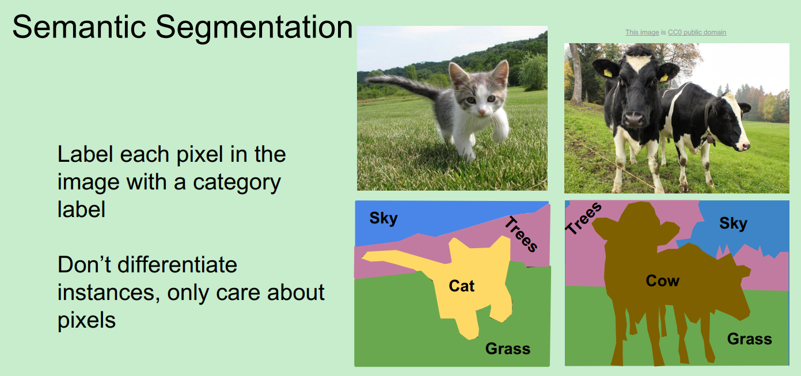

Hình 9.1 Phân vùng ngữ nghĩa: gán nhãn lớp cho từng điểm ảnh, không phân biệt cá thể

**2. Phân vùng thể hiện (instance segmentation)**

Khác phân vùng ngữ nghĩa, phân vùng thể hiện chỉ gán lớp cho các vật cụ thể (vật đếm được) và tách riêng từng cá thể; điểm này hơi giống phát hiện đối tượng, nhưng phát hiện đối tượng cho ra hộp bao và lớp, còn phân vùng thể hiện cho ra mặt nạ (mask) và lớp.

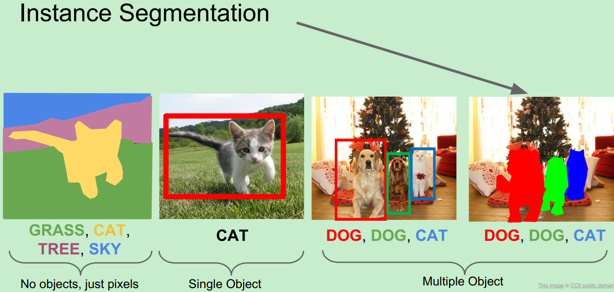

Hình 9.2 Từ phân vùng ngữ nghĩa (không có vật, chỉ có điểm ảnh) tới phân loại–định vị (một vật), phát hiện và phân vùng thể hiện (nhiều vật)

## 9.2 Phương pháp phân vùng truyền thống dựa trên CNN có nhược điểm gì?

<div class="qa-theory">

**Lý thuyết:** [Học sâu · 7.1 Từ Tầng Kết nối Đầy đủ đến Tích chập](dl/ch07_s1_vi) · [d2l (tiếng Anh) · 14.11 Mạng tích chập hoàn toàn](https://d2l.ai/chapter_computer-vision/fcn.html) ↗

</div>

Phương pháp phân vùng truyền thống dựa trên CNN: để phân loại một điểm ảnh, lấy một mảnh ảnh xung quanh điểm ảnh đó làm đầu vào của CNN để huấn luyện và dự đoán. Cách này có mấy nhược điểm chính:

1. **Tốn bộ nhớ.** Ví dụ mỗi điểm ảnh dùng một mảnh 15 × 15, trượt cửa sổ liên tục, đưa từng mảnh vào CNN để phán đoán lớp; dung lượng cần dùng tăng mạnh theo số lần trượt và kích thước cửa sổ.
2. **Kém hiệu quả.** Các mảnh của các điểm ảnh kề nhau gần như trùng nhau, tính tích chập cho từng mảnh một nên phần lớn phép tính bị lặp.
3. **Kích thước mảnh giới hạn vùng tiếp nhận.** Mảnh thường nhỏ hơn cả ảnh rất nhiều, chỉ trích được đặc trưng cục bộ, làm hiệu năng phân loại bị hạn chế.

Còn mạng tích chập hoàn toàn (FCN) khôi phục lớp của từng điểm ảnh từ đặc trưng trừu tượng, tức mở rộng từ phân loại mức ảnh sang phân loại mức điểm ảnh.

## 9.3 FCN

### 9.3.1 FCN thay đổi điều gì?

<div class="qa-theory">

**Lý thuyết:** [d2l (tiếng Anh) · 14.11 Mạng tích chập hoàn toàn](https://d2l.ai/chapter_computer-vision/fcn.html) ↗

</div>

Các mạng CNN phân loại thông thường như VGG và ResNet đều thêm vài tầng kết nối đầy đủ ở cuối, qua softmax là có xác suất các lớp. Nhưng thông tin xác suất này là một chiều, chỉ cho biết lớp của cả ảnh, không cho biết lớp của từng điểm ảnh, nên cách kết nối đầy đủ này không dùng được cho phân vùng ảnh.

FCN (Long và cộng sự, 2015) đề xuất thay mấy tầng kết nối đầy đủ phía sau bằng tích chập; như vậy có được một bản đồ đặc trưng hai chiều, theo sau là tầng softmax cho thông tin lớp của từng điểm ảnh, nhờ đó giải quyết bài toán phân vùng, như hình dưới.

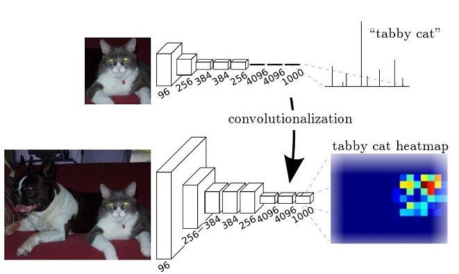

Hình 9.3 Biến các tầng kết nối đầy đủ thành tích chập: thay vì một vector điểm "tabby cat", mạng cho ra bản đồ nhiệt của lớp đó

### 9.3.2 Cấu trúc mạng FCN thế nào?

<div class="qa-theory">

**Lý thuyết:** [d2l (tiếng Anh) · 14.11 Mạng tích chập hoàn toàn](https://d2l.ai/chapter_computer-vision/fcn.html) ↗ · [d2l (tiếng Anh) · 14.10 Tích chập chuyển vị](https://d2l.ai/chapter_computer-vision/transposed-conv.html) ↗

</div>

FCN phân loại ảnh ở mức điểm ảnh, nhờ đó giải quyết bài toán phân vùng ở mức ngữ nghĩa (semantic segmentation). Khác CNN kinh điển dùng tầng kết nối đầy đủ sau các tầng tích chập để có vector đặc trưng độ dài cố định rồi phân loại (tầng kết nối đầy đủ + softmax), FCN nhận ảnh đầu vào kích thước bất kỳ, dùng tầng giải tích chập (deconvolution) để tăng mẫu bản đồ đặc trưng của tầng tích chập cuối về cùng kích thước ảnh đầu vào, nhờ đó sinh dự đoán cho từng điểm ảnh, đồng thời giữ thông tin không gian của ảnh đầu vào gốc, cuối cùng phân loại từng điểm ảnh trên bản đồ đặc trưng đã tăng mẫu.

Hình dưới là sơ đồ cấu trúc mạng tích chập hoàn toàn (FCN) dùng cho phân vùng ngữ nghĩa:

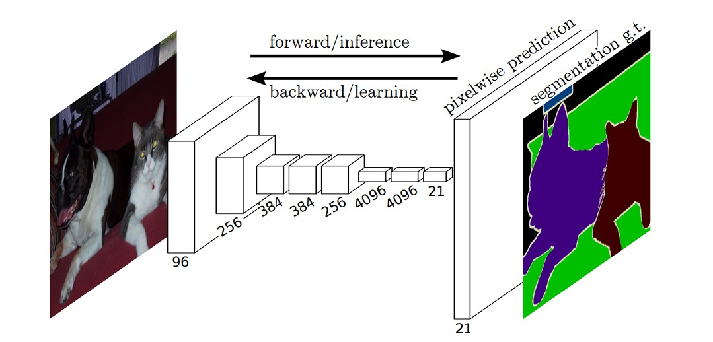

Hình 9.4 FCN: suy luận xuôi cho ra dự đoán từng điểm ảnh, so với nhãn phân vùng thật để học ngược

### 9.3.3 Ví dụ về mạng tích chập hoàn toàn?

<div class="qa-theory">

**Lý thuyết:** [d2l (tiếng Anh) · 14.11 Mạng tích chập hoàn toàn](https://d2l.ai/chapter_computer-vision/fcn.html) ↗

</div>

Thường mạng CNN nối vài tầng kết nối đầy đủ sau các tầng tích chập, ánh xạ bản đồ đặc trưng (feature map) do tầng tích chập sinh ra thành một vector đặc trưng độ dài cố định. Cấu trúc CNN kinh điển tiêu biểu là AlexNet hợp với bài toán phân loại và hồi quy ở mức ảnh, vì cuối cùng đều cho một vector xác suất cho cả ảnh đầu vào.

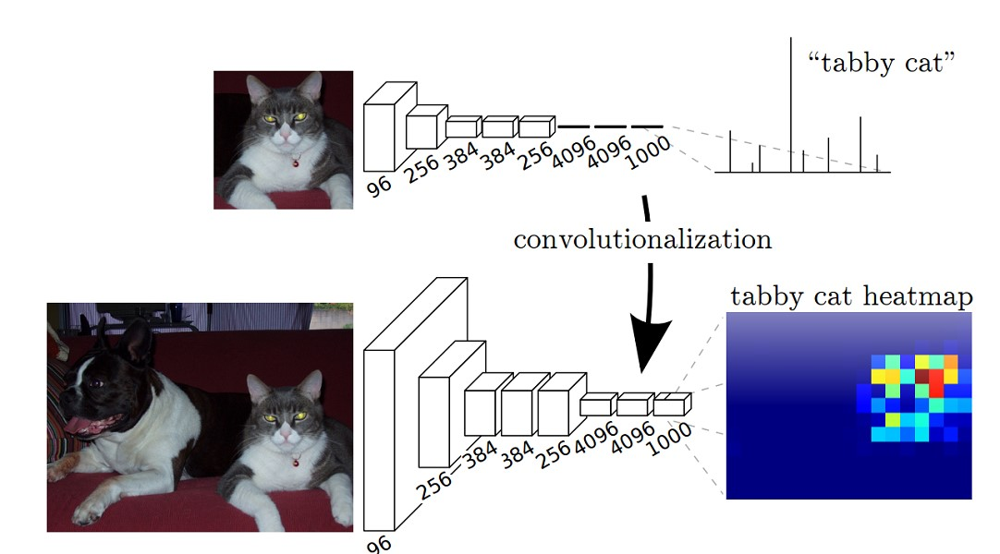

Hình 9.5 Cùng một mạng: dạng phân loại (trên) và dạng tích chập hoàn toàn (dưới)

Như hình trên:

1. Trong CNN, ảnh con mèo đưa vào AlexNet cho một vector đầu ra độ dài 1000, biểu diễn xác suất ảnh thuộc từng lớp; lớp "tabby cat" có xác suất cao nhất, dùng cho bài toán phân loại.
2. FCN khác CNN ở chỗ đổi các tầng kết nối đầy đủ cuối của CNN thành tầng tích chập, đầu ra là một ảnh đã mang nhãn, và ảnh này dùng được cho phân vùng ngữ nghĩa.
3. Sức mạnh của CNN là cấu trúc nhiều tầng tự học được đặc trưng, và học được đặc trưng ở nhiều mức: tầng tích chập nông có vùng tiếp nhận nhỏ, học đặc trưng của vùng cục bộ; tầng tích chập sâu có vùng tiếp nhận lớn, học được đặc trưng trừu tượng hơn. Đặc trưng trừu tượng mức cao ít nhạy với kích thước, vị trí và hướng của vật hơn, giúp tăng hiệu năng nhận dạng; vì vậy ta thường coi tầng tích chập là bộ trích đặc trưng.

### 9.3.4 Tầng kết nối đầy đủ và tầng tích chập chuyển đổi qua lại thế nào?

<div class="qa-theory">

**Lý thuyết:** [Học sâu · 7.4.3 Tầng Tích chập $1\times 1$](dl/ch07_s4_vi?id=_743-tầng-tích-chập-1×11times-11×1) · [Học sâu · 7.1.2 Ràng buộc MLP](dl/ch07_s1_vi?id=_712-ràng-buộc-mlp)

</div>

**Khả năng chuyển đổi qua lại:**

Khác biệt duy nhất giữa tầng kết nối đầy đủ và tầng tích chập là neuron trong tầng tích chập chỉ nối với một vùng cục bộ của dữ liệu đầu vào, và các neuron trong cùng một cột độ sâu dùng chung tham số. Nhưng ở cả hai loại tầng, neuron đều tính tích vô hướng, nên dạng hàm của chúng như nhau. Vì vậy chuyển đổi qua lại giữa hai loại là khả thi:

1. Với bất kỳ tầng tích chập nào cũng có một tầng kết nối đầy đủ thực hiện cùng hàm lan truyền xuôi. Ma trận trọng số là một ma trận khổng lồ, ngoài một số khối nhất định thì toàn số 0, và trong phần lớn các khối, các phần tử bằng nhau.
2. Bất kỳ tầng kết nối đầy đủ nào cũng chuyển được thành tầng tích chập. Ví dụ tầng kết nối đầy đủ đầu tiên của VGG16 có kích thước 25088 × 4096, chuyển thành $512\times7\times7\times4096$, tức một tầng kết nối đầy đủ $K=4096$ với đầu vào kích thước $7\times7\times512$ có thể coi tương đương một tầng tích chập $F=7, P=0, S=1, K=4096$. Nói cách khác, đặt kích thước bộ lọc bằng đúng kích thước khối đầu vào $7\times7$, thì đầu ra thành $1\times1\times4096$, về bản chất giống đầu ra của tầng kết nối đầy đủ.

**Độ sâu của khối kích hoạt đầu ra do số kernel quyết định ($K=4096$).**

Trong hai chiều chuyển đổi, chuyển tầng kết nối đầy đủ thành tầng tích chập hữu ích hơn trong thực tế. Giả sử đầu vào của một mạng tích chập là ảnh $224\times224\times3$, một loạt tầng tích chập và giảm mẫu biến dữ liệu ảnh thành khối kích hoạt $7\times7\times512$ (năm lần giảm mẫu hệ số 2: $224/32=7$); sau đó dùng hai tầng kết nối đầy đủ kích thước 4096, và một tầng kết nối đầy đủ cuối có 1000 neuron để tính điểm phân loại. Ta có thể chuyển bất kỳ tầng nào trong 3 tầng kết nối đầy đủ thành tầng tích chập:

1. Tầng kết nối đầy đủ thứ nhất nối với vùng $[7\times7\times512]$: đặt kích thước bộ lọc $F=7$, $K=4096$, khối đầu ra là $[1\times1\times4096]$.
2. Tầng kết nối đầy đủ thứ hai: đặt $F=1$, $K=4096$, khối đầu ra là $[1\times1\times4096]$.
3. Tầng kết nối đầy đủ cuối làm tương tự: $F=1$, $K=1000$, đầu ra cuối là $[1\times1\times1000]$.

> **Biên tập:** đoạn này dịch từ bài giảng CS231n; bản gốc ghi ảnh đầu vào $227\times227$ và gọi là "cách xử lý của AlexNet". Theo CS231n, ví dụ dùng ảnh $224\times224$ để qua 5 lần giảm mẫu còn đúng $7\times7$; AlexNet thật thì cho ra $6\times6\times256$ trước các tầng kết nối đầy đủ.

### 9.3.5 Vì sao CNN truyền thống cần ảnh đầu vào kích thước cố định?

<div class="qa-theory">

**Lý thuyết:** [Học sâu · 7.3 Đệm và Sải bước](dl/ch07_s3_vi) · [Học sâu · 7.5 Gộp](dl/ch07_s5_vi)

</div>

Với CNN, ảnh đầu vào đi qua tầng tích chập và tầng gộp thì các tầng này không quan tâm kích thước ảnh. Ví dụ với một tầng tích chập, $\text{outputsize} = (\text{inputsize} - \text{kernelsize}) / \text{stride} + 1$ (không đệm); nó không quan tâm inputsize lớn bao nhiêu, nhận bản đồ đặc trưng kích thước inputsize, trượt cửa sổ tích chập, cho ra bản đồ đặc trưng kích thước outputsize là được. Tầng gộp cũng vậy. Nhưng khi vào tầng kết nối đầy đủ, bản đồ đặc trưng (giả sử kích thước $n\times n$) phải duỗi thành một vector, mỗi phần tử của vector (tổng $n\times n$) là một nút nối với mọi nút của tầng sau (giả sử 4096 nút), số trọng số ở đây là $4096\times n\times n$; mà cấu trúc mạng neuron một khi đã xác định thì số trọng số là cố định, nên $n$ không được thay đổi. $n$ là outputsize của conv5, nên lần ngược lại từng tầng, mỗi outputsize đều phải cố định, mỗi inputsize đều phải cố định, do đó kích thước ảnh đầu vào phải cố định.

### 9.3.6 Định dạng lại trọng số $W$ của tầng kết nối đầy đủ thành bộ lọc của tầng tích chập có lợi gì?

<div class="qa-theory">

**Lý thuyết:** [d2l (tiếng Anh) · 14.11 Mạng tích chập hoàn toàn](https://d2l.ai/chapter_computer-vision/fcn.html) ↗

</div>

Chuyển đổi này cho phép, trong một lần lan truyền xuôi duy nhất, mạng tích chập trượt trên một ảnh đầu vào lớn hơn, cho ra nhiều đầu ra (có thể hiểu là một bản đồ nhãn).

Ví dụ: ta muốn cho cửa sổ 224×224 trượt với sải bước 32 trên ảnh 384×384, đưa từng vị trí dừng vào mạng tích chập, cuối cùng có điểm lớp của 6×6 vị trí; thì sau khi chuyển tầng kết nối đầy đủ thành tầng tích chập, quá trình tính là:

Nếu ảnh đầu vào 224×224 qua các tầng tích chập và giảm mẫu cho mảng $[7\times7\times512]$, thì ảnh lớn 384×384 đi thẳng qua cùng các tầng đó sẽ cho mảng $[12\times12\times512]$; rồi qua 3 tầng tích chập chuyển từ 3 tầng kết nối đầy đủ ở trên, cuối cùng cho đầu ra $[6\times6\times1000]$ ($(12 - 7)/1 + 1 = 6$); kết quả này chính là điểm tại 6×6 vị trí dừng của cửa sổ trên ảnh gốc.

Mạng CNN cố định phải cố định kích thước ảnh đầu vào vì số trọng số của tầng kết nối đầy đủ cố định, mà số trọng số liên quan tới kích thước bản đồ đặc trưng; nhưng FCN trên nền CNN đổi tầng kết nối đầy đủ 1000 nút thành tầng tích chập có 1000 kernel $1\times1$, qua tầng này vẫn được bản đồ đặc trưng hai chiều, mà ta cũng không quan tâm kích thước bản đồ này, nên không giới hạn kích thước ảnh đầu vào.

Như hình dưới, FCN chuyển các tầng kết nối đầy đủ của CNN truyền thống thành tầng tích chập; ứng với mạng CNN, FCN đổi ba tầng kết nối đầy đủ cuối thành ba tầng tích chập:

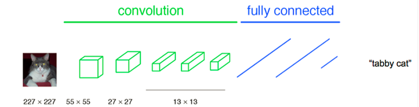

Hình 9.6 Một mạng phân loại

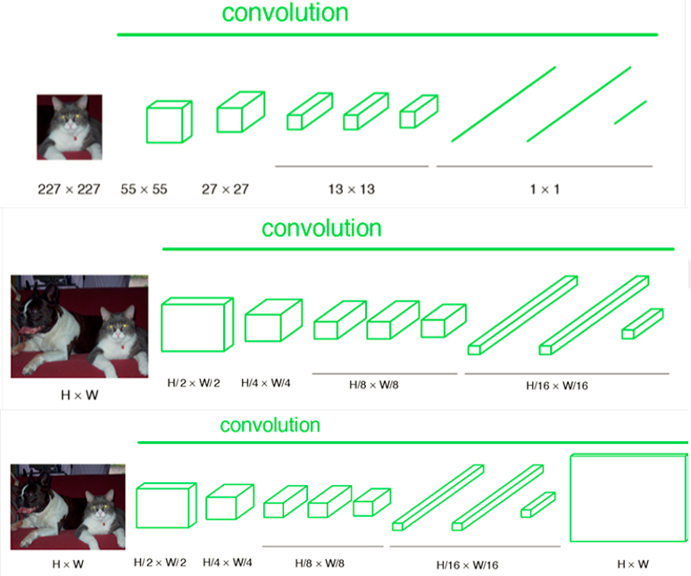

Hình 9.7 Biến thành mạng tích chập hoàn toàn

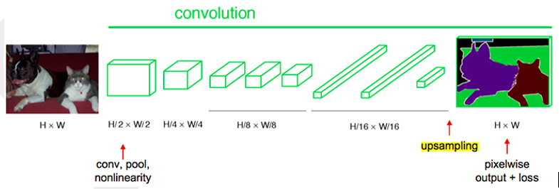

Hình 9.8 Mạng đầu-cuối, điểm ảnh tới điểm ảnh (end-to-end, pixels-to-pixels)

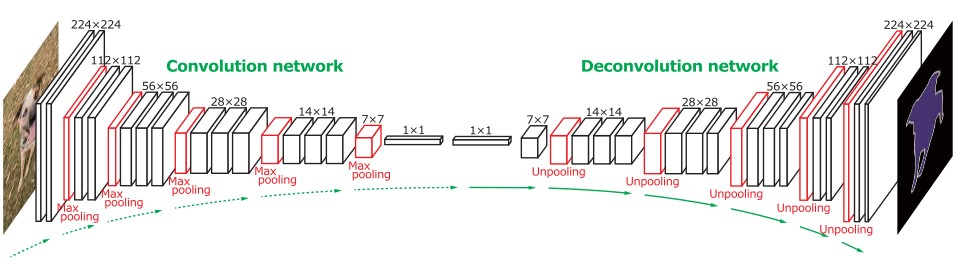

Hình 9.9 Mạng tích chập (trái) và mạng giải tích chập đối xứng (phải)

1. **Chuyển tầng kết nối đầy đủ thành tầng tích chập:** trong cấu trúc CNN truyền thống, 5 tầng đầu là tầng tích chập, tầng 6 và 7 mỗi tầng là một vector một chiều độ dài 4096, tầng 8 là vector một chiều độ dài 1000, ứng với xác suất của 1000 lớp. FCN biểu diễn 3 tầng này thành tầng tích chập, kích thước kernel (số kênh, rộng, cao) lần lượt là (4096,1,1), (4096,1,1), (1000,1,1). Về con số trông không khác, nhưng tích chập và kết nối đầy đủ là hai khái niệm, hai cách tính khác nhau; dùng trọng số và độ lệch của CNN đã huấn luyện, nhưng ở đây trọng số và độ lệch có phạm vi của chúng, thuộc về một kernel tích chập riêng.
2. Trong AlexNet, ảnh đầu vào thống nhất kích thước $227\times227$; sau conv1 còn $55\times55$, sau tầng gộp thứ nhất $27\times27$, sau tầng gộp thứ hai $13\times13$, sau tầng gộp thứ năm (pool5) $6\times6$. Còn FCN nhận ảnh kích thước $H\times W$ (trên nền VGG16): sau tầng gộp thứ nhất còn 1/2 ảnh gốc, thứ hai 1/4, thứ ba 1/8, thứ tư 1/16, thứ năm 1/32.
3. Qua nhiều lần tích chập và gộp, ảnh ngày càng nhỏ, độ phân giải ngày càng thấp. Khi tới $H/32 \times W/32$, tầng nhỏ nhất, ảnh sinh ra gọi là bản đồ nhiệt (heatmap); bản đồ nhiệt là bản đồ đặc trưng nhiều chiều quan trọng nhất. Có bản đồ nhiệt rồi thì bước quan trọng nhất và cũng là bước cuối là tăng mẫu (upsampling), phóng ảnh lên vài lần về kích thước ảnh gốc.

So với dùng mạng tích chập gốc trước khi chuyển đổi để lặp tính cả 36 vị trí, rồi dự đoán cho 36 vị trí, dùng mạng đã chuyển đổi chạy một lần lan truyền xuôi hiệu quả hơn nhiều, vì 36 lần tính đó dùng chung tài nguyên tính toán. Mẹo này rất hay dùng trong thực tế: thường phóng ảnh to hơn, dùng mạng đã chuyển đổi để chấm điểm phân loại ở nhiều vị trí không gian khác nhau, rồi lấy trung bình các điểm.

> **Biên tập:** bản gốc ghi kích thước sau các tầng gộp sai ở cả hai mạng: AlexNet được ghi "sau tầng gộp 1 là 55×55, tầng gộp 2 là 27×27, tầng gộp 5 là 13×13" (đúng là 55×55 sau conv1, rồi 27, 13, 6), còn FCN được ghi "tầng gộp 5 là 1/8, tầng 8 là 1/16" mâu thuẫn với chính câu sau ($H/32$). Với VGG16 có năm tầng gộp, tỉ lệ là $1/2, 1/4, 1/8, 1/16, 1/32$. Đã sửa.

### 9.3.7 Hiểu tầng giải tích chập thế nào?

<div class="qa-theory">

**Lý thuyết:** [d2l (tiếng Anh) · 14.10 Tích chập chuyển vị](https://d2l.ai/chapter_computer-vision/transposed-conv.html) ↗

</div>

Phép tăng mẫu (upsampling) có thể coi là giải tích chập (deconvolution); tham số của phép tính này, như tham số của CNN, được học bằng lan truyền ngược khi huấn luyện mô hình FCN. Tầng giải tích chập cũng là tầng tích chập, không quan tâm kích thước đầu vào, trượt cửa sổ tích chập rồi cho đầu ra. Deconv không phải giải tích chập thật (phép nghịch đảo của tích chập); tên gọi được chấp nhận rộng rãi gần đây là tích chập chuyển vị (transposed convolution): lan truyền xuôi của deconv chính là lan truyền ngược của conv.

Tham số của giải tích chập: dùng chuyển vị của bộ lọc trong tích chập (thực chất là lật bộ lọc theo chiều ngang và dọc) để tính ra bản đồ đặc trưng trước tích chập.

Phép giải tích chập như dưới đây; màu xanh dương là đầu vào của tầng giải tích chập, màu xanh lục là đầu ra.

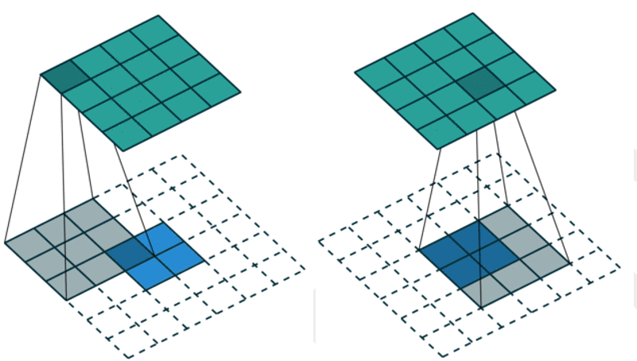

Hình 9.10 Tích chập chuyển vị với đệm đầy đủ (full padding, transposed): đầu vào $2\times2$, đầu ra $4\times4$ (kernel $3\times3$)

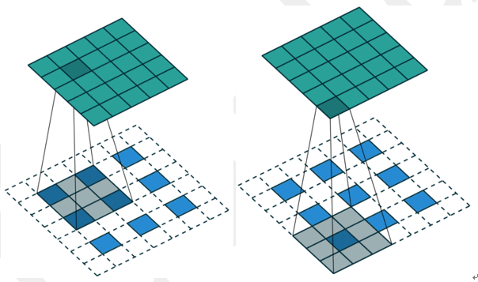

Hình 9.11 Tích chập chuyển vị có đệm, sải bước khác 1 (zero padding, non-unit strides, transposed): đầu vào $3\times3$ được chèn số 0 giữa các phần tử, đầu ra $5\times5$

### 9.3.8 Cấu trúc nhảy tầng (skip)

<div class="qa-theory">

**Lý thuyết:** [d2l (tiếng Anh) · 14.11 Mạng tích chập hoàn toàn](https://d2l.ai/chapter_computer-vision/fcn.html) ↗ · [Ôn tập · 8.2.5 FPN](qa/ch08_vi?id=_825-fpn)

</div>

Xử lý kết quả của CNN được dự đoán dày đặc (dense prediction), nhưng tác giả thấy trong thực nghiệm kết quả phân vùng khá thô, nên cân nhắc thêm thông tin chi tiết của các tầng trước, tức hợp nhất (fusion) đầu ra của vài tầng gần cuối với đầu ra cuối, thực chất là phép cộng:

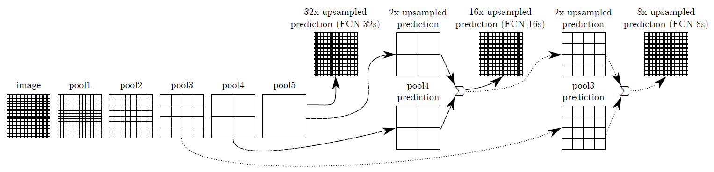

Hình 9.12 Cấu trúc nhảy tầng của FCN: dự đoán từ pool5 (FCN-32s), cộng thêm pool4 (FCN-16s), cộng thêm pool3 (FCN-8s)

Thực nghiệm cho thấy kết quả phân vùng như vậy chi tiết và chính xác hơn. Trong quá trình hợp nhất từng tầng, làm tới hàng thứ ba (FCN-8s) mà xuống thêm nữa thì kết quả lại không tốt hơn, nên tác giả dừng ở đây.

### 9.3.9 Huấn luyện mô hình

<div class="qa-theory">

**Lý thuyết:** [Ôn tập · 14.4.2 Có những cách tinh chỉnh nào?](qa/ch14_vi?id=_1442-có-những-cách-tinh-chỉnh-nào) · [d2l (tiếng Anh) · 14.11 Mạng tích chập hoàn toàn](https://d2l.ai/chapter_computer-vision/fcn.html) ↗

</div>

1. Khởi tạo bằng mô hình đã huấn luyện của AlexNet, VGG16 hay GoogLeNet, rồi tinh chỉnh (fine-tuning) toàn bộ trên nền đó; chỉ cần thêm tăng mẫu ở cuối, việc học tham số vẫn dùng lan truyền ngược của CNN.
2. Huấn luyện trên cả ảnh (whole image), không lấy mẫu theo mảnh (patchwise sampling). Thực nghiệm cho thấy dùng thẳng cả ảnh đã hiệu quả và nhanh (effective and efficient).
3. Khởi tạo toàn số 0 cho tầng tích chập cho điểm lớp (class score). Khởi tạo ngẫu nhiên không có lợi về hiệu năng hay hội tụ.

*Ví dụ:*

*FCN: đầu vào là ảnh màu kích thước bất kỳ; đầu ra cùng kích thước đầu vào, độ sâu là 20 lớp đối tượng + nền = 21; mô hình dựa trên AlexNet.*

- *Xanh dương: tầng tích chập.*
- *Xanh lá: tầng max pooling.*
- *Vàng: phép cộng, cộng từng phần tử để hợp nhất ba dự đoán ở ba độ sâu khác nhau: dự đoán nông chi tiết hơn, dự đoán sâu bền vững hơn.*
- *Xám: cắt (crop); trước khi hợp nhất, dùng tầng cắt để thống nhất kích thước hai bên, cuối cùng cắt về cùng kích thước đầu vào.*
- *Với ảnh đầu vào kích thước khác nhau, kích thước (cao, rộng) dữ liệu các tầng thay đổi theo, độ sâu (số kênh) không đổi.*

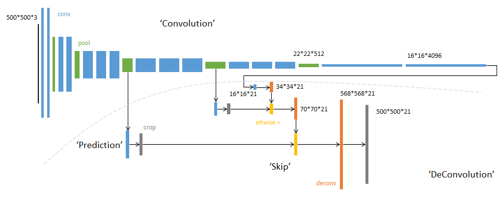

Hình 9.13 Cấu trúc FCN đầy đủ: tích chập, dự đoán, nhảy tầng, giải tích chập

1. Phần tích chập hoàn toàn trích đặc trưng; lấy đầu ra của các tầng tích chập (3 tầng xanh dương) làm đặc trưng để dự đoán 21 lớp.
2. Trong khung nét đứt là phép giải tích chập; các tầng giải tích chập (3 tầng màu cam) phóng to kích thước dữ liệu đầu vào. Như tầng tích chập, tham số cụ thể của tăng mẫu được xác định qua huấn luyện.

   1) Khởi tạo từ mạng phân loại AlexNet kinh điển. Hai tầng cuối là kết nối đầy đủ (màu đỏ), bỏ không dùng tham số.

   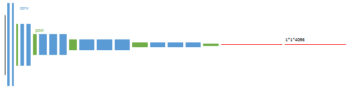

   2) Từ bản đồ đặc trưng nhỏ dự đoán bản đồ phân vùng nhỏ, rồi tăng mẫu thẳng lên bản đồ lớn.

   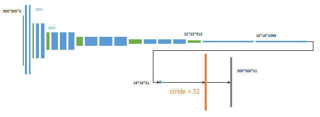

   Hình 9.14 Giải tích chập (màu cam) có sải bước 32, mạng này gọi là FCN-32s

   3) Tăng mẫu làm hai lần (cam × 2); trước lần tăng mẫu thứ hai, hợp nhất thêm dự đoán (xanh dương) từ tầng gộp thứ 4 (xanh lá). Dùng cấu trúc nhảy tầng để tăng độ chính xác.

   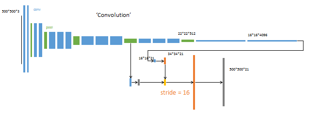

   Hình 9.15 Lần giải tích chập thứ hai có sải bước 16, mạng này gọi là FCN-16s

   4) Tăng mẫu làm ba lần (cam × 3), hợp nhất thêm dự đoán từ tầng gộp thứ 3.

   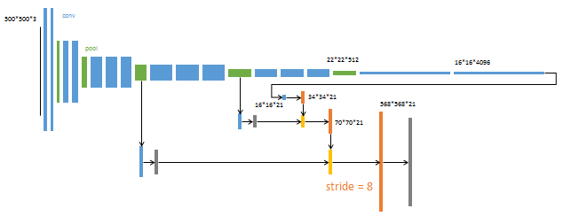

   Hình 9.16 Lần giải tích chập thứ ba có sải bước 8, gọi là FCN-8s

Các tham số khác:

- minibatch: 20 ảnh;
- tốc độ học: 0.001 (với AlexNet; bài báo dùng $10^{-4}$ cho VGG16 và $10^{-5}$ cho GoogLeNet);
- khởi tạo: tham số các tầng tích chập ngoài mạng phân loại khởi tạo bằng 0;
- tham số giải tích chập khởi tạo bằng nội suy song tuyến tính (bilinear);
- tầng giải tích chập cuối cố định là nội suy song tuyến tính, không học.

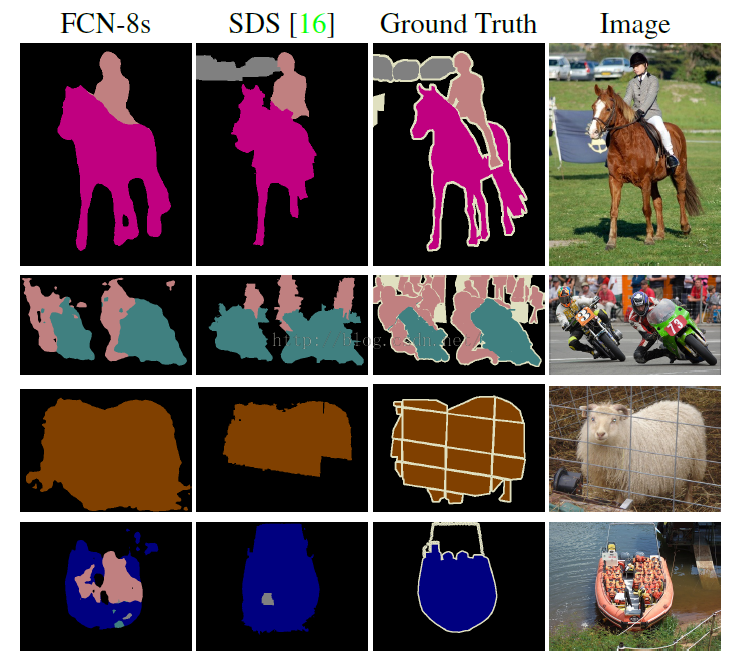

Hình 9.17 So sánh FCN-8s, SDS, nhãn thật và ảnh gốc

### 9.3.10 FCN có nhược điểm gì?

<div class="qa-theory">

**Lý thuyết:** [d2l (tiếng Anh) · 14.11 Mạng tích chập hoàn toàn](https://d2l.ai/chapter_computer-vision/fcn.html) ↗

</div>

1. Kết quả vẫn chưa đủ tinh. Tăng mẫu 8 lần tuy tốt hơn 32 lần nhiều, nhưng kết quả tăng mẫu vẫn khá mờ và trơn, không nhạy với chi tiết trong ảnh.
2. Phân loại từng điểm ảnh, chưa xét đầy đủ quan hệ giữa các điểm ảnh. Bỏ qua bước chuẩn hóa không gian (spatial regularization) mà các phương pháp phân vùng dựa trên phân loại điểm ảnh thường dùng, nên thiếu nhất quán không gian.

## 9.3b U-Net

<div class="qa-theory">

**Lý thuyết:** [Ôn tập · Bổ sung: ResNet và DenseNet](qa/ch04_vi?id=bổ-sung-resnet-và-densenet) · [d2l (tiếng Anh) · 14.10 Tích chập chuyển vị](https://d2l.ai/chapter_computer-vision/transposed-conv.html) ↗

</div>

Mạng tích chập được dùng rộng rãi cho bài toán phân loại, kết quả là nhãn lớp của cả ảnh. Nhưng trong nhiều bài toán thị giác, nhất là xử lý ảnh y sinh, đầu ra mong muốn phải gồm vị trí của lớp đối tượng, và mỗi điểm ảnh đều phải có nhãn lớp. Ngoài ra, ảnh y sinh thường thiếu ảnh huấn luyện. Vì vậy Ciresan và cộng sự huấn luyện một mạng neuron tích chập dùng cửa sổ trượt lấy vùng xung quanh điểm ảnh (mảnh, patch) làm đầu vào để dự đoán nhãn lớp của từng điểm ảnh. Mạng này có hai ưu điểm: một, kết quả định vị được vị trí lớp đối tượng; hai, vì dữ liệu huấn luyện đầu vào là các mảnh, tương đương tăng cường dữ liệu, giải quyết vấn đề ảnh y sinh ít.

Nhưng cách này cũng có hai nhược điểm rõ:

1. **Rất chậm**, vì mạng phải chạy cho từng mảnh, và các mảnh chồng nhau nhiều nên rất dư thừa. (Dư thừa gây ảnh hưởng gì? Trọng số $W$ trong kernel là trọng số trích đặc trưng; hai mảnh chồng nhau quá nhiều thì trọng số bị cùng một số đặc trưng huấn luyện hai lần, lãng phí tài nguyên, giảm tốc độ và hiệu suất huấn luyện. Có người nói dư thừa thì tập huấn luyện lớn hơn, độ chính xác chẳng cao hơn sao? Nhưng đây là cùng một ảnh, phần chồng nhau là giống hệt; giống như dùng một ảnh huấn luyện 20 lần, cũng là "tăng tập huấn luyện", nhưng kết quả dễ thấy là quá khớp: nhận ảnh này rất chuẩn, ảnh khác thì chưa chắc.)
2. **Độ chính xác định vị và lấy thông tin ngữ cảnh không thể có cả hai.** Mảnh lớn cần nhiều tầng max pooling hơn, làm giảm độ chính xác định vị (vì sao? vì ta phân loại điểm ảnh ở tâm mảnh; nếu mảnh quá lớn, kích thước tầng ngay trước tầng kết nối đầy đủ vẫn cố định, nên mảnh lớn cần nhiều tầng gộp hơn để thu về kích thước đó, mà càng nhiều tầng gộp thì càng mất thông tin); mảnh nhỏ thì chỉ thấy thông tin cục bộ rất nhỏ, không đủ ngữ cảnh.

Bài báo U-Net (Ronneberger và cộng sự, 2015) xây dựng một phương pháp tích chập hoàn toàn tốt hơn, dùng ít ảnh huấn luyện hơn mà phân vùng chính xác hơn.

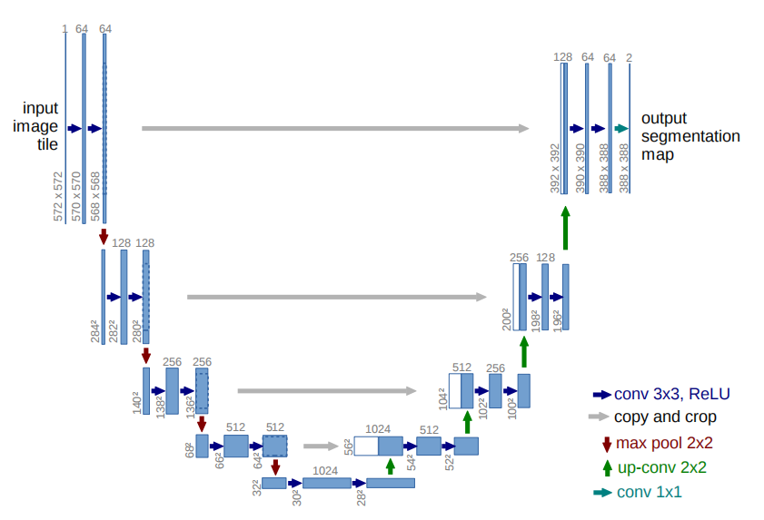

Hình 9.18 Cấu trúc U-Net: nhánh co (trái) và nhánh giãn (phải), nối bằng các đường sao chép và cắt

1. Dùng mạng neuron tích chập hoàn toàn. (Mạng tích chập hoàn toàn là thay tầng kết nối đầy đủ bằng tích chập; tầng kết nối đầy đủ cần cố định kích thước ảnh còn tích chập thì không, nên có thể nhập ảnh kích thước bất kỳ, đầu ra cũng là ảnh, tức một mạng đầu-cuối.)
2. Mạng bên trái là **đường co (contracting path)**: dùng tích chập và max pooling.
3. Mạng bên phải là **đường giãn (expansive path)**: ghép nối (concatenate) bản đồ đặc trưng sinh ra bởi tăng mẫu với bản đồ đặc trưng ở tầng tương ứng của đường co bên trái. (Tầng gộp làm mất thông tin ảnh và giảm độ phân giải, lại không đảo ngược được, ảnh hưởng tới phân vùng, còn với phân loại thì ít ảnh hưởng. Vì sao phải tăng mẫu? Vì tăng mẫu bù lại một phần thông tin, nhưng chắc chắn không đủ, nên phải nối với ảnh độ phân giải cao hơn ở bên trái (sao chép thẳng sang rồi cắt cho bằng kích thước ảnh tăng mẫu); như vậy là cân bằng giữa độ phân giải cao và đặc trưng trừu tượng: càng tích chập nhiều thì đặc trưng càng hiệu quả, càng trừu tượng, ảnh tăng mẫu đã qua nhiều lần tích chập nên hiệu quả và trừu tượng, rồi nối nó với ảnh đặc trưng bên trái ít trừu tượng nhưng độ phân giải cao hơn.)
4. Cuối cùng dùng một tích chập $1\times1$ ánh xạ đặc trưng 64 kênh thành 2 bản đồ điểm (heatmap), ví dụ bản đồ thứ nhất là điểm của lớp thứ nhất, bản đồ thứ hai là điểm của lớp thứ hai; hai bản đồ này làm đầu vào của softmax, cho xác suất mỗi lớp tại mỗi điểm ảnh, rồi đưa vào entropy chéo để lan truyền ngược huấn luyện.

> **Biên tập:** bản gốc viết bước cuối là "qua thêm hai lần giải tích chập, rồi dùng **hai** tích chập 1×1 để phân loại"; theo bài báo, cuối mạng chỉ có **một** tích chập $1\times1$ cho ra 2 kênh (số lớp). Bài báo U-Net dùng tích chập không đệm (valid) nên ảnh ra nhỏ hơn ảnh vào, vì thế mới cần "sao chép và cắt"; nhiều bản cài đặt hiện nay (như code dưới) dùng đệm `same` nên không cần cắt.

Dưới đây là code cài đặt mô hình U-Net bằng Keras (người đóng góp: Hoàng Khâm Kiến, Đại học Công nghệ Hoa Nam):

```python
from tensorflow.keras.layers import (Input, Conv2D, MaxPooling2D,
                                     Conv2DTranspose, concatenate)
from tensorflow.keras.models import Model
from tensorflow.keras.optimizers import Adam
from tensorflow.keras import backend as K

img_rows, img_cols = 96, 96   # kích thước ảnh đầu vào (ví dụ)
smooth = 1.0

def dice_coef(y_true, y_pred):
    # Hệ số Dice: 2|A∩B| / (|A|+|B|), "smooth" tránh chia cho 0
    y_true_f = K.flatten(y_true)
    y_pred_f = K.flatten(y_pred)
    intersection = K.sum(y_true_f * y_pred_f)
    return (2. * intersection + smooth) / (K.sum(y_true_f) + K.sum(y_pred_f) + smooth)

def dice_coef_loss(y_true, y_pred):
    return -dice_coef(y_true, y_pred)

def get_unet():
    inputs = Input((img_rows, img_cols, 1))
    conv1 = Conv2D(32, (3, 3), activation='relu', padding='same')(inputs)
    conv1 = Conv2D(32, (3, 3), activation='relu', padding='same')(conv1)
    pool1 = MaxPooling2D(pool_size=(2, 2))(conv1)
    # pool1 = Dropout(0.25)(pool1)
    # pool1 = BatchNormalization()(pool1)

    conv2 = Conv2D(64, (3, 3), activation='relu', padding='same')(pool1)
    conv2 = Conv2D(64, (3, 3), activation='relu', padding='same')(conv2)
    pool2 = MaxPooling2D(pool_size=(2, 2))(conv2)

    conv3 = Conv2D(128, (3, 3), activation='relu', padding='same')(pool2)
    conv3 = Conv2D(128, (3, 3), activation='relu', padding='same')(conv3)
    pool3 = MaxPooling2D(pool_size=(2, 2))(conv3)

    conv4 = Conv2D(256, (3, 3), activation='relu', padding='same')(pool3)
    conv4 = Conv2D(256, (3, 3), activation='relu', padding='same')(conv4)
    pool4 = MaxPooling2D(pool_size=(2, 2))(conv4)

    conv5 = Conv2D(512, (3, 3), activation='relu', padding='same')(pool4)
    conv5 = Conv2D(512, (3, 3), activation='relu', padding='same')(conv5)

    up6 = concatenate([Conv2DTranspose(256, (2, 2), strides=(2, 2), padding='same')(conv5), conv4], axis=3)
    conv6 = Conv2D(256, (3, 3), activation='relu', padding='same')(up6)
    conv6 = Conv2D(256, (3, 3), activation='relu', padding='same')(conv6)

    up7 = concatenate([Conv2DTranspose(128, (2, 2), strides=(2, 2), padding='same')(conv6), conv3], axis=3)
    conv7 = Conv2D(128, (3, 3), activation='relu', padding='same')(up7)
    conv7 = Conv2D(128, (3, 3), activation='relu', padding='same')(conv7)

    up8 = concatenate([Conv2DTranspose(64, (2, 2), strides=(2, 2), padding='same')(conv7), conv2], axis=3)
    conv8 = Conv2D(64, (3, 3), activation='relu', padding='same')(up8)
    conv8 = Conv2D(64, (3, 3), activation='relu', padding='same')(conv8)

    up9 = concatenate([Conv2DTranspose(32, (2, 2), strides=(2, 2), padding='same')(conv8), conv1], axis=3)
    conv9 = Conv2D(32, (3, 3), activation='relu', padding='same')(up9)
    conv9 = Conv2D(32, (3, 3), activation='relu', padding='same')(conv9)

    conv10 = Conv2D(1, (1, 1), activation='sigmoid')(conv9)   # một kênh: xác suất là tiền cảnh

    model = Model(inputs=[inputs], outputs=[conv10])
    model.compile(optimizer=Adam(learning_rate=1e-5),
                  loss=dice_coef_loss, metrics=[dice_coef])
    return model
```

> **Biên tập:** code gốc dùng `img_rows`, `img_cols`, `dice_coef`, `dice_coef_loss` mà không định nghĩa, và thiếu các dòng `import`; bản dịch bổ sung (định nghĩa Dice theo bản cài đặt Kaggle gốc của đoạn code này) và đổi `Adam(lr=...)` thành `Adam(learning_rate=...)` (tham số `lr` đã bị bỏ ở Keras mới). Đây là bản phân vùng nhị phân (một kênh sigmoid), khác bản 2 lớp + softmax của bài báo. Code chưa được chạy lại vì môi trường của site không cài TensorFlow.

## 9.4 SegNet

<div class="qa-theory">

**Lý thuyết:** [Ôn tập · 4.5 VGGNet](qa/ch04_vi?id=_45-vggnet) · [Học sâu · 7.5.1 Gộp Cực đại và Gộp Trung bình](dl/ch07_s5_vi?id=_751-gộp-cực-đại-và-gộp-trung-bình)

</div>

SegNet (Badrinarayanan và cộng sự, 2017) là một bộ máy phân vùng ảnh huấn luyện được, gồm một mạng mã hóa (encoder), một mạng giải mã (decoder) tương ứng, nối với một tầng phân loại mức điểm ảnh. Mạng mã hóa giống hệt 13 tầng tích chập của VGG16. Mạng giải mã ánh xạ bản đồ đặc trưng mã hóa độ phân giải thấp thành bản đồ đặc trưng độ phân giải đầy đủ. Mạng giải mã dùng chỉ số gộp (pooling indices) của các tầng max pooling để tăng mẫu phi tuyến, nên bước tăng mẫu không cần học. Bản đồ thưa có được sau tăng mẫu được tích chập với bộ lọc học được để thành bản đồ đặc trưng dày đặc.

Ưu điểm của tăng mẫu bằng chỉ số tầng gộp:

1. biên được khắc họa rõ hơn;
2. giảm tham số cần huấn luyện;
3. kiểu tăng mẫu này đưa được vào bất kỳ mạng mã hóa–giải mã nào.

Cấu trúc mạng SegNet như hình dưới:

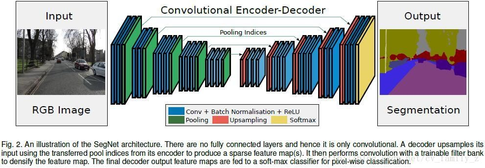

Hình 9.19 Cấu trúc SegNet: bộ mã hóa–giải mã tích chập, truyền chỉ số gộp từ bộ mã hóa sang bộ giải mã

Trong hình, Input là ảnh đầu vào, Output là ảnh phân vùng đầu ra, màu khác nhau là lớp khác nhau. Ý nghĩa của phân vùng ngữ nghĩa là không chỉ cho biết một vật trong ảnh là gì, mà còn cho biết nó ở đâu trong ảnh. Có thể thấy đây là một mạng đối xứng, lấy tầng gộp (xanh lá) và tầng tăng mẫu (đỏ) ở giữa làm ranh giới: bên trái là tích chập trích đặc trưng mức cao, và gộp làm ảnh nhỏ lại, tác giả SegNet gọi là Encoder; bên phải là giải tích chập (ở đây giải tích chập không khác tích chập) và tăng mẫu: giải tích chập làm đặc trưng sau phân loại hiện lại, tăng mẫu làm ảnh lớn lên, tác giả gọi là Decoder; cuối cùng qua Softmax, chọn lớp có giá trị lớn nhất. Đó là quá trình đại khái của SegNet; dưới đây giới thiệu các phương pháp dùng trong quá trình này.

Mạng mã hóa tích chập với bộ lọc để có bản đồ đặc trưng, rồi BN, ReLU, max pooling. Max pooling để có bất biến với dịch chuyển nhỏ trong không gian. Max pooling và giảm mẫu làm mất chi tiết biên, nên giữ thông tin biên trong quá trình mã hóa là quan trọng. Vì bộ nhớ, chỉ lưu chỉ số max pooling, tức vị trí của giá trị đặc trưng lớn nhất.

Kỹ thuật giải mã của SegNet như hình dưới:

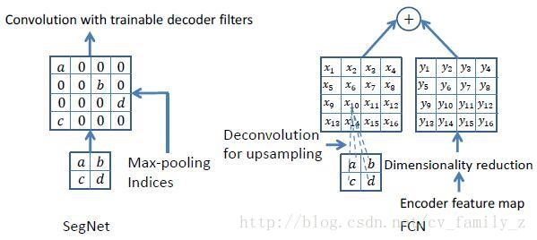

Hình 9.20 Trái: SegNet tăng mẫu bằng chỉ số max pooling rồi tích chập với bộ lọc giải mã học được; phải: FCN giảm chiều bản đồ mã hóa, tăng mẫu bằng giải tích chập rồi cộng

Mạng giải mã dùng chỉ số max pooling đã lưu để tăng mẫu, được bản đồ đặc trưng thưa; tích chập bản đồ này với bộ lọc giải mã học được thành bản đồ đặc trưng dày đặc. Sau đó làm BN. Bản đồ đặc trưng nhiều chiều đưa vào tầng softmax, phân loại từng điểm ảnh, được xác suất mỗi điểm ảnh thuộc $K$ lớp. Bên phải hình trên là kỹ thuật giải mã của FCN: FCN giảm chiều bản đồ đặc trưng đã mã hóa, đưa vào mạng giải mã; trong mạng giải mã, tăng mẫu bằng giải tích chập, bản đồ tăng mẫu được cộng từng phần tử với bản đồ mã hóa đã giảm chiều để có bản đồ giải mã cuối cùng. Mô hình giải mã của FCN phải lưu bản đồ đặc trưng mã hóa, mà thiết bị nhúng thì bộ nhớ eo hẹp.

Trong quá trình Encoder của SegNet, tích chập có tác dụng trích đặc trưng; SegNet dùng tích chập "same", tức tích chập không đổi kích thước ảnh; trong quá trình Decoder cũng dùng tích chập same, nhưng tác dụng của tích chập là làm giàu thông tin cho ảnh đã phóng to bằng tăng mẫu, để thông tin bị mất trong quá trình gộp được học lại ở Decoder. Tích chập trong SegNet không khác tích chập của CNN truyền thống.

> **Biên tập:** bản gốc viết "mạng **giải mã** giống 13 tầng tích chập của VGG16"; đúng là mạng **mã hóa**.

## 9.5 Tích chập giãn (Dilated Convolutions)

<div class="qa-theory">

**Lý thuyết:** [Ôn tập · 5.4 Có những loại kernel tích chập nào?](qa/ch05_vi?id=_54-có-những-loại-kernel-tích-chập-nào) · [Học sâu · 7.2.6 Ánh xạ Đặc trưng và Vùng Tiếp nhận](dl/ch07_s2_vi?id=_726-Ánh-xạ-Đặc-trưng-và-vùng-tiếp-nhận)

</div>

Trong phân vùng ảnh, ảnh đi vào CNN (mạng điển hình như FCN): FCN trước hết tích chập rồi gộp như CNN truyền thống, giảm kích thước ảnh đồng thời tăng vùng tiếp nhận; nhưng vì phân vùng là dự đoán cho từng điểm ảnh (pixel-wise), phải tăng mẫu ảnh nhỏ sau gộp về kích thước gốc để dự đoán (tăng mẫu thường dùng giải tích chập). Phép gộp trước đó giúp mỗi dự đoán điểm ảnh thấy được vùng tiếp nhận lớn. Vì vậy FCN trong phân vùng ảnh có hai điểm then chốt: gộp để giảm kích thước và tăng vùng tiếp nhận, tăng mẫu để phóng to kích thước. Trong quá trình thu nhỏ rồi phóng to, chắc chắn có thông tin bị mất; vậy có thể thiết kế một phép toán mới không cần gộp mà vẫn có vùng tiếp nhận lớn, thấy được nhiều thông tin không? Câu trả lời là tích chập giãn (dilated conv, Yu và Koltun, 2016).

Tóm tắt vấn đề chính của CNN trước đây:

1. Tầng tăng mẫu / gộp (up-sampling / pooling layer):
2. làm mất cấu trúc dữ liệu bên trong; mất thông tin phân cấp không gian;
3. không tái tạo được thông tin của vật nhỏ (giả sử có bốn tầng gộp thì về lý thuyết mọi vật nhỏ hơn $2^4 = 16$ điểm ảnh không tái tạo được).

Ví dụ như sau:

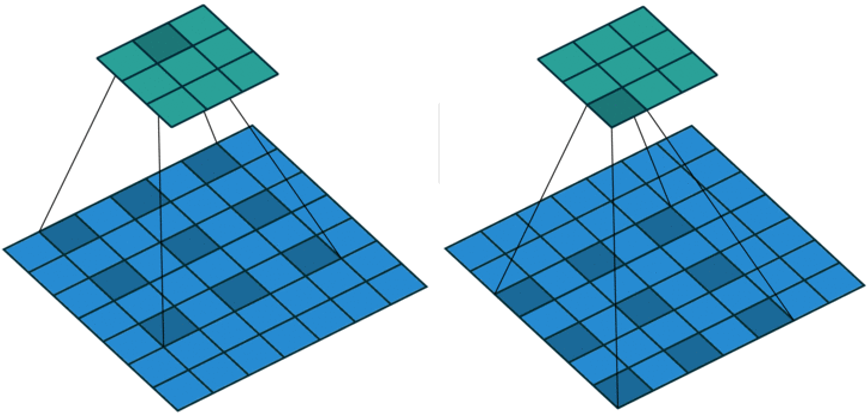

Hình 9.21 Tích chập giãn với kernel $3\times3$ và hệ số giãn 2

Xem sơ đồ trong bài báo gốc về tích chập giãn:

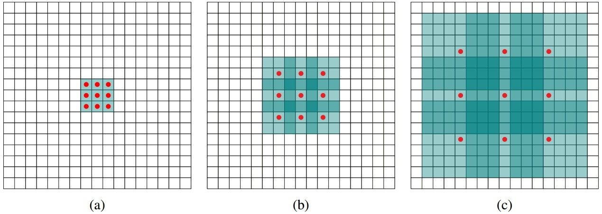

Hình 9.22 (a) giãn 1; (b) giãn 2; (c) giãn 4

Hình (a) là tích chập $3\times3$ giãn 1, giống tích chập thường; hình (b) là tích chập $3\times3$ giãn 2, kích thước kernel thực tế vẫn là $3\times3$ nhưng có lỗ hổng 1, tức với một mảnh $7\times7$ chỉ có 9 điểm đỏ tham gia tích chập với kernel $3\times3$, các điểm khác bỏ qua. Cũng có thể hiểu kernel có kích thước $7\times7$ nhưng chỉ 9 điểm trong hình có trọng số khác 0, còn lại đều bằng 0. Có thể thấy dù kernel chỉ $3\times3$, vùng tiếp nhận của tích chập này đã tăng lên $7\times7$ (nếu tính tầng trước tích chập giãn 2 là một tích chập giãn 1, thì mỗi điểm đỏ là đầu ra của tích chập giãn 1, có vùng tiếp nhận $3\times3$, nên tích chập giãn 1 và giãn 2 gộp lại đạt vùng tiếp nhận $7\times7$). Hình (c) là tích chập giãn 4, tương tự đặt sau hai tích chập giãn 1 và giãn 2, đạt vùng tiếp nhận $15\times15$. So với tích chập truyền thống: ba tầng tích chập $3\times3$ cộng lại với sải bước 1 chỉ đạt vùng tiếp nhận $(\text{kernel}-1)\times\text{layer}+1=7$, tức tăng tuyến tính theo số tầng, còn tích chập giãn (với hệ số giãn tăng gấp đôi mỗi tầng) cho vùng tiếp nhận tăng theo hàm mũ.

Lợi ích của tích chập giãn là không gộp (không mất thông tin) mà vẫn tăng vùng tiếp nhận, giúp mỗi đầu ra tích chập chứa thông tin của vùng rộng. Trong các bài toán ảnh cần thông tin toàn cục hay âm thanh, văn bản cần phụ thuộc chuỗi dài, tích chập giãn đều dùng rất tốt, ví dụ phân vùng ảnh, tổng hợp tiếng nói WaveNet, dịch máy ByteNet.

## 9.6 RefineNet

<div class="qa-theory">

**Lý thuyết:** [Ôn tập · Bổ sung: ResNet và DenseNet](qa/ch04_vi?id=bổ-sung-resnet-và-densenet) · [Ôn tập · 8.2.5 FPN](qa/ch08_vi?id=_825-fpn)

</div>

**Cấu trúc mạng:**

Tác dụng của khối RefineNet (Lin và cộng sự, 2017) là hợp nhất bản đồ đặc trưng ở các mức độ phân giải khác nhau. Cấu trúc mạng như sau:

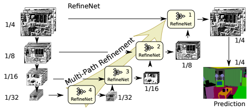

Hình 9.23 RefineNet tinh chỉnh nhiều đường: đặc trưng 1/4, 1/8, 1/16, 1/32 của ResNet đi qua chuỗi khối RefineNet

Cột ngoài cùng bên trái là phần mã hóa của FCN (bài báo dùng ResNet): trước hết chia ResNet huấn luyện sẵn thành bốn khối theo độ phân giải của bản đồ đặc trưng, rồi đi sang phải, dùng bốn khối làm bốn đường đi qua các khối RefineNet để hợp nhất và tinh chỉnh, cuối cùng được một bản đồ đặc trưng đã tinh chỉnh (nối softmax rồi nội suy song tuyến tính để ra kết quả). Chú ý: trừ RefineNet-4, mọi khối RefineNet đều có hai đầu vào, dùng để hợp nhất các mức khác nhau; còn RefineNet-4 một đầu vào có thể coi là bước thích nghi nhiệm vụ cho ResNet.

**Khối RefineNet**

Xem kỹ khối RefineNet; các thành phần chính là Residual convolution unit, Multi-resolution fusion, Chained residual pooling, Output convolutions. Nhớ rằng tác dụng của khối là hợp nhất bản đồ đặc trưng nhiều mức thành bản đồ đặc trưng một mức, nhưng cài đặt cụ thể không phụ thuộc vào số đầu vào hay hình dạng của chúng.

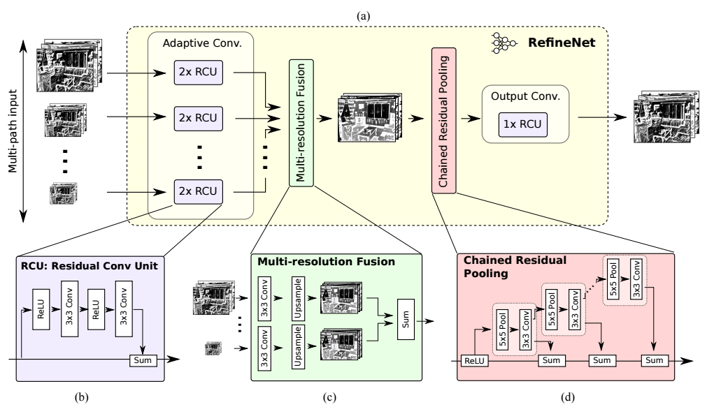

Hình 9.24 Khối RefineNet: (b) RCU, (c) hợp nhất đa độ phân giải, (d) gộp phần dư chuỗi

- **Residual convolution unit (RCU)** là khối phần dư thông thường bỏ BN.
- **Multi-resolution fusion**: trước hết dùng một tầng tích chập cho mỗi bản đồ đầu vào để thích nghi (đưa về cùng số kênh, bằng số kênh nhỏ nhất trong các đầu vào), rồi tăng mẫu tất cả lên độ phân giải lớn nhất trong các đầu vào và cộng từng phần tử. Chú ý với khối một đầu vào như RefineNet-4 thì bỏ qua phần này.
- **Chained residual pooling**: ReLU ở đây quan trọng cho hiệu quả của bước gộp phía sau, còn giúp mô hình bớt nhạy với thay đổi tốc độ học. Cấu trúc chuỗi này lấy được ngữ cảnh nền từ vùng rất rộng. Ngoài ra, cấu trúc dùng rất nhiều kết nối đồng nhất (identity mapping), cả dài lẫn ngắn, cho phép gradient đi thẳng từ một khối tới bất kỳ khối nào khác.
- **Output convolutions**: thêm một RCU trước khi ra đầu ra.

> **Biên tập:** bản gốc viết bước hợp nhất "đưa về hình dạng của bản đồ nhỏ nhất rồi tăng mẫu", dễ hiểu nhầm là về độ phân giải nhỏ nhất; theo bài báo, tích chập đưa các đầu vào về cùng *số kênh*, còn độ phân giải được tăng mẫu lên mức *lớn nhất*.

## 9.7 PSPNet

<div class="qa-theory">

**Lý thuyết:** [Ôn tập · 8.2.2 Fast R-CNN](qa/ch08_vi?id=_822-fast-r-cnn) · [Học sâu · 7.5 Gộp](dl/ch07_s5_vi)

</div>

Phân tích cảnh (scene parsing) là thách thức với từ vựng mở không giới hạn và các cảnh đa dạng. Bài báo dùng mô-đun gộp kim tự tháp (pyramid pooling module) để tích hợp ngữ cảnh theo nhiều vùng khác nhau, đề xuất PSPNet (Zhao và cộng sự, 2017), tận dụng thông tin ngữ cảnh để phân tích cảnh.

Tác giả cho rằng vấn đề chính của FCN là không có chiến lược phù hợp để dùng thông tin toàn cục; cách của bài báo là học SPPNet để thiết kế PSPNet.

Nhiều khung phân tích cảnh tốt nhất đều dựa trên FCN. Phương pháp dựa trên CNN tăng được hiểu biết về vật động, nhưng với từ vựng không giới hạn và cảnh khác nhau vẫn gặp thách thức. Ví dụ như hình dưới:

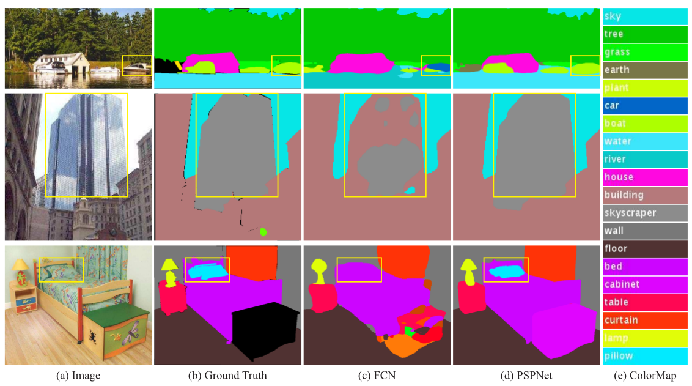

Hình 9.25 FCN nhầm thuyền thành ô tô; PSPNet dùng ngữ cảnh để sửa

FCN cho rằng vật trong khung bên phải là ô tô, nhưng thực ra là thuyền; nếu dùng tri thức tiên nghiệm về ngữ cảnh sẽ thấy bên trái là một nhà thuyền, từ đó suy ra vật trong khung là thuyền. Vấn đề chính của FCN là không tận dụng tốt manh mối cảnh toàn cục.

Với hiểu cảnh đặc biệt phức tạp, trước đây đều dùng gộp kim tự tháp không gian; khác các phương pháp trước, bài báo đề xuất mạng phân tích cảnh kim tự tháp (pyramid scene parsing network, PSPNet).

Đóng góp chính của bài báo:

1. Đề xuất PSPNet tích hợp đặc trưng ngữ cảnh khó trong khung dựa trên FCN.
2. Phát triển chiến lược tối ưu hiệu quả cho ResNet dựa trên mất mát giám sát sâu (deep supervision).
3. Xây dựng một hệ thống thực tế cho phân tích cảnh và phân vùng ngữ nghĩa đạt kết quả tốt nhất.

Quan sát kết quả của FCN, thấy các vấn đề sau:

1. Quan hệ không khớp (Mismatched Relationship): như thuyền trên mặt nước bị nhận là ô tô.
2. Lớp dễ nhầm lẫn (Confusion Categories): như "tòa nhà" và "nhà chọc trời".
3. Lớp không nổi bật (Inconspicuous Classes): vật nhỏ hay vật có màu giống nền bị bỏ sót.

Tổng kết các kết quả trên, thấy các vấn đề này một phần hoặc toàn bộ liên quan tới quan hệ ngữ cảnh và thông tin toàn cục, nên bài báo đề xuất PSPNet. Khung như sau:

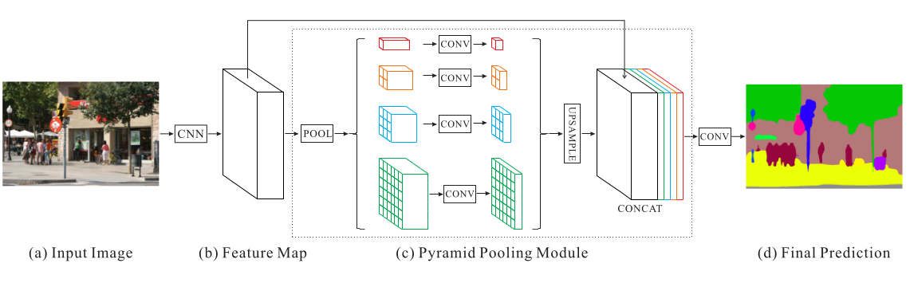

Hình 9.26 PSPNet: (a) ảnh vào, (b) bản đồ đặc trưng từ CNN, (c) mô-đun gộp kim tự tháp, (d) dự đoán cuối

Mô-đun gộp kim tự tháp gộp bản đồ đặc trưng thành lưới $1\times1$, $2\times2$, $3\times3$, $6\times6$ (từ toàn cục tới cục bộ), mỗi nhánh qua tích chập $1\times1$ giảm kênh, tăng mẫu về kích thước gốc rồi ghép với bản đồ đặc trưng ban đầu trước khi dự đoán.

Đồng thời thêm một mất mát giám sát sâu phụ:

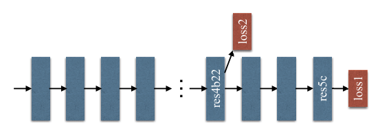

Hình 9.27 Mất mát phụ (loss2) gắn sau khối res4b22 của ResNet, bên cạnh mất mát chính (loss1)

> **Biên tập:** bản gốc chỉ liệt kê tên ba vấn đề và có các chỗ người viết tự hỏi ("vì sao khác, cần xem thuật toán kim tự tháp kinh điển", "cụ thể là gì?"); bản dịch bỏ các câu tự hỏi, bổ sung ví dụ cho ba vấn đề và cấu hình gộp $1, 2, 3, 6$ theo bài báo.

## 9.8 Họ DeepLab

### 9.8.1 DeepLabv1

<div class="qa-theory">

**Lý thuyết:** [Ôn tập · 5.4 Có những loại kernel tích chập nào?](qa/ch05_vi?id=_54-có-những-loại-kernel-tích-chập-nào) · [Toán · Chương 3 Ôn tập Xác suất](math/ch03_vi)

</div>

DeepLab (Chen và cộng sự, 2015) kết hợp mạng neuron tích chập sâu (DCNN) với mô hình đồ thị xác suất (DenseCRF).

Trong thực nghiệm thấy DCNN làm phân vùng ngữ nghĩa chưa đủ chính xác, nguyên nhân gốc là tính bất biến với tịnh tiến của đặc trưng mức cao của DCNN, bắt nguồn từ việc gộp và giảm mẫu lặp lại.

Với việc giảm mẫu hay gộp làm giảm độ phân giải, DeepLab dùng thuật toán atrous (có lỗ, tức tích chập giãn) để mở rộng vùng tiếp nhận, lấy thêm thông tin ngữ cảnh.

Bộ phân loại cần bất biến với biến đổi không gian để quyết định tập trung vào đối tượng, điều này vốn hạn chế độ chính xác định vị của DCNN; DeepLab dùng trường ngẫu nhiên có điều kiện kết nối đầy đủ (fully connected CRF) để tăng khả năng nắm bắt chi tiết của mô hình.

Ngoài tích chập giãn và CRF, bài báo còn dùng mẹo đặc trưng đa tỉ lệ (Multi-Scale features). Thực ra là ý tưởng của U-Net và FPN: gắn một MLP hai tầng vào ảnh đầu vào và đầu ra của bốn tầng max pooling đầu, tầng thứ nhất là 128 tích chập $3\times3$, tầng thứ hai là 128 tích chập $1\times1$. Đặc trưng ra cuối được hợp nhất với bản đồ đặc trưng tầng cuối của mạng chính, bản đồ đặc trưng thêm $5\times128=640$ kênh.

Thực nghiệm cho thấy đa tỉ lệ giúp tăng kết quả dự đoán, nhưng hiệu quả không rõ bằng CRF.

Mô hình trong bài báo dựa trên VGG16, chạy 8 FPS trên GPU Titan, suy luận CRF kết nối đầy đủ trung bình mất 0.5 giây, đạt 71.6% IoU trên PASCAL VOC-2012.

### 9.8.2 DeepLabv2

<div class="qa-theory">

**Lý thuyết:** [Ôn tập · 5.4 Có những loại kernel tích chập nào?](qa/ch05_vi?id=_54-có-những-loại-kernel-tích-chập-nào) · [Ôn tập · 8.2.2 Fast R-CNN](qa/ch08_vi?id=_822-fast-r-cnn)

</div>

DeepLabv2 (Chen và cộng sự, 2017) tối ưu trên nền DeepLabv1. DeepLabv1 nỗ lực theo ba hướng nhưng các vấn đề vẫn còn: độ phân giải đặc trưng giảm, vật có nhiều tỉ lệ, tính bất biến tịnh tiến của DCNN.

Vì gộp và giảm mẫu liên tiếp của DCNN làm giảm độ phân giải, DeepLabv2 bỏ giảm mẫu ở mấy tầng max pooling cuối, thay bằng tích chập giãn, tính bản đồ đặc trưng với mật độ lấy mẫu cao hơn.

Với vật có nhiều tỉ lệ, DeepLabv1 dùng nhiều MLP kết hợp đặc trưng đa tỉ lệ; tuy tăng được hiệu năng hệ thống nhưng tăng khối lượng tính đặc trưng và bộ nhớ.

Bài báo lấy cảm hứng từ gộp kim tự tháp không gian (Spatial Pyramid Pooling, SPP), đề xuất một cấu trúc tương tự: trên đầu vào cho trước, lấy mẫu song song bằng tích chập giãn với các tỉ lệ giãn khác nhau, tương đương nắm bắt ngữ cảnh của ảnh ở nhiều tỉ lệ, gọi là mô-đun ASPP (atrous spatial pyramid pooling).

Tính bất biến phân loại của DCNN ảnh hưởng tới độ chính xác không gian. DeepLabv2 dùng CRF kết nối đầy đủ để tăng khả năng nắm chi tiết của mô hình.

Mô hình trong bài báo dựa trên ResNet, chạy 8 FPS trên GPU NVidia Titan X, CRF kết nối đầy đủ suy luận trung bình 0.5 giây, về thời gian không khác DeepLabv1, nhưng đạt 79.7 mIoU trên PASCAL VOC-2012.

### 9.8.3 DeepLabv3

<div class="qa-theory">

**Lý thuyết:** [Ôn tập · 5.4 Có những loại kernel tích chập nào?](qa/ch05_vi?id=_54-có-những-loại-kernel-tích-chập-nào) · [Ôn tập · 8.2.5 FPN](qa/ch08_vi?id=_825-fpn)

</div>

Bài báo tốt không chỉ nói làm thế nào mà còn nói vì sao. DeepLab đến DeepLabv3 (Chen và cộng sự, 2017) vẫn xoay quanh tích chập giãn, nhưng khám phá các cấu trúc khác nhau.

Bài báo DeepLabv3 so sánh nhiều cách nắm thông tin đa tỉ lệ:

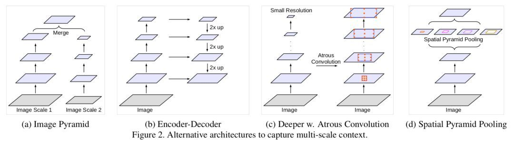

Hình 9.28 (a) Kim tự tháp ảnh; (b) mã hóa–giải mã; (c) sâu hơn với tích chập giãn; (d) gộp kim tự tháp không gian

1. **Image Pyramid (kim tự tháp ảnh):** co giãn ảnh đầu vào theo nhiều tỉ lệ, chạy DCNN trên từng tỉ lệ, hợp nhất kết quả dự đoán thành đầu ra cuối.
2. **Encoder-Decoder (mã hóa–giải mã):** dùng đặc trưng đa tỉ lệ của giai đoạn mã hóa, đưa vào giai đoạn giải mã để khôi phục độ phân giải không gian; tiêu biểu có SegNet, U-Net, RefineNet.
3. **Deeper w. Atrous Convolution (sâu hơn với tích chập giãn):** nối thêm các khối tích chập giãn với tỉ lệ giãn tăng dần lên trên mạng gốc để nắm thông tin tầm xa giữa các điểm ảnh; cùng nhóm "mô-đun ngữ cảnh" là các mô-đun đặt trên đỉnh mô hình như DenseCRF.
4. **Spatial Pyramid Pooling (gộp kim tự tháp không gian):** gộp kim tự tháp không gian có các kernel với tỉ lệ lấy mẫu và vùng nhìn khác nhau, nắm được vật ở nhiều tỉ lệ; tiêu biểu là PSPNet và ASPP của DeepLabv2.

DeepLabv1–v2 đều dùng tích chập giãn trích đặc trưng dày đặc để phân vùng ngữ nghĩa. Nhưng để giải quyết vấn đề nhiều tỉ lệ của vật cần phân vùng, DeepLabv3 thiết kế tích chập giãn nhiều tỉ lệ nối tầng hoặc song song để nắm ngữ cảnh nhiều tỉ lệ.

Ngoài ra, DeepLabv3 sửa mô-đun gộp kim tự tháp không gian có lỗ đã đề xuất trước đó (thêm BN và một nhánh gộp toàn cục ảnh), mô-đun này dùng để khám phá đặc trưng tích chập đa tỉ lệ, mã hóa ngữ cảnh toàn cục ở mức ảnh để có đặc trưng, đạt kết quả tốt nhất, 86.9 mIoU trên PASCAL VOC-2012.

> **Biên tập:** (1) bản gốc mô tả (c) là "thêm mô-đun phụ lên đỉnh mô hình gốc, như DenseCRF", không khớp với nhãn "Deeper w. Atrous Convolution" của hình; đã mô tả lại theo hình và ghi rõ DenseCRF thuộc nhóm mô-đun ngữ cảnh. (2) Bản gốc xếp PSPNet vào nhóm mã hóa–giải mã; PSPNet thuộc nhóm gộp kim tự tháp không gian. (3) Con số 86.9 mIoU là khi huấn luyện trước thêm trên COCO và JFT-300M.

### 9.8.4 DeepLabv3+

<div class="qa-theory">

**Lý thuyết:** [Ôn tập · 5.4 Có những loại kernel tích chập nào?](qa/ch05_vi?id=_54-có-những-loại-kernel-tích-chập-nào) · [Ôn tập · Chương 5 Mạng neuron tích chập (CNN)](qa/ch05_vi)

</div>

Các vấn đề phân vùng ngữ nghĩa quan tâm:

1. Vấn đề nhiều tỉ lệ của đối tượng.
2. Vì mạng sâu có các tầng sải bước 2, độ phân giải đặc trưng giảm, làm độ chính xác dự đoán giảm, gây mất thông tin biên.

Cấu trúc ASPP mới của DeepLabv3 giải quyết vấn đề 1; mục đích chính của DeepLabv3+ (Chen và cộng sự, 2018) là giải quyết vấn đề 2.

Vấn đề 2 có thể giải bằng dùng tích chập giãn thay nhiều tầng gộp hơn để có đặc trưng độ phân giải cao hơn. Nhưng đặc trưng độ phân giải cao hơn làm khối lượng tính tăng mạnh. Lấy ResNet-101 mà DeepLabv3 dùng làm ví dụ: sải bước đầu ra 16 làm 9 tầng cuối có bản đồ đặc trưng lớn hơn, khối lượng tính của 9 tầng đó tăng lên $2\times2=4$ lần. Sải bước 8 càng tệ hơn, 78 tầng cuối đều tính nhiều hơn rất nhiều.

Giải pháp: 1. cấu trúc mã hóa–giải mã; 2. Modified Aligned Xception.

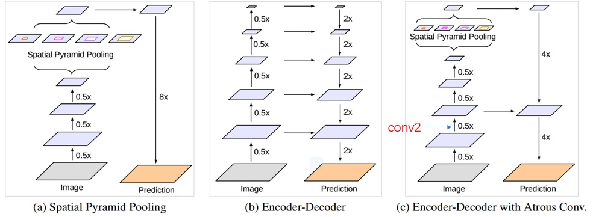

Hình 9.29 (a) Gộp kim tự tháp không gian; (b) mã hóa–giải mã; (c) mã hóa–giải mã với tích chập giãn (DeepLabv3+)

Thêm bộ giải mã vào DeepLabv3. A là cấu trúc ASPP, trong đó tăng mẫu 8 lần có thể coi là một bộ giải mã. B là cấu trúc mã hóa–giải mã, gộp đặc trưng mức cao và mức thấp. C là cấu trúc mà bài báo dùng.

Phương pháp:

**(1) Mã hóa–giải mã với tích chập giãn (Encoder-Decoder with Atrous Convolution)**

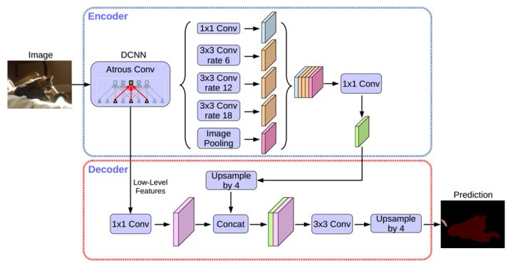

Hình 9.30 DeepLabv3+: bộ mã hóa DeepLabv3 (DCNN + ASPP) và bộ giải mã đơn giản

Bộ mã hóa dùng DeepLabv3.

Phần giải mã: trước hết chọn một đặc trưng mức thấp, dùng tích chập $1\times1$ nén số kênh của đặc trưng mức thấp (vốn là 256 hoặc 512 kênh, nén còn 48), để giảm tỉ trọng của mức thấp. Tác giả cho rằng đặc trưng từ bộ mã hóa giàu thông tin hơn, nên đặc trưng của bộ mã hóa phải có tỉ trọng cao hơn. Làm vậy có lợi cho huấn luyện.

Rồi tăng mẫu đầu ra bộ mã hóa cho cùng độ phân giải với đặc trưng mức thấp. Ví dụ dùng đặc trưng đầu ra conv2 của ResNet thì ở đây tăng mẫu ×4. Ghép nối hai đặc trưng, rồi qua một tích chập $3\times3$ (để tinh chỉnh), rồi tăng mẫu tiếp là có dự đoán mức điểm ảnh. Thí nghiệm sau đó cho thấy cấu trúc này ở sải bước 16 vừa có độ chính xác cao vừa nhanh. Sải bước 8 chỉ tăng chút ít độ chính xác mà tăng khối lượng tính rất nhiều.

**(2) Modified Aligned Xception**

Xception chủ yếu dùng tích chập tách được theo chiều sâu (depthwise separable convolution) thay các tầng tích chập gốc. Nói đơn giản, cấu trúc này học được cùng thông tin với ít tham số và ít tính toán hơn. Ở đây thay mạng xương sống ResNet-101 gốc bằng Xception.

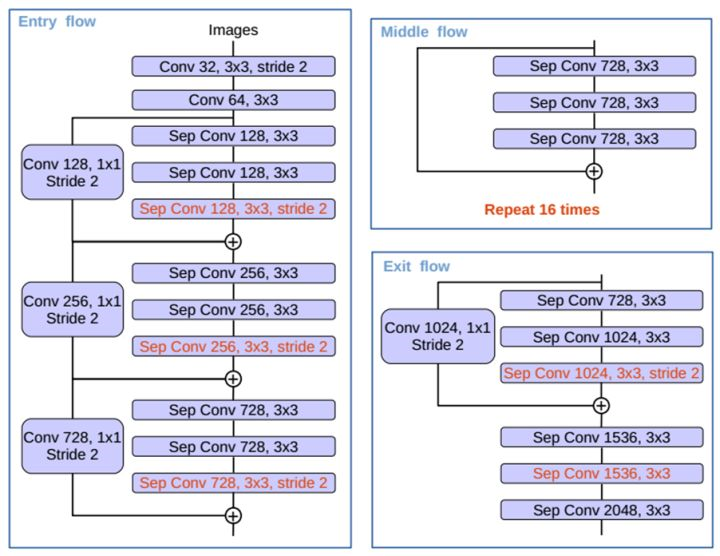

Hình 9.31 Modified Aligned Xception; phần màu đỏ là các sửa đổi

**Phần màu đỏ là sửa đổi:**

- Nhiều tầng hơn: phần giữa (middle flow) lặp 16 lần thay vì 8 lần (dựa trên công trình phát hiện đối tượng của MSRA).
- Thay các tầng gộp đơn giản gốc bằng tích chập tách được theo chiều sâu có sải bước 2.
- Thêm ReLU và chuẩn hóa sau mỗi tích chập depthwise $3\times3$ (trước đây chỉ có sau tích chập $1\times1$).

## 9.9 Mask R-CNN

<div class="qa-theory">

**Lý thuyết:** [Ôn tập · 8.2.6 Mask R-CNN](qa/ch08_vi?id=_826-mask-r-cnn) · [Ôn tập · 8.2.3 Faster R-CNN](qa/ch08_vi?id=_823-faster-r-cnn)

</div>

### 9.9.1 Sơ đồ cấu trúc mạng Mask R-CNN

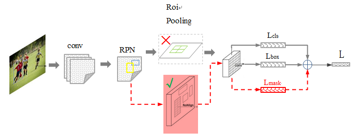

Hình 9.32 Mask R-CNN: phần đen là Faster R-CNN gốc, phần đỏ là sửa đổi (RoIAlign, nhánh mặt nạ $L_{mask}$)

Phần màu đen là Faster R-CNN gốc, phần màu đỏ là sửa đổi trên mạng Faster:

1. thay tầng RoI Pooling bằng RoIAlign;
2. thêm một tầng FCN song song (tầng Mask).

Tóm tắt vài đặc điểm của Mask R-CNN (theo phần tóm tắt của bài báo [Mask R-CNN](https://arxiv.org/pdf/1703.06870.pdf)):

1. Thêm một nhánh mạng trên nền nhận dạng hộp, dùng để nhận dạng mặt nạ (Mask);
2. Huấn luyện đơn giản, so với Faster chỉ thêm một chi phí nhỏ, chạy được 5 FPS;
3. Dễ mở rộng sang nhiệm vụ khác, như ước lượng tư thế người;
4. Không cần mẹo gì, trên mọi nhiệm vụ đều tốt hơn mọi mô hình đơn hiện có, kể cả đội thắng COCO 2016.

### 9.9.2 Các dạng đầu mạng của Mask R-CNN

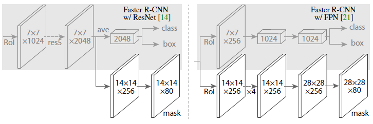

Hình 9.33 Đầu mạng của Mask R-CNN trên Faster R-CNN với ResNet-C4 (trái) và với FPN (phải); phần dưới là nhánh mặt nạ mới

Xem sơ đồ kết hợp hai phương pháp R-CNN sau với Mask: phần xám là mạng R-CNN gốc kết hợp ResNet hoặc FPN, phần đen phía dưới là tầng Mask song song mới thêm; hình này không khác gì hình trên, mục đích là cho thấy khả năng thích nghi tổng quát của phương pháp Mask R-CNN: kết hợp được với nhiều khung R-CNN và đều cho kết quả tốt.

> **Biên tập:** bản gốc đặt tiêu đề mục này là "khung phát hiện người đi bộ R-CNN"; hình thực ra là hai kiểu đầu mạng (C4 và FPN) trong bài báo Mask R-CNN, không liên quan tới phát hiện người đi bộ. Đã đổi tiêu đề.

### 9.9.3 Các điểm kỹ thuật chính của Mask R-CNN

**1. Điểm 1: mạng cơ sở mạnh hơn**

Dùng ResNeXt-101 + FPN làm mạng trích đặc trưng, đạt kết quả tốt nhất.

**2. Điểm 2: RoIAlign**

Dùng RoIAlign thay RoI Pooling (cải tiến phép gộp). Đưa vào một bước nội suy (song tuyến tính) để lấy giá trị tại các điểm có tọa độ số thực thay vì làm tròn, giải quyết phần lớn vấn đề lệch (misalignment) do lấy mẫu bằng gộp trực tiếp. (Chi tiết ở câu 8.2.6.)

Ghi chú: lệch tuy ảnh hưởng ít tới bài toán phân loại, nhưng ở mặt nạ mức điểm ảnh lại gây sai số lớn.

So sánh kết quả (Bảng 2 c & d của bài báo) cho thấy RoIAlign cải thiện khá lớn, và sải bước càng lớn thì cải thiện càng rõ.

**3. Điểm 3: hàm mất mát**

Với mỗi RoI, nhánh mặt nạ cho ra $K\cdot m^2$ giá trị: $K$ mặt nạ nhị phân kích thước $m\times m$, mỗi lớp một mặt nạ ($K$ là số lớp, $m=28$ là độ phân giải mặt nạ). Áp sigmoid cho từng điểm ảnh; mất mát mặt nạ $L_{mask}$ chỉ tính trên mặt nạ của lớp thật $k$ của RoI đó, là entropy chéo nhị phân trung bình (average binary cross-entropy) trên $m^2$ điểm ảnh:

$$
L_{mask} = -\frac{1}{m^2}\sum_{i,j}\Big[y_{ij}\log \sigma(s^k_{ij}) + (1-y_{ij})\log\big(1-\sigma(s^k_{ij})\big)\Big]
$$

với $s^k_{ij}$ là điểm của điểm ảnh $(i,j)$ trên mặt nạ lớp $k$ và $y_{ij}\in\{0,1\}$ là nhãn mặt nạ.

Vì sao $K$ mặt nạ? Mỗi lớp một mặt nạ giúp tránh cạnh tranh giữa các lớp (các lớp khác không đóng góp mất mát); việc chọn lớp đã do nhánh phân loại làm.

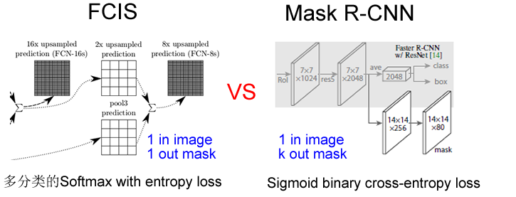

Hình 9.34 FCIS: một mặt nạ cho mỗi ảnh, softmax đa lớp với entropy chéo; Mask R-CNN: $K$ mặt nạ, entropy chéo nhị phân với sigmoid

Qua so sánh kết quả (Bảng 2 b), cách tách rời (decouple) mà tác giả nói tốt hơn nhiều so với softmax đa lớp.

Ngoài ra, tác giả đưa ra nhiều kết quả phân vùng, không liệt kê hết; chỉ đặt một hình so sánh với FCIS (FCIS bị lỗi chồng lấn, Overlap).

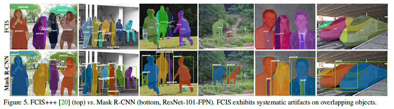

Hình 9.35 FCIS+++ (trên) và Mask R-CNN (dưới); FCIS có lỗi hệ thống ở các vật chồng nhau

> **Biên tập:** bản gốc ghi công thức mất mát là "$L_{mask}(Cls_k) = \mathrm{Sigmoid}(Cls_k)$", không phải một hàm mất mát; đã viết công thức entropy chéo nhị phân đúng. Bản gốc cũng ghi $m$ là độ phân giải gộp $7\times7$; $7\times7$ là của nhánh phân loại/hộp, nhánh mặt nạ dùng RoIAlign $14\times14$ và cho ra mặt nạ $28\times28$ (xem Hình 9.33).

## 9.10 Ứng dụng CNN trong phân vùng ảnh học yếu giám sát

<div class="qa-theory">

**Lý thuyết:** [Toán · 4.2 Ước lượng hợp lý cực đại](math/ch04_vi?id=_42-Ước-lượng-hợp-lý-cực-đại) · [Học máy · P.3 Thuật toán EM](ml/cluster_vi?id=p3-thuật-toán-em)

</div>

Nguồn: [CNN trong phân vùng ảnh học yếu giám sát](https://zhuanlan.zhihu.com/p/23811946) (Zhihu, tiếng Trung).

Các kỹ thuật phân vùng ảnh dựa trên học sâu gần đây thường dựa vào huấn luyện mạng CNN, quá trình huấn luyện cần rất nhiều ảnh có nhãn, tức thường yêu cầu mọi ảnh huấn luyện đều có kết quả phân vùng chính xác.

Với phân vùng ảnh, có được lượng lớn ảnh gán nhãn đầy đủ rất khó; ví dụ trên ImageNet có 14 triệu ảnh có nhãn lớp, khoảng 1 triệu ảnh có hộp bao, nhưng chỉ vài nghìn ảnh (theo bài gốc là 4460) có kết quả phân vùng mức điểm ảnh. Gán nhãn từng điểm ảnh trong ảnh huấn luyện rất tốn thời gian, nhất là với ảnh y tế: gán nhãn các mô trong một ảnh CT hay MRI ba chiều mất hàng giờ.

Nếu thuật toán học được kết quả phân vùng tốt chỉ từ tập dữ liệu gán nhãn thô, thì việc gán nhãn dữ liệu huấn luyện đơn giản hơn nhiều, giảm mạnh thời gian gán nhãn. Các nhãn thô này có thể là:

1. chỉ cho biết ảnh chứa những vật nào;
2. cho hộp bao của vật;
3. đánh dấu một phần điểm ảnh của vùng vật, ví dụ vẽ vài nét, nguệch ngoạc (scribbles).

> **Biên tập:** bản gốc ghi ImageNet có "50 vạn ảnh có hộp bao"; theo trang ImageNet, số ảnh có hộp bao là khoảng 1.03 triệu. Con số 4460 ảnh có phân vùng mức điểm ảnh không kiểm chứng được nên ghi là theo bài gốc.

### 9.10.1 Nhãn nguệch ngoạc (scribble)

<div class="qa-theory">

**Lý thuyết:** [Toán · 4.2 Ước lượng hợp lý cực đại](math/ch04_vi?id=_42-Ước-lượng-hợp-lý-cực-đại)

</div>

Bài báo: [ScribbleSup: Scribble-Supervised Convolutional Networks for Semantic Segmentation (CVPR 2016)](https://www.cv-foundation.org/openaccess/content_cvpr_2016/papers/Lin_ScribbleSup_Scribble-Supervised_Convolutional_CVPR_2016_paper.pdf)

Lâm Địch (Di Lin, Đại học Trung văn Hồng Kông) và cộng sự đề xuất một phương pháp học yếu giám sát dựa trên nhãn nguệch ngoạc. Nguệch ngoạc là cách gán nhãn rất tiện nên được dùng khá rộng. Như hình dưới, chỉ cần vẽ năm nét là gán nhãn xong một ảnh.

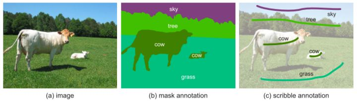

Hình 9.36 (a) Ảnh; (b) nhãn mặt nạ đầy đủ; (c) nhãn nguệch ngoạc

ScribbleSup chia hai bước: bước một lan truyền thông tin lớp của điểm ảnh từ các nét sang các điểm ảnh chưa gán nhãn khác, tự động gán nhãn xong mọi ảnh huấn luyện; bước hai dùng các ảnh đã gán nhãn này để huấn luyện CNN. Ở bước một, phương pháp trước hết sinh các siêu điểm ảnh (super-pixel), rồi gán nhãn mọi siêu điểm ảnh bằng phương pháp dựa trên cắt đồ thị (graph cut).

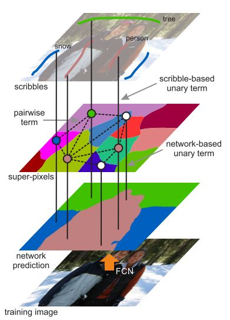

Hình 9.37 ScribbleSup: siêu điểm ảnh, số hạng đơn từ nét vẽ và từ mạng, số hạng cặp

Hàm năng lượng của graph cut là:

$$
\sum_{i}\psi_i\left(y_i|X,S\right)+\sum_{i,j}\psi_{ij}\left(y_i,y_j,X\right)
$$

Trong đồ thị này, mỗi siêu điểm ảnh là một nút, giữa các siêu điểm ảnh kề nhau có một cạnh. Số hạng đơn (unary) trong hàm năng lượng gồm hai trường hợp: một từ nét nguệch ngoạc, một từ xác suất CNN dự đoán cho siêu điểm ảnh đó. Cả quá trình tối ưu thực chất là tìm cực tiểu đồng thời của hàm năng lượng graph cut và tham số CNN:

$$
\sum_{i}\psi_i^{scr}\left(y_i|X,S\right)+\sum_i-\log P\left(y_i| X,\theta\right)+\sum_{i,j}\psi_{ij}\left(y_i,y_j|X\right)
$$

Tối ưu biểu thức trên bằng cách luân phiên tìm $Y$ và $\theta$ tối ưu. Bài báo thấy chỉ ba vòng lặp là có kết quả khá tốt.

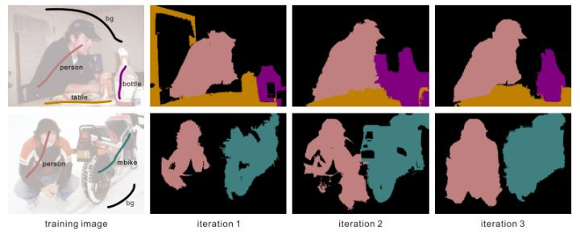

Hình 9.38 Nhãn được tinh chỉnh qua ba vòng lặp

### 9.10.2 Nhãn mức ảnh

<div class="qa-theory">

**Lý thuyết:** [Học máy · Chương 27 Soft-margin SVM](ml/ch27_vi)

</div>

Bài báo: [Constrained Convolutional Neural Networks for Weakly Supervised Segmentation (ICCV 2015)](https://www.cv-foundation.org/openaccess/content_iccv_2015/papers/Pathak_Constrained_Convolutional_Neural_ICCV_2015_paper.pdf)

Deepak Pathak (UC Berkeley) dùng dữ liệu huấn luyện có nhãn mức ảnh để học yếu giám sát. Dữ liệu huấn luyện chỉ cho biết ảnh chứa vật gì, không có vị trí hay các điểm ảnh của vật. Phương pháp biến nhãn ảnh (image tags) thành ràng buộc trên phân phối nhãn đầu ra của CNN, nên gọi là mạng neuron tích chập có ràng buộc (Constrained convolutional neural network, CCNN).

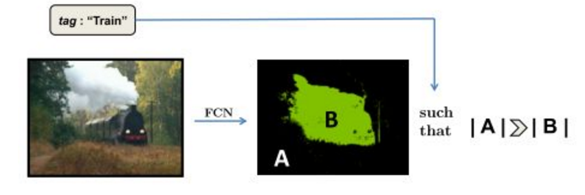

Hình 9.39 CCNN: từ nhãn "Train", ràng buộc rằng vùng tiền cảnh $B$ phải chiếm ít nhất một tỉ lệ so với nền $A$

Phương pháp coi huấn luyện là bài toán tối ưu có ràng buộc tuyến tính:

$$
\begin{aligned}
\min_{\theta, P}\quad & D\big(P(X)\,\Vert\, Q(X|\theta)\big)\\
\text{s.t.}\quad & A\vec P \ge \vec b,\qquad \sum_{X}P(X)=1
\end{aligned}
$$

Các ràng buộc tuyến tính đến từ nhãn trên dữ liệu huấn luyện, ví dụ cận trên hay cận dưới của số điểm ảnh kỳ vọng của một lớp tiền cảnh trong ảnh (kích thước vật), số điểm ảnh của một lớp trong ảnh bằng 0, hay ít nhất bằng 1… Hàm mục tiêu có thể chuyển thành hàm mất mát rồi huấn luyện bằng SGD.

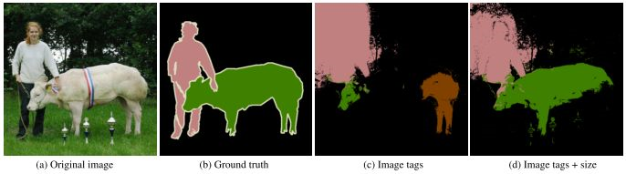

Hình 9.40 (a) Ảnh gốc; (b) nhãn thật; (c) chỉ dùng nhãn ảnh; (d) nhãn ảnh + ràng buộc kích thước

Thực nghiệm thấy chỉ dùng nhãn ảnh làm ràng buộc thì kết quả phân vùng còn khá kém: mIoU 35.6% trên tập PASCAL VOC 2012 test; thêm ràng buộc kích thước vật đạt 45.1%; dùng thêm hộp bao làm ràng buộc đạt 54%. FCN-8s đạt 62.2%, cho thấy học yếu giám sát muốn đạt kết quả tốt vẫn khá khó.

### 9.10.3 DeepLab + hộp bao + nhãn mức ảnh

<div class="qa-theory">

**Lý thuyết:** [Toán · 4.2 Ước lượng hợp lý cực đại](math/ch04_vi?id=_42-Ước-lượng-hợp-lý-cực-đại) · [Học máy · P.3 Thuật toán EM](ml/cluster_vi?id=p3-thuật-toán-em)

</div>

Bài báo: [Weakly- and Semi-Supervised Learning of a DCNN for Semantic Image Segmentation](https://arxiv.org/pdf/1502.02734.pdf)

George Papandreou (Google) và Liang-Chieh Chen (UCLA) cùng cộng sự, trên nền DeepLab, nghiên cứu thêm việc dùng hộp bao và nhãn mức ảnh làm dữ liệu huấn luyện. Họ dùng thuật toán kỳ vọng–cực đại hóa (EM) để ước lượng lớp của các điểm ảnh chưa gán nhãn và tham số CNN.

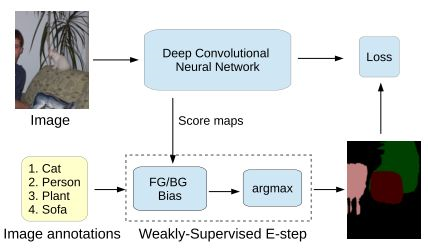

Hình 9.41 Bước E yếu giám sát với nhãn mức ảnh

Với dữ liệu có nhãn mức ảnh, ta quan sát được giá trị điểm ảnh $x$ và nhãn mức ảnh $z$, nhưng không biết nhãn của từng điểm ảnh, nên coi $y$ là biến ẩn. Dùng mô hình đồ thị xác suất sau:

$$
P(x,y,z;\theta) = P(x)\left(\prod_{m=1}^{M} P(y_m|x;\theta)\right)P(z|y)
$$

Bài báo học tham số $\theta$ của mô hình bằng EM; quá trình suy dẫn cụ thể xem bài báo gốc.

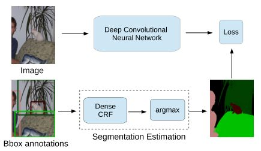

Hình 9.42 Với nhãn hộp bao: dùng DenseCRF ước lượng phân vùng trong hộp rồi học như giám sát đầy đủ

Với ảnh huấn luyện có hộp bao, phương pháp trước hết dùng CRF tự động phân vùng ảnh huấn luyện, rồi học có giám sát đầy đủ trên kết quả phân vùng đó. Thực nghiệm cho thấy chỉ dùng nhãn mức ảnh thì phân vùng khá kém, nhưng dùng dữ liệu có hộp bao thì kết quả khá tốt, đạt mIoU 62.2% trên VOC2012 test. Ngoài ra nếu kết hợp ít ảnh gán nhãn đầy đủ với nhiều ảnh gán nhãn yếu, đạt kết quả (69.0%) gần với học giám sát đầy đủ (70.3%).

### 9.10.4 Một khung thống nhất

<div class="qa-theory">

**Lý thuyết:** [Học máy · Chương 27 Soft-margin SVM](ml/ch27_vi) · [Học máy · Advanced clustering](ml/cluster_vi)

</div>

Bài báo: [Learning to Segment Under Various Forms of Weak Supervision (CVPR 2015)](https://www.cv-foundation.org/openaccess/content_cvpr_2015/papers/Xu_Learning_to_Segment_2015_CVPR_paper.pdf)

Jia Xu (Đại học Wisconsin-Madison) đề xuất một khung thống nhất xử lý nhiều loại nhãn yếu: nhãn mức ảnh, hộp bao và nhãn một phần điểm ảnh như nét nguệch ngoạc. Phương pháp chia mọi ảnh huấn luyện thành tổng cộng $n$ siêu điểm ảnh, mỗi siêu điểm ảnh trích một vector đặc trưng $d$ chiều. Vì không biết lớp của từng siêu điểm ảnh, tương đương học không giám sát, phương pháp phân cụm mọi siêu điểm ảnh bằng phân cụm lề cực đại (max-margin clustering, MMC); hàm mục tiêu tối ưu là:

$$
\min_{W,H}\quad \frac{1}{2}\operatorname{tr}\left(W^\top W\right) + \lambda\sum_{p=1}^{n}\sum_{c=1}^{C}\xi\left(w_c;x_p;h_p^c\right)
$$

Trên nền hàm mục tiêu này, tùy dạng nhãn yếu mà đặt các ràng buộc khác nhau; phương pháp chính là phân cụm lề cực đại dưới các ràng buộc tương ứng.

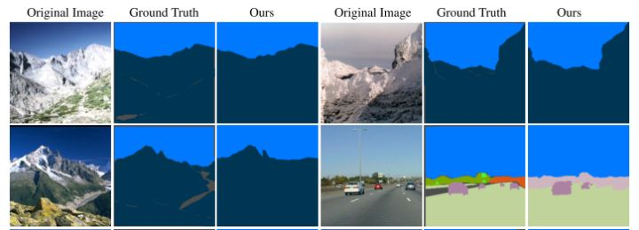

Hình 9.43 Kết quả của khung thống nhất trên SIFT Flow

Phương pháp cho kết quả khá tốt trên tập SIFT Flow, cao hơn kết quả tốt nhất lúc đó hơn 10%.

**Tóm tắt:** huấn luyện thuật toán phân vùng trên dữ liệu gán nhãn yếu giảm được sự phụ thuộc vào lượng lớn dữ liệu gán nhãn đầy đủ, trong phần lớn ứng dụng sát thực tế hơn. Nhãn yếu có thể là nhãn mức ảnh, hộp bao, nhãn một phần điểm ảnh… Cách huấn luyện thường coi là tối ưu có ràng buộc. Ngoài ra thuật toán EM có thể dùng để tối ưu đồng thời tham số CNN và lớp của điểm ảnh.

### 9.10.5 Tiến bộ mới của phân vùng yếu giám sát

<div class="qa-theory">

**Lý thuyết:** [Ôn tập · 7.1.1 Hiểu GAN một cách dễ hiểu thế nào?](qa/ch07_vi?id=_711-hiểu-gan-một-cách-dễ-hiểu-thế-nào) · [Ôn tập · 8.2.6 Mask R-CNN](qa/ch08_vi?id=_826-mask-r-cnn)

</div>

> Phần này do Minh Kỳ (明奇, Đại học Công nghệ Bắc Kinh) đóng góp cho bản gốc. Các hình của mục này không có trong repo gốc nên không hiển thị được.

**Giám sát bằng hộp bao**

1. **Learning to Segment via Cut-and-Paste (ECCV 2018).** Dùng ý tưởng học đối kháng của GAN, theo tư tưởng cắt–dán (cut-paste) để phân vùng thể hiện với giám sát yếu bằng hộp bao. Mạng chính gồm hai phần: bộ sinh mặt nạ và bộ phân biệt ảnh tổng hợp. Quy trình: (1) cắt vùng hộp thật trên ảnh, qua trích đặc trưng rồi dự đoán mặt nạ của vật trong hộp; (2) cắt ngẫu nhiên một ảnh nền từ ảnh gốc, lấy vật trong hộp theo mặt nạ sinh ra, dán lên nền đã cắt; (3) ảnh tổng hợp đưa qua bộ phân biệt để phán thật giả. Bộ sinh sinh mặt nạ tốt hơn để bộ phân biệt khó phân biệt hơn; trong học đối kháng cả hai cùng tiến bộ, dần có kết quả tốt hơn.

2. **Simple Does It: Weakly Supervised Instance and Semantic Segmentation (CVPR 2017).** Bài làm phân vùng ngữ nghĩa/thể hiện yếu giám sát bằng hộp bao, đạt 95% hiệu quả của phân vùng giám sát đầy đủ (DeepLabv1). Đóng góp chính: bàn về cách huấn luyện lặp bằng nhãn ngữ nghĩa yếu cùng giới hạn và thiếu sót của nó; chứng minh tính khả thi của việc sinh nhãn phân vùng từ hộp bao bằng thuật toán kiểu GrabCut, tránh phải điều chỉnh lại chiến lược huấn luyện như cách lặp ở trên; tiến gần kết quả của học có giám sát trên tập VOC. Cảm hứng của tác giả: đưa mặt nạ mức hộp vào mạng huấn luyện, mặt nạ phân vùng cho ra tốt hơn mặt nạ hộp đã đưa vào (đây là một nhận xét sâu sắc). Từ đó: lấy nhãn mức hộp làm mặt nạ ban đầu để tối ưu, mỗi lần lấy nhãn có được làm nhãn thật cho vòng lặp sau, nhờ đó kết quả ngày càng tốt. Trên nền này, thêm thuật toán GrabCut+ đã tối ưu, lọc một số vùng, và tích hợp thông tin dự đoán biên của BSDS500, đạt kết quả phân vùng lặp yếu giám sát rất tốt.

**Giám sát bằng nhãn phân loại**

1. **Weakly Supervised Learning of Instance Segmentation with Inter-pixel Relations (CVPR 2019).** Dùng nhãn phân loại làm thông tin giám sát yếu; trên nền đặc trưng trích bởi CAM (class activation map), thiết kế thêm IRNet học các ràng buộc đặc trưng bổ sung, đạt phân vùng thể hiện yếu giám sát tốt hơn. Để khắc phục giới hạn khi áp CAM vào phân vùng thể hiện, thiết kế IRNet gồm hai phần: (1) bản đồ phản hồi thể hiện không phân biệt lớp; (2) ái lực ngữ nghĩa theo cặp điểm ảnh (pairwise semantic affinity). Bản đồ phản hồi thể hiện kết hợp với CAM, sau ràng buộc thành CAM theo từng thể hiện; nhánh kia dự đoán trước biên của vật rồi có ái lực ngữ nghĩa theo cặp; hợp nhất và xử lý để có phân vùng cuối.

2. **Weakly Supervised Instance Segmentation using Class Peak Response (CVPR 2018).** Dùng nhãn lớp mức ảnh làm giám sát, khai thác đỉnh phản hồi của lớp để mạng phân loại trích được mặt nạ phân vùng thể hiện. Đây là công trình đầu tiên phân vùng thể hiện yếu giám sát chỉ bằng nhãn mức ảnh. Dưới giám sát phân loại, mạng CNN sinh bản đồ phản hồi lớp, mỗi vị trí là điểm tin cậy của lớp. Các cực đại địa phương của nó thường mang manh mối ngữ nghĩa thị giác mạnh về thể hiện. Trước hết tích hợp thông tin của bản đồ đỉnh phản hồi lớp, rồi lan truyền ngược để ánh xạ về các vùng giàu thông tin thể hiện như biên. Bản đồ ánh xạ sinh từ đỉnh phản hồi lớp gọi là Peak Response Maps (PRM), cho biểu diễn chi tiết của thể hiện vật, dùng tốt làm giám sát phân vùng. Quy trình: huấn luyện mạng phân loại bình thường, trích các cực đại địa phương trên bản đồ phản hồi lớp, tích chập tăng cường rồi dự đoán PRM; sau đó kết hợp nhiều nguồn thông tin để suy ra mặt nạ.

3. **Weakly Supervised Semantic Segmentation Using Superpixel Pooling Network (AAAI 2017).** Phân vùng ngữ nghĩa yếu giám sát bằng nhãn lớp. Phương pháp luân phiên lặp giữa sinh mặt nạ phân vùng ngữ nghĩa và học mạng phân vùng từ mặt nạ đã sinh. Mấu chốt là dùng nhãn lớp để có phân vùng ban đầu khá chính xác. Để làm vậy, đề xuất Superpixel Pooling Network (SPN), lấy kết quả phân vùng siêu điểm ảnh của ảnh đầu vào làm biểu diễn cấu trúc mức thấp, hỗ trợ suy luận phân vùng ngữ nghĩa. Trước hết SPN sinh mặt nạ ban đầu, rồi một mạng khác (DecoupledNet) học nhãn mặt nạ của từng điểm ảnh; mạng phân vùng này tách bài toán phân vùng ngữ nghĩa thành hai bài toán con là phân loại và phân vùng, và học được tri thức tiên nghiệm về hình dạng từ nhãn lớp để hỗ trợ phân vùng.

## 9.11 DenseNet

<div class="qa-theory">

**Lý thuyết:** [Ôn tập · Bổ sung: ResNet và DenseNet](qa/ch04_vi?id=bổ-sung-resnet-và-densenet) · [d2l (tiếng Anh) · 8.7 DenseNet](https://d2l.ai/chapter_convolutional-modern/densenet.html) ↗

</div>

> Phần này do Hoàng Khâm Kiến (黄钦建, Đại học Công nghệ Hoa Nam) đóng góp cho bản gốc.

> **Biên tập:** DenseNet là mạng phân loại, đặt trong chương phân vùng có lẽ vì có biến thể FC-DenseNet ("Tiramisu", Jégou và cộng sự, 2017) dùng cho phân vùng ngữ nghĩa. Xem thêm mục bổ sung về DenseNet ở chương 4.

Bài báo DenseNet (Huang và cộng sự) đoạt giải bài báo xuất sắc nhất CVPR 2017.

Thiết kế cấu trúc mạng neuron tích chập chủ yếu phát triển theo hai hướng: mạng rộng hơn (tiêu biểu: GoogLeNet, VGG) và mạng sâu hơn (tiêu biểu: ResNet). Nhưng khi số tầng tăng sẽ có vấn đề tiêu biến gradient, làm mạng ngừng học. Tới nay hướng giải quyết cơ bản đều là thêm kết nối đồng nhất (identity connections, đường tắt) giữa các tầng trước và sau.

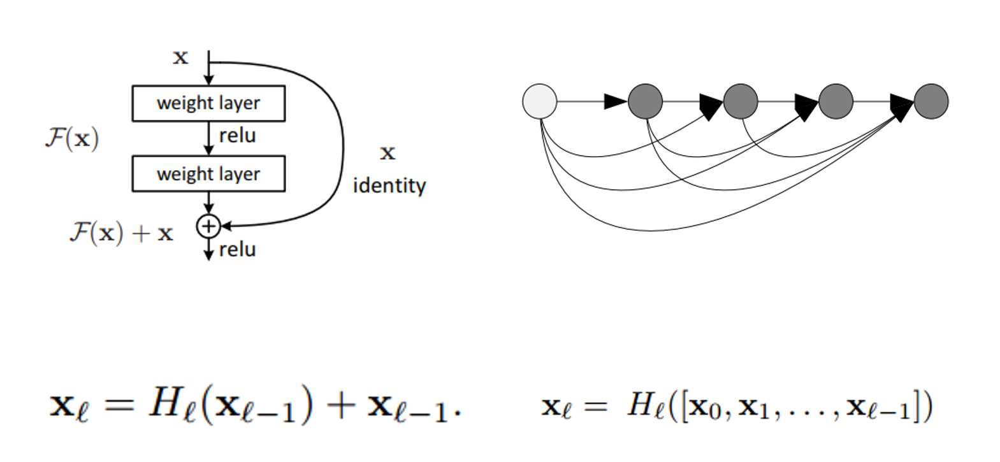

Hình 9.44 ResNet: $x_\ell = H_\ell(x_{\ell-1}) + x_{\ell-1}$; DenseNet: $x_\ell = H_\ell([x_0, x_1, \dots, x_{\ell-1}])$

Từ hình trên thấy ResNet cộng giá trị (phép add), số kênh không đổi. Còn DenseNet ghép kênh (phép concatenation), giống Inception. Từ hai công thức có thể thấy khác biệt bản chất của hai mạng. Ngoài ra, ở DenseNet đầu ra của mỗi tầng là đầu vào của mọi tầng phía sau, cũng khác ResNet.

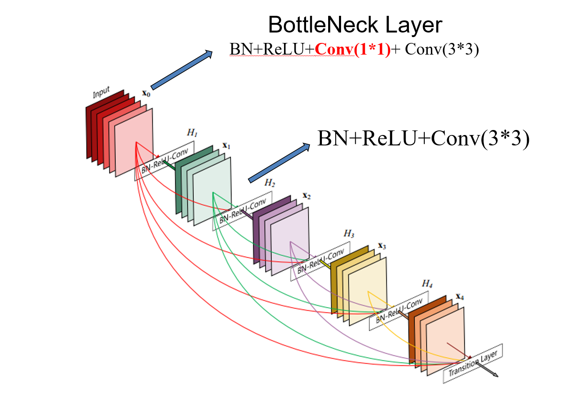

Hình 9.45 Khối dày đặc (Dense Block) với tầng thắt cổ chai BN-ReLU-Conv(1×1)-BN-ReLU-Conv(3×3)

Cấu trúc khối của DenseNet như hình trên.

Mục đích của kernel $1\times1$: giảm số bản đồ đặc trưng đầu vào, vừa giảm chiều để giảm tính toán, vừa hợp nhất đặc trưng giữa các kênh. DenseNet dùng tầng thắt cổ chai (bottleneck layer) gọi là DenseNet-B. (Trong thực nghiệm của bài báo, $n$ trong tích chập $1\times1\times n$ đặt bằng $4k$, $k$ là số bản đồ đặc trưng mỗi hàm $H$ sinh ra, gọi là tốc độ tăng trưởng.)

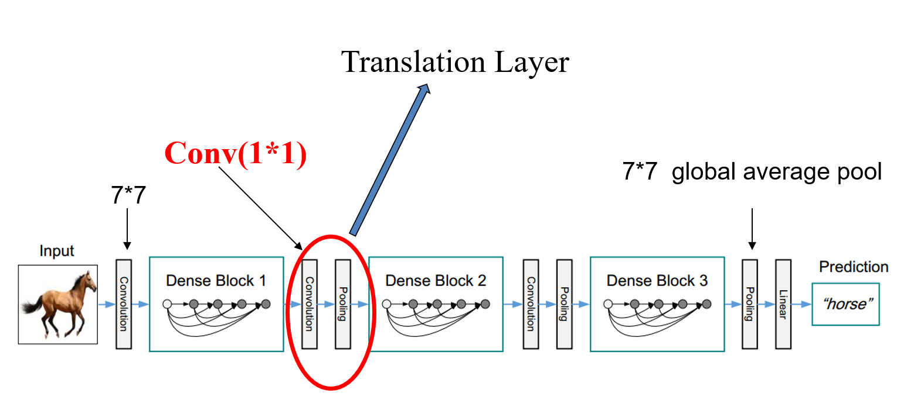

Hình 9.46 Cấu trúc tổng thể DenseNet: các khối dày đặc nối bằng tầng chuyển tiếp (Conv $1\times1$ + gộp)

Hình trên là sơ đồ cấu trúc tổng thể của DenseNet. Trong đó tích chập $1\times1$ để nén thêm tham số; tầng chuyển tiếp (transition layer) có tham số nén (reduction, $\theta$, trong khoảng 0 tới 1), cho biết đầu ra được thu nhỏ còn bao nhiêu lần, mặc định 0.5, như vậy khi sang khối dày đặc kế tiếp, số kênh giảm một nửa. Khi $\theta$ nhỏ hơn 1, mạng có tầng này gọi là DenseNet-C (dùng cả thắt cổ chai lẫn nén là DenseNet-BC).

Ưu điểm của DenseNet:

- giảm tiêu biến gradient;
- tăng cường truyền đặc trưng;
- dùng đặc trưng hiệu quả hơn;
- phần nào giảm số tham số;
- phần nào giảm quá khớp.

## 9.12 Các tập dữ liệu phân vùng ảnh thường dùng

### 9.12.1 PASCAL VOC

<div class="qa-theory">

**Lý thuyết:** [d2l (tiếng Anh) · 14.9 Phân vùng ngữ nghĩa và tập dữ liệu](https://d2l.ai/chapter_computer-vision/semantic-segmentation-and-dataset.html) ↗

</div>

Tập VOC có 20 lớp, tính cả nền là 21 lớp:

- Person: person
- Animal: bird, cat, cow, dog, horse, sheep
- Vehicle: aeroplane, bicycle, boat, bus, car, motorbike, train
- Indoor: bottle, chair, dining table, potted plant, sofa, tv/monitor

Ví dụ ảnh dùng cho cuộc thi phân vùng của VOC như dưới, gồm ảnh gốc và hai loại ảnh nhãn (định dạng PNG): phân vùng theo lớp (class) và phân vùng theo vật (object). Trong phân vùng theo lớp, trên ảnh nhãn thật (ground truth), vùng của mỗi vật được tô một màu riêng của lớp đó, tổng cộng 20 màu; trong phân vùng theo vật, mỗi cá thể một màu.

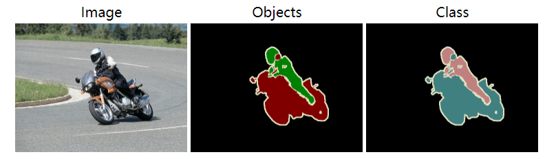

Hình 9.47 Ảnh, nhãn phân vùng theo vật (Objects) và theo lớp (Class) trong VOC

### 9.12.2 MS COCO

<div class="qa-theory">

**Lý thuyết:** [Ôn tập · 8.6.2 MS COCO](qa/ch08_vi?id=_862-ms-coco)

</div>

MS COCO là một trong những tập dữ liệu phân vùng ảnh lớn nhất, có 80 lớp vật (thing), hơn 33 vạn ảnh, trong đó hơn 20 vạn ảnh có nhãn, tổng số cá thể trong cả tập hơn 1.5 triệu. MS COCO là tập dữ liệu phân vùng ảnh khó nhất, nhiều thách thức nhất hiện nay. (Về sau COCO-Stuff bổ sung 91 lớp "nền" như trời, cỏ, đường, và COCO Panoptic kết hợp cả hai cho phân vùng toàn cảnh.)

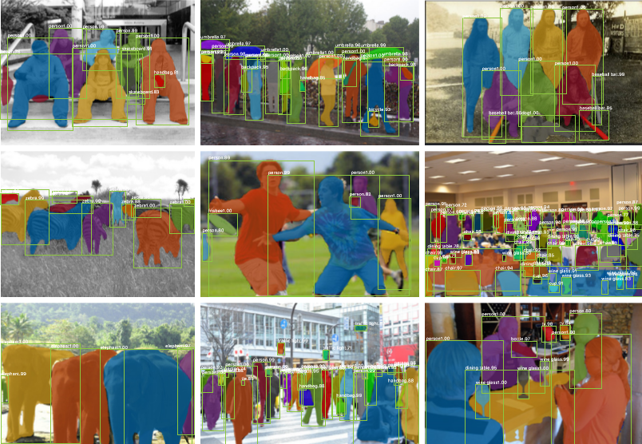

Hình 9.48 Ví dụ nhãn phân vùng thể hiện của COCO

### 9.12.3 Cityscapes

<div class="qa-theory">

**Lý thuyết:** [d2l (tiếng Anh) · 14.9 Phân vùng ngữ nghĩa và tập dữ liệu](https://d2l.ai/chapter_computer-vision/semantic-segmentation-and-dataset.html) ↗

</div>

Cityscapes là tập dữ liệu phân vùng ảnh để kiểm tra hiệu quả và hiệu năng trong lĩnh vực lái xe, gồm 5000 ảnh gán nhãn tinh và 20000 ảnh gán nhãn thô; các ảnh này gồm cảnh, nền, đường phố khác nhau của 50 thành phố, cùng nhãn của 30 lớp vật như mặt đường, tòa nhà, biển báo giao thông, thiên nhiên, bầu trời, người và xe (19 lớp trong đó dùng để đánh giá). Bộ đánh giá Cityscapes có hai nhiệm vụ: phân vùng cảnh mức điểm ảnh (Pixel-level, gọi tắt là phân vùng ngữ nghĩa) và phân vùng cảnh mức thể hiện (Instance-level, gọi tắt là phân vùng thể hiện).

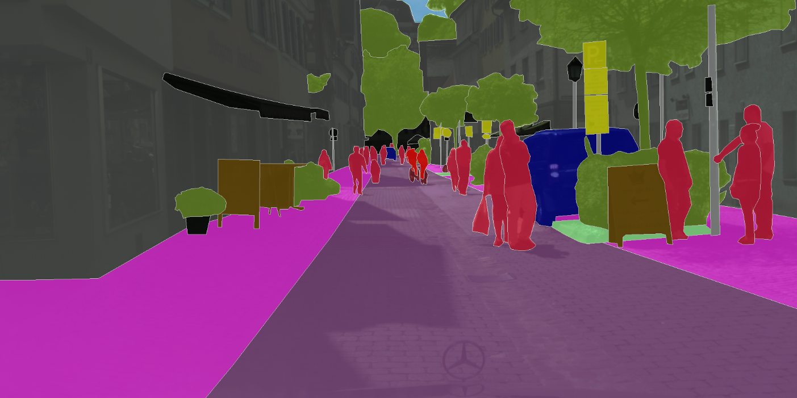

Hình 9.49 Ví dụ nhãn tinh của Cityscapes

### Bổ sung: các chỉ số đánh giá phân vùng

<div class="qa-theory">

**Lý thuyết:** [Học máy · E.2 Ma trận nhầm lẫn](ml/eval_vi?id=e2-ma-trận-nhầm-lẫn) · [Học máy · E.4 Precision, recall và F1](ml/eval_vi?id=e4-precision-recall-và-f1)

</div>

> **Biên tập:** danh sách TODO của bản gốc có mục "chỉ số đánh giá phân vùng ảnh" chưa viết; mục này do người biên tập bổ sung.

Với $C$ lớp, gọi $n_{ij}$ là số điểm ảnh thuộc lớp $i$ bị dự đoán là lớp $j$ (ma trận nhầm lẫn tính trên toàn tập), $t_i=\sum_j n_{ij}$ là số điểm ảnh thật của lớp $i$:

- **Độ chính xác điểm ảnh (pixel accuracy):** $\dfrac{\sum_i n_{ii}}{\sum_i t_i}$. Dễ bị lớp chiếm nhiều điểm ảnh (như nền, bầu trời) chi phối.
- **IoU của lớp $i$:** $\mathrm{IoU}_i=\dfrac{n_{ii}}{t_i+\sum_j n_{ji}-n_{ii}}$, tức giao trên hợp giữa vùng dự đoán và vùng thật của lớp đó. **mIoU** là trung bình IoU trên mọi lớp, chỉ số chính của VOC và Cityscapes.
- **Hệ số Dice (F1):** $\dfrac{2|A\cap B|}{|A|+|B|}$, liên hệ với IoU bởi $\mathrm{Dice}=\dfrac{2\,\mathrm{IoU}}{1+\mathrm{IoU}}$; hay dùng trong ảnh y tế, và dùng làm hàm mất mát (như code U-Net ở 9.3b).
- Phân vùng thể hiện dùng AP như phát hiện đối tượng nhưng tính IoU trên mặt nạ; phân vùng toàn cảnh dùng PQ (mục 9.13).

## 9.13 Phân vùng toàn cảnh

<div class="qa-theory">

**Lý thuyết:** [Ôn tập · 8.2.6 Mask R-CNN](qa/ch08_vi?id=_826-mask-r-cnn) · [Học máy · E.4 Precision, recall và F1](ml/eval_vi?id=e4-precision-recall-và-f1)

</div>

> Phần này do Minh Kỳ (明奇, Đại học Công nghệ Bắc Kinh) đóng góp cho bản gốc.

Công trình mở đầu của phân vùng toàn cảnh (panoptic segmentation): *Panoptic Segmentation* của Hà Khải Minh (Kirillov, He và cộng sự, CVPR 2019).

**1. Giới thiệu**

Phân vùng ngữ nghĩa dùng mạng tích chập hoàn toàn có lỗ, phân chia theo các "nền" (stuff) khác nhau; phân vùng thể hiện thì phân vùng vật trên nền phát hiện đối tượng, dựa vào hộp phát hiện. Thiếu một khung kết hợp cả hai để vừa phân vùng nền vừa phân vùng thể hiện, mà điều này rất có ích cho lái xe tự động và thực tế tăng cường (AR). Từ đó đề xuất bài toán phân vùng toàn cảnh, kết hợp được cả hai.

Ý tưởng của phân vùng toàn cảnh rất trực quan: gán cho mỗi điểm ảnh một nhãn ngữ nghĩa và một id thể hiện trong lớp; nhãn ngữ nghĩa để phân biệt thông tin ngữ nghĩa, id để tách thể hiện (vì vậy stuff không có id thể hiện). Khi đề xuất phân vùng toàn cảnh, tác giả chỉ hợp nhất một cách heuristic kết quả của hai bài toán phân vùng ngữ nghĩa và phân vùng thể hiện bằng hậu xử lý (như NMS), làm mốc cơ sở (baseline) cho bài toán PS. Để đánh giá chất lượng phân vùng toàn cảnh, đề xuất tiêu chí chất lượng toàn cảnh (panoptic quality, PQ), đưa đánh giá nền và vật vào một khung hoàn chỉnh. Sơ đồ như dưới:


Hình 9.50 (a) Ảnh; (b) phân vùng ngữ nghĩa; (c) phân vùng thể hiện; (d) phân vùng toàn cảnh

**2. Phân vùng toàn cảnh**

- **Dạng bài toán (task format).** Cách gán nhãn của phân vùng toàn cảnh: nhãn mức điểm ảnh, gồm nhãn lớp và id thể hiện trong lớp. Nếu cả hai thông tin của một điểm ảnh khớp, thì điểm ảnh đó được gán vào một lớp và một thể hiện. Điểm ảnh ngoài các lớp có thể gán nhãn rỗng (void), tức không phải điểm ảnh nào cũng phải có lớp ngữ nghĩa.
- **Nhãn stuff và thing.** Với nhãn của stuff và thing (nền và vật đếm được), giao là tập rỗng, hợp là toàn bộ không gian nhãn. Hai loại độc lập, không liên quan nhau (dễ hiểu: điểm ảnh thuộc lớp nào và thuộc vật nào là hai việc khác nhau).
- **Quan hệ.** Đều là nhãn mức điểm ảnh, phải gán nhãn cho từng điểm ảnh. Nhưng phân vùng thể hiện dựa trên vùng, cho phép các vùng chồng nhau, còn phân vùng toàn cảnh giống phân vùng ngữ nghĩa là nhãn mức điểm ảnh, không cho phép nhãn chồng nhau.
- **Điểm tin cậy.** Điểm này giống phân vùng ngữ nghĩa hơn phân vùng thể hiện: PS không cần điểm tin cậy để đánh giá chất lượng phân vùng. Tác giả cho rằng phân vùng ngữ nghĩa và toàn cảnh có thể so trực tiếp với nhãn người gán để đánh giá chất lượng mặt nạ; còn phân vùng thể hiện khi chọn mặt nạ lại dựa vào độ tin cậy phân loại, mà điều này không có nhãn người gán để tham chiếu nên khó nắm chắc.

**3. Chỉ số đánh giá phân vùng toàn cảnh**

Chỉ số đo hiệu quả phân vùng toàn cảnh cần: đầy đủ; dễ diễn giải; đơn giản. Từ đó đề xuất chỉ số PQ, chia hai bước: ghép phân vùng, rồi tính PQ trên các cặp đã ghép.

**3.1 Ghép phân vùng (segment matching)**

Định nghĩa ghép: một vùng dự đoán và một vùng thật có IoU lớn hơn 0.5 thì ghép được. Kết hợp với tính không chồng nhau của phân vùng toàn cảnh, dễ suy ra: mỗi vùng thật ghép được với nhiều nhất một vùng dự đoán (vì hai vùng dự đoán không chồng nhau không thể cùng có IoU > 0.5 với một vùng thật).

**3.2 Tính PQ**

Cách tính PQ giống mAP: tính trong từng lớp rồi lấy trung bình trên các lớp, để không nhạy với mất cân bằng lớp. Với mỗi lớp, chia các vùng thật và vùng dự đoán thành ba nhóm (mô tả ở hình dưới):


Hình 9.51 Với lớp person: TP là các cặp đã ghép, FN là vùng thật không được ghép, FP là vùng dự đoán không được ghép

- TP: dự đoán dương, thực tế dương, tức các cặp ghép tốt;
- FP: dự đoán dương, thực tế âm, tức các vùng dự đoán sai;
- FN: dự đoán âm, thực tế dương, tức các vùng thật không được ghép.

Từ ba nhóm này tính được PQ:

$$
PQ=\frac{\sum_{(p,g)\in TP}\mathrm{IoU}(p,g)}{|TP|+\frac12|FP|+\frac12|FN|}
$$

Bỏ FP và FN thì phần còn lại là IoU trung bình của các cặp đã ghép; thêm FP và FN là để phạt các vùng ghép thất bại.

Thú vị là biến đổi đồng nhất đơn giản công thức trên:

$$
PQ=\underbrace{\frac{\sum_{(p,g)\in TP}\mathrm{IoU}(p,g)}{|TP|}}_{\text{chất lượng phân vùng (SQ)}}\times\underbrace{\frac{|TP|}{|TP|+\frac12|FP|+\frac12|FN|}}_{\text{chất lượng nhận dạng (RQ)}}
$$

Thừa số thứ nhất đánh giá chất lượng của các vùng đã ghép, thừa số thứ hai giống điểm F1. Vì vậy có thể phân rã PQ thành:

$$
PQ=SQ\times RQ
$$

- **Nhãn rỗng (void labels).** Trong nhãn thật có thể có hai kiểu điểm ảnh gán nhãn rỗng: điểm ảnh ngoài các lớp và điểm ảnh mơ hồ (khó phân loại). Khi đánh giá, các nhãn rỗng này không được đánh giá. Cụ thể: (1) ở bước ghép, các điểm ảnh rỗng bị loại khỏi vùng dự đoán, không tham gia tính IoU; (2) sau bước ghép, các vùng dự đoán không ghép được bình thường sẽ tính là FP, nhưng nếu phần điểm ảnh rỗng trong vùng đó vượt một ngưỡng (hơn 50%) thì vùng bị loại, không tính là FP.
- **Nhãn nhóm (group labels).** Đôi khi khó gán nhãn riêng từng cá thể cùng lớp, nên có cách gán nhãn nhóm. Nhưng với cách tính PQ: (1) bước ghép không dùng nhãn nhóm mà phân biệt chặt từng thể hiện; (2) sau bước ghép, với các vùng dự đoán không ghép được mà chứa một phần điểm ảnh cùng lớp thuộc nhãn nhóm, phần đó bị loại và không tính là FP.

**3.3 So sánh với các chỉ số hiện có**

- **Chỉ số phân vùng ngữ nghĩa:** gồm độ chính xác mức điểm ảnh, độ chính xác trung bình, IoU. Nhưng chỉ tập trung vào phân chia mức điểm ảnh, không phản ánh hiệu năng phân vùng ở mức từng thể hiện vật.
- **Chỉ số phân vùng thể hiện:** là AP, chủ yếu dựa vào điểm tin cậy để chấm các vật được phát hiện. (Hai loại không hoàn toàn tách biệt: phân vùng thể hiện cũng có cách dùng IoU để giám sát, và việc điểm tin cậy có phản ánh đúng chất lượng mặt nạ hay không cũng từng bị nghi ngờ; tiêu chuẩn này không cố định.)
- **Chất lượng toàn cảnh:** PQ phân rã được thành SQ và RQ; SQ phản ánh hiệu năng IoU mức điểm ảnh như phân vùng ngữ nghĩa, RQ tập trung vào hiệu quả phát hiện–nhận dạng, nên hợp nhất hai bên vào một khung.

Kết quả phân vùng:


Hình 9.52 Ảnh, nhãn thật và dự đoán phân vùng toàn cảnh

> **Biên tập:** các công thức PQ trong bản gốc là ảnh, đã gõ lại; thêm ngưỡng 50% cho nhãn rỗng theo bài báo. Danh sách TODO cuối bản gốc ("công cụ gán nhãn phân vùng, chỉ số đánh giá, UNet++") được xử lý một phần: chỉ số đánh giá ở mục bổ sung trên; công cụ gán nhãn xem 8.7 (labelme, CVAT hỗ trợ đa giác và mặt nạ).
