# Chương 11 Học chuyển giao

> Ghi chú của người biên soạn: trang này dịch từ sách *Deep Learning 500 câu hỏi* (深度学习500问) do **Tan Jiyong (谈继勇)** chủ biên cùng cộng đồng đóng góp ([bản gốc](https://github.com/scutan90/DeepLearning-500-questions/tree/master/ch11_迁移学习), [mã nguồn](https://github.com/scutan90/DeepLearning-500-questions), giấy phép [GPL-3.0](https://www.gnu.org/licenses/gpl-3.0.html); phần dịch cũng theo GPL-3.0). Số câu hỏi giữ như bản gốc. Chỗ bản gốc sai hoặc thiếu đã được sửa ngay trong bài và ghi ở ô **Biên tập**; ô **Lý thuyết** dẫn sang bài học tương ứng trên site.

> **Biên tập:** phần lớn chương này rút từ *Sổ tay ngắn gọn về học chuyển giao* (迁移学习简明手册) của Vương Tấn Đông (Wang Jindong, Viện Hàn lâm Khoa học Trung Quốc), nên còn sót số hình (Hình 14–36) và số công thức (6.1, 8.1…) của cuốn sổ tay; bản dịch đánh lại số hình theo chương và gõ lại các công thức vốn để dạng ảnh. Người phụ trách chương trong bản gốc: Vương Tấn Đông, Quách Hiểu Phong (Viện Hàn lâm Khoa học Trung Quốc – iQIYI). Bản gốc đánh số mục 11.3 lộn xộn (hai mục 11.3.4, hai mục 11.3.6, mục 11.3.5 đứng sau 11.3.6); bản dịch đánh lại 11.3.5 tới 11.3.12 theo thứ tự xuất hiện. Phần mở đầu hứa có "triển vọng" và "tài nguyên học tập" nhưng bản gốc không viết; kho [transferlearning](https://github.com/jindongwang/transferlearning) của tác giả sổ tay là nơi tổng hợp tài liệu tốt.

Chương này giới thiệu ngắn gọn khái niệm cơ bản của học chuyển giao (transfer learning), vì sao cần nó, các hướng nghiên cứu và phương pháp cơ bản. Trọng tâm là mấy nhóm phương pháp thường dùng: thích nghi phân phối dữ liệu, chọn đặc trưng, học không gian con, và học chuyển giao sâu đang nóng nhất hiện nay.

## 11.1 Kiến thức cơ bản về học chuyển giao

### 11.1.1 Học chuyển giao là gì?

**Lý thuyết:** [d2l (tiếng Anh) · 14.2 Tinh chỉnh](https://d2l.ai/chapter_computer-vision/fine-tuning.html) ↗ · [Học sâu · 4.7 Môi trường và Dịch chuyển Phân phối](dl/ch04_s7_vi)

Tìm điểm tương đồng của bài toán đích; nhiệm vụ của học chuyển giao là xuất phát từ điểm tương đồng đó, áp dụng mô hình đã học ở miền (domain) cũ vào miền mới.

### 11.1.2 Vì sao cần học chuyển giao?

**Lý thuyết:** [Ôn tập · 13.1 Giải quyết bài toán ít mẫu huấn luyện thế nào?](qa/ch13_vi?id=_131-giải-quyết-bài-toán-ít-mẫu-huấn-luyện-thế-nào) · [Ôn tập · 14.4.1 Tinh chỉnh (fine-tune) là gì?](qa/ch14_vi?id=_1441-tinh-chỉnh-fine-tune-là-gì)

1. **Mâu thuẫn giữa dữ liệu lớn và ít nhãn:** dù có lượng dữ liệu rất lớn nhưng thường không có nhãn, không huấn luyện được mô hình học máy. Gán nhãn dữ liệu bằng tay quá tốn thời gian.
2. **Mâu thuẫn giữa dữ liệu lớn và năng lực tính toán yếu:** người bình thường không có lượng dữ liệu và tài nguyên tính toán khổng lồ, nên cần mượn mô hình đã có và chuyển giao.
3. **Mâu thuẫn giữa mô hình phổ quát và nhu cầu cá nhân hóa:** ngay cả trên cùng một nhiệm vụ, một mô hình cũng khó đáp ứng nhu cầu riêng của từng người, ví dụ thiết lập quyền riêng tư cụ thể. Khi đó cần thích nghi mô hình giữa những người khác nhau.
4. **Nhu cầu của các ứng dụng đặc thù** (như khởi đầu lạnh, cold start: hệ thống mới, người dùng mới chưa có dữ liệu).

### 11.1.3 Học chuyển giao có những vấn đề cơ bản nào?

**Lý thuyết:** [Học sâu · 4.7.3 Hiệu chỉnh Dịch chuyển Phân phối](dl/ch04_s7_vi?id=_473-hiệu-chỉnh-dịch-chuyển-phân-phối)

Có 3 vấn đề cơ bản:

- **How to transfer (chuyển giao thế nào):** làm học chuyển giao thế nào? (thiết kế phương pháp chuyển giao)
- **What to transfer (chuyển giao cái gì):** cho một miền đích, tìm miền nguồn tương ứng thế nào rồi chuyển giao? (chọn miền nguồn)
- **When to transfer (khi nào chuyển giao):** khi nào chuyển giao được, khi nào không? (tránh chuyển giao âm)

### 11.1.4 Học chuyển giao có những khái niệm thường dùng nào?

**Lý thuyết:** [Học sâu · 4.7.4 Phân loại các Bài toán Học](dl/ch04_s7_vi?id=_474-phân-loại-các-bài-toán-học) · [Học sâu · 4.7.1 Các Loại Dịch chuyển Phân phối](dl/ch04_s7_vi?id=_471-các-loại-dịch-chuyển-phân-phối)

- **Định nghĩa cơ bản**
  - **Miền (domain)** $\mathcal D = \{\mathcal X, P(X)\}$: gồm không gian đặc trưng và phân phối của đặc trưng, là chủ thể của việc học.
    - **Miền nguồn (source domain)** $\mathcal D_s$: miền đã có tri thức.
    - **Miền đích (target domain)** $\mathcal D_t$: miền cần học.
  - **Nhiệm vụ (task)** $\mathcal T = \{\mathcal Y, f(\cdot)\}$: gồm không gian nhãn và hàm dự đoán (hàm mục tiêu), là kết quả của việc học.
- **Phân loại theo không gian đặc trưng**
  - **Học chuyển giao đồng cấu (homogeneous TL):** không gian đặc trưng của miền nguồn và miền đích như nhau, $\mathcal X_s=\mathcal X_t$ (phân phối có thể khác).
  - **Học chuyển giao dị cấu (heterogeneous TL):** không gian đặc trưng khác nhau, $\mathcal X_s\ne \mathcal X_t$ (ví dụ nguồn là văn bản, đích là ảnh).
- **Phân loại theo tình huống chuyển giao**
  - **Học chuyển giao quy nạp (inductive TL):** nhiệm vụ học ở miền nguồn và miền đích khác nhau (miền đích có ít nhãn).
  - **Học chuyển giao truyền dẫn (transductive TL):** miền nguồn và miền đích khác nhau, nhiệm vụ học như nhau (miền đích không có nhãn).
  - **Học chuyển giao không giám sát (unsupervised TL):** cả miền nguồn và miền đích đều không có nhãn.
- **Phân loại theo phương pháp chuyển giao**
  - **Chuyển giao dựa trên mẫu (instance based TL):** chuyển giao bằng cách đánh lại trọng số để tái sử dụng mẫu của miền nguồn và miền đích.
  - **Chuyển giao dựa trên đặc trưng (feature based TL):** biến đổi đặc trưng của miền nguồn và miền đích về cùng một không gian.
  - **Chuyển giao dựa trên mô hình (parameter based TL):** dùng mô hình chia sẻ tham số giữa miền nguồn và miền đích.
  - **Chuyển giao dựa trên quan hệ (relation based TL):** chuyển giao dùng mạng quan hệ logic trong miền nguồn.

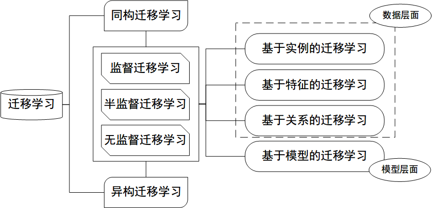

Hình 11.1 Phân loại học chuyển giao. Chữ trong hình: 迁移学习 = học chuyển giao; 同构/异构迁移学习 = đồng cấu / dị cấu; 监督/半监督/无监督迁移学习 = có giám sát / bán giám sát / không giám sát; 基于实例/特征/关系/模型的迁移学习 = dựa trên mẫu / đặc trưng / quan hệ / mô hình; 数据层面 = mức dữ liệu; 模型层面 = mức mô hình.

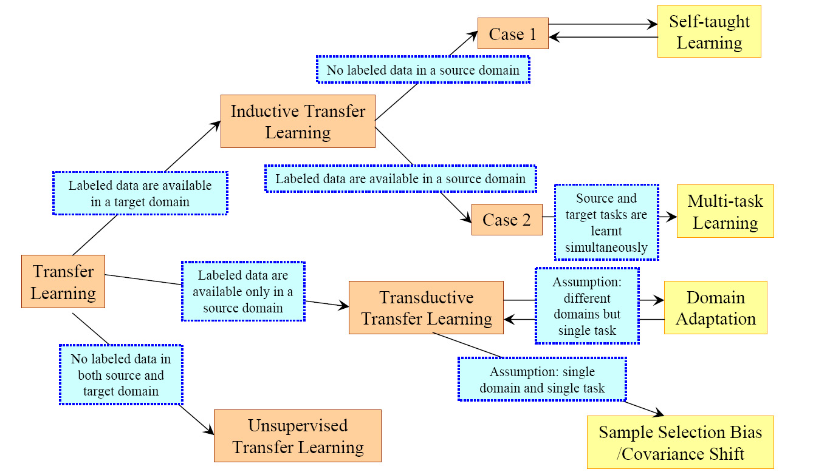

Hình 11.2 Phân loại theo tình huống: quy nạp, truyền dẫn, không giám sát, tùy miền đích và miền nguồn có nhãn hay không

> **Biên tập:** bản gốc viết học chuyển giao đồng cấu là "$D_s=D_t$" (miền bằng nhau). Nếu cả miền (không gian đặc trưng *và* phân phối) đều bằng nhau thì không cần chuyển giao; đồng cấu chỉ đòi hỏi *không gian đặc trưng* như nhau, $\mathcal X_s=\mathcal X_t$. Bản dịch bổ sung ký hiệu hình thức của miền và nhiệm vụ theo Pan và Yang (2010).

### 11.1.5 Học chuyển giao khác học máy truyền thống thế nào?

**Lý thuyết:** [Học sâu · 4.6 Tổng quát hóa trong Phân loại](dl/ch04_s6_vi) · [Học sâu · 4.7 Môi trường và Dịch chuyển Phân phối](dl/ch04_s7_vi)

| | Học chuyển giao | Học máy truyền thống |
|---|---|---|
| Phân phối dữ liệu | Dữ liệu huấn luyện và kiểm tra không cần cùng phân phối | Dữ liệu huấn luyện và kiểm tra cùng phân phối |
| Nhãn dữ liệu | Không cần đủ nhãn | Cần đủ nhãn |
| Mô hình hóa | Tái sử dụng được mô hình trước đó | Mỗi nhiệm vụ mô hình hóa riêng |

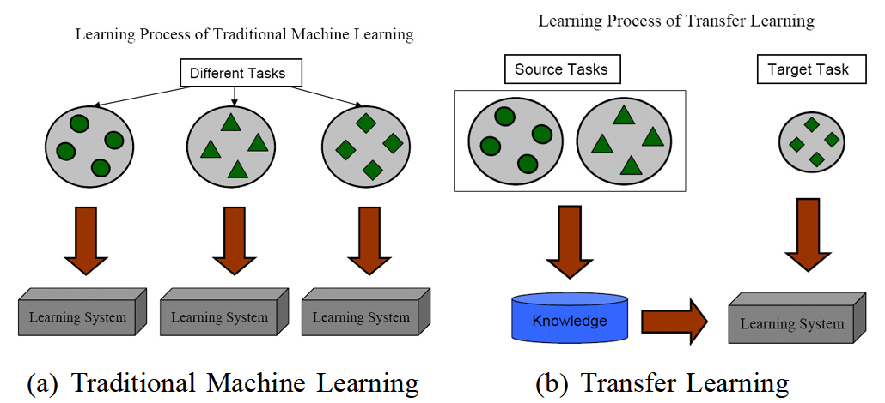

Hình 11.3 (a) Học máy truyền thống: mỗi nhiệm vụ một hệ thống học riêng; (b) học chuyển giao: tri thức từ nhiệm vụ nguồn được dùng cho nhiệm vụ đích

### 11.1.6 Cốt lõi và tiêu chí đo của học chuyển giao là gì?

**Lý thuyết:** [Ôn tập · 7.2.4 Kernel MMD (Maximum Mean Discrepancy)](qa/ch07_vi?id=_724-kernel-mmd-maximum-mean-discrepancy) · [Học sâu · 4.7.3 Hiệu chỉnh Dịch chuyển Phân phối](dl/ch04_s7_vi?id=_473-hiệu-chỉnh-dịch-chuyển-phân-phối)

**Ý tưởng tổng thể của học chuyển giao có thể tóm tắt là:** phát triển thuật toán tận dụng tối đa tri thức của miền có nhãn để hỗ trợ việc học và thu nhận tri thức ở miền đích.

**Cốt lõi của học chuyển giao là:** tìm điểm tương đồng giữa miền nguồn và miền đích rồi tận dụng hợp lý. Sự tương đồng này rất phổ biến. Ví dụ cơ thể người khác nhau có cấu tạo tương tự; cách đi xe đạp và xe máy tương tự; cờ vua và cờ tướng tương tự; cách đánh cầu lông và quần vợt tương tự. Sự tương đồng này cũng có thể hiểu là bất biến. Lấy cái bất biến ứng vạn biến mới đứng vững được.

**Có sự tương đồng rồi, bước tiếp theo là đo và tận dụng nó thế nào.** Việc đo có hai mục tiêu: một là đo tốt độ tương đồng của hai miền, không chỉ cho biết định tính chúng có giống nhau không mà còn cho biết định lượng giống tới mức nào; hai là lấy phép đo làm tiêu chí, dùng phương pháp học để tăng độ tương đồng giữa hai miền, qua đó hoàn thành học chuyển giao. (Các độ đo thường dùng: khoảng cách giữa trung bình đặc trưng như MMD, khoảng cách KL, khoảng cách $\mathcal H$-divergence trong lý thuyết của Ben-David và cộng sự.)

**Tóm lại một câu: tương đồng là cốt lõi, tiêu chí đo là công cụ quan trọng.**

### 11.1.7 Học chuyển giao khác các khái niệm khác thế nào?

**Lý thuyết:** [Học sâu · 4.7.1 Các Loại Dịch chuyển Phân phối](dl/ch04_s7_vi?id=_471-các-loại-dịch-chuyển-phân-phối) · [Học sâu · 4.7.1.1 Dịch chuyển Hiệp biến](dl/ch04_s7_vi?id=_4711-dịch-chuyển-hiệp-biến)

1. **Học chuyển giao và học đa nhiệm vụ:**
   - **Học đa nhiệm vụ (multi-task learning):** nhiều nhiệm vụ liên quan cùng học phối hợp, cùng lúc;
   - **Học chuyển giao:** nhấn mạnh tái sử dụng thông tin, chuyển từ một miền (domain) sang miền khác (thường tuần tự: học nguồn trước, rồi dùng cho đích).
2. **Học chuyển giao và thích nghi miền (domain adaptation):** thích nghi miền làm cho hai miền có phân phối đặc trưng không khớp trở nên khớp nhau; đây là một trường hợp riêng của học chuyển giao (cùng nhiệm vụ, khác phân phối).
3. **Học chuyển giao và dịch chuyển hiệp biến (covariate shift):** dịch chuyển hiệp biến là khi phân phối biên của dữ liệu đầu vào $P(X)$ thay đổi giữa huấn luyện và kiểm tra, còn phân phối có điều kiện $P(Y|X)$ giữ nguyên.

> **Biên tập:** bản gốc định nghĩa dịch chuyển hiệp biến là "phân phối **có điều kiện** của dữ liệu thay đổi"; ngược lại: dịch chuyển hiệp biến là $P(X)$ đổi, $P(Y|X)$ không đổi. Khi $P(Y|X)$ đổi thì gọi là dịch chuyển khái niệm (concept shift), xem mục 4.7.1 của khóa Học sâu.

Tài liệu tham khảo:

1. [Vương Tấn Đông, Sổ tay ngắn gọn về học chuyển giao](https://github.com/jindongwang/transferlearning-tutorial)
2. Ben-David, S., Blitzer, J., Crammer, K., Kulesza, A., Pereira, F., & Vaughan, J. W. (2010). A theory of learning from different domains. *Machine Learning*, 79(1-2), 151-175.
3. Tan, B., Song, Y., Zhong, E. and Yang, Q. (2015). Transitive transfer learning. In *KDD* (pp. 1155-1164). ACM.

### 11.1.8 Chuyển giao âm là gì? Nguyên nhân gây ra chuyển giao âm?

**Lý thuyết:** [Ôn tập · 14.4.4 Tinh chỉnh thế nào với các đặc điểm dữ liệu khác nhau?](qa/ch14_vi?id=_1444-tinh-chỉnh-thế-nào-với-các-đặc-điểm-dữ-liệu-khác-nhau)

Chuyển giao âm (negative transfer) là khi tri thức học từ miền nguồn lại tác động tiêu cực tới việc học ở miền đích (kết quả còn tệ hơn không chuyển giao).

Nguyên nhân chính gây chuyển giao âm:

- **Vấn đề dữ liệu:** miền nguồn và miền đích vốn không giống nhau, chuyển giao thế nào được?
- **Vấn đề phương pháp:** miền nguồn và miền đích giống nhau, nhưng phương pháp học chuyển giao chưa đủ tốt, không tìm được phần chuyển giao được.

Chuyển giao âm gây ảnh hưởng xấu tới nghiên cứu và ứng dụng học chuyển giao. Trong ứng dụng thực tế, tìm được điểm tương đồng hợp lý và chọn hay phát triển phương pháp học chuyển giao phù hợp giúp tránh được chuyển giao âm.

### 11.1.9 Ý tưởng cơ bản của học chuyển giao là gì?

**Lý thuyết:** [d2l (tiếng Anh) · 14.2 Tinh chỉnh](https://d2l.ai/chapter_computer-vision/fine-tuning.html) ↗

Ý tưởng tổng thể của học chuyển giao có thể tóm tắt là: phát triển thuật toán tận dụng tối đa tri thức của miền có nhãn để hỗ trợ việc học ở miền đích.

1. Tìm điểm tương đồng của bài toán đích; nhiệm vụ học chuyển giao là từ điểm tương đồng đó, áp dụng mô hình đã học ở miền cũ vào miền mới.
2. Học chuyển giao là quá trình học dùng sự tương đồng giữa dữ liệu, nhiệm vụ hay mô hình, áp dụng mô hình đã học ở miền cũ vào miền mới.
3. Học chuyển giao **có ích nhất** khi bạn muốn tối ưu hiệu năng của nhiệm vụ B mà nhiệm vụ này có tương đối ít dữ liệu. Ví dụ trong khoa X-quang, rất khó thu thập nhiều ảnh chụp X-quang để xây dựng một hệ chẩn đoán tốt; trong trường hợp này, có thể tìm một nhiệm vụ liên quan nhưng khác, như nhận dạng ảnh, mà bạn có thể đã huấn luyện trên 1 triệu ảnh và học được nhiều đặc trưng mức thấp, nên có lẽ giúp mạng làm tốt hơn trên nhiệm vụ X-quang dù nhiệm vụ đó không có nhiều dữ liệu.
4. Khi nào học chuyển giao có ý nghĩa? Nó thực sự có thể **tăng đáng kể hiệu năng** của nhiệm vụ học, nhưng cũng có trường hợp nhiệm vụ nguồn A thực ra còn ít dữ liệu hơn nhiệm vụ đích B; khi đó lợi ích có thể chẳng bao nhiêu. Theo Andrew Ng, chuyển giao từ A sang B có ý nghĩa khi: A và B có cùng loại đầu vào; A có nhiều dữ liệu hơn B rất nhiều; đặc trưng mức thấp học từ A có ích cho B.

> Khi nào dùng được học chuyển giao?
>
> Nếu hai miền khác nhau quá lớn thì **không nên dùng thẳng học chuyển giao**, vì kết quả sẽ không tốt. Khi đó nên dùng cách của bài [3]: chuyển giao từng bước qua các miền trung gian giữa hai miền có độ tương đồng thấp (dò đá qua sông).

> **Biên tập:** câu 4 bản gốc bị hỏng chữ ("nhiệm vụ thực ra có ít dữ liệu hơn nhiệm vụ"); đã sửa theo ý của bài giảng Andrew Ng mà đoạn này dịch lại, và bổ sung ba điều kiện.

**Các câu hỏi mở** (bản gốc chỉ nêu câu hỏi, người biên tập trả lời ngắn):

1. *Học chuyển giao có những hướng giải quyết chính nào?* Xem 11.2 (dựa trên mẫu, đặc trưng, mô hình, quan hệ) và 11.3 (thích nghi phân phối, chọn đặc trưng, căn chỉnh không gian con, tinh chỉnh, thích nghi mạng sâu, đối kháng).
2. *Ngoài độ chính xác khi suy luận, đo hiệu quả học chuyển giao thế nào?* So với mốc không chuyển giao (huấn luyện chỉ trên đích, hoặc dùng thẳng mô hình nguồn) để thấy có chuyển giao âm không; đo khoảng cách phân phối giữa hai miền trên đặc trưng học được (MMD, độ chính xác của một bộ phân loại phân biệt miền: càng gần 50% thì đặc trưng càng bất biến miền); đo theo số mẫu có nhãn của đích cần để đạt một độ chính xác.
3. *Mạng đối kháng chuyển giao thế nào?* Xem 11.3.12 (DANN).

## 11.2 Học chuyển giao có những hướng cơ bản nào?

**Lý thuyết:** [Học sâu · 4.7.3 Hiệu chỉnh Dịch chuyển Phân phối](dl/ch04_s7_vi?id=_473-hiệu-chỉnh-dịch-chuyển-phân-phối)

Các phương pháp học chuyển giao cơ bản chia thành bốn loại: chuyển giao dựa trên mẫu, dựa trên mô hình, dựa trên đặc trưng, và dựa trên quan hệ.

### 11.2.1 Chuyển giao dựa trên mẫu

**Lý thuyết:** [Học sâu · 4.7.3 Hiệu chỉnh Dịch chuyển Phân phối](dl/ch04_s7_vi?id=_473-hiệu-chỉnh-dịch-chuyển-phân-phối) · [Học máy · T.5 Boosting và AdaBoost](ml/ensemble_vi?id=t5-boosting-và-adaboost)

Phương pháp học chuyển giao dựa trên mẫu (instance based transfer learning) tái sử dụng các mẫu dữ liệu theo một quy tắc sinh trọng số nào đó để chuyển giao. Hình dưới minh họa ý tưởng: miền nguồn có nhiều loài động vật như chó, chim, mèo; miền đích chỉ có chó. Khi chuyển giao, để giống miền đích nhất, ta có thể tăng trọng số của các mẫu thuộc lớp chó trong miền nguồn.

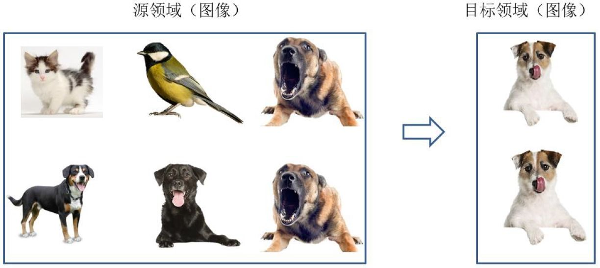

Hình 11.4 Chuyển giao dựa trên mẫu: miền nguồn (ảnh, trái) có nhiều loài, miền đích (ảnh, phải) chỉ có chó

Trong học chuyển giao, với miền nguồn $\mathcal D_s$ và miền đích $\mathcal D_t$, thường giả định phân phối sinh ra chúng khác nhau và chưa biết ($P(X_s)\ne P(X_t)$). Ngoài ra, vì số chiều và số mẫu thường rất lớn, ước lượng trực tiếp $P(X_s)$ và $P(X_t)$ là không khả thi. Vì vậy nhiều nghiên cứu [Khan và Heisterkamp, 2016; Zadrozny, 2004; Cortes và cộng sự, 2008; Dai và cộng sự, 2007; Tan và cộng sự, 2015, 2017] tập trung ước lượng **tỉ số** phân phối giữa miền đích và miền nguồn $P(X_t)/P(X_s)$. Tỉ số ước lượng được chính là trọng số của mẫu. Các phương pháp này thường giả định tỉ số đó bị chặn (giá của $P(X_t)$ nằm trong giá của $P(X_s)$) và phân phối có điều kiện của hai miền như nhau ($P(y|x_s)=P(y|x_t)$). Đặc biệt, Đới Văn Uyên (Dai) và cộng sự ở Đại học Giao thông Thượng Hải [Dai và cộng sự, 2007] đề xuất TrAdaBoost, áp ý tưởng AdaBoost vào học chuyển giao: tăng trọng số các mẫu có lợi cho nhiệm vụ phân loại đích, giảm trọng số các mẫu bất lợi, và suy ra cận trên của lỗi tổng quát hóa dựa trên lý thuyết PAC. TrAdaBoost là một trong những nghiên cứu kinh điển của hướng này. Bài [Huang và cộng sự, 2007] đề xuất phương pháp khớp trung bình kernel (Kernel Mean Matching, KMM) để ước lượng phân phối, mục tiêu là làm phân phối của miền nguồn sau khi đánh trọng số gần với miền đích nhất. Trong các kết quả mới nhất, Đàm Bân (Tan) và cộng sự ở Đại học Khoa học và Công nghệ Hồng Kông mở rộng phạm vi ứng dụng của chuyển giao theo mẫu, đề xuất học chuyển giao bắc cầu (Transitive Transfer Learning, TTL) [Tan và cộng sự, 2015] và học chuyển giao miền xa (Distant Domain Transfer Learning, DDTL) [Tan và cộng sự, 2017], dùng phân rã ma trận chung và mạng neuron sâu, áp dụng học chuyển giao để chia sẻ tri thức giữa nhiều miền không giống nhau, đạt kết quả tốt.

Phương pháp đánh trọng số mẫu tuy có nền tảng lý thuyết tốt, dễ suy cận trên lỗi tổng quát hóa, nhưng thường chỉ hiệu quả khi khác biệt phân phối giữa các miền nhỏ, nên với các bài toán như xử lý ngôn ngữ tự nhiên, thị giác máy tính thì chưa lý tưởng. Còn phương pháp chuyển giao dựa trên biểu diễn đặc trưng cho kết quả tốt hơn, là trọng tâm nghiên cứu.

> **Biên tập:** bản gốc viết giả định "phân phối khác nhau ($P(X_s)=P(X_t)$)" (thiếu dấu khác) và "các phương pháp này thường giả định $P(x_s) <$" (câu bị cắt). Đã sửa theo ý đúng: trọng số $w(x)=P_t(x)/P_s(x)$, giống phương pháp hiệu chỉnh dịch chuyển hiệp biến bằng trọng số quan trọng ở mục 4.7.3 khóa Học sâu.

### 11.2.2 Chuyển giao dựa trên đặc trưng

**Lý thuyết:** [Học máy · 21.1 Phân tích thành phần chính](ml/ch21_vi?id=_211-phân-tích-thành-phần-chính) · [Ôn tập · 7.2.4 Kernel MMD (Maximum Mean Discrepancy)](qa/ch07_vi?id=_724-kernel-mmd-maximum-mean-discrepancy)

Phương pháp chuyển giao dựa trên đặc trưng (feature based transfer learning) biến đổi đặc trưng để chuyển qua lại [Liu và cộng sự, 2011; Zheng và cộng sự, 2008; Hu và Yang, 2011], giảm khoảng cách giữa miền nguồn và miền đích; hoặc biến đổi đặc trưng dữ liệu của hai miền về một không gian đặc trưng thống nhất [Pan và cộng sự, 2011; Long và cộng sự, 2014b; Duan và cộng sự, 2012], rồi dùng phương pháp học máy truyền thống để phân loại. Tùy đặc trưng đồng cấu hay dị cấu, lại chia thành học chuyển giao đồng cấu và dị cấu. Hình dưới minh họa hai kiểu chuyển giao dựa trên đặc trưng.

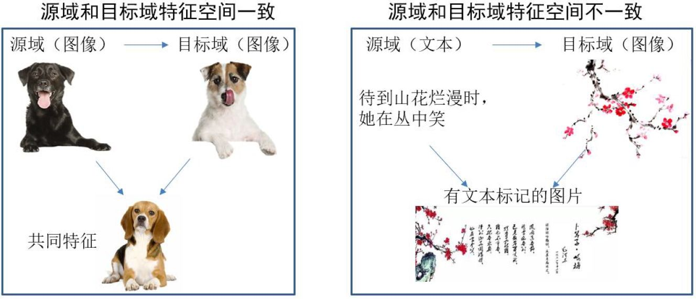

Hình 11.5 Trái: không gian đặc trưng của nguồn và đích như nhau (ảnh → ảnh), tìm đặc trưng chung; phải: không gian đặc trưng khác nhau (văn bản → ảnh), nối qua các ảnh có chú thích văn bản. Chữ trong hình: 源域（图像） = miền nguồn (ảnh), 目标域 = miền đích, 共同特征 = đặc trưng chung, 有文本标记的图片 = ảnh có nhãn văn bản.

Phương pháp dựa trên đặc trưng là hướng nghiên cứu nóng nhất của học chuyển giao, thường giả định miền nguồn và miền đích có một số đặc trưng giao nhau. Phương pháp phân tích thành phần chuyển giao (Transfer Component Analysis, TCA) của Phan Gia Lượng (Sinno Pan) và cộng sự ở Đại học Khoa học và Công nghệ Hồng Kông [Pan và cộng sự, 2011] là một phương pháp điển hình. Cốt lõi của nó là lấy chênh lệch trung bình cực đại (Maximum Mean Discrepancy, MMD) [Borgwardt và cộng sự, 2006] làm tiêu chí đo, cực tiểu hóa khác biệt phân phối giữa các miền dữ liệu. Blitzer và cộng sự ở UC Berkeley [Blitzer và cộng sự, 2006] đề xuất phương pháp học dựa trên tương ứng cấu trúc (Structural Correspondence Learning, SCL): qua ánh xạ, biến các đặc trưng riêng của một không gian thành các đặc trưng trục (pivot) chung của mọi không gian, rồi dùng thuật toán học máy để phân loại trên các đặc trưng đó. Long Minh Thịnh (Long Mingsheng) và cộng sự ở Đại học Thanh Hoa [Long và cộng sự, 2014b] đề xuất khớp chung có chuyển giao (Transfer Joint Matching, TJM), vừa cực tiểu khoảng cách phân phối vừa chọn mẫu, kết hợp hữu cơ chuyển giao theo mẫu và theo đặc trưng. Jing Zhang và cộng sự ở Đại học Wollongong (Úc) [Zhang và cộng sự, 2017a] đề xuất học riêng ma trận biến đổi cho miền nguồn và miền đích để đạt mục tiêu chuyển giao.

### 11.2.3 Chuyển giao dựa trên mô hình

**Lý thuyết:** [Học máy · Chương 26 Support vector machine (SVM)](ml/ch26_vi) · [Ôn tập · 14.4.2 Có những cách tinh chỉnh nào?](qa/ch14_vi?id=_1442-có-những-cách-tinh-chỉnh-nào)

Phương pháp chuyển giao dựa trên mô hình (parameter/model based transfer learning) tìm thông tin tham số dùng chung giữa miền nguồn và miền đích để chuyển giao. Giả định của cách này là dữ liệu miền nguồn và miền đích có thể dùng chung một số tham số mô hình. Các công trình tiêu biểu: [Zhao và cộng sự, 2010, 2011; Pan và cộng sự, 2008a, 2008b]. Hình dưới minh họa ý tưởng.

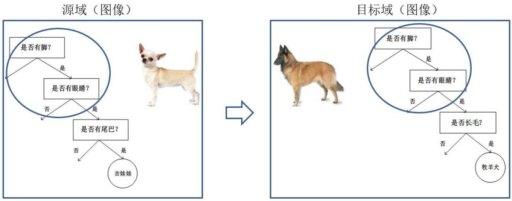

Hình 11.6 Chuyển giao dựa trên mô hình: cây quyết định học ở miền nguồn (chó nhỏ) được dùng lại, thêm nhánh, cho miền đích (chó lớn)

Trong đó, Zhao và cộng sự ở Viện Công nghệ Tính toán (Viện Hàn lâm Khoa học Trung Quốc) [Zhao và cộng sự, 2011] đề xuất TransEMDT: trước hết dùng cây quyết định dựng mô hình nhận dạng hành vi bền vững trên dữ liệu có nhãn, rồi với dữ liệu không nhãn dùng phân cụm K-means để tìm tham số gán nhãn tối ưu. Deng và cộng sự ở Đại học Bưu chính Viễn thông Tây An [Deng và cộng sự, 2014] cũng làm công việc tương tự bằng máy học cực hạn (extreme learning machine). Pan và cộng sự ở Đại học Khoa học và Công nghệ Hồng Kông [Pan và cộng sự, 2008a] dùng HMM nghiên cứu định vị trong nhà bằng Wi-Fi dưới các phân phối khác nhau, do tín hiệu thay đổi động theo thiết bị, thời gian và không gian. Một phần các nhà nghiên cứu khác cải tiến máy vector hỗ trợ SVM [Nater và cộng sự, 2011; Li và cộng sự, 2012]. Các phương pháp này giả định vector trọng số $\mathbf w$ của SVM tách được thành hai phần: $\mathbf w = \mathbf w_0+\mathbf v$, trong đó $\mathbf w_0$ là phần dùng chung giữa miền nguồn và miền đích, $\mathbf v$ là phần xử lý riêng cho từng miền. Trong kết quả mới nhất, Wei và cộng sự ở Đại học Khoa học và Công nghệ Hồng Kông [Wei và cộng sự, 2016b] đưa thông tin mạng xã hội vào số hạng điều chuẩn của phương pháp học chuyển giao. Long Minh Thịnh và cộng sự ở Đại học Thanh Hoa [Long và cộng sự, 2015a, 2016, 2017] cải tiến cấu trúc mạng sâu, thêm tầng thích nghi phân phối xác suất vào mạng, tăng thêm khả năng tổng quát hóa của mạng học chuyển giao sâu trên dữ liệu lớn.

### 11.2.4 Chuyển giao dựa trên quan hệ

**Lý thuyết:** [Toán · Chương 3 Ôn tập Xác suất](math/ch03_vi)

Phương pháp học chuyển giao dựa trên quan hệ (relation based transfer learning) có ý tưởng khác hẳn ba cách trên. Cách này chú ý tới quan hệ giữa các mẫu của miền nguồn và miền đích. Hình dưới minh họa các quan hệ tương tự giữa các miền khác nhau.

Hiện nay nghiên cứu về chuyển giao dựa trên quan hệ rất ít, chỉ có vài bài liên tiếp: [Mihalkova và cộng sự, 2007; Mihalkova và Mooney, 2008; Davis và Domingos, 2009]. Các bài này đều dùng mạng logic Markov (Markov Logic Network) để khai thác sự tương đồng về quan hệ giữa các miền.

Ta sẽ tập trung bàn các phương pháp dựa trên đặc trưng và dựa trên mô hình, vốn là điểm nóng của tuyệt đại đa số nghiên cứu hiện nay.

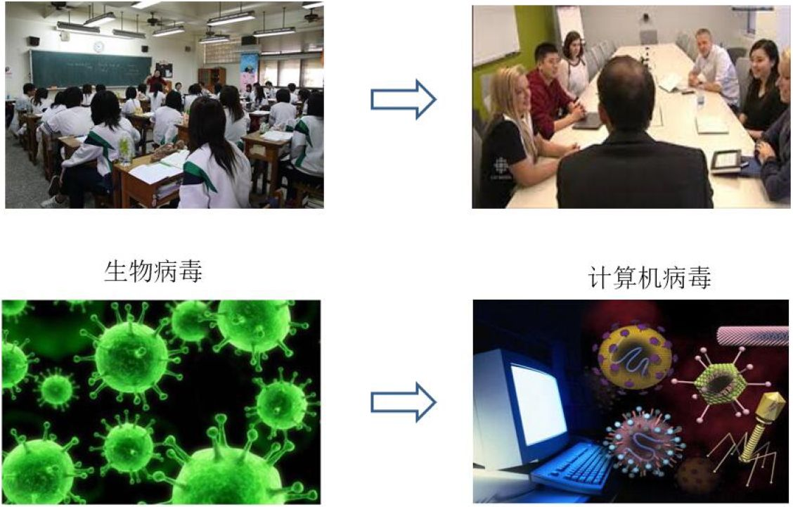

Hình 11.7 Quan hệ tương tự giữa các miền: thầy–trò trong lớp học và trong buổi họp; virus sinh học (生物病毒) và virus máy tính (计算机病毒)

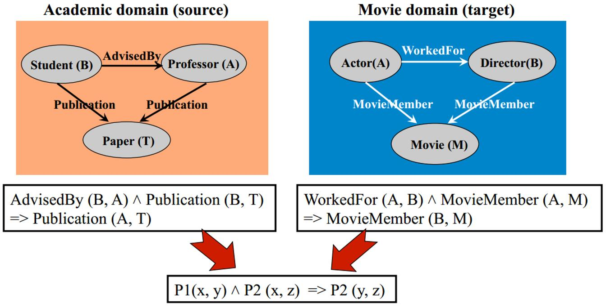

Hình 11.8 Chuyển giao quan hệ bằng mạng logic Markov: quy tắc "Student–Professor–Paper" ở miền học thuật tương ứng với "Actor–Director–Movie" ở miền điện ảnh

## 11.3 Các phương pháp học chuyển giao thường dùng

### 11.3.1 Thích nghi phân phối dữ liệu

**Lý thuyết:** [Học sâu · 4.7.1 Các Loại Dịch chuyển Phân phối](dl/ch04_s7_vi?id=_471-các-loại-dịch-chuyển-phân-phối) · [Học sâu · 4.7.3 Hiệu chỉnh Dịch chuyển Phân phối](dl/ch04_s7_vi?id=_473-hiệu-chỉnh-dịch-chuyển-phân-phối)

Thích nghi phân phối dữ liệu (distribution adaptation) là nhóm phương pháp học chuyển giao thường dùng nhất. Ý tưởng cơ bản: vì phân phối xác suất của dữ liệu miền nguồn và miền đích khác nhau, cách trực tiếp nhất là dùng một số phép biến đổi kéo khoảng cách giữa các phân phối lại gần.

Hình dưới minh họa vài trường hợp phân phối dữ liệu. Nói đơn giản, phân phối biên khác nhau tức dữ liệu tổng thể không giống nhau. Phân phối có điều kiện khác nhau tức dữ liệu tổng thể giống nhau, nhưng đi vào từng lớp thì không giống.

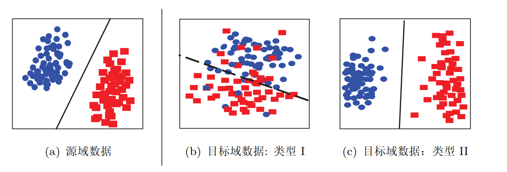

Hình 11.9 (a) Dữ liệu miền nguồn; (b) dữ liệu miền đích loại I: phân phối biên khác; (c) dữ liệu miền đích loại II: phân phối có điều kiện khác

Theo tính chất của phân phối dữ liệu, nhóm này lại chia thành thích nghi phân phối biên, thích nghi phân phối có điều kiện và thích nghi phân phối đồng thời. Dưới đây giới thiệu nguyên lý và công trình tiêu biểu của từng loại: trước hết ý tưởng cơ bản, rồi cốt lõi, cuối cùng là các mở rộng gần đây.

### 11.3.2 Thích nghi phân phối biên

**Lý thuyết:** [Ôn tập · 7.2.4 Kernel MMD (Maximum Mean Discrepancy)](qa/ch07_vi?id=_724-kernel-mmd-maximum-mean-discrepancy) · [Học máy · Chương 21 Principal component analysis (PCA)](ml/ch21_vi)

Mục tiêu của thích nghi phân phối biên (marginal distribution adaptation) là giảm khoảng cách giữa phân phối xác suất biên của miền nguồn và miền đích để chuyển giao. Về hình thức, phương pháp này dùng khoảng cách giữa $P(X_s)$ và $P(X_t)$ để xấp xỉ khác biệt giữa hai miền:

$$
\mathrm{DISTANCE}(\mathcal D_s,\mathcal D_t)\approx\lVert P(X_s)-P(X_t)\rVert
$$

Thích nghi phân phối biên ứng với trường hợp chuyển từ Hình 11.9(a) sang 11.9(b). Phương pháp tiêu biểu là TCA (11.2.2): tìm một phép chiếu sao cho MMD giữa hai miền sau chiếu nhỏ nhất mà vẫn giữ phương sai dữ liệu.

### 11.3.3 Thích nghi phân phối có điều kiện

**Lý thuyết:** [Học sâu · 4.7.1.3 Dịch chuyển Khái niệm](dl/ch04_s7_vi?id=_4713-dịch-chuyển-khái-niệm)

Mục tiêu của thích nghi phân phối có điều kiện (conditional distribution adaptation) là giảm khoảng cách giữa phân phối có điều kiện của miền nguồn và miền đích. Về hình thức, phương pháp này dùng khoảng cách giữa $P(y_s|X_s)$ và $P(y_t|X_t)$ để xấp xỉ khác biệt giữa hai miền:

$$
\mathrm{DISTANCE}(\mathcal D_s,\mathcal D_t)\approx\lVert P(y_s|X_s)-P(y_t|X_t)\rVert
$$

Thích nghi phân phối có điều kiện ứng với trường hợp chuyển từ Hình 11.9(a) sang 11.9(c).

Hiện các công trình chỉ dùng riêng thích nghi phân phối có điều kiện còn ít, chủ yếu có thể tìm trong [Saito và cộng sự, 2017]. Gần đây Vương Tấn Đông và cộng sự ở Viện Công nghệ Tính toán đề xuất phương pháp STL (Stratified Transfer Learning) [Wang và cộng sự, 2018], đưa ra ý tưởng chuyển giao trong lớp (intra-class transfer): phần lớn phương pháp hiện có chỉ học một phép biến đổi đặc trưng toàn cục (global domain shift), bỏ qua sự tương đồng trong từng lớp; chuyển giao trong lớp tận dụng được đặc trưng trong lớp, cho kết quả chuyển giao tốt hơn.

Ý tưởng cơ bản của STL như hình dưới. Trước hết dùng bỏ phiếu đa số để sinh nhãn giả cho dữ liệu hành vi chưa gán nhãn ở vị trí mới; rồi trong không gian Hilbert với kernel tái sinh, dùng tương quan trong lớp để giảm chiều thích nghi, tăng tương quan giữa dữ liệu hành vi ở các tình huống khác nhau; cuối cùng gán nhãn lần hai để gán nhãn chính xác dữ liệu chưa biết.

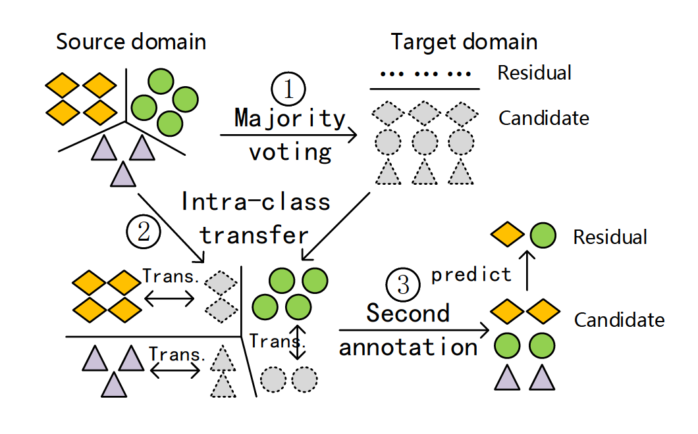

Hình 11.10 STL: (1) bỏ phiếu đa số sinh nhãn giả, (2) chuyển giao trong lớp, (3) gán nhãn lần hai

> **Biên tập:** cách hiểu "thích nghi phân phối có điều kiện" ở đây theo sổ tay: thực tế miền đích không có nhãn nên $P(y_t|X_t)$ được xấp xỉ bằng nhãn giả (như bước 1 của STL), hoặc so sánh các phân phối có điều kiện theo lớp $P(X|y)$ trên từng lớp.

### 11.3.4 Thích nghi phân phối đồng thời

**Lý thuyết:** [Học sâu · 4.7.1 Các Loại Dịch chuyển Phân phối](dl/ch04_s7_vi?id=_471-các-loại-dịch-chuyển-phân-phối)

Mục tiêu của thích nghi phân phối đồng thời (joint distribution adaptation) là giảm khoảng cách giữa phân phối xác suất đồng thời của miền nguồn và miền đích. Về hình thức, phương pháp này dùng cả khoảng cách giữa $P(X_s)$ và $P(X_t)$ lẫn khoảng cách giữa $P(y_s|X_s)$ và $P(y_t|X_t)$ để xấp xỉ khác biệt giữa hai miền:

$$
\mathrm{DISTANCE}(\mathcal D_s,\mathcal D_t)\approx\lVert P(X_s)-P(X_t)\rVert+\lVert P(y_s|X_s)-P(y_t|X_t)\rVert
$$

Thích nghi phân phối đồng thời ứng với cả trường hợp chuyển từ Hình 11.9(a) sang 11.9(b) và từ 11.9(a) sang 11.9(c). Phương pháp tiêu biểu là JDA (Joint Distribution Adaptation, Long và cộng sự, 2013) và BDA (Balanced Distribution Adaptation, Wang và cộng sự, 2017); BDA thêm hệ số cân bằng $\mu$ giữa hai số hạng.

> **Biên tập:** công thức bản gốc nối hai khoảng cách bằng dấu **trừ**; khoảng cách đồng thời là **tổng** hai khoảng cách (trừ đi thì càng khác về điều kiện lại càng "giống", vô nghĩa).

### 11.3.5 So sánh ưu nhược của các phương pháp thích nghi phân phối xác suất

**Lý thuyết:** [Ôn tập · 7.2.4 Kernel MMD (Maximum Mean Discrepancy)](qa/ch07_vi?id=_724-kernel-mmd-maximum-mean-discrepancy)

Tổng hợp ba loại thích nghi phân phối xác suất trên, có thể rút ra:

1. So sánh độ chính xác: BDA > JDA > TCA > thích nghi phân phối có điều kiện.
2. Áp các phương pháp thích nghi phân phối xác suất vào mạng neuron là một xu hướng phát triển. Bảng ở Hình 11.12 cho thấy thêm thích nghi phân phối xác suất vào mạng sâu thường tốt hơn các phương pháp không sâu.

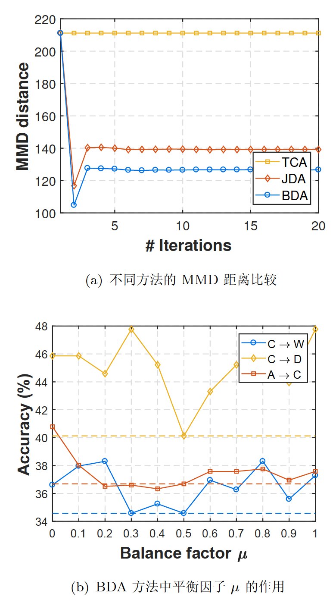

Hình 11.11 Hiệu quả của BDA: (a) khoảng cách MMD theo số vòng lặp của TCA, JDA, BDA; (b) độ chính xác theo hệ số cân bằng $\mu$

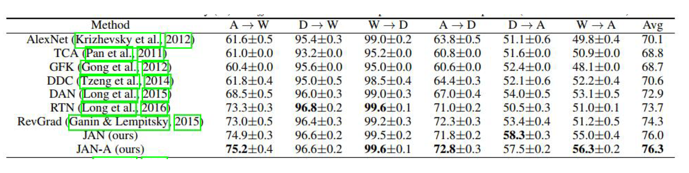

Hình 11.12 Độ chính xác của các phương pháp thích nghi phân phối trên tập Office-31 (A, W, D là ba miền ảnh); các phương pháp sâu (DAN, RTN, RevGrad, JAN) vượt các phương pháp không sâu (TCA, GFK)

### 11.3.6 Chọn đặc trưng

**Lý thuyết:** [Học máy · D.9 Chọn đặc trưng](ml/prep_vi?id=d9-chọn-đặc-trưng) · [Ôn tập · 13.7b Chọn đặc trưng (feature selection) thế nào?](qa/ch13_vi?id=_137b-chọn-đặc-trưng-feature-selection-thế-nào)

Giả định cơ bản của phương pháp chọn đặc trưng: miền nguồn và miền đích đều chứa một phần đặc trưng chung, và trên phần đặc trưng chung đó phân phối dữ liệu của hai miền khớp nhau. Vì vậy mục tiêu của nhóm này là dùng phương pháp học máy chọn ra phần đặc trưng dùng chung đó, rồi dựng mô hình dựa trên chúng.

Hình dưới minh họa ý tưởng chính của chọn đặc trưng.

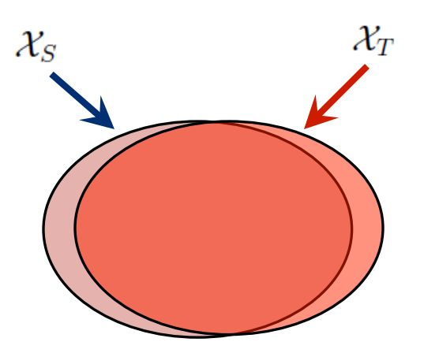

Hình 11.13 Chọn đặc trưng: tìm phần giao giữa đặc trưng của miền nguồn $\mathcal X_S$ và miền đích $\mathcal X_T$

Một phương pháp kinh điển của hướng này đăng ở hội nghị EMNLP 2006, tác giả đề xuất phương pháp SCL (Structural Correspondence Learning) [Blitzer và cộng sự, 2006]. Mục tiêu của phương pháp chính là như ta nói: tìm các đặc trưng chung của hai miền. Tác giả gọi các đặc trưng chung này là đặc trưng trục (pivot feature). Tìm ra pivot feature là hoàn thành nhiệm vụ chuyển giao.

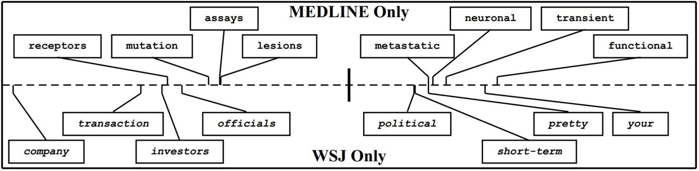

Hình 11.14 Đặc trưng trục: các từ xuất hiện ở cả văn bản y sinh (MEDLINE) và văn bản tài chính (WSJ)

Hình trên minh họa ý nghĩa của pivot feature. Trong phân loại văn bản, pivot feature là các từ xuất hiện với tần suất cao ở các miền khác nhau. Tóm lại:

- chọn đặc trưng chọn và trích các đặc trưng dùng chung từ miền nguồn và miền đích, dựng mô hình thống nhất;
- thường kết hợp với thích nghi phân phối;
- thường dùng biểu diễn thưa $\lVert\mathbf A\rVert_{2,1}$ để chọn đặc trưng (chuẩn $\ell_{2,1}$ đẩy cả hàng của ma trận về 0, tức bỏ cả đặc trưng).

> **Biên tập:** bản gốc ghi SCL đăng ở "ECML-PKDD 2006"; theo danh mục tài liệu của chính chương (Blitzer và cộng sự, 2006), bài đăng ở EMNLP 2006.

### 11.3.7 Căn chỉnh đặc trưng thống kê

**Lý thuyết:** [Học máy · 21.1 Phân tích thành phần chính](ml/ch21_vi?id=_211-phân-tích-thành-phần-chính) · [Toán · Chương 1 Ôn tập Đại số tuyến tính](math/ch01_vi)

Phương pháp căn chỉnh đặc trưng thống kê biến đổi để căn chỉnh các đặc trưng thống kê của dữ liệu. Dữ liệu sau căn chỉnh có thể dùng phương pháp học máy truyền thống dựng bộ phân loại. Phương pháp SA (Subspace Alignment, căn chỉnh không gian con) [Fernando và cộng sự, 2013] là kết quả tiêu biểu. Gọi $X_s, X_t\in\mathbb R^{D\times d}$ là ma trận gồm $d$ vector riêng chính (từ PCA) của miền nguồn và miền đích (cơ sở trực chuẩn của không gian con mỗi miền). SA tìm trực tiếp một phép biến đổi tuyến tính $M$ đưa cơ sở nguồn khớp với cơ sở đích. Mục tiêu tối ưu của SA:

$$
F(M) = \lVert X_s M - X_t\rVert_F^2
$$

Khi đó $M$ là:

$$
M^* = \arg\min_M F(M)
$$

Vì $X_s$ có các cột trực chuẩn ($X_s^\top X_s=I$) và chuẩn Frobenius bất biến qua phép biến đổi trực chuẩn, ta có:

$$
F(M) = \lVert X_s^\top X_s M - X_s^\top X_t\rVert_F^2 = \lVert M - X_s^\top X_t\rVert_F^2
$$

nên có ngay nghiệm dạng đóng $M^* = X_s^\top X_t$. Dữ liệu nguồn được chiếu bằng $X_s M^*$, dữ liệu đích bằng $X_t$, rồi huấn luyện bộ phân loại trên dữ liệu nguồn đã chiếu.

SA cài đặt đơn giản, tính toán hiệu quả, là phương pháp tiêu biểu của học không gian con. (Một phương pháp cùng nhóm hay dùng là CORAL, Sun và cộng sự, 2016: căn chỉnh ma trận hiệp phương sai của hai miền, rất dễ đưa vào mạng sâu thành Deep CORAL.)

> **Biên tập:** bản gốc để ba công thức dạng ảnh và không nói $X_s$, $X_t$ là gì; nếu hiểu là ma trận dữ liệu thì đẳng thức thứ hai sai. Đã gõ lại và ghi rõ đó là cơ sở không gian con trực chuẩn từ PCA. Đẳng thức $\lVert X_sM - X_t\rVert = \lVert X_s^\top X_s M - X_s^\top X_t\rVert$ theo bài báo đúng khi chuẩn tính trên không gian con (bài báo dùng tính bất biến của chuẩn Frobenius qua phép chiếu trực chuẩn).

### 11.3.8 Phương pháp học đa tạp

**Lý thuyết:** [Học máy · Chương 21 Principal component analysis (PCA)](ml/ch21_vi) · [Toán · Chương 1 Ôn tập Đại số tuyến tính](math/ch01_vi)

**Học đa tạp là gì**

Học đa tạp (manifold learning) từ khi được đề xuất trên tạp chí *Science* năm 2000 (Isomap và LLE) đã thành vấn đề nóng của học máy và khai phá dữ liệu. Giả định cơ bản của nó là dữ liệu hiện có được lấy mẫu từ một không gian nhiều chiều, nên có cấu trúc đa tạp ít chiều nằm trong không gian nhiều chiều. Đa tạp là một đối tượng hình học (thứ ta tưởng tượng, quan sát được). Nói nôm na: từ cách biểu diễn gốc của dữ liệu ta không nhìn ra rõ cấu trúc của nó, nên ta tưởng tượng nó nằm trong một không gian nhiều chiều, trong không gian đó nó có hình dạng. Một ví dụ hay là các chòm sao. Mô tả cả bầu trời sao thế nào? Ta tưởng tượng các ngôi sao có hình dạng trong một vũ trụ nhiều chiều hơn, thế là có các chòm sao, như Thiên Cầm, Lạp Hộ. Các phương pháp học đa tạp kinh điển có Isomap, locally linear embedding, Laplacian eigenmap…

Đo khoảng cách trong không gian đa tạp: giữa hai điểm, đường nào ngắn nhất? Trong mặt phẳng là đường thẳng (đoạn thẳng), còn trong không gian ba chiều thì sao? Đi trên mặt Trái Đất, đường ngắn nhất giữa hai điểm không phải đường thẳng (xuyên qua lòng đất) mà là cung của đường tròn lớn đi qua hai điểm đó; trên quả cầu ba chiều nó là một đường cong. Đường cong này là khoảng cách ngắn nhất giữa hai điểm *trên mặt cầu*, gọi là đường trắc địa (geodesic). Nói gọn: giữa hai điểm, đường trắc địa ngắn nhất. Trong học đa tạp, khi phải đo khoảng cách thì thường dùng chính đường trắc địa này. Phương pháp GFK giới thiệu dưới đây cũng dùng khoảng cách trắc địa. Ví dụ ở hình dưới, khoảng cách ngắn nhất từ A tới C là một cung trên mặt cầu.

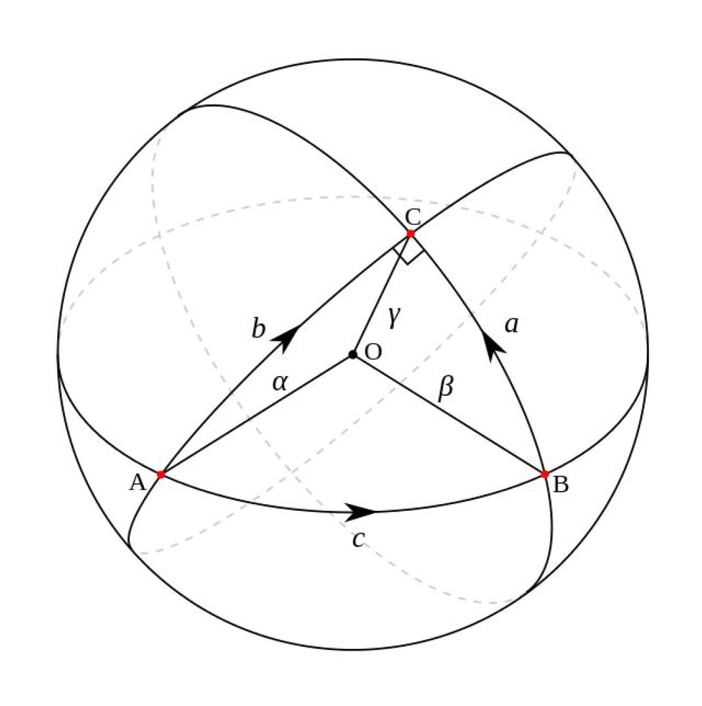

Hình 11.15 Khoảng cách giữa hai điểm trên mặt cầu ba chiều là cung trắc địa

Vì đặc trưng trong không gian đa tạp thường có tính chất hình học tốt, tránh được méo đặc trưng, nên trước hết ta biến đặc trưng ở không gian gốc sang không gian đa tạp. Trong các đa tạp đã biết, đa tạp Grassmann $\mathbb G(d, D)$ coi mỗi không gian con $d$ chiều (của không gian đặc trưng $D$ chiều) là một phần tử (một điểm), từ đó giúp học bộ phân loại. Trên đa tạp Grassmann, biến đổi đặc trưng và thích nghi phân phối thường có dạng số hiệu quả, nên biểu diễn và giải hiệu quả được trong bài toán chuyển giao [Hamm và Lee, 2008]. Vì vậy dùng không gian đa tạp Grassmann để học chuyển giao là khả thi. Hiện có nhiều phương pháp biến đổi đặc trưng gốc sang không gian đa tạp [Gopalan và cộng sự, 2011; Baktashmotlagh và cộng sự, 2014].

Trong các phương pháp chuyển giao dựa trên biến đổi đa tạp, GFK (Geodesic Flow Kernel) [Gong và cộng sự, 2012] là tiêu biểu nhất. GFK phát triển từ phương pháp SGF đăng ở ICCV 2011 [Gopalan và cộng sự, 2011]. Trước hết giới thiệu SGF.

SGF lấy cảm hứng từ học tăng dần: người muốn đi từ điểm này tới điểm khác phải đi từng bước. Vậy nếu coi miền nguồn và miền đích là hai điểm trong không gian nhiều chiều, thì quá trình biến đổi từ miền nguồn sang miền đích chẳng phải là học chuyển giao sao? Tức là đường phải đi từng bước mà thành.

SGF làm đúng việc đó. Làm thế nào? Coi miền nguồn và miền đích là hai điểm trong không gian nhiều chiều (tức đa tạp Grassmann), lấy $d$ điểm trung gian trên đường trắc địa giữa hai điểm, rồi nối lần lượt. Như vậy miền nguồn và miền đích tạo thành một đường đi trắc địa. Chỉ cần tìm phép biến đổi phù hợp cho mỗi bước là đi được từ miền nguồn sang miền đích. Hình dưới là sơ đồ SGF.

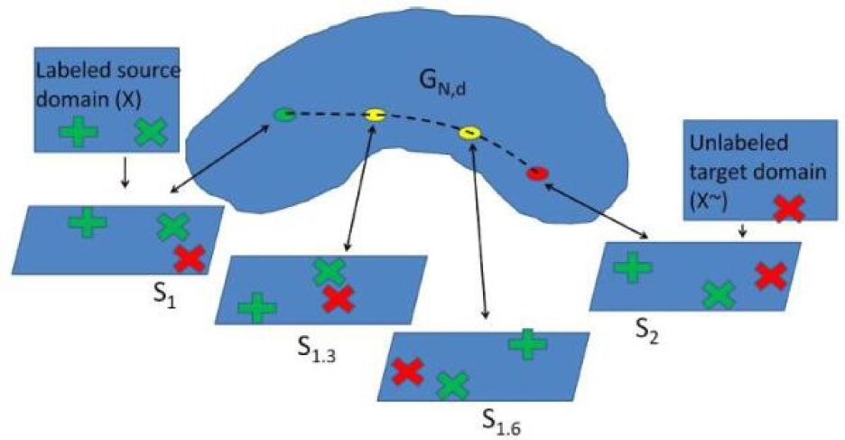

Hình 11.16 SGF: lấy các không gian con trung gian $S_{1.3}, S_{1.6}$ trên đường trắc địa từ $S_1$ (nguồn) tới $S_2$ (đích) trên đa tạp Grassmann

Đóng góp chính của SGF là đề xuất cách tính và cài đặt thuật toán cho phép biến đổi này. Nhưng nó có nhược điểm rõ: rốt cuộc cần bao nhiêu điểm trung gian? SGF không trả lời được, tức tham số $d$ không có cách ước lượng tốt. Vấn đề này được GFK trả lời.

GFK trước hết giải quyết vấn đề của SGF: xác định số điểm trung gian $d$ thế nào. Nó đề xuất một phương pháp học kernel, lấy tích phân trên vô hạn điểm trên đường đi, giải quyết vấn đề này. Đó là đóng góp thứ nhất. Rồi nó giải quyết vấn đề thứ hai: khi có nhiều miền nguồn, chọn miền nguồn nào để chuyển giao sang miền đích? GFK đề xuất độ đo Rank of Domain, đo ra miền nguồn gần miền đích nhất. Hình dưới là sơ đồ GFK.

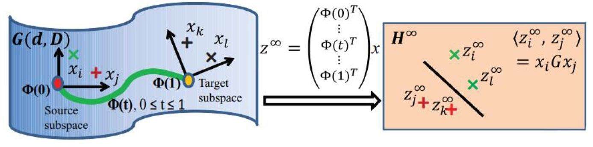

Hình 11.17 GFK: đường trắc địa $\Phi(t)$, $0\le t\le1$, từ không gian con nguồn $\Phi(0)$ tới không gian con đích $\Phi(1)$; chiếu dữ liệu lên mọi điểm trên đường cho đặc trưng vô hạn chiều $z^\infty$

Gọi $S_s$ và $S_t$ là không gian con của miền nguồn và miền đích sau phân tích thành phần chính (PCA); khi đó $\mathbb G$ có thể coi là tập mọi không gian con $d$ chiều. Mỗi không gian con $d$ chiều có thể coi là một điểm trên $\mathbb G$. Vì vậy đường trắc địa $\{\Phi(t) : 0\le t\le1\}$ giữa hai điểm tạo thành một đường đi giữa hai không gian con. Nếu đặt $S_s = \Phi(0)$, $S_t = \Phi(1)$, thì tìm một đường trắc địa từ $\Phi(0)$ tới $\Phi(1)$ tương đương biến đặc trưng gốc sang một không gian vô hạn chiều, cuối cùng giảm hiện tượng dịch chuyển giữa các miền. Phương pháp này có thể coi là một cách "đi bộ" tăng dần từ $\Phi(0)$ tới $\Phi(1)$.

Đặc biệt, đặc trưng trong không gian đa tạp biểu diễn được thành $\mathbf z = \Phi(t)^\top\mathbf x$. Tích trong của hai đặc trưng sau biến đổi $\mathbf z_i$ và $\mathbf z_j$ định nghĩa một kernel dòng trắc địa nửa xác định dương (positive semidefinite):

$$
\langle \mathbf z_i, \mathbf z_j\rangle = \int_0^1 \big(\Phi(t)^\top\mathbf x_i\big)^\top\big(\Phi(t)^\top\mathbf x_j\big)\,dt = \mathbf x_i^\top G\,\mathbf x_j
$$

Ma trận $G$ tính được dạng đóng từ $S_s$, $S_t$ (qua phân rã giá trị suy biến); chi tiết tính toán của GFK xem bài báo gốc.

> **Biên tập:** (1) bản gốc nói đường ngắn nhất trên Trái Đất là "đường thẳng vẽ khi trải Trái Đất ra mặt phẳng"; không trải mặt cầu ra mặt phẳng mà giữ nguyên khoảng cách được, đường ngắn nhất là cung đường tròn lớn. (2) Ký hiệu $\Phi(t)$ trong bản gốc bị lỗi phông thành "\$(t)", đã sửa. (3) "Chòm Chức Nữ" (织女座) trong bản gốc thực ra là sao Chức Nữ (Vega) thuộc chòm Thiên Cầm.

### 11.3.9 Tinh chỉnh (fine-tune) là gì?

**Lý thuyết:** [Ôn tập · 14.4.1 Tinh chỉnh (fine-tune) là gì?](qa/ch14_vi?id=_1441-tinh-chỉnh-fine-tune-là-gì) · [d2l (tiếng Anh) · 14.2 Tinh chỉnh](https://d2l.ai/chapter_computer-vision/fine-tuning.html) ↗

Tinh chỉnh mạng sâu có lẽ là cách chuyển giao mạng sâu đơn giản nhất. **Finetune**, còn gọi là tinh chỉnh, fine-tuning, là khái niệm quan trọng trong học sâu. Nói ngắn gọn, tinh chỉnh là dùng mạng người khác đã huấn luyện, điều chỉnh lại cho nhiệm vụ của mình. Hiểu theo nghĩa đó, dễ thấy tinh chỉnh là một phần của học chuyển giao.

**Vì sao cần mạng đã huấn luyện?**

Trong ứng dụng thực tế, ta thường không huấn luyện mạng neuron từ đầu cho mỗi nhiệm vụ mới. Làm vậy rõ ràng rất tốn thời gian. Nhất là dữ liệu huấn luyện của ta không thể lớn như ImageNet để huấn luyện được mạng sâu có khả năng tổng quát hóa đủ mạnh. Ngay cả khi có nhiều dữ liệu như vậy, huấn luyện từ đầu cũng tốn kém không chịu nổi.

Vậy làm sao? Học chuyển giao cho biết: dùng mô hình đã huấn luyện, chuyển nó sang nhiệm vụ của mình là được.

**Vì sao cần tinh chỉnh?**

Vì mô hình người khác huấn luyện có thể không hoàn toàn hợp với nhiệm vụ của ta: dữ liệu huấn luyện của họ có thể khác phân phối với dữ liệu của ta; mạng của họ có thể làm được nhiều việc hơn nhiệm vụ của ta; mạng của họ có thể phức tạp mà nhiệm vụ của ta đơn giản.

Ví dụ ta muốn huấn luyện mạng neuron phân loại nhị phân ảnh chó mèo; khi đó mạng đã huấn luyện trên CIFAR-100 rất đáng tham khảo. Nhưng CIFAR-100 có 100 lớp, ta chỉ cần 2 lớp. Lúc này phải theo nhiệm vụ của mình, cố định các tầng liên quan của mạng gốc, sửa tầng đầu ra để kết quả hợp với nhu cầu hơn.

Hình dưới minh họa một quá trình tinh chỉnh đơn giản. Có thể thấy mạng huấn luyện sẵn rất phức tạp, nếu huấn luyện từ đầu thì chi phí thời gian rất cao. Ta có thể cải tạo mạng: cố định tham số của một số tầng đầu, chỉ tinh chỉnh vài tầng sau cho nhiệm vụ của mình. Như vậy huấn luyện nhanh hơn rất nhiều, và cũng giúp tăng hiệu năng trên nhiệm vụ của ta.

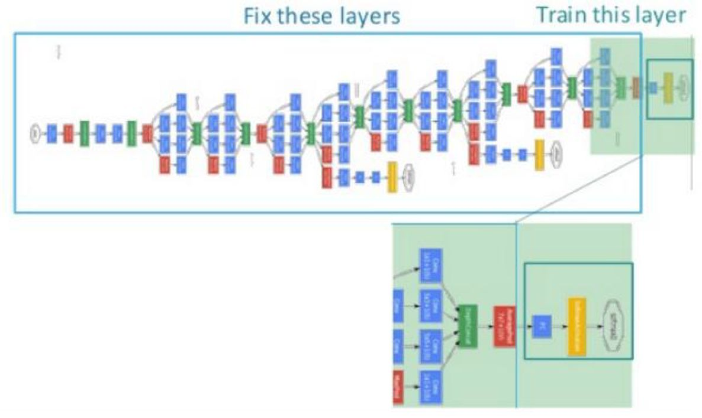

Hình 11.18 Tinh chỉnh: cố định các tầng đầu (Fix these layers), chỉ huấn luyện tầng cuối (Train this layer)

**Ưu điểm của tinh chỉnh**

Ưu điểm của tinh chỉnh khá rõ, gồm:

- không phải huấn luyện mạng từ đầu cho nhiệm vụ mới, tiết kiệm thời gian;
- mô hình huấn luyện sẵn thường được huấn luyện trên tập dữ liệu lớn, ngầm mở rộng dữ liệu huấn luyện của ta, giúp mô hình bền vững và tổng quát hóa tốt hơn;
- tinh chỉnh dễ cài đặt, ta chỉ cần tập trung vào nhiệm vụ của mình.

**Mở rộng của tinh chỉnh**

Trong ứng dụng thực tế, hầu như không ai huấn luyện mạng neuron từ đầu cho nhiệm vụ mới. Tinh chỉnh là lựa chọn lý tưởng.

Tinh chỉnh không chỉ có ích cho mạng neuron sâu mà cũng rất hiệu quả với học máy truyền thống không sâu. Ví dụ dùng mạng sâu làm bộ trích đặc trưng đã thay thế rất tốt các phương pháp trích đặc trưng thủ công truyền thống. Ta có thể dùng mạng sâu huấn luyện trên dữ liệu gốc, dựa vào mạng để trích các đặc trưng phong phú, giàu biểu đạt hơn, rồi lấy các đặc trưng này làm đầu vào cho phương pháp học máy truyền thống. Lợi ích rõ ràng: vừa tránh trích đặc trưng thủ công rườm rà, vừa tự động trích được đặc trưng giàu biểu đạt hơn.

Ví dụ nghiên cứu ảnh từng dựa vào các đặc trưng truyền thống như SIFT, SURF, cho tới năm 2014 các nhà nghiên cứu Berkeley đề xuất phương pháp trích đặc trưng DeCAF [Donahue và cộng sự, 2014], dùng thẳng mạng neuron tích chập sâu để trích đặc trưng. Thực nghiệm cho thấy so với đặc trưng ảnh truyền thống, phương pháp này có ưu thế áp đảo về độ chính xác. Ngoài ra cũng có nhà nghiên cứu dùng đặc trưng trích bởi mạng tích chập làm đầu vào cho bộ phân loại SVM [Razavian và cộng sự, 2014], tăng rõ rệt độ chính xác phân loại ảnh.

### 11.3.10 Vì sao tinh chỉnh hiệu quả?

**Lý thuyết:** [Học sâu · 7.2.6 Ánh xạ Đặc trưng và Vùng Tiếp nhận](dl/ch07_s2_vi?id=_726-Ánh-xạ-Đặc-trưng-và-vùng-tiếp-nhận) · [Ôn tập · 14.4.3 Vì sao khi tinh chỉnh lại đóng băng các tầng dưới, huấn luyện tầng trên trước?](qa/ch14_vi?id=_1443-vì-sao-khi-tinh-chỉnh-lại-đóng-băng-các-tầng-dưới-huấn-luyện-tầng-trên-trước)

Từ khi AlexNet [Krizhevsky và cộng sự, 2012] vô địch ImageNet năm 2012, học sâu bắt đầu tỏa sáng trong nghiên cứu và ứng dụng học máy. Dù cho kết quả tốt, bản thân mạng neuron như một hộp đen, thấy được nhưng không sờ được, khả năng giải thích kém. Vì mạng neuron có cấu trúc tầng rõ ràng, tự nhiên có người quan tâm liệu có thể dùng cấu trúc tầng để giải thích mạng không. Thế là có ví dụ quen thuộc: giả sử mạng phải nhận dạng một con mèo, ban đầu nó chỉ phát hiện được vài cạnh, góc, không liên quan gì tới mèo; rồi có thể phát hiện các đường thẳng và hình tròn; dần dần phát hiện được vùng có mèo; tiếp theo là chân mèo, mặt mèo… Hình dưới là một ví dụ đơn giản.

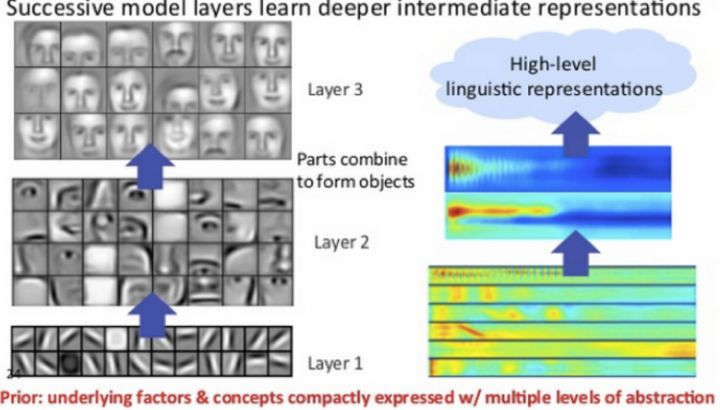

Hình 11.19 Các tầng liên tiếp học biểu diễn trung gian ngày càng sâu: cạnh (tầng 1) → bộ phận khuôn mặt (tầng 2) → khuôn mặt (tầng 3)

Điều này nói lên gì? Tóm lại: mấy tầng đầu học đặc trưng tổng quát (general feature); càng vào sâu, các tầng sau càng thiên về học đặc trưng riêng của nhiệm vụ (specific feature). Điều này rất dễ hiểu và dễ chấp nhận. Vậy câu hỏi là: làm sao biết tầng nào học đặc trưng tổng quát, tầng nào học đặc trưng riêng? Xa hơn: khi áp dụng học chuyển giao, quyết định chuyển giao tầng nào, cố định tầng nào ra sao?

Câu hỏi này rất có ý nghĩa với việc hiểu mạng neuron và học chuyển giao sâu.

Jason Yosinski và cộng sự ở Đại học Cornell [Yosinski và cộng sự, 2014] là những người đầu tiên nghiên cứu khả năng chuyển giao của mạng neuron sâu, công bố ở NIPS 2014 (hội nghị hàng đầu về học máy) dưới dạng báo cáo miệng (oral). Đây là một bài báo thực nghiệm (cả bài không có công thức nào), mục đích là tìm hiểu các câu hỏi then chốt nêu trên. Vì vậy toàn bộ đóng góp của bài đến từ thí nghiệm và kết quả.

Trên 1000 lớp của ImageNet, tác giả chia 1000 lớp làm hai phần (A và B), mỗi phần 500 lớp. Rồi dùng Caffe huấn luyện một mạng AlexNet cho A và một cho B. Một mạng AlexNet có tổng cộng 8 tầng; trừ tầng 8 gắn với lớp nên không chuyển giao được, tác giả làm thí nghiệm tinh chỉnh lần lượt trên 7 tầng từ 1 tới 7, khám phá khả năng chuyển giao của mạng.

Để trình bày kết quả tinh chỉnh rõ hơn, tác giả đề xuất hai khái niệm thú vị: AnB và BnB.

Chuyển $n$ tầng đầu của mạng A sang B (AnB) so với cố định $n$ tầng đầu của mạng B (BnB).

Nói qua AnB là gì (mọi thí nghiệm đều trên dữ liệu B): lấy $n$ tầng đầu của mạng A và đóng băng (frozen), $8-n$ tầng còn lại khởi tạo ngẫu nhiên, rồi phân loại B.

Tương ứng, BnB: lấy $n$ tầng đầu của mạng B đã huấn luyện và đóng băng, $8-n$ tầng còn lại khởi tạo ngẫu nhiên, rồi phân loại B. Thêm dấu "+" (AnB+, BnB+) nghĩa là không đóng băng mà cho phép tinh chỉnh cả $n$ tầng đầu.

**Kết quả thực nghiệm**

Kết quả như hình dưới:

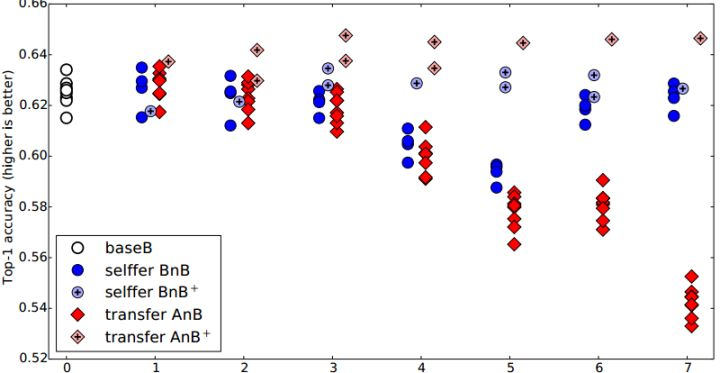

Hình 11.20 Độ chính xác top-1 trên B theo số tầng $n$ được chuyển: baseB, BnB, BnB+, AnB, AnB+

Hình này nói lên gì? Trước hết xem BnB và BnB+ (BnB có thêm tinh chỉnh) màu xanh dương. Với BnB, 3 tầng đầu của mô hình B đã huấn luyện dùng thẳng được mà độ chính xác không giảm; đến tầng 4 và 5, độ chính xác giảm nhẹ, vẫn chấp nhận được. Nhưng tới tầng 6 và 7, độ chính xác lại hồi phục! Vì sao? Với tầng 4, 5 giảm ban đầu: các tầng giữa này có các đặc trưng "đồng thích nghi" (co-adaptation) mong manh với các tầng phía trên; đóng băng một nửa rồi khởi tạo lại nửa kia thì phần trên khó học lại được sự phối hợp đó bằng gradient, nên độ chính xác giảm. Còn ở tầng 6, 7, phía trên chỉ còn rất ít tầng phải học lại, mà các tầng này dễ học lại, nên độ chính xác gần như bằng mạng B ban đầu.

Với BnB+, kết quả cơ bản giữ nguyên, cho thấy tinh chỉnh giúp ích tốt cho kết quả của mô hình.

Tập trung vào AnB và AnB+. Với AnB, chuyển thẳng 3 tầng đầu của mạng A sang B dường như không ảnh hưởng gì, một lần nữa cho thấy 3 tầng đầu của mạng học gần như toàn đặc trưng tổng quát! Tiếp theo, ở tầng 4, 5 độ chính xác bắt đầu giảm, ở tầng 6, 7 còn giảm mạnh hơn. Tác giả đưa ra hai nguyên nhân: đồng thích nghi bị phá vỡ (như BnB, chủ yếu ở tầng giữa) và đặc trưng ngày càng chuyên biệt cho tập A (chủ yếu ở tầng trên, vì A và B khác lớp). Ở tầng 4, 5 cả hai nguyên nhân cùng tác động; ở tầng 6, 7 thì nguyên nhân thứ hai chiếm ưu thế: đặc trưng của A đã quá riêng, không hợp với B.

Xem AnB+. Thêm tinh chỉnh, AnB+ cho kết quả rất tốt với hầu hết mọi $n$, thậm chí còn tốt hơn baseB (B ban đầu) một chút! Điều này cho thấy: tinh chỉnh giúp ích rất tốt cho chuyển giao sâu (khởi tạo từ một tập lớn khác giúp tổng quát hóa tốt hơn, hiệu ứng này còn duy trì cả sau khi tinh chỉnh lâu).

Tới đây cơ bản xong AnB và BnB. Tác giả lại nghĩ: có phải khi chia dữ liệu A và B, có một số lớp khá giống nhau làm kết quả tốt? Ví dụ A có mèo, B có sư tử, nên kết quả tốt? Để loại ảnh hưởng này, tác giả chia lại tập dữ liệu, lần này A và B gần như không có lớp nào giống nhau (A toàn đồ vật nhân tạo, B toàn vật tự nhiên). Trong điều kiện này làm lại AnB, so với độ chính xác ban đầu (lấy 0% làm mốc).

Kết quả cho thấy gì? Đơn giản: số tầng chuyển giao càng nhiều, hiệu năng mô hình càng giảm (và giảm nhanh hơn khi hai tập khác nhau nhiều). Nhưng 3 tầng đầu vẫn chuyển giao được! Đồng thời, so với khởi tạo ngẫu nhiên mọi trọng số (hay dùng bộ lọc ngẫu nhiên cố định), độ chính xác của học chuyển giao cao hơn hẳn. Tóm lại:

- mạng chuyển giao sâu tốt hơn khởi tạo trọng số ngẫu nhiên;
- chuyển giao các tầng giúp tăng tốc việc học và tối ưu mạng.

> **Biên tập:** (1) bản gốc nhắc tới hai hình kết quả nữa ("ghép các kết quả" và "chia A/B không giống nhau") nhưng hai hình này không có trong repo. (2) Lời giải thích cho đường AnB ở tầng 6, 7 trong bản gốc ("mạng gần như không lặp nữa nên khả năng học kém") không khớp với bài báo; bài báo quy cho tính chuyên biệt của đặc trưng tầng trên, đã sửa. (3) Bỏ một câu đùa không liên quan trong bản gốc.

### 11.3.11 Thích nghi mạng sâu là gì?

**Lý thuyết:** [Ôn tập · 7.2.4 Kernel MMD (Maximum Mean Discrepancy)](qa/ch07_vi?id=_724-kernel-mmd-maximum-mean-discrepancy) · [Học sâu · 4.7.3 Hiệu chỉnh Dịch chuyển Phân phối](dl/ch04_s7_vi?id=_473-hiệu-chỉnh-dịch-chuyển-phân-phối)

**Ý tưởng cơ bản**

Tinh chỉnh mạng sâu giúp tiết kiệm thời gian huấn luyện, tăng độ chính xác. Nhưng tinh chỉnh có điểm yếu bẩm sinh: nó không xử lý được trường hợp dữ liệu huấn luyện và dữ liệu kiểm tra khác phân phối (khi miền đích không có nhãn để tinh chỉnh). Mà hiện tượng này gặp khắp nơi trong thực tế. Giả định cơ bản của tinh chỉnh vẫn là dữ liệu huấn luyện và kiểm tra cùng phân phối, điều không đúng trong học chuyển giao. Vì vậy phải tiến thêm một bước, phát triển phương pháp tốt hơn cho mạng sâu để hoàn thành nhiệm vụ chuyển giao.

Lấy các phương pháp thích nghi phân phối dữ liệu đã giới thiệu làm tham khảo, nhiều phương pháp học sâu [Tzeng và cộng sự, 2014; Long và cộng sự, 2015a] phát triển tầng thích nghi (adaptation layer) để thích nghi dữ liệu miền nguồn và miền đích. Thích nghi làm phân phối dữ liệu hai miền gần nhau hơn, nhờ đó mạng hiệu quả hơn.

Từ phân tích trên, thích nghi mạng sâu chủ yếu làm hai việc:

- một là những tầng nào được thích nghi, quyết định mức độ học của mạng;
- hai là dùng phương pháp thích nghi (tiêu chí đo) nào, quyết định khả năng tổng quát hóa của mạng.

Điều quan trọng nhất trong mạng sâu là định nghĩa mất mát. Tuyệt đại đa số phương pháp chuyển giao sâu định nghĩa mất mát như sau:

$$
\ell = \ell_c(\mathcal D_s,\mathbf y_s)+\lambda\,\ell_A(\mathcal D_s,\mathcal D_t)
$$

trong đó $\ell$ là mất mát cuối cùng của mạng, $\ell_c(\mathcal D_s,\mathbf y_s)$ là mất mát phân loại thông thường trên dữ liệu có nhãn (phần lớn là miền nguồn), giống hệt mạng sâu bình thường, $\ell_A(\mathcal D_s,\mathcal D_t)$ là mất mát thích nghi của mạng. Phần cuối này mạng sâu truyền thống không có, riêng học chuyển giao mới có; về ý nghĩa nó giống khác biệt phân phối giữa miền nguồn và miền đích đã bàn ở trên (ví dụ DAN dùng MMD đa kernel trên các tầng kết nối đầy đủ). $\lambda$ là trọng số cân bằng hai phần.

Phân tích trên cho ta nguyên tắc cơ bản để thiết kế mạng chuyển giao sâu: chọn tầng thích nghi, thêm độ đo thích nghi vào các tầng đó, cuối cùng tinh chỉnh mạng.

### 11.3.12 Ứng dụng GAN trong học chuyển giao

**Lý thuyết:** [Ôn tập · 7.1.1 Hiểu GAN một cách dễ hiểu thế nào?](qa/ch07_vi?id=_711-hiểu-gan-một-cách-dễ-hiểu-thế-nào) · [Ôn tập · 7.1.3 Hàm mục tiêu của GAN là gì?](qa/ch07_vi?id=_713-hàm-mục-tiêu-của-gan-là-gì)

Mạng đối sinh GAN (Generative Adversarial Nets) [Goodfellow và cộng sự, 2014] là một trong những khái niệm nóng nhất của trí tuệ nhân tạo hiện nay, được Yann LeCun, người dẫn đầu học sâu, đánh giá là thành tựu thú vị nhất những năm gần đây. Mạng đối kháng phát triển từ đó cũng thành công cụ mạnh để tăng hiệu năng mạng. Mục này giới thiệu ý tưởng cơ bản và kết quả tiêu biểu của việc dùng mạng đối kháng sâu cho học chuyển giao.

**Ý tưởng cơ bản**

GAN lấy cảm hứng từ trò chơi tổng bằng không hai người (two-player zero-sum game) trong lý thuyết trò chơi. Nó gồm hai phần: mạng sinh (generative network), tạo ra mẫu càng giống thật càng tốt, gọi là bộ sinh (generator); và mạng phân biệt (discriminative network), phán đoán mẫu là thật hay do bộ sinh tạo, gọi là bộ phân biệt (discriminator). Bộ sinh và bộ phân biệt đấu với nhau là xong huấn luyện đối kháng.

Mục tiêu của GAN rất rõ: sinh mẫu huấn luyện. Điều này có vẻ hơi khác mục tiêu lớn của học chuyển giao. Tuy nhiên, vì trong học chuyển giao vốn có sẵn một miền nguồn và một miền đích, ta có thể bỏ bước sinh mẫu, coi thẳng dữ liệu của một miền (thường là miền đích) là mẫu "được sinh ra". Khi đó chức năng của bộ sinh thay đổi: không sinh mẫu mới mà đóng vai trò trích đặc trưng: liên tục học đặc trưng của dữ liệu các miền sao cho bộ phân biệt không phân biệt được hai miền. Như vậy bộ sinh ban đầu cũng có thể gọi là bộ trích đặc trưng (feature extractor).

Thường ký hiệu bộ trích đặc trưng là $G_f$, bộ phân biệt là $G_d$. Chính dựa trên ý tưởng đối kháng miền này, mạng đối kháng sâu dùng tốt cho học chuyển giao. Giống phương pháp thích nghi mạng sâu, mất mát của mạng đối kháng sâu cũng gồm hai phần: mất mát huấn luyện mạng $\ell_c$ và mất mát phân biệt miền $\ell_d$:

$$
\ell = \ell_c(\mathcal D_s,\mathbf y_s)+\lambda\,\ell_d(\mathcal D_s,\mathcal D_t)
$$

**DANN**

Yaroslav Ganin và cộng sự [Ganin và cộng sự, 2016] lần đầu đưa cơ chế đối kháng vào huấn luyện mạng neuron, gọi mạng của họ là DANN (Domain-Adversarial Neural Network). Trong nghiên cứu này, mục tiêu học là: đặc trưng sinh ra vừa giúp phân loại tốt nhãn của miền nguồn, vừa khiến bộ phân biệt **không** phân biệt được đặc trưng đến từ miền nào; còn bộ phân biệt thì cố phân biệt hai miền. Hàm mất mát đối kháng miền của phương pháp này là:

$$
\ell_d = \max\left[-\frac{1}{n}\sum_{i=1}^{n}\mathcal L_d^i(\mathbf W,\mathbf b,\mathbf u,z)-\frac{1}{n'}\sum_{i=n+1}^{N}\mathcal L_d^i(\mathbf W,\mathbf b,\mathbf u,z)\right]
$$

trong đó $n$ mẫu đầu là miền nguồn, $n' = N-n$ mẫu sau là miền đích, và $\mathcal L_d$ là entropy chéo nhị phân của bộ phân biệt miền với nhãn miền $d_i$ (1 cho nguồn, 0 cho đích):

$$
\mathcal L_d\big(G_d(G_f(\mathbf x_i)),d_i\big)=d_i\log\frac{1}{G_d(G_f(\mathbf x_i))}+(1-d_i)\log\frac{1}{1-G_d(G_f(\mathbf x_i))}
$$

Khi cài đặt, DANN dùng một **tầng đảo gradient** (gradient reversal layer) đặt giữa bộ trích đặc trưng và bộ phân biệt: lan truyền xuôi giữ nguyên, lan truyền ngược nhân gradient với $-\lambda$. Nhờ vậy chỉ cần một lần lan truyền ngược thông thường: bộ phân biệt cực tiểu mất mát phân biệt miền, còn bộ trích đặc trưng nhận gradient ngược dấu nên cực đại mất mát đó, tức học đặc trưng bất biến miền.

> **Biên tập:** (1) bản gốc viết mục tiêu của DANN là "đặc trưng sinh ra giúp phân biệt đặc trưng của hai miền, đồng thời khiến bộ phân biệt không phân biệt được" (tự mâu thuẫn); đúng là đặc trưng phải khiến hai miền *không* phân biệt được. (2) Công thức $\mathcal L_d$ trong bản gốc (ảnh) có số hạng thứ hai là $\log\frac{1}{G_d(\cdot)}$, thiếu "$1-$"; đã sửa. (3) Tầng đảo gradient do người biên tập bổ sung vì đó là điểm cốt lõi khi cài đặt DANN. Bản gốc dừng ở đây; các phương pháp đối kháng sau DANN gồm ADDA, CDAN, và hướng mới hơn là thích nghi miền bằng mô hình nền tảng huấn luyện sẵn trên dữ liệu rất lớn.

## Tài liệu tham khảo

Vương Tấn Đông, *Sổ tay ngắn gọn về học chuyển giao* (迁移学习简明手册), https://github.com/jindongwang/transferlearning-tutorial

Pan, S. J. and Yang, Q. (2010). A survey on transfer learning. *IEEE Transactions on Knowledge and Data Engineering*, 22(10): 1345-1359.

Ben-David, S., Blitzer, J., Crammer, K., Kulesza, A., Pereira, F., and Vaughan, J. W. (2010). A theory of learning from different domains. *Machine Learning*, 79(1-2): 151-175.

Blitzer, J., McDonald, R., and Pereira, F. (2006). Domain adaptation with structural correspondence learning. In *EMNLP*, pages 120-128.

Borgwardt, K. M., Gretton, A., Rasch, M. J., Kriegel, H.-P., Schölkopf, B., and Smola, A. J. (2006). Integrating structured biological data by kernel maximum mean discrepancy. *Bioinformatics*, 22(14): e49-e57.

Dai, W., Yang, Q., Xue, G.-R., and Yu, Y. (2007). Boosting for transfer learning. In *ICML*, pages 193-200.

Donahue, J., Jia, Y., et al. (2014). DeCAF: A deep convolutional activation feature for generic visual recognition. In *ICML*, pages 647-655.

Fernando, B., Habrard, A., Sebban, M., and Tuytelaars, T. (2013). Unsupervised visual domain adaptation using subspace alignment. In *ICCV*, pages 2960-2967.

Ganin, Y., Ustinova, E., Ajakan, H., Germain, P., Larochelle, H., Laviolette, F., Marchand, M., and Lempitsky, V. (2016). Domain-adversarial training of neural networks. *Journal of Machine Learning Research*, 17(59): 1-35.

Gong, B., Shi, Y., Sha, F., and Grauman, K. (2012). Geodesic flow kernel for unsupervised domain adaptation. In *CVPR*, pages 2066-2073.

Gopalan, R., Li, R., and Chellappa, R. (2011). Domain adaptation for object recognition: An unsupervised approach. In *ICCV*, pages 999-1006.

Huang, J., Gretton, A., Borgwardt, K. M., Schölkopf, B., and Smola, A. J. (2007). Correcting sample selection bias by unlabeled data. In *NIPS*, pages 601-608.

Long, M., Cao, Y., Wang, J., and Jordan, M. I. (2015a). Learning transferable features with deep adaptation networks. In *ICML*, pages 97-105.

Pan, S. J., Tsang, I. W., Kwok, J. T., and Yang, Q. (2011). Domain adaptation via transfer component analysis. *IEEE Transactions on Neural Networks*, 22(2): 199-210.

Razavian, A. S., Azizpour, H., Sullivan, J., and Carlsson, S. (2014). CNN features off-the-shelf: an astounding baseline for recognition. In *CVPR Workshops*, pages 806-813.

Tan, B., Song, Y., Zhong, E., and Yang, Q. (2015). Transitive transfer learning. In *KDD*, pages 1155-1164.

Tzeng, E., Hoffman, J., Zhang, N., Saenko, K., and Darrell, T. (2014). Deep domain confusion: Maximizing for domain invariance. *arXiv:1412.3474*.

Wang, J., Chen, Y., Hu, L., Peng, X., and Yu, P. S. (2018). Stratified transfer learning for cross-domain activity recognition. In *PerCom*.

Yosinski, J., Clune, J., Bengio, Y., and Lipson, H. (2014). How transferable are features in deep neural networks? In *NIPS*, pages 3320-3328.

> **Biên tập:** danh mục tài liệu của bản gốc là bản chép (dở dang, theo thứ tự chữ cái tới chữ G) từ sổ tay của Vương Tấn Đông; bản dịch giữ các mục được trích trong chương. Danh mục đầy đủ xem sổ tay gốc.
