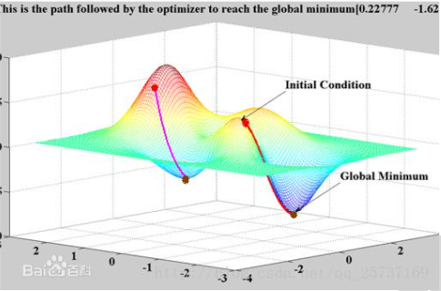
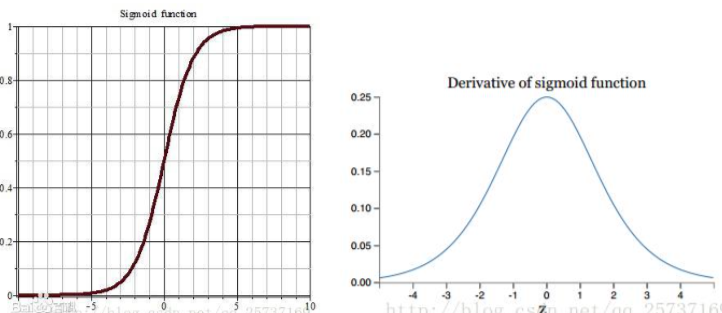

# Chương 13 Thuật toán tối ưu

> Ghi chú của người biên soạn: trang này dịch từ sách *Deep Learning 500 câu hỏi* (深度学习500问) do **Tan Jiyong (谈继勇)** chủ biên cùng cộng đồng đóng góp ([bản gốc](https://github.com/scutan90/DeepLearning-500-questions/tree/master/ch13_优化算法), [mã nguồn](https://github.com/scutan90/DeepLearning-500-questions), giấy phép [GPL-3.0](https://www.gnu.org/licenses/gpl-3.0.html); phần dịch cũng theo GPL-3.0). Số câu hỏi giữ như bản gốc. Chỗ bản gốc sai hoặc thiếu đã được sửa ngay trong bài và ghi ở ô **Biên tập**; ô **Lý thuyết** dẫn sang bài học tương ứng trên site.

> **Biên tập:** tên chương là "thuật toán tối ưu" nhưng nội dung rộng hơn: dữ liệu ít, khởi tạo, hàm kích hoạt, hàm mất mát, chọn đặc trưng, tiêu biến gradient, đánh giá và chia dữ liệu. Bản gốc đánh số trùng (hai mục 13.5, hai mục 13.7, mục 13.7 đứng trước 13.6). Bản dịch giữ số gốc để đối chiếu, mục trùng thứ hai thêm hậu tố "b". Danh mục tài liệu cuối chương chỉ có một mục, trong khi mục 13.7 có các số trích dẫn [1]–[9] lấy từ nguồn khác; bản dịch ghi tên bài báo thay cho các số đó.

> **Biên tập:** mục 13.19 (bộ tối ưu sau Adam, cắt gradient, độ chính xác hỗn hợp, tiết kiệm bộ nhớ) do người biên tập viết thêm, cập nhật tới 2026.

## 13.1 Giải quyết bài toán ít mẫu huấn luyện thế nào?

<div class="qa-theory">

**Lý thuyết:** [d2l (tiếng Anh) · 14.2 Tinh chỉnh](https://d2l.ai/chapter_computer-vision/fine-tuning.html) ↗ · [d2l (tiếng Anh) · 14.1 Tăng cường ảnh](https://d2l.ai/chapter_computer-vision/image-augmentation.html) ↗ · [Học sâu · 5.5.4 Các Phương pháp Điều chuẩn Cổ điển cho Mạng Sâu](dl/ch05_s5_vi?id=_554-các-phương-pháp-Điều-chuẩn-cổ-điển-cho-mạng-sâu)

</div>

Phần lớn mô hình học sâu hiện nay vẫn cần lượng dữ liệu khổng lồ. Ví dụ ImageNet có hơn 14 triệu ảnh. Còn trong môi trường sản xuất thực tế, tập dữ liệu thường nhỏ, chỉ vài vạn, thậm chí vài trăm mẫu. Khi đó áp dụng học sâu thế nào?

1. **Dùng mô hình huấn luyện sẵn để tinh chỉnh chuyển giao (fine-tuning).** Mô hình huấn luyện sẵn thường có đặc trưng mang ngữ nghĩa tốt. Chỉ cần tinh chỉnh mô hình trên tập dữ liệu nhỏ là được kết quả khá. Đây cũng là cách huấn luyện phổ biến nhất hiện nay cho tập dữ liệu nhỏ. Trong thị giác thường dùng mô hình đã huấn luyện trên ImageNet; trong xử lý ngôn ngữ tự nhiên có các mô hình huấn luyện sẵn như BERT.
2. **Học một mẫu hoặc ít mẫu (one-shot, few-shot learning).** Cách này hợp với tập dữ liệu cực đoan, số lớp lớn hơn rất nhiều số mẫu mỗi lớp, ví dụ 1000 lớp, mỗi lớp chỉ 1–5 mẫu. Học ít mẫu cũng cần mô hình huấn luyện sẵn, nhưng khác tinh chỉnh ở chỗ: tinh chỉnh thường vẫn học ngữ nghĩa của từng lớp, còn học ít mẫu thường học một độ đo khoảng cách giữa các mẫu. Ví dụ mạng Siamese (Siamese Neural Networks) huấn luyện hai mạng cùng cấu trúc (dùng chung trọng số) để phán đoán hai ảnh đầu vào có cùng lớp hay không.

Hai cách trên là cách thường dùng để huấn luyện trên tập dữ liệu nhỏ. Ngoài ra còn các biện pháp phổ biến khác như tăng cường dữ liệu, điều chuẩn hay học bán giám sát.

## 13.2 Học sâu có dùng tốt cho mọi tập dữ liệu không?

<div class="qa-theory">

**Lý thuyết:** [Học sâu · 7.1.1 Tính Bất biến](dl/ch07_s1_vi?id=_711-tính-bất-biến) · [Học máy · T.7 XGBoost, LightGBM và CatBoost](ml/ensemble_vi?id=t7-xgboost-lightgbm-và-catboost)

</div>

Học sâu không dùng tốt cho mọi loại dữ liệu hiện nay; hai ví dụ:

1. Học sâu đạt được thành quả hiện nay phần lớn nhờ tập dữ liệu khổng lồ và phần cứng tính toán hiệu năng cao. Vì vậy khi tập dữ liệu quá nhỏ, cần xem học máy truyền thống có lợi thế hơn về hiệu năng và hiệu suất dùng tài nguyên phần cứng không.
2. Học sâu hiện đã đạt kết quả tốt trong thị giác, xử lý ngôn ngữ tự nhiên… Đặc điểm lớn nhất của các lĩnh vực này là có tương quan cục bộ. Ví dụ trong ảnh, tai người nằm hai bên, mũi nằm giữa hai mắt; trong văn bản, các từ tạo thành câu. Những thứ này đều có tương quan cục bộ, xáo trộn đi thì phá vỡ ngữ nghĩa hoặc thành nghĩa khác. Nên khi dữ liệu không có kiểu tương quan này, học sâu khó phát huy.

> **Biên tập:** ví dụ điển hình cho điểm 2 là **dữ liệu dạng bảng** (mỗi cột một đặc trưng, thứ tự cột không mang nghĩa): trên loại dữ liệu này, các mô hình cây tăng cường gradient (XGBoost, LightGBM, CatBoost) đến nay vẫn thường ngang hoặc hơn mạng neuron, theo nhiều bài so sánh (ví dụ Grinsztajn và cộng sự, NeurIPS 2022).

## 13.3 Có thể tìm được thuật toán tốt hơn các thuật toán đã biết không?

<div class="qa-theory">

**Lý thuyết:** [Học sâu · 4.6.3 Lý thuyết Học Thống kê](dl/ch04_s6_vi?id=_463-lý-thuyết-học-thống-kê) · [Học sâu · 3.6 Tổng quát hóa](dl/ch03_s6_vi)

</div>

Trong lý thuyết tối ưu có định lý "không có bữa trưa miễn phí" (No Free Lunch). Ý chính: nếu lấy trung bình trên **mọi bài toán có thể có** (coi chúng như nhau), thì mọi thuật toán có hiệu quả kỳ vọng bằng nhau, kể cả đoán ngẫu nhiên. Tức là không có thuật toán nào tốt hơn mọi thuật toán khác trên mọi bài toán. Học sâu là một nhánh của học máy nên cũng tuân theo định lý này. Vì vậy dù học sâu đã đạt thành quả rất tốt, ta cũng không nên sùng bái mù quáng.

Về bản chất, tối ưu thuật toán là tìm kiếm, khám phá thuật toán hợp hơn với dữ liệu và bài toán. Ở đây dữ liệu là động lực của thuật toán, còn bài toán cần giải bằng dữ liệu là cốt lõi của thuật toán; thuật toán nào tách khỏi dữ liệu cũng không có giá trị thực tế, giả định của thuật toán nào cũng không được tách khỏi bài toán thực tế. Do đó trong ứng dụng, gặp tình huống và bài toán khác nhau, có thể phân tích bài toán từ nhiều góc độ để tìm thuật toán tốt hơn.

> **Biên tập:** bản gốc viết "khi không xét bối cảnh cụ thể, mọi thuật toán có hiệu quả kỳ vọng như đoán ngẫu nhiên", dễ hiểu nhầm là thuật toán nào cũng vô dụng. Điều kiện then chốt của định lý là lấy trung bình trên *mọi* phân phối bài toán. Bài toán thực tế có cấu trúc (ảnh có tính cục bộ, dữ liệu trơn…), nên thuật toán có giả định hợp với cấu trúc đó (thiên kiến quy nạp) sẽ tốt hơn hẳn đoán ngẫu nhiên. Đó chính là ý của đoạn thứ hai.

## 13.4 Đa cộng tuyến là gì? Phát hiện và xử lý thế nào?

<div class="qa-theory">

**Lý thuyết:** [Học máy · 7.4.3 Hồi quy ridge](ml/ch07_vi?id=_743-hồi-quy-ridge) · [Học máy · 21.1 Phân tích thành phần chính](ml/ch21_vi?id=_211-phân-tích-thành-phần-chính) · [Học máy · D.9 Chọn đặc trưng](ml/prep_vi?id=d9-chọn-đặc-trưng)

</div>

Với các thuật toán hồi quy, dù là hồi quy thông thường hay hồi quy logistic, khi dùng nhiều biến để dự đoán đều có thể xảy ra tình trạng các biến tương quan với nhau, đó là đa cộng tuyến (multicollinearity). Đa cộng tuyến làm các đặc trưng dư thừa lẫn nhau, khiến hệ số ước lượng rất không ổn định (đổi một ít dữ liệu là hệ số đổi mạnh, thậm chí đổi dấu) và khó diễn giải.

Các cách thường dùng để phát hiện đa cộng tuyến:

1. **Phân tích tương quan.** Hệ số tương quan giữa hai biến cao hơn 0.8 cho thấy có đa cộng tuyến; nhưng hệ số tương quan thấp không có nghĩa là không có đa cộng tuyến (một biến có thể là tổ hợp tuyến tính của nhiều biến khác).
2. **Hệ số phóng đại phương sai (VIF).** $\mathrm{VIF}_j = \dfrac{1}{1-R_j^2}$, với $R_j^2$ là hệ số xác định khi hồi quy biến $j$ theo các biến còn lại. VIF lớn hơn 5 hoặc 10 cho thấy mô hình có đa cộng tuyến nghiêm trọng.
3. **Kiểm tra số điều kiện.** Số điều kiện (condition number) của ma trận $X^\top X$ lớn hơn 100 cho thấy đa cộng tuyến vừa, lớn hơn 1000 là nghiêm trọng.

Thường có thể loại bỏ đa cộng tuyến bằng giảm chiều PCA, hồi quy từng bước (stepwise regression), hồi quy LASSO, hoặc hồi quy Ridge.

> **Biên tập:** (1) bản gốc nói đa cộng tuyến "dẫn đến quá khớp". Chính xác hơn: nó làm phương sai của *hệ số* lớn (hệ số không ổn định, khó diễn giải), còn độ chính xác *dự đoán* trên dữ liệu cùng phân phối thường ít bị ảnh hưởng. (2) Bản gốc bỏ sót hồi quy Ridge, cách xử lý kinh điển nhất: thêm $\lambda I$ vào $X^\top X$ làm ma trận khả nghịch và ổn định. LASSO khi gặp nhóm biến tương quan mạnh thường giữ ngẫu nhiên một biến, bỏ các biến còn lại. (3) Thêm công thức VIF và nói rõ số điều kiện tính trên $X^\top X$ (nếu tính trên $X$ thì ngưỡng thường dùng là 10 và 30).

## 13.5 Có những cách khởi tạo trọng số nào?

<div class="qa-theory">

**Lý thuyết:** [Học sâu · 5.4.2 Khởi tạo Tham số](dl/ch05_s4_vi?id=_542-khởi-tạo-tham-số) · [Học sâu · 6.3.1 Khởi tạo Dựng sẵn](dl/ch06_s3_vi?id=_631-khởi-tạo-dựng-sẵn)

</div>

Trong mô hình học sâu, khi huấn luyện từ đầu, khởi tạo trọng số đôi khi ảnh hưởng lớn tới quá trình huấn luyện. Khởi tạo tốt giúp mô hình hội tụ nhanh, hiệu quả; khởi tạo tồi có thể làm mô hình không huấn luyện được.

Hiện nay phần lớn framework học sâu đều có nhiều cách khởi tạo; các cách hay dùng gồm:

**1. Khởi tạo hằng số (constant)**

Khởi tạo trọng số hoặc độ lệch bằng một hằng số, ví dụ 0. Độ lệch khởi tạo bằng 0 khá phổ biến, trọng số thì hiếm khi khởi tạo bằng 0 (mọi neuron trong tầng sẽ giống hệt nhau, xem câu 12.6.3). TensorFlow cũng có các hàm khởi tạo hằng số đặc biệt như `zeros_initializer`, `ones_initializer`.

**2. Khởi tạo Gauss (gaussian)**

Cho trước trung bình và độ lệch chuẩn, tham số được khởi tạo ngẫu nhiên theo phân phối Gauss với trung bình và độ lệch chuẩn đó. Khởi tạo Gauss rất hay dùng. Đặc biệt, TensorFlow còn có khởi tạo Gauss cắt cụt (`truncated_normal_initializer`): số ngẫu nhiên nào lệch quá hai độ lệch chuẩn so với trung bình sẽ được rút lại, để các giá trị ổn định hơn.

**3. Khởi tạo phân phối đều (uniform)**

Cho trước cận dưới và cận trên, tham số được khởi tạo theo phân phối đều trong khoảng đó. Khoảng thường dùng là một khoảng nhỏ đối xứng quanh 0, như $(-0.05,\ 0.05)$.

**4. Khởi tạo Xavier (dạng phân phối đều)**

Trước khi có chuẩn hóa theo batch, muốn huấn luyện mạng khá sâu mà không bị tiêu biến gradient thì phải dựa vào cách khởi tạo rất tốt. Xavier (Glorot và Bengio, 2010) là một cách khởi tạo khá tốt, hiện vẫn là một trong những cách thường dùng nhất. Mục đích là giữ phương sai của giá trị kích hoạt và của gradient không đổi khi lan truyền qua các tầng. Về bản chất Xavier vẫn là khởi tạo phân phối đều, nhưng khác cách trên ở chỗ cận được tính từ kích thước tầng; Xavier lấy mẫu đều trong khoảng:

$$
\left[-\sqrt{\frac{6}{n+m}},\ \sqrt{\frac{6}{n+m}}\right]
$$

trong đó $n$ là số chiều đầu vào của tầng, $m$ là số chiều đầu ra. Phân phối đều $U[-a, a]$ có phương sai $a^2/3$, nên trọng số có phương sai $\dfrac{2}{n+m}$. (Cũng có dạng Gauss: $\mathcal N\!\left(0, \frac{2}{n+m}\right)$.)

**5. Khởi tạo Kaiming (khởi tạo MSRA)**

Khởi tạo Kaiming (He và cộng sự, 2015), trong Caffe gọi là khởi tạo MSRA, cũng như Xavier nhằm chống tiêu biến gradient. Kaiming ra đời vì Xavier dựa trên một giả định không đúng với ReLU: Xavier suy ra công thức khi coi hàm kích hoạt gần như tuyến tính quanh 0 (đối xứng, đạo hàm bằng 1), còn ReLU đưa một nửa đầu vào về 0, làm phương sai giảm một nửa sau mỗi tầng. Kaiming bù lại bằng cách nhân đôi phương sai; về bản chất là khởi tạo Gauss với trung bình 0, phương sai $2/n$:

$$
w \sim \mathcal N\!\left(0,\ \frac{2}{n}\right)
$$

trong đó $n$ là số chiều đầu vào của tầng.

Ngoài các cách thường gặp trên, các framework học sâu khác nhau còn có những cách khởi tạo khác, bạn đọc có thể tự tra tài liệu chính thức.

> **Biên tập:** sửa ba chỗ: (1) bản gốc nói khoảng thường dùng của khởi tạo đều là $(0, 1)$; trọng số toàn dương và lớn như vậy làm mọi neuron lệch cùng một hướng và đầu ra bùng nổ theo độ sâu, khoảng dùng thực tế là nhỏ và đối xứng quanh 0. (2) Công thức Kaiming bản gốc ghi $[0, \sqrt{2/n}]$ trông như một khoảng; đúng là phân phối chuẩn trung bình 0, *độ lệch chuẩn* $\sqrt{2/n}$ (phương sai $2/n$). (3) Bản gốc đánh số 1, 2, 3, 4, 6 (thiếu 5).

## 13.5b Làm sao để hạ gradient không mắc kẹt ở cực tiểu địa phương?

<div class="qa-theory">

**Lý thuyết:** [Học sâu · 12.1.2 Những Thách thức Tối ưu trong Học sâu](dl/ch12_s1_vi?id=_1212-những-thách-thức-tối-ưu-trong-học-sâu) · [Học sâu · 12.5 Hạ Gradient Ngẫu nhiên theo Minibatch](dl/ch12_s5_vi) · [Học sâu · 12.6 Động lượng](dl/ch12_s6_vi) · [Học sâu · 12.7 Adagrad](dl/ch12_s7_vi) · [Học sâu · 12.8 RMSProp](dl/ch12_s8_vi)

</div>

Hạ gradient (GD) và các biến thể của nó là thuật toán tối ưu thường dùng nhất trong học sâu hiện nay. Hàm mất mát của mạng neuron là hàm **không lồi**, rất có thể có nhiều cực tiểu địa phương thay vì chỉ một cực tiểu toàn cục. Để tránh mắc kẹt ở cực tiểu địa phương, thường dùng các cách dưới đây; tất nhiên chúng không bảo đảm tìm được cực tiểu toàn cục, nhưng tìm được một cực tiểu địa phương tốt hơn hiện tại cũng đã tốt.

**(1) Hạ gradient ngẫu nhiên / hạ gradient theo minibatch**

Trong GD, mỗi lần gradient được cộng dồn từ toàn bộ mẫu; như vậy hướng gradient quá ổn định, số lần cập nhật lại quá ít, nên dễ kẹt ở cực tiểu địa phương. SGD là kiểu cập nhật cực đoan ở đầu kia: mỗi lần chỉ dùng một mẫu để cập nhật tham số; số lần cập nhật tăng mạnh và nhiễu trong gradient giúp thoát khỏi cực tiểu địa phương. Nhưng vấn đề nảy sinh là hướng cập nhật quá dao động, khó tối ưu tiếp đến gần nghiệm. Hạ gradient theo minibatch là thỏa hiệp giữa hai thái cực: mỗi lần cập nhật dùng một nhóm nhỏ mẫu. Đây là thuật toán tối ưu thường dùng nhất hiện nay; theo nghĩa chặt thì nó cũng là SGD, nên nhiều framework học sâu gọi là SGD.

**(2) Động lượng**

Động lượng (momentum) cũng là kỹ thuật thường dùng trong GD. Cách cập nhật của SGD tuy hiệu quả, nhưng mỗi lần chỉ dựa vào hướng gradient của batch hiện tại, nên hướng gradient vẫn khá ngẫu nhiên. Động lượng dùng để giảm tính ngẫu nhiên, tăng độ ổn định. Ý tưởng là mô phỏng động lượng trong vật lý: trước mỗi lần cập nhật, cộng thêm một phần lượng cập nhật của lần trước, nhờ đó hướng tổng không quá ngẫu nhiên. Trong một số tình huống, ví dụ đang đi với "đà" lớn mà rơi vào một cực tiểu địa phương nông, lần cập nhật sau có thể nhờ đà đó vượt ra khỏi cực tiểu địa phương.

**(3) Tốc độ học thích ứng**

GD hay động lượng đều tập trung tối ưu hướng gradient. Còn tốc độ học là siêu tham số trực tiếp điều khiển độ lớn của bước cập nhật. Có nhiều phương pháp tốc độ học thích ứng, ví dụ Adagrad và RMSprop. Hai cách hơi khác nhau, nhưng ý tưởng chính đều là dựa trên gradient tích lũy trong quá khứ để tính tốc độ học hợp lý cho hiện tại, riêng cho từng tham số.

> **Biên tập:** bản gốc viết GD "là thuật toán thường dùng nhất để giải bài toán tối ưu **lồi** trong học sâu". Sai: mất mát của mạng neuron gần như luôn không lồi; nếu lồi thì đã không có chuyện cực tiểu địa phương. Thêm một điểm bản gốc chưa nói: với mạng lớn, trở ngại thường gặp hơn cực tiểu địa phương là **điểm yên ngựa** và vùng phẳng (Dauphin và cộng sự, 2014); thực nghiệm cho thấy phần lớn cực tiểu địa phương của mạng lớn có mất mát gần cực tiểu toàn cục.

## 13.7 Vì sao cần hàm kích hoạt? Hàm kích hoạt tốt cần tính chất gì?

<div class="qa-theory">

**Lý thuyết:** [Học máy · 16.3 Hàm kích hoạt](ml/ch16_vi?id=_163-hàm-kích-hoạt) · [Ôn tập · 3.4.4 Hàm kích hoạt có những tính chất nào?](qa/ch03_vi?id=_344-hàm-kích-hoạt-có-những-tính-chất-nào) · [Ôn tập · 3.4.1 Vì sao cần hàm kích hoạt phi tuyến?](qa/ch03_vi?id=_341-vì-sao-cần-hàm-kích-hoạt-phi-tuyến)

</div>

1. **Phi tuyến:** tức đạo hàm không phải hằng số. Đây là nền tảng của mạng nhiều tầng: bảo đảm mạng nhiều tầng không suy biến thành một mạng tuyến tính một tầng. Đây cũng chính là ý nghĩa của hàm kích hoạt.
2. **Khả vi hầu khắp nơi:** tính khả vi bảo đảm tính được gradient khi tối ưu. Hàm kích hoạt truyền thống như sigmoid khả vi mọi nơi. Hàm tuyến tính từng khúc như ReLU chỉ khả vi hầu khắp nơi (không khả vi tại một số hữu hạn điểm). Với SGD, vì gần như không bao giờ rơi đúng vào điểm không khả vi (xác suất bằng 0), số ít điểm không khả vi không ảnh hưởng nhiều tới kết quả tối ưu (Goodfellow và cộng sự, *Deep Learning*, 2016, mục 6.3).
3. **Tính toán đơn giản:** có rất nhiều hàm phi tuyến. Nói cực đoan, một mạng neuron nhiều tầng cũng có thể coi là một hàm phi tuyến, giống cách Network In Network (Lin và cộng sự, 2013) dùng nó như phép tích chập. Nhưng số lần tính hàm kích hoạt trong lan truyền xuôi tỉ lệ với số neuron, nên hàm phi tuyến đơn giản đương nhiên hợp làm hàm kích hoạt hơn. Đây là một lý do ReLU và các hàm tương tự được ưa chuộng hơn các hàm dùng phép mũ.
4. **Không bão hòa (saturation):** bão hòa là hiện tượng gradient gần bằng 0 trong một số khoảng (tức tiêu biến gradient), làm tham số không cập nhật tiếp được. Ví dụ kinh điển là sigmoid: đạo hàm của nó gần 0 khi $x$ dương lớn hoặc âm lớn. Ví dụ cực đoan hơn là hàm bậc thang: gradient bằng 0 ở gần như mọi nơi, nên bão hòa khắp nơi, không dùng làm hàm kích hoạt được. ReLU có đạo hàm luôn bằng 1 khi $x>0$, nên dù $x$ dương lớn đến mấy cũng không bão hòa. Nhưng khi $x<0$ gradient luôn bằng 0, lúc này nó cũng bão hòa (trường hợp này thường gọi là "ReLU chết", dying ReLU). Leaky ReLU (Maas và cộng sự, 2013) và PReLU (He và cộng sự, 2015) được đề xuất chính để giải quyết vấn đề này.
5. **Đơn điệu (monotonic):** tức dấu của đạo hàm không đổi. Phần lớn hàm kích hoạt có tính chất này, trừ những hàm như sin, cos. Theo hiểu biết của tác giả, tính đơn điệu khiến hướng gradient tại hàm kích hoạt không đổi thường xuyên, nhờ đó huấn luyện dễ hội tụ hơn.
6. **Miền giá trị có giới hạn:** miền đầu ra giới hạn giúp mạng ổn định hơn với một số đầu vào khá lớn; đó là lý do các hàm kích hoạt thời đầu chủ yếu thuộc loại này, như Sigmoid, TanH. Nhưng điều này gây ra vấn đề tiêu biến gradient nói ở trên, và ép đầu ra mỗi tầng vào một khoảng cố định sẽ hạn chế khả năng biểu diễn. Vì vậy hiện nay các hàm này chỉ dùng ở những chỗ cần miền đầu ra cụ thể, như đầu ra xác suất (khi đó phép log trong hàm mất mát triệt tiêu ảnh hưởng tiêu biến gradient), hay hàm cổng trong LSTM.
7. **Gần với phép đồng nhất (identity):** tức xấp xỉ $x$. Lợi ích là biên độ đầu ra không tăng đáng kể theo độ sâu, nên mạng ổn định hơn, gradient cũng dễ truyền ngược hơn. Điều này hơi mâu thuẫn với tính phi tuyến, nên các hàm kích hoạt chỉ thỏa một phần, ví dụ TanH chỉ có vùng tuyến tính gần gốc tọa độ (giá trị 0 và đạo hàm 1 tại gốc), còn ReLU chỉ tuyến tính khi $x>0$. Tính chất này cũng giúp suy ra khoảng khởi tạo tham số đơn giản hơn (Glorot và Bengio, 2010; He và cộng sự, 2015). Nói thêm, tính đồng nhất này cũng được nhiều thiết kế mạng mượn, như ResNet (He và cộng sự, 2016) trong CNN và LSTM trong RNN.
8. **Ít tham số:** phần lớn hàm kích hoạt không có tham số. PReLU có một tham số nên tăng kích thước mạng chút ít. Một ngoại lệ là Maxout (Goodfellow và cộng sự, 2013): bản thân không có tham số, nhưng với cùng số kênh đầu ra, Maxout $k$ nhánh cần số kênh đầu vào gấp $k$ lần hàm khác, tức số neuron cũng phải gấp $k$ lần; còn nếu không cần giữ số kênh đầu ra thì hàm này lại giảm số kênh đầu ra (và số tham số của tầng sau) đi $k$ lần.
9. **Chuẩn hóa (normalization):** khái niệm mới xuất hiện gần đây, hàm kích hoạt tương ứng là SELU (Klambauer và cộng sự, 2017), ý tưởng chính là tự động đưa phân phối mẫu về trung bình 0, phương sai 1 để ổn định huấn luyện. Trước đó, ý tưởng chuẩn hóa này cũng đã được dùng trong thiết kế cấu trúc mạng, như Batch Normalization (Ioffe và Szegedy, 2015).

> **Biên tập:** mục này chép từ một câu trả lời trên Zhihu nên giữ các số trích dẫn [1]–[9] không có danh mục; bản dịch thay bằng tên tác giả, năm. Câu ở điểm 2 bản gốc viết "SGD gần như không thể hội tụ tới chỗ gradient gần 0" là dịch hỏng; ý gốc là SGD gần như không bao giờ rơi đúng vào điểm không khả vi. Về điểm 5: các hàm kích hoạt hiện đại dùng nhiều nhất trong Transformer là GELU và SiLU/Swish, cả hai đều **không** đơn điệu (có một vùng lõm nhỏ khi $x<0$) mà vẫn huấn luyện tốt, nên đơn điệu không phải điều kiện cần.

## 13.6 Các hàm mất mát thường gặp là gì?

<div class="qa-theory">

**Lý thuyết:** [Học máy · E.9 Hồi quy: MAE, MSE, RMSE và $R^2$](ml/eval_vi?id=e9-hồi-quy-mae-mse-rmse-và-r2r2r2) · [Học máy · 15.3 Hàm mất mát và phương pháp tối ưu](ml/ch15_vi?id=_153-hàm-mất-mát-và-phương-pháp-tối-ưu) · [Học máy · 27.4.2 Mất mát bản lề](ml/ch27_vi?id=_2742-mất-mát-bản-lề) · [Học máy · T.5 Boosting và AdaBoost](ml/ensemble_vi?id=t5-boosting-và-adaboost)

</div>

Học máy giải và tối ưu liên tục hàm mục tiêu của thuật toán để có kết quả mong muốn. Trong bài toán phân loại và hồi quy, thường dùng hàm mất mát hoặc hàm chi phí làm hàm mục tiêu.

Hàm mất mát dùng để đánh giá mức độ khác nhau giữa giá trị dự đoán và giá trị thật. Hàm mất mát phù hợp với bài toán thì mô hình thường tốt hơn.

Hàm mục tiêu có thể chia thành **rủi ro thực nghiệm** và **rủi ro cấu trúc**. Rủi ro thực nghiệm (empirical risk) là mất mát trung bình tính trên dữ liệu đã biết. Rủi ro cấu trúc (structural risk) bằng rủi ro thực nghiệm cộng thêm một số hạng phạt (điều chuẩn) để mô hình không khớp quá mức dữ liệu đã biết.

Dưới đây là các hàm mất mát thường dùng.

**(1) Hàm mất mát 0-1**

Nếu giá trị dự đoán bằng giá trị đích thì mất mát là 0, khác thì là 1:

$$
L(Y,f(x))=
\begin{cases}
1, & Y\ne f(x), \\
0, & Y=f(x).
\end{cases}
$$

Trong thực tế, điều kiện bằng nhau thường quá chặt, có thể nới bớt:

$$
L(Y,f(x))=
\begin{cases}
1, & |Y - f(x)| \ge T, \\
0, & |Y-f(x)| < T.
\end{cases}
$$

**(2) Hàm mất mát giá trị tuyệt đối**

$$
L(Y,f(x))=|Y-f(x)|.
$$

**(3) Hàm mất mát bình phương**

$$
L(Y,f(x))=\sum_{i=1}^{N}\big(Y_i-f(x_i)\big)^2.
$$

Có thể hiểu từ góc độ bình phương tối thiểu và khoảng cách Euclid. Nguyên lý của bình phương tối thiểu là: đường cong khớp tốt nhất phải làm tổng **bình phương** khoảng cách (theo phương thẳng đứng) từ các điểm tới đường hồi quy nhỏ nhất.

**(4) Hàm mất mát log**

$$
L(Y,P(Y|X))=-\log P(Y|X).
$$

Hồi quy logistic thường gặp dùng chính hàm mất mát log; nhiều người tưởng hàm mất mát của hồi quy logistic là mất mát bình phương, thực ra không phải. Hồi quy logistic giả định mẫu theo phân phối Bernoulli, từ đó lập hàm hợp lý của phân phối này, rồi lấy log và tìm cực trị. Hàm rủi ro thực nghiệm suy ra từ hồi quy logistic là cực tiểu hóa đối của log hợp lý, nhìn từ góc độ hàm mất mát thì chính là mất mát log.

**(5) Hàm mất mát mũ**

Dạng chuẩn của hàm mất mát mũ là:

$$
L(Y,f(x))=\exp[-Yf(x)].
$$

Ví dụ AdaBoost dùng hàm mất mát mũ.

**(6) Hàm mất mát bản lề (hinge)**

Dạng chuẩn của mất mát bản lề:

$$
L(y)=\max(0,\ 1-ty),
$$

trong đó $y$ là điểm số dự đoán (số thực bất kỳ, dấu của nó là lớp dự đoán), $t$ là giá trị đích, bằng $-1$ hoặc $1$.

Bài toán tối ưu của máy vector hỗ trợ tuyến tính (lề mềm) tương đương với:

$$
\min_{w,b}\ \sum_{i=1}^{N}\max\big(0,\ 1-y_i(w^\top x_i+b)\big)+\lambda \lVert w \rVert^2
$$

trong đó $\max\big(0, 1-y_i(w^\top x_i+b)\big)$ là mất mát bản lề, còn $\lambda\lVert w \rVert^2$ là số hạng điều chuẩn.

> **Biên tập:** sửa các công thức của mục này: (a) công thức SVM bản gốc thiếu $\max(0,\cdot)$ (không có nó thì mẫu đã đúng và xa lề lại *giảm* mất mát vô hạn) và viết $\lVert w^2\rVert$ thay cho $\lVert w\rVert^2$; công thức thứ hai trong bản gốc ($\frac1m\sum l(wx_i+by_i)$) sai thứ tự biến nên bỏ, giữ một công thức đúng. (b) Bản gốc nói đầu ra $y$ của mất mát bản lề "trong khoảng $(-1, 1)$"; thực ra là số thực bất kỳ. (c) Bình phương tối thiểu cực tiểu hóa tổng *bình phương* khoảng cách, không phải tổng khoảng cách (tổng khoảng cách tuyệt đối là hồi quy trung vị, ứng với mất mát (2)). (d) Bản gốc gọi rủi ro thực nghiệm và rủi ro cấu trúc là hai "loại hàm mất mát"; rủi ro cấu trúc là rủi ro thực nghiệm cộng điều chuẩn, không phải một hàm mất mát riêng.

## 13.7b Chọn đặc trưng (feature selection) thế nào?

<div class="qa-theory">

**Lý thuyết:** [Học máy · D.9 Chọn đặc trưng](ml/prep_vi?id=d9-chọn-đặc-trưng) · [Học máy · C.8 Ưu điểm, nhược điểm và độ quan trọng của đặc trưng](ml/tree_vi?id=c8-Ưu-điểm-nhược-điểm-và-độ-quan-trọng-của-đặc-trưng)

</div>

### 13.7.1 Có những loại đặc trưng nào?

Đối tượng có rất nhiều thuộc tính. Đặc trưng là một thuộc tính hay một nhóm thuộc tính thể hiện rõ nhất đối tượng về một mặt nào đó. Nói chung, có thể chia đặc trưng làm ba loại:

1. **Đặc trưng liên quan:** thuộc tính có ích cho nhiệm vụ và tình huống cụ thể, thường giúp tăng hiệu năng thuật toán đáng kể;
2. **Đặc trưng không liên quan:** thuộc tính hoàn toàn vô dụng với nhiệm vụ và tình huống cụ thể đó;
3. **Đặc trưng dư thừa:** cũng có ích cho nhiệm vụ và tình huống cụ thể, nhưng thông tin của nó đã có sẵn ở các đặc trưng khác, không tạo thêm thông tin mới nào.

### 13.7.2 Cân nhắc khi chọn đặc trưng

Sau khi tiền xử lý dữ liệu, với một tình huống và mục tiêu cụ thể, nhiều chiều đặc trưng không có khả năng phân biệt hay biểu diễn gì, nên cần lọc dữ liệu theo chiều. Nói chung có thể chọn đặc trưng từ hai góc độ:

1. **Đặc trưng có phân tán không:** nếu một đặc trưng có giá trị như nhau hoặc gần như nhau trên mọi mẫu, tức phương sai rất nhỏ, thì mọi mẫu biểu hiện giống nhau ở đặc trưng đó, nó không mang thông tin gì.
2. **Tương quan giữa đặc trưng và mục tiêu:** đặc trưng tương quan cao với mục tiêu nên được ưu tiên chọn.

### 13.7.3 Phân loại các phương pháp chọn đặc trưng

Theo hình thức, có thể chia phương pháp chọn đặc trưng thành 3 loại:

1. **Phương pháp lọc (filter):** chấm điểm từng đặc trưng theo độ phân tán hoặc độ tương quan, đặt ngưỡng hoặc số đặc trưng cần chọn, rồi chọn.
2. **Phương pháp bao (wrapper):** dựa vào hàm mục tiêu (thường là điểm hiệu quả dự đoán), mỗi lần chọn thêm hoặc loại bớt vài đặc trưng.
3. **Phương pháp nhúng (embedded):** huấn luyện trước bằng một thuật toán, mô hình học máy nào đó để có hệ số trọng số của từng đặc trưng (hay độ quan trọng của đặc trưng), rồi chọn đặc trưng theo hệ số từ lớn tới nhỏ. Ví dụ hồi quy LASSO, độ quan trọng đặc trưng của cây quyết định.

### 13.7.4 Mục đích của chọn đặc trưng

1. Giảm số chiều đặc trưng, giúp mô hình tổng quát hóa tốt hơn, giảm quá khớp;
2. Giảm độ khó học của nhiệm vụ;
3. Một bộ đặc trưng tốt thường giảm độ phức tạp mô hình, tăng hiệu suất mô hình.

## 13.8 Nguyên nhân tiêu biến gradient / bùng nổ gradient và cách giải quyết

### 13.8.1 Vì sao dùng quy tắc cập nhật theo gradient?

<div class="qa-theory">

**Lý thuyết:** [Học máy · 16.4 Lan truyền ngược](ml/ch16_vi?id=_164-lan-truyền-ngược) · [Học sâu · 12.3.2 Hạ Gradient Nhiều biến](dl/ch12_s3_vi?id=_1232-hạ-gradient-nhiều-biến)

</div>

Học sâu thịnh hành như hiện nay, một trong những công thần lớn nhất là lan truyền ngược. Lan truyền ngược nghĩa là: từ sai số tính bởi hàm đánh giá mất mát, tính ra gradient, rồi truyền gradient ngược lại để hướng dẫn việc cập nhật trọng số của mạng sâu. Lý do là mạng sâu được chồng từ nhiều tầng phi tuyến; mỗi tầng phi tuyến có thể coi là một hàm phi tuyến, nên cả mạng sâu có thể coi là một hàm hợp phi tuyến nhiều biến:

$$
F(x)=f_n\Big(\cdots f_3\big(f_2(f_1(x\,\theta_1+b_1)\,\theta_2+b_2)\,\theta_3+b_3\big)\cdots\Big)
$$

Mục đích cuối cùng là muốn hàm nhiều biến này ánh xạ tốt từ đầu vào ra đầu ra. Giả sử với các đầu vào khác nhau, đầu ra tối ưu là $g(x)$, thì tối ưu mạng sâu là tìm trọng số phù hợp sao cho $\mathrm{Loss} = L(g(x), F(x))$ đạt cực tiểu, ví dụ hàm mất mát đơn giản nhất:

$$
\mathrm{Loss} = \lVert g(x)-F(x) \rVert^2_2.
$$

Giả sử không gian của hàm mất mát trông như hình dưới; trọng số tối ưu là để tìm điểm cực tiểu trong hình. Với bài toán tìm cực tiểu kiểu này, dùng hạ gradient là hợp nhất.



Hình 13.1 Mặt mất mát; đường đi từ điểm khởi đầu (Initial Condition) tới cực tiểu toàn cục (Global Minimum), và một đường khác rơi vào cực tiểu địa phương.

> **Biên tập:** công thức gốc dùng chung một độ lệch $b$ cho mọi tầng, và viết mất mát với $f(x)$ thay cho $F(x)$; mỗi tầng có độ lệch riêng $b_i$.

### 13.8.2 Tiêu biến / bùng nổ gradient do đâu?

<div class="qa-theory">

**Lý thuyết:** [Học sâu · 5.4.1 Tiêu biến và Bùng nổ Gradient](dl/ch05_s4_vi?id=_541-tiêu-biến-và-bùng-nổ-gradient) · [Ôn tập · 3.4.3 Đạo hàm của các hàm kích hoạt thường gặp?](qa/ch03_vi?id=_343-Đạo-hàm-của-các-hàm-kích-hoạt-thường-gặp)

</div>

Về bản chất, tiêu biến và bùng nổ gradient là cùng một hiện tượng. Trong mạng sâu, vì mạng quá sâu, nếu gradient ban đầu (ở tầng đầu ra) quá nhỏ, hoặc trên đường truyền ngược bị nhỏ đi ở một tầng nào đó, thì gradient ở các tầng phía trước (gần đầu vào hơn) càng ngày càng nhỏ, tức là tiêu biến gradient. Bùng nổ gradient cũng tương tự. Nói chung, khởi tạo không hợp lý và hàm kích hoạt như sigmoid đều làm gradient quá lớn hoặc quá nhỏ, dẫn tới tiêu biến hay bùng nổ.

Dưới đây giải thích lần lượt từ góc độ độ sâu mạng và hàm kích hoạt.

**(1) Độ sâu mạng**

Khi mạng rất sâu, nếu trọng số khởi tạo khá nhỏ, mỗi tầng nhân thêm một số trong khoảng 0–1, đạo hàm hàm kích hoạt cũng là số trong 0–1. Nhân liên tiếp nhiều lần thì kết quả rất nhỏ, gây **tiêu biến gradient**. Nếu trọng số khởi tạo khá lớn, lớn tới mức nhân với đạo hàm hàm kích hoạt vẫn lớn hơn 1, thì nhân liên tiếp có thể làm đạo hàm rất lớn, gây **bùng nổ gradient**.

**(2) Hàm kích hoạt**

Nếu chọn hàm kích hoạt không phù hợp, như sigmoid, tiêu biến gradient sẽ rất rõ. Lý do xem hình dưới: bên trái là đồ thị hàm sigmoid, bên phải là đồ thị đạo hàm. Dùng sigmoid làm hàm kích hoạt thì gradient của nó không bao giờ vượt quá 0.25 ($\sigma'(x) = \sigma(x)(1-\sigma(x)) \le \tfrac14$, đạt tại $x=0$), nên qua quy tắc dây chuyền rất dễ bị tiêu biến gradient.



Hình 13.2 Hàm sigmoid (trái) và đạo hàm của nó (phải)

> **Biên tập:** bản gốc viết "nếu dùng sigmoid làm **hàm mất mát**"; đúng là hàm kích hoạt. Cũng sửa hướng: gradient truyền từ đầu ra về đầu vào, nên tiêu biến xảy ra ở các tầng *gần đầu vào*.

### 13.8.3 Các cách giải quyết tiêu biến, bùng nổ gradient

<div class="qa-theory">

**Lý thuyết:** [Học sâu · 5.4.2 Khởi tạo Tham số](dl/ch05_s4_vi?id=_542-khởi-tạo-tham-số) · [Ôn tập · 3.6.8 Batch Normalization là gì?](qa/ch03_vi?id=_368-batch-normalization-là-gì) · [Ôn tập · Bổ sung: ResNet và DenseNet](qa/ch04_vi?id=bổ-sung-resnet-và-densenet) · [Ôn tập · 6.11 LSTM](qa/ch06_vi?id=_611-lstm)

</div>

**1. Huấn luyện trước rồi tinh chỉnh**

Cách này đến từ bài báo năm 2006 của Hinton. Để giải quyết vấn đề gradient, Hinton đề xuất huấn luyện không giám sát từng tầng một: mỗi lần huấn luyện một tầng nút ẩn, lấy đầu ra của tầng nút ẩn trước làm đầu vào, còn đầu ra của tầng hiện tại làm đầu vào cho tầng tiếp theo; quá trình này là "huấn luyện trước" (pre-training) từng tầng. Huấn luyện trước xong thì "tinh chỉnh" (fine-tuning) cả mạng. Hinton dùng cách này khi huấn luyện mạng niềm tin sâu (Deep Belief Networks): huấn luyện trước xong các tầng rồi dùng thuật toán lan truyền ngược huấn luyện cả mạng. Ý tưởng này giống như tìm nghiệm tốt cho từng phần trước, rồi ghép lại để tối ưu toàn cục. Cách này có ích nhất định, nhưng nay ít được dùng.

**2. Cắt gradient, điều chuẩn**

Cắt gradient (gradient clipping) chủ yếu nhắm vào bùng nổ gradient. Ý tưởng là đặt một ngưỡng cắt; khi cập nhật, nếu gradient (thường là chuẩn của vector gradient) vượt ngưỡng thì ép nó về trong phạm vi đó. Cách này chống được bùng nổ gradient. (Chi tiết cách dùng trong PyTorch ở 13.19.2.)

Một cách khác chống bùng nổ gradient là điều chuẩn trọng số (weights regularization), hay gặp là điều chuẩn L1 và L2: phạt trọng số lớn nên gián tiếp hạn chế gradient lớn.

**3. Các hàm kích hoạt ReLU, Leaky ReLU**

1. **ReLU:** đạo hàm bằng 1 trên phần dương, nên trong mạng sâu, hàm kích hoạt không làm gradient quá lớn hay quá nhỏ, giảm tiêu biến và bùng nổ gradient; tính toán cũng tiện. Tất nhiên nó cũng có nhược điểm, ví dụ lọc mất phần âm làm mất một phần thông tin, đầu ra không còn tâm tại 0, thay đổi phân phối dữ liệu.
2. **Leaky ReLU:** nhằm khắc phục ảnh hưởng của vùng bằng 0 của ReLU, công thức $\mathrm{LeakyReLU}(x)=\max(kx,\ x)$, trong đó $k$ là hệ số rò rỉ, thường chọn 0.01 hoặc 0.02, hoặc học từ dữ liệu (khi đó gọi là PReLU).

**4. Chuẩn hóa theo batch**

Chuẩn hóa theo batch (Batch Normalization, BN) là một trong những thành quả quan trọng nhất từ khi học sâu phát triển, hiện được dùng rộng rãi trong các mạng lớn, giúp mạng hội tụ nhanh hơn và huấn luyện ổn định hơn. BN chuẩn hóa đầu ra $x$ của tầng về trung bình 0, phương sai 1 (rồi co giãn, dịch chuyển bằng hai tham số học được) để bảo đảm mạng ổn định, nhờ đó giảm vấn đề gradient trong lan truyền ngược.

**5. Cấu trúc phần dư**

Cấu trúc phần dư (residual) cho phép gradient của mạng sâu đi thẳng về các tầng nông qua đường kết nối tắt, nên dù mạng sâu đến đâu gradient vẫn truyền ngược hiệu quả.

**6. LSTM**

LSTM (long short-term memory networks, mạng bộ nhớ dài–ngắn hạn) không dễ bị tiêu biến gradient, lý do chính là các "cổng" (gates) bên trong. Trạng thái ô nhớ được cập nhật theo kiểu cộng $c_t = f_t \odot c_{t-1} + i_t \odot \tilde c_t$, nên gradient theo $c$ đi qua mỗi bước chỉ bị nhân với cổng quên $f_t$; khi cổng quên gần 1, gradient truyền qua nhiều bước mà gần như không suy giảm.

> **Biên tập:** sửa ba chỗ: (1) công thức Leaky ReLU bản gốc là $\max(kx, 0)$, sai: với $x>0$ cho $kx$ (gần 0), với $x<0$ cho 0, tức còn tệ hơn ReLU; đúng là $\max(kx, x)$ với $0<k<1$. (2) Bản gốc giải thích LSTM chống tiêu biến gradient vì "các gradient trong quá trình tính triệt tiêu nhau"; cơ chế đúng là đường cập nhật cộng của ô nhớ như trên. (3) Bản gốc nói BN "về bản chất là giải quyết vấn đề gradient trong lan truyền ngược". Vì sao BN hiệu quả vẫn còn tranh luận: bài báo gốc nói là giảm "dịch chuyển hiệp biến nội tại", Santurkar và cộng sự (2018) cho rằng chủ yếu vì BN làm mặt mất mát trơn hơn.

## 13.9 Vì sao học sâu không dùng tối ưu bậc hai?

<div class="qa-theory">

**Lý thuyết:** [Học sâu · 12.3.3 Các Phương pháp Thích ứng](dl/ch12_s3_vi?id=_1233-các-phương-pháp-thích-ứng) · [Học sâu · 12.2 Tính Lồi](dl/ch12_s2_vi)

</div>

Học sâu hiện nay chủ yếu dựa vào gradient bậc một trong lan truyền ngược. Về lý thuyết lẫn thực tế, đạo hàm bậc hai đều áp dụng được cho mạng, nhưng so với bậc một, tối ưu bậc hai có các vấn đề chính sau:

1. **Khối lượng tính toán lớn, huấn luyện rất chậm.** Ma trận Hessian có $n^2$ phần tử với $n$ là số tham số; với mạng $10^8$ tham số là $10^{16}$ phần tử, không lưu nổi chứ chưa nói tới nghịch đảo ($O(n^3)$).
2. **Độ chính xác cao không cần thiết.** Phương pháp bậc hai tìm được nghiệm chính xác cao nhanh hơn, điều này có ích với mô hình nông. Nhưng với mô hình sâu như mạng neuron, yêu cầu về độ chính xác của tham số không cao, thậm chí độ chính xác không cao lại có lợi, giúp mô hình tổng quát hóa tốt hơn.
3. **Độ ổn định.** Phương pháp bậc hai tìm nghiệm chính xác cao nhanh, nhưng cũng đòi hỏi dữ liệu (gradient, Hessian) chính xác hơn tương ứng. Với minibatch, ước lượng Hessian rất nhiễu; thêm vào đó mặt mất mát không lồi có nhiều hướng cong âm, phương pháp Newton thuần có thể đi về phía điểm yên ngựa. Điều này gây vấn đề về độ ổn định.

> **Biên tập:** bổ sung số liệu ở điểm 1 và lý do cong âm ở điểm 3. Cũng nên biết các phương pháp *xấp xỉ* bậc hai vẫn được dùng: L-BFGS (cho bài toán nhỏ, full-batch), K-FAC (dùng trong ACKTR ở chương 10), Shampoo; và các phương pháp thích ứng như Adam có thể coi là tiền điều kiện bằng một đường chéo xấp xỉ.

> **Biên tập:** từ khoảng 2023, các phương pháp tiền điều kiện theo ma trận (Shampoo, SOAP, Muon) quay lại và cạnh tranh được với AdamW khi huấn luyện mô hình lớn, vì chúng chỉ xấp xỉ theo từng tầng, không cần Hessian đầy đủ. Xem 13.19.1.

## 13.10 Vì sao cần đặt một chỉ số đánh giá duy nhất? Ý nghĩa của việc đặt chỉ số?

<div class="qa-theory">

**Lý thuyết:** [Học máy · E.12 Tóm tắt: chọn chỉ số nào](ml/eval_vi?id=e12-tóm-tắt-chọn-chỉ-số-nào) · [Học máy · E.4 Precision, recall và F1](ml/eval_vi?id=e4-precision-recall-và-f1)

</div>

Khi huấn luyện mô hình, dù chỉnh siêu tham số hay đổi thuật toán, ta đều cần một chỉ số đánh giá hiệu quả; chỉ số này giúp nhanh chóng biết sau mỗi lần thử mới, mô hình có tốt hơn không. Ví dụ khi phân loại, ta thường chọn độ chính xác (accuracy); khi mẫu mất cân bằng thì precision và recall (hay F1 gộp hai số đó) lại là chỉ số tốt hơn. Vì vậy khi huấn luyện, nếu đặt một chỉ số đánh giá dạng một con số duy nhất, ta thường thấy ngay cải tiến của mô hình có trực tiếp đem lại lợi ích không, nhờ đó tăng tốc quá trình cải tiến thuật toán. Nếu trong quá trình huấn luyện, mục tiêu tối ưu đi sâu hơn mà chỉ số hiện tại không phản ánh đủ mục tiêu mới thì cần chọn lại chỉ số đánh giá.

## 13.11 Định nghĩa và cách chia tập huấn luyện / kiểm định / kiểm tra

<div class="qa-theory">

**Lý thuyết:** [Học máy · E.1 Đo trên dữ liệu nào](ml/eval_vi?id=e1-Đo-trên-dữ-liệu-nào) · [Học sâu · 4.6.2 Tái sử dụng Tập Kiểm tra](dl/ch04_s6_vi?id=_462-tái-sử-dụng-tập-kiểm-tra) · [Học sâu · 3.6.3 Lựa chọn Mô hình](dl/ch03_s6_vi?id=_363-lựa-chọn-mô-hình)

</div>

Tập huấn luyện, tập kiểm định và tập kiểm tra là ba phần rất quan trọng trong học máy, cùng nhau quyết định giới hạn trên và hướng đi về hiệu năng của cả dự án.

- **Tập huấn luyện:** tập mẫu để huấn luyện mô hình, chiếm nhiều mẫu nhất;
- **Tập kiểm định (validation):** để đánh giá mô hình trong quá trình huấn luyện, dựa vào đó mới chỉnh siêu tham số tốt được;
- **Tập kiểm tra (test):** để đánh giá một lần cuối cùng cho mô hình đã chọn, phản ánh trực tiếp hiệu năng mô hình.

Về cách chia, có hai trường hợp:

1. **Số mẫu có hạn.** Đôi khi gộp tập kiểm định và tập kiểm tra. Thực tế nếu chia ba thì huấn luyện : kiểm định : kiểm tra = 6:2:2; nếu chia hai thì huấn luyện : kiểm định = 7:3. Cần chú ý: khi dữ liệu không nhiều, tập kiểm định và kiểm tra phải chiếm tỉ lệ khá lớn để hiểu đầy đủ khả năng tổng quát hóa của mô hình. (Khi rất ít dữ liệu, nên dùng kiểm định chéo $K$ phần thay cho một tập kiểm định cố định.)
2. **Số mẫu khổng lồ,** trường hợp khá phổ biến trong học sâu hiện nay. Lúc này dữ liệu rất lớn, không cần dành quá nhiều cho tập kiểm định và kiểm tra. Ví dụ với 1 triệu mẫu, chia huấn luyện : kiểm định : kiểm tra = 98:1:1, thì 1% kiểm định và 1% kiểm tra đã có mỗi tập 1 vạn mẫu, đủ để đánh giá hiệu năng mô hình.

Ngoài ra, nếu khi gỡ lỗi thấy đánh giá hiệu năng trên tập huấn luyện và tập kiểm định chênh nhau rất lớn, có thể chia lại để xác định vấn đề do cách chia dữ liệu (ví dụ hai tập khác phân phối) hay do bản thân mô hình.

> **Biên tập:** bản gốc gợi ý chia lại cả ba tập khi kết quả trên chúng chênh nhau nhiều, kể cả khi đổi chỉ số đánh giá. Cần cẩn thận: tập kiểm tra chỉ được dùng một lần ở cuối; mỗi lần chia lại hay chọn mô hình dựa trên kết quả tập kiểm tra là đang "học" trên tập kiểm tra, làm con số cuối cùng lạc quan quá mức. Chia lại nên giới hạn ở phần huấn luyện–kiểm định.

## 13.12 Tỉ lệ lỗi top-5 là gì?

<div class="qa-theory">

**Lý thuyết:** [Học máy · E.8 Bài toán nhiều lớp](ml/eval_vi?id=e8-bài-toán-nhiều-lớp)

</div>

Thường thì với một hệ thống phân loại, hệ thống so một mẫu chưa biết với mọi lớp đã biết, cho ra xác suất mẫu đó thuộc từng lớp. Lớp có xác suất lớn nhất là lớp hệ thống cho là khả năng cao nhất. Top-5 là năm lớp có xác suất lớn nhất. Tỉ lệ lỗi top-5 là tỉ lệ mẫu mà cả năm lớp được dự đoán khả năng cao nhất đều không phải lớp thật của mẫu.

Tỉ lệ lỗi top-5 thường dùng cho hệ thống có rất nhiều lớp hoặc lớp phân biệt chi tiết (fine-grained). Ví dụ điển hình là ImageNet nổi tiếng, có 1000 lớp, thường dùng tỉ lệ lỗi top-5 (do nhiều ảnh chứa nhiều vật hoặc các lớp rất giống nhau, như nhiều giống chó).

## 13.13 Lỗi tổng quát hóa là gì? Hiểu phương sai và độ chệch thế nào?

<div class="qa-theory">

**Lý thuyết:** [Học máy · E.10 Bias và variance](ml/eval_vi?id=e10-bias-và-variance) · [Học sâu · 3.6.2 Dưới khớp hay Quá khớp?](dl/ch03_s6_vi?id=_362-dưới-khớp-hay-quá-khớp)

</div>

Thường khi đánh giá hiệu năng mô hình ta dùng lỗi tổng quát hóa. Lỗi tổng quát hóa càng thấp, mô hình càng tốt. Lỗi tổng quát hóa có thể phân tích thành ba phần: phương sai, độ chệch và nhiễu. Trong ba phần, nhiễu là yếu tố không kiểm soát được; nó là vấn đề mà thuật toán không giải quyết nổi, rất khó giảm, nên ta chủ yếu quan tâm tới phương sai và độ chệch.

Phân tích lỗi tổng quát hóa thành phương sai và độ chệch như sau. Giả sử ta huấn luyện mô hình trên nhiều tập huấn luyện $D$ khác nhau rút từ cùng một phân phối; gọi $g = g_D(x)$ là dự đoán của mô hình huấn luyện trên $D$, $f = f(x)$ là giá trị thật (bỏ qua nhiễu), và $\bar g = \mathbb E_D[g]$ là dự đoán trung bình của thuật toán trên mọi tập huấn luyện. Khi đó sai số bình phương kỳ vọng là:

$$
\begin{aligned}
\mathbb E(g-f)^2&=\mathbb E(g^2-2gf+f^2)\\
&=\mathbb E(g^2)-\bar g^2+(\bar g-f)^2\\
&=\mathbb E(g^2)-2\bar g^2+\bar g^2+(\bar g-f)^2\\
&=\mathbb E(g^2-2g\bar g+\bar g^2)+(\bar g-f)^2\\
&=\underbrace{\mathbb E(g-\bar g)^2}_{\text{phương sai}}+\underbrace{(\bar g-f)^2}_{\text{độ chệch}^2}
\end{aligned}
$$

Nếu giá trị quan sát là $y = f + \varepsilon$ với nhiễu $\varepsilon$ trung bình 0, phương sai $\sigma^2$, thì $\mathbb E(g-y)^2 = \text{độ chệch}^2 + \text{phương sai} + \sigma^2$.

Từ công thức trên: **phương sai** đo dự đoán của mô hình dao động bao nhiêu khi đổi tập huấn luyện (cùng phân phối), tức mô hình nhạy với dữ liệu huấn luyện cụ thể tới đâu; **độ chệch** đo dự đoán trung bình của mô hình lệch khỏi giá trị thật bao nhiêu, tức khả năng khớp của chính họ mô hình đó. Phương sai lớn là dấu hiệu quá khớp, độ chệch lớn là dấu hiệu dưới khớp.

> **Biên tập:** sửa công thức và cách giải thích của bản gốc: (1) dòng thứ tư bản gốc viết $\mathbb E(g^2-2g\bar g^{\,2}+\bar g^2)$, thừa một số mũ, đúng là $-2g\bar g$; (2) bản gốc giải thích phương sai là quan hệ giữa dự đoán và "kỳ vọng lý thuyết trên các tập dữ liệu thuộc *nhiều loại phân phối khác nhau*", và "phương sai càng lớn thì phân phối dữ liệu càng phân tán". Sai: kỳ vọng lấy trên các tập huấn luyện rút từ *cùng một* phân phối, và phương sai nói về sự dao động của *dự đoán*, không phải của dữ liệu. Đã viết lại đoạn giải thích và bổ sung số hạng nhiễu.

## 13.14 Làm sao tăng độ ổn định của mô hình?

<div class="qa-theory">

**Lý thuyết:** [Học sâu · 5.5.3 Dừng sớm](dl/ch05_s5_vi?id=_553-dừng-sớm) · [Học sâu · 5.6 Dropout](dl/ch05_s6_vi) · [Học sâu · 3.7 Suy giảm Trọng số](dl/ch03_s7_vi) · [Học máy · D.9 Chọn đặc trưng](ml/prep_vi?id=d9-chọn-đặc-trưng)

</div>

Đánh giá mô hình không chỉ xét hiệu năng trên chỉ số chính mà còn phải chú ý độ ổn định. Độ ổn định thể hiện ở mức chênh lệch kết quả của mô hình giữa các mẫu khác nhau. Nếu phương sai của mô hình rất lớn, có thể xét các hướng sau:

1. **Điều chuẩn (L2, L1, dropout):** phương sai lớn rất có thể do quá khớp. Điều chuẩn giảm độ phức tạp mô hình hiệu quả, tăng khả năng thích nghi với nhiều phân phối hơn.
2. **Dừng sớm:** dừng huấn luyện khi mô hình đạt hiệu năng tốt trên tập kiểm định (thường là khi lỗi kiểm định không giảm thêm sau vài epoch). Bản chất giống điều chuẩn: giảm phương sai đồng thời tăng độ chệch, nhằm cân bằng hiệu năng giữa tập huấn luyện và dữ liệu chưa biết.
3. **Mở rộng tập huấn luyện:** điều chuẩn tăng khả năng thích nghi bằng cách kiểm soát độ phức tạp mô hình. Còn thêm dữ liệu huấn luyện để mô hình thích nghi với nhiều loại dữ liệu là cách đơn giản, trực tiếp và đáng tin cậy nhất để tăng độ ổn định. Khác với điều chuẩn, thêm dữ liệu giảm phương sai mà không làm tăng độ chệch.
4. **Chọn đặc trưng:** số chiều đặc trưng quá cao làm mô hình quá khớp; giảm số chiều cũng như điều chuẩn có thể giải quyết vấn đề phương sai, nhưng đồng thời làm tăng độ chệch. Cần chú ý nếu cắt quá nhiều đặc trưng thì rất có thể bỏ mất nhiều đặc trưng có ích, làm giảm hiệu năng. Vì vậy cần để ý ảnh hưởng của đặc trưng bị cắt tới hiệu năng mô hình.

> **Biên tập:** bản gốc nói mở rộng tập dữ liệu "vừa giảm được độ chệch vừa giảm được phương sai". Thêm dữ liệu (cùng phân phối) chủ yếu giảm **phương sai**; độ chệch do giới hạn của họ mô hình quyết định, thêm dữ liệu không sửa được (mô hình tuyến tính khớp dữ liệu cong vẫn chệch dù có bao nhiêu dữ liệu). Tăng cường dữ liệu đôi khi còn làm tăng độ chệch chút ít vì nhiệm vụ khó hơn.

## 13.15 Có những hướng nào để cải thiện mô hình?

<div class="qa-theory">

**Lý thuyết:** [Học sâu · 5.5 Tổng quát hóa trong Học sâu](dl/ch05_s5_vi) · [Học máy · E.11 Đường học](ml/eval_vi?id=e11-Đường-học) · [Học sâu · 12.11 Lập lịch Tốc độ học](dl/ch12_s11_vi)

</div>

Cải thiện mô hình về bản chất là tối ưu mô hình thế nào; đây là câu hỏi rất rộng, cũng là mục tiêu giới học thuật luôn tìm tòi. Với các biện pháp thông thường hiện nay, có thể xét mấy hướng sau.

### 13.15.1 Từ góc độ dữ liệu

Tăng cường tập dữ liệu. Dù học có giám sát hay không giám sát, dữ liệu luôn là động lực quan trọng nhất. Nhiều loại dữ liệu hơn giúp mô hình tốt có độ ổn định cao hơn và dự đoán dữ liệu chưa biết tốt hơn. Với mô hình, "thứ đã thấy bao giờ cũng tự tin phân biệt hơn thứ chưa thấy". Nhưng tăng dữ liệu không phải làm mù quáng: khi năng lực (capacity) của mô hình không cao thì có tăng dữ liệu cũng vô nghĩa với mô hình. Xét theo chi phí thu thập dữ liệu, mở rộng hiệu quả dữ liệu sẵn có cũng là cách rất hiệu quả và thực tế. Xử lý dữ liệu tốt, các cách thường gặp như co giãn, chuẩn hóa về khoảng và chuẩn hóa về trung bình 0, phương sai 1.

### 13.15.2 Từ góc độ mô hình

Năng lực của mô hình quyết định không gian có thể tối ưu. Khi dữ liệu đủ, với cùng loại mô hình, tăng quy mô mô hình để tăng năng lực chắc chắn là cách trực tiếp và hiệu quả nhất. Nhưng mô hình càng nhiều tham số càng khó tối ưu, nên cần thay đổi quy mô tham số trong phạm vi hợp lý. Với các loại mô hình khác nhau, chi phí tối ưu trên các dữ liệu khác nhau có thể khác nhau, nên khi tìm mô hình cần cố chọn mô hình dễ tối ưu, huấn luyện hiệu quả hơn.

### 13.15.3 Từ góc độ chỉnh tham số tối ưu

Nếu bạn biết vì sao hiệu năng mô hình không tăng nữa, bạn đã tiến một bước dài tới việc tăng hiệu năng. Bản thân chỉnh siêu tham số là vấn đề khá lớn, thường gồm cấu hình khởi tạo mô hình, chọn thuật toán tối ưu, chiến lược tốc độ học, cấu hình điều chuẩn và hàm mất mát… Cần nói rằng với cùng thuật toán tối ưu, quy mô tham số tương đương, các loại mô hình khác nhau luôn cho hiệu năng khác nhau. Đây thực chất là chi phí tối ưu của mô hình. Nghĩ ngược lại, một mô hình cũng luôn có thuật toán tối ưu khá hợp với nó. Nên chọn mô hình xong thì chọn thuật toán tối ưu hợp với mô hình cũng là biện pháp rất quan trọng.

### 13.15.4 Từ góc độ huấn luyện

Nhiều khi ta gộp tối ưu và huấn luyện làm một. Ở đây tách riêng ra chủ yếu để nhấn mạnh việc huấn luyện đủ. Trên tập dữ liệu hay mô hình càng lớn, đúng là thuật toán tối ưu tốt luôn giúp hội tụ nhanh hơn. Nhưng chưa khám phá được giới hạn trên của mô hình thì bạn không bao giờ biết huấn luyện bao lâu mới là xong. Vì vậy trong việc cải thiện mô hình, huấn luyện đủ luôn là bước cần thiết nhất. Huấn luyện đủ không chỉ là tăng số epoch; giảm dần tốc độ học hợp lý và điều chuẩn cũng là biện pháp rất cần thiết.

## 13.16 Dựng nhanh một mô hình ban đầu hiệu quả thế nào?

<div class="qa-theory">

**Lý thuyết:** [Học máy · E.11 Đường học](ml/eval_vi?id=e11-Đường-học) · [Học sâu · 5.7 Dự đoán Giá nhà trên Kaggle](dl/ch05_s7_vi) · [Học sâu · 4.3 Mô hình Phân loại Cơ sở](dl/ch04_s3_vi)

</div>

Dựng một mô hình ban đầu hiệu quả giúp nhanh chóng hiểu chất lượng dữ liệu và xác định hướng xây dựng mô hình. Dựng một mô hình ban đầu tốt thường cần chú ý mấy điểm:

1. **Hiểu "đối thủ".** "Đối thủ" ở đây thường là dữ liệu. Khi có dữ liệu, việc đầu tiên là hiểu đặc điểm và tình huống sử dụng của dữ liệu. Hiểu đặc điểm dữ liệu giúp nhanh chóng định hướng cách mô hình hóa; xác định tình huống sử dụng giúp xác định hướng cần tối ưu mô hình. Đặc điểm dữ liệu thường cần nắm: quy mô tập dữ liệu, tập huấn luyện và tập kiểm định có khớp nhau không, phân phối mẫu có đều không, dữ liệu có giá trị thiếu không…
2. **Đứng trên vai người khổng lồ.** Dựa vào đặc điểm dữ liệu, ta thường tìm được một mô hình có sẵn khá tốt; các mô hình này thường cho hiệu năng khá trên dữ liệu tương tự.
3. **Đơn giản trước đã.** Mục đích của mô hình ban đầu là nhanh chóng hiểu chất lượng và đặc điểm dữ liệu, nên hiệu năng thường không cần cao, độ phức tạp cũng không cần cao. Ví dụ khi phân loại ảnh dùng mô hình huấn luyện sẵn, không cần ngay từ đầu dùng mô hình khổng lồ, quá phức tạp như ResNet152. Khi dữ liệu ít, mô hình như vậy dễ quá khớp, khiến ta đưa ra nhận định sai lệch về dữ liệu, lại tốn thêm thời gian huấn luyện. Nên dùng mô hình và hàm mất mát nhỏ hơn, đơn giản hơn để thăm dò dữ liệu là lựa chọn khôn ngoan hơn.
4. **Phải hơn đoán bừa.** Ý nghĩa của mô hình là để có một mô hình hiệu quả; dù không đòi hỏi mô hình ban đầu hiệu năng cao, điều kiện tiên quyết là phải tốt hơn đoán ngẫu nhiên (hoặc tốt hơn mốc đơn giản như luôn đoán lớp nhiều nhất), không thì việc xây mô hình mất ý nghĩa.
5. **Mổ xẻ mô hình.** Khi đã chọn một mô hình ban đầu, dù bạn quen mô hình đó tới đâu, gặp một lô dữ liệu mới bạn vẫn luôn phải tìm hiểu lại nó, vì bạn không bao giờ chắc bên trong mô hình đã xảy ra chuyện gì. Mổ xẻ mô hình thường cần: khi huấn luyện, theo dõi sự thay đổi của sai số, để ý chênh lệch giữa tập huấn luyện và tập kiểm định; khi xuất hiện NaN hay Inf, phải in ra xem đầu ra bên trong, xác định vấn đề xuất hiện lúc nào, ở đâu; huấn luyện xong, phải kiểm tra đầu ra của mô hình có đúng và hợp lý không, để xác nhận chỉ số đánh giá có hợp với tình huống dữ liệu không. Dùng mô hình nào cũng vậy, ta không thể coi nó là hộp đen.

## 13.17 Dùng mô hình để nhìn lại dữ liệu thế nào?

<div class="qa-theory">

**Lý thuyết:** [Học máy · E.3 Accuracy và bẫy dữ liệu mất cân bằng](ml/eval_vi?id=e3-accuracy-và-bẫy-dữ-liệu-mất-cân-bằng) · [Học máy · E.2 Ma trận nhầm lẫn](ml/eval_vi?id=e2-ma-trận-nhầm-lẫn)

</div>

Với câu hỏi này, thay vì nói làm thế nào, đúng hơn là câu hỏi dùng để nhấn mạnh tầm quan trọng của việc này. Nhìn lại dữ liệu thực ra không khó, nhưng nhiều người bỏ qua tầm quan trọng của bước này.

Dùng mô hình để nhìn lại dữ liệu không chỉ giúp hiểu tình trạng của mô hình, mà còn giúp hiểu sâu hơn chất lượng dữ liệu. Học sâu hiện có thành tựu rất lớn trong học có giám sát. Học có giám sát dựa vào lượng lớn nhãn do người gán, mà nhãn do người gán thì khó chắc có nhãn sai hay sót nhãn hay không. Trường hợp nào cũng ảnh hưởng tới nhận định của ta về mô hình. Vì vậy dùng mô hình để kiểm tra lại chất lượng dữ liệu là bước rất quan trọng (ví dụ xem các mẫu có mất mát cao nhất: rất hay gặp nhãn sai ở đó). Nhiều người mới thường bỏ qua điểm này, dẫn tới đánh giá sai mô hình, nặng thì ảnh hưởng cả hướng xây dựng mô hình. Ngoài ra, khi có dấu hiệu quá khớp, ta cũng có thể quan sát để hiểu mô hình. Ví dụ bài toán phân loại có mẫu mất cân bằng nặng: mô hình đoán tất cả về một phía mà độ chính xác vẫn rất cao, nhưng rõ ràng mô hình đã có vấn đề.

## 13.18 Giải quyết vấn đề dữ liệu không khớp thế nào?

<div class="qa-theory">

**Lý thuyết:** [Học sâu · 4.7.1 Các Loại Dịch chuyển Phân phối](dl/ch04_s7_vi?id=_471-các-loại-dịch-chuyển-phân-phối) · [Học sâu · 4.7.3 Hiệu chỉnh Dịch chuyển Phân phối](dl/ch04_s7_vi?id=_473-hiệu-chỉnh-dịch-chuyển-phân-phối)

</div>

### 13.18.1 Phát hiện dữ liệu không khớp thế nào?

Dữ liệu không khớp (data mismatch: phân phối dữ liệu huấn luyện khác phân phối dữ liệu dùng thật) là vấn đề không dễ phát hiện và giải quyết. Biểu hiện của nó rất giống quá khớp: hiệu năng trên tập huấn luyện rất tốt, nhưng trên tập kiểm tra luôn chưa như ý. Khác biệt ở chỗ: nếu là dữ liệu không khớp, thì trên một lô dữ liệu có phân phối giống hoặc gần giống tập huấn luyện, mô hình vẫn cho kết quả tốt. Nhưng nhiều khi, thấy kết quả trên tập kiểm tra kém, nhiều người mới quy ngay cho quá khớp, thử đủ cách với mô hình mà hiệu năng vẫn không lên. Gặp trường hợp này, nên xác định trước có phải dữ liệu không khớp không. Cách kiểm tra đơn giản nhất là tách một phần dữ liệu từ tập huấn luyện làm một tập kiểm định riêng (gọi là tập huấn luyện–kiểm định, train-dev set, cùng phân phối với tập huấn luyện nhưng không dùng để huấn luyện), rồi so sánh: tốt trên train-dev mà kém trên tập kiểm định thật thì là dữ liệu không khớp; kém ngay trên train-dev thì là quá khớp.

### 13.18.2 Ví dụ vài tình huống dữ liệu không khớp thường gặp

Ví dụ thiết kế một ứng dụng nhận diện vật thể: ảnh trong thực tế đều chụp bằng điện thoại, còn tập huấn luyện lại là đủ loại ảnh cào từ mạng. Hay trong xử lý ảnh như khử nhiễu, khử mờ, khử sương, siêu phân giải: vì khó thu được nhiều dữ liệu thật, người ta dùng ảnh tổng hợp theo giả định của con người để huấn luyện, áp dụng vào thực tế cũng dễ gặp vấn đề không khớp.

### 13.18.3 Giải quyết dữ liệu không khớp thế nào?

Dữ liệu không khớp là vấn đề khó có cách giải cố định. Dưới đây là vài hướng để tham khảo:

1. **Thu thập thêm dữ liệu đúng như tình huống thực tế cần.** Có vẻ là cách đơn giản nhất nhưng cũng khó nhất.
2. **Phân tích lỗi trên kết quả.** Tìm đặc điểm và khác biệt giữa dữ liệu bị đoán sai và dữ liệu đoán đúng; điều này cho hướng đi rất hiệu quả cho cả việc phân tích mô hình lẫn xử lý dữ liệu về sau. Chú ý, dữ liệu ở đây gồm cả tập huấn luyện và tập kiểm tra.
3. **Tăng cường dữ liệu.** Tăng cường dữ liệu không có nghĩa tập dữ liệu càng lớn càng tốt; mục đích là làm phong phú phân phối dữ liệu để thích nghi với nhiều biến đổi hơn. Khi gặp dữ liệu không khớp, xử lý dữ liệu thường có hai cách. Một là tổng hợp hoặc xử lý để có thêm dữ liệu gần với đặc điểm cần thiết. Hai là xử lý mọi dữ liệu, kể cả dữ liệu tình huống thực tế, đưa tất cả về một phân phối khác, thống nhất thành một đặc điểm mới.

### 13.18.4 Làm sao tăng hiệu năng của hệ thống học sâu?

Khi muốn tăng hiệu năng của hệ thống học sâu, hiện nay có thể xét đại khái ba hướng:

1. **Cải tiến cấu trúc mô hình**, ví dụ tăng số tầng của mạng neuron, hay thay đơn vị neuron đơn giản bằng đơn vị LSTM phức tạp, như trong xử lý ngôn ngữ tự nhiên tận dụng ưu thế của LSTM trong phân tích cú pháp.
2. **Cải tiến cách khởi tạo mô hình**, bảo đảm gradient giai đoạn đầu có một số tính chất có lợi, hoặc có tính thưa cao, hoặc tận dụng ưu thế của đại số tuyến tính (ví dụ khởi tạo trực giao).
3. **Chọn thuật toán học mạnh hơn**, ví dụ đổi cách cập nhật gradient (động lượng), hoặc chia mỗi tham số cho chuẩn L2 của các gradient trước đó khi cập nhật (các phương pháp thích ứng như Adagrad, RMSProp, Adam), thậm chí dùng thuật toán bậc hai đắt hơn.

## 13.19 Bổ sung: tối ưu khi huấn luyện mô hình lớn (2017–2026)

> **Biên tập:** mục này do người biên tập viết, không có trong bản gốc. Từ khoảng 2018, huấn luyện mạng lớn có thêm một bộ kỹ thuật gần như bắt buộc: bộ tối ưu mới cho batch lớn và tiết kiệm bộ nhớ, cắt gradient, huấn luyện độ chính xác hỗn hợp, tích lũy gradient. Phần về AdamW, khởi động tốc độ học và lịch cosin nằm ở chương 3, mục 3.15.4–3.15.5. Code trong mục đã chạy thử với PyTorch 2 trên CPU.

### 13.19.1 Sau Adam có những bộ tối ưu nào đáng biết?

<div class="qa-theory">

**Lý thuyết:** [Học sâu · 12.10.1 Thuật toán](dl/ch12_s10_vi?id=_12101-thuật-toán) · [Ôn tập · 3.15.4 AdamW khác Adam với L2 thế nào?](qa/ch03_vi?id=_3154-adamw-khác-adam-với-l2-thế-nào) · [Ôn tập · 13.9 Vì sao học sâu không dùng tối ưu bậc hai?](qa/ch13_vi?id=_139-vì-sao-học-sâu-không-dùng-tối-ưu-bậc-hai)

</div>

| Bộ tối ưu | Ý tưởng | Dùng khi |
| --- | --- | --- |
| **AdamW** (2019) | Adam với suy giảm trọng số tách rời (3.15.4) | mặc định cho Transformer, ViT, mô hình khuếch tán |
| **SGD + động lượng** | như dl 12.6 | CNN phân loại ảnh: vẫn thường tổng quát hóa ngang hoặc tốt hơn Adam |
| **LARS** (You và cộng sự 2017) | SGD động lượng, mỗi tầng một tốc độ học tỉ lệ với $\lVert w\rVert/\lVert\nabla w+\lambda w\rVert$ | batch rất lớn cho CNN (ResNet-50 với batch 32k) |
| **LAMB** (You và cộng sự 2019) | cùng ý tỉ lệ theo tầng, áp lên bước của Adam | batch rất lớn cho Transformer (huấn luyện trước BERT trong 76 phút) |
| **Adafactor** (Shazeer và Stern 2018) | với ma trận $n\times m$, chỉ lưu tổng theo hàng và theo cột của moment bậc hai, bộ nhớ $O(n+m)$ thay vì $O(nm)$ | thiếu bộ nhớ (dùng cho T5) |
| **Lion** (Chen và cộng sự 2023) | chỉ lấy **dấu** của tổ hợp động lượng và gradient, mỗi tham số chỉ lưu một trạng thái | tiết kiệm bộ nhớ; cần tốc độ học nhỏ hơn AdamW 3–10 lần |
| **Shampoo / SOAP** | tiền điều kiện bằng ma trận cho từng tầng, xấp xỉ bậc hai (13.9) | huấn luyện lớn có tài nguyên để chỉnh; Distributed Shampoo thắng một hạng mục của benchmark AlgoPerf 2024 |
| **Muon** (Jordan 2024) | với ma trận trọng số 2D: lấy động lượng rồi **trực giao hóa** nó bằng vài vòng lặp Newton–Schulz; tham số còn lại dùng AdamW | huấn luyện mô hình ngôn ngữ; Moonshot AI (2025) báo cáo hiệu quả tính toán khoảng gấp đôi AdamW |

Công thức Lion, với $\beta_1=0{,}9$, $\beta_2=0{,}99$:

$$c_t=\beta_1 m_{t-1}+(1-\beta_1)g_t,\qquad \theta_t=\theta_{t-1}-\eta\big(\mathrm{sign}(c_t)+\lambda\theta_{t-1}\big),\qquad m_t=\beta_2 m_{t-1}+(1-\beta_2)g_t .$$

Do $\mathrm{sign}$ cho mọi thành phần độ lớn bằng 1, bước của Lion lớn hơn bước của Adam, nên phải giảm tốc độ học và tăng $\lambda$ tương ứng.

Muon thay ma trận động lượng $M = U\Sigma V^\top$ bằng xấp xỉ của $UV^\top$, tức giữ hướng và đặt mọi giá trị kỳ dị về gần 1. Như vậy mọi hướng trong không gian trọng số được cập nhật với cùng độ lớn, kể cả những hướng hiếm có gradient lớn. Năm vòng Newton–Schulz bậc năm (hệ số $3{,}4445$; $-4{,}7750$; $2{,}0315$) đưa giá trị kỳ dị của một ma trận ngẫu nhiên $256\times128$ về khoảng $[0{,}68;\ 1{,}13]$ (đã kiểm). Muon không cần chính xác hơn mức này.

**Lời khuyên thực tế:** bắt đầu với AdamW và lịch khởi động + cosin. Chỉ đổi bộ tối ưu khi có lý do cụ thể: thiếu bộ nhớ thì dùng Adafactor hoặc Lion; batch cực lớn thì dùng LAMB/LARS; muốn tiết kiệm tính toán ở quy mô lớn thì thử Muon. Khi so sánh, phải chỉnh lại tốc độ học cho từng bộ tối ưu. Nhiều "cải tiến" công bố trước đây biến mất khi đường cơ sở AdamW được chỉnh kỹ.

### 13.19.2 Cắt gradient dùng thế nào cho đúng?

<div class="qa-theory">

**Lý thuyết:** [Ôn tập · 13.8.3 Các cách giải quyết tiêu biến, bùng nổ gradient](qa/ch13_vi?id=_1383-các-cách-giải-quyết-tiêu-biến-bùng-nổ-gradient) · [Ôn tập · 6.11 LSTM](qa/ch06_vi?id=_611-lstm)

</div>

Mục 13.8.3 đã nêu ý tưởng. Có hai cách cắt:

- **Cắt theo chuẩn** (dùng nhiều nhất): gộp gradient của **mọi** tham số thành một vector $g$; nếu $\lVert g\rVert_2 > c$ thì thay $g \leftarrow g\cdot c/\lVert g\rVert_2$. Hướng cập nhật giữ nguyên, chỉ độ dài bị giới hạn.
- **Cắt theo giá trị:** ép từng thành phần vào $[-c, c]$. Cách này làm đổi hướng gradient nên ít dùng.

Trong PyTorch, gọi `torch.nn.utils.clip_grad_norm_(model.parameters(), max_norm=1.0)` **sau** `backward()` và **trước** `optimizer.step()`. Hàm trả về chuẩn *trước khi cắt*; nên ghi lại giá trị này để theo dõi, vì chuẩn gradient tăng vọt thường báo trước loss phân kỳ. Ví dụ đã chạy: chuẩn $1{,}99\times10^4$ được đưa về đúng $1{,}0$. Ngưỡng $c=1{,}0$ là mặc định phổ biến cho Transformer. RNN và học tăng cường (PPO thường dùng $0{,}5$) cũng hay cắt gradient.

### 13.19.3 Huấn luyện độ chính xác hỗn hợp (FP16, BF16) là gì?

<div class="qa-theory">

**Lý thuyết:** [Ôn tập · 15.8.4 Tối ưu hiệu năng hơn nữa thế nào?](qa/ch15_vi?id=_1584-tối-ưu-hiệu-năng-hơn-nữa-thế-nào) · [Ôn tập · 17.1 Hiểu nén mô hình thế nào?](qa/ch17_vi?id=_171-hiểu-nén-mô-hình-thế-nào)

</div>

Ý tưởng là tính phần lớn phép nhân ma trận ở số thực 16 bit, vừa nhanh hơn (Tensor Core) vừa tốn nửa bộ nhớ kích hoạt. Bản sao chính của trọng số và bước cập nhật vẫn giữ ở FP32 (Micikevicius và cộng sự 2018).

| Kiểu | Bit mũ / định trị | Lớn nhất | Nhỏ nhất (chuẩn) | Khoảng cách tại 1 |
| --- | --- | --- | --- | --- |
| FP32 | 8 / 23 | $3{,}4\times10^{38}$ | $1{,}2\times10^{-38}$ | $1{,}2\times10^{-7}$ |
| FP16 | 5 / 10 | $65504$ | $6{,}1\times10^{-5}$ | $9{,}8\times10^{-4}$ |
| BF16 | 8 / 7 | $3{,}4\times10^{38}$ | $1{,}2\times10^{-38}$ | $7{,}8\times10^{-3}$ |

- **FP16** có miền giá trị hẹp. Gradient nhỏ như $10^{-8}$ bị làm tròn thành $0$, còn $70000$ thành $\infty$ (đã kiểm). Vì vậy cần **co giãn loss** (loss scaling): nhân loss với một hệ số lớn trước `backward()`, chia lại trước khi cập nhật. Hệ số này được tự động giảm khi gặp `inf`/`nan` (bước đó bị bỏ qua) và tăng dần khi ổn định.
- **BF16** có cùng miền giá trị với FP32 nên **không cần** co giãn loss, đổi lại kém chính xác hơn. Đây là lựa chọn mặc định trên GPU từ thế hệ Ampere (A100) và trên TPU.
- **FP8** (H100 trở lên): dùng cho mô hình rất lớn, cần thư viện chuyên dụng (Transformer Engine) để quản lý hệ số co giãn theo từng tensor.

Code PyTorch với FP16 (với BF16 thì đổi `dtype` và bỏ `scaler`). Đã chạy thử trên CPU; trên GPU đặt `device = "cuda"`:

```python
device = "cuda"
scaler = torch.amp.GradScaler(device)
for X, Y in loader:
    with torch.autocast(device_type=device, dtype=torch.float16):
        loss = loss_fn(model(X), Y)          # matmul/conv chạy FP16, softmax/loss tự giữ FP32
    opt.zero_grad(set_to_none=True)
    scaler.scale(loss).backward()
    scaler.unscale_(opt)                     # phải bỏ hệ số co giãn trước khi cắt gradient
    torch.nn.utils.clip_grad_norm_(model.parameters(), max_norm=1.0)
    scaler.step(opt)                         # bỏ qua bước này nếu gradient có inf/nan
    scaler.update()
```

### 13.19.4 Không đủ bộ nhớ GPU cho batch lớn hoặc mô hình lớn thì làm gì?

<div class="qa-theory">

**Lý thuyết:** [Ôn tập · 15.8.1 Cấu hình môi trường nhiều GPU](qa/ch15_vi?id=_1581-cấu-hình-môi-trường-nhiều-gpu) · [Ôn tập · 15.8.2 Có huấn luyện phân tán được không?](qa/ch15_vi?id=_1582-có-huấn-luyện-phân-tán-được-không)

</div>

Bộ nhớ khi huấn luyện gồm bốn phần: trọng số, gradient, trạng thái bộ tối ưu và kích hoạt lưu cho lan truyền ngược. Với AdamW và độ chính xác hỗn hợp, ba phần đầu tốn khoảng **16 byte cho mỗi tham số**: trọng số FP16 2 byte, gradient FP16 2 byte, rồi 12 byte FP32 cho bản sao trọng số, $m$ và $v$ (theo bài ZeRO). Mô hình 7 tỉ tham số vì thế cần khoảng 112 GB, chưa tính kích hoạt. Các kỹ thuật giảm bộ nhớ, từ đơn giản tới phức tạp:

1. **Tích lũy gradient:** chia batch thành $k$ batch nhỏ, chia loss cho $k$, gọi `backward()` $k$ lần rồi mới `step()`. Gradient thu được bằng gradient của batch lớn (đã kiểm: 4 batch nhỏ cho gradient trùng batch đầy đủ). Lưu ý BatchNorm vẫn chỉ thấy batch nhỏ.
2. **Lưu ít kích hoạt** (activation/gradient checkpointing, `torch.utils.checkpoint`): chỉ lưu kích hoạt ở một số điểm, khi lan truyền ngược thì tính lại phần còn thiếu. Đổi khoảng 30% thời gian lấy bộ nhớ kích hoạt giảm mạnh.
3. **Độ chính xác hỗn hợp** (13.19.3), hoặc bộ tối ưu ít trạng thái (Adafactor, Lion, Adam 8 bit).
4. **Chia trạng thái cho nhiều GPU:** ZeRO (DeepSpeed) hoặc FSDP (PyTorch) chia trạng thái bộ tối ưu, gradient và cả trọng số ra các GPU, thay vì mỗi GPU giữ một bản đầy đủ như DDP (15.8.1). Mô hình rất lớn còn kết hợp song song tensor và song song pipeline.
5. **Chỉ tinh chỉnh một phần nhỏ tham số:** LoRA, QLoRA (chương 11, mục 11.4) khi chỉ cần thích nghi mô hình có sẵn.

## Tài liệu tham khảo

[1] Phùng Vũ Húc (冯宇旭), Lý Dụ Mai (李裕梅). Tổng quan các phương pháp tối ưu và cách giảm tốc độ học trong học sâu (深度学习优化器方法及学习率衰减方式综述) [J]. *Khai phá dữ liệu (数据挖掘)*, 2018, 8(4): 186–200.
