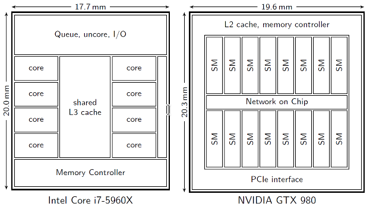
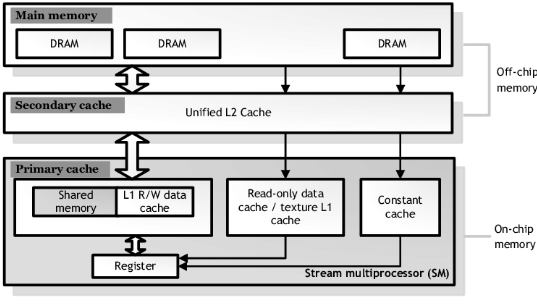
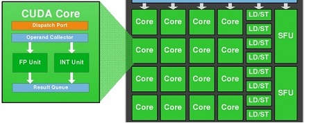
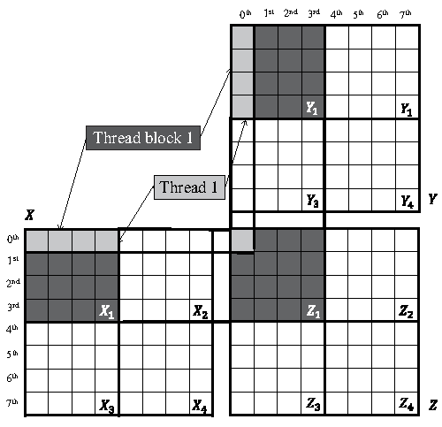
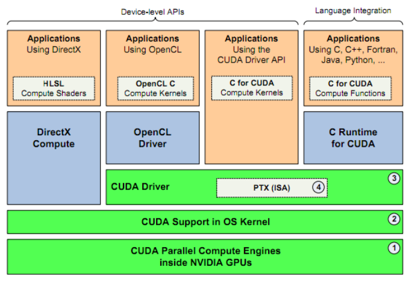
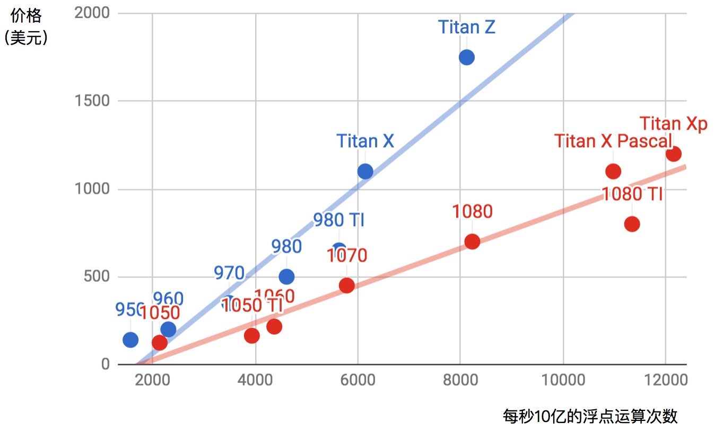

# Chương 15 Tính toán dị thể, GPU và chọn framework

> Ghi chú của người biên soạn: trang này dịch từ sách *Deep Learning 500 câu hỏi* (深度学习500问) do **Tan Jiyong (谈继勇)** chủ biên cùng cộng đồng đóng góp ([bản gốc](https://github.com/scutan90/DeepLearning-500-questions/tree/master/ch15_GPU和框架选型), [mã nguồn](https://github.com/scutan90/DeepLearning-500-questions), giấy phép [GPL-3.0](https://www.gnu.org/licenses/gpl-3.0.html); phần dịch cũng theo GPL-3.0). Số câu hỏi giữ như bản gốc. Chỗ bản gốc sai hoặc thiếu đã được sửa ngay trong bài và ghi ở ô **Biên tập**; ô **Lý thuyết** dẫn sang bài học tương ứng trên site.

> **Biên tập:** bản gốc của chương này viết khoảng 2018–2019 và còn dang dở. Khoảng một nửa số mục (15.3.4, 15.3.5, 15.4, 15.6.3, 15.6.4, phần lớn 15.7 và 15.8) chỉ có tiêu đề, người biên tập viết bổ sung. Sau dòng kẻ ngang, bản gốc còn một phần thứ hai, đánh số lại từ 15.1 (mua GPU, chọn framework, triển khai); phần này phỏng theo phụ lục "Mua GPU" của *Dive into Deep Learning* (bản tiếng Trung) và bài viết của Tim Dettmers. Bản dịch đánh lại số phần thứ hai thành 15.9–15.11 để không trùng số. Mọi khuyến nghị phần cứng, phần mềm trong bản gốc (RTX 20xx, CUDA 8/9 trên Ubuntu 16.04, TensorFlow 1.x, Theano, MXNet…) đã lỗi thời; bản dịch giữ nội dung gốc làm tư liệu, kèm ghi chú cập nhật tới năm 2025–2026. Giá và mẫu card thay đổi rất nhanh, nên trước khi mua hãy xem bài cập nhật mới nhất của Tim Dettmers và bảng thông số của hãng.

Quá trình huấn luyện và suy luận của học sâu gồm rất nhiều phép toán trên vector, ma trận và tensor, thường cần lượng lớn phép tính dấu phẩy động, gồm độ chính xác cao (khi huấn luyện) và độ chính xác thấp (khi suy luận và triển khai). GPU là một bộ tăng tốc lập trình được, đa dụng. Ban đầu nó được thiết kế để xử lý và kết xuất đồ họa; nhưng từ năm 2007, khi NVIDIA ra mắt nền tảng tính toán đa dụng CUDA cho GPU, một kỷ nguyên mới mở ra: dùng GPU cho tính toán đa dụng (GPGPU). Từ đó vô số nhà nghiên cứu và lập trình viên viết lại (một phần) các thuật toán bằng CUDA, tăng tốc từ vài lần tới hàng trăm lần. Đặc biệt khi làn sóng học máy, rồi học sâu, ập tới, tăng tốc bằng GPU trở thành một trong những tầng nền cơ bản của mọi công cụ. Chương này giới thiệu sơ lược kiến trúc GPU, các chỉ số hiệu năng, cách chọn framework và các nội dung khác liên quan tới học sâu.

## 15.1 Tính toán dị thể là gì?

<div class="qa-theory">

**Lý thuyết:** [Học sâu · 6.7.1 Thiết bị Tính toán](dl/ch06_s7_vi?id=_671-thiết-bị-tính-toán)

</div>

Tính toán dị thể (heterogeneous computing) xuất phát từ một khái niệm đơn giản hơn là "tính dị thể": các nền tảng tính toán khác nhau có đặc tính khác nhau do khác biệt về phần cứng (lõi tính toán và bộ nhớ), tập lệnh và phần mềm tầng dưới. Tính toán dị thể là kết hợp hai hay nhiều nền tảng tính toán khác nhau để cùng làm việc. Kiến trúc phổ biến và đã chín muồi nhất trong học máy, học sâu là CPU + GPU. Ngoài ra còn các bộ đồng xử lý (coprocessor) khác: TPU của Google, các ASIC thiết kế riêng cho từng mục đích, FPGA lập trình được… Chương này tập trung vào bộ tăng tốc đồ họa đã cùng phát triển với học sâu, tức GPU.

## 15.2 GPU là gì?

<div class="qa-theory">

**Lý thuyết:** [Học sâu · 6.7.1 Thiết bị Tính toán](dl/ch06_s7_vi?id=_671-thiết-bị-tính-toán)

</div>

Như tên gọi (Graphics Processing Unit, bộ xử lý đồ họa), GPU ban đầu được phát triển để kết xuất đồ họa máy tính, giảm tải cho CPU. Vì các điểm ảnh gần như độc lập với nhau, GPU được thiết kế theo kiểu "một lệnh, nhiều dữ liệu" (SIMD): cùng một lệnh (ví dụ một phép biến đổi ảnh) được thực hiện đồng thời trên rất nhiều điểm ảnh, cho thông lượng lớn, nhờ đó máy tính mới kết xuất được cảnh 2D/3D phức tạp theo thời gian thực. Ban đầu GPU không phải là nền tảng tính toán đa dụng; khoảng năm 2007, NVIDIA đưa GPU vào thế giới tính toán đa dụng, cho phép tăng tốc chương trình thông thường trong một môi trường lập trình tương đối thân thiện (CUDA, sau đó là OpenCL). Từ đó GPGPU trở thành công nghệ được giới học thuật và công nghiệp dùng thường xuyên, và trong thời kỳ bùng nổ của học sâu, GPU là một lực đẩy rất quan trọng.

> **Biên tập:** NVIDIA gọi mô hình thực thi của mình là **SIMT** (single instruction, multiple threads): mỗi luồng có bộ đếm chương trình và thanh ghi riêng, lập trình viên viết mã cho một luồng, còn phần cứng gom 32 luồng thành một warp và cho cả warp chạy cùng một lệnh. Về hiệu quả thì gần với SIMD, nhưng các luồng trong warp vẫn rẽ nhánh được (khi đó các nhánh chạy lần lượt, gọi là phân kỳ warp, làm chậm).

## 15.3 Sơ lược kiến trúc GPU

GPU có logic thiết kế và kịch bản sử dụng khác CPU nên kiến trúc rất khác. Phần này giới thiệu sơ lược GPU được tổ chức thế nào và lõi tính toán của nó có những đặc tính gì.

### 15.3.1 Hiểu kiến trúc GPU một cách dễ hiểu thế nào?

<div class="qa-theory">

**Lý thuyết:** [Học sâu · 6.7.1 Thiết bị Tính toán](dl/ch06_s7_vi?id=_671-thiết-bị-tính-toán) · [d2l (tiếng Anh) · 13.4 Phần cứng](https://d2l.ai/chapter_computational-performance/hardware.html) ↗

</div>

Hình dưới cho thấy vài đặc điểm khác biệt của GPU so với CPU:

- **Lõi tính toán:** CPU trong hình là Intel Core i7-5960X (kiến trúc Haswell-E), có 8 lõi (16 luồng), tức về lý thuyết chạy được 16 tác vụ khác nhau cùng lúc. Ngoài 8 lõi, phần lớn diện tích chip dành cho bộ đệm cấp 3, bộ điều khiển bộ nhớ và mạch điều khiển. Ngược lại, GPU GTX 980 của NVIDIA, trên diện tích chip gần tương đương, phần lớn là đơn vị tính toán: 16 SM (streaming multiprocessor, bộ đa xử lý luồng), mỗi SM có 128 lõi CUDA, tổng cộng 2048 lõi; về lý thuyết GPU này thực hiện được 2048 phép nhân–cộng (FMA) dấu phẩy động độ chính xác đơn trong một chu kỳ xung nhịp.

> **Biên tập:** bản gốc ghi i7-5960X thuộc "thế hệ 5, kiến trúc Broadwell"; thực ra i7-5960X dùng kiến trúc **Haswell-E** (tên số 5xxx gây nhầm). Một phép FMA tính $a\times b+c$ nên được đếm là 2 FLOP: GTX 980 ở xung nhịp cơ bản 1126 MHz đạt khoảng $2048 \times 2 \times 1{,}126 \approx 4612$ GFLOPS FP32.



- **Xung nhịp lõi:** tần số xung nhịp là số xung đồng bộ trong một giây, phản ánh một phần tốc độ làm việc của một linh kiện. Các bảng dưới so sánh vài sản phẩm đời đầu như Intel Xeon X5650 và vài GPU NVIDIA. Có thể thấy về xung nhịp, CPU cao hơn GPU nhiều. CPU theo đuổi xung nhịp cao (khi chưa tính tới giới hạn năng lượng và công nghệ chế tạo); còn GPU dùng thiết kế nhiều lõi, nên tăng xung nhịp một chút cũng không ảnh hưởng nhiều tới hiệu năng tổng. Dĩ nhiên còn có cân nhắc về điện năng để tránh tỏa nhiệt quá mức. Một lý do khác: các lõi CUDA trong cùng một SM dùng chung bộ đệm và thanh ghi rất hạn chế; bộ nhớ dùng chung cũng có giới hạn hiệu năng, nên dù tăng xung nhịp từng lõi, nếu bị bộ nhớ kéo chậm thì cũng không phát huy được.

Thông số CPU Intel Xeon X5650:

| Thông số | Intel Xeon X5650 |
| --- | --- |
| Kiến trúc | x86 |
| Xung nhịp (MHz) | 2670 |
| Số lõi | 6 (12 luồng) |
| Hiệu năng đỉnh (GFLOPS) | 124,8 |
| Bộ đệm L1 | 32 KB |
| Bộ đệm L2 | 256 KB |
| Bộ đệm L3 | 12 MB |
| Hiệu năng đỉnh trên mỗi watt (GFLOPS/W) | 1,31 |
| Giá đề xuất khi ra mắt | > 1000 USD |

So sánh thông số một số GPU:

| Thông số | NVIDIA Tesla M2070 | NVIDIA Tesla K20 | NVIDIA GTX 970 |
| --- | --- | --- | --- |
| Kiến trúc | Fermi | Kepler | Maxwell |
| Xung nhịp (MHz) | 1150 | 706 | 1050 |
| Tổng số lõi | 448 (32 × 14 SM) | 2496 (192 × 13 SM) | 1664 (128 × 13 SM) |
| Hiệu năng đỉnh FP32 (GFLOPS) | 1030 | 3524 | 3494 |
| Hiệu năng đỉnh trên mỗi watt (GFLOPS/W) | 4,6 | 15,7 | 24,1 |
| Giá đề xuất khi ra mắt | > 3000 USD | > 5000 USD | 329 USD |
| Thanh ghi (mỗi SM) | 32768 × 32 bit | 65536 × 32 bit | 65536 × 32 bit |
| Bộ nhớ dùng chung / L1 (mỗi SM) | 16 KB/48 KB | 16 KB/48 KB | 96 KB / 24 KB |
| Bộ đệm L2 | 768 KB | 1536 KB | 1792 KB |

> **Biên tập:** hai bảng trên được gõ lại từ ảnh trong bản gốc, có sửa: (1) M2070 có 448 lõi = 32 × **14** SM (ảnh ghi 32 × 16 SM, tức 512 lõi); (2) hiệu năng đỉnh FP32 của M2070 là $448 \times 2 \times 1{,}15 \approx 1030$ GFLOPS, không phải 1288 (con số đó ứng với một card khác), nên hiệu năng trên mỗi watt (TDP 225 W) là khoảng 4,6 chứ không phải 5,7; (3) K20 có **13** SMX (192 × 13 = 2496; ảnh ghi 192 × 12 = 2304, mâu thuẫn với chính tổng số lõi); (4) số thanh ghi là 65536 ($2^{16}$), không phải 65535. Với Fermi/Kepler, mỗi SM có 64 KB SRAM chia giữa bộ nhớ dùng chung và L1 theo tỉ lệ 16/48 hoặc 48/16 KB; Maxwell tách riêng 96 KB bộ nhớ dùng chung. Các số còn lại khớp với công thức số lõi × 2 FLOP × xung nhịp. Để so sánh: một GPU trung tâm dữ liệu đời 2022 như H100 SXM đạt khoảng 67 TFLOPS FP32 và gần 1000 TFLOPS FP16 dày đặc trên Tensor Core.

- **Kiến trúc bộ nhớ:** bộ nhớ nhiều tầng của GPU gồm bộ nhớ toàn cục (global memory, tức "VRAM" mà đa số người dùng quan tâm), bộ đệm L2, và bộ nhớ trên chip (thanh ghi, bộ nhớ dùng chung chung với L1, bộ đệm chỉ đọc/texture và bộ đệm hằng). Thường thì bộ nhớ dùng chung, bộ đệm và thanh ghi tốc độ cao nhất đều rất hạn chế; ví dụ trên Tesla K20, mỗi SM chỉ có tối đa 48 KB dùng làm bộ nhớ dùng chung (hoặc L1). Vì vậy trong nhiều thuật toán tăng tốc bằng GPU, dùng hiệu quả các bộ đệm tốc độ cao này là yếu tố rất quan trọng để tăng hiệu năng.

> **Biên tập:** bản gốc ghi bộ nhớ toàn cục "từ vài GB tới 16 GB (mới nhất hiện nay)". Tới 2025, card tiêu dùng cao cấp có 24–32 GB (RTX 4090: 24 GB, RTX 5090: 32 GB), còn GPU trung tâm dữ liệu có 80–192 GB bộ nhớ HBM (H100: 80 GB, H200: 141 GB, B200: khoảng 180–192 GB, AMD MI300X: 192 GB).



Dung lượng bộ nhớ của hai GPU Tesla:

| Thông số | M2070 | K20 |
| --- | --- | --- |
| Số lõi CUDA | 448 (32 × 14 SM) | 2496 (192 × 13 SM) |
| Bộ nhớ dùng chung (mỗi SM) | 16 KB/48 KB | 16 KB/48 KB |
| Thanh ghi (mỗi SM) | 32768 × 32 bit | 65536 × 32 bit |
| Dung lượng bộ nhớ toàn cục | 6 GB | 5 GB |
| Băng thông bộ nhớ toàn cục | 150 GB/s | 208 GB/s |

> **Biên tập:** dòng cuối trong ảnh gốc ghi "Global Memory Frequency" (tần số), nhưng đơn vị GB/s cho thấy đó là **băng thông**.

### 15.3.2 Lõi CUDA là gì?

<div class="qa-theory">

**Lý thuyết:** [Học sâu · 6.7.1 Thiết bị Tính toán](dl/ch06_s7_vi?id=_671-thiết-bị-tính-toán)

</div>

Như đã nói, một chip GPU có hàng nghìn lõi CUDA, phân bố trong nhiều SM; ví dụ GTX 980 có 16 SM, mỗi SM 128 lõi CUDA. Như hình dưới, lõi CUDA là đơn vị nhỏ nhất trong kiến trúc GPU, cấu trúc khá giống một lõi CPU đơn giản: có một đơn vị tính dấu phẩy động, một đơn vị tính số nguyên và phần điều khiển (cổng điều phối, bộ thu toán hạng, hàng đợi kết quả). Các lõi CUDA trong một warp cùng thực hiện một lệnh nhưng trên các điểm dữ liệu khác nhau.

> **Biên tập:** bản gốc viết "mọi lõi CUDA trong cùng một SM đồng bộ thực hiện cùng một lệnh". Chính xác hơn: đơn vị cùng thực hiện một lệnh là **warp** 32 luồng; mỗi SM có nhiều bộ lập lịch warp (GTX 980: 4 bộ), mỗi chu kỳ có thể phát các lệnh khác nhau cho các warp khác nhau.



Nói chung, nhiều lõi CUDA hơn nghĩa là nhiều đơn vị thực thi song song hơn, nên có thể nói một cách phiến diện là hiệu năng cao hơn. Nhưng thực tế còn phụ thuộc nhiều yếu tố, quan trọng nhất là khi cài đặt song song, thuật toán có được lập lịch hiệu quả và tối ưu cách dùng bộ nhớ hay không. Phần lớn framework học sâu có tăng tốc GPU hiện nay, gồm TensorFlow, PyTorch…, đều dựa vào mã tăng tốc ma trận cài đặt ở tầng dưới. NVIDIA cũng xây dựng các giao diện thống nhất như cuDNN để framework ở tầng trên tận dụng hiệu năng GPU tốt hơn.

### 15.3.3 Vì sao dùng GPU?

<div class="qa-theory">

**Lý thuyết:** [d2l (tiếng Anh) · 13.4 Phần cứng](https://d2l.ai/chapter_computational-performance/hardware.html) ↗ · [Ôn tập · 15.3.1 Hiểu kiến trúc GPU một cách dễ hiểu thế nào?](qa/ch15_vi?id=_1531-hiểu-kiến-trúc-gpu-một-cách-dễ-hiểu-thế-nào)

</div>

Tính toán song song có thể chia rất thô thành:

- **Song song lệnh:** nhiều lệnh được phân lên các lõi khác nhau và chạy cùng lúc; các lệnh này khác nhau và độc lập với nhau, không cần đồng bộ hay chia sẻ thông tin thêm.
- **Song song dữ liệu:** nếu dữ liệu có tính độc lập tự nhiên, như từng điểm ảnh trong một ảnh, thì khi xử lý ảnh, cùng một lệnh có thể áp dụng đồng thời cho mọi điểm ảnh, và thao tác trên cả ảnh được song song hóa. Về lý thuyết, nếu bộ nhớ không phải vấn đề và số đơn vị tính toán nhiều hơn số điểm ảnh, thao tác này có thể xong trong một chu kỳ xung nhịp.

Xét về tổng thể, theo một nghĩa nào đó GPU hỗ trợ cả hai kiểu song song trên. Trong một SM dùng mô hình "một lệnh, nhiều dữ liệu"; còn giữa các SM, cùng lúc có thể phát các lệnh khác nhau. Từ góc độ này, chip GPU là một kiến trúc rất linh hoạt. Số SM trên một chip và số lõi CUDA trong mỗi SM là điểm cân bằng tìm được khi thiết kế theo ứng dụng.

Vì phần lớn phép toán trong học sâu song song tự nhiên (rất nhiều phép toán ma trận), GPU hiện vẫn là nền tảng rất phù hợp. Ví dụ điển hình là phép nhân ma trận (hình dưới): để tính $Z = XY$, các tích từng phần tử giữa hàng của $X$ và cột của $Y$ có thể tính đồng thời, có kết quả rồi mới cộng dồn, và bước cộng dồn cũng song song hóa được, nên hiệu quả tăng rất nhiều. NVIDIA cũng phát triển thư viện tầng dưới cuBLAS cho lập trình viên. Các framework quen thuộc (TensorFlow, PyTorch…) dùng những thư viện song song này, nhờ đó hiệu năng huấn luyện và triển khai tăng lên rất nhiều.



### 15.3.4 Ứng dụng GPU trong học sâu

<div class="qa-theory">

**Lý thuyết:** [Học sâu · 6.7.3 Mạng Neuron và GPU](dl/ch06_s7_vi?id=_673-mạng-neuron-và-gpu) · [Ôn tập · 4.2 AlexNet](qa/ch04_vi?id=_42-alexnet)

</div>

> **Biên tập:** bản gốc chỉ có câu mở đầu và hai ý "những tình huống nào dùng GPU", "ví dụ ImageNet"; phần còn lại do người biên tập viết.

Sự bùng nổ của học sâu trong những năm gần đây có GPU làm lực đẩy vững chắc phía sau.

**Ví dụ ImageNet.** AlexNet (Krizhevsky, Sutskever và Hinton, 2012) thắng ILSVRC 2012 với lỗi top-5 15,3%, so với 26,2% của đội thứ hai. Mô hình có khoảng 60 triệu tham số, được huấn luyện trên **hai GPU GTX 580 3 GB** trong 5–6 ngày; vì một card không đủ bộ nhớ, mạng được chia đôi, mỗi nửa chạy trên một GPU (một dạng song song mô hình). Tác giả viết rằng mạng bị giới hạn chủ yếu bởi bộ nhớ GPU và thời gian huấn luyện chấp nhận được, và kết quả sẽ tốt hơn khi có GPU nhanh hơn. Nếu chạy trên CPU thời đó, cùng khối lượng tính toán sẽ mất nhiều tuần tới vài tháng. Từ đó, kích thước mô hình và lượng tính toán dùng để huấn luyện tăng theo cấp số nhân, chủ yếu nhờ GPU và các bộ tăng tốc chuyên dụng: theo ước tính của OpenAI (2018), lượng tính toán dùng cho các mô hình lớn nhất tăng gấp đôi khoảng mỗi 3,4 tháng trong giai đoạn 2012–2018.

**Những tình huống nên dùng GPU:**

- huấn luyện mạng sâu (CNN, RNN, Transformer) trên dữ liệu ảnh, âm thanh, văn bản: hầu như bắt buộc;
- suy luận khi cần độ trễ thấp với mô hình lớn, hoặc gom batch nhiều yêu cầu để tăng thông lượng (máy chủ dịch vụ);
- các bài toán khác có cấu trúc song song dữ liệu: mô phỏng vật lý, học tăng cường với nhiều môi trường song song, tính toán khoa học, xử lý dữ liệu bảng lớn (RAPIDS cuDF, cuML).

**Những tình huống CPU là đủ hoặc tốt hơn:** mô hình nhỏ, dữ liệu bảng vừa phải (cây quyết định, gradient boosting trên vài trăm nghìn dòng), suy luận từng mẫu một với mô hình nhẹ, bước tiền xử lý dữ liệu nhiều rẽ nhánh. Khi dữ liệu nhỏ, chi phí chép dữ liệu qua PCIe giữa RAM và VRAM có thể lớn hơn thời gian tính.

### 15.3.5 Tensor Core trong kiến trúc Turing có tác dụng gì với học sâu?

<div class="qa-theory">

**Lý thuyết:** [Ôn tập · 3.5 Kích thước batch](qa/ch03_vi?id=_35-kích-thước-batch) · [Ôn tập · Chương 13 Thuật toán tối ưu](qa/ch13_vi)

</div>

> **Biên tập:** bản gốc chỉ có tiêu đề; nội dung do người biên tập viết. Tensor Core xuất hiện lần đầu ở kiến trúc **Volta** (Tesla V100, 2017), không phải Turing (2018); Turing đưa Tensor Core xuống dòng card tiêu dùng (RTX 20xx).

Tensor Core là đơn vị phần cứng chuyên làm phép **nhân–cộng ma trận nhỏ** trong một lệnh: ở Volta, mỗi Tensor Core mỗi chu kỳ tính $D = A\times B + C$ với $A, B$ là ma trận $4\times4$ FP16 và $C, D$ là FP16 hoặc FP32, tức 64 phép FMA một chu kỳ. Lõi CUDA thường chỉ làm một FMA vô hướng mỗi chu kỳ. V100 có 640 Tensor Core, đạt khoảng $640 \times 64 \times 2 \times 1{,}53\text{ GHz} \approx 125$ TFLOPS cho nhân ma trận độ chính xác hỗn hợp, so với khoảng 15,7 TFLOPS FP32 trên lõi CUDA.

Tác dụng với học sâu:

1. **Tăng tốc phép nhân ma trận và tích chập,** chiếm phần lớn thời gian tính của mạng neuron; cuBLAS, cuDNN tự dùng Tensor Core khi kiểu dữ liệu và kích thước phù hợp (kích thước là bội của 8 với FP16 cho hiệu quả tốt nhất).
2. **Huấn luyện độ chính xác hỗn hợp (mixed precision):** nhân bằng FP16/BF16, cộng dồn bằng FP32, lưu một bản trọng số chính FP32. Với FP16 cần nhân hệ số mất mát (loss scaling) để gradient nhỏ không bị làm tròn về 0; BF16 (từ Ampere) có cùng khoảng số mũ với FP32 nên thường không cần. Kết quả: nhanh hơn 2–3 lần và tốn khoảng một nửa bộ nhớ cho activation, độ chính xác gần như không đổi.
3. **Suy luận lượng tử hóa:** Turing thêm INT8/INT4; các thế hệ sau thêm TF32 (Ampere, 2020: dùng thay FP32 mà không cần sửa mã), FP8 (Hopper, 2022) và FP4 (Blackwell, 2024), giúp huấn luyện và suy luận mô hình ngôn ngữ lớn rẻ hơn.
4. Turing còn có RT Core cho dò tia (ray tracing), không liên quan trực tiếp tới học sâu.

Trong PyTorch, bật huấn luyện độ chính xác hỗn hợp chỉ cần vài dòng:

```python
scaler = torch.amp.GradScaler("cuda")            # chỉ cần với float16
for x, y in loader:
    opt.zero_grad()
    with torch.autocast("cuda", dtype=torch.float16):
        loss = loss_fn(model(x.cuda()), y.cuda())
    scaler.scale(loss).backward()
    scaler.step(opt)
    scaler.update()
```

## 15.4 Framework CUDA

### 15.4.1 Lập trình CUDA có khó không?

<div class="qa-theory">

**Lý thuyết:** [d2l (tiếng Anh) · 13.4 Phần cứng](https://d2l.ai/chapter_computational-performance/hardware.html) ↗

</div>

> **Biên tập:** mục 15.4 bản gốc chỉ có tiêu đề; nội dung do người biên tập viết. Hình kiến trúc phần mềm CUDA có trong thư mục ảnh của bản gốc nhưng không được dùng trong bài; bản dịch đặt nó ở đây.

Viết một chương trình CUDA **chạy đúng** thì không khó nếu đã biết C/C++; viết một chương trình CUDA **chạy nhanh** thì khó. CUDA mở rộng C++ bằng vài từ khóa: hàm `__global__` (kernel) chạy trên GPU, được gọi với cú pháp `<<<số khối, số luồng mỗi khối>>>`; mỗi luồng tự tính chỉ số của mình để biết xử lý phần tử nào. Ví dụ cộng hai vector:

```cpp
__global__ void add(const float* a, const float* b, float* c, int n) {
    int i = blockIdx.x * blockDim.x + threadIdx.x;   // chỉ số toàn cục của luồng
    if (i < n) c[i] = a[i] + b[i];
}
// trên CPU: cấp phát bộ nhớ GPU, chép dữ liệu sang, gọi kernel, chép kết quả về
cudaMalloc(&d_a, n * sizeof(float));  /* … tương tự cho d_b, d_c … */
cudaMemcpy(d_a, h_a, n * sizeof(float), cudaMemcpyHostToDevice);
add<<<(n + 255) / 256, 256>>>(d_a, d_b, d_c, n);
cudaMemcpy(h_c, d_c, n * sizeof(float), cudaMemcpyDeviceToHost);
```

Cái khó nằm ở tối ưu hiệu năng, đòi hỏi hiểu phần cứng:

- **truy cập bộ nhớ hợp nhất (coalesced):** các luồng trong một warp nên đọc các địa chỉ liền nhau;
- **dùng bộ nhớ dùng chung** để tái sử dụng dữ liệu (nhân ma trận theo khối như hình ở 15.3.3), tránh xung đột bank;
- **tránh phân kỳ warp** (các luồng trong warp rẽ nhánh khác nhau);
- **đủ độ chiếm dụng (occupancy)** để che độ trễ bộ nhớ, cân bằng số thanh ghi mỗi luồng;
- **đồng bộ** đúng chỗ (`__syncthreads()`), tránh tranh chấp dữ liệu;
- chồng lấp truyền dữ liệu với tính toán bằng stream; gỡ lỗi và đo hiệu năng bằng Nsight.

Một kernel nhân ma trận tự viết đơn giản thường chỉ đạt vài phần trăm tới vài chục phần trăm tốc độ của cuBLAS. Vì vậy người làm học sâu hiếm khi phải viết CUDA: framework đã gọi sẵn các thư viện tối ưu. Khi cần kernel riêng (ví dụ gộp nhiều phép toán), có các lựa chọn bậc cao hơn: **Triton** (OpenAI) viết kernel bằng Python theo khối, **Numba**/**CuPy** cho Python, `torch.compile` tự gộp và sinh kernel.



### 15.4.2 cuDNN

<div class="qa-theory">

**Lý thuyết:** [Ôn tập · Chương 5 Mạng neuron tích chập (CNN)](qa/ch05_vi) · [Học sâu · 6.7.3 Mạng Neuron và GPU](dl/ch06_s7_vi?id=_673-mạng-neuron-và-gpu)

</div>

cuDNN (CUDA Deep Neural Network library) là thư viện của NVIDIA cung cấp các cài đặt tối ưu cao trên GPU cho những phép toán chuẩn của mạng neuron: tích chập (xuôi và ngược), pooling, chuẩn hóa, hàm kích hoạt, softmax, RNN/LSTM, và từ các phiên bản gần đây là attention (cuDNN fused attention, dùng bởi các bản cài đặt kiểu FlashAttention). Gần như mọi framework (PyTorch, TensorFlow, JAX, MXNet…) đều gọi cuDNN bên dưới.

Điểm đáng chú ý:

- Với tích chập, cuDNN có nhiều thuật toán (GEMM ngầm, FFT, Winograd…) và chọn thuật toán nhanh nhất theo kích thước đầu vào. Trong PyTorch, `torch.backends.cudnn.benchmark = True` cho phép đo thử và chọn thuật toán nhanh nhất khi kích thước đầu vào cố định.
- Một số thuật toán nhanh nhất **không tất định** (kết quả lệch ở chữ số cuối giữa các lần chạy); khi cần tái lập kết quả, đặt `torch.backends.cudnn.deterministic = True` (chậm hơn).
- Phiên bản cuDNN phải khớp với phiên bản CUDA; khi cài PyTorch bằng pip/conda, cuDNN đã được đóng gói sẵn (xem 15.6.2).

## 15.5 Khuyến nghị cấu hình phần cứng GPU

### 15.5.1 Các chỉ số hiệu năng chính của GPU

<div class="qa-theory">

**Lý thuyết:** [d2l (tiếng Anh) · Phụ lục: chọn máy chủ và GPU](https://d2l.ai/chapter_appendix-tools-for-deep-learning/selecting-servers-gpus.html) ↗

</div>

Hiệu năng GPU chủ yếu do ba thông số quyết định:

1. **Năng lực tính toán.** Thường người ta quan tâm tới năng lực tính dấu phẩy động 32 bit. Huấn luyện bằng số dấu phẩy động 16 bit cũng bắt đầu phổ biến, còn nếu chỉ suy luận thì có thể dùng số nguyên 8 bit.
2. **Dung lượng bộ nhớ.** Mô hình càng lớn, hoặc batch huấn luyện càng lớn, càng cần nhiều bộ nhớ GPU.
3. **Băng thông bộ nhớ.** Chỉ khi băng thông đủ lớn thì mới phát huy hết năng lực tính toán.

Với đa số người dùng, chỉ cần xét năng lực tính toán. Bộ nhớ GPU nên không dưới 4 GB; nếu GPU còn phải hiển thị giao diện đồ họa thì nên có ít nhất 6 GB. Băng thông bộ nhớ thường tương đối cố định theo từng dòng, ít lựa chọn.

> **Biên tập:** đoạn này lấy từ phụ lục của *Dive into Deep Learning* bản 2019; đã lỗi thời ở hai điểm. (1) Từ khi có Tensor Core, thước đo quan trọng là thông lượng **FP16/BF16 trên Tensor Core**, không phải FP32 trên lõi CUDA. (2) Với mô hình hiện nay, **bộ nhớ** thường là ràng buộc đầu tiên: nên có tối thiểu 8 GB để học tập, 12–16 GB để làm thị giác máy tính và tinh chỉnh mô hình vừa, 24 GB trở lên nếu làm với mô hình ngôn ngữ lớn (một mô hình 7 tỉ tham số ở FP16 riêng trọng số đã chiếm khoảng 14 GB). Với suy luận mô hình ngôn ngữ lớn, tốc độ sinh từng token bị giới hạn chủ yếu bởi **băng thông bộ nhớ**, chứ không phải năng lực tính toán (xem thêm 15.9.2).

Hình dưới so sánh năng lực tính toán dấu phẩy động 32 bit và giá của các mẫu trong dòng GTX 900 và 1000; giá lấy theo giá đề xuất trên Wikipedia.



Từ hình có thể rút ra hai điều:

1. Trong cùng một dòng, giá và hiệu năng gần như tỉ lệ thuận. Nhưng mẫu ra sau có tỉ lệ hiệu năng/giá cao hơn, ví dụ 980 Ti và 1080 Ti.
2. Dòng GTX 1000 có tỉ lệ hiệu năng/giá cao hơn dòng 900 khoảng 2 lần.

So sánh thêm các dòng GTX cũ hơn cũng thấy quy luật tương tự. Do đó, nên mua GPU mới nhất trong khả năng tài chính.

Dòng RTX có thêm Tensor Core và hỗ trợ FP16 (tốc độ cao), khiến lựa chọn card đa dạng hơn.

### 15.5.2 Lời khuyên khi mua

<div class="qa-theory">

**Lý thuyết:** [d2l (tiếng Anh) · Phụ lục: chọn máy chủ và GPU](https://d2l.ai/chapter_appendix-tools-for-deep-learning/selecting-servers-gpus.html) ↗

</div>

> **Biên tập:** danh sách dưới đây là lời khuyên của Tim Dettmers năm 2019, giữ lại làm tư liệu; các mẫu card đều đã cũ hai tới ba thế hệ. Nguyên tắc chung theo cách nhìn năm 2025: (1) chọn theo **dung lượng bộ nhớ** trước (xem ghi chú 15.5.1), rồi tới thông lượng Tensor Core và băng thông; (2) card cũ đã qua sử dụng như RTX 3090 (24 GB) thường có tỉ lệ bộ nhớ/giá tốt; (3) nếu chỉ thỉnh thoảng cần GPU mạnh, thuê GPU đám mây (Colab, Kaggle miễn phí có GPU giới hạn; các nhà cung cấp thuê theo giờ) thường rẻ hơn mua; (4) "dữ liệu > 250 GB" bản thân không đòi hỏi card đắt: dữ liệu được nạp dần theo batch, nên kích thước tập dữ liệu ảnh hưởng tới ổ đĩa và RAM nhiều hơn là tới GPU.

Một số lời khuyên tổng quát:

- Hiệu năng/giá tốt nhưng khá đắt: RTX 2070, GTX 1080 Ti.
- Hiệu năng/giá tốt mà rẻ: RTX 2060, GTX 1060 (6 GB).
- Khi dùng tập dữ liệu > 250 GB: GTX Titan X (Maxwell), NVIDIA Titan X Pascal hoặc NVIDIA Titan Xp.
- Không có nhiều tiền: GTX 1060 (6 GB).
- Gần như không có tiền, mới nhập môn: GTX 1050 Ti (4 GB).
- Thi Kaggle: RTX 2070, GTX 1060 (6 GB) cho mọi cuộc thi "bình thường"; GTX 1080 Ti (đủ ngân sách thì RTX 2080 Ti) cho các "cuộc thi học sâu".
- Nhà nghiên cứu thị giác máy tính: RTX 2080 Ti (nên chọn bản tản nhiệt turbo thổi ra ngoài hoặc tản nước, tiện thêm card sau này); mạng rất sâu thì có thể chọn Titan RTX.
- Nhà nghiên cứu NLP: RTX 2080 Ti, huấn luyện bằng FP16.
- Dựng cụm GPU: khá phức tạp, bàn riêng.
- Mới bắt đầu nghiên cứu học sâu: bắt đầu với RTX 2060 hoặc GTX 1060 (6 GB), rồi chọn tiếp theo hướng quan tâm (nhập môn, Kaggle, nghiên cứu, ứng dụng). Hiện RTX 2060 và GTX 1060 đều phù hợp để nhập môn.
- Muốn thử học sâu nhưng không yêu cầu nhiều: GTX 1050 Ti (4 hoặc 2 GB).

Hiện GPU rời chủ yếu có hai hãng là AMD và NVIDIA. NVIDIA đầu tư vào học sâu sớm hơn, được các framework hỗ trợ tốt hơn, nên hiện đa số chọn GPU NVIDIA.

> **Biên tập:** tới 2025, AMD (ROCm, dòng Instinct MI300X/MI325X) đã được PyTorch hỗ trợ chính thức và dùng trong một số cụm lớn, Intel có Gaudi, Google có TPU, Apple Silicon chạy PyTorch qua backend MPS; nhưng hệ sinh thái CUDA vẫn rộng và ít trục trặc nhất, nên với người mới, GPU NVIDIA vẫn là lựa chọn an toàn.

NVIDIA có hai loại GPU: cho người dùng cá nhân (ví dụ dòng GTX) và cho doanh nghiệp (ví dụ dòng Tesla). Năng lực tính toán của hai loại tương đương. Tuy nhiên GPU doanh nghiệp thường tản nhiệt thụ động và có thêm kiểm tra lỗi bộ nhớ (ECC), nên hợp với trung tâm dữ liệu hơn, và thường đắt hơn GPU cá nhân khoảng 10 lần.

Nếu là công ty lớn có trên 100 máy, có thể xét dòng NVIDIA Tesla cho doanh nghiệp. Nếu là phòng thí nghiệm hoặc công ty vừa và nhỏ có 10 tới 100 máy, ngân sách dư dả thì có thể xét dòng NVIDIA DGX; nếu không, có thể mua máy chủ có tỉ lệ hiệu năng/giá tốt như của Supermicro rồi lắp GPU dòng GTX.

> **Biên tập:** từ cuối 2017, giấy phép driver GeForce của NVIDIA **cấm** triển khai card GeForce/Titan trong trung tâm dữ liệu (trừ xử lý blockchain), nên phương án "máy chủ Supermicro + card GTX" chỉ hợp với máy trạm, phòng thí nghiệm nhỏ, không hợp với trung tâm dữ liệu cung cấp dịch vụ. Thương hiệu "Tesla" cho GPU trung tâm dữ liệu cũng đã bỏ từ thế hệ Ampere (A100, H100, B200…).

NVIDIA thường ra thế hệ GPU mới mỗi một tới hai năm, ví dụ dòng GTX 1000 ra năm 2016. Mỗi dòng có vài mẫu với hiệu năng khác nhau.

> **Biên tập:** bản gốc ghi dòng GTX 1000 ra năm 2017; thực tế GTX 1080/1070 (Pascal) ra tháng 5–6/2016. Các thế hệ card tiêu dùng sau đó: RTX 20 (Turing, 2018), RTX 30 (Ampere, 2020), RTX 40 (Ada Lovelace, 2022), RTX 50 (Blackwell, 2025).

## 15.6 Dựng môi trường phần mềm

Học sâu thực chất là xây dựng thuật toán và huấn luyện mô hình trên một hệ thống phần mềm hoàn chỉnh. Dựng hệ thống đó thế nào, ví dụ chọn hệ điều hành ra sao, gặp vấn đề gì khi cài đặt…, mục này tổng kết ngắn gọn.

### 15.6.1 Chọn hệ điều hành nào?

<div class="qa-theory">

**Lý thuyết:** [Học sâu · 6.7.1 Thiết bị Tính toán](dl/ch06_s7_vi?id=_671-thiết-bị-tính-toán)

</div>

Các hãng phần cứng như NVIDIA đều hỗ trợ tốt nhiều hệ điều hành, như Windows và Linux. Nhưng vì Linux thân thiện với người làm kỹ thuật, gần như mọi hệ thống học sâu hiện nay đều dựng trên Linux, phổ biến là Ubuntu, CentOS…

Chọn hệ điều hành là câu hỏi mà người mới vào học sâu thường gặp. Vài gợi ý:

1. mới bắt đầu, quen Windows, chưa quen cả Linux lẫn học sâu: có thể học nhập môn trên Windows;
2. biết sơ qua Linux, chưa hiểu học sâu: có thể dựng framework trực tiếp trên Linux, chạy vài dự án mã nguồn mở rồi học sâu dần;
3. quen Linux, chưa quen lý thuyết học sâu: không cần bàn, nên dùng Linux, cài phần mềm đơn giản, làm việc hiệu quả.

Tóm lại, nếu chưa quen Linux thì hãy làm quen dần, vì cuối cùng hệ thống học sâu vẫn nên dựng trên Linux.

> **Biên tập:** từ 2020, Windows có **WSL2** (Windows Subsystem for Linux) hỗ trợ CUDA: cài driver NVIDIA trên Windows, rồi dùng Ubuntu trong WSL2 như một máy Linux, rất tiện cho người mới. CentOS (bản thường) đã ngừng hỗ trợ năm 2024; máy chủ thường dùng Ubuntu LTS hoặc Rocky/Alma Linux.

### 15.6.2 Cài các phần mềm cơ bản thường dùng thế nào?

<div class="qa-theory">

**Lý thuyết:** [Học sâu · 6.7.2 Tensor và GPU](dl/ch06_s7_vi?id=_672-tensor-và-gpu)

</div>

Hiện có nhiều framework học sâu, nhưng gần như tất cả có chung một đặc điểm: huấn luyện mô hình trên GPU NVIDIA. Để dùng tốt GPU NVIDIA, CUDA và cuDNN là phần mềm bắt buộc.

> **Biên tập:** cách cài dưới đây (CUDA 8.0/9.0 bằng file `.run` trên Ubuntu 16.04) là cách của năm 2018, giữ làm tư liệu; hai ảnh chụp trang tải CUDA trong bản gốc đã bỏ. **Cách làm hiện nay đơn giản hơn nhiều:** chỉ cần cài **driver NVIDIA** (trên Ubuntu: `sudo ubuntu-drivers install`, hoặc gói `nvidia-driver-XXX`), rồi cài PyTorch bằng pip hoặc conda theo lệnh sinh ở pytorch.org. Gói PyTorch đã kèm sẵn thư viện runtime CUDA, cuDNN, cuBLAS, NCCL đúng phiên bản; không cần cài CUDA Toolkit riêng trừ khi phải tự biên dịch mã CUDA. Kiểm tra bằng `nvidia-smi` (driver thấy GPU chưa) và `python -c "import torch; print(torch.cuda.is_available())"`. Driver phải đủ mới so với phiên bản CUDA mà gói được biên dịch (driver mới chạy được CUDA cũ, không ngược lại).

1. **Cài CUDA.** Phần trên đã giới thiệu CUDA; ở đây chỉ trình bày các bước cài trên Linux. Có thể cài CUDA 8.0 hoặc 9.0 tùy nhu cầu, các bước gần như giống nhau; lấy ví dụ Ubuntu 16.04 LTS:

   1. Tải từ trang chủ: CUDA 8.0 tại `https://developer.nvidia.com/cuda-80-ga2-download-archive`, CUDA 9.0 tại `https://developer.nvidia.com/cuda-90-download-archive`; vào trang rồi chọn đúng hệ điều hành và phiên bản.
   2. Trong dòng lệnh, vào thư mục chứa file cài và cấp quyền chạy:

      ```bash
      sudo chmod +x cuda_8.0.61_375.26_linux.run    # CUDA 8.0
      sudo chmod +x cuda_9.0.176_384.81_linux.run   # CUDA 9.0
      ```

   3. Chạy file cài:

      ```bash
      sudo sh cuda_8.0.61_375.26_linux.run          # CUDA 8.0
      sudo sh cuda_9.0.176_384.81_linux.run         # CUDA 9.0
      ```

      Sau đó là các bước cài đặt, CUDA 8.0 và 9.0 gần như giống nhau:

      - đầu tiên hiện điều khoản bản quyền, có thể bấm `q` để bỏ qua;
      - `Do you accept the previously read EULA? accept/decline/quit:` gõ **accept**;
      - `Install NVIDIA Accelerated Graphics Driver for Linux-x86_64 384.81? (y)es/(n)o/(q)uit:` gõ **no** (nếu đã cài driver riêng; driver đi kèm bộ cài thường cũ hơn);
      - `Install the CUDA 9.0 Toolkit? (y)es/(n)o/(q)uit:` gõ **yes**;
      - `Enter Toolkit Location [ default is /usr/local/cuda-9.0 ]:` bấm Enter;
      - `Do you want to install a symbolic link at /usr/local/cuda? (y)es/(n)o/(q)uit:` gõ **yes**;
      - `Install the CUDA 9.0 Samples? (y)es/(n)o/(q)uit:` gõ **yes**.

   Đó là các bước cài CUDA cơ bản. Sau khi cài, thêm `/usr/local/cuda/bin` vào `PATH` và `/usr/local/cuda/lib64` vào `LD_LIBRARY_PATH`, kiểm tra bằng `nvcc --version`.

2. **Cài cuDNN.** cuDNN là thư viện tăng tốc chuyên cho học sâu của NVIDIA (xem 15.4.2).

   > **Biên tập:** bản gốc dừng ở câu trên ("…"). Cách cài thủ công: tải gói cuDNN đúng với phiên bản CUDA từ trang NVIDIA (cần tài khoản developer), giải nén rồi chép header và thư viện vào thư mục CUDA:
   >
   > ```bash
   > tar -xf cudnn-linux-x86_64-*.tar.xz
   > sudo cp cudnn-*/include/cudnn*.h /usr/local/cuda/include
   > sudo cp -P cudnn-*/lib/libcudnn* /usr/local/cuda/lib64
   > ```
   >
   > Hiện nay cuDNN cũng có sẵn dưới dạng gói apt từ kho của NVIDIA, gói conda và gói pip (`nvidia-cudnn-cu12`); khi cài PyTorch bằng pip thì gói này được kéo về tự động.

### 15.6.3 Cài trực tiếp lên máy hay dùng Docker?

<div class="qa-theory">

**Lý thuyết:** [Ôn tập · 15.6.2 Cài các phần mềm cơ bản thường dùng thế nào?](qa/ch15_vi?id=_1562-cài-các-phần-mềm-cơ-bản-thường-dùng-thế-nào)

</div>

> **Biên tập:** mục 15.6.3 và 15.6.4 bản gốc chỉ có tiêu đề; nội dung do người biên tập viết.

| | Cài trực tiếp (thường kèm conda/venv) | Docker (+ NVIDIA Container Toolkit) |
| --- | --- | --- |
| Cài đặt | nhanh, đơn giản cho một người, một dự án | phải học Docker; cần cài driver trên máy chủ và NVIDIA Container Toolkit |
| Cô lập phiên bản | conda/venv cô lập gói Python; thư viện hệ thống vẫn dùng chung | mỗi container có hệ điều hành, CUDA, thư viện riêng; nhiều phiên bản CUDA cùng tồn tại |
| Tái lập, chia sẻ | khó đảm bảo y hệt trên máy khác | một image chạy giống nhau ở mọi nơi; dễ chuyển từ máy cá nhân lên máy chủ, đám mây |
| Hiệu năng | đầy đủ | gần như đầy đủ (GPU được ánh xạ trực tiếp vào container) |
| Hợp với | học tập, thử nghiệm cá nhân | nhóm nhiều người, máy chủ dùng chung, triển khai, CI/CD, Kubernetes |

Gợi ý: học tập thì cài trực tiếp với conda hoặc venv là đủ. Khi làm nhóm hoặc triển khai, dùng Docker, xuất phát từ image dựng sẵn (`pytorch/pytorch`, `nvcr.io/nvidia/pytorch` của NGC, `tensorflow/tensorflow:latest-gpu`) và chạy bằng `docker run --gpus all ...`. Lưu ý: container chứa CUDA runtime, còn **driver** luôn là của máy chủ; driver trên máy chủ phải đủ mới cho phiên bản CUDA trong image.

### 15.6.4 Các vấn đề về driver GPU

<div class="qa-theory">

**Lý thuyết:** [Ôn tập · 15.6.2 Cài các phần mềm cơ bản thường dùng thế nào?](qa/ch15_vi?id=_1562-cài-các-phần-mềm-cơ-bản-thường-dùng-thế-nào)

</div>

Các lỗi thường gặp và cách xử lý:

- **`nvidia-smi` báo không giao tiếp được với driver** (`NVIDIA-SMI has failed because it couldn't communicate with the NVIDIA driver`): thường do vừa cập nhật nhân Linux mà module driver chưa được biên dịch lại (cài driver qua gói DKMS để tự biên dịch lại), do Secure Boot chặn module chưa ký (ký module hoặc tắt Secure Boot), hoặc do driver mã nguồn mở `nouveau` đang chiếm GPU (phải chặn nouveau).
- **Không khớp phiên bản:** `torch.cuda.is_available()` trả về `False` dù `nvidia-smi` chạy: driver quá cũ so với CUDA của gói, hoặc lỡ cài bản PyTorch chỉ cho CPU. Dòng "CUDA Version" trong `nvidia-smi` là phiên bản CUDA **cao nhất** driver hỗ trợ, không phải phiên bản đã cài.
- **Xung đột nhiều bản cài:** trộn driver cài bằng file `.run` với driver từ gói hệ điều hành; nên gỡ sạch rồi chỉ dùng một cách (ưu tiên gói của hệ điều hành).
- **Lỗi khi đang chạy:** `CUDA out of memory` (giảm batch, dùng độ chính xác hỗn hợp, gradient checkpointing; kiểm tra tiến trình khác đang chiếm bộ nhớ bằng `nvidia-smi`); `Xid` trong `dmesg` cho biết lỗi phần cứng/driver (quá nhiệt, thiếu nguồn, lỗi bộ nhớ).
- **Máy laptop có hai GPU** (Intel/AMD tích hợp + NVIDIA): cần chọn đúng chế độ (`prime-select nvidia`), nếu không ứng dụng chạy trên GPU tích hợp.

## 15.7 Chọn framework

### 15.7.1 So sánh các framework chính

<div class="qa-theory">

**Lý thuyết:** [Ôn tập · 12.2.4 PyTorch và TensorFlow khác nhau ở đâu?](qa/ch12_vi?id=_1224-pytorch-và-tensorflow-khác-nhau-ở-đâu)

</div>

> **Biên tập:** bản gốc chỉ ghi "(một bảng lớn so sánh)"; bảng dưới do người biên tập lập, theo tình hình năm 2025.

| Framework | Bên phát triển, năm | Kiểu đồ thị | Điểm mạnh | Tình trạng 2025 |
| --- | --- | --- | --- | --- |
| PyTorch | Facebook/Meta, 2016–2017; nay thuộc PyTorch Foundation (Linux Foundation) | động (eager), `torch.compile` để biên dịch | dễ dùng, gỡ lỗi như Python thường; chiếm đa số bài báo và mô hình mở | chủ đạo cả nghiên cứu lẫn công nghiệp |
| TensorFlow (+ Keras) | Google, 2015 | tĩnh ở 1.x; eager mặc định từ 2.0 (2019), `tf.function` để dựng đồ thị | hệ sinh thái triển khai (Serving, Lite, TF.js), TPU | vẫn dùng nhiều trong sản phẩm có sẵn, ít dùng cho dự án mới |
| JAX | Google, 2018 | hàm thuần, biên dịch XLA (`jit`, `grad`, `vmap`, `pmap`) | rất nhanh trên TPU/GPU, mở rộng tốt cho huấn luyện quy mô lớn | dùng nhiều ở Google DeepMind và nghiên cứu |
| Keras 3 | François Chollet, 2015; Keras 3 năm 2023 | API cấp cao, chạy trên JAX, TensorFlow hoặc PyTorch | nhập môn nhanh, mã ngắn | đang phát triển |
| MXNet (Gluon) | DMLC, 2015; Amazon, Apache | lai (imperative + symbolic) | tiết kiệm bộ nhớ, đa ngôn ngữ | dừng phát triển, chuyển vào Apache Attic năm 2023 |
| Caffe / Caffe2 | Berkeley 2013 / Facebook 2017 | khai báo cấu hình (prototxt) | nhanh cho CNN, triển khai C++ | Caffe ngừng phát triển; Caffe2 gộp vào PyTorch 2018 |
| CNTK | Microsoft, 2016 | tĩnh | nhanh cho giọng nói, RNN | ngừng phát triển từ 2019 |
| PaddlePaddle | Baidu, 2016 | động và tĩnh | hệ sinh thái tiếng Trung, mô hình công nghiệp (PaddleOCR…) | đang phát triển |
| MindSpore | Huawei, 2020 | động và tĩnh | tối ưu cho chip Ascend | đang phát triển |

### 15.7.2 Chi tiết từng framework

<div class="qa-theory">

**Lý thuyết:** [Ôn tập · 12.1.1 TensorFlow là gì?](qa/ch12_vi?id=_1211-tensorflow-là-gì) · [Ôn tập · 12.2.1 PyTorch là gì?](qa/ch12_vi?id=_1221-pytorch-là-gì) · [Ôn tập · 12.3.1 Caffe là gì?](qa/ch12_vi?id=_1231-caffe-là-gì)

</div>

**TensorFlow**

TensorFlow là framework học sâu dựa trên lập trình luồng dữ liệu (dataflow) do Google mở mã năm 2015. Nhờ năng lực kỹ thuật và thương hiệu của Google, TensorFlow phát triển rất nhanh, số người dùng vượt xa các framework khác.

Ưu điểm:

1. do Google phát triển và bảo trì, đảm bảo tính liên tục của hỗ trợ và phát triển;
2. cộng đồng lớn, sôi động;
3. có cả giao diện cấp thấp và cấp cao để huấn luyện mạng;
4. TensorBoard là bộ công cụ trực quan hóa mạnh, theo dõi cấu trúc mạng và hiệu năng, giúp gỡ lỗi dễ hơn;
5. không chỉ hỗ trợ học sâu mà còn có công cụ cho học tăng cường và các thuật toán khác.

Nhược điểm:

1. tốc độ chậm (theo bản gốc: "vì đồ thị tính toán viết thuần bằng Python");
2. đồ thị dựng tĩnh, nghĩa là phải "biên dịch" đồ thị trước rồi mới chạy.

> **Biên tập:** nhược điểm 1 sai: lõi tính toán của TensorFlow viết bằng C++/CUDA, Python chỉ dùng để **khai báo** đồ thị; khi chạy, đồ thị được thực thi trong runtime C++. Các bài so sánh thời đó cho thấy TensorFlow đôi khi chậm hơn đối thủ ở vài mô hình là do cài đặt từng phép toán, không phải do Python. Nhược điểm 2 chỉ đúng với TensorFlow 1.x; từ TensorFlow 2.0 (2019) chế độ eager là mặc định.

**PyTorch**

PyTorch là framework học sâu Facebook ra mắt năm 2017, khá muộn so với các framework khác; nhưng đó cũng là lợi thế, vì khi thiết kế đã tránh được nhiều vấn đề của các framework trước, nên vừa ra mắt đã được đón nhận rất nồng nhiệt.

Ưu điểm:

1. giao diện gọn và nhất quán, tài liệu đầy đủ, kết hợp liền mạch với Python;
2. cộng đồng rất sôi động, nhiều bản cài đặt mã nguồn mở;
3. đồ thị tính toán động (sinh ra lúc chạy), cho phép xử lý đầu vào và đầu ra có độ dài thay đổi, rất hữu ích khi dùng RNN chẳng hạn;
4. dễ tự viết loại tầng mới, dễ chạy trên GPU;
5. khi TensorBoard thiếu chức năng cần thiết, có thể dùng Losswise thay thế cho PyTorch.

Nhược điểm:

1. triển khai mô hình kém hơn các framework khác một chút; nhưng PyTorch 1.0 gộp với Caffe2 sẽ cải thiện nhiều, khả năng triển khai tốt của Caffe2 sẽ bù vào điểm yếu này.

> **Biên tập:** bản gốc để trống hai nhược điểm và một tài nguyên. Cập nhật: từ PyTorch 1.1 (2019) có `torch.utils.tensorboard` dùng thẳng TensorBoard, nên ưu điểm 5 không còn cần thiết (Losswise đã ngừng hoạt động); công cụ theo dõi thí nghiệm phổ biến hiện nay là TensorBoard, Weights & Biases, MLflow. Về triển khai, PyTorch hiện có TorchScript (đang dần được thay), `torch.export`, xuất ONNX, TorchServe, và ExecuTorch cho thiết bị di động.

Tài nguyên:

1. hướng dẫn chính thức: https://pytorch.org/tutorials/
2. tổng hợp các dự án mã nguồn mở dựa trên PyTorch: https://github.com/bharathgs/Awesome-pytorch-list

**Keras**

Keras là API cấp cao hơn, thân thiện nhất với người dùng, có backend cấu hình được, do François Chollet (thành viên nhóm Google Brain) viết và bảo trì.

Ưu điểm:

1. API cấp cao để xây mô hình học sâu, dễ đọc, dễ dùng;
2. tài liệu viết chuẩn mực;
3. cộng đồng lớn, sôi động;
4. chạy trên các thư viện học sâu khác (như Theano và TensorFlow, cấu hình được);
5. thiết kế hướng đối tượng, mọi thứ (tầng mạng, tham số, bộ tối ưu…) đều là đối tượng; mọi tham số mô hình truy cập được như thuộc tính đối tượng.

Nhược điểm:

1. vì quá đa dụng nên hiệu năng còn kém;
2. khi dùng với backend TensorFlow có vấn đề hiệu năng (vì chưa được tối ưu cho nó), còn với backend Theano thì chạy tốt;
3. không linh hoạt bằng TensorFlow hay PyTorch.

> **Biên tập:** bản gốc ghi tên tác giả là "Francis Chollet"; đúng là **François** Chollet. Nhược điểm 2 đã lỗi thời: Theano ngừng phát triển từ 2017, Keras được tích hợp thành `tf.keras` (TensorFlow 2), và Keras 3 (2023) chạy trên JAX, TensorFlow hoặc PyTorch.

**Sonnet**

> **Biên tập:** bản gốc chỉ có tên. Sonnet là thư viện của DeepMind (mở mã 2017) xây trên TensorFlow, tổ chức mạng thành các module Python có trạng thái, dùng nhiều trong nghiên cứu của DeepMind thời TensorFlow 1.x; Sonnet 2 dùng TensorFlow 2. Từ khoảng 2020, DeepMind chuyển phần lớn sang JAX với Haiku (cũng đã ngừng phát triển tính năng mới) rồi Flax.

**Caffe**

Caffe là thư viện học sâu cấp sản phẩm chính thống đầu tiên, do UC Berkeley mở mã năm 2014.

Ưu điểm:

1. mạng đơn giản không cần viết mã, dựng nhanh;
2. giao diện MATLAB và Python đẹp;
3. viết hoàn toàn bằng C++, dễ triển khai.

Nhược điểm:

1. không linh hoạt. Trong Caffe, mỗi nút là một tầng, nên muốn có loại tầng mới thì phải định nghĩa đầy đủ quá trình xuôi, ngược và cập nhật gradient. Các tầng là khối xây dựng của mạng, và phải chọn trong một danh sách dài vô tận. (Ngược lại, trong TensorFlow mỗi nút là một phép toán tensor như cộng, nhân ma trận hay tích chập; có thể dễ dàng định nghĩa một tầng là tổ hợp các phép toán đó. Vì vậy khối xây dựng của TensorFlow nhỏ hơn, cho phép mô-đun hóa linh hoạt hơn.)
2. cần nhiều mã dài dòng không cần thiết. Muốn hỗ trợ cả CPU và GPU thì phải viết thêm hàm cho mỗi loại. Còn phải dùng trình soạn thảo văn bản thường để định nghĩa mô hình. Thật đau đầu! Hầu như ai cũng muốn định nghĩa mô hình bằng chương trình, vì như thế dễ mô-đun hóa các thành phần. Thú vị là kiến trúc sư chính của Caffe hiện đang làm trong nhóm TensorFlow.
3. chuyên biệt: chỉ nhắm vào thị giác máy tính (nhưng làm khá tốt);
4. không viết bằng Python! Muốn thay đổi gì thì phải lập trình C++ và CUDA (thay đổi nhỏ thì có thể dùng giao diện Python và MATLAB);
5. tài liệu kém;
6. cài đặt khá khó, rất nhiều gói phụ thuộc.

> **Biên tập:** Caffe được công bố công khai cuối năm 2013 (bài báo ACM Multimedia 2014), do Berkeley Vision and Learning Center phát triển. Câu "kiến trúc sư chính của Caffe hiện đang làm trong nhóm TensorFlow" chép từ một bài viết năm 2017 và đã lỗi thời: Jia Yangqing (tác giả Caffe) từng làm ở Google, sau đó sang Facebook để làm Caffe2 và PyTorch 1.0, rồi sang Alibaba. Caffe đã ngừng phát triển; xem thêm chương 12.

**Caffe2**

> **Biên tập:** bản gốc chỉ có tên. Caffe2 là framework Facebook ra mắt tháng 4/2017, kế thừa Caffe nhưng nhẹ hơn, mô-đun hơn, hướng tới triển khai sản phẩm trên máy chủ và điện thoại (Facebook dùng nó cho hiệu ứng camera trên ứng dụng di động). Năm 2018, Caffe2 được gộp vào PyTorch (PyTorch 1.0): PyTorch dùng để nghiên cứu, mã Caffe2 làm backend triển khai; định dạng ONNX ra đời một phần để chuyển mô hình giữa hai bên. Hiện Caffe2 không còn được phát triển riêng.

**MXNet**

MXNet là framework học sâu của cộng đồng DMLC, khởi xướng từ giới học thuật, có đóng góp của các nhà nghiên cứu nhiều ngành từ nhiều trường đại học hàng đầu, được Amazon chọn làm framework chính thức năm 2016.

Ưu điểm nổi tiếng nhất của MXNet là hỗ trợ nhiều GPU và khả năng mở rộng tốt; hiệu năng tốt giúp nó có chỗ đứng trong công nghiệp, và sau khi có Amazon hỗ trợ, tài liệu và tốc độ phát triển tốt lên rõ rệt. Ngoài khả năng mở rộng, MXNet còn có mô hình lập trình lai (mệnh lệnh và khai báo), tương thích nhiều ngôn ngữ (Python, C++, R, Scala, Julia, MATLAB và JavaScript); hiện chủ yếu đẩy giao diện cấp cao Gluon cho Python.

Ưu điểm:

1. hỗ trợ nhiều GPU tốt, mở rộng tốt, có giao diện cho nhiều ngôn ngữ; phần lớn do đội ngũ người Hoa phát triển, cộng đồng tiếng Trung sôi động, nhiều tài liệu và khóa học tiếng Trung;
2. ra mắt hai module GluonCV và GluonNLP cho hai lĩnh vực nóng, tái hiện các bài báo kinh điển đạt kết quả tốt nhất, giao diện đơn giản, tài liệu đầy đủ, dùng ngay được.

Nhược điểm:

1. cộng đồng chính thức hiện chủ yếu đẩy giao diện Gluon, giao diện hơi lộn xộn, nhiều "hố", ngưỡng nhập môn hơi cao;
2. khá ít người dùng, bản cài đặt mã nguồn mở của các mạng và dự án kinh điển ít hơn TensorFlow và PyTorch, nhiều thứ phải tự cài.

Tài nguyên:

1. hướng dẫn chính thức: http://mxnet.incubator.apache.org, có hướng dẫn bắt đầu nhanh và tài liệu chi tiết;
2. hướng dẫn tiếng Trung: http://zh.gluon.ai/, khóa học chính thức tiếng Trung có video, chủ yếu do Mu Li giảng;
3. diễn đàn tiếng Trung: https://discuss.gluon.ai/, các tác giả chính của MXNet đều ở đây, diễn đàn sôi động, được trả lời nhanh;
4. các dự án mã nguồn mở dựa trên MXNet: https://github.com/chinakook/Awesome-MXNet.

> **Biên tập:** bản gốc ghi Amazon chọn MXNet năm 2017; Amazon công bố việc này tháng 11/2016. Apache MXNet đã ngừng phát triển và chuyển vào **Apache Attic** năm 2023, nên không nên chọn cho dự án mới. Khóa học tiếng Trung tại zh.gluon.ai nay là sách *Dive into Deep Learning* (d2l.ai, có bản tiếng Trung zh.d2l.ai), đã chuyển sang dùng PyTorch làm chính; khóa Học sâu trên site này dịch từ sách đó. Diễn đàn discuss.gluon.ai và trang GluonNLP (gluon-nlp.mxnet.io, nay chuyển tới nlp.gluon.ai) không còn truy cập được.

**CNTK**

> **Biên tập:** bản gốc chỉ có tên. CNTK (Microsoft Cognitive Toolkit) là framework của Microsoft, mở mã năm 2016, nổi tiếng nhờ huấn luyện nhanh trên nhiều GPU và được dùng cho hệ nhận dạng giọng nói của Microsoft. Bản 2.7 (2019) là bản cuối; Microsoft chuyển sang hỗ trợ PyTorch và ONNX Runtime.

**PaddlePaddle**

> **Biên tập:** bản gốc chỉ có tên. PaddlePaddle (飞桨, Parallel Distributed Deep Learning) của Baidu, mở mã năm 2016, hỗ trợ cả đồ thị động và tĩnh, mạnh ở huấn luyện phân tán quy mô lớn và có nhiều bộ công cụ công nghiệp dùng ngay: PaddleOCR (nhận dạng chữ, rất phổ biến), PaddleDetection, PaddleNLP, Paddle Lite cho thiết bị di động. Hệ sinh thái chủ yếu ở Trung Quốc.

**Các framework mã nguồn mở khác của Trung Quốc**

> **Biên tập:** bản gốc chỉ có tiêu đề. Ngoài PaddlePaddle có: **MindSpore** (Huawei, 2020, tối ưu cho chip Ascend), **MegEngine** (Megvii, 2020), **OneFlow** (OneFlow Inc., 2020, mạnh về huấn luyện phân tán), **Jittor** (Đại học Thanh Hoa, 2020, biên dịch tức thời), **MACE** (Xiaomi) và **NCNN**, **MNN** (Tencent, Alibaba) cho suy luận trên di động.

### 15.7.3 Những framework nào thân thiện với môi trường triển khai?

<div class="qa-theory">

**Lý thuyết:** [Ôn tập · 15.11 Triển khai mô hình](qa/ch15_vi?id=_1511-triển-khai-mô-hình)

</div>

> **Biên tập:** mục này và 15.7.4 bản gốc chỉ có danh sách tên; phần giải thích do người biên tập viết. Tên "ONNPACK" trong bản gốc có lẽ là **NNPACK**/**QNNPACK** (thư viện tính toán cho CPU di động của Facebook), bản dịch giải thích theo hướng đó.

- **TensorFlow Serving:** hệ thống phục vụ mô hình TensorFlow (định dạng SavedModel) qua gRPC/REST, có quản lý phiên bản, nạp mô hình mới không cần dừng dịch vụ, tự gom batch các yêu cầu.
- **Chuẩn ONNX** (Open Neural Network Exchange, Facebook và Microsoft, 2017): định dạng trung gian mở cho mô hình mạng neuron. Huấn luyện ở PyTorch, xuất ra ONNX (`torch.onnx.export`), rồi chạy bằng ONNX Runtime trên CPU, GPU, thiết bị di động, trình duyệt, hoặc chuyển tiếp sang TensorRT, OpenVINO…
- **TensorRT:** bộ tối ưu và runtime suy luận của NVIDIA cho GPU NVIDIA: gộp tầng, chọn kernel nhanh nhất cho từng GPU, lượng tử hóa FP16/INT8/FP8; thường nhanh hơn nhiều lần so với chạy thẳng trong framework. Với mô hình ngôn ngữ lớn có TensorRT-LLM.
- **NNPACK/QNNPACK:** thư viện tăng tốc tích chập trên CPU (đặc biệt ARM), QNNPACK cho phép toán lượng tử hóa 8 bit; về sau được thay bởi XNNPACK, dùng làm backend CPU của TensorFlow Lite và PyTorch.
- **Clipper** (UC Berkeley, 2017): hệ thống phục vụ dự đoán độ trễ thấp, đứng giữa ứng dụng và nhiều framework khác nhau, có bộ đệm, gom batch thích ứng và chọn mô hình; là dự án nghiên cứu, nay không còn phát triển.
- Lựa chọn hiện nay: NVIDIA **Triton Inference Server** (phục vụ nhiều loại mô hình: TensorRT, ONNX, PyTorch, TensorFlow), TorchServe, BentoML, Ray Serve, KServe trên Kubernetes; với mô hình ngôn ngữ lớn: vLLM, SGLang, TensorRT-LLM, llama.cpp.

### 15.7.4 Chọn framework cho nền tảng di động thế nào?

<div class="qa-theory">

**Lý thuyết:** [Ôn tập · 15.7.3 Những framework nào thân thiện với môi trường triển khai?](qa/ch15_vi?id=_1573-những-framework-nào-thân-thiện-với-môi-trường-triển-khai)

</div>

- **TensorFlow Lite** (2017): chuyển mô hình TensorFlow (và nay cả PyTorch, JAX) sang định dạng `.tflite`, lượng tử hóa, chạy trên Android, iOS, vi điều khiển (TFLite Micro), có thể dùng GPU, NPU qua delegate. Năm 2024 được đổi tên thành **LiteRT**.
- **Caffe2:** từng là lựa chọn di động của Facebook; sau khi gộp vào PyTorch được thay bởi PyTorch Mobile, và nay là **ExecuTorch** (2023–2024).
- Các lựa chọn khác: **Core ML** (Apple, iOS/macOS, dùng Neural Engine), **ONNX Runtime Mobile**, **NCNN** (Tencent, nhẹ, nhiều mô hình thị giác), **MNN** (Alibaba), **Paddle Lite**, **MediaPipe** (Google, có sẵn pipeline nhận dạng tay, mặt, tư thế).

Cách chọn: ứng dụng chỉ cho iOS dùng Core ML; Android hoặc đa nền tảng dùng LiteRT, ONNX Runtime hoặc ExecuTorch tùy mô hình huấn luyện bằng gì; cần mô hình thị giác nhẹ, nhanh trên CPU ARM thì NCNN, MNN. Chi tiết về nén và tăng tốc mô hình xem chương 17.

## 15.8 Các vấn đề khác

> **Biên tập:** mục 15.8 bản gốc chỉ có tiêu đề; nội dung do người biên tập viết.

### 15.8.1 Cấu hình môi trường nhiều GPU

<div class="qa-theory">

**Lý thuyết:** [d2l (tiếng Anh) · 13.6 Nhiều GPU (cài đặt gọn)](https://d2l.ai/chapter_computational-performance/multiple-gpus-concise.html) ↗ · [Học sâu · 6.7.2 Tensor và GPU](dl/ch06_s7_vi?id=_672-tensor-và-gpu)

</div>

Trước hết kiểm tra phần cứng: `nvidia-smi` liệt kê đủ các GPU, `nvidia-smi topo -m` cho biết các GPU nối với nhau qua NVLink hay qua PCIe (ảnh hưởng tới tốc độ đồng bộ gradient). Biến môi trường `CUDA_VISIBLE_DEVICES=0,1` chọn GPU nào chương trình được thấy.

**TensorFlow:** dùng `tf.distribute.MirroredStrategy` cho nhiều GPU trên một máy (mỗi GPU một bản sao mô hình, gradient được cộng dồn bằng all-reduce):

```python
strategy = tf.distribute.MirroredStrategy()          # dùng mọi GPU nhìn thấy
with strategy.scope():
    model = build_model()
    model.compile(optimizer="adam", loss="sparse_categorical_crossentropy")
model.fit(dataset, epochs=10)                        # batch toàn cục được chia đều cho các GPU
```

Nhiều máy thì dùng `MultiWorkerMirroredStrategy` và đặt biến `TF_CONFIG`.

**PyTorch:** dùng `DistributedDataParallel` (DDP), chạy mỗi GPU một tiến trình bằng `torchrun`. (`nn.DataParallel` cũ hơn, chạy một tiến trình nhiều luồng, chậm hơn, không còn được khuyến nghị.)

```python
# train.py — chạy: torchrun --nproc_per_node=4 train.py
import os, torch, torch.distributed as dist
from torch.nn.parallel import DistributedDataParallel as DDP
from torch.utils.data import DataLoader, DistributedSampler

dist.init_process_group("nccl" if torch.cuda.is_available() else "gloo")
rank = int(os.environ["LOCAL_RANK"])
dev = torch.device(f"cuda:{rank}") if torch.cuda.is_available() else torch.device("cpu")
if dev.type == "cuda":
    torch.cuda.set_device(dev)

model = DDP(build_model().to(dev), device_ids=[rank] if dev.type == "cuda" else None)
sampler = DistributedSampler(train_set)              # mỗi tiến trình một phần dữ liệu
loader = DataLoader(train_set, batch_size=64, sampler=sampler)
opt = torch.optim.SGD(model.parameters(), lr=0.1)

for epoch in range(10):
    sampler.set_epoch(epoch)                         # xáo trộn khác nhau mỗi epoch
    for x, y in loader:
        opt.zero_grad()
        loss = torch.nn.functional.cross_entropy(model(x.to(dev)), y.to(dev))
        loss.backward()                              # DDP all-reduce gradient ở đây
        opt.step()
dist.destroy_process_group()
```

Lưu ý: `batch_size` ở đây là batch **mỗi GPU**; batch toàn cục bằng batch mỗi GPU nhân số GPU, nên thường phải tăng tốc độ học theo (quy tắc tỉ lệ tuyến tính kèm khởi động, xem chương 14). Chỉ lưu checkpoint và in log ở tiến trình `rank == 0`.

### 15.8.2 Có huấn luyện phân tán được không?

<div class="qa-theory">

**Lý thuyết:** [d2l (tiếng Anh) · 13.7 Máy chủ tham số](https://d2l.ai/chapter_computational-performance/parameterserver.html) ↗ · [Ôn tập · 15.8.1 Cấu hình môi trường nhiều GPU](qa/ch15_vi?id=_1581-cấu-hình-môi-trường-nhiều-gpu)

</div>

Được, và với mô hình lớn hiện nay thì bắt buộc. Các kiểu song song:

- **Song song dữ liệu (data parallelism):** mỗi máy/GPU giữ một bản sao mô hình, xử lý một phần batch, rồi đồng bộ gradient. Kiến trúc đồng bộ gồm **máy chủ tham số** (parameter server, kiểu TensorFlow 1.x, MXNet) và **all-reduce vòng** (ring all-reduce, Horovod, NCCL, PyTorch DDP; lượng dữ liệu mỗi GPU gửi không tăng theo số GPU).
- **Phân mảnh trạng thái (ZeRO / FSDP):** song song dữ liệu nhưng chia trọng số, gradient và trạng thái bộ tối ưu ra các GPU thay vì nhân bản (DeepSpeed ZeRO, PyTorch FSDP), giúp huấn luyện mô hình lớn hơn bộ nhớ một GPU.
- **Song song tensor:** chia từng phép nhân ma trận lớn ra nhiều GPU (Megatron-LM); cần kết nối rất nhanh (NVLink), thường dùng trong một máy.
- **Song song pipeline:** chia các tầng của mạng ra nhiều GPU, mỗi GPU một đoạn, chia batch thành micro-batch để các đoạn cùng bận (GPipe, PipeDream).
- **Song song chuỗi / ngữ cảnh, song song chuyên gia (MoE):** cho chuỗi rất dài và mô hình hỗn hợp chuyên gia.

Huấn luyện mô hình ngôn ngữ lớn kết hợp nhiều kiểu cùng lúc ("song song 3D"). Các khó khăn chính: chi phí truyền thông (cần mạng InfiniBand/RoCE tốc độ cao), batch toàn cục lớn ảnh hưởng tới hội tụ, xử lý máy hỏng giữa chừng (lưu checkpoint thường xuyên). Công cụ: PyTorch DDP/FSDP, DeepSpeed, Megatron-LM, Horovod, JAX `pjit`/`shard_map`, Ray Train.

### 15.8.3 Có thể huấn luyện hoặc triển khai mô hình trong môi trường Spark không?

<div class="qa-theory">

**Lý thuyết:** [Ôn tập · 15.8.2 Có huấn luyện phân tán được không?](qa/ch15_vi?id=_1582-có-huấn-luyện-phân-tán-được-không)

</div>

Được, chủ yếu khi dữ liệu đã nằm sẵn trong hạ tầng Hadoop/Spark và muốn tránh chép dữ liệu ra ngoài:

- **Huấn luyện:** Horovod on Spark và `TorchDistributor` (Spark 3.4 trở lên) chạy huấn luyện phân tán PyTorch/TensorFlow trên các executor của Spark; trước đây có BigDL (Intel), TensorFlowOnSpark (Yahoo), Elephas (Keras). Spark 3 cũng có lập lịch nhận biết GPU (GPU-aware scheduling).
- **Suy luận theo lô:** cách phổ biến và hiệu quả nhất là dùng pandas UDF: mỗi executor nạp mô hình một lần rồi chạy dự đoán trên từng phân vùng dữ liệu; MLflow có `mlflow.pyfunc.spark_udf` để làm việc này. Spark ML Pipeline cũng có thể bọc mô hình để tích hợp vào luồng ETL.

Tuy nhiên Spark được thiết kế cho xử lý dữ liệu song song kiểu MapReduce, không tối ưu cho việc đồng bộ gradient dày đặc; huấn luyện mạng lớn thường hiệu quả hơn trên cụm GPU chuyên dụng (Kubernetes, Slurm, Ray), còn Spark dùng cho bước chuẩn bị dữ liệu và suy luận theo lô.

### 15.8.4 Tối ưu hiệu năng hơn nữa thế nào?

<div class="qa-theory">

**Lý thuyết:** [d2l (tiếng Anh) · 13.1 Biên dịch và thông dịch](https://d2l.ai/chapter_computational-performance/hybridize.html) ↗ · [Ôn tập · 15.3.5 Tensor Core trong kiến trúc Turing có tác dụng gì với học sâu?](qa/ch15_vi?id=_1535-tensor-core-trong-kiến-trúc-turing-có-tác-dụng-gì-với-học-sâu)

</div>

Trước hết đo xem chậm ở đâu (PyTorch Profiler, Nsight Systems): GPU có thường xuyên nhàn rỗi vì chờ nạp dữ liệu không (tăng `num_workers`, `pin_memory`, đọc dữ liệu định dạng nhanh), có dùng độ chính xác hỗn hợp chưa (15.3.5), batch đã đủ lớn chưa. Sau đó mới tới các bộ biên dịch học sâu, vốn tối ưu đồ thị tính toán (gộp phép toán, bố trí bộ nhớ) và sinh mã riêng cho từng phần cứng:

- **TVM** (Apache TVM, Đại học Washington, 2018): nhận mô hình từ nhiều framework, tối ưu đồ thị rồi tự động tìm cách lập lịch tốt nhất cho từng phép toán trên từng phần cứng (AutoTVM, Ansor), sinh mã cho CPU, GPU, di động, FPGA, chip chuyên dụng. Mạnh khi phải triển khai trên phần cứng ít được thư viện của hãng hỗ trợ.
- **nGraph** (Intel, 2017): bộ biên dịch đồ thị trung gian của Intel, kết nối các framework với CPU Intel, Nervana NNP, GPU; đã ngừng phát triển và được thay bởi **OpenVINO** (suy luận trên phần cứng Intel) và oneDNN.
- Hiện nay còn có: **XLA** (dùng bởi JAX, TensorFlow, PyTorch/XLA), **`torch.compile`** (PyTorch 2.0, 2023, dùng TorchDynamo bắt đồ thị và Inductor sinh kernel Triton; thường nhanh hơn 1,3–2 lần chỉ bằng một dòng), **TensorRT** cho suy luận, **MLIR** làm hạ tầng chung cho các bộ biên dịch.

### 15.8.5 TPU và GPU khác nhau thế nào?

<div class="qa-theory">

**Lý thuyết:** [Ôn tập · 15.3.5 Tensor Core trong kiến trúc Turing có tác dụng gì với học sâu?](qa/ch15_vi?id=_1535-tensor-core-trong-kiến-trúc-turing-có-tác-dụng-gì-với-học-sâu) · [Ôn tập · 15.1 Tính toán dị thể là gì?](qa/ch15_vi?id=_151-tính-toán-dị-thể-là-gì)

</div>

TPU (Tensor Processing Unit) là ASIC Google thiết kế riêng cho học sâu, dùng nội bộ từ 2015, công bố năm 2016.

| | GPU (NVIDIA) | TPU (Google) |
| --- | --- | --- |
| Bản chất | bộ xử lý song song đa dụng, có thêm Tensor Core | ASIC chuyên cho phép toán tensor |
| Đơn vị tính chính | hàng nghìn lõi CUDA + Tensor Core | mảng tâm thu (systolic array) nhân ma trận lớn, ví dụ $128\times128$ đơn vị MAC; dữ liệu chảy qua mảng, giảm truy cập bộ nhớ |
| Độ linh hoạt | rất cao: chạy được mọi thuật toán, kernel tùy biến | thấp hơn: tốt nhất với nhân ma trận dày đặc, hình dạng tensor cố định; phép toán thưa, rẽ nhánh nhiều thì kém |
| Phần mềm | CUDA, mọi framework | XLA qua JAX, TensorFlow, PyTorch/XLA |
| Kết nối quy mô lớn | NVLink, InfiniBand | mạng liên kết chip riêng (ICI), "pod" hàng nghìn chip |
| Cách tiếp cận | mua hoặc thuê ở mọi nhà cung cấp đám mây | chủ yếu thuê trên Google Cloud; bản Edge TPU nhỏ cho thiết bị |
| Hợp với | nghiên cứu, mô hình đa dạng, khi cần tùy biến | huấn luyện, suy luận mô hình lớn với khối lượng ổn định (Google dùng cho Gemini) |

TPU thế hệ đầu (2016) chỉ làm suy luận số nguyên 8 bit; từ TPU v2 (2017) huấn luyện được với BF16, định dạng số do chính nhóm Google Brain đề xuất cho TPU. Về hiệu năng trên mỗi watt và mỗi đô-la, TPU và GPU đời cùng thời thường cạnh tranh sát nhau; lựa chọn phụ thuộc phần mềm và hạ tầng đang dùng hơn là thông số đỉnh.

### 15.8.6 Điện toán lượng tử trong tương lai ảnh hưởng thế nào tới học sâu và AI?

Máy tính lượng tử dùng qubit, có thể ở trạng thái chồng chập và vướng víu, cho phép một số thuật toán nhanh hơn máy tính cổ điển rất nhiều: thuật toán Shor phân tích số nguyên nhanh theo hàm mũ, thuật toán Grover tìm kiếm không cấu trúc nhanh theo căn bậc hai, thuật toán HHL giải hệ phương trình tuyến tính (với nhiều điều kiện ngặt về dữ liệu đầu vào và đầu ra).

Với học máy, các hướng nghiên cứu gồm: mạch lượng tử có tham số (variational quantum circuits, "mạng neuron lượng tử"), máy kernel lượng tử (ánh xạ dữ liệu vào không gian Hilbert rất lớn), lấy mẫu từ phân phối khó mô phỏng cổ điển, tối ưu tổ hợp bằng ủ lượng tử.

Đánh giá thận trọng tính tới năm 2025:

- Máy lượng tử hiện tại thuộc giai đoạn NISQ: vài trăm tới hơn một nghìn qubit vật lý, nhiều nhiễu, chưa có sửa lỗi đầy đủ; chưa có bài toán học máy thực tế nào chạy nhanh hơn rõ ràng so với GPU.
- Nhiều đề xuất "tăng tốc lượng tử cho học máy" đã bị "giải lượng tử hóa" (dequantization, Tang 2018 và các công trình sau): tìm được thuật toán cổ điển nhanh tương đương dưới cùng giả thiết.
- Nạp lượng dữ liệu lớn vào trạng thái lượng tử (cần RAM lượng tử) là nút thắt chưa giải được; học sâu lại là bài toán cần rất nhiều dữ liệu.
- Ảnh hưởng thực tế có khả năng đến sớm hơn ở chiều ngược lại: dùng học sâu để thiết kế, hiệu chỉnh và giải mã sửa lỗi cho máy lượng tử, và mô phỏng hệ lượng tử trong hóa học, vật liệu.

Vì vậy trong tương lai gần, điện toán lượng tử nhiều khả năng sẽ không thay thế GPU cho học sâu; nếu có tác động, nhiều khả năng là ở các bài toán chuyên biệt có cấu trúc lượng tử tự nhiên.

## 15.9 Hướng dẫn mua GPU

<div class="qa-theory">

**Lý thuyết:** [d2l (tiếng Anh) · Phụ lục: chọn máy chủ và GPU](https://d2l.ai/chapter_appendix-tools-for-deep-learning/selecting-servers-gpus.html) ↗ · [Ôn tập · 15.5.1 Các chỉ số hiệu năng chính của GPU](qa/ch15_vi?id=_1551-các-chỉ-số-hiệu-năng-chính-của-gpu)

</div>

> **Biên tập:** từ đây là phần thứ hai của bản gốc; bản gốc đánh số lại 15.1–15.3 (trùng với phần đầu), bản dịch đổi thành 15.9–15.11.

Huấn luyện học sâu thường cần nhiều tài nguyên tính toán. GPU hiện là phần cứng tăng tốc được dùng nhiều nhất cho học sâu. So với CPU, GPU rẻ hơn và tính toán dày đặc hơn. Một mặt, với cùng năng lực tính toán, giá GPU thường chỉ bằng một phần mười giá CPU. Mặt khác, một máy chủ thường gắn được 8 hoặc 16 GPU. Vì vậy số GPU có thể xem là một thước đo năng lực tính toán học sâu của một máy chủ.

### 15.9.1 Chọn GPU thế nào?

> **Biên tập:** bản gốc chỉ có tiêu đề. Tóm tắt các nguyên tắc ở 15.5 và 15.9.2: (1) xác định mục đích và kích thước mô hình, từ đó suy ra bộ nhớ tối thiểu; (2) trong các card đủ bộ nhớ, so thông lượng Tensor Core (FP16/BF16) và băng thông bộ nhớ trên mỗi đô-la; (3) kiểm tra nguồn điện, kích thước, tản nhiệt của máy (15.9.3); (4) nếu chỉ dùng thỉnh thoảng, cân nhắc thuê GPU đám mây trước khi mua.

### 15.9.2 Chỉ số hiệu năng chính của GPU

<div class="qa-theory">

**Lý thuyết:** [Ôn tập · 15.3.1 Hiểu kiến trúc GPU một cách dễ hiểu thế nào?](qa/ch15_vi?id=_1531-hiểu-kiến-trúc-gpu-một-cách-dễ-hiểu-thế-nào)

</div>

Khi chọn GPU, câu hỏi hiệu năng đầu tiên cần xét là gì: có phải số lõi CUDA? Xung nhịp bao nhiêu? Bộ nhớ bao nhiêu?

Đều không phải. Với hiệu năng học sâu, đặc trưng quan trọng nhất là **băng thông bộ nhớ** (memory bandwidth).

Nói ngắn gọn: GPU được tối ưu cho băng thông bộ nhớ, đổi lại hy sinh thời gian truy cập bộ nhớ (độ trễ). Thiết kế của CPU thì ngược lại: nếu chỉ cần ít bộ nhớ (ví dụ nhân vài số $3\times6\times9$), CPU tính rất nhanh; nhưng với lượng bộ nhớ lớn (như nhân ma trận $A\times B\times C$) thì chậm. Do giới hạn băng thông, khi bài toán cần lượng bộ nhớ lớn, ưu thế tính nhanh của GPU thường bị hạn chế. Dĩ nhiên GPU và CPU còn khác nhau ở nhiều điểm phức tạp hơn; vì sao GPU hợp với bài toán học sâu sẽ bàn riêng.

Vì vậy nếu muốn mua một GPU nhanh, trước hết hãy chú ý tới băng thông của GPU.

> **Biên tập:** đoạn trên tóm tắt bài viết năm 2019 của Tim Dettmers; câu chữ của bản gốc dễ gây hiểu nhầm. Ý đúng: với cùng một khối lượng dữ liệu, CPU có độ trễ thấp nhưng băng thông nhỏ (vài chục tới khoảng 100 GB/s), GPU có độ trễ cao hơn nhưng băng thông lớn hơn nhiều (hàng trăm GB/s tới vài TB/s); phép toán trên nhiều dữ liệu như nhân ma trận lớn vì thế nhanh hơn trên GPU, chứ không phải GPU "bị hạn chế" so với CPU. Cách nhìn chính xác hơn là **mô hình roofline**: phép toán có cường độ tính toán thấp (ít FLOP trên mỗi byte đọc, như cộng từng phần tử, chuẩn hóa, sinh token khi suy luận mô hình ngôn ngữ) bị giới hạn bởi băng thông; phép toán có cường độ cao (nhân ma trận lớn, tích chập) bị giới hạn bởi năng lực tính toán, khi đó Tensor Core mới là yếu tố chính. Trong bài cập nhật năm 2023, Dettmers xếp thứ tự ưu tiên: Tensor Core, rồi băng thông bộ nhớ, rồi bộ nhớ đệm, rồi FLOPS.

### 15.9.3 Cấu hình cả máy

<div class="qa-theory">

**Lý thuyết:** [Ôn tập · 15.5.2 Lời khuyên khi mua](qa/ch15_vi?id=_1552-lời-khuyên-khi-mua)

</div>

Thường ta dùng GPU chủ yếu để huấn luyện học sâu, nên không cần mua CPU cao cấp. Về cấu hình cả máy, cứ tham khảo cấu hình tầm trung–cao được khuyến nghị trên mạng là được. Tuy vậy, xét tới công suất, tản nhiệt và kích thước của GPU, cần tính thêm ba yếu tố:

1. **Kích thước vỏ máy.** GPU khá to, thường nên chọn vỏ lớn và có quạt.
2. **Nguồn điện.** Khi mua GPU cần tra công suất của nó, ví dụ từ 50 W tới 300 W. Nguồn phải đủ công suất và không làm quá tải điện của phòng máy.
3. **Khe PCIe trên bo mạch chủ.** Nên dùng PCIe 3.0 x16 để đảm bảo đủ băng thông giữa GPU và bộ nhớ chính. Nếu gắn nhiều GPU, đọc kỹ hướng dẫn của bo mạch chủ để đảm bảo khi dùng nhiều GPU cùng lúc vẫn là băng thông x16. Lưu ý, một số bo mạch chủ khi gắn 4 GPU sẽ giảm xuống x8 hoặc thậm chí x4.

> **Biên tập:** cập nhật: card cao cấp hiện nay tiêu thụ 350–600 W (RTX 4090: 450 W, RTX 5090: 575 W), nên nguồn cho máy một card cao cấp thường cần 1000 W trở lên, và cần tính dư cho các đột biến công suất ngắn. Bo mạch chủ hiện dùng PCIe 4.0/5.0; với đa số bài toán huấn luyện trên một máy, x8 PCIe 4.0 chỉ làm chậm vài phần trăm so với x16. CPU tuy không cần mạnh nhưng nên đủ lõi để nạp và tăng cường dữ liệu (khoảng 2–4 lõi cho mỗi GPU), RAM nên ít nhất bằng tổng bộ nhớ các GPU, và ổ SSD NVMe giúp nạp dữ liệu nhanh.

### 15.9.4 Tóm tắt

- Trong phạm vi ngân sách, mua GPU càng mới càng tốt.
- Cấu hình cả máy cần tính tới công suất, tản nhiệt và kích thước của GPU.

## 15.10 Chọn framework

<div class="qa-theory">

**Lý thuyết:** [Ôn tập · 15.7.1 So sánh các framework chính](qa/ch15_vi?id=_1571-so-sánh-các-framework-chính) · [Ôn tập · 12.2.4 PyTorch và TensorFlow khác nhau ở đâu?](qa/ch12_vi?id=_1224-pytorch-và-tensorflow-khác-nhau-ở-đâu)

</div>

Các framework thường dùng hiện nay gồm TensorFlow, Keras, PyTorch, MXNet…; ưu nhược điểm của từng framework được giới thiệu ngắn gọn dưới đây.

### 15.10.1 Giới thiệu các framework thường dùng

1. **TensorFlow:** được Google hậu thuẫn mạnh, lại có thiết kế phân tán tốt, tài liệu hướng dẫn và diễn đàn phong phú, triển khai công nghiệp thuận tiện; rất nhiều người nhập môn bằng TensorFlow.
   - Ưu điểm: Google hậu thuẫn, huấn luyện phân tán, tài liệu hướng dẫn phong phú, các vấn đề thường gặp đều tìm được cách giải trên mạng, triển khai công nghiệp thuận tiện.
   - Nhược điểm: giao diện lộn xộn, tài liệu chính thức chưa đủ gọn, rõ ràng.
2. **Keras:** giao diện lập trình cấp cao, có thể chọn backend khác nhau như TensorFlow, Theano…
   - Ưu điểm: giao diện gọn, học nhanh, tài liệu tốt, nhiều tài nguyên.
   - Nhược điểm: đóng gói quá kỹ nên khó hiểu chi tiết kỹ thuật bên dưới.
3. **PyTorch:** thư viện học máy mã nguồn mở cho Python, dựa trên Torch; từ bản chính thức 1.0 đã kết hợp với Caffe2; ứng dụng chủ yếu trong AI như xử lý ngôn ngữ tự nhiên. Ban đầu do nhóm nghiên cứu AI của Facebook phát triển.
   - Ưu điểm: tài liệu rõ ràng, tính toán tensor tương thích NumPy, mạng neuron sâu dựa trên hệ thống vi phân tự động, do Facebook phát triển và bảo trì, các mô hình thông dụng đều có bản cài đặt bằng PyTorch.
   - Nhược điểm: triển khai công nghiệp hơi yếu (nhưng sau khi gộp Caffe2 đã hỗ trợ triển khai trên mọi nền tảng).
4. **MXNet:** framework học sâu của cộng đồng DMLC, được Amazon chọn làm framework chính thức (2016).
   - Ưu điểm: hỗ trợ nhiều ngôn ngữ, mã thiết kế tốt, tiết kiệm bộ nhớ GPU, đội ngũ người Hoa phát triển, cộng đồng tiếng Trung sôi động, có GluonCV và GluonNLP tái hiện các bài báo kinh điển, rất tiện, dùng ngay được.
   - Nhược điểm: cộng đồng chính thức chủ yếu đẩy giao diện Gluon, giao diện hơi lộn xộn, nhiều "hố", ngưỡng nhập môn hơi cao.
5. **Caffe:** nhiều công ty lớn làm học sâu từ sớm vẫn dùng Caffe, vì giai đoạn 2013–2015 gần như là thiên hạ của Caffe; mã của Caffe thiết kế tốt, đã được đọc đi đọc lại và phân tích rất nhiều; các công ty lớn hầu như đều sửa đổi Caffe, phát triển tiếp trên nền Caffe, nên hiện nhiều nơi vẫn dùng.
   - Ưu điểm: tài nguyên phong phú, mã dễ hiểu, triển khai thuận tiện.
   - Nhược điểm: ngưỡng nhập môn cao, ít tài liệu.

**Tổng kết chọn framework:**

1. người mới nhập môn: khuyên dùng PyTorch trước tiên, học nhanh, tài nguyên phong phú, tài liệu chính thức viết rất tốt (https://pytorch.org/tutorials/);
2. triển khai công nghiệp hiện nay: TensorFlow là lựa chọn hàng đầu, tài nguyên phong phú, và gần như độc chiếm mảng huấn luyện phân tán;
3. giao diện Gluon của MXNet có nhiều tài nguyên tiếng Trung (hướng dẫn: zh.gluon.ai, diễn đàn: discuss.gluon.ai), module GluonCV (https://gluon-cv.mxnet.io), module GluonNLP (https://gluon-nlp.mxnet.io).

> **Biên tập:** tổng kết này đúng cho năm 2019, nay đã thay đổi. PyTorch hiện là lựa chọn mặc định cho cả nghiên cứu lẫn phần lớn sản phẩm mới, và huấn luyện phân tán quy mô lớn chủ yếu dùng PyTorch (FSDP, DeepSpeed, Megatron) hoặc JAX; TensorFlow chủ yếu còn trong các hệ thống đã có. MXNet đã ngừng phát triển (2023), các trang gluon-cv, gluon-nlp không còn được cập nhật. Nhận xét "PyTorch chủ yếu dùng cho NLP" cũng chỉ là đặc điểm thời đó; nay PyTorch dùng cho mọi lĩnh vực.

## 15.11 Triển khai mô hình

<div class="qa-theory">

**Lý thuyết:** [Ôn tập · 15.7.3 Những framework nào thân thiện với môi trường triển khai?](qa/ch15_vi?id=_1573-những-framework-nào-thân-thiện-với-môi-trường-triển-khai) · [Ôn tập · 15.7.4 Chọn framework cho nền tảng di động thế nào?](qa/ch15_vi?id=_1574-chọn-framework-cho-nền-tảng-di-động-thế-nào)

</div>

Thường ta viết mã và huấn luyện mô hình bằng Python hoặc ngôn ngữ khác, rồi triển khai trên backend. Các framework thường có công cụ triển khai riêng, như TensorFlow, PyTorch, Caffe2, MXNet… Một số framework chuyên dùng cho suy luận và triển khai:

1. TensorRT;
2. TVM;
3. ONNX.

> **Biên tập:** xem giải thích từng công cụ ở 15.7.3 (TensorRT, ONNX), 15.8.4 (TVM) và 15.7.4 (thiết bị di động); nén, lượng tử hóa mô hình trước khi triển khai xem chương 17. Một quy trình triển khai điển hình hiện nay: xuất mô hình (`torch.export`/ONNX) → tối ưu cho phần cứng đích (TensorRT, OpenVINO, LiteRT, Core ML) → phục vụ qua máy chủ suy luận (Triton, TorchServe, vLLM cho mô hình ngôn ngữ) có gom batch động → theo dõi độ trễ, thông lượng và chất lượng dự đoán.

## Tài liệu tham khảo

1. Aston Zhang, Mu Li, Zachary C. Lipton, Alexander J. Smola. [*Dive into Deep Learning*, phụ lục "Chọn máy chủ và GPU"](https://zh.d2l.ai/chapter_appendix-tools-for-deep-learning/selecting-servers-gpus.html) (bản tiếng Trung; link gốc tới file buy-gpu.md trên GitHub đã chết, thay bằng trang hiện hành), 2019; bản tiếng Anh hiện hành: [Selecting Servers and GPUs](https://d2l.ai/chapter_appendix-tools-for-deep-learning/selecting-servers-gpus.html).
2. Tim Dettmers. [Which GPU(s) to Get for Deep Learning: My Experience and Advice for Using GPUs in Deep Learning](http://timdettmers.com/2019/04/03/which-gpu-for-deep-learning/), 2019 (bản được bản gốc dẫn); [bản cập nhật 2023](https://timdettmers.com/2023/01/30/which-gpu-for-deep-learning/).
