# Chương 17 Nén, tăng tốc mô hình và triển khai trên thiết bị di động

> Ghi chú của người biên soạn: trang này dịch từ sách *Deep Learning 500 câu hỏi* (深度学习500问) do **Tan Jiyong (谈继勇)** chủ biên cùng cộng đồng đóng góp ([bản gốc](https://github.com/scutan90/DeepLearning-500-questions/tree/master/ch17_模型压缩、加速及移动端部署), [mã nguồn](https://github.com/scutan90/DeepLearning-500-questions), giấy phép [GPL-3.0](https://www.gnu.org/licenses/gpl-3.0.html); phần dịch cũng theo GPL-3.0). Số câu hỏi giữ như bản gốc. Chỗ bản gốc sai hoặc thiếu đã được sửa ngay trong bài và ghi ở ô **Biên tập**; ô **Lý thuyết** dẫn sang bài học tương ứng trên site.

> **Biên tập:** chương này viết khoảng 2018–2019, phần lớn ghép từ hai bài tổng quan tiếng Trung (*Tổng quan về nén và tăng tốc mạng neuron sâu*, *Tổng quan về nén mô hình mạng sâu*), các bài blog CSDN và bài giới thiệu của từng framework; bản gốc còn để lại các số trích dẫn như [5], [34] không có danh mục tài liệu, bản dịch bỏ chúng và ghi tên công trình khi cần. Đánh số trong bản gốc bị trùng và lộn (hai mục 17.4.6, thiếu 17.8.6, phần triển khai đánh số 17.8.x nằm trong 17.11, phần "khó khăn khi triển khai" đánh số 17.9); bản dịch đánh lại: mục low-rank thứ hai thành 17.4.6b, 17.8.7 thành 17.8.6, phần triển khai thành 17.11.1–17.11.4, phần khó khăn thành 17.12. Hướng dẫn triển khai NCNN nằm trong một file riêng của bản gốc ("17.8.1 NCNN部署.md"), được đưa vào 17.11.1. Nhiều framework di động trong chương đã ngừng phát triển (MDL, Prestissimo, FeatherCNN, PocketFlow, QNNPACK bản riêng, Paddle-Mobile đã thành Paddle Lite, TensorFlow Lite đổi tên thành LiteRT); bản dịch giữ nội dung gốc làm tư liệu và ghi chú tình trạng hiện nay. Mã Android trong 17.11 dùng API và thư viện của năm 2018 (Android Support Library, `ncnn::Option` kiểu cũ…), cần chỉnh lại nếu dùng với công cụ hiện nay.

Mạng neuron sâu đã thành công lớn trong các ứng dụng trí tuệ nhân tạo như nhận dạng giọng nói, thị giác máy tính, xử lý ngôn ngữ tự nhiên; nhưng chúng cần chi phí tính toán và bộ nhớ rất lớn, cản trở nghiêm trọng việc dùng chúng khi tài nguyên hạn chế. Chương này tổng kết nguyên lý và phương pháp chung để nén, tăng tốc mô hình, và cách triển khai trên thiết bị di động.

## 17.1 Hiểu nén mô hình thế nào?

<div class="qa-theory">

**Lý thuyết:** [Ôn tập · 17.4 Hiện có những phương pháp nén mô hình học sâu nào?](qa/ch17_vi?id=_174-hiện-có-những-phương-pháp-nén-mô-hình-học-sâu-nào)

</div>

Nén mô hình là dùng tập dữ liệu để tinh giản một mô hình sâu đã huấn luyện, thu được một mạng nhẹ mà độ chính xác tương đương. Mạng sau khi nén có cấu trúc nhỏ hơn, ít tham số hơn, giảm đáng kể chi phí tính toán và lưu trữ, dễ triển khai trong môi trường phần cứng hạn chế.

## 17.2 Vì sao cần nén và tăng tốc mô hình?

<div class="qa-theory">

**Lý thuyết:** [Ôn tập · 15.3.4 Ứng dụng GPU trong học sâu](qa/ch15_vi?id=_1534-Ứng-dụng-gpu-trong-học-sâu)

</div>

1. AI phát triển rất nhanh, ngày càng nhiều công ty muốn đưa khả năng AI vào sản phẩm trên thiết bị di động.
2. Với các ứng dụng thời gian thực như học trực tuyến, học tăng dần, giảm bộ nhớ và lượng tính toán của các mạng lớn có rất nhiều tầng và nút là cực kỳ quan trọng.
3. Số tham số phần nào thể hiện độ phức tạp của mô hình; nghiên cứu cho thấy không phải tham số nào cũng có ích, một phần tham số tác dụng hạn chế, dư thừa, thậm chí làm giảm hiệu năng mô hình.
4. Mô hình phức tạp tuy cho hiệu năng tốt, nhưng tốn nhiều bộ nhớ và tài nguyên tính toán, đó là lý do quan trọng khiến chúng khó dùng hiệu quả trên nhiều nền tảng phần cứng.
5. Thiết bị thông minh phổ biến, cung cấp tài nguyên bộ nhớ, CPU, năng lượng, băng thông, khiến việc triển khai mô hình học sâu trên thiết bị di động trở nên khả thi.
6. Các phương pháp học sâu hiệu quả giúp thiết bị nhúng và hệ phân tán hoàn thành công việc phức tạp; triển khai học sâu trên thiết bị di động có ý nghĩa rất lớn.

## 17.3 Sự cần thiết và tính khả thi của nén mô hình

<div class="qa-theory">

**Lý thuyết:** [Ôn tập · 4.5 VGGNet](qa/ch04_vi?id=_45-vggnet)

</div>

| | |
| --- | --- |
| Sự cần thiết | Trước hết là tài nguyên hạn chế; ngoài ra nhiều kiến trúc mạng rất nặng, ví dụ VGG-16 có hơn 138 triệu tham số, chiếm hơn 500 MB, cần khoảng 30,9 tỉ phép tính dấu phẩy động cho một lần nhận dạng một ảnh. |
| Tính khả thi | Số tham số phần nào thể hiện độ phức tạp của mô hình; nghiên cứu cho thấy không phải tham số nào cũng có ích, một phần tham số tác dụng hạn chế, dư thừa, thậm chí làm giảm hiệu năng. Bài *Predicting Parameters in Deep Learning* (Denil và cộng sự, 2013) chỉ ra rằng với nhiều mạng sâu, chỉ cần một phần nhỏ (khoảng 5%) trọng số là đủ để dự đoán phần còn lại, và phần còn lại thậm chí không cần học. Tức là chỉ huấn luyện một phần nhỏ trọng số ban đầu cũng có thể đạt hiệu năng gần bằng, thậm chí vượt mạng ban đầu (có thể coi là một dạng chính quy hóa). |
| Mục đích cuối cùng | Giảm tối đa độ phức tạp của mô hình, giảm dung lượng lưu trữ, đồng thời tăng tốc huấn luyện và suy luận. |

> **Biên tập:** VGG-16 có khoảng 138 triệu tham số (bản gốc ghi "hơn 130 triệu"), khoảng 15,5 tỉ phép nhân–cộng cho một ảnh $224\times224$, tức khoảng 31 tỉ FLOP nếu đếm nhân và cộng riêng; con số 30,9 tỉ của bản gốc theo cách đếm thứ hai.

## 17.4 Hiện có những phương pháp nén mô hình học sâu nào?

<div class="qa-theory">

**Lý thuyết:** [Ôn tập · 5.12 Làm sao giảm số tham số của tầng tích chập?](qa/ch05_vi?id=_512-làm-sao-giảm-số-tham-số-của-tầng-tích-chập)

</div>

Hiện nay các phương pháp nén mô hình học sâu chủ yếu gồm: thiết kế mô hình tinh gọn hơn, cắt tỉa mô hình (pruning), làm thưa kernel, lượng tử hóa (quantization), phân rã hạng thấp (low-rank decomposition), học chuyển giao…; các phương pháp này lại chia thành nén phía trước (front-end) và nén phía sau (back-end).

### 17.4.1 So sánh nén phía trước và nén phía sau

<div class="qa-theory">

**Lý thuyết:** [Ôn tập · 17.4.5 Nén phía trước](qa/ch17_vi?id=_1745-nén-phía-trước) · [Ôn tập · 17.4.6 Nén phía sau](qa/ch17_vi?id=_1746-nén-phía-sau)

</div>

| Tiêu chí | Nén phía trước | Nén phía sau |
| --- | --- | --- |
| Ý nghĩa | kỹ thuật nén không làm thay đổi cấu trúc mạng ban đầu | kỹ thuật nén làm thay đổi lớn cấu trúc mạng ban đầu |
| Phương pháp chính | chưng cất tri thức, thiết kế cấu trúc mô hình gọn, cắt tỉa ở mức bộ lọc | xấp xỉ hạng thấp, cắt tỉa không ràng buộc, lượng tử hóa tham số, mạng nhị phân |
| Độ khó cài đặt | khá đơn giản | khá khó |
| Có đảo ngược được không | được | không |
| Ứng dụng đã chín muồi | cắt tỉa | xấp xỉ hạng thấp, lượng tử hóa tham số |
| Ứng dụng đang phát triển | chưng cất tri thức | mạng nhị phân |

> **Biên tập:** cách phân loại "phía trước/phía sau" này không phải thuật ngữ chuẩn trong tài liệu tiếng Anh, và bảng có chỗ tự mâu thuẫn: thiết kế cấu trúc gọn và cắt tỉa bộ lọc rõ ràng **thay đổi** cấu trúc mạng (mạng có ít kênh hơn), còn lượng tử hóa thì giữ nguyên cấu trúc, chỉ đổi kiểu số. Cách hiểu hợp lý hơn: "phía trước" là các phương pháp cho ra một mạng **dày đặc bình thường**, chạy được trên mọi framework; "phía sau" là các phương pháp cho ra mạng cần **thư viện hoặc phần cứng đặc biệt** để có lợi (ma trận thưa, số nhị phân…). Các cách phân loại phổ biến hơn là theo kỹ thuật: cắt tỉa, lượng tử hóa, chưng cất, phân rã hạng thấp, thiết kế kiến trúc gọn (gồm cả tìm kiếm kiến trúc NAS).

### 17.4.2 Cắt tỉa mạng (network pruning)

<div class="qa-theory">

**Lý thuyết:** [Ôn tập · 3.12 Các câu hỏi về dropout](qa/ch03_vi?id=_312-các-câu-hỏi-về-dropout)

</div>

Vì mô hình học sâu có tính **thưa**, có thể cắt tỉa thành mạng có cấu trúc tinh gọn; gồm cắt tỉa có cấu trúc và cắt tỉa không cấu trúc.

| Loại | Đặc điểm | Ví dụ |
| --- | --- | --- |
| Cắt tỉa không cấu trúc | thường ở mức kết nối, chi tiết (fine-grained); độ chính xác khá cao nhưng cần thư viện thuật toán hoặc phần cứng hỗ trợ riêng | Deep Compression (Han và cộng sự 2016), Sparse-Winograd (Liu và cộng sự 2018) |
| Cắt tỉa có cấu trúc | ở mức bộ lọc hoặc tầng, thô (coarse-grained); độ chính xác thấp hơn một chút nhưng hiệu quả thực tế hơn, không cần thư viện hay phần cứng riêng, chạy thẳng trên các framework phổ biến | cục bộ, từng tầng một, cực tiểu sai số tái tạo bản đồ đặc trưng đầu ra: Channel Pruning (He và cộng sự 2017), ThiNet (Luo và cộng sự 2017), Discrimination-aware Channel Pruning (Zhuang và cộng sự 2018); toàn cục, phạt L1 lên hệ số $\gamma$ của tầng BN khi huấn luyện: Network Slimming (Liu và cộng sự 2017); toàn cục, xếp hạng bộ lọc theo tiêu chí Taylor: Neuron Pruning (Molchanov và cộng sự 2017); toàn cục, cho phép cập nhật lại bộ lọc đã cắt: Soft Filter Pruning (He và cộng sự 2018) |

Theo độ chi tiết, từ thô tới mịn có thể chia thành: cắt tầng ẩn, cắt kênh (bản đồ đặc trưng), cắt kernel, cắt bên trong kernel, cắt từng trọng số. Hình dưới xếp theo độ chi tiết từ thô (trái) tới mịn (phải).

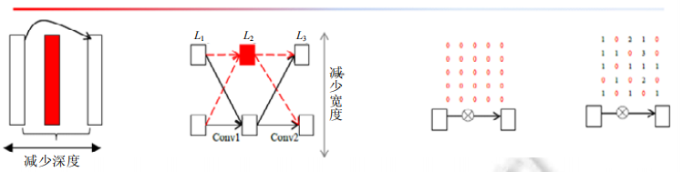

| Độ chi tiết | Đặc điểm |
| --- | --- |
| Từng trọng số | OBD (Optimal Brain Damage) của LeCun (1990) coi mọi trọng số là một tham số riêng; tăng được độ chính xác dự đoán nhưng không giảm được thời gian chạy; chi phí cắt tỉa quá cao, chỉ hợp với mạng nhỏ. |
| Bên trong kernel | mọi trọng số coi là tham số riêng và cắt ngẫu nhiên, không cấu trúc; kết nối trở nên không đều, cần biểu diễn thưa để giảm bộ nhớ, dẫn tới khi suy luận cần nhiều phép rẽ nhánh và bộ nhớ phụ để đánh dấu vị trí tham số khác 0, nên không hợp với tính toán song song. |
| Kernel và kênh | là cắt tỉa thô, không cần thư viện tích chập thưa hay phần cứng riêng; vừa đạt tỉ lệ nén cao vừa giảm mạnh thời gian suy luận. |

> **Biên tập:** dòng cuối của bảng trong bản gốc bị cắt giữa chừng ("由" ở cuối câu).

Theo mục tiêu, cắt tỉa có thể nhằm: giảm tham số và độ phức tạp mạng; giảm quá khớp, tăng khả năng tổng quát hóa và độ chính xác; giảm thời gian chạy khi triển khai, tăng hiệu suất; giảm thời gian huấn luyện.

### 17.4.3 So sánh một số phương pháp cắt tỉa tiêu biểu

| Phương pháp | Đối tượng cắt | Cách cắt | Hiệu quả |
| --- | --- | --- | --- |
| Deep Compression | trọng số | cắt theo độ lớn trọng số, rồi lượng tử hóa và mã hóa Huffman | nén 35–49 lần |
| Structured Sparsity Learning | trọng số | thưa theo nhóm (group lasso) | tăng tốc thực tế trên CPU/GPU |
| Network Slimming | kênh của bản đồ đặc trưng | cắt theo hệ số co giãn $\gamma$ của BN | tiết kiệm tài nguyên tính toán |
| meProp | gradient | chỉ giữ $k$ thành phần gradient lớn nhất khi lan truyền ngược | tăng tốc huấn luyện |

> **Biên tập:** sửa so với bản gốc: (1) Deep Compression (Han, Mao, Dally 2016) không "cắt ngẫu nhiên" mà cắt các trọng số có **độ lớn nhỏ**, rồi lượng tử hóa bằng chia sẻ trọng số và mã hóa Huffman; nén AlexNet 35 lần (240 MB → 6,9 MB), VGG-16 49 lần, không mất độ chính xác. (2) Dòng "Structured Pruning: thưa nhóm + thưa loại trừ" trong bản gốc ứng với các công trình học cấu trúc thưa (như SSL, Wen và cộng sự 2016); "hiệu năng tăng" chưa rõ nghĩa, nên ghi theo kết quả chính của SSL. (3) "mProp" đúng tên là **meProp** (Sun và cộng sự 2017), là phương pháp tăng tốc **huấn luyện**, không phải nén mô hình.

### 17.4.4 Chưng cất mạng (network distillation)

<div class="qa-theory">

**Lý thuyết:** [Ôn tập · 11.1.1 Học chuyển giao là gì?](qa/ch11_vi?id=_1111-học-chuyển-giao-là-gì)

</div>

Chưng cất mạng là dùng một lượng lớn dữ liệu chuyển giao (transfer data) không nhãn để cho mô hình nhỏ khớp theo mô hình lớn, nhờ đó mô hình nhỏ học được ánh xạ hàm gần giống mô hình lớn. Chưng cất có thể xem là một trường hợp riêng của học chuyển giao trên cùng một miền, mục đích là có một mạng tinh gọn hơn mạng ban đầu; khung tổng thể như hình dưới.

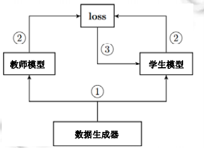

### 17.4.5 Nén phía trước

<div class="qa-theory">

**Lý thuyết:** [Ôn tập · 17.4.4 Chưng cất mạng (network distillation)](qa/ch17_vi?id=_1744-chưng-cất-mạng-network-distillation) · [Ôn tập · 17.9 Các mạng nhẹ thường dùng là những mạng nào?](qa/ch17_vi?id=_179-các-mạng-nhẹ-thường-dùng-là-những-mạng-nào)

</div>

**(1) Chưng cất tri thức**

Một mô hình phức tạp có thể được huấn luyện từ nhiều mô hình đơn giản hoặc với các ràng buộc mạnh. Mô hình phức tạp có hiệu năng tốt nhưng nhiều tham số, tính toán kém hiệu quả; mô hình nhỏ tính nhanh nhưng hiệu năng kém hơn. Chưng cất tri thức chuyển tri thức mà mô hình phức tạp học được sang mô hình nhỏ, để mô hình nhỏ giữ tốc độ tính nhanh mà vẫn có hiệu năng gần mô hình phức tạp, đạt mục đích nén mô hình.

> **Biên tập:** bản gốc không nêu công thức. Dạng chuẩn của Hinton, Vinyals và Dean (2015) *Distilling the Knowledge in a Neural Network*: mô hình thầy và trò cho logit $z^t, z^s$; làm mềm bằng nhiệt độ $T>1$: $p_i = \dfrac{\exp(z_i/T)}{\sum_j \exp(z_j/T)}$. Mất mát của trò kết hợp khớp phân phối mềm của thầy và nhãn thật:
>
> $$\mathcal L = \alpha\, T^2\, \mathrm{KL}\big(p^t_T \,\|\, p^s_T\big) + (1-\alpha)\, \mathrm{CE}\big(y, \mathrm{softmax}(z^s)\big).$$
>
> Phân phối mềm mang "tri thức tối" (dark knowledge): thầy cho biết ảnh chó giống mèo hơn giống ô tô, thông tin mà nhãn one-hot không có. Nhân $T^2$ vì gradient của phần mềm co lại theo $1/T^2$. Cài đặt bằng PyTorch (đã chạy thử):
>
> ```python
> import torch.nn.functional as F
>
> def kd_loss(s_logits, t_logits, y, T=4.0, alpha=0.9):
>     soft = F.kl_div(F.log_softmax(s_logits / T, dim=1),
>                     F.softmax(t_logits / T, dim=1),
>                     reduction="batchmean") * T * T     # nhân T^2 để giữ độ lớn gradient
>     hard = F.cross_entropy(s_logits, y)
>     return alpha * soft + (1 - alpha) * hard
> ```

**(2) Thiết kế cấu trúc mô hình gọn**

Thiết kế cấu trúc gọn chủ yếu là cải tiến cách tích chập, như dùng hai tích chập $3\times3$ thay một tích chập $5\times5$, dùng tích chập tách được theo chiều sâu (depthwise separable)…, để giảm lượng tính toán và tham số. Nhiều mạng hiện nay thiết kế theo mô-đun, lớn cả theo chiều sâu lẫn chiều rộng, dẫn tới dư thừa tham số. Vì vậy có nhiều nghiên cứu về thiết kế mô hình như SqueezeNet, MobileNet…, dùng thiết kế tinh tế, hiệu quả hơn, giảm mạnh kích thước mô hình mà vẫn có hiệu năng tốt (xem 17.8, 17.9).

**(3) Cắt tỉa ở mức bộ lọc**

Cắt tỉa ở mức bộ lọc là bỏ hẳn những bộ lọc (ma trận trọng số) có trọng số nhỏ, rồi tinh chỉnh lại cả mạng. Cách làm cụ thể: khi huấn luyện, thêm ràng buộc thưa (số hạng chính quy hóa thưa trên trọng số, đẩy phần lớn trọng số về gần 0); huấn luyện xong thì cắt bỏ các bộ lọc gần như bằng 0.

> **Biên tập:** bản gốc viết "cắt tỉa ở mức bộ lọc thuộc loại cắt tỉa **không cấu trúc**", rồi kết luận "ưu điểm là đơn giản, nhược điểm là cắt không sạch, cắt tỉa không cấu trúc làm tăng chi phí truy cập bộ nhớ". Hai câu này lẫn lộn hai kỹ thuật. Cắt cả bộ lọc là cắt tỉa **có cấu trúc** (xem 17.4.2): mạng sau khi cắt vẫn là mạng dày đặc với ít kênh hơn, nên tăng tốc được ngay trên mọi framework; nhược điểm thật của nó là cắt thô nên dễ mất độ chính xác nhiều hơn, cần tinh chỉnh lại. Còn "cắt không sạch, tăng chi phí truy cập bộ nhớ" là nhược điểm của cắt tỉa **không cấu trúc** từng trọng số. Để chọn bộ lọc cần cắt, thường dùng chuẩn L1 của bộ lọc (Li và cộng sự 2017, *Pruning Filters for Efficient ConvNets*) hoặc hệ số $\gamma$ của BN (Network Slimming).

### 17.4.6 Nén phía sau

<div class="qa-theory">

**Lý thuyết:** [Ôn tập · 17.4.6b Phân rã hạng thấp](qa/ch17_vi?id=_1746b-phân-rã-hạng-thấp) · [PyTorch (tiếng Anh) · Lượng tử hóa](https://pytorch.org/docs/stable/quantization.html) ↗

</div>

**(1) Xấp xỉ hạng thấp**

Trong mạng neuron tích chập, phép tích chập được thực hiện dưới dạng nhân ma trận. Với mạng phức tạp, ma trận trọng số thường rất lớn, tốn nhiều bộ nhớ và tính toán. Xấp xỉ hạng thấp dùng tổ hợp vài ma trận hạng thấp để tái tạo ma trận trọng số lớn, nhờ đó giảm bộ nhớ và tính toán.

| | Đặc điểm |
| --- | --- |
| Ưu điểm | giảm bộ nhớ và tính toán; thường nén được 2–3 lần; độ chính xác gần như không giảm |
| Nhược điểm | mô hình càng phức tạp, ma trận trọng số càng lớn, tái tạo bằng xấp xỉ hạng thấp không đảm bảo giữ hiệu năng; số siêu tham số (như số kênh của tầng trung gian) tăng tuyến tính theo số tầng; khi mô hình phức tạp hơn, không gian tìm kiếm tăng vọt |

**(2) Cắt tỉa không ràng buộc**

Huấn luyện xong, cắt bỏ không ràng buộc các tham số dư thừa.

| | Đặc điểm |
| --- | --- |
| Ưu điểm | giữ nguyên hiệu năng mà giảm số tham số 9–11 lần (Han và cộng sự 2015: AlexNet 9 lần, VGG-16 13 lần); bỏ trọng số không quan trọng có thể tăng tốc tính toán và tăng khả năng tổng quát hóa |
| Nhược điểm | phụ thuộc nặng vào thư viện và nền tảng chạy chuyên dụng, không có tính phổ quát; tỉ lệ nén quá lớn sẽ làm hỏng hiệu năng |

**(3) Lượng tử hóa tham số**

Tham số của mạng neuron thường là số dấu phẩy động 32 bit; lượng tử hóa dùng độ chính xác thấp hơn để biểu diễn chúng. Hoặc ánh xạ nhiều trọng số về cùng một giá trị, tức chia sẻ trọng số. **Lượng tử hóa thực chất là một chiến lược chia sẻ trọng số.** Tensor trọng số sau lượng tử hóa là một ma trận rất thưa (sau cắt tỉa) với nhiều trọng số dùng chung; với các tham số khác 0 còn có thể nén thêm bằng số dấu phẩy tĩnh để đạt tỉ lệ nén cao hơn.

| | Đặc điểm |
| --- | --- |
| Ưu điểm | hiệu năng giảm rất ít, kích thước giảm 8–16 lần |
| Nhược điểm | tỉ lệ nén lớn thì hiệu năng giảm rõ; phụ thuộc thư viện chuyên dụng, tính phổ quát kém |
| Ví dụ | mạng nhị phân: XNOR-Net (Rastegari 2016), ABC-Net với nhiều cơ sở nhị phân (Lin 2017), HORQ – lượng tử hóa phần dư bậc cao (Li 2017), Bi-Real Net (Liu 2018); mạng tam phân: Ternary Weight Networks (Li 2016), Trained Ternary Quantization (Zhu 2017); lượng tử hóa W1-A8 hoặc W2-A8: Learning Symmetric Quantization (Faraone 2018); lượng tử hóa INT8: TensorFlow Lite, TensorRT; phi tuyến khác: INQ của Intel (Zhou 2017), LogNet, CNNPack (Wang 2016) |
| Tổng kết | tiêu biểu nhất là mạng nhị phân, XNOR-Net…: dùng 1 bit để mã hóa đầu vào, trọng số và đầu ra của mạng. Vừa giảm kích thước mô hình, vừa thay được phép tích chập bằng các phép toán bit, tăng tốc rất nhiều. Nhưng nếu mạng gốc chưa đủ phức tạp (năng lực biểu diễn), mạng nhị phân sẽ giảm khá nhiều năng lực biểu diễn. Vì vậy hiện có các nghiên cứu mã hóa $n$ bit (mạng $n$ giá trị, đa giá trị), số bit thay đổi hoặc tổ hợp bit để khắc phục điểm yếu này. |

> **Biên tập:** "kích thước giảm 8–16 lần" chỉ đúng khi kết hợp lượng tử hóa với cắt tỉa và mã hóa (như Deep Compression); lượng tử hóa INT8 thuần túy giảm đúng 4 lần so với FP32, INT4 giảm 8 lần. Hiện nay lượng tử hóa INT8 sau huấn luyện (post-training quantization) được mọi công cụ triển khai hỗ trợ (TensorRT, LiteRT, ONNX Runtime, OpenVINO, Core ML), nên "phụ thuộc thư viện chuyên dụng" không còn là nhược điểm lớn với INT8. Với mô hình ngôn ngữ lớn, lượng tử hóa trọng số 4 bit (GPTQ, AWQ, định dạng GGUF của llama.cpp) là cách phổ biến để chạy mô hình hàng chục tỉ tham số trên một GPU tiêu dùng. Ví dụ lượng tử hóa động bằng PyTorch (đã chạy thử, mô hình hai tầng Linear $1024\to1024\to10$ giảm từ 4,24 MB xuống 1,07 MB; lưu ý API `torch.ao.quantization` đang được chuyển sang thư viện `torchao`):
>
> ```python
> q = torch.ao.quantization.quantize_dynamic(model, {nn.Linear}, dtype=torch.qint8)
> ```

**(4) Mạng nhị phân**

Cực đoan hơn lượng tử hóa: số dấu phẩy động 32 bit được biểu diễn bằng 1 bit nhị phân, $-1$ hoặc $1$, giảm rất mạnh kích thước mô hình.

| | Đặc điểm |
| --- | --- |
| Ưu điểm | mạng nhỏ, tính nhanh, đôi khi tránh được quá khớp ở một phần mạng |
| Nhược điểm | thông tin mất đi so với số dấu phẩy động rất lớn; xấp xỉ nhị phân thô làm mô hình hội tụ rất chậm khi huấn luyện |

**(5) Mạng tam phân**

| | Đặc điểm |
| --- | --- |
| Ưu điểm | so với mạng nhị phân, mạng tam phân (Ternary Weight Networks, trọng số thuộc $\{-1, 0, +1\}$) có năng lực biểu diễn cao hơn nhiều với cùng cấu trúc, mà độ phức tạp tính toán như nhau. Ví dụ với kernel $3\times3$ hay gặp nhất trong ResNet-18, mạng nhị phân biểu diễn được tối đa $2^{3\times3}=512$ dạng kernel, còn mạng tam phân biểu diễn được $3^{3\times3}=19683$ dạng, gấp $19683/512\approx38$ lần. Vì vậy mạng tam phân tăng mạnh năng lực biểu diễn mà vẫn giữ độ phức tạp tính toán thấp, độ chính xác cải thiện rõ so với mạng nhị phân. Ngoài ra, vì giữ được nhiều thông tin trung gian hơn, mạng tam phân hội tụ nhanh hơn nhiều khi huấn luyện, đạt kết quả tốt nhất nhanh và ổn định hơn. |

> **Biên tập:** bản gốc viết năng lực biểu diễn "tăng hàng trăm, hàng nghìn lần", rồi chính nó tính ra 38 lần; đã bỏ câu phóng đại.

### 17.4.6b Phân rã hạng thấp

<div class="qa-theory">

**Lý thuyết:** [Ôn tập · 17.4.6 Nén phía sau](qa/ch17_vi?id=_1746-nén-phía-sau)

</div>

Ý tưởng cốt lõi của nén và tăng tốc mạng sâu bằng phân rã hạng thấp là dùng kỹ thuật phân rã ma trận hoặc tensor để ước lượng và phân rã các kernel tích chập ban đầu trong mô hình sâu. Tích chập là phép toán có độ phức tạp tính toán cao nhất trong cả mạng neuron tích chập; phân rã tensor kernel 4 chiều giảm được đáng kể tính dư thừa bên trong mô hình. Với ma trận tham số 2 chiều của tầng kết nối đầy đủ, cũng có thể dùng phân rã hạng thấp. Vì cách phân rã tầng tích chập và tầng kết nối đầy đủ khác nhau, bài tổng quan gốc xem xét riêng hai trường hợp.

Năm 2013, Denil và cộng sự lần đầu dùng phân rã hạng thấp để phân tích về mặt lý thuyết rằng mạng sâu có rất nhiều thông tin dư thừa, mở ra hướng nén và tăng tốc mạng sâu dựa trên phân rã hạng thấp. Hình dưới minh họa tích chập sau các phép phân rã tensor phổ biến.

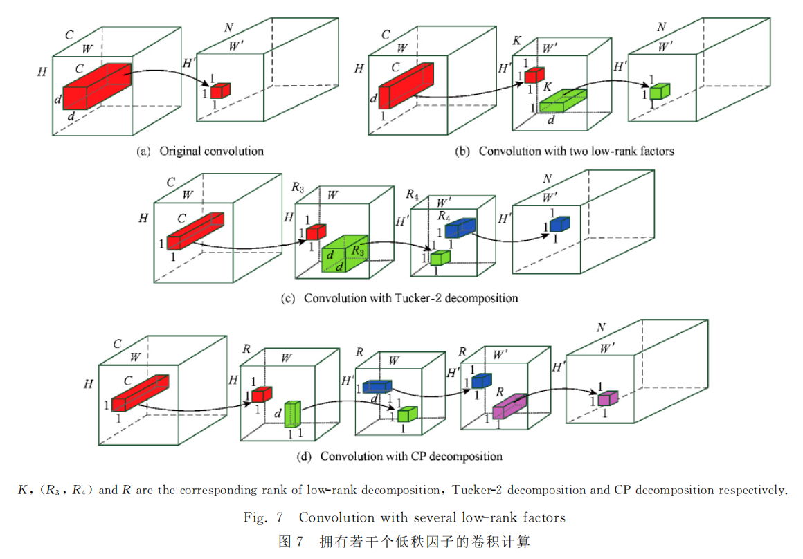

> **Biên tập:** ví dụ đơn giản nhất cho tầng kết nối đầy đủ: thay ma trận $W\in\mathbb R^{m\times n}$ bằng tích $UV$ với $U\in\mathbb R^{m\times r}$, $V\in\mathbb R^{r\times n}$ (lấy từ SVD rút gọn), số tham số giảm từ $mn$ xuống $r(m+n)$; với $m=n=4096$, $r=256$ là giảm 8 lần. Cách này về sau được dùng rộng rãi theo hướng khác: **LoRA** (Hu và cộng sự 2021) giữ nguyên trọng số gốc, chỉ học một cập nhật hạng thấp $\Delta W = BA$ khi tinh chỉnh mô hình ngôn ngữ lớn.

### 17.4.7 Có những chỉ số nào để đánh giá hiệu quả nén tổng thể?

<div class="qa-theory">

**Lý thuyết:** [Ôn tập · 17.6 Bốn yếu tố ảnh hưởng tới tốc độ mạng neuron](qa/ch17_vi?id=_176-bốn-yếu-tố-ảnh-hưởng-tới-tốc-độ-mạng-neuron)

</div>

Các chỉ số đánh giá nén mạng gồm hiệu suất chạy, tỉ lệ nén tham số và độ chính xác. Khi so với mô hình gốc để đo mức cải thiện, có thể dùng số lần tăng (speedup) hoặc tỉ lệ tăng (ratio).

| Chỉ số | Đặc điểm |
| --- | --- |
| Độ chính xác | hiện đa số nghiên cứu đo độ chính xác Top-1; chỉ trên tập dữ liệu lớn như ImageNet mới dùng thêm Top-5 để tiện so sánh. |
| Tỉ lệ nén tham số | đếm mọi tham số huấn luyện được, đổi sang đơn vị byte theo độ chính xác số dấu phẩy động của máy, thường giữ hai chữ số có nghĩa để ước lượng gần đúng. |
| Hiệu suất chạy | đánh giá theo 3 góc: số phép tính dấu phẩy động (FLOP), số phép nhân (MULTS), hoặc thời gian trung bình một lần lan truyền xuôi đo bằng thực nghiệm. |

> **Biên tập:** FLOP và tốc độ thực tế có thể lệch nhau nhiều (xem 17.6 và 17.8.3–17.8.6); nên luôn đo độ trễ thực tế trên đúng thiết bị đích, kèm điều kiện đo (batch, số luồng, độ chính xác số).

### 17.4.8 So sánh một số cấu trúc mạng nhẹ

<div class="qa-theory">

**Lý thuyết:** [Ôn tập · 17.9.2 MobileNet](qa/ch17_vi?id=_1792-mobilenet) · [Ôn tập · 17.9.3 MobileNet-v2](qa/ch17_vi?id=_1793-mobilenet-v2) · [Ôn tập · 17.9.5 ShuffleNet-v1](qa/ch17_vi?id=_1795-shufflenet-v1)

</div>

| Mạng | Độ chính xác Top-1 (%) | Số tham số (triệu) | Thời gian chạy CPU (ms) |
| --- | --- | --- | --- |
| MobileNet V1 | 70,6 | 4,2 | 123 |
| ShuffleNet (1,5) | 69,0 | 2,9 | - |
| ShuffleNet (x2) | 70,9 | 4,4 | - |
| MobileNet V2 | 71,7 | 3,4 | 80 |
| MobileNet V2 (1,4) | 74,7 | 6,9 | 149 |

> **Biên tập:** bảng lấy từ bản arXiv đầu tiên của bài MobileNetV2 (ImageNet, đo trên một lõi của điện thoại Google Pixel 1 với TensorFlow Lite); bản đăng hội nghị CVPR 2018 ghi MobileNetV2 72,0% và thời gian 113/75/143 ms. Các mạng nhẹ ra sau như MobileNetV3 (2019), EfficientNet (2019), MobileViT (2021), MobileNetV4 (2024) đạt độ chính xác cao hơn với cùng chi phí.

### 17.4.9 Nén mạng có những hướng nghiên cứu nào trong tương lai?

<div class="qa-theory">

**Lý thuyết:** [Ôn tập · 14.6.3 Tìm kiếm kiến trúc mạng neuron (NAS) là gì?](qa/ch14_vi?id=_1463-tìm-kiếm-kiến-trúc-mạng-neuron-nas-là-gì)

</div>

Cắt tỉa, chưng cất và phân rã mạng đều đạt được mục đích nén ở một mức độ nào đó. Quay về bản chất của nén mạng sâu, tức trích lấy thông tin hữu ích trong mạng, dưới đây là một số hướng đáng nghiên cứu:

1. **Đo ảnh hưởng của trọng số lên kết quả.** Kết quả cuối của mạng sâu do mọi trọng số cùng tạo nên; hiện cách đo mức quan trọng của từng kernel hay từng trọng số vẫn còn khá đơn giản. Đã có công trình phân tích chi tiết hơn, nhưng tính toán quá nặng nên không thực tế. Vì vậy tìm cách xấp xỉ hiệu quả hơn ảnh hưởng của từng tham số lên mô hình là rất quan trọng.
2. **Xây dựng cấu trúc mạng trò.** Cấu trúc mạng trò hiện vẫn do người chỉ định; nhưng các cấu trúc khác nhau có độ khó huấn luyện khác nhau, kết quả đạt được cũng khác nhau. Vì vậy thiết kế cấu trúc hợp lý theo mạng thầy để có hiệu năng cao với mô hình tinh gọn là trọng tâm nghiên cứu tương lai.
3. **Phần cứng hỗ trợ tái tạo tham số.** Phân rã mạng có thể cho mô hình nén không mất mát, rất quan trọng trong các tình huống đòi hỏi hiệu năng cao. Nhưng bước tái tạo tham số làm tăng thời gian suy luận; tăng tốc bước này bằng phần cứng là một hướng nghiên cứu.
4. **Nén ở mức bài toán hoặc tình huống sử dụng.** Mạng lớn thường huấn luyện trên tập dữ liệu rất lớn, ví dụ mô hình trên ImageNet phân loại được 1000 lớp, nhưng trong ứng dụng cụ thể có khi chỉ cần một mô hình nhỏ nhận ra vài lớp trong số đó. Vì vậy nén một mạng đầy đủ chức năng thành mạng con có một phần chức năng sẽ đáp ứng được nhu cầu của nhiều ứng dụng thực tế.
5. **Đánh giá hiệu quả nén.** Hiện việc đánh giá các thuật toán nén khá rời rạc, chủ yếu so số tham số và thời gian chạy với mạng lớn bị nén. Nghiên cứu sau này có thể đề xuất tiêu chuẩn đánh giá tổng quát hơn: một mặt cân bằng ảnh hưởng của tốc độ và kích thước mô hình trong các tình huống khác nhau; mặt khác đánh giá mô hình sau nén dựa trên chính cấu trúc của nó.

(Nguồn: *Tổng quan về nén mô hình mạng sâu*)

> **Biên tập:** nhìn từ 2025, hướng 2 phần lớn được giải quyết bằng **tìm kiếm kiến trúc mạng (NAS)** có tính tới độ trễ trên thiết bị (MnasNet, Once-for-All, MobileNetV3); hướng 5 có các bộ đo chuẩn như MLPerf Inference/Mobile. Hướng mới nổi bật là nén mô hình ngôn ngữ lớn: lượng tử hóa 4 bit và thấp hơn, cắt tỉa có cấu trúc 2:4 được Tensor Core từ Ampere hỗ trợ, chưng cất từ mô hình lớn sang mô hình nhỏ, giải mã suy đoán (speculative decoding) để tăng tốc sinh.

## 17.5 Hiện có những phương pháp tối ưu, tăng tốc mô hình học sâu nào?

<div class="qa-theory">

**Lý thuyết:** [Ôn tập · 15.8.4 Tối ưu hiệu năng hơn nữa thế nào?](qa/ch15_vi?id=_1584-tối-ưu-hiệu-năng-hơn-nữa-thế-nào)

</div>

### 17.5.1 Các phương pháp tối ưu, tăng tốc mô hình

<div class="qa-theory">

**Lý thuyết:** [Ôn tập · 15.4.2 cuDNN](qa/ch15_vi?id=_1542-cudnn)

</div>

Tối ưu và tăng tốc mô hình giúp tăng hiệu suất tính toán của mạng, cụ thể gồm:

1. thuật toán nhanh ở mức phép toán: tích chập 2D bằng FFT (cho kernel $7\times7$, $9\times9$), tích chập 2D bằng Winograd (cho kernel $3\times3$, $5\times5$)…;
2. thuật toán nhanh ở mức tầng: Sparse-block net (SBNet, Ren và cộng sự 2018)…;
3. công cụ và thư viện tối ưu: TensorRT (NVIDIA), Tensor Comprehensions (Facebook), Distiller (Intel)…

> **Biên tập:** Tensor Comprehensions và Distiller đã ngừng phát triển. Công cụ tương ứng hiện nay: TensorRT, `torch.compile`, TVM, OpenVINO; thư viện nén như NVIDIA Model Optimizer, Intel Neural Compressor, `torchao`.

### 17.5.2 Nguyên lý tăng tốc của TensorRT

<div class="qa-theory">

**Lý thuyết:** [Ôn tập · 15.7.3 Những framework nào thân thiện với môi trường triển khai?](qa/ch15_vi?id=_1573-những-framework-nào-thân-thiện-với-môi-trường-triển-khai)

</div>

TensorRT tăng tốc suy luận mạng neuron, kể cả trên thiết bị nhúng tài nguyên tính toán hạn chế, chủ yếu nhờ hai điểm:

- Thứ nhất, TensorRT hỗ trợ tính bằng INT8 và FP16, tìm được điểm cân bằng tốt giữa giảm lượng tính toán và giữ độ chính xác, nhờ đó tăng tốc suy luận.
- Quan trọng hơn, TensorRT tái cấu trúc và tối ưu cấu trúc mạng, thể hiện ở các mặt sau:
  1. phân tích mô hình và loại bỏ các tầng đầu ra không dùng tới để giảm tính toán;
  2. **gộp theo chiều dọc**: gộp ba tầng Conv, BN, ReLU của các mạng phổ biến thành một tầng, ví dụ tái cấu trúc khối Inception thường gặp ở hình 1 thành cấu trúc ở hình 2;
  3. **gộp theo chiều ngang**: gộp các tầng có cùng tensor đầu vào và cùng phép toán thành một, ví dụ chuyển từ hình 2 sang hình 3.

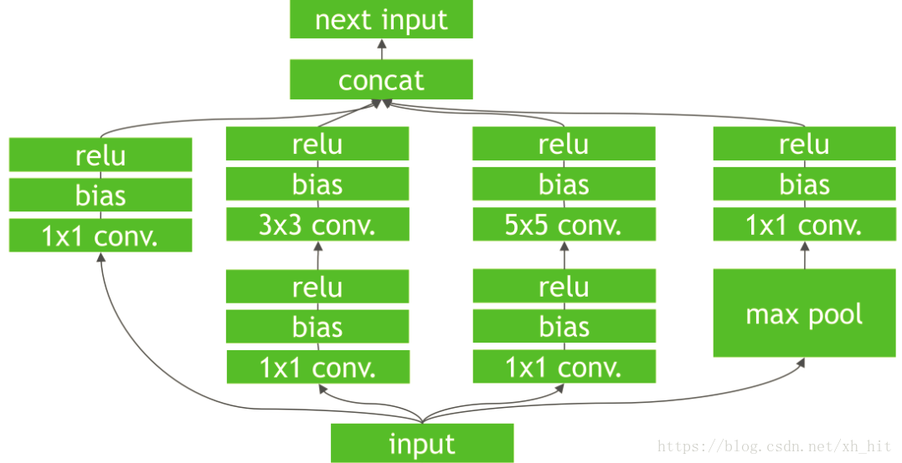

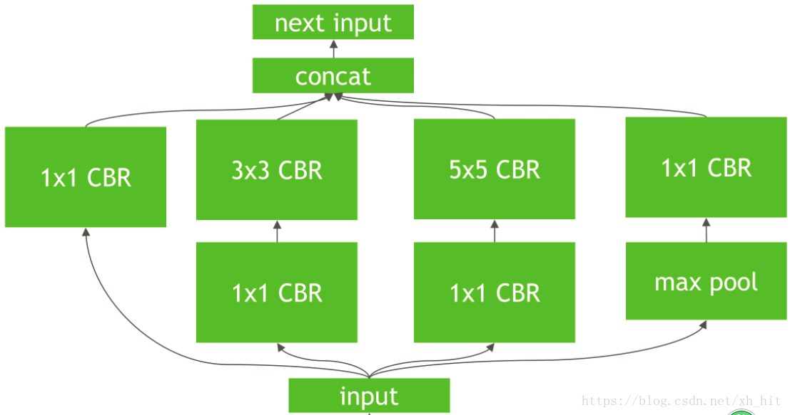

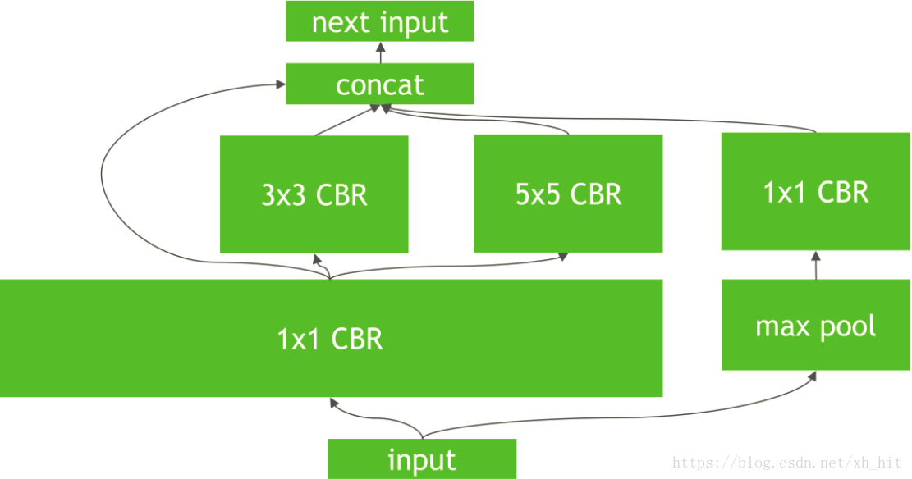

Ba bước trên là cách TensorRT tối ưu và tái cấu trúc mạng được triển khai. Theo chiến lược này, bước một và bước hai áp dụng cho mọi kiến trúc, còn bước ba tăng tốc rõ nhất với mạng có cấu trúc Inception.

Mẹo (theo bản gốc): để tận dụng TensorRT tốt hơn, có thể dùng nhiều cấu trúc Inception trong mạng nền.

> **Biên tập:** "mẹo" trên không nên làm theo: chọn kiến trúc nên theo độ chính xác và độ trễ đo thực tế, không theo việc một bước tối ưu nào đó có tác dụng nhiều hơn. Ngoài gộp tầng, TensorRT còn: tự chọn kernel nhanh nhất cho từng tầng trên đúng GPU đích (kernel auto-tuning), tái sử dụng bộ nhớ của tensor trung gian, chạy nhiều luồng song song. Hiệu chỉnh INT8 cần một tập dữ liệu hiệu chỉnh nhỏ để xác định khoảng giá trị của activation. Cách dùng phổ biến hiện nay: xuất mô hình sang ONNX rồi dựng engine bằng `trtexec --onnx=model.onnx --fp16`, hoặc dùng Torch-TensorRT ngay trong PyTorch.

### 17.5.3 TensorRT tối ưu, tái cấu trúc mô hình thế nào?

<div class="qa-theory">

**Lý thuyết:** [Ôn tập · 17.5.2 Nguyên lý tăng tốc của TensorRT](qa/ch17_vi?id=_1752-nguyên-lý-tăng-tốc-của-tensorrt)

</div>

| Điều kiện | Cách làm |
| --- | --- |
| Mô hình chỉ chứa các phép toán TensorRT hỗ trợ | 1. Mô hình huấn luyện bằng Caffe và TensorFlow: TensorRT tối ưu, tái cấu trúc trực tiếp. |
| | 2. Mô hình huấn luyện bằng MXNet, PyTorch hay framework khác: dựng lại cấu trúc mạng bằng TensorRT API rồi tối ưu gián tiếp. |
| Mô hình chứa phép toán TensorRT không hỗ trợ | 1. Mô hình TensorFlow có thể chuyển bằng `tf.contrib.tensorrt`, các phép toán không hỗ trợ được giữ lại làm nút tính của TensorFlow. |
| | 2. Tự cài đặt phép toán không hỗ trợ bằng Plugin API rồi thêm vào đồ thị TensorRT. |
| | 3. Chia mạng làm hai phần: phần chỉ chứa phép toán TensorRT hỗ trợ thì chuyển sang đồ thị TensorRT, phần còn lại chạy bằng framework khác như MXNet hay PyTorch. |

> **Biên tập:** trình phân tích Caffe và UFF (TensorFlow) đã bị bỏ khỏi TensorRT; đường chính hiện nay là **ONNX** (`torch.onnx.export`, `tf2onnx`) cho mọi framework. `tf.contrib` đã bị xóa từ TensorFlow 2; TF-TRT nay nằm ở `tf.experimental.tensorrt`. Với PyTorch có Torch-TensorRT, tự chia đồ thị như cách 3.

### 17.5.4 TensorRT tăng tốc được bao nhiêu?

<div class="qa-theory">

**Lý thuyết:** [Ôn tập · 17.5.2 Nguyên lý tăng tốc của TensorRT](qa/ch17_vi?id=_1752-nguyên-lý-tăng-tốc-của-tensorrt)

</div>

Kết quả tăng tốc của TensorRT với các mạng phân loại lớn trên GPU Titan X (Pascal):

| Mạng | Độ chính xác số | Framework | Thời gian trung bình (batch = 8, ms) | Độ chính xác Top-1 (ImageNet-1k) |
| --- | --- | --- | --- | --- |
| ResNet-50 | FP32 | TensorFlow | 24,1 | 0,7374 |
| ResNet-50 | FP32 | MXNet | 15,7 | 0,7374 |
| ResNet-50 | FP32 | TRT 4.0.1 | 12,1 | 0,7374 |
| ResNet-50 | INT8 | TRT 4.0.1 | 6 | 0,7226 |
| ResNet-101 | FP32 | TensorFlow | 36,7 | 0,7612 |
| ResNet-101 | FP32 | MXNet | 25,8 | 0,7612 |
| ResNet-101 | FP32 | TRT 4.0.1 | 19,3 | 0,7612 |
| ResNet-101 | INT8 | TRT 4.0.1 | 9 | 0,7574 |

> **Biên tập:** bảng ghi GPU là "Titan X (Pascal)" ở câu dẫn và "TitanXP" ở tiêu đề cột; đây là hai card khác nhau (Titan X Pascal 2016 và Titan Xp 2017), bản gốc không nói rõ là card nào. Với ResNet-50, INT8 nhanh hơn TensorFlow FP32 khoảng 4 lần, độ chính xác Top-1 giảm khoảng 1,5 điểm.

## 17.6 Bốn yếu tố ảnh hưởng tới tốc độ mạng neuron

<div class="qa-theory">

**Lý thuyết:** [Ôn tập · 17.9.6 ShuffleNet-v2](qa/ch17_vi?id=_1796-shufflenet-v2)

</div>

1. FLOPs (số phép nhân–cộng mạng thực hiện);
2. MAC (memory access cost, chi phí truy cập bộ nhớ);
3. mức độ song song (mạng song song cao thì tốc độ tăng rõ);
4. nền tảng tính toán (GPU, ARM).

> **Biên tập:** bốn yếu tố này lấy từ bài ShuffleNet V2 (Ma và cộng sự 2018). Bài này viết FLOPs theo nghĩa số phép nhân–cộng; cách đếm FLOP thông dụng khác coi một phép nhân–cộng là 2 FLOP, nên khi so số liệu giữa các bài cần chú ý. Bản gốc ghi tiêu đề "(chi tiết hơn một chút)" nhưng không có thêm chi tiết; phân tích chi tiết ở 17.8.3–17.8.6.

## 17.7 Chọn phương pháp nén và tăng tốc thế nào?

<div class="qa-theory">

**Lý thuyết:** [Ôn tập · 17.4.1 So sánh nén phía trước và nén phía sau](qa/ch17_vi?id=_1741-so-sánh-nén-phía-trước-và-nén-phía-sau)

</div>

1. Với ứng dụng hoặc thiết bị có bộ nhớ khi tính toán hạn chế, có thể chọn chia sẻ tham số và cắt tỉa tham số, đặc biệt là lượng tử hóa nhị phân trọng số và activation, và cắt tỉa có cấu trúc. Các phương pháp khác tuy nén tốt trọng số, nhưng không giảm được bộ nhớ ẩn trong lúc tính (như bản đồ đặc trưng).
2. Nếu mô hình gọn cần dựa vào mô hình huấn luyện sẵn, nên ưu tiên cắt tỉa tham số, chia sẻ tham số và phân rã hạng thấp. Ngược lại, nếu không cần mô hình huấn luyện sẵn, có thể xét thiết kế bộ lọc gọn và chưng cất tri thức.
3. Nếu cần huấn luyện đầu cuối một lần để có mô hình đã nén và tăng tốc, có thể dùng phương pháp dựa trên thiết kế bộ lọc gọn.
4. Nói chung, cắt tỉa tham số, nhất là cắt tỉa không cấu trúc, nén được rất nhiều kích thước mô hình mà không dễ mất độ chính xác phân loại. Với ứng dụng cần phân loại ổn định, cắt tỉa không cấu trúc là lựa chọn hàng đầu.
5. Khi tập dữ liệu nhỏ, có thể xét chưng cất tri thức: với tập ít mẫu, mạng trò tiếp thu tốt tri thức của mạng thầy, tăng khả năng phân biệt.
6. Năm nhóm phương pháp nén và tăng tốc chính trực giao với nhau, có thể kết hợp để nén và tăng tốc thêm. Ví dụ Han Song và cộng sự kết hợp cắt tỉa và chia sẻ tham số; Wen Wei và cộng sự, Alvarez và cộng sự kết hợp cắt tỉa và phân rã hạng thấp. Ngoài ra với từng tình huống cụ thể như phát hiện đối tượng, có thể dùng kỹ thuật nén và tăng tốc khác nhau cho tầng tích chập và tầng kết nối đầy đủ.

(Tham khảo: *Tổng quan về nén và tăng tốc mạng neuron sâu*)

> **Biên tập:** với ý 4 cần nói rõ: cắt tỉa không cấu trúc giảm **kích thước lưu trữ** nhưng thường **không tăng tốc** trên phần cứng thông thường (xem 17.4.2); nếu mục tiêu là độ trễ thì nên ưu tiên cắt tỉa có cấu trúc, lượng tử hóa INT8 và kiến trúc gọn. Quy trình thực tế hay dùng nhất hiện nay: chọn sẵn một kiến trúc nhẹ → lượng tử hóa INT8 sau huấn luyện → nếu mất độ chính xác nhiều thì huấn luyện có nhận biết lượng tử hóa (QAT) hoặc chưng cất.

## 17.8 Vì sao thay đổi thiết kế cấu trúc mạng lại nén, tăng tốc được mô hình?

### 17.8.1 Tích chập nhóm (group convolution)

<div class="qa-theory">

**Lý thuyết:** [d2l (tiếng Anh) · 8.6 ResNet và ResNeXt](https://d2l.ai/chapter_convolutional-modern/resnet.html) ↗ · [Ôn tập · 4.2 AlexNet](qa/ch04_vi?id=_42-alexnet)

</div>

Tích chập nhóm xuất hiện lần đầu trong AlexNet, để giải quyết việc bộ nhớ một GPU không đủ, phải chia mạng ra nhiều GPU để huấn luyện. Tích chập nhóm giảm số tham số của một tầng tích chập còn $1/g$. Tính thế nào?

Giả sử:

- đặc trưng đầu vào có kích thước $H\times W\times c_1$;
- kernel tích chập có kích thước $h_1\times w_1\times c_1$, gồm $c_2$ kernel;
- đặc trưng đầu ra có kích thước $H_1\times W_1\times c_2$.

Tích chập thông thường như hình dưới:

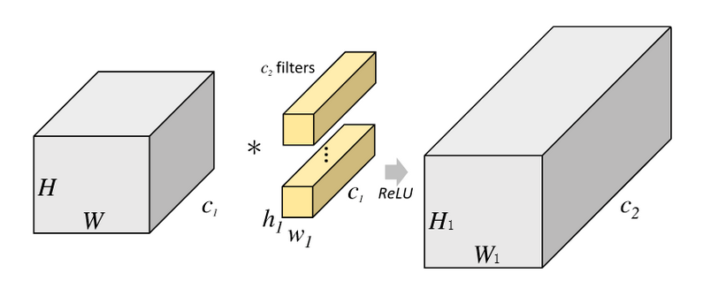

Lượng tính toán của tích chập thông thường (lấy $H_1=H$, $W_1=W$ để đơn giản):

$$A = H\cdot W\cdot h_1\cdot w_1\cdot c_1\cdot c_2.$$

Tích chập nhóm chia $c_1$ kênh đầu vào thành $g$ phần, mỗi nhóm có $c_1/g$ kênh, đặc trưng kích thước $H\times W\times c_1/g$; kernel của mỗi nhóm cũng đổi thành $h_1\times w_1\times c_1/g$, gồm $c_2/g$ kernel; các nhóm tính độc lập, cuối cùng ghép kết quả lại.

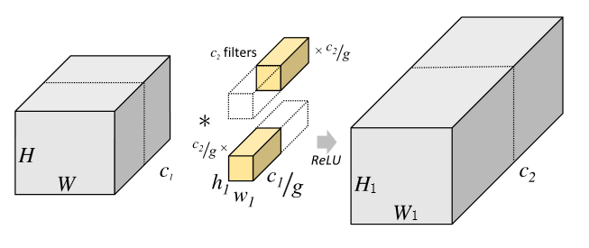

Lượng tính toán của tích chập nhóm:

$$B = H\cdot W\cdot h_1\cdot w_1\cdot \frac{c_1}{g}\cdot\frac{c_2}{g}\cdot g.$$

Tỉ lệ so với tích chập thông thường:

$$\frac{B}{A} = \frac{H\cdot W\cdot h_1\cdot w_1\cdot \frac{c_1}{g}\cdot\frac{c_2}{g}\cdot g}{H\cdot W\cdot h_1\cdot w_1\cdot c_1\cdot c_2} = \frac{1}{g}.$$

Vậy tích chập nhóm có lượng tính toán (và số tham số) bằng $1/g$ tích chập thông thường.

> **Biên tập:** bản gốc ghi kích thước kernel của mỗi nhóm là "$h_1\times w_1\times c_1/9$" (gõ nhầm $g$ thành 9), ghi đầu ra là $H_1\times W_1$ nhưng công thức lại dùng $H\times W$, và kết luận "giảm $1/g$" (đúng phải là "còn $1/g$", tức giảm $g$ lần).

### 17.8.2 Tích chập tách được theo chiều sâu (depthwise separable convolution)

<div class="qa-theory">

**Lý thuyết:** [Ôn tập · 5.13 Khi tích chập, có bắt buộc xét cùng lúc kênh và vùng không gian không?](qa/ch05_vi?id=_513-khi-tích-chập-có-bắt-buộc-xét-cùng-lúc-kênh-và-vùng-không-gian-không) · [Ôn tập · 5.8 Tích chập $1\times1$ có tác dụng gì?](qa/ch05_vi?id=_58-tích-chập-1×11times11×1-có-tác-dụng-gì)

</div>

Tích chập tách được theo chiều sâu gồm tích chập theo chiều sâu (depthwise, DW) và tích chập điểm (pointwise, PW).

Tích chập DW giảm hiệu quả số tham số và tăng tốc độ tính. Nhưng vì mỗi bản đồ đặc trưng chỉ được một kernel tích chập, bản đồ đặc trưng đầu ra của DW không chứa thông tin từ các kênh khác của đầu vào, và thông tin giữa các kênh không trao đổi được, gây ra "dòng thông tin bị tắc".

Tích chập PW thực hiện việc trao đổi thông tin giữa các kênh, giải quyết vấn đề "dòng thông tin bị tắc" do DW gây ra.

Giả sử đặc trưng đầu vào có kích thước $H\times W\times c_1$; kernel $h_1\times w_1\times c_1$, gồm $c_2$ kernel; đặc trưng đầu ra $H_1\times W_1\times c_2$.

Tích chập thông thường như hình dưới:

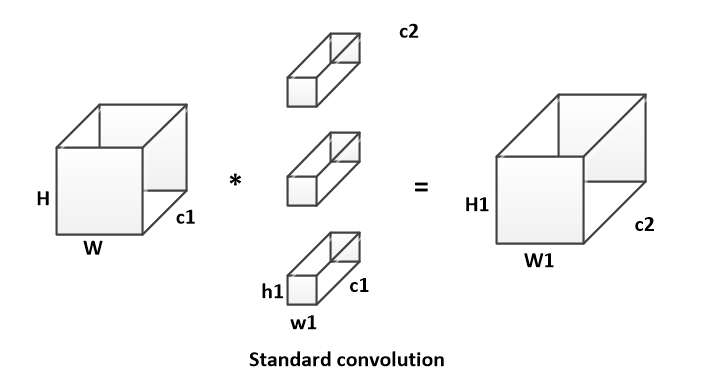

Lượng tính toán:

$$A = H\cdot W\cdot h_1\cdot w_1\cdot c_1\cdot c_2.$$

Tích chập DW:

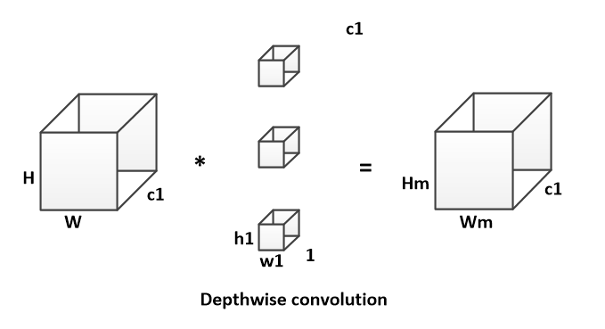

Lượng tính toán của DW:

$$B_{DW} = H\cdot W\cdot h_1\cdot w_1\cdot 1\cdot c_1.$$

Tích chập PW:

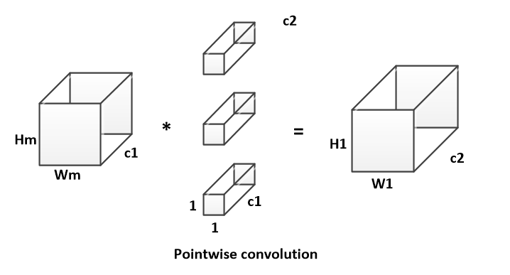

$$B_{PW} = H_m\cdot W_m\cdot 1\cdot 1\cdot c_1\cdot c_2.$$

Tổng lượng tính toán của tích chập tách được:

$$B = B_{DW} + B_{PW}.$$

Tỉ lệ so với tích chập thông thường (với $H_m=H$, $W_m=W$):

$$\frac{B}{A} = \frac{H\cdot W\cdot h_1\cdot w_1\cdot c_1 + H\cdot W\cdot c_1\cdot c_2}{H\cdot W\cdot h_1\cdot w_1\cdot c_1\cdot c_2} = \frac{1}{c_2} + \frac{1}{h_1\cdot w_1}.$$

Vậy số kênh càng nhiều, tích chập tách được càng tiết kiệm so với tích chập thông thường.

> **Biên tập:** với kernel $3\times3$ và $c_2=256$, tỉ lệ là $1/256+1/9\approx0{,}115$, tức ít hơn khoảng 8,7 lần; khi $c_2$ lớn, tỉ lệ tiến về $1/(h_1 w_1)$ nên với kernel $3\times3$ không giảm được quá 9 lần. Bản gốc viết "đầu ra của DW **không chỉ** chứa toàn bộ thông tin" (不能只包含), sai chữ; ý đúng là **không** chứa được thông tin từ các kênh khác.

### 17.8.3 Số kênh vào và ra bằng nhau thì MAC nhỏ nhất

<div class="qa-theory">

**Lý thuyết:** [Ôn tập · 17.6 Bốn yếu tố ảnh hưởng tới tốc độ mạng neuron](qa/ch17_vi?id=_176-bốn-yếu-tố-ảnh-hưởng-tới-tốc-độ-mạng-neuron)

</div>

**Khi số kênh vào và ra của tầng tích chập bằng nhau thì MAC nhỏ nhất, lúc đó mô hình chạy nhanh nhất.**

Xét tích chập $1\times1$, bản đồ đặc trưng kích thước $h\times w$, $c_1$ kênh vào, $c_2$ kênh ra. Ta có:

$$\mathrm{FLOPs} = B = h\cdot w\cdot c_1\cdot c_2 \;\Rightarrow\; c_1 c_2 = \frac{B}{hw},$$

$$\mathrm{MAC} = hw(c_1 + c_2) + c_1 c_2.$$

Theo bất đẳng thức AM-GM, $c_1+c_2 \ge 2\sqrt{c_1c_2}$, nên

$$\mathrm{MAC} \ge 2hw\sqrt{\frac{B}{hw}} + \frac{B}{hw} = 2\sqrt{hwB} + \frac{B}{hw}.$$

Dấu bằng xảy ra khi $c_1=c_2$: với cùng FLOPs, MAC đạt cận dưới khi số kênh vào bằng số kênh ra.

> **Biên tập:** bản gốc viết "theo bất đẳng thức trung bình được $(c_1-c_2)^2\ge0$", lẫn bước chứng minh; đã viết lại. Ba số hạng của MAC lần lượt là đọc đầu vào, ghi đầu ra và đọc trọng số (giả sử bộ nhớ đệm đủ lớn để mỗi thứ chỉ đọc/ghi một lần). Lập luận chỉ xét tích chập $1\times1$, loại chiếm phần lớn tính toán trong các mạng nhẹ.

### 17.8.4 Giảm số nhóm của tích chập nhóm

<div class="qa-theory">

**Lý thuyết:** [Ôn tập · 17.8.1 Tích chập nhóm (group convolution)](qa/ch17_vi?id=_1781-tích-chập-nhóm-group-convolution)

</div>

**Quá nhiều nhóm làm MAC tăng, mô hình chạy chậm hơn.**

Từ công thức trên, tích chập nhóm giảm được lượng tính toán, tăng hiệu suất; nếu giữ nguyên FLOPs, tích chập nhóm cho phép dùng nhiều kênh hơn, tăng độ chính xác. Nhưng số kênh tăng thì MAC cũng tăng.

FLOPs:

$$B = \frac{hw\,c_1 c_2}{g}.$$

MAC:

$$\mathrm{MAC} = hw(c_1 + c_2) + \frac{c_1 c_2}{g}.$$

Từ hai công thức trên (thay $c_2 = Bg/(hw\,c_1)$):

$$\mathrm{MAC} = hw\,c_1 + \frac{Bg}{c_1} + \frac{B}{hw}.$$

Khi FLOPs cố định ($B$ không đổi), $g$ càng lớn thì MAC càng lớn.

### 17.8.5 Giảm mức phân mảnh của mạng (số nhánh)

<div class="qa-theory">

**Lý thuyết:** [Ôn tập · 4.6 GoogLeNet](qa/ch04_vi?id=_46-googlenet)

</div>

**Mô hình càng ít nhánh thì chạy càng nhanh.**

Kết luận này chủ yếu rút ra từ thực nghiệm. Dưới đây là ảnh hưởng của số nhánh và số tích chập trong mỗi nhánh tới tốc độ mạng:

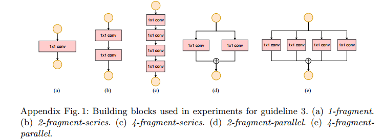

Mỗi khối cơ bản trên được lặp 10 lần rồi đo. Kết quả:

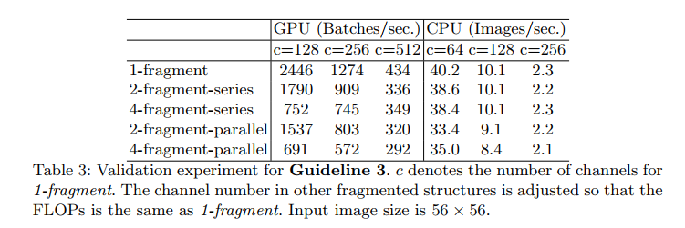

Từ kết quả, khi số nhánh tăng, tốc độ mạng giảm. Mức phân mảnh ảnh hưởng rõ tới GPU, ít rõ hơn với CPU, nhưng tốc độ vẫn giảm.

### 17.8.6 Giảm các phép toán từng phần tử

<div class="qa-theory">

**Lý thuyết:** [Ôn tập · 17.6 Bốn yếu tố ảnh hưởng tới tốc độ mạng neuron](qa/ch17_vi?id=_176-bốn-yếu-tố-ảnh-hưởng-tới-tốc-độ-mạng-neuron)

</div>

**Thời gian tốn cho các phép toán từng phần tử (element-wise) không thể bỏ qua.**

ReLU, cộng tensor, cộng bias, và cả tích chập theo chiều sâu đều được tính là phép toán từng phần tử (vì có tỉ lệ MAC/FLOPs cao).

FLOPs chủ yếu tính cho tích chập, vì FLOPs của phép toán từng phần tử thấp hơn nhiều. Nhưng quá nhiều phép toán từng phần tử cũng tốn thời gian. Tác giả ShuffleNet phân tích thời gian của các loại tầng trong ShuffleNet v1 và MobileNet v2, thấy phép toán từng phần tử ảnh hưởng lớn tới tốc độ mạng.

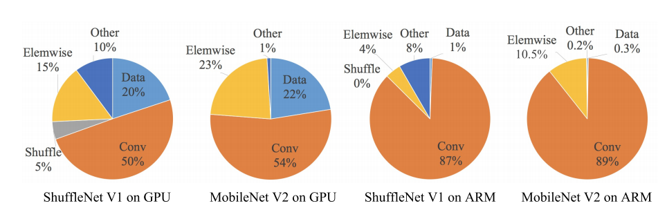

## 17.9 Các mạng nhẹ thường dùng là những mạng nào?

<div class="qa-theory">

**Lý thuyết:** [Ôn tập · 17.8 Vì sao thay đổi thiết kế cấu trúc mạng lại nén, tăng tốc được mô hình?](qa/ch17_vi?id=_178-vì-sao-thay-đổi-thiết-kế-cấu-trúc-mạng-lại-nén-tăng-tốc-được-mô-hình)

</div>

### 17.9.1 SqueezeNet

<div class="qa-theory">

**Lý thuyết:** [Ôn tập · 5.8 Tích chập $1\times1$ có tác dụng gì?](qa/ch05_vi?id=_58-tích-chập-1×11times11×1-có-tác-dụng-gì) · [Ôn tập · 4.2 AlexNet](qa/ch04_vi?id=_42-alexnet)

</div>

SqueezeNet là từ bài *SqueezeNet: AlexNet-level accuracy with 50x fewer parameters and <0.5MB model size* của F. N. Iandola, S. Han và cộng sự (2016). Tác giả giữ nguyên độ chính xác mà nén AlexNet nhỏ đi 510 lần (khi kết hợp thêm Deep Compression).

#### Ý tưởng thiết kế

Về thiết kế cấu trúc mạng, chủ yếu dùng ba cách:

- **Thay tích chập $3\times3$ bằng $1\times1$:** về lý thuyết một kernel $1\times1$ có số tham số bằng $1/9$ kernel $3\times3$, giảm kích thước mô hình 9 lần.
- **Giảm số kênh đầu vào của tích chập $3\times3$:** theo công thức trên, giảm số kênh vào không chỉ giảm lượng tính toán mà khi số kênh vào bằng số kênh ra còn giảm được MAC.
- **Trì hoãn giảm mẫu:** đầu vào độ phân giải lớn cung cấp nhiều thông tin đặc trưng hơn, có lợi cho mạng; trì hoãn giảm mẫu (đặt các tầng stride 2 về cuối mạng) tăng được độ chính xác.

#### Kiến trúc mạng

SqueezeNet đề xuất một cấu trúc nhiều nhánh gọi là fire module, gồm tầng squeeze và tầng expand. Tầng squeeze gồm $s_1$ kernel $1\times1$, chủ yếu để giảm số chiều đầu vào cho tầng expand; tầng expand dùng $e_1$ kernel $1\times1$ và $e_3$ kernel $3\times3$ tạo thành cấu trúc nhiều nhánh trích đặc trưng, tăng độ chính xác (trong SqueezeNet $e_1=e_3=4s_1$).

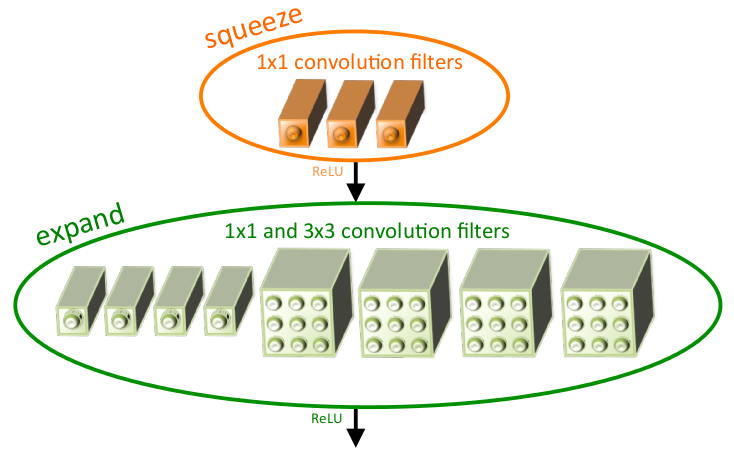

Toàn bộ kiến trúc SqueezeNet như hình dưới:

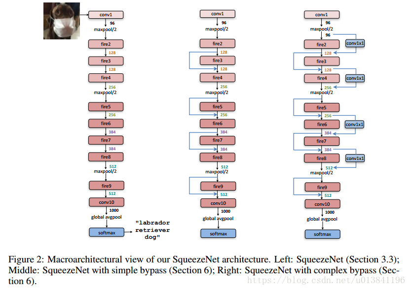

#### Kết quả thực nghiệm

So sánh các phương pháp nén khác nhau trên ImageNet:

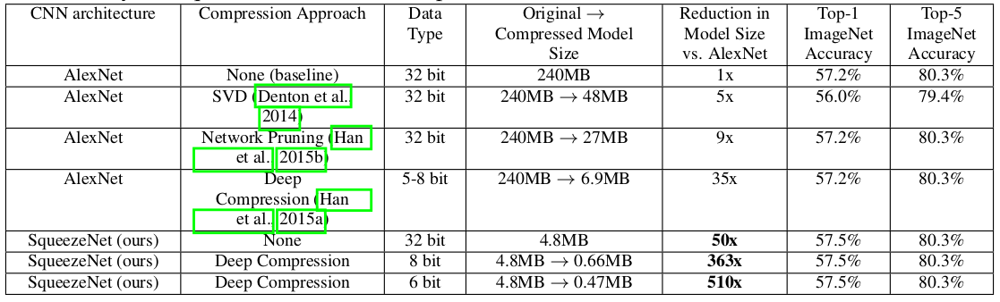

Kết quả cho thấy SqueezeNet vừa giữ độ chính xác, vừa thu nhỏ mô hình từ 240 MB của AlexNet xuống 4,8 MB, nhỏ hơn 50 lần, chứng tỏ thiết kế mạng nhẹ này khả thi.

### 17.9.2 MobileNet

<div class="qa-theory">

**Lý thuyết:** [Ôn tập · 17.8.2 Tích chập tách được theo chiều sâu (depthwise separable convolution)](qa/ch17_vi?id=_1782-tích-chập-tách-được-theo-chiều-sâu-depthwise-separable-convolution)

</div>

MobileNet là mạng sâu nhẹ do nhóm Google đề xuất cho điện thoại và thiết bị nhúng, trong bài *MobileNets: Efficient Convolutional Neural Networks for Mobile Vision Applications* (arXiv 4/2017). Mạng có dạng xếp chồng thẳng giống VGG, nhưng dùng tổ hợp DW + PW để giảm số tham số mà không mất quá nhiều độ chính xác.

> **Biên tập:** bản gốc ghi MobileNet là "bài CVPR 2017"; MobileNet (V1) chỉ công bố trên arXiv, không đăng ở CVPR.

#### Ý tưởng thiết kế

- **Dùng tích chập tách được theo chiều sâu thay tích chập thông thường:**
  - tích chập DW giảm số tham số và tăng tốc độ tính; nhưng vì mỗi bản đồ đặc trưng chỉ được một kernel tích chập, đầu ra của DW không chứa thông tin từ các kênh khác, thông tin giữa các kênh không trao đổi được, gây "dòng thông tin bị tắc";
  - tích chập PW thực hiện trao đổi thông tin giữa các kênh, giải quyết vấn đề trên.
- **Dùng tích chập stride 2 thay pooling:** giảm mẫu ngay khi tích chập bằng stride 2, bỏ được bước pooling giảm mẫu riêng, tăng tốc độ. Hơn nữa, trước pooling cần một tích chập stride 1, mà lượng tính toán của nó cao gần 4 lần tích chập stride 2 (theo cách hiểu riêng của người viết bản gốc).

#### Kiến trúc mạng

- **Tích chập DW và PW.** Kiến trúc MobileNet chủ yếu gồm tích chập DW và PW; so với tích chập thông thường, lượng tính toán chỉ còn $\dfrac{1}{N} + \dfrac{1}{D_K^2}$ lần ($N$ là số kênh ra, $D_K$ là kích thước kernel).

Tích chập thông thường so với DW và PW:

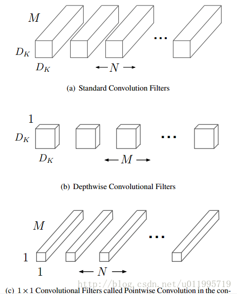

So sánh lượng tính toán:

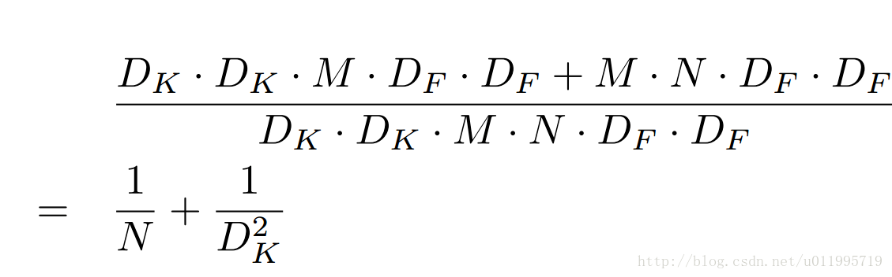

Khối cơ bản:

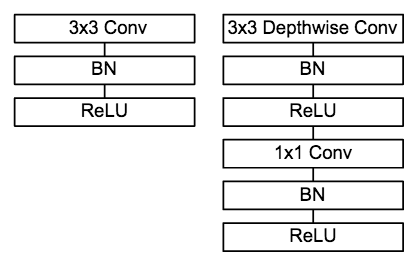

- **Kiến trúc MobileNet:**

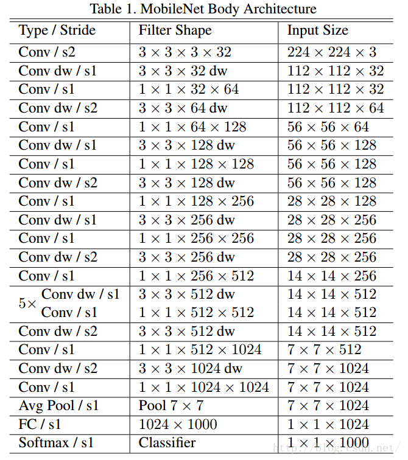

> **Biên tập:** bản gốc viết tỉ lệ là $\frac{1}{N} + \frac{1}{D_k}$, thiếu bình phương ở $D_K$ (hình ngay dưới ghi đúng $D_K^2$).

#### Kết quả thực nghiệm

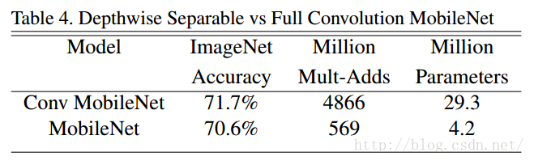

Từ bảng trên, với cùng cấu trúc, dùng tích chập tách được làm độ chính xác giảm khoảng 1 điểm (71,7% → 70,6%), nhưng số tham số giảm khoảng 6/7 (29,3 triệu → 4,2 triệu).

### 17.9.3 MobileNet-v2

<div class="qa-theory">

**Lý thuyết:** [Ôn tập · 17.9.2 MobileNet](qa/ch17_vi?id=_1792-mobilenet) · [d2l (tiếng Anh) · 8.6 ResNet](https://d2l.ai/chapter_convolutional-modern/resnet.html) ↗

</div>

MobileNet-V2 là bài *Inverted Residuals and Linear Bottlenecks: Mobile Networks for Classification, Detection and Segmentation* công bố trên arXiv tháng 1/2018 (CVPR 2018), cải tiến MobileNet-V1, vẫn là một mạng tích chập nhẹ.

#### Ý tưởng thiết kế

- **Dùng khối phần dư đảo ngược (inverted residual):** để mạng trích được nhiều đặc trưng hơn, tích chập $1\times1$ đầu tiên của khối phần dư dùng để **tăng** số kênh, trước tích chập DW $3\times3$.
- **Nút cổ chai tuyến tính (linear bottleneck):** để tránh ReLU phá hỏng đặc trưng, tích chập $1\times1$ cuối khối (ngay trước phép cộng phần dư) không dùng ReLU.
- Khối có stride 2 không dùng kết nối tắt; khối stride 1 thì dùng.

> **Biên tập:** bản gốc viết "tăng số kênh **trước** tích chập $1\times1$ đầu tiên và tích chập DW $3\times3$"; thực ra chính tích chập $1\times1$ đầu tiên làm việc tăng kênh (hệ số mở rộng $t$, thường bằng 6). Kết nối tắt chỉ dùng khi stride 1 **và** số kênh vào bằng số kênh ra.

#### Kiến trúc mạng

- **Khối phần dư đảo ngược.** Khối phần dư của ResNet đi qua tích chập $1\times1$ để giảm số kênh, rồi tích chập $3\times3$, cuối cùng tích chập $1\times1$ để "mở rộng" số kênh trở lại; tức nén trước, mở rộng sau. Khối phần dư đảo ngược thì mở rộng trước, nén sau.

  MobileNet dùng tích chập DW để trích đặc trưng; vì bản thân DW trích được ít đặc trưng, nếu đi qua khối phần dư thông thường để "nén" thì số đặc trưng còn ít hơn nữa, nên khối phần dư đảo ngược "mở rộng" trước để mạng trích được nhiều đặc trưng hơn.

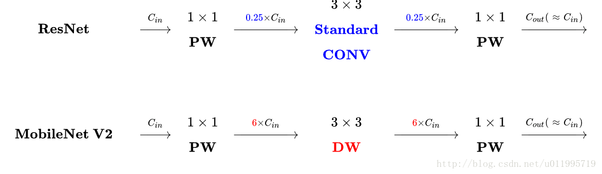

- **Nút cổ chai tuyến tính.** Hàm ReLU phá hỏng đặc trưng: với đầu vào âm, đầu ra đều bằng 0; mà kênh đặc trưng ở chỗ nút cổ chai đã bị "nén", nếu đi qua ReLU nữa sẽ mất thêm một phần đặc trưng. Dùng hàm tuyến tính là để tránh ReLU phá hỏng đặc trưng.

> **Biên tập:** bản gốc dùng lại đúng hình so sánh ResNet và MobileNet V2 ở trên cho phần này (hai file ảnh giống hệt nhau), nên bản dịch không lặp lại hình.

- **Kết nối tắt.** Tích chập stride 2 không dùng kết nối tắt, stride 1 thì dùng.

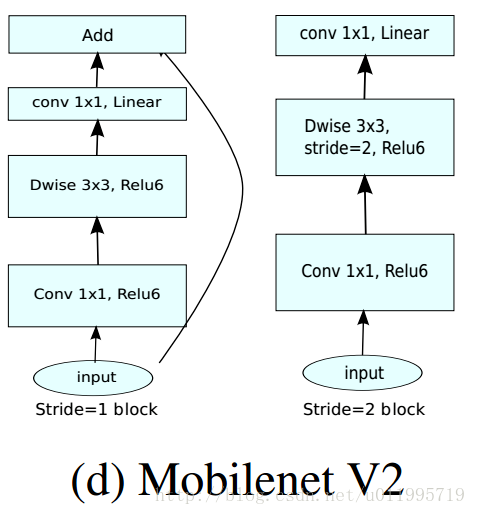

- **Kiến trúc mạng** (mỗi dòng là một chuỗi $n$ tầng giống nhau; $t$ là hệ số mở rộng, $c$ là số kênh ra, $s$ là stride của tầng đầu chuỗi):

| Đầu vào | Phép toán | $t$ | $c$ | $n$ | $s$ |
| --- | --- | --- | --- | --- | --- |
| $224^2\times3$ | conv2d | - | 32 | 1 | 2 |
| $112^2\times32$ | bottleneck | 1 | 16 | 1 | 1 |
| $112^2\times16$ | bottleneck | 6 | 24 | 2 | 2 |
| $56^2\times24$ | bottleneck | 6 | 32 | 3 | 2 |
| $28^2\times32$ | bottleneck | 6 | 64 | 4 | 2 |
| $14^2\times64$ | bottleneck | 6 | 96 | 3 | 1 |
| $14^2\times96$ | bottleneck | 6 | 160 | 3 | 2 |
| $7^2\times160$ | bottleneck | 6 | 320 | 1 | 1 |
| $7^2\times320$ | conv2d $1\times1$ | - | 1280 | 1 | 1 |
| $7^2\times1280$ | avgpool $7\times7$ | - | - | 1 | - |
| $1\times1\times1280$ | conv2d $1\times1$ | - | $k$ | - | - |

> **Biên tập:** bảng trên được gõ lại theo bảng 2 của bài MobileNetV2. Ảnh bảng trong bản gốc có lỗi ở cột đầu vào (ghi $28^2\times64$ thay cho $14^2\times64$) và có vết sửa tay màu đỏ ở cột $s$, dễ gây nhầm, nên bản dịch không dùng ảnh đó.

### 17.9.4 Xception

<div class="qa-theory">

**Lý thuyết:** [Ôn tập · 4.6 GoogLeNet](qa/ch04_vi?id=_46-googlenet) · [Ôn tập · 17.8.2 Tích chập tách được theo chiều sâu (depthwise separable convolution)](qa/ch17_vi?id=_1782-tích-chập-tách-được-theo-chiều-sâu-depthwise-separable-convolution)

</div>

Xception do Google đề xuất, bản arXiv V1 công bố tháng 10/2016 với tên *Xception: Deep Learning with Depthwise Separable Convolutions* (CVPR 2017). Xception là một cải tiến khác của Inception v3, chủ yếu dùng tích chập tách được theo chiều sâu thay các phép tích chập trong Inception v3.

#### Ý tưởng thiết kế

Dùng tích chập tách được theo chiều sâu thay các phép tích chập của Inception v3. Bài báo nêu hai điểm khác giữa mô-đun "Inception cực đoan" và tích chập tách được theo chiều sâu thông thường:

- thứ tự: tích chập tách được thông thường làm tích chập từng kênh trước, rồi tích chập $1\times1$; "Inception cực đoan" thì ngược lại, $1\times1$ trước, rồi tích chập từng kênh;
- tích chập tách được thông thường không có hàm kích hoạt giữa hai bước; "Inception cực đoan" có ReLU sau tích chập $1\times1$.

> **Biên tập:** bản gốc trình bày như thể Xception dùng thứ tự đảo ngược và có ReLU ở giữa. Thực ra đó là đặc điểm của mô-đun "Inception cực đoan" mà tác giả dùng để lập luận; mạng **Xception** cuối cùng dùng tích chập tách được theo chiều sâu **thông thường** (từng kênh trước, $1\times1$ sau), và thí nghiệm trong bài cho thấy **không** đặt hàm kích hoạt giữa hai bước thì tốt hơn. Tác giả cũng nhận xét thứ tự hai bước không quan trọng khi các khối được xếp chồng.

#### Kiến trúc mạng

Bản đồ đặc trưng có tương quan theo cả không gian lẫn kênh; mô-đun Inception cùng hàm kích hoạt phi tuyến tách rời (decouple) tương quan giữa các kênh. Tăng số nhánh tích chập $3\times3$ cho tới bằng số kênh ra của tích chập $1\times1$, khi đó mỗi tích chập $3\times3$ chỉ tác động lên một kênh, tác giả gọi là mô-đun "Inception cực đoan" (Extreme Inception); đây là khối cơ bản của Xception.

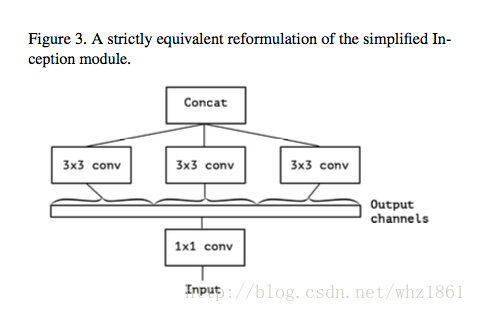

### 17.9.5 ShuffleNet-v1

<div class="qa-theory">

**Lý thuyết:** [Ôn tập · 17.8.1 Tích chập nhóm (group convolution)](qa/ch17_vi?id=_1781-tích-chập-nhóm-group-convolution) · [Ôn tập · 17.8.4 Giảm số nhóm của tích chập nhóm](qa/ch17_vi?id=_1784-giảm-số-nhóm-của-tích-chập-nhóm)

</div>

ShuffleNet là kiến trúc mạng cho suy luận trên thiết bị di động do nhóm Face++ (Megvii) đề xuất, công bố trên arXiv chậm hơn MobileNet khoảng ba tháng, trong bài *ShuffleNet: An Extremely Efficient Convolutional Neural Network for Mobile Devices* (CVPR 2018). ShuffleNet dựa trên ý tưởng tích chập nhóm như MobileNet, giới hạn mỗi phép tích chập vào một số kênh đầu vào nhất định. Điểm khác là ShuffleNet xáo trộn các nhóm đầu vào, để trường tiếp nhận của mỗi kernel trải ra đầu vào của nhiều nhóm khác nhau, tăng khả năng học của mô hình.

> **Biên tập:** MobileNet lên arXiv tháng 4/2017, ShuffleNet tháng 7/2017, cách nhau khoảng ba tháng (bản gốc ghi hai tháng).

#### Ý tưởng thiết kế

- **Dùng tích chập nhóm để giảm mạnh số tham số:** tích chập nhóm có cùng vấn đề "dòng thông tin bị tắc" như tích chập DW.
- **Dùng xáo trộn kênh (channel shuffle) để giải quyết vấn đề trên:** MobileNet giải bằng tích chập PW, ShuffleNet giải bằng xáo trộn kênh.
- **Dùng ghép (concat) thay cộng (add):** avg pooling và tích chập DW (stride 2) làm giảm độ phân giải bản đồ đặc trưng; dùng ghép để tăng số kênh, bù lại thông tin mất do độ phân giải giảm.

#### Kiến trúc mạng

Trong MobileNet, tích chập $1\times1$ chiếm khoảng 95% lượng tính toán, nên tác giả đổi cả tích chập $1\times1$ thành tích chập nhóm, giảm mạnh lượng tính toán so với MobileNet.

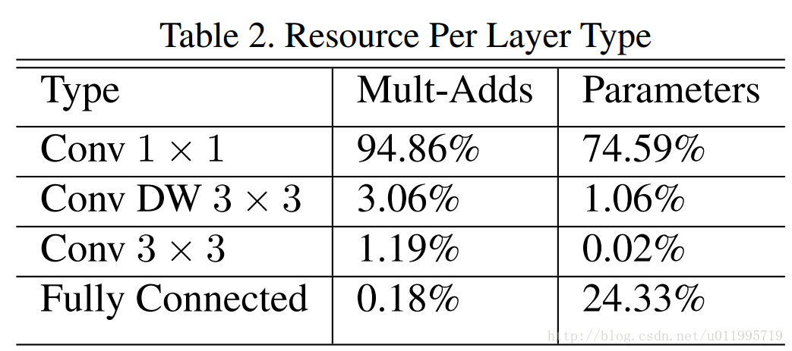

Tích chập nhóm có cùng vấn đề "trao đổi thông tin giữa các kênh bị tắc" như DW; MobileNet giải bằng tích chập PW, ShuffleNet giải bằng xáo trộn kênh.

Phép xáo trộn kênh của ShuffleNet như hình dưới:

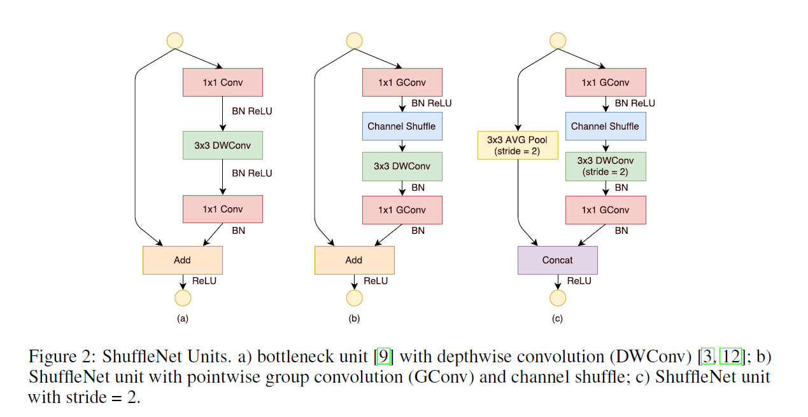

avg pooling và tích chập DW (stride 2) làm giảm độ phân giải bản đồ đặc trưng; dùng ghép để tăng số kênh, bù lại thông tin mất do độ phân giải giảm. Thực nghiệm cho thấy dùng nhiều kênh (tăng mức sử dụng kênh) giúp tăng độ chính xác của mô hình nhỏ.

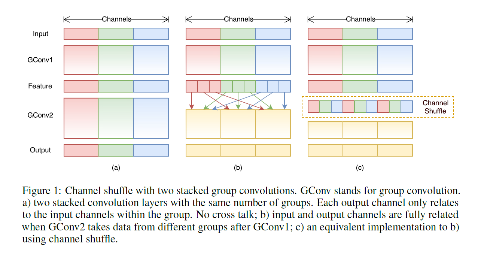

Kiến trúc mạng:

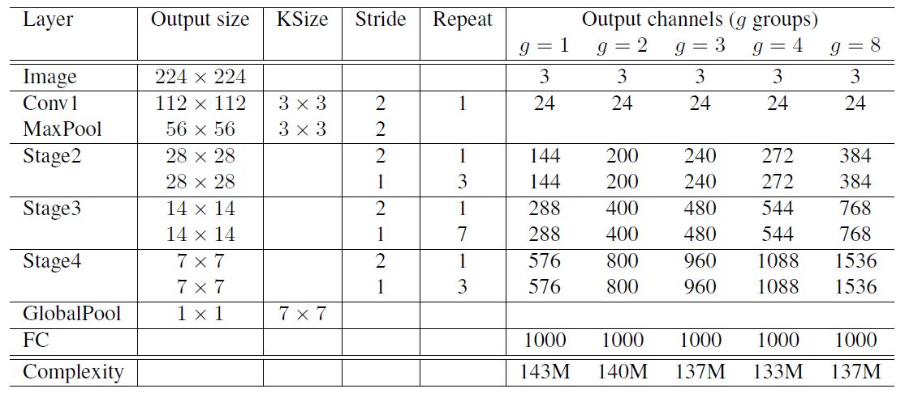

### 17.9.6 ShuffleNet-v2

<div class="qa-theory">

**Lý thuyết:** [Ôn tập · 17.6 Bốn yếu tố ảnh hưởng tới tốc độ mạng neuron](qa/ch17_vi?id=_176-bốn-yếu-tố-ảnh-hưởng-tới-tốc-độ-mạng-neuron) · [Ôn tập · 17.8.3 Số kênh vào và ra bằng nhau thì MAC nhỏ nhất](qa/ch17_vi?id=_1783-số-kênh-vào-và-ra-bằng-nhau-thì-mac-nhỏ-nhất)

</div>

ShuffleNet-v2 là bài *ShuffleNet V2: Practical Guidelines for Efficient CNN Architecture Design* của nhóm Face++ (ECCV 2018), nhằm thiết kế một mạng nhẹ mà vẫn đảm bảo độ chính xác và tốc độ.

#### Ý tưởng thiết kế

- Bài báo nêu 4 yếu tố ảnh hưởng tới tốc độ mạng neuron:
  1. FLOPs (số phép nhân–cộng mạng thực hiện);
  2. MAC (chi phí truy cập bộ nhớ);
  3. mức độ song song (mạng song song cao thì tốc độ tăng rõ);
  4. nền tảng tính toán (GPU, ARM).
- ShuffleNet-v2 đưa ra 4 nguyên tắc thiết kế cấu trúc mạng:
  - G1. số kênh vào và ra bằng nhau thì MAC nhỏ nhất;
  - G2. tích chập nhóm quá mức làm tăng MAC;
  - G3. phân mảnh mạng làm giảm mức độ song song;
  - G4. phép toán từng phần tử không thể bỏ qua.

#### Kiến trúc mạng

Tích chập DW và cấu trúc nút cổ chai làm tăng MAC, dùng quá nhiều nhóm, và phép cộng từng phần tử ở kết nối tắt cũng là chỗ cần tối ưu. Vì vậy ShuffleNet V2 thêm vài đặc điểm mới.

Gọi là **tách kênh** (channel split): chia số kênh làm đôi, thành hai nhánh, thay cho cấu trúc tích chập nhóm cũ (G2); mỗi tầng tích chập trong nhánh đều giữ số kênh vào bằng số kênh ra (G1); một nhánh không làm phép toán nào, để giảm số khối cơ bản (G3); cuối cùng dùng ghép thay cho cộng từng phần tử, và không đặt ReLU ngay sau đó (G4); rồi thêm xáo trộn kênh để tăng trao đổi thông tin giữa các kênh. Với tầng giảm mẫu, số kênh được nhân đôi. Ở cuối mạng, trước tầng pooling trung bình, thêm một tầng tích chập $1\times1$ để trộn đặc trưng thêm.

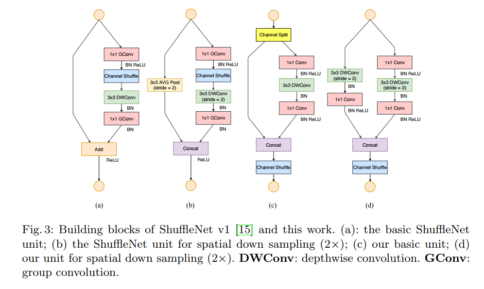

Kiến trúc mạng:

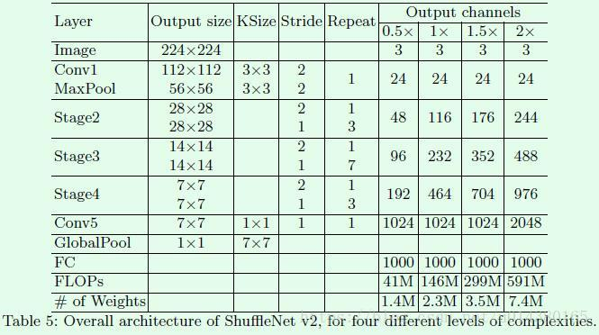

#### Vì sao ShuffleNet-v2 có độ chính xác cao?

- Vì hiệu quả, có thể tăng số kênh, tăng dung lượng của mạng.
- Tách kênh khiến một phần đặc trưng nối thẳng tới khối sau, tái sử dụng đặc trưng (giống DenseNet).

> **Biên tập:** bản gốc đánh số mục con này là "6.4" (không có 6.3) và có chữ hỏng ("huffleNet", "Ecient", "后面不加 ReLU 直接" bị cắt câu); đã sửa.

## 17.10 Các framework mã nguồn mở hiện có cho thiết bị di động và đặc điểm của chúng

<div class="qa-theory">

**Lý thuyết:** [Ôn tập · 15.7.4 Chọn framework cho nền tảng di động thế nào?](qa/ch15_vi?id=_1574-chọn-framework-cho-nền-tảng-di-động-thế-nào)

</div>

### 17.10.1 NCNN

<div class="qa-theory">

**Lý thuyết:** [Ôn tập · 17.11.1 Lấy NCNN làm ví dụ](qa/ch17_vi?id=_17111-lấy-ncnn-làm-ví-dụ)

</div>

1. Thời gian mở mã: tháng 7/2017.
2. Đơn vị mở mã: Tencent Youtu.
3. GitHub: https://github.com/Tencent/ncnn
4. Đặc điểm:
   - NCNN tính tới khác biệt phần cứng, hệ điều hành và cách gọi trên điện thoại; thiết kế kiến trúc lấy việc chạy trên điện thoại làm nguyên tắc chính.
   - Không phụ thuộc thư viện bên thứ ba, đa nền tảng; tốc độ trên CPU điện thoại nhanh hơn mọi framework mã nguồn mở đã biết (tính tới thời điểm mở mã).
   - Dựa trên ncnn, lập trình viên dễ dàng đưa thuật toán học sâu lên điện thoại chạy hiệu quả, phát triển ứng dụng AI.
5. Chức năng:
   1. hỗ trợ mạng tích chập, cấu trúc mạng phức tạp nhiều nhánh, nhiều đầu vào như VGG, GoogLeNet, ResNet, SqueezeNet…;
   2. không phụ thuộc thư viện bên thứ ba nào;
   3. viết hoàn toàn bằng C/C++, hệ thống biên dịch CMake đa nền tảng, dễ chuyển sang hệ thống và thiết bị khác;
   4. tối ưu ở mức hợp ngữ, tính cực nhanh; dùng tập lệnh ARM NEON cho phần lớn các tầng CNN chính như tích chập, kết nối đầy đủ, pooling;
   5. thiết kế cấu trúc dữ liệu tinh tế, không dùng cách thông thường tốn nhiều bộ nhớ là im2col + nhân ma trận, nên dùng rất ít bộ nhớ;
   6. hỗ trợ tính song song nhiều lõi, tối ưu lập lịch CPU;
   7. kích thước toàn thư viện dưới 500 KB, có thể rút gọn dưới 300 KB;
   8. thiết kế mô hình mở rộng được, hỗ trợ lượng tử hóa 8 bit và lưu trữ dấu phẩy động nửa độ chính xác;
   9. hỗ trợ nạp mô hình bằng tham chiếu trực tiếp vào bộ nhớ;
   10. có thể đăng ký tầng tự định nghĩa để mở rộng.
6. Ví dụ triển khai NCNN trên Android:
   1. chọn và cài phiên bản Android Studio phù hợp;
   2. chọn và cài phiên bản NDK theo nhu cầu;
   3. cấu hình biến môi trường NDK trong Android Studio;
   4. biên dịch NCNN SDK theo nhu cầu:

      ```bash
      mkdir build-android
      cd build-android
      cmake -DCMAKE_TOOLCHAIN_FILE=$ANDROID_NDK/build/cmake/android.toolchain.cmake \
          -DANDROID_ABI="armeabi-v7a" -DANDROID_ARM_NEON=ON \
          -DANDROID_PLATFORM=android-14 ..
      make
      make install
      ```

      Cài xong, thư mục `install` có hai thư mục `include` và `lib`. Ghi chú:

      ```text
      ANDROID_ABI       tên kiến trúc; "armeabi-v7a" hỗ trợ phần lớn điện thoại
      ANDROID_ARM_NEON  có dùng tập lệnh NEON không; đặt ON hỗ trợ phần lớn điện thoại
      ANDROID_PLATFORM  phiên bản hệ điều hành thấp nhất; "android-14" là Android 4.0
      ```

   5. phát triển bằng NDK:

      ```text
      1) đặt file bin và param vào thư mục assets;
      2) đặt file cpp và mk vào thư mục jni;
      3) sửa file gradle của app;
      4) cấu hình Android.mk và Application.mk;
      5) viết giao diện Java;
      6) đọc và chép file bin, param (có khi là file pb, tùy trường hợp);
      7) khởi tạo mô hình và chạy dự đoán;
      8) build;
      9) cd vào src/main/jni, chạy ndk-build để sinh file .so;
      10) tiếp đó viết phần xử lý theo nhu cầu.
      ```

> **Biên tập:** bản gốc dồn lệnh `cmake` vào một dòng (không chạy được), đã tách lại. Hiện nay ncnn đã hỗ trợ GPU qua **Vulkan** (từ 2019), chạy trên Android, iOS, Linux, Windows, macOS, WebAssembly; nên dùng `arm64-v8a` (điện thoại 64 bit) thay cho `armeabi-v7a`, và công cụ chuyển mô hình hiện khuyến nghị là **PNNX** (từ PyTorch/ONNX) thay cho `caffe2ncnn`.

### 17.10.2 QNNPACK

<div class="qa-theory">

**Lý thuyết:** [Ôn tập · 15.7.3 Những framework nào thân thiện với môi trường triển khai?](qa/ch15_vi?id=_1573-những-framework-nào-thân-thiện-với-môi-trường-triển-khai)

</div>

Tên đầy đủ: Quantized Neural Network PACKage (gói mạng neuron lượng tử hóa).

1. Thời gian mở mã: tháng 10/2018.
2. Đơn vị mở mã: Facebook.
3. GitHub: https://github.com/pytorch/QNNPACK
4. Đặc điểm:
   1. thư viện hàm tối ưu cho tích chập độ chính xác thấp;
   2. chạy được Mask R-CNN và DensePose theo thời gian thực trên điện thoại;
   3. phân loại ảnh trong dưới 100 ms trên thiết bị di động hiệu năng hạn chế.
5. QNNPACK tăng hiệu suất thế nào?

**1) QNNPACK dùng cách lượng tử hóa tuyến tính tương thích với Android Neural Networks API**

Ma trận đầu vào của QNNPACK đến từ các mô hình thị giác máy tính độ chính xác thấp, chuyên cho thiết bị di động. Khi nhân hai ma trận A và B, các thư viện khác đóng gói lại (repack) A và B để tận dụng tốt hơn hệ thống bộ đệm nhiều tầng, mong chi phí đóng gói được chia đều trên lượng tính toán lớn. QNNPACK bỏ mọi phép biến đổi bộ nhớ không cần thiết cho tính toán, và tối ưu cho trường hợp phép nhân A × B vừa trong bộ đệm L1.

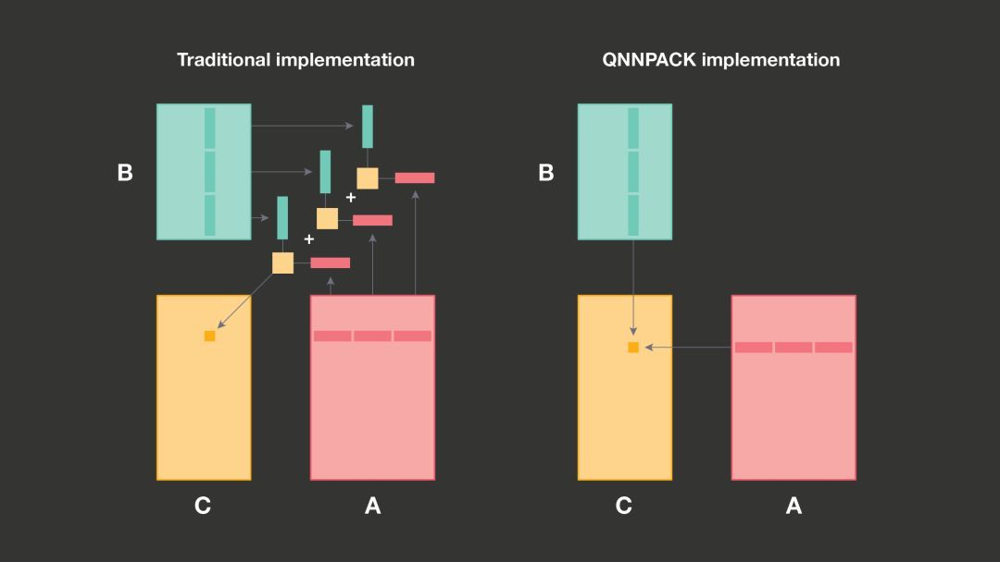

(1) Tối ưu tính toán trong bộ đệm L1, không cần xuất kết quả trung gian mà xuất thẳng kết quả cuối, tiết kiệm băng thông bộ nhớ và bộ đệm.

Phân tích cụ thể:

- **Cài đặt thông thường:** trong nhân ma trận lượng tử hóa, tích của các số nguyên 8 bit thường được cộng dồn vào kết quả trung gian 32 bit, rồi lượng tử hóa lại để ra đầu ra 8 bit. Với ma trận lớn, chẳng hạn khi $K$ quá lớn, các panel của A và B không vừa bộ đệm; lúc đó phải tận dụng hệ thống bộ đệm, GEMM chia các panel A và B dọc chiều $K$ thành các panel con kích thước cố định để mỗi panel con vừa L1, rồi gọi vi nhân (microkernel) cho từng panel con. Tối ưu bộ đệm này đòi hỏi vi nhân PDOT xuất kết quả trung gian 32 bit, cuối cùng cộng lại và lượng tử hóa lại thành số nguyên 8 bit.
- **Cài đặt tối ưu:** vì QNNPACK tối ưu cho các mạng di động mà panel A và B luôn vừa L1, nó xử lý cả panel A và B trong một lần gọi vi nhân. Vì không cần cộng dồn kết quả trung gian 32 bit bên ngoài vi nhân, QNNPACK gộp bước lượng tử hóa lại vào vi nhân và ghi thẳng giá trị 8 bit, tiết kiệm băng thông bộ nhớ và bộ đệm.

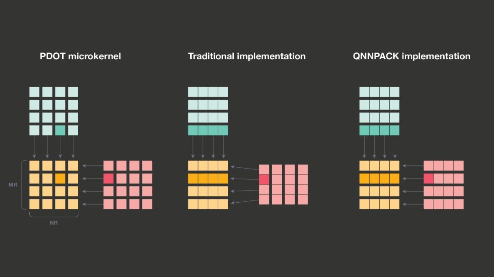

(2) Bỏ việc đóng gói lại ma trận A.

- **Cài đặt thông thường:** ma trận B chứa trọng số tĩnh, có thể chuyển một lần sang bất kỳ bố cục bộ nhớ nào; nhưng ma trận A chứa đầu vào tích chập, thay đổi mỗi lần suy luận, nên đóng gói lại A gây chi phí mỗi lần chạy. Dù vậy GEMM truyền thống vẫn đóng gói lại A vì hai lý do:
  - a. *giới hạn về độ kết hợp của bộ đệm và hiệu suất vi nhân:* nếu không đóng gói lại, vi nhân phải đọc vài hàng của A cách nhau một bước nhảy (stride) có thể rất lớn. Nếu bước nhảy này là bội của một lũy thừa lớn của 2, các phần tử ở các hàng khác nhau trong panel có thể rơi vào cùng một tập bộ đệm (cache set); nếu số hàng xung đột vượt độ kết hợp của bộ đệm, chúng đẩy nhau ra và hiệu năng giảm mạnh;
  - b. *ảnh hưởng của việc đóng gói tới hiệu suất vi nhân* gắn chặt với việc dùng lệnh vector SIMD mà mọi bộ xử lý di động hiện nay hỗ trợ. Các lệnh này nạp, lưu hoặc tính trên vector nhỏ kích thước cố định thay vì từng số vô hướng. Trong nhân ma trận, tận dụng tốt lệnh vector là rất quan trọng để đạt hiệu năng cao. Trong GEMM truyền thống, vi nhân đóng gói lại $MR$ phần tử vào $MR$ làn của thanh ghi vector.
- **Cài đặt tối ưu:**
  - a. khi panel vừa L1 thì không có vấn đề về độ kết hợp bộ đệm và hiệu suất vi nhân;
  - b. trong QNNPACK, $MR$ phần tử không liền nhau trong bộ nhớ, vi nhân phải nạp chúng vào các thanh ghi vector khác nhau. Áp lực thanh ghi tăng buộc QNNPACK dùng ô $MR\times NR$ nhỏ hơn, nhưng thực tế khác biệt rất nhỏ và được bù lại nhờ bỏ được chi phí đóng gói. Ví dụ trên ARM 32 bit, QNNPACK dùng vi nhân $4\times8$, trong đó 57% lệnh vector là nhân–cộng; còn thư viện gemmlowp dùng vi nhân $4\times12$ hiệu quả hơn một chút, 60% lệnh vector là nhân–cộng. Vi nhân nạp nhiều hàng của A, nhân với các cột đầy đủ của B, cộng kết quả, rồi lượng tử hóa lại và ghi kết quả. Phần tử của A và B được lượng tử hóa thành số nguyên 8 bit, nhưng tích được cộng dồn thành 32 bit. Phần lớn bộ xử lý ARM và ARM64 không có lệnh làm trực tiếp phép này, nên phải tách thành nhiều lệnh được hỗ trợ. QNNPACK có hai phiên bản vi nhân, khác nhau ở chuỗi lệnh dùng để nhân giá trị 8 bit và cộng dồn thành 32 bit.

**2) Từ nhân ma trận tới tích chập**

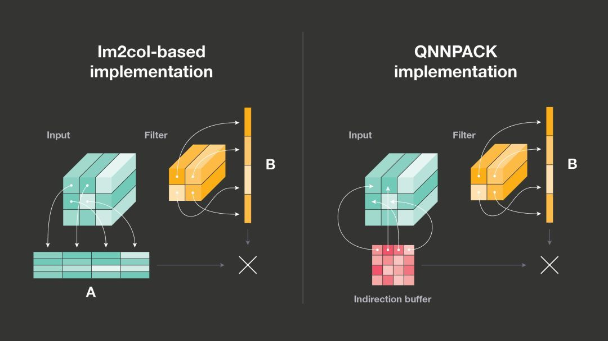

*Cài đặt truyền thống:* tích chập $1\times1$ đơn giản có thể ánh xạ thẳng thành nhân ma trận, nhưng tích chập có kernel lớn hơn, có padding hoặc lấy mẫu con (stride) thì không. Tuy nhiên các tích chập phức tạp hơn này có thể ánh xạ thành nhân ma trận nhờ phép biến đổi bộ nhớ im2col. Với mỗi điểm ảnh đầu ra, im2col chép vùng ảnh đầu vào tương ứng thành ma trận 2D. Vì mỗi điểm ảnh đầu ra chịu ảnh hưởng của $KH\times KW\times C$ giá trị đầu vào ($KH$, $KW$ là chiều cao và rộng của kernel, $C$ là số kênh của ảnh vào), ma trận này lớn gấp $KH\times KW$ lần ảnh đầu vào; im2col gây chi phí cả về bộ nhớ lẫn hiệu năng. Giống Caffe, phần lớn framework học sâu dùng cài đặt dựa trên im2col, tận dụng các thư viện nhân ma trận đã tối ưu cao để tính tích chập.

*Cài đặt tối ưu:* các nhà nghiên cứu Facebook cài đặt một thuật toán hiệu quả hơn trong QNNPACK.

- Thay vì biến đổi đầu vào tích chập cho hợp với cài đặt nhân ma trận, họ điều chỉnh cài đặt vi nhân PDOT để thực hiện biến đổi im2col ngay khi chạy. Nhờ đó không cần chép dữ liệu đầu vào vào bộ đệm im2col, mà dựng một **bộ đệm gián tiếp** (indirection buffer) chứa con trỏ tới các hàng điểm ảnh đầu vào liên quan tới việc tính từng điểm ảnh đầu ra.
- Họ cũng sửa vi nhân nhân ma trận để nạp con trỏ tới các hàng của ma trận "ảo" A từ bộ đệm gián tiếp; bộ đệm gián tiếp thường nhỏ hơn nhiều so với bộ đệm im2col.
- Ngoài ra, nếu vị trí lưu tensor đầu vào không đổi giữa hai lần suy luận, bộ đệm gián tiếp có thể khởi tạo một lần bằng con trỏ tới các hàng của tensor đầu vào rồi dùng lại cho nhiều lần suy luận. Các nhà nghiên cứu thấy vi nhân dùng bộ đệm gián tiếp không chỉ bỏ được chi phí im2col mà còn nhanh hơn vi nhân nhân ma trận một chút (có lẽ vì các hàng đầu vào được dùng lại khi tính các điểm ảnh đầu ra khác nhau).

**3) Tích chập theo chiều sâu**

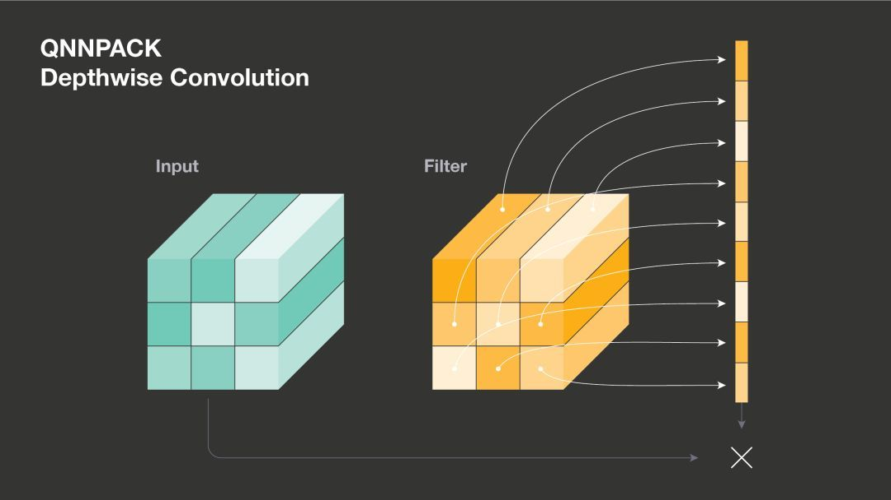

Tích chập nhóm chia kênh vào và ra thành nhiều nhóm rồi xử lý riêng từng nhóm. Trường hợp giới hạn khi số nhóm bằng số kênh là tích chập theo chiều sâu, rất hay dùng trong các mạng hiện nay. Tích chập theo chiều sâu lọc không gian riêng từng kênh, có kiểu tính toán rất khác tích chập thông thường, nên thường được cài đặt riêng; QNNPACK có một bản tích chập theo chiều sâu $3\times3$ được tối ưu cao.

Cài đặt truyền thống lặp qua từng phần tử của kernel, mỗi lần cộng dồn kết quả của một hàng kernel và một hàng đầu vào vào hàng đầu ra. Với tích chập theo chiều sâu $3\times3$, cách này cập nhật mỗi hàng đầu ra 9 lần. Trong QNNPACK, các nhà nghiên cứu tính kết quả của cả $3\times3$ hàng kernel và $3\times3$ hàng đầu vào, cộng dồn một lần vào hàng đầu ra, rồi mới xử lý hàng đầu ra tiếp theo.

Yếu tố then chốt để QNNPACK đạt hiệu năng cao là dùng tối đa các thanh ghi đa dụng (GPR) để trải vòng lặp trên các phần tử kernel, đồng thời tránh nạp lại thanh ghi địa chỉ trong vòng lặp nóng (hot loop). Kiến trúc ARM 32 bit giới hạn cài đặt ở 14 GPR. Trong tích chập theo chiều sâu $3\times3$, cần đọc 9 hàng đầu vào và 9 hàng kernel, tức muốn trải hết vòng lặp thì phải lưu 18 địa chỉ. Tuy nhiên khi suy luận, kernel không đổi. Vì vậy các nhà nghiên cứu Facebook đóng gói các bộ lọc vốn ở dạng $C\times KH\times KW$ thành $\lceil C/8\rceil\times KW\times KH\times8$, để chỉ cần một GPR với phép tăng địa chỉ là truy cập được mọi bộ lọc. (Dùng số 8 vì một lệnh nạp 8 phần tử rồi trừ điểm 0, sinh ra 8 giá trị 16 bit trong một thanh ghi NEON 128 bit.) Sau đó dùng 9 con trỏ hàng đầu vào và con trỏ tới bộ lọc đã đóng gói, tổng cộng 10 GPR, trải hết vòng lặp trên các phần tử bộ lọc. Kiến trúc ARM 64 bit có số GPR gấp đôi ARM 32 bit; QNNPACK tận dụng các GPR thêm này để lưu con trỏ tới $3\times5$ hàng đầu vào cùng lúc và tính 3 hàng đầu ra một lần.

6. Ưu thế hiệu năng:

Kết quả kiểm thử cho thấy ưu thế hiệu năng của QNNPACK trên các bộ đo đầu cuối. Với kiến trúc MobileNetV2 lượng tử hóa, toán tử Caffe2 dựa trên QNNPACK nhanh khoảng gấp đôi TensorFlow Lite, trên nhiều loại điện thoại. Ngoài QNNPACK, Facebook còn mở mã mô hình MobileNetV2 lượng tử hóa của Caffe2, độ chính xác Top-1 cao hơn mô hình TensorFlow tương ứng 1,3 điểm.

**MobileNetV1**

Kiến trúc MobileNetV1 đi tiên phong trong việc dùng tích chập theo chiều sâu để mô hình hợp với thiết bị di động hơn. MobileNetV1 gần như chỉ gồm tích chập $1\times1$ và $3\times3$. Các nhà nghiên cứu Facebook chuyển mô hình MobileNetV1 lượng tử hóa từ TensorFlow Lite, rồi đo MobileNetV1 trên TensorFlow Lite và QNNPACK trên thiết bị ARM 32 bit. Cả hai đều chạy 4 luồng; QNNPACK nhanh hơn TensorFlow Lite trung bình nhân 1,8 lần.

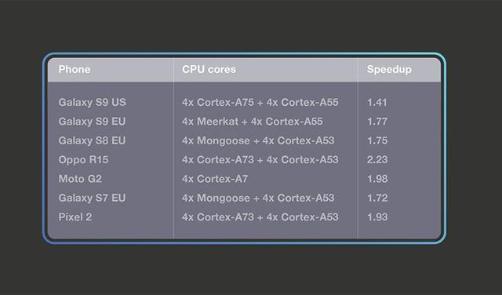

**MobileNetV2**

Là một trong những kiến trúc tốt nhất cho thị giác trên thiết bị di động lúc đó, MobileNetV2 dùng khối nút cổ chai và kết nối tắt giữa các nút cổ chai. Các nhà nghiên cứu so sánh toán tử Caffe2 dựa trên QNNPACK với bản cài đặt TensorFlow Lite trên MobileNetV2 phân loại đã lượng tử hóa. Mô hình Caffe2 MobileNetV2 lượng tử hóa được mở mã, mô hình TensorFlow Lite lượng tử hóa lấy từ kho chính thức. Bảng dưới là độ chính xác Top-1 của hai mô hình trên tập kiểm thử thông dụng:

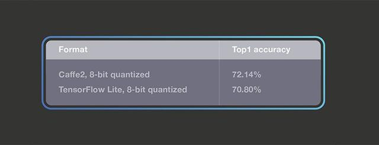

Các nhà nghiên cứu dùng các mô hình này để lập bộ đo trên nền tảng đánh giá hiệu năng AI của Facebook (https://github.com/facebook/FAI-PEP), trên nhiều điện thoại môi trường ARM 32 bit. Với TensorFlow Lite, họ thử từ một tới bốn luồng và báo kết quả nhanh nhất; kết quả cho thấy TensorFlow Lite nhanh nhất với bốn luồng, nên sau đó dùng bốn luồng để so TensorFlow Lite với QNNPACK. Bảng dưới cho thấy trên cả điện thoại phổ thông lẫn cao cấp, toán tử dựa trên QNNPACK nhanh hơn TensorFlow Lite nhiều.

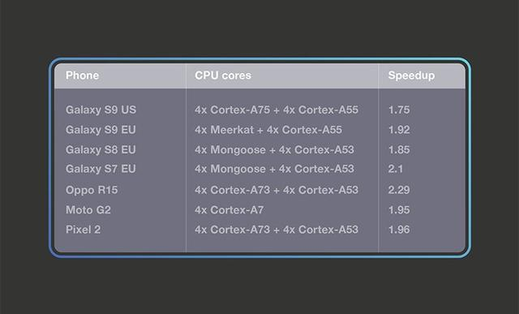

> **Biên tập:** độ chênh 72,14% − 70,80% = 1,34 điểm, khớp với con số "cao hơn 1,3%" ở trên. Bản gốc còn ghi "ONNPACK" ở một chỗ (gõ nhầm QNNPACK). Nguồn của mục này là bài giới thiệu QNNPACK trên blog kỹ thuật của Facebook (10/2018) và các bản dịch tiếng Trung trên Baidu, Sohu. QNNPACK nay đã được gộp vào PyTorch (backend lượng tử hóa `qnnpack`) và được kế tục bởi **XNNPACK**, dùng làm backend CPU của LiteRT, ExecuTorch, ONNX Runtime và nhiều framework khác.

### 17.10.3 Prestissimo

1. Thời gian mở mã: tháng 11/2017.
2. Đơn vị mở mã: Jiuyan Technology (công ty của ứng dụng in66).
3. GitHub: https://github.com/in66-dev/In-Prestissimo
4. Tính năng:

**Chức năng cơ bản**

- hỗ trợ mạng tích chập, cấu trúc nhiều đầu vào và nhiều nhánh;
- API tinh gọn, dễ dùng;
- có giao diện gỡ lỗi, in được dữ liệu và thời gian của từng tầng;
- không phụ thuộc framework tính toán bên thứ ba, toàn thư viện khoảng 500 KB (32 bit khoảng 400 KB, 64 bit khoảng 600 KB);
- viết thuần C++, đa nền tảng, hỗ trợ Android và iOS;
- mô hình là file nhị phân thuần, không lộ cấu trúc mạng do lập trình viên thiết kế.

**Tốc độ cực nhanh**

- tối ưu toàn diện từ thiết kế framework tới viết hợp ngữ; trên iPhone 7 chạy SqueezeNet chỉ mất 26 ms (một luồng);
- hỗ trợ hai chế độ tính dấu phẩy động (float) và số nguyên (int); chế độ float có độ chính xác như Caffe, chế độ int tính nhanh, độ chính xác của int đã đủ với đa số mạng;
- bố trí bộ nhớ khéo léo để tăng tỉ lệ trúng bộ đệm CPU, vẫn mạnh trên máy tầm trung và thấp;
- tối ưu kỹ cho cả bốn nhánh float-arm32, float-arm64, int-arm32, int-arm64, đảm bảo cả bản 32 bit và 64 bit đều có hiệu năng rất tốt.

**Kết quả đo SqueezeNet-v1.1**

**Lưu ý:** hiệu năng đo trên điện thoại có dao động, lấy trung bình nhiều lần chạy liên tiếp.

**Lưu ý:** Huawei Mate 8, Mate 9, Google Nexus 6 tuy là CPU 64 bit nhưng thử bằng thư viện 32 bit, nên kiến trúc CPU vẫn ghi arm-v7a.

| Kiến trúc CPU | Máy | CPU | ncnn (4 luồng) | mdl | Prestissimo_float (1 luồng) | Prestissimo_int (1 luồng) |
| --- | --- | --- | --- | --- | --- | --- |
| arm-v7a | Xiaomi 2 | Qualcomm APQ8064 1,5 GHz | 185 ms | 370 ms | 184 ms | 115 ms |
| arm-v7a | Xiaomi 2s | Snapdragon APQ8064 Pro 4 lõi 1,7 GHz | 166 ms | - | 136 ms | 96 ms |
| arm-v7a | Redmi Note 4x | Snapdragon 625 4 lõi 2,0 GHz | 124 ms | 306 ms | 202 ms | 110 ms |
| arm-v7a | Google Nexus 6 | Snapdragon 805 4 lõi 2,7 GHz | 84 ms | 245 ms | 103 ms | 63 ms |
| arm-v7a | Vivo X6D | MediaTek MT6752 1,7 GHz | 245 ms | 502 ms | 370 ms | 186 ms |
| arm-v7a | Huawei Mate 8 | HiSilicon Kirin 950, 4 lõi lớn 2,3 GHz + 4 lõi nhỏ 1,8 GHz | 75 ms | 180 ms | 95 ms | 57 ms |
| arm-v7a | Huawei Mate 9 | HiSilicon Kirin 960, 4 lõi lớn 2,4 GHz + 4 lõi nhỏ 1,8 GHz | 61 ms | 170 ms | 94 ms | 48 ms |
| arm-v8 | iPhone 7 | Apple A10 Fusion 2,34 GHz | - | - | 27 ms | 26 ms |

**Tính năng chưa mở**

- tăng tốc song song nhiều lõi (máy nhiều lõi có thể nhanh thêm 30%–100%);
- tích chập theo chiều sâu (để hỗ trợ MobileNet);
- nén mô hình, kích thước sau nén có thể nhỏ hơn 20%;
- chế độ tính trên GPU (Android dựa trên OpenGL ES 3.1, iOS dựa trên Metal).

**So sánh với các framework cùng loại**

| Framework | Caffe | TensorFlow | mdl-android | mdl-ios | ncnn | Core ML | Prestissimo |
| --- | --- | --- | --- | --- | --- | --- | --- |
| Phần cứng tính toán | CPU | CPU | CPU | GPU | CPU | GPU | CPU (bản GPU chưa mở) |
| Tốc độ | chậm | chậm | chậm | rất nhanh | rất nhanh | cực nhanh | cực nhanh |
| Kích thước thư viện | lớn | khá lớn | vừa | nhỏ | nhỏ | nhỏ | nhỏ |
| Tương thích | tốt | tốt | tốt | chỉ iOS 8 trở lên | rất tốt | chỉ iOS 11 | rất tốt |
| Mức hỗ trợ mô hình | rất tốt | tốt | - | kém (chỉ vài mô hình định sẵn) | khá tốt | - | trung bình (bản hiện tại chưa hỗ trợ MobileNet) |

**Cách dùng: chuyển mô hình**

Prestissimo (tên tiếng Trung 绝影) dùng định dạng mô hình riêng, cần chuyển mô hình huấn luyện bằng Caffe sang định dạng `.prestissimo` bằng công cụ `caffe2Prestissimo.out` (cần protobuf 3.3.0). Chuyển `XXX.prototxt` và `YYY.caffemodel` thành `ZZZ.prestissimo`:

```bash
./caffe2Prestissimo.out XXX.prototxt YYY.caffemodel ZZZ.prestissimo
```

> **Biên tập:** bảng so sánh và số liệu do chính nhóm phát triển Prestissimo đưa ra; lưu ý cột ncnn chạy 4 luồng còn Prestissimo chạy 1 luồng. Dự án đã ngừng cập nhật từ khoảng 2018.

### 17.10.4 MDL (mobile-deep-learning)

1. Thời gian mở mã: tháng 9/2017 (đã ngừng cập nhật).
2. Đơn vị mở mã: Baidu.
3. GitHub: https://github.com/allonli/mobile-deep-learning
4. Đặc điểm:
   - triển khai một lệnh, đổi tham số kịch bản là chuyển giữa iOS và Android;
   - hỗ trợ chạy MobileNet, SqueezeNet trên GPU iOS;
   - đã thử chạy ổn định MobileNet, GoogLeNet v1, SqueezeNet, ResNet-50;
   - kích thước cực nhỏ, không phụ thuộc bên thứ ba, viết hoàn toàn thủ công;
   - có hàm lượng tử hóa, hỗ trợ trực tiếp chuyển float 32 bit sang uint 8 bit, mô hình sau lượng tử hóa khoảng 4 MB;
   - đã trao đổi nhiều lần với nhóm thuật toán của ARM, sẽ tiếp tục tối ưu cho nền tảng ARM;
   - dùng NEON cho mọi phép toán tích chập, chuẩn hóa, pooling;
   - tối ưu hợp ngữ, tối ưu cụ thể cho thao tác trên thanh ghi;
   - trải vòng lặp (loop unrolling): để tăng hiệu năng, giảm tiêu tốn CPU không cần thiết, trải hết các phép kiểm tra;
   - đưa nhiều phần tính toán nặng ra trước, vào giai đoạn chuẩn bị (overhead).
5. Cấu trúc framework

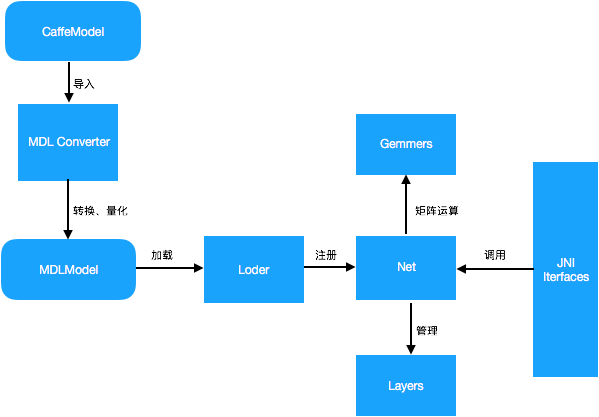

Framework MDL chủ yếu gồm: **mô-đun chuyển mô hình (MDL Converter), mô-đun nạp mô hình (Loader), mô-đun quản lý mạng (Net), mô-đun tính ma trận (Gemmers) và tầng giao diện JNI (JNI Interfaces) cho Android gọi.**

Trong đó mô-đun chuyển mô hình chủ yếu chuyển mô hình Caffe thành mô hình MDL, đồng thời hỗ trợ lượng tử hóa tham số float 32 bit thành 8 bit, nén mạnh kích thước mô hình; mô-đun nạp mô hình chủ yếu giải lượng tử hóa, kiểm tra khi nạp, đăng ký mạng…; mô-đun quản lý mạng chủ yếu khởi tạo và quản lý các tầng trong mạng; MDL có tầng giao diện JNI để Android gọi, lập trình viên dễ dàng nạp mô hình và dự đoán bằng cách gọi JNI.

6. Hiệu năng và tương thích của MDL

- Kích thước: armv7 khoảng 300 KB.
- Tốc độ: trên GPU iOS, MobileNet đạt 40 ms, SqueezeNet đạt 30 ms.

MDL đã lặp phát triển hơn một năm từ khi lập dự án tới khi mở mã. Các chỉ số mà thiết bị di động quan tâm như kích thước, điện năng, tốc độ đều tốt. Các sản phẩm nội bộ Baidu cũng đã so sánh nhiều lần trước khi dùng; so với các dự án mã nguồn mở liên quan, MDL vừa đảm bảo tốc độ và điện năng vừa hỗ trợ nhiều mô hình như MobileNet, GoogLeNet v1, SqueezeNet…, lại có bản GPU cho iOS, SqueezeNet một lần chạy nhanh nhất 30–40 ms.

**So sánh với các framework cùng loại**

| Framework | Caffe2 | TensorFlow | ncnn | MDL (CPU) | MDL (GPU) |
| --- | --- | --- | --- | --- | --- |
| Phần cứng | CPU | CPU | CPU | CPU | GPU |
| Tốc độ | chậm | chậm | nhanh | nhanh | cực nhanh |
| Kích thước | lớn | lớn | nhỏ | nhỏ | nhỏ |
| Tương thích | Android và iOS | Android và iOS | Android và iOS | Android và iOS | iOS |

So với các framework di động hỗ trợ CNN khác, MDL nhanh, ổn định, tương thích tốt, ví dụ mẫu đầy đủ.

**Tương thích**

MDL chạy ổn định trên cả iOS và Android; trên iOS 10 trở lên có API tính bằng GPU, hiệu năng rất tốt, còn trên Android thì chạy thuần CPU. Trạng thái chạy trên máy cao, trung, thấp cấp và mức phủ trên ứng dụng Baidu và các ứng dụng khác đều có ưu thế tuyệt đối.

MDL cũng hỗ trợ chuyển trực tiếp mô hình Caffe thành mô hình MDL.

> **Biên tập:** bảng so sánh trong bản gốc bị dồn thành một dòng chữ liền ("框架Caffe2TensorFlowncnn…"), đã dựng lại thành bảng; "3-40ms" là 30–40 ms. Các nhận định "ưu thế tuyệt đối" là của chính nhóm phát triển. MDL đã được gộp vào Paddle-Mobile (17.10.5), nay là Paddle Lite.

### 17.10.5 Paddle-Mobile

<div class="qa-theory">

**Lý thuyết:** [Ôn tập · 17.11.3 Dùng Paddle-Mobile phân loại ảnh trên điện thoại Android](qa/ch17_vi?id=_17113-dùng-paddle-mobile-phân-loại-ảnh-trên-điện-thoại-android)

</div>

1. Thời gian mở mã: liên tục cập nhật, đã tới bản 3.0.
2. Đơn vị mở mã: Baidu.
3. GitHub: https://github.com/PaddlePaddle/paddle-mobile
4. Đặc điểm:
   - hiệu năng cao trên CPU ARM;
   - hỗ trợ GPU Mali;
   - hỗ trợ GPU Adreno;
   - hỗ trợ GPU trên thiết bị Apple bằng Metal;
   - hỗ trợ các bo mạch FPGA như ZU5, ZU9;
   - hỗ trợ các bo mạch ARM-Linux như Raspberry Pi.

> **Biên tập:** bản gốc viết "Andreno"; đúng tên là **Adreno** (GPU của Qualcomm). Paddle-Mobile đã được đổi tên và phát triển tiếp thành **Paddle Lite** (2019), kho cũ chuyển hướng về `PaddlePaddle/Paddle-Lite`.

### 17.10.6 MACE (Mobile AI Compute Engine)

1. Thời gian mở mã: tháng 6/2018 (liên tục cập nhật, v0.9.0 ngày 20/7/2018).
2. Đơn vị mở mã: Xiaomi.
3. GitHub: https://github.com/XiaoMi/mace
4. Giới thiệu: Mobile AI Compute Engine (MACE) là framework suy luận học sâu tối ưu cho các thiết bị tính toán dị thể trên di động. MACE bao phủ các thiết bị tính toán phổ biến trên di động (CPU, GPU và DSP), có bộ công cụ và tài liệu đầy đủ, giúp người dùng dễ dàng triển khai mô hình học sâu trên thiết bị di động. MACE được dùng rộng rãi trong Xiaomi và được kiểm chứng có hiệu năng và độ ổn định hàng đầu.

> **Biên tập:** bản gốc ghi thời gian mở mã là tháng 4/2018; MACE được Xiaomi công bố mã nguồn cuối tháng 6/2018.

5. Khung cơ bản của MACE:

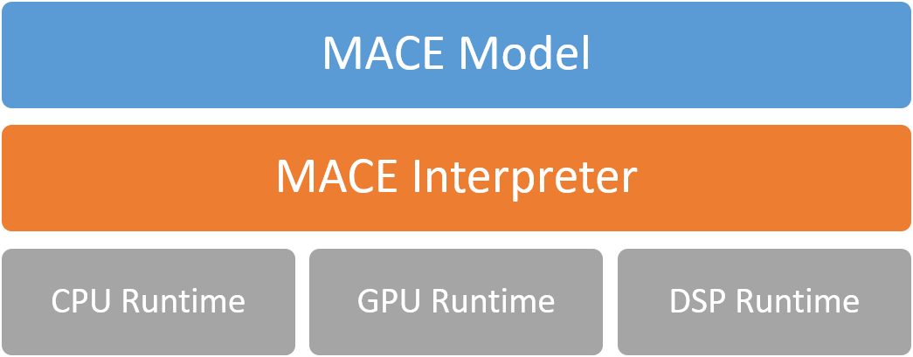

**MACE Model**

MACE định nghĩa định dạng mô hình riêng (giống Caffe2); công cụ của MACE chuyển được mô hình Caffe và TensorFlow thành mô hình MACE.

**MACE Interpreter**

MACE Interpreter chủ yếu phân tích và chạy đồ thị mạng neuron (DAG) và quản lý các tensor trong mạng.

**Runtime**

Các runtime CPU/GPU/DSP là phần cài đặt toán tử cho từng thiết bị tính toán.

6. Quy trình cơ bản dùng MACE:

Quy trình: cấu hình file triển khai mô hình → biên dịch thư viện MACE → chuyển mô hình → (triển khai | chạy bằng dòng lệnh | Benchmark).

**1. Cấu hình file triển khai mô hình (.yml)**

File triển khai mô tả chi tiết mô hình cần triển khai và thông tin thư viện cần sinh; MACE dựa vào file này để sinh thư viện tương ứng.

**2. Biên dịch thư viện MACE**

Biên dịch thư viện tĩnh hoặc động của MACE.

**3. Chuyển mô hình**

Chuyển mô hình TensorFlow hoặc Caffe thành mô hình MACE.

**4.1. Triển khai**

Tích hợp thư viện sinh ở bước Build tùy mục đích sử dụng, rồi gọi giao diện tương ứng của MACE để chạy mô hình.

**4.2. Chạy bằng dòng lệnh**

MACE có công cụ dòng lệnh để chạy mô hình, dùng để đo thời gian chạy, bộ nhớ và kiểm tra tính đúng của mô hình.

**4.3. Benchmark**

MACE có công cụ benchmark dòng lệnh, xem chi tiết thời gian chạy của mọi toán tử trong mô hình.

> **Biên tập:** sơ đồ quy trình trong bản gốc (ảnh chữ tiếng Trung) đã được viết lại thành dòng quy trình ở trên.

7. MACE tối ưu ở những mặt nào?

**MACE** là framework tính toán mạng neuron tối ưu riêng cho nền tảng tính toán dị thể trên di động, tối ưu chủ yếu ở các mặt sau:

- **Hiệu năng:** mã được tối ưu riêng bằng NEON, OpenCL và Hexagon HVX, dùng [thuật toán Winograd](https://arxiv.org/abs/1509.09308) để tăng tốc tích chập; ngoài ra còn tối ưu riêng tốc độ khởi động.
- **Điện năng:** hỗ trợ quản lý điện năng của chip, như lập lịch big.LITTLE của ARM, các tùy chọn điện năng của GPU Adreno của Qualcomm.
- **Độ phản hồi của hệ thống:** tự động chia nhỏ các tác vụ OpenCL chạy lâu để tác vụ vẽ giao diện được ưu tiên chen vào tốt, đảm bảo giao diện hệ thống phản hồi và trải nghiệm người dùng.
- **Bộ nhớ:** dùng phân tích phụ thuộc bộ nhớ và tái sử dụng bộ nhớ để giảm bộ nhớ dùng; đồng thời giữ phụ thuộc bên ngoài ít nhất có thể, mã gọn.
- **Mã hóa và bảo vệ mô hình:** bảo vệ mô hình là một mục tiêu thiết kế quan trọng; hỗ trợ chuyển mô hình thành mã C++, làm rối các chuỗi hằng quan trọng, tăng độ khó dịch ngược.
- **Phạm vi phần cứng:** hỗ trợ tăng tốc tính toán trên CPU, GPU và DSP (hiện chỉ Hexagon) của các dòng chip Qualcomm, MediaTek, Pinecone (Xiaomi)…; đồng thời chạy được trên CPU của các hệ thống có giao diện POSIX.

8. So sánh hiệu năng:

MACE hỗ trợ mô hình TensorFlow và Caffe, có công cụ chuyển mô hình đã huấn luyện thành file dữ liệu mô hình riêng; cũng có thể chọn chuyển mô hình thành mã C++, sinh thư viện động hoặc tĩnh, tăng tính bảo mật của mô hình.

So sánh các framework hiện có (theo bản giới thiệu của MACE):

| | TensorFlow Lite | Caffe | SNPE | MiAI Compute Engine (MACE) |
| --- | --- | --- | --- | --- |
| Mã nguồn mở | có | có | không | có |
| Tốc độ CPU | | trung bình | | nhanh |
| Tốc độ GPU | không hỗ trợ | không hỗ trợ | nhanh, chỉ hỗ trợ Adreno | nhanh, hỗ trợ đa số GPU di động |
| Tốc độ DSP | không hỗ trợ | không hỗ trợ | nhanh, hỗ trợ HVX | nhanh, hỗ trợ HVX |
| Tốc độ khởi tạo GPU | không hỗ trợ | không hỗ trợ | chậm | tối ưu riêng |
| Bộ nhớ GPU | không hỗ trợ | không hỗ trợ | trung bình | tốt, hỗ trợ tái sử dụng bộ nhớ |
| Chống giật trên GPU | không hỗ trợ | không hỗ trợ | dễ giật | tối ưu riêng |
| Mã hóa mô hình | trung bình, cần tùy biến | trung bình, cần tùy biến | trung bình, khó tùy biến | tối ưu riêng, hỗ trợ biên dịch mô hình thành mã, tùy biến được |
| Phát triển thêm | dễ | dễ | khá khó | dễ |

> **Biên tập:** bảng trên gõ lại từ ảnh (chữ tiếng Trung) trong bản gốc; đây là bảng tự so sánh của nhóm MACE năm 2018, TensorFlow Lite sau đó đã hỗ trợ GPU (2019) và DSP/NPU qua delegate. SNPE là bộ công cụ của Qualcomm (nay thuộc Qualcomm AI Engine Direct / QNN). MACE ít được cập nhật từ khoảng 2021.

### 17.10.7 FeatherCNN

1. Thời gian mở mã: năm 2018.
2. Đơn vị mở mã: Tencent AI.
3. GitHub: https://github.com/Tencent/FeatherCNN
4. Đặc điểm:

**FeatherCNN là thư viện suy luận CNN hiệu quả cho kiến trúc ARM do phòng AI Platform của Tencent phát triển; hỗ trợ mô hình Caffe, có ba đặc tính: hiệu năng cao, dễ triển khai, nhẹ.**

**Đặc tính cụ thể:**

- **Hiệu năng cao:** trên thiết bị di động (iOS/Android), thiết bị nhúng (Linux) hay máy chủ ARM (Linux), FeatherCNN đều đạt hiệu năng suy luận tiên tiến nhất.
- **Dễ triển khai:** toàn bộ FeatherCNN nằm trong một kho mã, không có phụ thuộc bên thứ ba, nên dễ triển khai trên nền tảng di động. Định dạng mô hình riêng của FeatherCNN hoàn toàn tương thích với mô hình Caffe.
- **Nhẹ:** thư viện FeatherCNN sau biên dịch chỉ vài trăm KB.

> **Biên tập:** dòng "thời gian mở mã" trong bản gốc chép nhầm từ mục Paddle-Mobile ("liên tục cập nhật, đã tới bản 3.0"); FeatherCNN được mở mã năm 2018 và nay đã ngừng phát triển.

### 17.10.8 TensorFlow Lite

<div class="qa-theory">

**Lý thuyết:** [Ôn tập · 15.7.4 Chọn framework cho nền tảng di động thế nào?](qa/ch15_vi?id=_1574-chọn-framework-cho-nền-tảng-di-động-thế-nào)

</div>

1. Thời gian mở mã: tháng 11/2017.
2. Đơn vị mở mã: Google.
3. GitHub: https://github.com/tensorflow/tensorflow/tree/master/tensorflow/contrib/lite
4. Giới thiệu:

Google cho biết TensorFlow Lite là phiên bản mở rộng của TensorFlow Mobile. Trước đó, qua API TensorFlow Mobile, TensorFlow đã hỗ trợ triển khai nhúng mô hình trên điện thoại. TensorFlow Lite nên được xem là bản nâng cấp của TensorFlow Mobile.

TensorFlow Lite phối hợp tốt với Neural Networks API phát hành cùng Android 8.1; ngay cả khi không có tăng tốc phần cứng vẫn gọi CPU để xử lý, đảm bảo mô hình chạy được trên các thiết bị khác nhau. Mà quyền điều khiển sự phát triển của Android nằm trong tay Google, nên về lâu dài TensorFlow Lite sẽ được hỗ trợ ở tầng hệ thống Android.

5. Kiến trúc:

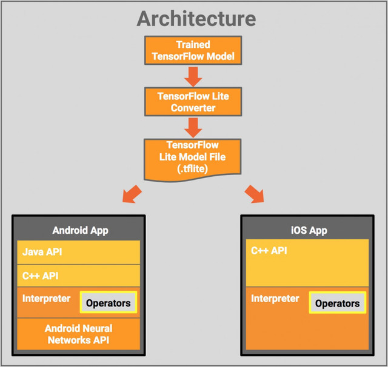

Các thành phần gồm:

- **Mô hình TensorFlow (TensorFlow Model):** mô hình đã huấn luyện lưu trên đĩa.
- **Bộ chuyển TensorFlow Lite (TensorFlow Lite Converter):** chương trình chuyển mô hình sang định dạng file TensorFlow Lite.
- **File mô hình TensorFlow Lite (TensorFlow Lite Model File):** định dạng dựa trên FlatBuffers, tối ưu cho tốc độ lớn nhất và kích thước nhỏ nhất.

6. Các bước phát triển trên di động:

Android Studio 3.0, SDK API 26, NDK 14.

Các bước:

1. Nhập dự án này vào Android Studio: https://github.com/tensorflow/tensorflow/tree/master/tensorflow/contrib/lite/java/demo
2. Tải mô hình (model) và nhãn (labels) cho di động: https://storage.googleapis.com/download.tensorflow.org/models/tflite/mobilenet_v1_224_android_quant_2017_11_08.zip
3. Giải nén `mobilenet_v1_224_android_quant_2017_11_08.zip`, được một file `xxx.tflite` và một file `labels.txt`, tức mô hình và nhãn; chép hai file này vào thư mục `assets`.
4. Build app và chạy.

> **Biên tập:** các đường dẫn `tensorflow/contrib/lite` đã không còn (TensorFlow Lite chuyển ra khỏi `contrib` từ 2018, rồi tháng 9/2024 được đổi tên thành **LiteRT** với kho riêng `google-ai-edge/LiteRT`). Các ví dụ Android hiện nay nằm ở kho ví dụ của LiteRT / MediaPipe. LiteRT nay cũng nhận mô hình từ PyTorch (qua `ai-edge-torch`) và JAX.

### 17.10.8b TensorFlow Lite và TensorFlow Mobile khác nhau thế nào?

<div class="qa-theory">

**Lý thuyết:** [Ôn tập · 17.10.8 TensorFlow Lite](qa/ch17_vi?id=_17108-tensorflow-lite)

</div>

- TensorFlow Lite là bản tiến hóa của TensorFlow Mobile.
- Trong đa số trường hợp, TensorFlow Lite có file nhị phân nhỏ hơn, ít phụ thuộc hơn và hiệu năng tốt hơn.
- TensorFlow Mobile là bản cắt gọn của TensorFlow đầy đủ, còn TensorFlow Lite gần như được viết lại từ đầu. Về bên trong, các cấu trúc dữ liệu cơ bản nhất của lõi như OP, Context đều mới. Về bên ngoài, file mô hình đổi từ định dạng PB sang FlatBuffers, kích thước thư viện giảm mạnh xuống khoảng 300 KB, kèm một bộ chuyển (converter) để chuyển mô hình TensorFlow thường sang định dạng TensorFlow Lite. Vì vậy xét về mọi mặt, TensorFlow Lite là một phương án cài đặt mới.

> **Biên tập:** trong bản gốc, đoạn này nằm trong mục 17.10.8 với tiêu đề viết thường "17.7.9" (số sai); bản dịch tách thành mục riêng 17.10.8b. TensorFlow Mobile đã bị bỏ từ đầu năm 2019.

### 17.10.9 PocketFlow

<div class="qa-theory">

**Lý thuyết:** [Ôn tập · 14.6.1 AutoML là gì?](qa/ch14_vi?id=_1461-automl-là-gì) · [Ôn tập · 17.4 Hiện có những phương pháp nén mô hình học sâu nào?](qa/ch17_vi?id=_174-hiện-có-những-phương-pháp-nén-mô-hình-học-sâu-nào)

</div>

1. Thời gian mở mã: tháng 9/2018.
2. Đơn vị mở mã: Tencent.
3. GitHub: https://github.com/Tencent/PocketFlow
4. Giới thiệu:

Được nhóm phát triển giới thiệu là "framework nén mô hình tự động đầu tiên trên thế giới": một framework nén mô hình tự động cho lập trình viên AI trên thiết bị di động, tích hợp các thuật toán nén và huấn luyện mô hình phổ biến, kết hợp với thành phần tối ưu siêu tham số tự phát triển, tự động hóa toàn bộ việc nén và tăng tốc mô hình. Lập trình viên không cần hiểu chi tiết thuật toán vẫn nhanh chóng đưa AI lên sản phẩm di động, xử lý dữ liệu người dùng tại chỗ một cách hiệu quả.

5. Giới thiệu framework

PocketFlow gồm hai nhóm thành phần chính: thành phần thuật toán nén/tăng tốc mô hình và thành phần tối ưu siêu tham số, cấu trúc như hình dưới.

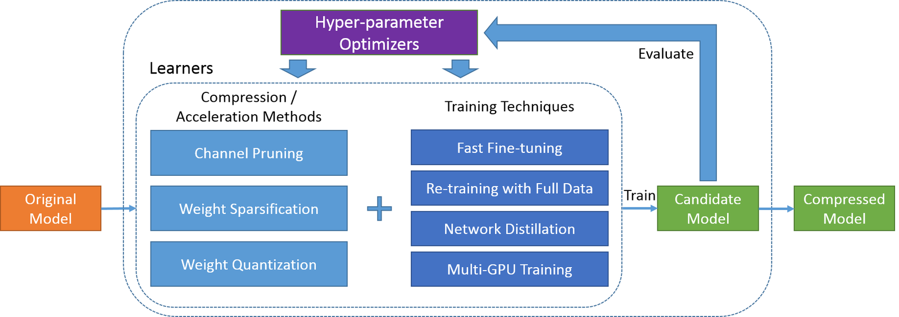

Lập trình viên đưa mô hình gốc chưa nén vào PocketFlow, đồng thời chỉ định chỉ tiêu hiệu năng mong muốn, ví dụ số lần nén và/hoặc tăng tốc. Trong mỗi vòng lặp, thành phần tối ưu siêu tham số chọn một tổ hợp giá trị siêu tham số, rồi thành phần thuật toán nén/tăng tốc dựa vào tổ hợp đó để nén mô hình gốc, được một mô hình ứng viên đã nén; dựa trên kết quả đánh giá hiệu năng của mô hình ứng viên, thành phần tối ưu siêu tham số chỉnh tham số của chính nó, chọn tổ hợp siêu tham số mới để bắt đầu vòng tiếp theo. Khi dừng lặp, PocketFlow chọn tổ hợp siêu tham số tốt nhất và mô hình ứng viên tương ứng làm đầu ra cuối cùng, trả cho lập trình viên để triển khai trên di động.

6. PocketFlow nén và tăng tốc mô hình thế nào?

Cụ thể, PocketFlow kết hợp hiệu quả các thành phần thuật toán sau, nén và tăng tốc mô hình học sâu với mất mát độ chính xác nhỏ hơn và mức tự động hóa cao hơn:

- a) **Cắt kênh (channel pruning):** trong CNN, cắt theo chiều kênh của bản đồ đặc trưng giảm đồng thời kích thước và độ phức tạp tính toán, mô hình sau nén triển khai thẳng trên các framework hiện có. Trên bài phân loại ảnh CIFAR-10, cắt kênh ResNet-56 đạt tăng tốc 2,5 lần với mất 0,4% độ chính xác, tăng tốc 3,3 lần với mất 0,7%.
- b) **Làm thưa trọng số (weight sparsification):** thêm ràng buộc thưa lên trọng số, giảm mạnh số phần tử khác 0; trọng số sau nén lưu và truyền dưới dạng ma trận thưa, đạt nén mô hình. Với mô hình phân loại MobileNet, bỏ 50% trọng số chỉ làm độ chính xác Top-1 trên ImageNet giảm 0,6%.
- c) **Lượng tử hóa trọng số (weight quantization):** thêm ràng buộc lượng tử hóa lên trọng số, giảm số bit biểu diễn mỗi trọng số; hỗ trợ cả hai nhóm thuật toán lượng tử hóa đều và không đều, tận dụng tối ưu phần cứng của ARM, FPGA…, tăng hiệu suất tính trên di động, và hỗ trợ phần mềm cho việc thiết kế chip mạng neuron sau này. Ví dụ ResNet-18 cho phân loại ImageNet, lượng tử hóa dấu phẩy tĩnh 8 bit nén 4 lần không mất độ chính xác.
- d) **Chưng cất mạng (network distillation):** với các thành phần nén trên, dùng đầu ra của mô hình gốc chưa nén làm thông tin giám sát thêm để hướng dẫn huấn luyện mô hình sau nén; với cùng số lần nén/tăng tốc, độ chính xác tăng thêm 0,5%–2,0%.
- e) **Huấn luyện nhiều GPU (multi-GPU training):** huấn luyện mô hình học sâu đòi hỏi nhiều tài nguyên tính toán, một GPU khó huấn luyện xong trong thời gian ngắn, nên nhóm hỗ trợ đầy đủ huấn luyện phân tán nhiều máy nhiều card để rút ngắn quá trình phát triển. Cả mô hình phân loại ảnh ResNet-50 trên ImageNet lẫn mô hình dịch máy Transformer trên WMT14 đều huấn luyện xong trong vòng một giờ.
- f) **Tối ưu siêu tham số (hyper-parameter optimization):** đa số lập trình viên ít hiểu về thuật toán nén mô hình, nhưng giá trị siêu tham số lại ảnh hưởng rất lớn tới kết quả cuối, nên nhóm đưa vào thành phần tối ưu siêu tham số, dùng các thuật toán như học tăng cường và framework tối ưu siêu tham số tự động AutoML do AI Lab tự phát triển, để xác định tổ hợp siêu tham số tốt nhất theo yêu cầu hiệu năng cụ thể. Ví dụ với thuật toán cắt kênh, thành phần này tự động dùng tỉ lệ cắt khác nhau cho từng tầng tùy mức dư thừa của tầng đó trong mô hình gốc, tối đa hóa độ chính xác của mô hình sau nén mà vẫn thỏa số lần nén tổng thể.

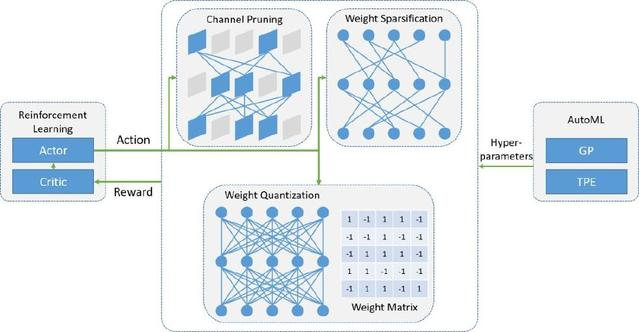

7. Hiệu năng của PocketFlow

Nhờ thành phần tối ưu siêu tham số, PocketFlow không chỉ tránh được việc chỉnh tham số thủ công phiền phức, đòi hỏi trình độ cao, mà còn vượt kết quả chỉnh tay trên mọi thuật toán nén. Lấy phân loại ảnh làm ví dụ, trên CIFAR-10 và ImageNet, PocketFlow nén và tăng tốc hiệu quả nhiều cấu trúc CNN như ResNet và MobileNet.

Trên CIFAR-10, PocketFlow dùng ResNet-56 làm mô hình gốc để cắt kênh, thêm các chiến lược huấn luyện như tối ưu siêu tham số và chưng cất mạng, đạt tăng tốc 2,5 lần với mất 0,4% độ chính xác, 3,3 lần với mất 0,7%, và tốt hơn rõ ResNet-44 chưa nén. Trên ImageNet, PocketFlow có thể tiếp tục làm thưa trọng số của MobileNet vốn đã rất gọn, đạt độ chính xác tương tự với mô hình nhỏ hơn; so với Inception-V1, ResNet-18…, kích thước chỉ bằng khoảng 20–40% mà độ chính xác cơ bản như nhau (thậm chí cao hơn).

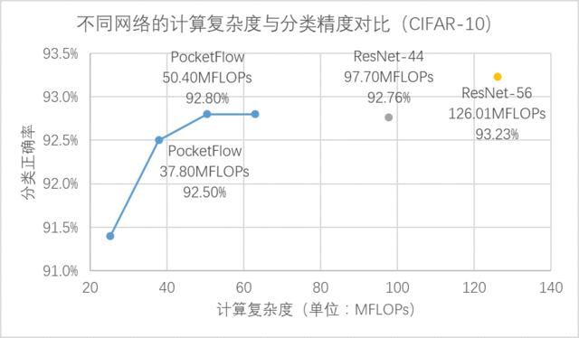

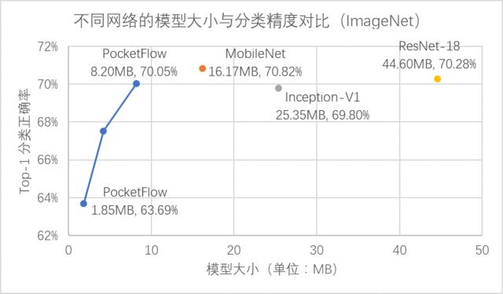

So với chỉnh tham số thủ công tốn thời gian công sức, thành phần tối ưu siêu tham số tự động AutoML trong PocketFlow chỉ cần hơn 10 vòng lặp là đạt hiệu năng tương tự chỉnh tay, sau 100 vòng lặp tổ hợp siêu tham số tìm được giảm thêm khoảng 0,6% mất mát độ chính xác. Dùng thành phần tối ưu siêu tham số để tự động xác định số bit lượng tử hóa cho trọng số từng tầng, PocketFlow cải thiện nhất quán khi nén ResNet-18 cho phân loại ImageNet; khi số bit lượng tử hóa trung bình là 4, thành phần tối ưu siêu tham số tăng độ chính xác từ 63,6% lên 68,1% (mô hình gốc đạt 70,3%).

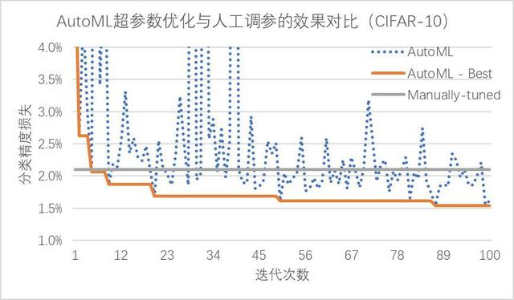

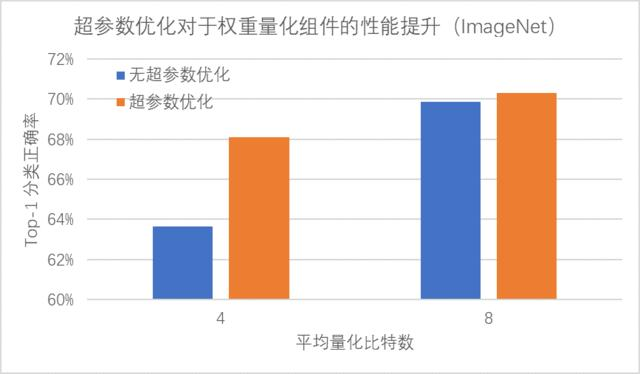

**Tài liệu tham khảo của mục này**

1. Zhuangwei Zhuang, Mingkui Tan, Bohan Zhuang, Jing Liu, Jiezhang Cao, Qingyao Wu, Junzhou Huang, Jinhui Zhu. "Discrimination-aware Channel Pruning for Deep Neural Networks". NeurIPS 2018, Montreal, Canada.
2. Jiaxiang Wu, Weidong Huang, Junzhou Huang, Tong Zhang. "Error Compensated Quantized SGD and its Applications to Large-scale Distributed Optimization". ICML 2018, Stockholm, Sweden.

> **Biên tập:** các biểu đồ có tiêu đề và nhãn trục tiếng Trung; chú thích dưới mỗi hình đã dịch nội dung. PocketFlow (dựa trên TensorFlow 1.x) đã ngừng phát triển; các công cụ nén tự động hiện nay gồm NNI (Microsoft), NVIDIA Model Optimizer, Intel Neural Compressor, và các tính năng lượng tử hóa sẵn có trong LiteRT, ONNX Runtime, `torchao`.

### 17.10.10 Một số framework mã nguồn mở khác hỗ trợ học sâu trên di động

<div class="qa-theory">

**Lý thuyết:** [Ôn tập · 15.7.4 Chọn framework cho nền tảng di động thế nào?](qa/ch15_vi?id=_1574-chọn-framework-cho-nền-tảng-di-động-thế-nào)

</div>

Bản gốc chỉ dẫn một bài blog CSDN: https://blog.csdn.net/zchang81/article/details/74280019

> **Biên tập:** bổ sung các framework suy luận trên thiết bị phổ biến hiện nay: **LiteRT** (Google, trước là TensorFlow Lite), **ExecuTorch** (Meta, kế tục PyTorch Mobile), **Core ML** (Apple), **ONNX Runtime Mobile** (Microsoft), **MNN** (Alibaba), **ncnn** (Tencent), **Paddle Lite** (Baidu), **MediaPipe** (Google, pipeline dựng sẵn), **TNN** (Tencent), **Qualcomm AI Engine Direct**, **MediaTek NeuroPilot**; và cho mô hình ngôn ngữ lớn trên thiết bị: **llama.cpp**, **MLC LLM**, **MLX** (Apple).

### 17.10.11 So sánh MDL, NCNN và TFLite

<div class="qa-theory">

**Lý thuyết:** [Ôn tập · 17.10.1 NCNN](qa/ch17_vi?id=_17101-ncnn) · [Ôn tập · 17.10.4 MDL (mobile-deep-learning)](qa/ch17_vi?id=_17104-mdl-mobile-deep-learning) · [Ôn tập · 17.10.8 TensorFlow Lite](qa/ch17_vi?id=_17108-tensorflow-lite)

</div>

So sánh framework MDL của Baidu, NCNN của Tencent và TFLite của Google.

| | MDL | NCNN | TFLite |
| --- | --- | --- | --- |
| Chất lượng mã | trung bình | cao | rất cao |
| Đa nền tảng | √ | √ | √ |
| Hỗ trợ mô hình Caffe | √ | √ | × |
| Hỗ trợ mô hình TensorFlow | × | × | √ |
| Tối ưu lệnh NEON trên CPU | √ | √ | √ |
| Tăng tốc GPU | √ | × | × |

Điểm giống nhau:

- chỉ có chức năng suy luận (inference), mô hình phải được huấn luyện ngoại tuyến;
- thư viện cuối cùng nhỏ, đều dưới 500 KB;
- để tăng tốc độ chạy đều dùng lệnh ARM NEON;
- đa nền tảng, hỗ trợ cả iOS và Android.

Điểm khác nhau:

- MDL và NCNN chỉ hỗ trợ file mô hình do Caffe sinh ra, còn TFLite đương nhiên chỉ hỗ trợ file mô hình của TensorFlow, framework "nhà mình";
- MDL hỗ trợ tăng tốc GPU bằng framework Metal của iOS, tăng đáng kể tốc độ chạy trên iPhone, đạt mức gần thời gian thực; NCNN và TFLite chưa có chức năng này.

> **Biên tập:** bản gốc viết "Matal", đúng là **Metal**. So sánh này đúng với năm 2018: ncnn nay có GPU qua Vulkan và nhận mô hình từ PyTorch/ONNX qua PNNX; TFLite/LiteRT có GPU delegate (OpenGL ES, OpenCL, Metal) và nhận mô hình PyTorch; MDL đã ngừng phát triển.

## 17.11 Triển khai bằng các framework mã nguồn mở trên di động

> **Biên tập:** trong bản gốc, bốn mục con ở đây đánh số 17.8.1, 17.8.2, 17.8.4, 17.8.3 (trùng với mục 17.8 và lộn thứ tự), mục NCNN và QNNPACK chỉ có dòng "các bước triển khai". Hướng dẫn NCNN được lấy từ file riêng "17.8.1 NCNN部署.md" của bản gốc; mục QNNPACK và MACE do người biên tập viết ngắn gọn.

### 17.11.1 Lấy NCNN làm ví dụ

<div class="qa-theory">

**Lý thuyết:** [Ôn tập · 17.10.1 NCNN](qa/ch17_vi?id=_17101-ncnn)

</div>

> **Biên tập:** hướng dẫn dưới đây (theo các bài blog CSDN được dẫn) ghép từ hai ví dụ khác nhau và có vài chỗ không khớp, cần lưu ý khi làm theo: (1) đoạn mã C++ chạy trên máy tính (bước s8) là ví dụ phân loại **tín hiệu** hai kênh I/Q dài 4400 điểm thành 13 lớp cử chỉ (nạp `demo.param`, include `gesture.id.h`), không phải phân loại ảnh bằng AlexNet như tiêu đề; (2) mã Java và C++ của phần Android viết cho mô hình **MobileNetV2** (đọc `mobilenet_v2.param.bin`, `mobilenet_v2.bin`, dùng `mobilenet_v2_param_id`, ảnh $224\times224$, giá trị trung bình và hệ số chuẩn hóa của MobileNet), trong khi các bước chuẩn bị mô hình dùng AlexNet ($227\times227$). Muốn chạy với AlexNet thì đổi tên file, tên namespace `alexnet_param_id`, kích thước ảnh, và bỏ hệ số chuẩn hóa 0,017 (AlexNet của Caffe chỉ trừ trung bình); (3) `ncnn2mem` không "mã hóa" mô hình mà chuyển file `.param` sang dạng nhị phân (`alexnet.param.bin`) và sinh header chứa chỉ số các blob, nhờ đó không lộ tên tầng trong file và nạp được từ bộ nhớ; ứng dụng phải đọc file `.param.bin` này (bằng `load_param` với dữ liệu nhị phân) chứ không phải `.param`. Mã dưới đây đã sửa hai lỗi biên dịch trong file C++ của Android (xem ghi chú ở đó). Từ khoảng 2021, ncnn khuyến nghị chuyển mô hình bằng PNNX và có sẵn kho ví dụ Android chính thức (ví dụ `ncnn-android-squeezenet`), nên đơn giản hơn nhiều so với các bước dưới.

#### 1. Dùng ncnn phân loại trên máy tính (AlexNet)

**s1.** Cài g++, cmake, protobuf, OpenCV.

**s2.** Biên dịch mã nguồn:

```bash
git clone https://github.com/Tencent/ncnn
cd <ncnn-root-dir>
mkdir -p build
cd build
cmake ..
make -j4
```

**s3.** Chuẩn bị file mô hình Caffe (AlexNet):

```text
deploy.prototxt
snapshot_10000.caffemodel
```

AlexNet: [deploy.prototxt](https://github.com/BVLC/caffe/tree/master/models/bvlc_alexnet), [caffemodel](http://dl.caffe.berkeleyvision.org/bvlc_alexnet.caffemodel).

**s4.** Dùng công cụ của Caffe chuyển prototxt và caffemodel của phiên bản Caffe cũ sang phiên bản mới. Đặt prototxt và caffemodel cũ vào thư mục `caffe/build/tools`, chạy:

```bash
./upgrade_net_proto_text [old prototxt] [new prototxt]
./upgrade_net_proto_binary [old caffemodel] [new caffemodel]
```

**s5.** Thay tầng đầu vào trong `deploy.prototxt` bằng tầng Input (nếu chỉ đọc một ảnh thì đặt dim đầu là 1):

```protobuf
layer {
  name: "data"
  type: "Input"
  top: "data"
  input_param { shape: { dim: 1 dim: 3 dim: 227 dim: 227 } }
}
```

**s6.** Dùng công cụ `caffe2ncnn` chuyển mô hình Caffe thành mô hình ncnn:

```bash
./caffe2ncnn deploy.prototxt bvlc_alexnet.caffemodel alexnet.param alexnet.bin
```

File param và bin được sinh trong thư mục `ncnn/build/tools`.

**s7.** Chuyển tham số mô hình sang dạng nhị phân (bản gốc gọi là "mã hóa"):

```bash
./ncnn2mem alexnet.param alexnet.bin alexnet.id.h alexnet.mem.h
```

Các file được sinh trong thư mục `ncnn/build/tools`:

- `alexnet.param`: cấu trúc mạng (sau `ncnn2mem` là `alexnet.param.bin`, dạng nhị phân);
- `alexnet.bin`: trọng số của mạng;
- `alexnet.id.h`: chỉ số các blob, dùng khi dự đoán ảnh.

**s8.** Viết mã chạy trên máy tính (tham khảo https://blog.csdn.net/qq_36982160/article/details/79929869):

```cpp
#include <stdio.h>
#include <algorithm>
#include <vector>
#include"gesture.id.h"
#include "net.h"
// dùng ncnn: tham số thứ nhất là dữ liệu cần dự đoán, tham số thứ hai là vector điểm của các lớp; truyền tham chiếu để hàm ghi được giá trị
static int detect_squeezenet( float *data, std::vector<float>& cls_scores) {
	// tạo ncnn::Net; nhớ include "net.h" (nếu báo không tìm thấy net.h thì xem phần cấu hình CMake ở dưới)
	ncnn::Net squeezenet;

	// nạp file cấu trúc và trọng số; vị trí đặt file xem bước s10
	int a=squeezenet.load_param("demo.param");
	int b=squeezenet.load_param_bin("demo.bin");

	// tạo Mat: ba tham số đầu là kích thước theo thứ tự w, h, c (đặt theo dữ liệu của bạn), tham số thứ tư là dữ liệu
	ncnn::Mat in = ncnn::Mat(550, 8, 2, data);

	// tạo Extractor
	ncnn::Extractor ex = squeezenet.create_extractor();
	ex.set_light_mode(true);
	// đổi "data" thành tên tầng dữ liệu trong deploy.prototxt của bạn
	int d= ex.input("data", in);

	ncnn::Mat out;
	// chạy mạng tới tầng ra; đổi "prob" thành tên tầng cuối trong deploy.prototxt của bạn
	int c=ex.extract("prob", out);

	// chép giá trị của out vào cls_scores để trả về điểm của từng lớp
	cls_scores.resize(out.w);
	for (int j=0; j<out.w; j++) {
		cls_scores[j] = out[j];
		}
		return 0;
	}

int main(int argc, char** argv) {
	// argv là tham số nhập từ dòng lệnh, ở đây là đường dẫn hai file dữ liệu (i và q), sửa theo nhu cầu
	const char* imagepath1 = argv[1];
	const char* imagepath2=argv[2];

	FILE *fopeni=NULL;
	FILE *fopenq=NULL;

	fopeni=fopen(imagepath1,"r");
	fopenq=fopen(imagepath2,"r");

	// dữ liệu ví dụ: hai tín hiệu i và q, tương đương hai kênh của một ảnh
	float i[4400];
	float q[4400];
	float data[8800];

	int count=4400;
	for (int j = 0; j < count; ++j) {
		fscanf(fopeni,"%f",&i[j]);
		fscanf(fopenq,"%f",&q[j]);
	}

	// ghép i và q (hai kênh) thành một vector một chiều; chú ý thứ tự các chiều dữ liệu
	for (int j = 0; j < 8800; ++j) {
		if (j<4400) {
			data[j]=i[j];
		}
		else{
			data[j]=q[j-4400];
		}
	}

	char a[13]={'A','B','C','F','G','H','I','J','K','L','M','N','O'};

	// gọi ncnn
	std::vector<float> cls_scores;  // lưu điểm cuối cùng của từng lớp
	// hàm này được định nghĩa ở trên
	detect_squeezenet(data, cls_scores);
	for (int i = 0; i < cls_scores.size(); ++i) {
		printf("%c : %f\n", a[i],cls_scores[i]);
	}

	return 0;
}
```

Đây là cách dùng ncnn đơn giản nhất, có thể thêm mã theo nhu cầu.

**s9.** Biên dịch mã.

(1) Viết `CMakeLists.txt`: thêm hai dòng sau vào `CMakeLists.txt` (của thư mục `examples`):

```cmake
add_executable(demo demo.cpp)
target_link_libraries(demo ncnn)
```

`CMakeLists.txt` khi đó như sau:

```cmake
find_package(OpenCV QUIET COMPONENTS core highgui imgproc imgcodecs)
if(NOT OpenCV_FOUND)
	find_package(OpenCV REQUIRED COMPONENTS core highgui imgproc)
endif()

include_directories(${CMAKE_CURRENT_SOURCE_DIR}/../src)
include_directories(${CMAKE_CURRENT_BINARY_DIR}/../src)

add_executable(squeezenet squeezenet.cpp)

target_link_libraries(squeezenet ncnn ${OpenCV_LIBS})

add_executable(fasterrcnn fasterrcnn.cpp)
target_link_libraries(fasterrcnn ncnn ${OpenCV_LIBS})

add_executable(demo demo.cpp)
target_link_libraries(demo ncnn)

add_subdirectory(ssd)
```

(2) Bỏ chú thích ở dòng biên dịch examples trong `CMakeLists.txt` ở thư mục gốc của ncnn:

```cmake
##############################################

# add_subdirectory(examples)
# add_subdirectory(benchmark)
add_subdirectory(src)
if(NOT ANDROID AND NOT IOS)
add_subdirectory(tools)
endif()
```

> **Biên tập:** đoạn trên chép từ `CMakeLists.txt` khi dòng `add_subdirectory(examples)` **còn** bị chú thích; cần xóa dấu `#` ở đầu dòng đó.

(3) Biên dịch trong thư mục `ncnn/build`, sinh file chạy `demo`:

```bash
make
```

**s10.** Chạy: chép file `.param` và `.bin` vừa sinh vào thư mục `ncnn/build/examples`, rồi cd vào thư mục đó và chạy:

```bash
./demo data_path1 data_path2
```

#### 2. Windows x64 (Visual Studio Community 2017)

**s1.** Cài Visual Studio Community 2017:

```text
download Visual Studio Community 2017 from https://visualstudio.microsoft.com/vs/community/
install it
Start → Programs → Visual Studio 2017 → Visual Studio Tools → x64 Native Tools Command Prompt for VS 2017
```

**s2.** Biên dịch protobuf:

```powershell
download protobuf-3.4.0 from https://github.com/google/protobuf/archive/v3.4.0.zip
> cd <protobuf-root-dir>
> mkdir build-vs2017
> cd build-vs2017
> cmake -G"NMake Makefiles" -DCMAKE_BUILD_TYPE=Release -DCMAKE_INSTALL_PREFIX=%cd%/install -Dprotobuf_BUILD_TESTS=OFF -Dprotobuf_MSVC_STATIC_RUNTIME=OFF ../cmake
> nmake
> nmake install
```

**s3.** Biên dịch thư viện ncnn:

```powershell
> cd <ncnn-root-dir>
> mkdir -p build-vs2017
> cd build-vs2017
> cmake -G"NMake Makefiles" -DCMAKE_BUILD_TYPE=Release -DCMAKE_INSTALL_PREFIX=%cd%/install -DProtobuf_INCLUDE_DIR=<protobuf-root-dir>/build-vs2017/install/include -DProtobuf_LIBRARIES=<protobuf-root-dir>/build-vs2017/install/lib/libprotobuf.lib -DProtobuf_PROTOC_EXECUTABLE=<protobuf-root-dir>/build-vs2017/install/bin/protoc.exe ..
> nmake
> nmake install

pick build-vs2017/install folder for further usage
```

#### 3. Dùng ncnn trên Android

Tham khảo:

- https://blog.csdn.net/qq_33200967/article/details/82421089
- https://blog.csdn.net/qq_36982160/article/details/79931741

**s1.** Cài NDK bằng Android Studio.

1. Mở Android Studio, lần lượt chọn File → Settings → Appearance & Behavior → System Settings → Android SDK → SDK Tools, đánh dấu NDK, bấm Apply để tự tải và cài (cài thành công sẽ có thư mục `ndk-bundle` trong thư mục SDK).
2. Cấu hình biến môi trường cho NDK:
   - mở file profile:

     ```bash
     sudo vim /etc/profile
     ```

   - thêm đường dẫn NDK vào cuối file:

     ```bash
     export NDK_HOME=sdkroot/ndk-bundle
     PATH=$NDK_HOME:$PATH
     ```

   - lưu và thoát, dùng lệnh `source` để biến môi trường có hiệu lực:

     ```bash
     source /etc/profile
     ```

   - kiểm tra NDK đã cấu hình thành công chưa:

     ```bash
     ndk-build -v
     ```

**s2.** Biên dịch ncnn SDK bằng các lệnh dưới; thư mục `install` được sinh trong `ncnn/build-android`, gồm `include` (header cần để gọi ncnn) và `lib` (thư viện ncnn đã biên dịch `libncnn.a`):

```bash
mkdir build-android
cd build-android
cmake -DCMAKE_TOOLCHAIN_FILE=$ANDROID_NDK/build/cmake/android.toolchain.cmake \
    -DANDROID_ABI="armeabi-v7a" -DANDROID_ARM_NEON=ON \
    -DANDROID_PLATFORM=android-14 ..
make
make install
make package
```

Thiết lập tham số xem: https://github.com/Tencent/ncnn/wiki/cmake-%E6%89%93%E5%8C%85-android-sdk

```text
ANDROID_ABI       tên kiến trúc; "armeabi-v7a" hỗ trợ phần lớn điện thoại
ANDROID_ARM_NEON  có dùng tập lệnh NEON không; đặt ON hỗ trợ phần lớn điện thoại
ANDROID_PLATFORM  phiên bản hệ điều hành thấp nhất; "android-14" là Android 4.0
```

**s3–s8.** Biên dịch mã nguồn ncnn cho máy tính (để có các công cụ chuyển đổi), chuẩn bị mô hình AlexNet, nâng cấp prototxt/caffemodel, thay tầng Input, chuyển bằng `caffe2ncnn` và chạy `ncnn2mem`: giống hệt các bước s2–s7 của phần 1 ở trên.

**s9.** Phát triển dự án Android.

(1) Trong Android Studio tạo dự án `NCNN1`, chọn Include C++ support.

> **Biên tập:** ảnh chụp màn hình ở bước này trong bản gốc là ảnh từ blog CSDN (có hình mờ), không có trong kho, nên đã bỏ.

(2) Tạo thư mục `assets` trong thư mục `main`, chép `alexnet.param.bin`, `alexnet.bin`, `label.txt` vào đó.

(3) Chép thư mục `include` và `alexnet.id.h` vào thư mục `cpp`.

(4) Tạo thư mục `jniLibs/armeabi-v7a/` trong thư mục `main`, chép `libncnn.a` vào đó.

> **Biên tập:** bản gốc ở bước (4) ghi chép `alexnet.id.h` vào `jniLibs/armeabi-v7a/`; đúng phải là thư viện **`libncnn.a`** (file `CMakeLists.txt` ở bước (10) đọc `jniLibs/armeabi-v7a/libncnn.a`). Ở bước (2), bản gốc ghi `alexnet.param`; theo ghi chú đầu mục, ứng dụng đọc file nhị phân `.param.bin`.

(5) Tạo file C++ trong thư mục `cpp` (`ncnn_jni.cpp`) để nạp mô hình và dự đoán ảnh:

```cpp
#include <android/bitmap.h>
#include <android/log.h>
#include <jni.h>
#include <string>
#include <vector>
// ncnn
#include "include/net.h"
#include "mobilenet_v2.id.h"
#include <sys/time.h>
#include <unistd.h>
static ncnn::UnlockedPoolAllocator g_blob_pool_allocator;
static ncnn::PoolAllocator g_workspace_pool_allocator;
static ncnn::Mat ncnn_param;
static ncnn::Mat ncnn_bin;
static ncnn::Net ncnn_net;
extern "C" {
// public native boolean Init(byte[] param, byte[] bin);
JNIEXPORT jboolean JNICALL
Java_com_example_ncnn1_NcnnJni_Init(JNIEnv *env, jobject thiz, jbyteArray param, jbyteArray bin) {
	// init param
	{
		int len = env->GetArrayLength(param);
		ncnn_param.create(len, (size_t) 1u);
		env->GetByteArrayRegion(param, 0, len, (jbyte *) ncnn_param); int ret = ncnn_net.load_param((const unsigned char *) ncnn_param);
		__android_log_print(ANDROID_LOG_DEBUG, "NcnnJni", "load_param %d %d", ret, len);
	}

	// init bin
	{
		int len = env->GetArrayLength(bin);
		ncnn_bin.create(len, (size_t) 1u);
		env->GetByteArrayRegion(bin, 0, len, (jbyte *) ncnn_bin);
		int ret = ncnn_net.load_model((const unsigned char *) ncnn_bin);
		__android_log_print(ANDROID_LOG_DEBUG, "NcnnJni", "load_model %d %d", ret, len);
	}

	ncnn::Option opt;
	opt.lightmode = true;
	opt.num_threads = 4;
	opt.blob_allocator = &g_blob_pool_allocator;
	opt.workspace_allocator = &g_workspace_pool_allocator;

	ncnn::set_default_option(opt);

	return JNI_TRUE;
}

// public native String Detect(Bitmap bitmap);
JNIEXPORT jfloatArray JNICALL Java_com_example_ncnn1_NcnnJni_Detect(JNIEnv* env, jobject thiz, jobject bitmap)
{
	// ncnn from bitmap
	ncnn::Mat in;
	{
		AndroidBitmapInfo info;
		AndroidBitmap_getInfo(env, bitmap, &info);
		int width = info.width; int height = info.height;
		if (info.format != ANDROID_BITMAP_FORMAT_RGBA_8888)
			return NULL;

		void* indata;
		AndroidBitmap_lockPixels(env, bitmap, &indata);
		// chuyển điểm ảnh thành dữ liệu, chỉ định thứ tự kênh
		in = ncnn::Mat::from_pixels((const unsigned char*)indata, ncnn::Mat::PIXEL_RGBA2BGR, width, height);
		AndroidBitmap_unlockPixels(env, bitmap);
	}

	// ncnn_net
	std::vector<float> cls_scores;
	{
		// trừ giá trị trung bình rồi nhân hệ số chuẩn hóa
		const float mean_vals[3] = {103.94f, 116.78f, 123.68f};
		const float scale[3] = {0.017f, 0.017f, 0.017f};

		in.substract_mean_normalize(mean_vals, scale);

		ncnn::Extractor ex = ncnn_net.create_extractor();
		// nếu không dùng ncnn2mem thì viết ex.input("data", in);
		ex.input(mobilenet_v2_param_id::BLOB_data, in);

		ncnn::Mat out;
		// nếu không dùng ncnn2mem thì viết ex.extract("prob", out);
		ex.extract(mobilenet_v2_param_id::BLOB_prob, out);

		int output_size = out.w;
		jfloatArray jOutputData = env->NewFloatArray(output_size);
		if (jOutputData == nullptr) return nullptr;

		env->SetFloatArrayRegion(jOutputData, 0, output_size, (const jfloat *) out.data); // chép kết quả
		return jOutputData;
	}
}
}
```

> **Biên tập:** sửa ba lỗi trong file này so với bản gốc: (1) dòng chú thích `// public native boolean Init(...)` bị dính với `JNIEXPORT jboolean JNICALL` trên cùng một dòng, khiến khai báo hàm `Init` mất kiểu trả về và không biên dịch được; đã tách dòng; (2) bản gốc include `alexnet.id.h` nhưng dùng `mobilenet_v2_param_id::BLOB_data`, nên đổi include thành `mobilenet_v2.id.h` cho khớp với phần Java (xem ghi chú đầu mục); (3) phần chép kết quả dùng mảng con trỏ độ dài thay đổi (VLA, không phải C++ chuẩn) rồi lấy con trỏ đầu tiên; thay bằng chép thẳng từ `out` (dữ liệu của `ncnn::Mat` một chiều nằm liên tục). Các API `ncnn::Option`, `set_default_option`, `opt.lightmode` là của ncnn năm 2018; bản mới đặt tùy chọn qua `ncnn_net.opt` trước khi nạp mô hình.

(6) Trong gói `com.example.ncnn1`, sửa mã của `MainActivity.java`:

```java
package com.example.ncnn1;
import android.Manifest;
import android.app.Activity;
import android.content.Intent;
import android.content.pm.PackageManager;
import android.content.res.AssetManager;
import android.graphics.Bitmap;
import android.graphics.BitmapFactory;
import android.net.Uri;
import android.os.Bundle;
import android.support.annotation.NonNull;
import android.support.annotation.Nullable;
import android.support.v4.app.ActivityCompat;
import android.support.v4.content.ContextCompat;
import android.text.method.ScrollingMovementMethod;
import android.util.Log;
import android.view.View;
import android.widget.Button;
import android.widget.ImageView;
import android.widget.TextView;
import android.widget.Toast;

import com.bumptech.glide.Glide;
import com.bumptech.glide.load.engine.DiskCacheStrategy;
import com.bumptech.glide.request.RequestOptions;

import java.io.BufferedReader;
import java.io.FileNotFoundException;
import java.io.IOException;
import java.io.InputStream;
import java.io.InputStreamReader;
import java.util.ArrayList;
import java.util.Arrays;
import java.util.List;

public class MainActivity extends Activity {
	private static final String TAG = MainActivity.class.getName();
	private static final int USE_PHOTO = 1001;
	private String camera_image_path;
	private ImageView show_image;
	private TextView result_text;
	private boolean load_result = false; private int[] ddims = {1, 3, 224, 224};
	private int model_index = 1;
	private List<String> resultLabel = new ArrayList<>();
	private NcnnJni squeezencnn = new NcnnJni();

	@Override
	public void onCreate(Bundle savedInstanceState) {
		super.onCreate(savedInstanceState);
		setContentView(R.layout.activity_main);

		try {
			initSqueezeNcnn();
		} catch (IOException e) {
			Log.e("MainActivity", "initSqueezeNcnn error");
		}

		init_view();
		readCacheLabelFromLocalFile();
	}

	private void initSqueezeNcnn() throws IOException {
		byte[] param = null;
		byte[] bin = null;

		{
			InputStream assetsInputStream = getAssets().open("mobilenet_v2.param.bin");
			int available = assetsInputStream.available();
			param = new byte[available];
			int byteCode = assetsInputStream.read(param);
			assetsInputStream.close();
		}

		{
			InputStream assetsInputStream = getAssets().open("mobilenet_v2.bin");
			int available = assetsInputStream.available();
			bin = new byte[available];
			int byteCode = assetsInputStream.read(bin);
			assetsInputStream.close();
		}

		load_result = squeezencnn.Init(param, bin);
		Log.d("load model", "result:" + load_result);
	}

	// initialize view
	private void init_view() {
		request_permissions();
		show_image = (ImageView) findViewById(R.id.show_image);
		result_text = (TextView) findViewById(R.id.result_text);
		result_text.setMovementMethod(ScrollingMovementMethod.getInstance());
		Button use_photo = (Button) findViewById(R.id.use_photo);

		// use photo click
		use_photo.setOnClickListener(new View.OnClickListener() {
			@Override
			public void onClick(View view) {
				if (!load_result) {
					Toast.makeText(MainActivity.this, "never load model", Toast.LENGTH_SHORT).show();
					return;
				}
				PhotoUtil.use_photo(MainActivity.this, USE_PHOTO);
			}
		});
	}

	// load label's name
	private void readCacheLabelFromLocalFile() {
		try {
			AssetManager assetManager = getApplicationContext().getAssets();
			BufferedReader reader = new BufferedReader(new InputStreamReader(assetManager.open("synset.txt")));
			String readLine = null;
			while ((readLine = reader.readLine()) != null) {
				resultLabel.add(readLine);
			}
			reader.close();
		} catch (Exception e) {
			Log.e("labelCache", "error " + e);
		}
	}

	@Override
	protected void onActivityResult(int requestCode, int resultCode, @Nullable Intent data) {
		String image_path;
		RequestOptions options = new RequestOptions().skipMemoryCache(true).diskCacheStrategy(DiskCacheStrategy.NONE);
		if (resultCode == Activity.RESULT_OK) {
			switch (requestCode) {
				case USE_PHOTO:
					if (data == null) {
						Log.w(TAG, "user photo data is null");
						return;
					}
					Uri image_uri = data.getData();
					Glide.with(MainActivity.this).load(image_uri).apply(options).into(show_image);
					// get image path from uri
					image_path = PhotoUtil.get_path_from_URI(MainActivity.this, image_uri);
					// predict image
					predict_image(image_path);
					break;
			}
		}
	}

	//  predict image
	private void predict_image(String image_path) {
		// picture to float array
		Bitmap bmp = PhotoUtil.getScaleBitmap(image_path);
		Bitmap rgba = bmp.copy(Bitmap.Config.ARGB_8888, true);

		// resize to 227x227
		Bitmap input_bmp = Bitmap.createScaledBitmap(rgba, ddims[2], ddims[3], false);
		try {
			// Data format conversion takes too long
			// Log.d("inputData", Arrays.toString(inputData));
			long start = System.currentTimeMillis();
			// get predict result
			float[] result = squeezencnn.Detect(input_bmp);
			long end = System.currentTimeMillis();
			Log.d(TAG, "origin predict result:" + Arrays.toString(result));
			long time = end - start; Log.d("result length", String.valueOf(result.length));
			// show predict result and time
			int r = get_max_result(result);
			String show_text = "result：" + r + "\nname：" + resultLabel.get(r) + "\nprobability：" + result[r] + "\ntime：" + time + "ms";
			result_text.setText(show_text);
		} catch (Exception e) {
			e.printStackTrace();
		}
	}

	// get max probability label
	private int get_max_result(float[] result) {
		float probability = result[0];
		int r = 0;
		for (int i = 0; i < result.length; i++) {
			if (probability < result[i]) {
				probability = result[i];
				r = i;
			}
		}
		return r;
	}

	// request permissions
	private void request_permissions() {
		List<String> permissionList = new ArrayList<>();
		if (ContextCompat.checkSelfPermission(this, Manifest.permission.CAMERA) != PackageManager.PERMISSION_GRANTED) {
			permissionList.add(Manifest.permission.CAMERA);
		}

		if (ContextCompat.checkSelfPermission(this, Manifest.permission.WRITE_EXTERNAL_STORAGE) != PackageManager.PERMISSION_GRANTED) {
			permissionList.add(Manifest.permission.WRITE_EXTERNAL_STORAGE);
		}

		if (ContextCompat.checkSelfPermission(this, Manifest.permission.READ_EXTERNAL_STORAGE) != PackageManager.PERMISSION_GRANTED) {
			permissionList.add(Manifest.permission.READ_EXTERNAL_STORAGE);
		}

		// if list is not empty will request permissions
		if (!permissionList.isEmpty()) {
			ActivityCompat.requestPermissions(this, permissionList.toArray(new String[permissionList.size()]), 1);
		}
	}

	@Override
	public void onRequestPermissionsResult(int requestCode, @NonNull String[] permissions, @NonNull int[] grantResults) {
		super.onRequestPermissionsResult(requestCode, permissions, grantResults);
		switch (requestCode) {
			case 1:
				if (grantResults.length > 0) {
					for (int i = 0; i < grantResults.length; i++) {
						int grantResult = grantResults[i];
						if (grantResult == PackageManager.PERMISSION_DENIED) {
							String s = permissions[i];
							Toast.makeText(this, s + " permission was denied", Toast.LENGTH_SHORT).show();
						}
					}
				}
				break;
		}
	}
}
```

(7) Trong gói `com.example.ncnn1`, tạo lớp `NcnnJni.java` cung cấp giao diện JNI:

```java
package com.example.ncnn1;

import android.graphics.Bitmap;

public class NcnnJni {
	public native boolean Init(byte[] param, byte[] bin);
	public native float[] Detect(Bitmap bitmap);

	static {
		System.loadLibrary("ncnn_jni");
	}
}
```

(8) Trong gói `com.example.ncnn1`, tạo lớp `PhotoUtil.java`, lớp tiện ích xử lý ảnh:

```java
package com.example.ncnn1;

import android.app.Activity;
import android.content.Context;
import android.content.Intent;
import android.database.Cursor;
import android.graphics.Bitmap;
import android.graphics.BitmapFactory;
import android.net.Uri;
import android.provider.MediaStore;
import java.nio.FloatBuffer;

public class PhotoUtil {
	// get picture in photo
	public static void use_photo(Activity activity, int requestCode) {
		Intent intent = new Intent(Intent.ACTION_PICK);
		intent.setType("image/*");
		activity.startActivityForResult(intent, requestCode);
	}

	// get photo from Uri
	public static String get_path_from_URI(Context context, Uri uri) {
		String result;
		Cursor cursor = context.getContentResolver().query(uri, null, null, null, null);
		if (cursor == null) {
			result = uri.getPath();
		} else {
			cursor.moveToFirst();
			int idx = cursor.getColumnIndex(MediaStore.Images.ImageColumns.DATA);
			result = cursor.getString(idx);
			cursor.close();
		}
		return result;
	}

	// compress picture
	public static Bitmap getScaleBitmap(String filePath) {
		BitmapFactory.Options opt = new BitmapFactory.Options();
		opt.inJustDecodeBounds = true;
		BitmapFactory.decodeFile(filePath, opt);

		int bmpWidth = opt.outWidth;
		int bmpHeight = opt.outHeight;

		int maxSize = 500;

		// compress picture with inSampleSize
		opt.inSampleSize = 1;
		while (true) {
			if (bmpWidth / opt.inSampleSize < maxSize || bmpHeight / opt.inSampleSize < maxSize) {
				break;
			}
			opt.inSampleSize *= 2;
		}
		opt.inJustDecodeBounds = false;
		return BitmapFactory.decodeFile(filePath, opt);
	}
}
```

(9) Sửa layout của màn hình khởi động:

```xml
<?xml version="1.0" encoding="utf-8"?>
<RelativeLayout xmlns:android="http://schemas.android.com/apk/res/android"
    xmlns:app="http://schemas.android.com/apk/res-auto"
    xmlns:tools="http://schemas.android.com/tools"
    android:layout_width="match_parent"
    android:layout_height="match_parent"
    tools:context=".MainActivity">

    <LinearLayout
        android:id="@+id/btn_ll"
        android:layout_alignParentBottom="true"
        android:layout_width="match_parent"
        android:layout_height="wrap_content"
        android:orientation="horizontal">

        <Button
            android:id="@+id/use_photo"
            android:layout_weight="1"
            android:layout_width="0dp"
            android:layout_height="wrap_content"
            android:text="Album ảnh" />

    </LinearLayout>

    <TextView
    	android:layout_above="@id/btn_ll"
    	android:id="@+id/result_text"
    	android:textSize="16sp"
    	android:layout_width="match_parent"
    	android:hint="Kết quả dự đoán hiển thị ở đây"
    	android:layout_height="100dp" />
    <ImageView
    	android:layout_alignParentTop="true"
    	android:layout_above="@id/result_text"
    	android:id="@+id/show_image"
    	android:layout_width="match_parent"
    	android:layout_height="match_parent" />
</RelativeLayout>
```

(10) Sửa file `CMakeLists.txt` trong thư mục APP:

```cmake
# For more information about using CMake with Android Studio, read the
# documentation: https://d.android.com/studio/projects/add-native-code.html

# Sets the minimum version of CMake required to build the native library.

cmake_minimum_required(VERSION 3.4.1)

# Creates and names a library, sets it as either STATIC
# or SHARED, and provides the relative paths to its source code.
# You can define multiple libraries, and CMake builds them for you.
# Gradle automatically packages shared libraries with your APK.
set(ncnn_lib ${CMAKE_SOURCE_DIR}/src/main/jniLibs/armeabi-v7a/libncnn.a)
add_library (ncnn_lib STATIC IMPORTED)
set_target_properties(ncnn_lib PROPERTIES IMPORTED_LOCATION ${ncnn_lib})

add_library( # Sets the name of the library.
			ncnn_jni
			# Sets the library as a shared library.
			SHARED

			# Provides a relative path to your source file(s).
			src/main/cpp/ncnn_jni.cpp )

# Searches for a specified prebuilt library and stores the path as a
# variable. Because CMake includes system libraries in the search path by
# default, you only need to specify the name of the public NDK library
# you want to add. CMake verifies that the library exists before
# completing its build.

find_library( # Sets the name of the path variable.
				log-lib

				# Specifies the name of the NDK library that
				# you want CMake to locate.
				log )

# Specifies libraries CMake should link to your target library. You
# can link multiple libraries, such as libraries you define in this
# build script, prebuilt third-party libraries, or system libraries.

target_link_libraries( # Specifies the target library.
						ncnn_jni
						ncnn_lib
						jnigraphics

						# Links the target library to the log library
						# included in the NDK.
						${log-lib} )
```

(11) Sửa file `build.gradle` trong thư mục APP:

```groovy
apply plugin: 'com.android.application'

android {
	compileSdkVersion 28
	defaultConfig {
		applicationId "com.example.ncnn1"
		minSdkVersion 21
		targetSdkVersion 28
		versionCode 1
		versionName "1.0"
		testInstrumentationRunner "android.support.test.runner.AndroidJUnitRunner"
		externalNativeBuild {
			cmake {
				cppFlags "-std=c++11 -fopenmp"
				abiFilters "armeabi-v7a"
			}
		}
	}
	buildTypes {
		release {
			minifyEnabled false
			proguardFiles getDefaultProguardFile('proguard-android.txt'), 'proguard-rules.pro'
		}
	}
	externalNativeBuild {
		cmake {
			path "CMakeLists.txt"
		}
	}

	sourceSets {
		main {
			jniLibs.srcDirs = ["src/main/jniLibs"]
			jni.srcDirs = ['src/cpp']
		}
	}
}

dependencies {
	implementation fileTree(dir: 'libs', include: ['*.jar'])
	implementation 'com.android.support:appcompat-v7:28.0.0-rc02'
	implementation 'com.android.support.constraint:constraint-layout:1.1.3'
	testImplementation 'junit:junit:4.12'
	implementation 'com.github.bumptech.glide:glide:4.3.1'
	androidTestImplementation 'com.android.support.test:runner:1.0.2'
	androidTestImplementation 'com.android.support.test.espresso:espresso-core:3.0.2'
}
```

(12) Cuối cùng thêm quyền vào file cấu hình (`AndroidManifest.xml`):

```xml
<uses-permission android:name="android.permission.READ_EXTERNAL_STORAGE"/>
<uses-permission android:name="android.permission.WRITE_EXTERNAL_STORAGE"/>
```

(13) Biên dịch xong là chạy được.

> **Biên tập:** các thư viện `com.android.support:*` (Support Library) đã ngừng từ 2018, dự án hiện nay dùng AndroidX; quyền `READ/WRITE_EXTERNAL_STORAGE` cũng bị thu hẹp từ Android 10–13 (nên đọc ảnh bằng Photo Picker, lưu mô hình trong bộ nhớ riêng của ứng dụng).

### 17.11.2 Lấy QNNPACK làm ví dụ

<div class="qa-theory">

**Lý thuyết:** [Ôn tập · 17.10.2 QNNPACK](qa/ch17_vi?id=_17102-qnnpack)

</div>

> **Biên tập:** bản gốc chỉ có dòng "các bước triển khai". QNNPACK là thư viện toán tử cấp thấp chứ không phải framework hoàn chỉnh, nên không dùng trực tiếp để triển khai một mô hình mà dùng qua PyTorch. Các bước (theo PyTorch, lượng tử hóa theo kiểu eager mode):
>
> 1. chọn backend: `torch.backends.quantized.engine = "qnnpack"` và cấu hình lượng tử hóa `torch.ao.quantization.get_default_qconfig("qnnpack")`;
> 2. chuẩn bị mô hình: gộp Conv + BN + ReLU (`fuse_modules`), thêm `QuantStub`/`DeQuantStub`, rồi `prepare`;
> 3. hiệu chỉnh: chạy vài trăm ảnh đại diện qua mô hình để thu khoảng giá trị activation;
> 4. `convert` sang mô hình INT8, kiểm tra độ chính xác;
> 5. xuất mô hình để chạy trên điện thoại (trước đây là TorchScript + PyTorch Mobile; nay là `torch.export` + ExecuTorch với backend XNNPACK, thư viện kế tục QNNPACK).
>
> Lưu ý: API `torch.ao.quantization` đang được chuyển sang thư viện `torchao` (quy trình PT2E: `prepare_pt2e`/`convert_pt2e`); nên theo tài liệu ExecuTorch hiện hành.

### 17.11.3 Dùng Paddle-Mobile phân loại ảnh trên điện thoại Android

<div class="qa-theory">

**Lý thuyết:** [Ôn tập · 17.10.5 Paddle-Mobile](qa/ch17_vi?id=_17105-paddle-mobile)

</div>

**Biên dịch thư viện paddle-mobile**

1) Biên dịch thư viện C++ dùng được trên Android: có thể biên dịch paddle-mobile cho Android bằng Docker hoặc biên dịch chéo trên Ubuntu; ở đây giới thiệu cách biên dịch chéo trên Ubuntu.

*Lưu ý:* trong dự án Android, mã Java gọi mã C++ thì tên hàm C++ phải theo quy tắc đặt tên nhất định, như `Java_<tên gói>_<tên lớp>_<tên phương thức Java tương ứng>`.

Hiện bản chính thức có 5 hàm cho Java gọi, mã ở `paddle-mobile/src/jni/paddle_mobile_jni.cpp`. Muốn gọi các hàm này từ lớp trong gói của mình thì phải sửa tên hàm C++ như sau:

```cpp
JNIEXPORT jboolean JNICALL Java_com_baidu_paddle_PML_load(JNIEnv *env,
	jclass thiz,
	jstring modelPath) {
		ANDROIDLOGI("load invoked");
		bool optimize = true;
		return getPaddleMobileInstance()->Load(jstring2cppstring(env, modelPath), optimize); }
```

Gói của dự án trong ví dụ là `com.example.paddlemobile1`, trong gói có chương trình `ImageRecognition.java` tương ứng với chương trình C++ này, nên sửa hàm `load` như sau:

```cpp
JNIEXPORT jboolean JNICALL Java_com_example_paddlemobile1_ImageRecognition_load(JNIEnv *env,
                                                          jclass thiz,
                                                          jstring modelPath) {
  ANDROIDLOGI("load invoked");
  bool optimize = true;
  return getPaddleMobileInstance()->Load(jstring2cppstring(env, modelPath),
                                         optimize);
}
```

**Biên dịch chéo thư viện paddle-mobile trên Ubuntu**

1. Tải và giải nén NDK:

```bash
wget https://dl.google.com/android/repository/android-ndk-r17b-linux-x86_64.zip
unzip android-ndk-r17b-linux-x86_64.zip
```

2. Đặt biến môi trường NDK, là thư mục giải nén NDK:

```bash
export NDK_ROOT="/home/test/paddlepaddle/android-ndk-r17b"
```

Đặt xong có thể dùng lệnh sau để xem cấu hình:

```text
root@test:/home/test/paddlepaddle# echo $NDK_ROOT
/home/test/paddlepaddle/android-ndk-r17b
```

3. Cài cmake, cần bản khá mới; trong ví dụ là cmake 3.11.2.

Tải mã nguồn cmake:

```bash
wget https://cmake.org/files/v3.11/cmake-3.11.2.tar.gz
```

Giải nén:

```bash
tar -zxvf cmake-3.11.2.tar.gz
```

Vào thư mục gốc của mã nguồn cmake và chạy bootstrap:

```bash
cd cmake-3.11.2
./bootstrap
```

Cuối cùng chạy hai lệnh sau để cài cmake:

```bash
make
make install
```

Cài xong, dùng `cmake --version` để kiểm tra:

```text
root@test:/home/test/paddlepaddle# cmake --version
cmake version 3.11.2

CMake suite maintained and supported by Kitware (kitware.com/cmake).
```

4. Clone mã nguồn paddle-mobile:

```bash
git clone https://github.com/PaddlePaddle/paddle-mobile.git
```

5. Vào thư mục `tools` của paddle-mobile và biên dịch:

```bash
cd paddle-mobile/tools/
sh build.sh android
```

(Tùy chọn) Nếu muốn biên dịch thư viện nhỏ hơn cho riêng một mạng, thêm tham số tương ứng sau lệnh:

```bash
sh build.sh android googlenet
```

6. Cuối cùng thư viện paddle-mobile được sinh trong thư mục `paddle-mobile/build/release/arm-v7a/build`:

```text
root@test:/home/test/paddlepaddle/paddle-mobile/build/release/arm-v7a/build# ls
libpaddle-mobile.so
```

`libpaddle-mobile.so` là thư viện paddle-mobile dùng khi phát triển dự án Android.

**Tạo dự án Android**

1. Dùng Android Studio tạo một dự án Android thông thường, tên gói `com.example.paddlemobile1`.
2. Trong thư mục `main` tạo thư mục `assets/paddle_models`, chứa mô hình dự đoán đã huấn luyện bằng PaddleFluid. PaddleMobile hỗ trợ mô hình lượng tử hóa, lượng tử hóa thu nhỏ mô hình còn một phần tư; nếu dùng mô hình lượng tử hóa thì giao diện nạp mô hình cũng phải đổi, dùng giao diện sau:

```java
public static native boolean loadQualified(String modelDir);
```

3. Trong thư mục `main` tạo thư mục `jniLibs`, chứa thư viện C++ đã biên dịch, trong dự án này là `libpaddle-mobile.so` biên dịch ở phần trước.
4. Trong file cấu hình của dự án Android (`AndroidManifest.xml`) thêm khai báo quyền; vì cần đọc album ảnh và dùng camera nên thêm các quyền sau:

```xml
<uses-permission android:name="android.permission.CAMERA" />
<uses-permission android:name="android.permission.WRITE_EXTERNAL_STORAGE" />
<uses-permission android:name="android.permission.READ_EXTERNAL_STORAGE" />
```

5. Sửa giao diện `activity_main.xml` như sau:

```xml
<?xml version="1.0" encoding="utf-8"?>
<RelativeLayout xmlns:android="http://schemas.android.com/apk/res/android"
    xmlns:app="http://schemas.android.com/apk/res-auto"
    xmlns:tools="http://schemas.android.com/tools"
    android:layout_width="match_parent"
    android:layout_height="match_parent"
    tools:context=".MainActivity">
<LinearLayout
    android:id="@+id/btn_ll"
    android:layout_alignParentBottom="true"
    android:layout_width="match_parent"
    android:layout_height="wrap_content"
    android:orientation="horizontal">

    <Button
        android:id="@+id/use_photo"
        android:layout_weight="1"
        android:layout_width="0dp"
        android:layout_height="wrap_content"
        android:text="Album ảnh" />

    <Button
        android:id="@+id/start_camera"
        android:layout_weight="1"
        android:layout_width="0dp"
        android:layout_height="wrap_content"
        android:text="Chụp ảnh" />
</LinearLayout>

<TextView
    android:layout_above="@id/btn_ll"
    android:id="@+id/result_text"
    android:textSize="16sp"
    android:layout_width="match_parent"
    android:hint="Kết quả dự đoán hiển thị ở đây"
    android:layout_height="100dp" />

<ImageView
    android:layout_alignParentTop="true"
    android:layout_above="@id/result_text"
    android:id="@+id/show_image"
    android:layout_width="match_parent"
    android:layout_height="match_parent" />
</RelativeLayout>
```

6. Tạo chương trình Java `ImageRecognition.java`, dùng để gọi các hàm trong `paddle-mobile/src/jni/paddle_mobile_jni.cpp`. Hiện hỗ trợ các giao diện sau:

```java
package com.example.paddlemobile1;

public class ImageRecognition {
    // set thread num
    public static native void setThread(int threadCount);

//Load seperated parameters
public static native boolean load(String modelDir);

// load qualified model
public static native boolean loadQualified(String modelDir);

// Load combined parameters
public static native boolean loadCombined(String modelPath, String paramPath);

// load qualified model
public static native boolean loadCombinedQualified(String modelPath, String paramPath);

// object detection
public static native float[] predictImage(float[] buf, int[]ddims);

// predict yuv image
public static native float[] predictYuv(byte[] buf, int imgWidth, int imgHeight, int[] ddims, float[]meanValues);

// clear model
public static native void clear();
}
```

7. Tiếp đó viết lớp tiện ích `PhotoUtil.java`:

```java
package com.example.paddlemobile1;

import android.app.Activity;
import android.content.Context;
import android.content.Intent;
import android.database.Cursor;
import android.graphics.Bitmap;
import android.graphics.BitmapFactory;
import android.net.Uri;
import android.os.Build;
import android.provider.MediaStore;
import android.support.v4.content.FileProvider;
import android.util.Log;

import java.io.File;
import java.io.IOException;
import java.util.Arrays;

public class PhotoUtil {
// start camera
public static Uri start_camera(Activity activity, int requestCode) {
    Uri imageUri;
    // save image in cache path
    File outputImage = new File(activity.getExternalCacheDir(), "out_image.jpg");
    try {
        if (outputImage.exists()) {
            outputImage.delete();
        }
        outputImage.createNewFile();
    } catch (IOException e) {
        e.printStackTrace();
    }
    if (Build.VERSION.SDK_INT >= 24) {
        // compatible with Android 7.0 or over
        imageUri = FileProvider.getUriForFile(activity,
                "com.example.paddlemobile1", outputImage);
    } else {
        imageUri = Uri.fromFile(outputImage);
    }
    // set system camera Action
    Intent intent = new Intent(MediaStore.ACTION_IMAGE_CAPTURE);
    // set save photo path
    intent.putExtra(MediaStore.EXTRA_OUTPUT, imageUri);
    // set photo quality, min is 0, max is 1
    intent.putExtra(MediaStore.EXTRA_VIDEO_QUALITY, 0);
    activity.startActivityForResult(intent, requestCode);
    return imageUri;
}

// get picture in photo
public static void use_photo(Activity activity, int requestCode){
    Intent intent = new Intent(Intent.ACTION_PICK);
    intent.setType("image/*");
    activity.startActivityForResult(intent, requestCode);
}

// get photo from Uri
public static String get_path_from_URI(Context context, Uri uri) {
    String result;
    Cursor cursor = context.getContentResolver().query(uri, null, null, null, null);
    if (cursor == null) {
        result = uri.getPath();
    } else {
        cursor.moveToFirst();
        int idx = cursor.getColumnIndex(MediaStore.Images.ImageColumns.DATA);
        result = cursor.getString(idx);
        cursor.close();
    }
    return result;
}

// Compress the image to the size of the training image，and change RGB
public static float[] getScaledMatrix(Bitmap bitmap, int desWidth,
                               int desHeight) {
    float[] dataBuf = new float[3 * desWidth * desHeight];
    int rIndex;
    int gIndex;
    int bIndex;
    int[] pixels = new int[desWidth * desHeight];
    Bitmap bm = Bitmap.createScaledBitmap(bitmap, desWidth, desHeight, false);
    bm.getPixels(pixels, 0, desWidth, 0, 0, desWidth, desHeight);
    int j = 0;
    int k = 0;
    for (int i = 0; i < pixels.length; i++) {
        int clr = pixels[i];
        j = i / desHeight;
        k = i % desWidth;
        rIndex = j * desWidth + k;
        gIndex = rIndex + desHeight * desWidth;
        bIndex = gIndex + desHeight * desWidth;
        dataBuf[rIndex] = (float) ((clr & 0x00ff0000) >> 16) - 148;
        dataBuf[gIndex] = (float) ((clr & 0x0000ff00) >> 8) - 148;
        dataBuf[bIndex] = (float) ((clr & 0x000000ff)) - 148;

    }
    if (bm.isRecycled()) {
        bm.recycle();
    }
    return dataBuf;
}

// compress picture
public static Bitmap getScaleBitmap(String filePath) {
    BitmapFactory.Options opt = new BitmapFactory.Options();
    opt.inJustDecodeBounds = true;
    BitmapFactory.decodeFile(filePath, opt);

    int bmpWidth = opt.outWidth;
    int bmpHeight = opt.outHeight;

    int maxSize = 500;

    // compress picture with inSampleSize
    opt.inSampleSize = 1;
    while (true) {
        if (bmpWidth / opt.inSampleSize < maxSize || bmpHeight / opt.inSampleSize < maxSize) {
            break;
        }
        opt.inSampleSize *= 2;
    }
    opt.inJustDecodeBounds = false;
    return BitmapFactory.decodeFile(filePath, opt);
}
}
```

- `start_camera()`: mở camera và trả về URI của ảnh;
- `use_photo()`: mở album ảnh, URI của ảnh lấy trong hàm callback;
- `get_path_from_URI()`: chuyển URI của ảnh thành đường dẫn tuyệt đối;
- `getScaledMatrix()`: thu nhỏ ảnh về kích thước như lúc huấn luyện, và chuyển sang mảng số thực theo định dạng dữ liệu cần cho dự đoán;
- `getScaleBitmap()`: thu nhỏ ảnh giữ nguyên tỉ lệ, giảm bộ nhớ dùng.

8. Cuối cùng sửa `MainActivity.java` như sau:

```java
package com.example.paddlemobile1;

import android.Manifest;
import android.annotation.SuppressLint;
import android.app.Activity;
import android.content.Context;
import android.content.Intent;
import android.content.pm.PackageManager;
import android.graphics.Bitmap;
import android.net.Uri;
import android.os.Bundle;
import android.os.Environment;
import android.support.annotation.NonNull;
import android.support.annotation.Nullable;
import android.support.v4.app.ActivityCompat;
import android.support.v4.content.ContextCompat;
import android.support.v7.app.AppCompatActivity;
import android.util.Log;
import android.view.View;
import android.widget.Button;
import android.widget.ImageView;
import android.widget.TextView;
import android.widget.Toast;

import com.bumptech.glide.Glide;
import com.bumptech.glide.load.engine.DiskCacheStrategy;
import com.bumptech.glide.request.RequestOptions;

import java.io.File;
import java.io.FileOutputStream;
import java.io.InputStream;
import java.util.ArrayList;
import java.util.Arrays;
import java.util.List;

public class MainActivity extends AppCompatActivity {
    private static final String TAG = MainActivity.class.getName();
    private static final int USE_PHOTO = 1001;
    private static final int START_CAMERA = 1002;
    private Uri image_uri;
    private ImageView show_image;
    private TextView result_text;
    private String assets_path = "paddle_models";
    private boolean load_result = false;
    private int[] ddims = {1, 3, 224, 224};
private static final String[] PADDLE_MODEL = {
        "lenet",
        "alexnet",
        "vgg16",
        "resnet",
        "googlenet",
        "mobilenet_v1",
        "mobilenet_v2",
        "inception_v1",
        "inception_v2",
        "squeezenet"
};

// load paddle-mobile api
static {
    try {
        System.loadLibrary("paddle-mobile");

    } catch (SecurityException e) {
        e.printStackTrace();

    } catch (UnsatisfiedLinkError e) {
        e.printStackTrace();

    } catch (NullPointerException e) {
        e.printStackTrace();

    }

}
@Override
protected void onCreate(Bundle savedInstanceState) {
    super.onCreate(savedInstanceState);
    setContentView(R.layout.activity_main);

    init();
}

// initialize view
private void init() {
    request_permissions();
    show_image = (ImageView) findViewById(R.id.show_image);
    result_text = (TextView) findViewById(R.id.result_text);
    Button use_photo = (Button) findViewById(R.id.use_photo);
    Button start_photo = (Button) findViewById(R.id.start_camera);

    // use photo click
    use_photo.setOnClickListener(new View.OnClickListener() {
        @Override
        public void onClick(View view) {
            PhotoUtil.use_photo(MainActivity.this, USE_PHOTO);
            //                load_model();
            }
        });
    // start camera click
    start_photo.setOnClickListener(new View.OnClickListener() {
        @Override
        public void onClick(View view) {
            image_uri = PhotoUtil.start_camera(MainActivity.this, START_CAMERA);
        }
    });

    // copy file from assets to sdcard
    String sdcard_path = Environment.getExternalStorageDirectory()
            + File.separator + assets_path;
    copy_file_from_asset(this, assets_path, sdcard_path);

    // load model
    load_model();
}

// load infer model
private void load_model() {
    String model_path = Environment.getExternalStorageDirectory()
            + File.separator + assets_path + File.separator + PADDLE_MODEL[4];
    Log.d(TAG, model_path);
    load_result = ImageRecognition.load(model_path);
    if (load_result) {
        Log.d(TAG, "model load success");
    } else {
        Log.d(TAG, "model load fail");
    }
}

// clear infer model
private void clear_model() {
    ImageRecognition.clear();
    Log.d(TAG, "model is clear");
}

// copy file from asset to sdcard
public void copy_file_from_asset(Context context, String oldPath, String newPath) {
    try {
        String[] fileNames = context.getAssets().list(oldPath);
        if (fileNames.length > 0) {
            // directory
            File file = new File(newPath);
            if (!file.exists()) {
                file.mkdirs();
            }
            // copy recursivelyC
            for (String fileName : fileNames) {
                copy_file_from_asset(context, oldPath + "/" + fileName, newPath + "/" + fileName);
            }
            Log.d(TAG, "copy files finish");
        } else {
            // file
            File file = new File(newPath);
            // if file exists will never copy
            if (file.exists()) {
                return;
            }

            // copy file to new path
            InputStream is = context.getAssets().open(oldPath);
            FileOutputStream fos = new FileOutputStream(file);
            byte[] buffer = new byte[1024];
            int byteCount;
            while ((byteCount = is.read(buffer)) != -1) {
                fos.write(buffer, 0, byteCount);
            }
            fos.flush();
            is.close();
            fos.close();
        }
    } catch (Exception e) {
        e.printStackTrace();
    }
}

@Override
protected void onActivityResult(int requestCode, int resultCode, @Nullable Intent data) {
    String image_path;
    RequestOptions options = new RequestOptions().skipMemoryCache(true).diskCacheStrategy(DiskCacheStrategy.NONE);
    if (resultCode == Activity.RESULT_OK) {
        switch (requestCode) {
            case USE_PHOTO:
                if (data == null) {
                    Log.w(TAG, "user photo data is null");
                    return;
                }
                image_uri = data.getData();
                Glide.with(MainActivity.this).load(image_uri).apply(options).into(show_image);
                // get image path from uri
                image_path = PhotoUtil.get_path_from_URI(MainActivity.this, image_uri);
                // show result
                result_text.setText(image_path);
                // predict image
                predict_image(PhotoUtil.get_path_from_URI(MainActivity.this, image_uri));
                break;
            case START_CAMERA:
                // show photo
                Glide.with(MainActivity.this).load(image_uri).apply(options).into(show_image);
                // get image path from uri
                image_path = PhotoUtil.get_path_from_URI(MainActivity.this, image_uri);
                // show result
                result_text.setText(image_path);
                // predict image
                predict_image(PhotoUtil.get_path_from_URI(MainActivity.this, image_uri));
                break;
        }
    }
}

@SuppressLint("SetTextI18n")
private void predict_image(String image_path) {
    // picture to float array
    Bitmap bmp = PhotoUtil.getScaleBitmap(image_path);
    float[] inputData = PhotoUtil.getScaledMatrix(bmp, ddims[2], ddims[3]);
    try {
        long start = System.currentTimeMillis();
        // get predict result
        float[] result = ImageRecognition.predictImage(inputData, ddims);
        Log.d(TAG, "origin predict result:" + Arrays.toString(result));
        long end = System.currentTimeMillis();
        long time = end - start;
        Log.d("result length", String.valueOf(result.length));
        // show predict result and time
        int r = get_max_result(result);
        String show_text = "result：" + r + "\nprobability：" + result[r] + "\ntime：" + time + "ms";
        result_text.setText(show_text);
    } catch (Exception e) {
        e.printStackTrace();
    }
}

private int get_max_result(float[] result) {
    float probability = result[0];
    int r = 0;
    for (int i = 0; i < result.length; i++) {
        if (probability < result[i]) {
            probability = result[i];
            r = i;
        }
    }
    return r;
}

// request permissions
private void request_permissions() {

    List<String> permissionList = new ArrayList<>();
    if (ContextCompat.checkSelfPermission(this, Manifest.permission.CAMERA) != PackageManager.PERMISSION_GRANTED) {
        permissionList.add(Manifest.permission.CAMERA);
    }

    if (ContextCompat.checkSelfPermission(this, Manifest.permission.WRITE_EXTERNAL_STORAGE) != PackageManager.PERMISSION_GRANTED) {
        permissionList.add(Manifest.permission.WRITE_EXTERNAL_STORAGE);
    }

    if (ContextCompat.checkSelfPermission(this, Manifest.permission.READ_EXTERNAL_STORAGE) != PackageManager.PERMISSION_GRANTED) {
        permissionList.add(Manifest.permission.READ_EXTERNAL_STORAGE);
    }

    // if list is not empty will request permissions
    if (!permissionList.isEmpty()) {
        ActivityCompat.requestPermissions(this, permissionList.toArray(new String[permissionList.size()]), 1);
    }
}

@Override
public void onRequestPermissionsResult(int requestCode, @NonNull String[] permissions, @NonNull int[] grantResults) {
    super.onRequestPermissionsResult(requestCode, permissions, grantResults);
    switch (requestCode) {
        case 1:
            if (grantResults.length > 0) {
                for (int i = 0; i < grantResults.length; i++) {

                    int grantResult = grantResults[i];
                    if (grantResult == PackageManager.PERMISSION_DENIED) {
                        String s = permissions[i];
                        Toast.makeText(this, s + " permission was denied", Toast.LENGTH_SHORT).show();
                    }
                }
            }
            break;
    }
}

@Override
protected void onDestroy() {
    // clear model before destroy app
    clear_model();
    super.onDestroy();
}
}
```

- `load_model()`: nạp mô hình dự đoán;
- `clear_model()`: xóa mô hình dự đoán;
- `copy_file_from_asset()`: chép mô hình dự đoán vào thẻ nhớ;
- `predict_image()`: dự đoán ảnh;
- `get_max_result()`: lấy kết quả dự đoán có xác suất lớn nhất;
- `request_permissions()`: xin quyền lúc chạy.

Vì dùng thư viện nạp ảnh Glide nên phải thêm dòng sau vào `build.gradle`:

```groovy
implementation 'com.github.bumptech.glide:glide:4.3.1'
```

9. Cuối cùng chạy dự án, chọn ảnh để dự đoán sẽ được kết quả.

> **Biên tập:** bản gốc tách `MainActivity.java` thành ba khối mã rời (cắt ngang giữa thân hàm `init()`); bản dịch ghép lại thành một khối. Bản gốc đánh số hai bước cuối đều là "8", đã sửa thành 8 và 9. Paddle-Mobile nay là **Paddle Lite**: mô hình được tối ưu bằng công cụ `opt` thành file `.nb`, và có sẵn thư viện dựng sẵn cho Android/iOS cùng kho ví dụ chính thức, không cần tự biên dịch chéo như trên.

### 17.11.4 Dùng MACE phân loại ảnh trên điện thoại Android

<div class="qa-theory">

**Lý thuyết:** [Ôn tập · 17.10.6 MACE (Mobile AI Compute Engine)](qa/ch17_vi?id=_17106-mace-mobile-ai-compute-engine)

</div>

> **Biên tập:** bản gốc chỉ có tiêu đề. Tóm tắt theo tài liệu và ví dụ Android chính thức của MACE (`mace/examples/android`):
>
> 1. cài môi trường biên dịch (Bazel hoặc CMake, Android NDK, Python với các gói trong `requirements`), hoặc dùng image Docker dựng sẵn của MACE;
> 2. viết file triển khai `.yml` mô tả mô hình: đường dẫn và checksum của file mô hình (TensorFlow `.pb` hoặc Caffe), tên và kích thước tensor đầu vào/đầu ra, runtime (`cpu`, `gpu`, `dsp` hoặc `cpu+gpu`), kiểu dữ liệu, có chuyển mô hình thành mã C++ hay không;
> 3. chuyển mô hình bằng công cụ converter của MACE (ví dụ `python tools/converter.py convert --config=your_model.yml`; tên và vị trí script đổi theo phiên bản);
> 4. kiểm tra trên điện thoại nối qua adb: `python tools/converter.py run --config=your_model.yml` (có tùy chọn `--validate` để so kết quả với framework gốc, và lệnh `benchmark` để đo thời gian từng toán tử);
> 5. tích hợp vào ứng dụng: chép thư viện MACE (`libmace.so`/`.a`) và file mô hình vào dự án Android, gọi API C++ của MACE (`MaceEngine`) qua JNI để khởi tạo engine với runtime mong muốn, đưa ảnh đã tiền xử lý vào tensor đầu vào, chạy `Run()` và đọc tensor đầu ra; ví dụ chính thức có sẵn ứng dụng phân loại ảnh bằng MobileNet.

## 17.12 Những khó khăn khi triển khai bằng framework di động

<div class="qa-theory">

**Lý thuyết:** [Ôn tập · 17.11.1 Lấy NCNN làm ví dụ](qa/ch17_vi?id=_17111-lấy-ncnn-làm-ví-dụ) · [Ôn tập · 17.4.6 Nén phía sau](qa/ch17_vi?id=_1746-nén-phía-sau)

</div>

> **Biên tập:** bản gốc chỉ có dòng "thêm vài vấn đề thường gặp" và tên một bài blog đọc bài báo về chưng cất tri thức (*Distilling the Knowledge in a Neural Network*, Hinton và cộng sự 2015, đã giới thiệu ở 17.4.5). Dưới đây là các vấn đề thường gặp do người biên tập tổng hợp.

1. **Toán tử không được hỗ trợ.** Khi chuyển mô hình, gặp tầng mà framework đích chưa có (một số hàm kích hoạt mới, phép biến đổi hình dạng phức tạp, NMS…). Cách xử lý: thay bằng tổ hợp toán tử tương đương trước khi xuất, đổi phiên bản opset của ONNX, tự viết tầng tùy biến (custom layer/plugin), hoặc tách phần hậu xử lý ra làm bằng mã thường.
2. **Kết quả lệch so với khi huấn luyện.** Nguyên nhân hay gặp nhất là tiền xử lý không khớp: thứ tự kênh RGB/BGR, bố cục NCHW/NHWC, giá trị trung bình và hệ số chuẩn hóa, cách thay đổi kích thước ảnh (nội suy, giữ tỉ lệ hay không), chưa chuyển mô hình sang chế độ suy luận (BN, dropout). Cách kiểm tra: đưa cùng một tensor đầu vào vào mô hình gốc và mô hình đã chuyển, so đầu ra từng tầng.
3. **Mất độ chính xác khi lượng tử hóa.** Tập hiệu chỉnh không đại diện, một số tầng nhạy cảm (tầng đầu, tầng cuối, tích chập theo chiều sâu có phân phối trọng số lệch). Cách xử lý: lượng tử hóa theo từng kênh (per-channel), giữ các tầng nhạy cảm ở FP16, huấn luyện có nhận biết lượng tử hóa (QAT), chưng cất.
4. **Chậm hơn mong đợi.** FLOP thấp nhưng chậm do MAC cao, nhiều nhánh, nhiều phép toán từng phần tử (17.8.3–17.8.6); toán tử rơi về CPU vì GPU/NPU không hỗ trợ; lần chạy đầu chậm do khởi tạo, biên dịch kernel GPU. Luôn đo bằng công cụ benchmark của framework trên đúng thiết bị đích, bỏ qua vài lần chạy khởi động.
5. **Phân mảnh phần cứng.** Cùng một mô hình chạy khác nhau trên chip Qualcomm, MediaTek, Samsung, Apple; NPU của mỗi hãng hỗ trợ toán tử và kiểu dữ liệu khác nhau. Nên có đường dự phòng chạy trên CPU và kiểm thử trên vài dòng máy đại diện.
6. **Bộ nhớ, kích thước ứng dụng, nhiệt độ và pin.** Mô hình lớn làm tăng kích thước gói cài đặt (có thể tải mô hình sau khi cài), chạy liên tục làm máy nóng và giảm xung nhịp; cân nhắc giảm tần suất suy luận, dùng mô hình nhỏ cho bước lọc trước.
7. **Bảo vệ mô hình.** File mô hình trong gói ứng dụng dễ bị trích xuất; có thể mã hóa file, chuyển mô hình thành mã (như MACE, `ncnn2mem`), nhưng không có cách nào chống được hoàn toàn khi mô hình chạy trên thiết bị của người dùng.

## Tài liệu tham khảo

1. Lei Jie, Gao Xin, Song Jie, Wang Xinglu, Song Mingli. *Tổng quan về nén mô hình mạng sâu* (深度网络模型压缩综述). Journal of Software, 2018.
2. Ji Rongrong, Lin Shaohui, Chao Fei, Wu Yongjian, Huang Feiyue. *Tổng quan về nén và tăng tốc mạng neuron sâu* (深度神经网络压缩与加速综述). Journal of Computer Research and Development, 2018.
3. Misha Denil, Babak Shakibi, Laurent Dinh, Marc'Aurelio Ranzato, Nando de Freitas. *Predicting Parameters in Deep Learning*. NeurIPS 2013.
4. Song Han, Huizi Mao, William J. Dally. *Deep Compression: Compressing Deep Neural Networks with Pruning, Trained Quantization and Huffman Coding*. ICLR 2016.
5. Geoffrey Hinton, Oriol Vinyals, Jeff Dean. *Distilling the Knowledge in a Neural Network*. NeurIPS Deep Learning Workshop 2014 (arXiv 2015).
6. Forrest N. Iandola và cộng sự. *SqueezeNet: AlexNet-level accuracy with 50x fewer parameters and <0.5MB model size*. arXiv 2016.
7. Andrew G. Howard và cộng sự. *MobileNets: Efficient Convolutional Neural Networks for Mobile Vision Applications*. arXiv 2017.
8. Mark Sandler và cộng sự. *MobileNetV2: Inverted Residuals and Linear Bottlenecks*. CVPR 2018.
9. François Chollet. *Xception: Deep Learning with Depthwise Separable Convolutions*. CVPR 2017.
10. Xiangyu Zhang, Xinyu Zhou, Mengxiao Lin, Jian Sun. *ShuffleNet: An Extremely Efficient Convolutional Neural Network for Mobile Devices*. CVPR 2018.
11. Ningning Ma, Xiangyu Zhang, Hai-Tao Zheng, Jian Sun. *ShuffleNet V2: Practical Guidelines for Efficient CNN Architecture Design*. ECCV 2018.
12. Marat Dukhan, Yiming Wu, Hao Lu. *QNNPACK: Open source library for optimized mobile deep learning*. Facebook Engineering blog, 10/2018.
