# Chương 18 Chọn kiến trúc backend và kịch bản ứng dụng

> Ghi chú của người biên soạn: trang này dịch từ sách *Deep Learning 500 câu hỏi* (深度学习500问) do **Tan Jiyong (谈继勇)** chủ biên cùng cộng đồng đóng góp ([bản gốc](https://github.com/scutan90/DeepLearning-500-questions/tree/master/ch18_后端架构选型及应用场景), [mã nguồn](https://github.com/scutan90/DeepLearning-500-questions), giấy phép [GPL-3.0](https://www.gnu.org/licenses/gpl-3.0.html); phần dịch cũng theo GPL-3.0). Số câu hỏi giữ như bản gốc. Chỗ bản gốc sai hoặc thiếu đã được sửa ngay trong bài và ghi ở ô **Biên tập**; ô **Lý thuyết** dẫn sang bài học tương ứng trên site.

> **Biên tập:** repo gốc có **hai thư mục** cho chương 18: "后端架构选型及应用场景" (*chọn kiến trúc backend và kịch bản ứng dụng*, khoảng 89 KB) và "后端架构选型、离线及实时计算" (*chọn kiến trúc backend, tính toán ngoại tuyến và thời gian thực*, khoảng 38 KB). Đối chiếu từng dòng cho thấy bản thứ hai là **bản nháp cũ hơn** và là tập con của bản thứ nhất: phần 18.1–18.2 (các framework phân tán) và phần tính toán thời gian thực giống hệt nhau, chỉ khác định dạng (bản nháp có thêm dòng chú thích dưới vài hình); bản nháp có thêm 5 mục 18.3, 18.5–18.8 nhưng **chỉ có tiêu đề**, không có nội dung ("làm sao chọn framework phân tán phù hợp để huấn luyện", "dùng framework phân tán để tăng tốc huấn luyện", "framework phân tán trong Internet di động", "framework phân tán trong gợi ý cá nhân hóa"); mục 18.9 của bản nháp (đánh giá hệ gợi ý) trùng với phần đầu mục 18.6.10 của bản đầy đủ. Năm ảnh trùng tên giữa hai thư mục khác nhau: bản đầy đủ dùng ảnh **vẽ lại** (không có hình mờ của blog), bản nháp dùng ảnh chụp từ blog. Vì vậy trang này dịch **bản đầy đủ**, dùng ảnh của bản đầy đủ, lấy thêm các dòng chú thích hình từ bản nháp. Các mục chỉ có tiêu đề của bản nháp được trả lời ngắn ở 18.8 (mục bổ sung).
>
> Về nội dung: chương do một kỹ sư viết từ kinh nghiệm hệ thống hỏi đáp bảo hiểm và gợi ý tin tức (2018), ghép với nhiều đoạn chép từ blog (ví dụ phần thời gian thực chép gần nguyên bài của tác giả "foreach_break" trên cnblogs, phần FTRL và độ đo đánh giá chép từ các bài CSDN); bản gốc kết thúc bằng "còn tiếp", nhiều đoạn mang tính ghi chép. Bản dịch giữ nội dung, gõ lại các ảnh chỉ chứa công thức hoặc bảng chữ Trung, sửa các lỗi công thức, mã và đường dẫn ảnh hỏng (bản gốc trỏ tới ổ `H:/` và `C:\Users\...` trên máy người viết). Nhiều công cụ trong chương đã thay đổi lớn từ 2018 (Storm nhường chỗ cho Flink, Sqoop đã ngừng, hệ hỏi đáp chuyển sang mô hình ngôn ngữ lớn và RAG); xem các ghi chú cập nhật.

## 18.1 Vì sao cần tính toán phân tán?

<div class="qa-theory">

**Lý thuyết:** [Ôn tập · 15.8.2 Có huấn luyện phân tán được không?](qa/ch15_vi?id=_1582-có-huấn-luyện-phân-tán-được-không)

</div>

Trong thời đại bùng nổ dữ liệu, lượng dữ liệu sinh ra không ngừng tăng, từ GB, TB, PB tới ZB. Khai thác giá trị trong dữ liệu là mục tiêu cuối cùng mà doanh nghiệp luôn theo đuổi. Nhưng muốn khai thác lượng dữ liệu khổng lồ, trước hết phải giải quyết việc lưu trữ nó, chẳng hạn dữ liệu cỡ TB.

Nói tới lưu trữ thì không thể không nói tới tốc độ đọc ghi của ổ đĩa. Đầu những năm 1990, một ổ cứng thông thường chứa khoảng 1 GB, tốc độ đọc khoảng 4,4 MB/s, đọc hết một ổ mất khoảng 5 phút. Ngày nay ổ cứng khoảng 1 TB, dung lượng tăng gần nghìn lần, nhưng tốc độ đọc chỉ khoảng 100 MB/s, đọc hết một ổ mất khoảng 2,5 giờ. Vì vậy nếu phân tích dữ liệu cỡ TB, chỉ riêng việc đọc hết dữ liệu từ ổ đã mất nhiều ngày, chưa nói tới tính toán. Vậy xử lý lưu trữ và tính toán dữ liệu lớn thế nào?

Một cách rất đơn giản để giảm thời gian đọc ghi là đọc ghi đồng thời trên nhiều ổ. Ví dụ có 100 ổ, mỗi ổ chứa 1% dữ liệu, đọc song song thì chưa tới hai phút đã xong việc trước đó cần 2,5 giờ. Đó là mô hình lưu trữ phân tán trong dữ liệu lớn. Tất nhiên để có lưu trữ phân tán còn phải giải quyết nhiều vấn đề, như hỏng phần cứng: khi lưu trữ phân tán trên nhiều máy, nếu một máy hỏng sẽ mất dữ liệu, nên có cơ chế bản sao: hệ thống lưu các bản sao của dữ liệu, khi một hệ thống hỏng thì dùng bản sao khác thay thế (mảng đĩa dự phòng RAID nổi tiếng cũng dựa trên nguyên lý này). Ngoài ra còn các vấn đề như chia một file rất lớn ra lưu thế nào, đọc các phần đã chia thì kiểm tra tính toàn vẹn ra sao. HDFS của Hadoop cũng gặp các vấn đề này, chỉ là framework đã giải quyết sẵn và đóng gói ở tầng dưới, lập trình viên không phải lo.

Tương tự, giả sử có một file 10 TB, cần đếm số lần xuất hiện của một từ khóa. Cách truyền thống là duyệt toàn bộ file để đếm, hiệu suất cực thấp. Với lưu trữ phân tán, dữ liệu nằm rải trên nhiều máy chủ, ta có thể dùng framework tính toán phân tán (như MapReduce, Spark) để tính song song (tính toán phân tán): mỗi máy chủ đếm số lần xuất hiện của từ khóa trong phần dữ liệu nó lưu, cuối cùng tổng hợp lại một lần. Nếu dữ liệu nằm trên 100 máy chủ, tức 100 máy cùng đếm, hiệu suất có thể tăng hàng chục lần ngay.

> **Biên tập:** ví dụ ổ cứng này lấy từ sách *Hadoop: The Definitive Guide* (Tom White). Tính lại: 1 GB / 4,4 MB/s ≈ 4 phút; 1 TB / 100 MB/s ≈ 2,8 giờ; chia cho 100 ổ còn khoảng 1,7 phút. Ổ SSD NVMe hiện nay đọc được vài GB/s, nhưng dữ liệu cũng lớn hơn nhiều, nên lập luận "đọc song song từ nhiều ổ, tính tại chỗ dữ liệu" vẫn đúng.

## 18.2 Hiện có những framework tính toán phân tán nào cho học sâu?

<div class="qa-theory">

**Lý thuyết:** [Ôn tập · 15.8.2 Có huấn luyện phân tán được không?](qa/ch15_vi?id=_1582-có-huấn-luyện-phân-tán-được-không) · [Ôn tập · 15.8.3 Có thể huấn luyện hoặc triển khai mô hình trong môi trường Spark không?](qa/ch15_vi?id=_1583-có-thể-huấn-luyện-hoặc-triển-khai-mô-hình-trong-môi-trường-spark-không)

</div>

> **Biên tập:** danh sách dưới trộn nhiều loại công cụ khác nhau: framework học sâu (PaddlePaddle, DL4J), thư viện học máy trên Hadoop/Spark (Mahout, MLlib), framework tính toán phân tán tổng quát (Ray), xử lý luồng (Spark Streaming), thư viện huấn luyện phân tán (Horovod), và học sâu trên Spark (BigDL, TensorFlowOnSpark, Petastorm). Các lựa chọn chính hiện nay cho huấn luyện phân tán xem chương 15, mục 15.8.

### 18.2.1 PaddlePaddle

<div class="qa-theory">

**Lý thuyết:** [Ôn tập · 15.7.2 Chi tiết từng framework](qa/ch15_vi?id=_1572-chi-tiết-từng-framework)

</div>

PaddlePaddle là nền tảng học sâu mã nguồn mở của Baidu, cung cấp nhiều API phong phú để nhà nghiên cứu dễ dàng cấu hình mạng neuron, huấn luyện mô hình… Tài liệu chính thức giới thiệu cách dùng framework cho các ứng dụng:

- hồi quy tuyến tính;
- nhận dạng chữ số;
- phân loại ảnh;
- vector từ;
- gợi ý cá nhân hóa;
- phân tích cảm xúc;
- gán nhãn vai trò ngữ nghĩa;
- dịch máy.

GitHub: https://github.com/PaddlePaddle/Paddle

### 18.2.2 Deeplearning4j

<div class="qa-theory">

**Lý thuyết:** [Ôn tập · 15.8.3 Có thể huấn luyện hoặc triển khai mô hình trong môi trường Spark không?](qa/ch15_vi?id=_1583-có-thể-huấn-luyện-hoặc-triển-khai-mô-hình-trong-môi-trường-spark-không)

</div>

DeepLearning4J (DL4J) là bộ công cụ mạng neuron viết bằng Java, dùng để xây dựng, huấn luyện và triển khai mạng neuron. DL4J tích hợp với Hadoop và Spark, hỗ trợ CPU và GPU phân tán.

Deeplearning4j gồm cả framework học sâu phân tán, đa luồng lẫn framework đơn luồng thông thường. Việc huấn luyện chạy trên cụm máy, nên Deeplearning4j xử lý nhanh lượng dữ liệu lớn. Deeplearning4j có thể làm thành phần mô-đun trong một ngăn xếp mở, nên là framework học sâu hợp với kiến trúc vi dịch vụ (microservice).

Deeplearning4j thiết kế mạng sâu từ các loại mạng nông. Sự linh hoạt này cho phép người dùng, tùy nhu cầu, kết hợp máy Boltzmann hạn chế, các autoencoder khác, mạng tích chập hay mạng hồi tiếp trong một framework phân tán, cấp sản phẩm, chạy trên CPU hoặc GPU phân tán cùng Spark và Hadoop.

Các thư viện của hệ sinh thái Deeplearning4j và vị trí của chúng trong toàn hệ thống:

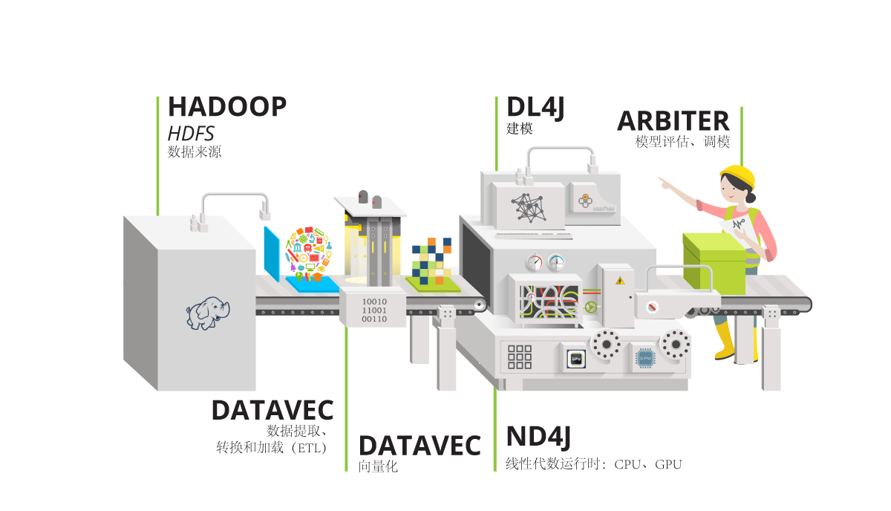

GitHub: https://github.com/deeplearning4j/deeplearning4j

> **Biên tập:** dự án nay là Eclipse Deeplearning4j (kho `deeplearning4j/deeplearning4j`, do Konduit duy trì), vẫn dùng chủ yếu trong hệ sinh thái Java/JVM.

### 18.2.3 Mahout

Mahout là framework phân tán cho học máy và khai phá dữ liệu dựa trên Hadoop. Mahout cài đặt một số thuật toán khai phá dữ liệu bằng MapReduce, giải quyết việc khai phá song song.

Mahout có nhiều cài đặt, gồm phân cụm, phân loại, gợi ý (lọc), khai phá tập mục thường xuyên…

Thư viện thuật toán của Mahout (gõ lại từ sơ đồ của bản gốc):

| Nhóm | Thành phần |
| --- | --- |
| Lọc cộng tác | dựa trên vật phẩm (item-based), dựa trên người dùng (user-based) |
| Thuật toán gợi ý | UserBasedRecommender, ItemBasedRecommender, SlopeOneRecommender, SVDRecommender, KnnItemBasedRecommender, TreeClusteringRecommender |
| Ma trận tương đồng | khoảng cách Euclid, Pearson, cosine, hệ số tương quan hạng Spearman, hệ số Tanimoto, log-likelihood |
| Thuật toán láng giềng | lấy láng giềng theo ngưỡng giá trị, lấy láng giềng theo tỉ lệ |
| Mô hình dữ liệu (gợi ý) | (UserId, ItemId, PreferenceValue), (UserId, ItemId) |
| Mô hình dữ liệu (vector) | DenseVector, RandomAccessSparseVector, SequentialAccessSparseVector |
| Kiểm tra thuật toán | độ phủ (recall), độ chính xác (precision) |
| Khoảng cách | Euclid, bình phương Euclid, Mahalanobis, cosine, Tanimoto, khoảng cách có trọng số |
| Chuẩn hóa khoảng cách | normalization |
| Phân loại | SGD, SVM, Naive Bayes, Complementary Naive Bayes, rừng ngẫu nhiên |
| Phân cụm | k-means, Canopy, fuzzy k-means, Dirichlet, mô hình chủ đề LDA |
| Mô-đun hệ thống (phân loại) | tập huấn luyện, tập kiểm thử, thuật toán phân loại, quá trình huấn luyện, dựng bộ phân loại, mô-đun kiểm định, dữ liệu thật, chỉnh tham số, chạy phân loại, kết quả dự đoán, kiểm tra kết quả, tự động dựng |
| Triển khai | triển khai trên cụm Hadoop |

Kịch bản ứng dụng của Mahout:

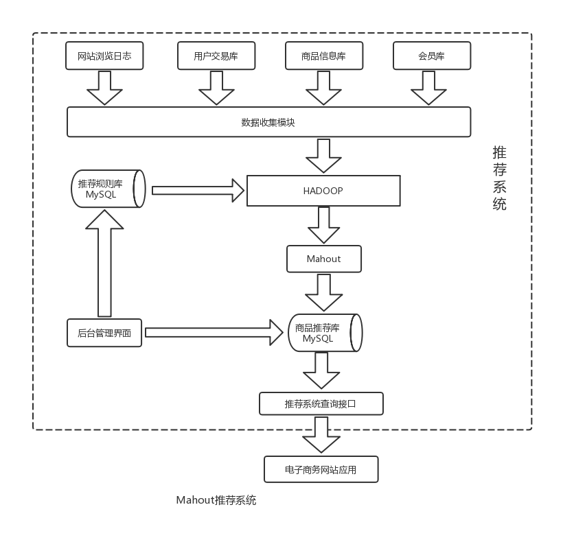

GitHub: https://github.com/apache/mahout

> **Biên tập:** bản gốc ghi sai vài tên trong sơ đồ ("Native Bayes" thay cho Naive Bayes, "Dirchlet", "ItemBaseRecommender"). Từ bản 0.10 (2015), Mahout bỏ dần các thuật toán MapReduce, chuyển sang môi trường đại số tuyến tính phân tán "Samsara" trên Spark; dự án hiện ít được dùng.

### 18.2.4 Spark MLlib

<div class="qa-theory">

**Lý thuyết:** [Ôn tập · 15.8.3 Có thể huấn luyện hoặc triển khai mô hình trong môi trường Spark không?](qa/ch15_vi?id=_1583-có-thể-huấn-luyện-hoặc-triển-khai-mô-hình-trong-môi-trường-spark-không)

</div>

MLlib (Machine Learning library) là thư viện cài đặt các thuật toán học máy thông dụng của Spark, kèm các công cụ kiểm thử và sinh dữ liệu liên quan.

MLlib là một phần của MLBase; MLBase gồm bốn phần: MLlib, MLI, ML Optimizer và MLRuntime.

- ML Optimizer chọn thuật toán học máy (đã cài đặt sẵn bên trong) và tham số mà nó cho là phù hợp nhất để xử lý dữ liệu người dùng đưa vào, rồi trả về mô hình hoặc kết quả hỗ trợ phân tích khác;
- MLI là API hoặc nền tảng cài đặt thuật toán cho trích xuất đặc trưng và trừu tượng hóa lập trình học máy cấp cao;
- MLlib là phần Spark cài đặt các thuật toán học máy và tiện ích phổ biến, gồm phân loại, hồi quy, phân cụm, lọc cộng tác, giảm chiều và tối ưu tầng dưới, có thể mở rộng;
- MLRuntime dựa trên framework tính toán Spark, đưa tính toán phân tán của Spark vào lĩnh vực học máy.

MLlib gồm ba phần chính:

- nền tảng tầng dưới: thư viện chạy của Spark, thư viện ma trận và vector;
- thư viện thuật toán: mô hình tuyến tính tổng quát, hệ gợi ý, phân cụm, cây quyết định và các thuật toán đánh giá;
- tiện ích: sinh dữ liệu kiểm thử, đọc dữ liệu ngoài…

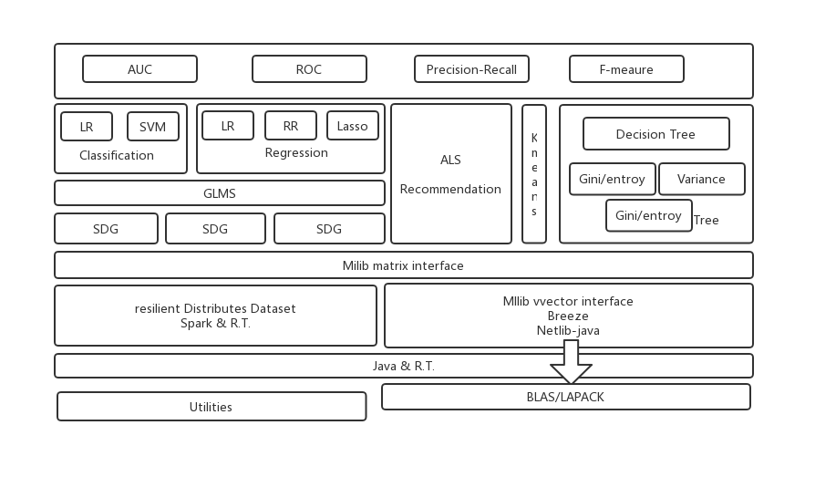

> **Biên tập:** ảnh kiến trúc của bản đầy đủ (vẽ lại) ghi nhầm "SDG" thay cho SGD và "F-meaure", "Gini/entroy"; ảnh của bản nháp ghi đúng.

MLlib hiện hỗ trợ 4 loại bài toán học máy phổ biến: phân loại, hồi quy, phân cụm và lọc cộng tác. Vị trí của MLlib trong hệ sinh thái Spark như hình dưới.

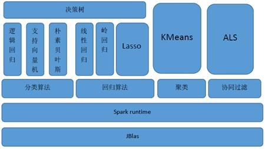

> **Biên tập:** MLBase, MLI, ML Optimizer là các dự án nghiên cứu ở AMPLab (Berkeley) quanh 2013, không thành sản phẩm. API dựa trên RDD (`spark.mllib`) đã ở chế độ bảo trì từ Spark 2.0; API chính hiện nay là `spark.ml` dựa trên DataFrame, có Pipeline.

### 18.2.5 Ray

<div class="qa-theory">

**Lý thuyết:** [Tăng cường · 1.1 Tổng quan về học tăng cường](chapter1/chapter1_vi?id=_11-tổng-quan-về-học-tăng-cường) · [Ôn tập · 10.9 Các framework mã nguồn mở cho học tăng cường](qa/ch10_vi?id=_109-các-framework-mã-nguồn-mở-cho-học-tăng-cường)

</div>

Ray là framework tính toán phân tán mới cho lĩnh vực học máy, do các nhà nghiên cứu của phòng thí nghiệm RISELab (Real-time Intelligent Secure Execution) thuộc Đại học California, Berkeley phát triển. Framework nhằm cho các khối lượng công việc học máy và học sâu viết bằng Python chạy theo thời gian thực, với hiệu năng và độ mịn tương tự giao diện truyền thông điệp (MPI).

Trong học tăng cường, theo định nghĩa, không có sẵn nhãn tĩnh, nên thường phải đưa vào hệ thống đích thật (để huấn luyện nhanh hơn, thường là môi trường mô phỏng của hệ thống đích) để lấy phản hồi, dùng làm căn cứ đánh giá mất mát/lợi ích, khép kín vòng phản hồi của quá trình huấn luyện. Các bước điển hình: quan sát trạng thái của hệ thống đích, thu phản hồi, đánh giá lợi ích, dùng thông tin này chỉnh tham số, huấn luyện mô hình, và dựa trên kết quả huấn luyện mới sinh hành động (action) để điều chỉnh hệ thống đích, đưa vào hệ thống đích, ảnh hưởng tới sự thay đổi trạng thái của nó, khép kín vòng; lặp đi lặp lại như vậy, mục tiêu cuối cùng là tối đa hóa một loại lợi ích nào đó (ví dụ với AlphaGo, lợi ích là thắng một ván cờ vây).

Trong quá trình này, một mặt, mô phỏng hệ thống đích, thu trạng thái và phản hồi, đánh giá lợi ích, huấn luyện tham số, sinh hành động… có thể gồm rất nhiều tác vụ và tính toán (để chọn hành động tốt nhất có thể phải mô phỏng đồng thời rất nhiều hành động khả dĩ). Bản thân các tác vụ này có thể rất khác nhau, dị thể, thời gian chạy dài ngắn khác nhau, có cái cần đồng bộ, có cái hợp chạy bất đồng bộ hơn.

Mặt khác, đồ thị DAG của toàn bộ quy trình có thể thay đổi động; hệ thống thường cần dựa vào kết quả bước trước để chỉnh tham số hành vi hoặc quy trình của bước sau. Việc điều chỉnh này có thể do nhu cầu của hệ thống đích (ví dụ xe tự lái gặp người đi bộ thì có thể cần mô phỏng tính quãng đường phanh để quyết định phanh hay rẽ, bình thường thì không cần bước này), hoặc do nhu cầu của thuật toán huấn luyện học tăng cường cụ thể (ví dụ dựa trên lợi ích hiện tại của nhiều mô hình huấn luyện song song để chỉnh siêu tham số, thay mô hình…).

Ngoài ra, vì hệ thống đích có thể là hệ thống cụ thể trong thế giới vật lý, nên có thể có yêu cầu khắt khe về thời gian. Ví dụ hệ thống bạn muốn làm là điều khiển robot đi lại hay chơi trò chơi điện tử, thì cả vòng phản hồi phải xong trong giới hạn thời gian nhất định (như cỡ mili giây).

Tóm lại, kịch bản học tăng cường có thể đòi hỏi rất cao về độ trễ lập lịch tác vụ, thông lượng và khả năng sửa đổi đồ thị DAG một cách động của framework tính toán phân tán. Theo mục tiêu thiết kế chính thức, Ray cần hỗ trợ tác vụ tính toán dị thể, luồng tính toán động, độ trễ cỡ mili giây và khả năng lập lịch hàng triệu tác vụ mỗi giây.

Bài toán Ray nhắm tới chủ yếu là các vấn đề kỹ thuật gặp phải trong các kịch bản như học tăng cường. Vậy kịch bản học tăng cường khác học máy, học sâu thông thường ở đâu? Nói đơn giản là đòi hỏi cao hơn về tính kịp thời và tính linh hoạt của cả chuỗi xử lý.

Ưu điểm của framework Ray:

- khả năng lập lịch rất nhiều tác vụ;
- độ trễ cỡ mili giây;
- hỗ trợ tác vụ dị thể;
- khả năng sửa đổi động đồ thị tác vụ.

Ray không dùng lập lịch tập trung mà dùng cách giống lập lịch phân cấp (hierarchy): ngoài một dịch vụ lập lịch trung tâm toàn cục (thực ra nút này cũng mở rộng ngang được), việc lập lịch tác vụ còn có thể do dịch vụ lập lịch cục bộ trên chính nút làm việc quản lý và thực hiện. Khác với lập lịch phân cấp truyền thống phân việc từ trên xuống, Ray dùng chiến lược từ dưới lên. Tức là yêu cầu lập lịch không gửi trước cho bộ lập lịch trung tâm toàn cục để quy hoạch rồi mới phân cho các bộ lập lịch cấp dưới, mà nút chạy tác vụ gửi thẳng cho bộ lập lịch cục bộ; nếu bộ lập lịch cục bộ đáp ứng được yêu cầu thì lập lịch luôn, không được thì mới gửi lên bộ lập lịch toàn cục, để nó điều phối sang bộ lập lịch cục bộ của một nút khác có đủ khả năng.

Thiết kế này một mặt giảm chi phí RPC giữa các nút, mặt khác tránh được nút cổ chai ở nút trung tâm. Tất nhiên cũng có nhược điểm: vì thiếu cái nhìn toàn cục về các tác vụ, không quy hoạch toàn cục được, nên cấu trúc logic của các tác vụ chưa chắc tối ưu.

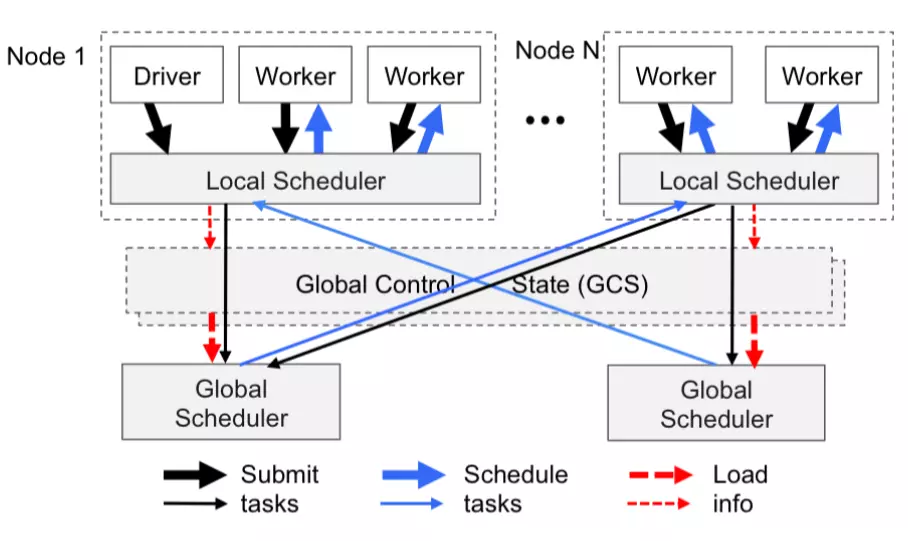

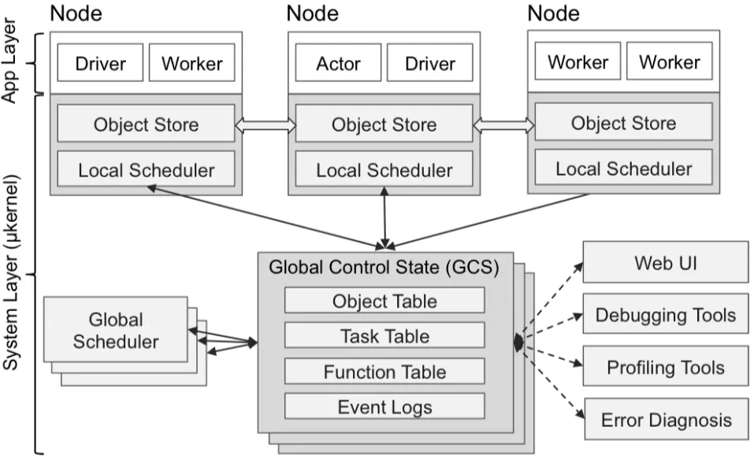

Hiện trạng của Ray (theo bản gốc, 2018):

- phần trên tầng API còn khá mỏng, logic cốt lõi của mô-đun Core còn cần thời gian hoàn thiện;
- ở Trung Quốc, ngoài hợp tác có mục tiêu giữa Ant Financial và RISELab, mức quan tâm còn rất thấp, chưa thấy ứng dụng thực tế; nhìn chung vẫn ở giai đoạn đầu xây dựng framework.

GitHub: https://github.com/ray-project/ray

> **Biên tập:** nhận định "giai đoạn đầu" đã lỗi thời. Từ Ray 2.0 (2022), cách lập lịch đã thay đổi (bỏ bộ lập lịch toàn cục kiểu cũ, lập lịch phân tán dựa trên raylet và GCS). Ray nay được dùng rộng rãi: thư viện học tăng cường RLlib, Ray Train (huấn luyện phân tán), Ray Tune (tìm siêu tham số), Ray Serve (phục vụ mô hình), Ray Data; nhiều công ty dùng Ray để huấn luyện và phục vụ mô hình ngôn ngữ lớn, và các hệ thống huấn luyện LLM bằng học tăng cường như OpenRLHF, veRL dựng trên Ray.

### 18.2.6 Spark Streaming

<div class="qa-theory">

**Lý thuyết:** [Ôn tập · 18.3 Tính toán thời gian thực thế nào?](qa/ch18_vi?id=_183-tính-toán-thời-gian-thực-thế-nào)

</div>

Khi dữ liệu lớn phát triển, yêu cầu xử lý dữ liệu lớn ngày càng cao. Framework xử lý theo lô MapReduce vốn hợp với tính toán ngoại tuyến, nhưng không đáp ứng được các nghiệp vụ đòi hỏi tính thời gian thực cao như gợi ý thời gian thực, phân tích hành vi người dùng. Spark Streaming là framework tính toán thời gian thực xây trên Spark; nhờ API phong phú và bộ máy chạy tốc độ cao dựa trên bộ nhớ, người dùng có thể kết hợp các ứng dụng xử lý luồng, xử lý lô và truy vấn tương tác.

Spark là framework tính toán phân tán giống MapReduce, cốt lõi là tập dữ liệu phân tán có khả năng phục hồi (RDD), có mô hình phong phú hơn MapReduce, có thể lặp nhiều lần nhanh trên tập dữ liệu trong bộ nhớ để hỗ trợ các thuật toán khai phá dữ liệu và tính toán đồ thị phức tạp. Spark Streaming là framework tính toán thời gian thực xây trên Spark, mở rộng khả năng xử lý dữ liệu luồng quy mô lớn của Spark.

Ưu điểm của Spark Streaming:

- chạy được trên hơn 100 nút, đạt độ trễ cỡ giây;
- dùng Spark chạy trên bộ nhớ làm bộ máy thực thi, hiệu quả và chịu lỗi;
- tích hợp được xử lý lô và truy vấn tương tác của Spark;
- cung cấp giao diện đơn giản giống xử lý lô để cài đặt thuật toán phức tạp.

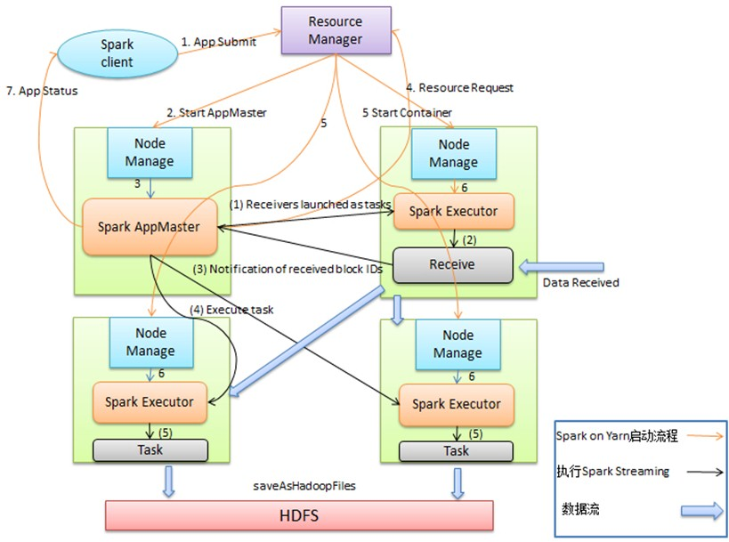

Spark Streaming chia luồng dữ liệu đầu vào thời gian thực thành các khối theo khoảng thời gian $\Delta t$ (ví dụ 1 giây). Mỗi khối dữ liệu được coi là một RDD và được xử lý bằng các phép toán trên RDD. Mỗi khối sinh một Spark Job để xử lý, kết quả cuối cùng cũng trả về theo từng khối.

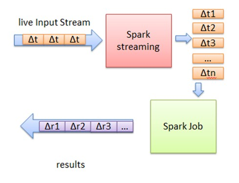

Đúng như mục tiêu ban đầu của Spark Streaming, nhờ API phong phú và bộ máy tính toán tốc độ cao trên bộ nhớ, người dùng có thể kết hợp các ứng dụng xử lý luồng, xử lý lô và truy vấn tương tác. Vì vậy Spark Streaming hợp với các ứng dụng cần phân tích kết hợp dữ liệu lịch sử và dữ liệu thời gian thực. Tất nhiên nó cũng hoàn toàn đáp ứng các ứng dụng không đòi hỏi quá cao về tính thời gian thực. Ngoài ra, cơ chế tái sử dụng dữ liệu của RDD giúp chịu lỗi hiệu quả hơn.

> **Biên tập:** Spark Streaming (API DStream) đã ở chế độ cũ; từ Spark 2.x, API chính là **Structured Streaming** (dựa trên DataFrame, có xử lý theo thời gian sự kiện và watermark). Với độ trễ thấp hơn mức giây, Apache **Flink** là lựa chọn phổ biến nhất hiện nay.

### 18.2.7 Horovod

<div class="qa-theory">

**Lý thuyết:** [Ôn tập · 15.8.1 Cấu hình môi trường nhiều GPU](qa/ch15_vi?id=_1581-cấu-hình-môi-trường-nhiều-gpu) · [Ôn tập · 15.8.2 Có huấn luyện phân tán được không?](qa/ch15_vi?id=_1582-có-huấn-luyện-phân-tán-được-không)

</div>

Horovod là một công cụ học sâu mã nguồn mở khác của Uber, kế thừa ưu điểm của bài báo "huấn luyện ImageNet trong một giờ" của Facebook và Ring Allreduce của Baidu, giúp người dùng huấn luyện phân tán.

Horovod hỗ trợ huấn luyện mô hình phân tán qua giao diện truyền thông điệp (MPI), giao diện cấp thấp cho tính toán song song hiệu năng cao. Với MPI, có thể dùng cụm Kubernetes phân tán để huấn luyện mô hình TensorFlow và PyTorch.

Mô hình máy chủ tham số (parameter server paradigm) của TensorFlow phân tán thường cần viết cẩn thận rất nhiều mã khuôn mẫu, còn Horovod chỉ cần vài dòng. Dưới đây là ví dụ một dự án TensorFlow phân tán dùng Horovod:

```python
import  tensorflow as tf
import horovod.tensorflow as hvd
# Initialize Horovod
hvd.init()
# Pin GPU to be used to process local rank (one GPU per process)
config = tf.ConfigProto()
config.gpu_options.visible_device_list = str(hvd.local_rank())
# Build model…
loss = …
opt = tf.train.AdagradOptimizer(0.01)
# Add Horovod Distributed Optimizer
opt = hvd.DistributedOptimizer(opt)
# Add hook to broadcast variables from rank 0 to all other processes during
# initialization.
hooks = [hvd.BroadcastGlobalVariablesHook(0)]
# Make training operation
train_op = opt.minimize(loss)
# The MonitoredTrainingSession takes care of session initialization,
# restoring from a checkpoint, saving to a checkpoint, and closing when done
# or an error occurs.
with tf.train.MonitoredTrainingSession(checkpoint_dir="/tmp/train_logs",
  config=config,
  hooks=hooks) as mon_sess:
 while not mon_sess.should_stop():
   # Perform synchronous training.
   mon_sess.run(train_op)
```

Trong ví dụ, các thay đổi cần làm để chuyển một dự án một GPU sang phân tán là:

- `hvd.init()` khởi tạo Horovod;
- `config.gpu_options.visible_device_list = str(hvd.local_rank())` gán cho mỗi tiến trình TensorFlow một GPU;
- `opt = hvd.DistributedOptimizer(opt)` bọc bộ tối ưu TensorFlow thông thường bằng bộ tối ưu Horovod, bộ này lấy trung bình gradient bằng ring-allreduce;
- `hvd.BroadcastGlobalVariablesHook(0)` phát biến từ tiến trình đầu tiên tới các tiến trình khác để khởi tạo nhất quán. Nếu dự án không dùng được `MonitoredTrainingSession`, có thể chạy `hvd.broadcast_global_variables(0)`.

Sau đó dùng lệnh `mpirun` để chạy nhiều bản sao của chương trình trên nhiều máy chủ:

```bash
mpirun -np 16 -x LD_LIBRARY_PATH -H server1:4,server2:4,server3:4,server4:4 python train.py
```

Lệnh `mpirun` phân phối `train.py` tới bốn nút, rồi chạy `train.py` trên bốn GPU của mỗi nút.

GitHub: https://github.com/uber/horovod

> **Biên tập:** bản gốc viết "các dòng chữ **đậm** là những thay đổi cần làm", nhưng đoạn mã không có chữ đậm; đã liệt kê rõ. Lệnh `mpirun` trong bản gốc bị ngắt dòng giữa tham số `-H` (không chạy được), đã nối lại. Đoạn mã dùng API TensorFlow 1.x (`tf.ConfigProto`, `MonitoredTrainingSession`); với TensorFlow 2 hay PyTorch, cách dùng tương tự (`hvd.init()`, gán GPU theo `local_rank`, `DistributedOptimizer`, phát trọng số ban đầu), và lệnh chạy hiện nay là `horovodrun -np 16 -H server1:4,... python train.py`. Horovod nay thuộc LF AI & Data (kho `horovod/horovod`); với PyTorch, `DistributedDataParallel` có sẵn thường được dùng thay Horovod (xem 15.8.1).

### 18.2.8 BigDL

<div class="qa-theory">

**Lý thuyết:** [Ôn tập · 15.8.3 Có thể huấn luyện hoặc triển khai mô hình trong môi trường Spark không?](qa/ch15_vi?id=_1583-có-thể-huấn-luyện-hoặc-triển-khai-mô-hình-trong-môi-trường-spark-không)

</div>

BigDL là framework học sâu phân tán dựa trên Apache Spark (Intel), chạy liền mạch trực tiếp trên các cụm Apache Spark và Hadoop có sẵn. Thiết kế của BigDL học hỏi nhiều từ framework Torch, hỗ trợ đầy đủ cho học sâu, gồm tính toán số và mạng neuron cấp cao; dùng cụm Spark có sẵn để chạy tính toán học sâu, và đơn giản hóa việc nạp các tập dữ liệu lớn lưu trong Hadoop.

Ưu điểm của BigDL:

- **hỗ trợ học sâu phong phú:** mô phỏng theo Torch, BigDL hỗ trợ đầy đủ cho học sâu, gồm tính toán số (qua Tensor) và mạng neuron cấp cao; ngoài ra người dùng có thể dùng BigDL nạp mô hình Caffe hoặc Torch đã huấn luyện vào chương trình Spark;
- **hiệu năng cực cao:** để đạt hiệu năng cao, BigDL dùng Intel MKL và lập trình đa luồng trong mỗi tác vụ Spark. Vì vậy trên một nút Xeon đơn, nó nhanh hơn nhiều bậc so với Caffe, Torch hay TensorFlow mã nguồn mở dùng nguyên bản (theo Intel, tương đương GPU phổ thông);
- **mở rộng ngang hiệu quả:** BigDL mở rộng hiệu quả tới phân tích dữ liệu ở "quy mô dữ liệu lớn" nhờ Apache Spark (framework xử lý dữ liệu phân tán nhanh), cùng cài đặt hiệu quả SGD đồng bộ và truyền thông all-reduce trên Spark.

Nhược điểm của BigDL:

- yêu cầu máy cao, chạy trên JDK 7 hiệu năng kém; trên CentOS 6 và 7 phải tăng số tiến trình tối đa của người dùng lên giá trị lớn hơn (ví dụ 514585), nếu không có thể gặp lỗi như "unable to create new native thread";
- dữ liệu huấn luyện và kiểm định được nạp vào bộ nhớ, chiếm nhiều bộ nhớ.

Các kịch bản BigDL đáp ứng:

- dùng học sâu phân tích dữ liệu lớn ngay trong framework Hadoop/Spark (dữ liệu lưu trên HDFS, HBase, Hive…);
- thêm chức năng học sâu vào chương trình hoặc luồng công việc Spark;
- dùng cụm Hadoop/Spark có sẵn để chạy chương trình học sâu, rồi chia sẻ động mã với các kịch bản ứng dụng khác như ETL (Extract, Transform, Load, tức trích xuất, chuyển đổi, nạp dữ liệu), kho dữ liệu (data warehouse), bộ máy đặc trưng, học máy cổ điển, phân tích đồ thị…

> **Biên tập:** "nhanh hơn nhiều bậc" là so trên **CPU** với các framework chưa tối ưu cho CPU Intel thời đó, theo số liệu của Intel; không nên hiểu là CPU nhanh bằng GPU cho huấn luyện mạng lớn. Bản gốc dịch "AllReduce" thành "全面减少" (giảm toàn diện), đã sửa. Dự án BigDL về sau gộp với Analytics Zoo thành BigDL 2.x, rồi năm 2024 phần chính được đổi tên thành **IPEX-LLM** (chạy LLM trên phần cứng Intel).

### 18.2.9 Petastorm

Petastorm là thư viện truy cập dữ liệu mã nguồn mở do Uber ATG phát triển. Thư viện cho phép huấn luyện một máy hoặc phân tán và đánh giá mô hình học sâu trực tiếp trên các tập dữ liệu định dạng Parquet cỡ vài TB. Petastorm hỗ trợ các framework học máy dựa trên Python như TensorFlow, PyTorch và PySpark, cũng có thể dùng trực tiếp trong mã Python.

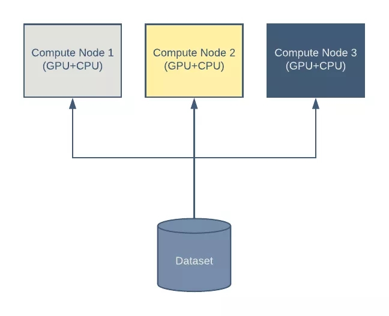

Ngay cả trên phần cứng hiện đại, huấn luyện mô hình sâu cũng tốn thời gian, và trong nhiều trường hợp cần chia tải huấn luyện ra nhiều máy. Một cụm học sâu điển hình làm các bước sau:

- một hoặc nhiều máy đọc tập dữ liệu tập trung hoặc cục bộ;
- mỗi máy tính giá trị hàm mất mát và gradient theo tham số mô hình; bước này thường dùng GPU;
- cập nhật hệ số mô hình bằng cách kết hợp các gradient ước lượng (thường được nhiều máy tính theo cách phân tán).

Thường một tập dữ liệu được tạo ra bằng cách nối bản ghi từ nhiều nguồn. Tập dữ liệu do PySpark (giao diện Python của Apache Spark) tạo ra này sau đó được dùng để huấn luyện học máy. Petastorm cung cấp một chức năng đơn giản: mở rộng Parquet chuẩn bằng siêu dữ liệu riêng của Petastorm, để tập dữ liệu tương thích với Petastorm. Có Petastorm, việc dùng dữ liệu đơn giản như tạo và lặp đọc đối tượng trong HDFS hay hệ thống file. Petastorm dùng PyArrow để đọc file Parquet.

Kết hợp nhiều nguồn dữ liệu vào một cấu trúc bảng duy nhất để tạo tập dữ liệu; có thể dùng cùng một tập dữ liệu nhiều lần để huấn luyện và đánh giá mô hình.

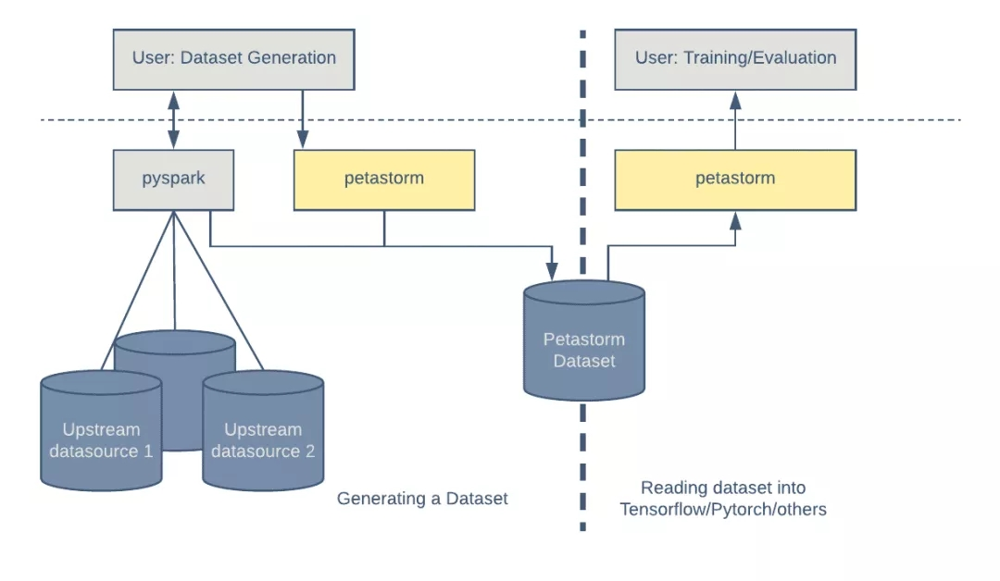

**Chia mảnh cho huấn luyện phân tán.** Trong môi trường huấn luyện phân tán, mỗi tiến trình thường phụ trách một tập con của dữ liệu huấn luyện, và tập con của các tiến trình không giao nhau. Petastorm hỗ trợ chia mảnh khi đọc, biến tập dữ liệu thành các tập mẫu không giao nhau.

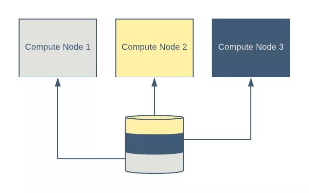

**Bộ đệm cục bộ.** Petastorm hỗ trợ lưu đệm dữ liệu trong bộ nhớ cục bộ, có ích khi kết nối mạng chậm hoặc băng thông đắt.

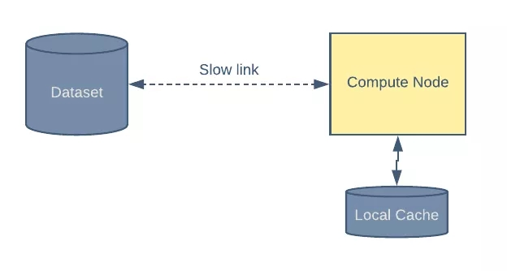

GitHub: https://github.com/uber/petastorm

> **Biên tập:** bản gốc gán sai số trích dẫn (BigDL dẫn [9], vốn là bài về Petastorm); đã bỏ các số trích dẫn và sắp lại danh mục tài liệu cuối chương.

### 18.2.10 TensorFlowOnSpark

<div class="qa-theory">

**Lý thuyết:** [Ôn tập · 15.8.3 Có thể huấn luyện hoặc triển khai mô hình trong môi trường Spark không?](qa/ch15_vi?id=_1583-có-thể-huấn-luyện-hoặc-triển-khai-mô-hình-trong-môi-trường-spark-không)

</div>

TensorFlowOnSpark (của Yahoo) mang học sâu mở rộng được tới các cụm Apache Hadoop và Apache Spark. Nhờ kết hợp các đặc điểm nổi bật của framework học sâu TensorFlow và các framework dữ liệu lớn Apache Spark, Apache Hadoop, TensorFlowOnSpark cho phép học sâu phân tán trên cụm máy chủ GPU và CPU.

Kịch bản đáp ứng: dùng TensorFlow để học sâu trên cụm Spark và Hadoop có sẵn, không cần dựng cụm riêng cho học sâu.

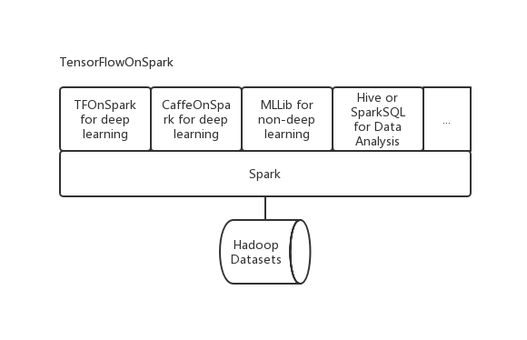

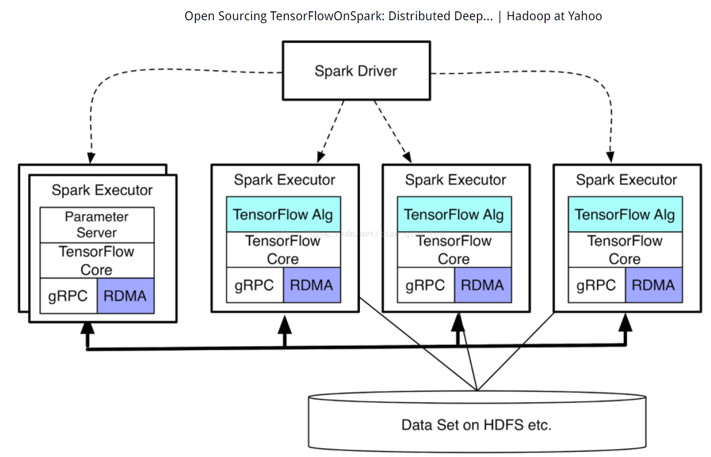

Ưu điểm:

- dễ dàng chuyển mọi chương trình TensorFlow có sẵn, sửa dưới 10 dòng mã;
- hỗ trợ mọi tính năng của TensorFlow: huấn luyện đồng bộ/bất đồng bộ, song song mô hình/dữ liệu, suy luận và TensorBoard;
- giao tiếp trực tiếp giữa các máy chủ khi có thể, giúp học nhanh hơn;
- cho phép dữ liệu ở HDFS và các nguồn khác được Spark đẩy vào hoặc TensorFlow kéo về;
- dễ tích hợp với quy trình xử lý dữ liệu và thuật toán học máy có sẵn (ví dụ MLlib, CaffeOnSpark);
- dễ triển khai trên đám mây hoặc tại chỗ: CPU và GPU, Ethernet và InfiniBand;
- TensorFlowOnSpark dựa trên TensorFlow của Google, mà TensorFlow có bộ hướng dẫn đầy đủ, phong phú.

Nhược điểm:

- mở mã chưa lâu, chưa được kiểm chứng đầy đủ.

GitHub: https://github.com/yahoo/TensorFlowOnSpark

## 18.3 Tính toán thời gian thực thế nào?

<div class="qa-theory">

**Lý thuyết:** [Ôn tập · 18.2.6 Spark Streaming](qa/ch18_vi?id=_1826-spark-streaming)

</div>

### 18.3.1 Tính toán luồng thời gian thực là gì?

Tính toán luồng thời gian thực (real-time stream computing) xuất hiện khi dữ liệu được dùng rộng rãi trong những năm gần đây, mô hình hóa dữ liệu lưu trữ lâu dài không còn đáp ứng được, nên cần mô hình hóa hoặc xử lý tức thời luồng dữ liệu. Ví dụ ứng dụng của tính toán thời gian thực gồm dịch vụ tài chính, giám sát mạng, quản lý dữ liệu viễn thông, ứng dụng web, sản xuất, cảm biến… Trong mô hình luồng dữ liệu này, mỗi đơn vị dữ liệu có thể là một bộ (tuple) liên quan, như dữ liệu sinh từ đo đạc mạng, bản ghi cuộc gọi, lượt truy cập trang web. Nhưng dữ liệu này đến liên tục thành luồng lớn, nhanh, biến đổi theo thời gian (có thể không đoán trước được), làm nảy sinh các vấn đề nghiên cứu cơ bản mới, đó là tính toán thời gian thực. Một hướng quan trọng của tính toán thời gian thực là tính toán luồng thời gian thực.

### 18.3.2 Quá trình tính toán luồng thời gian thực

<div class="qa-theory">

**Lý thuyết:** [Ôn tập · 18.3.1 Tính toán luồng thời gian thực là gì?](qa/ch18_vi?id=_1831-tính-toán-luồng-thời-gian-thực-là-gì)

</div>

> **Biên tập:** toàn bộ mục này chép (gần nguyên văn) từ bài blog *Giới thiệu và phân tích đơn giản hệ thống tính toán thời gian thực, xử lý dữ liệu luồng* của tác giả "foreach_break" trên cnblogs (2015); ví dụ dùng Apache Storm và thiết kế cửa sổ trượt của Michael G. Noll. Các đoạn "bài viết trước" là của blog gốc.

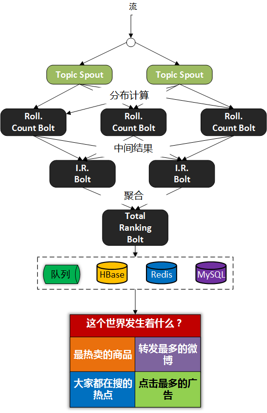

Lấy ví dụ thống kê sản phẩm bán chạy, xem cách tính truyền thống:

- làm sạch hành vi người dùng, log… rồi lưu vào cơ sở dữ liệu;
- lưu thông tin đơn hàng vào cơ sở dữ liệu;
- dùng trigger hoặc coroutine… để dựng chỉ mục cục bộ, hoặc chỉ mục độc lập ở xa;
- join các bảng đơn hàng, chi tiết đơn hàng, người dùng, sản phẩm…, tổng hợp thống kê sản phẩm bán chạy trong 20 phút, trả về top 10;
- hiển thị trên web hoặc app.

Đây là kịch bản giả định, nhưng nếu từng xử lý kịch bản tương tự, bạn sẽ thấy các vấn đề và khó khăn sau:

- **Mở rộng ngang (scale-out).** Rõ ràng với một trang thương mại điện tử có quy mô nhất định, lượng dữ liệu rất lớn. Mà thông tin giao dịch liên quan tới giao tác (transaction), nên khó bỏ khả năng giao tác của cơ sở dữ liệu quan hệ để chuyển sang NoSQL có khả năng mở rộng ngang tốt hơn.

  Vì vậy thường phải chia mảnh (sharding). Dữ liệu lịch sử thì dễ: lưu trữ theo ngày, tính ngoại tuyến theo lô rồi đệm kết quả. Nhưng ở đây yêu cầu là trong 20 phút, rất khó.

- **Hiệu năng.** Vấn đề này đi cùng scale-out: giả sử đã chia mảnh, vì các bảng nằm rải trên nhiều nút, ta phải truy vấn nhiều lần rồi tổng hợp ở tầng nghiệp vụ.

  Vấn đề là: với yêu cầu 20 phút, phải truy vấn bao nhiêu lần? 10 phút thì sao? 5 phút thì sao? Thời gian thực thì sao?

  Hơn nữa tầng nghiệp vụ cũng bị giới hạn bởi năng lực tính của một máy, cần mở rộng ngang, khi đó lại phải xét tính nhất quán. Tới đây mọi thứ đều trở nên rất phức tạp.

- **Mở rộng nghiệp vụ.** Giả sử ta không chỉ thống kê sản phẩm bán chạy, mà còn thống kê lượt bấm quảng cáo, hay nhanh chóng xác định đặc điểm người dùng theo hành vi truy cập để điều chỉnh thông tin họ thấy cho hợp với nhu cầu tiềm ẩn…, thì tầng nghiệp vụ càng phức tạp.

Có thể bạn có cách hay hơn, nhưng thực ra ta cần một nhận thức mới: những gì xảy ra trên thế giới là thời gian thực. Vì vậy ta cần một mô hình tính toán thời gian thực, chứ không phải mô hình xử lý theo lô. Mô hình này phải xử lý được dữ liệu rất lớn, nên phải mở rộng ngang tốt, tốt nhất là ta không phải bận tâm nhiều về tính nhất quán, sao chép.

Mô hình tính toán đó chính là mô hình tính toán thời gian thực, cũng có thể coi là mô hình tính toán luồng. Giả sử đã có mô hình như vậy, ta có thể vui vẻ thiết kế các kịch bản nghiệp vụ mới:

- weibo nào được chia sẻ nhiều nhất?
- những sản phẩm nào bán chạy nhất?
- mọi người đang tìm kiếm chủ đề nóng nào?
- quảng cáo nào của ta, ở vị trí nào, được bấm nhiều nhất?

Hay nói cách khác, ta có thể hỏi: thế giới này đang xảy ra chuyện gì?

Chủ đề weibo nóng nhất là gì? Ta dùng một bài toán đếm cửa sổ trượt đơn giản để vén bức màn bí ẩn của tính toán thời gian thực. Giả sử yêu cầu nghiệp vụ là: thống kê 10 chủ đề weibo nóng nhất trong 20 phút.

Để giải bài toán này, cần xét:

- **Nguồn dữ liệu.** Giả sử dữ liệu là các chủ đề được đẩy qua kết nối dài của weibo.
- **Mô hình hóa bài toán.** Chủ đề là đoạn chữ nằm giữa hai dấu `#`; chủ đề nóng nhất là chủ đề xuất hiện nhiều lần hơn các chủ đề khác. Ví dụ: "@foreach_break: xin chào, #thế giới#, tôi yêu bạn, #weibo#." thì "thế giới" và "weibo" là chủ đề.
- **Bộ máy tính toán:** dùng Storm.
- **Định nghĩa thời gian.** Định nghĩa thời gian là việc khó, tùy độ chính xác cần thiết. Thực tế ta thường dùng tick để biểu diễn khái niệm thời điểm. Trong hạ tầng của Storm, ở giai đoạn khởi động executor, dùng bộ hẹn giờ để kích hoạt sự kiện "đã qua một khoảng thời gian", như sau:

```clojure
(defn setup-ticks! [worker executor-data]
  (let [storm-conf (:storm-conf executor-data)
        tick-time-secs (storm-conf TOPOLOGY-TICK-TUPLE-FREQ-SECS)
        receive-queue (:receive-queue executor-data)
        context (:worker-context executor-data)]
    (when tick-time-secs
      (if (or (system-id? (:component-id executor-data))
              (and (= false (storm-conf TOPOLOGY-ENABLE-MESSAGE-TIMEOUTS))
                   (= :spout (:type executor-data))))
        (log-message "Timeouts disabled for executor " (:component-id executor-data) ":" (:executor-id executor-data))
        (schedule-recurring
          (:user-timer worker)
          tick-time-secs
          tick-time-secs
          (fn []
            (disruptor/publish
              receive-queue
              [[nil (TupleImpl. context [tick-time-secs] Constants/SYSTEM_TASK_ID Constants/SYSTEM_TICK_STREAM_ID)]]
              )))))))
```

Bài viết trước (của blog gốc) đã phân tích chi tiết quan hệ của các hạ tầng này. Cứ mỗi khoảng thời gian, một sự kiện như vậy được kích hoạt; khi bolt ở hạ lưu nhận được sự kiện này, nó có thể chọn tăng bộ đếm hay tổng hợp kết quả rồi gửi vào luồng.

Bolt làm sao biết tuple nhận được là "tick"? Luồng executor quản lý bolt, khi tiêu thụ thông điệp từ hàng đợi nó đăng ký, sẽ gọi phương thức `execute` của bolt; vậy có thể kiểm tra trong `execute` như sau:

```java
public static boolean isTick(Tuple tuple) {
    return tuple != null
           && Constants.SYSTEM_COMPONENT_ID  .equals(tuple.getSourceComponent())
           && Constants.SYSTEM_TICK_STREAM_ID.equals(tuple.getSourceStreamId());
}
```

Kết hợp với mã Clojure `setup-ticks!` ở trên, ta biết `SYSTEM_TICK_STREAM_ID` được truyền vào tuple qua tham số hàm dựng trong callback của sự kiện hẹn giờ; vậy `SYSTEM_COMPONENT_ID` từ đâu ra? Có thể thấy trong mã dưới, `SYSTEM_TASK_ID` cũng được truyền cho tuple:

```clojure
;; chú ý SYSTEM_TASK_ID và SYSTEM_TICK_STREAM_ID
(TupleImpl. context [tick-time-secs] Constants/SYSTEM_TASK_ID Constants/SYSTEM_TICK_STREAM_ID)
```

Rồi dùng mã dưới để lấy được `SYSTEM_COMPONENT_ID`:

```java
public String getComponentId(int taskId) {
    if(taskId==Constants.SYSTEM_TASK_ID) {
        return Constants.SYSTEM_COMPONENT_ID;
    } else {
        return _taskToComponent.get(taskId);
    }
}
```

**Cửa sổ trượt.** Có hạ tầng trên rồi, ta còn cần vài cách để "kỹ thuật hóa", biến ý tưởng thành hiện thực. Ở đây xem thiết kế cửa sổ trượt của Michael G. Noll.

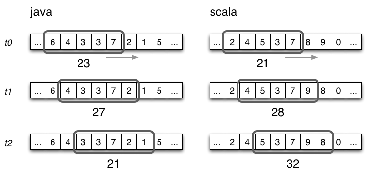

**Topology**

```java
String spoutId = "wordGenerator";
String counterId = "counter";
String intermediateRankerId = "intermediateRanker";
String totalRankerId = "finalRanker";
// giả sử TestWordSpout là nguồn phát tuple chủ đề
builder.setSpout(spoutId, new TestWordSpout(), 5);
// RollingCountBolt có cửa sổ 9 giây, cứ 3 giây gửi kết quả đếm xuống hạ lưu một lần
builder.setBolt(counterId, new RollingCountBolt(9, 3), 4).fieldsGrouping(spoutId, new Fields("word"));
// IntermediateRankingsBolt tổng hợp một phần, tìm top-n chủ đề
builder.setBolt(intermediateRankerId, new IntermediateRankingsBolt(TOP_N), 4).fieldsGrouping(counterId, new Fields(
    "obj"));
    // TotalRankingsBolt tổng hợp toàn bộ, tìm top-n chủ đề
builder.setBolt(totalRankerId, new TotalRankingsBolt(TOP_N)).globalGrouping(intermediateRankerId);
```

Topology trên được thiết kế như sau:

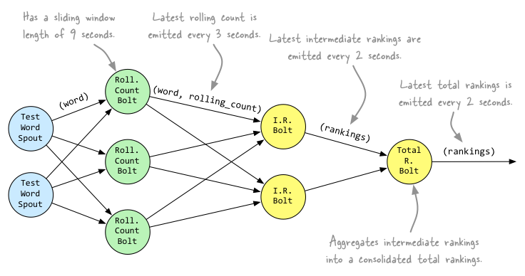

**Kết hợp tính toán tổng hợp với thời gian.** Như đã nói, sự kiện tick sẽ kích hoạt phương thức `execute` của bolt trong callback, vậy có thể làm như sau:

```java
RollingCountBolt:
  @Override
  public void execute(Tuple tuple) {
    if (TupleUtils.isTick(tuple)) {
      LOG.debug("Received tick tuple, triggering emit of current window counts");
      // tick tới: gửi kết quả đếm trong cửa sổ hiện tại, rồi trượt cửa sổ
      emitCurrentWindowCounts();
    }
    else {
      // tuple thường: chỉ cần tăng bộ đếm của chủ đề
      countObjAndAck(tuple);
    }
  }

  // obj là chủ đề, tăng bộ đếm thêm 1 (count++)
  // lưu ý: tốc độ ở đây gần như phụ thuộc tốc độ luồng, có thể hàng triệu mỗi giây, cũng có thể vài chục
  // thiếu bộ nhớ? bolt có thể mở rộng ngang (scale-out)
  private void countObjAndAck(Tuple tuple) {
    Object obj = tuple.getValue(0);
    counter.incrementCount(obj);
    collector.ack(tuple);
  }

  // gửi kết quả đếm xuống hạ lưu
  private void emitCurrentWindowCounts() {
    Map<Object, Long> counts = counter.getCountsThenAdvanceWindow();
    int actualWindowLengthInSeconds = lastModifiedTracker.secondsSinceOldestModification();
    lastModifiedTracker.markAsModified();
    if (actualWindowLengthInSeconds != windowLengthInSeconds) {
      LOG.warn(String.format(WINDOW_LENGTH_WARNING_TEMPLATE, actualWindowLengthInSeconds, windowLengthInSeconds));
    }
    emit(counts, actualWindowLengthInSeconds);
  }
```

Đoạn mã trên có thể hơi trừu tượng, xem hình này là hiểu: tick đến là cửa sổ trượt.


```java
IntermediateRankingsBolt & TotalRankingsBolt：
  public final void execute(Tuple tuple, BasicOutputCollector collector) {
    if (TupleUtils.isTick(tuple)) {
      getLogger().debug("Received tick tuple, triggering emit of current rankings");
      // gửi kết quả đã tổng hợp và sắp xếp xuống hạ lưu
      emitRankings(collector);
    }
    else {
      // tổng hợp và sắp xếp
      updateRankingsWithTuple(tuple);
    }
  }
```

Trong đó, cách tổng hợp và sắp xếp của `IntermediateRankingsBolt` và `TotalRankingsBolt` hơi khác nhau.

Cách tổng hợp và sắp xếp của `IntermediateRankingsBolt`:

```java
@Override
void updateRankingsWithTuple(Tuple tuple) {
  // bước này lấy ra chủ đề và số lần xuất hiện của nó
  Rankable rankable = RankableObjectWithFields.from(tuple);
  // bước này cộng dồn số lần xuất hiện, rồi sắp xếp lại mọi chủ đề
  super.getRankings().updateWith(rankable);
}
```

Cách tổng hợp và sắp xếp của `TotalRankingsBolt`:

```java
@Override
void updateRankingsWithTuple(Tuple tuple) {
// lấy kết quả trung gian từ IntermediateRankingsBolt
  Rankings rankingsToBeMerged = (Rankings) tuple.getValue(0);
// tổng hợp và sắp xếp
  super.getRankings().updateWith(rankingsToBeMerged);
// bỏ các mục bằng 0 để tiết kiệm bộ nhớ
  super.getRankings().pruneZeroCounts();
}
```

Còn cách sắp xếp lại thì khá đơn giản thô bạo, vì chỉ cần N phần tử đầu, mà N không lớn:

```java
private void rerank() {
  Collections.sort(rankedItems);
  Collections.reverse(rankedItems);
}
```

**Kết luận.** Bảng dưới có lẽ là kết quả ta muốn: đã thống kê xong các chủ đề nóng trong khoảng t0 – t1.

| Hạng | Chủ đề | Số lần |
| --- | --- | --- |
| Top 1 | 大圣归来 (Đại Thánh trở về) | 20000 |
| Top 2 | 小时代 (Tiểu thời đại) | 18000 |
| Top 3 | 栀子花开 (Hoa dành dành nở) | 15000 |
| Top ? | foreach_break | 1 |

> **Biên tập:** bảng trên gõ lại từ ảnh (ba chủ đề là tên các phim Trung Quốc ra năm 2015, lúc bài blog gốc được viết). Hiện nay Storm ít được dùng cho dự án mới; **Apache Flink** (có sẵn cửa sổ trượt, cửa sổ phiên, thời gian sự kiện, đảm bảo exactly-once) và Kafka Streams là lựa chọn phổ biến; bài toán "top N trong 20 phút" chỉ cần vài dòng Flink SQL với `HOP` window.

## 18.4 Tính toán ngoại tuyến thế nào?

<div class="qa-theory">

**Lý thuyết:** [Ôn tập · 15.8.3 Có thể huấn luyện hoặc triển khai mô hình trong môi trường Spark không?](qa/ch15_vi?id=_1583-có-thể-huấn-luyện-hoặc-triển-khai-mô-hình-trong-môi-trường-spark-không)

</div>

So với tính toán thời gian thực, tính toán ngoại tuyến có nhiều thời gian để tính toán và khai phá.

**Kịch bản ứng dụng**

- hệ thống cảnh báo người dùng rời bỏ;
- hệ thống níu giữ dựa trên lịch sử mua hàng;
- hệ thống trích đặc trưng và quy tắc người dùng;
- hệ thống phân tích dữ liệu;
- hệ thống chân dung người dùng.

**Quy trình**

- thu thập dữ liệu;
- tiền xử lý dữ liệu;
- mô hình hóa dữ liệu;
- ETL;
- xuất dữ liệu;
- lập lịch luồng công việc.

> **Biên tập:** các mục con dưới đây là ghi chép theo một dự án mẫu phân tích log truy cập website (log nginx của ngày 18/9/2013) trên Hadoop: Flume thu log vào HDFS, MapReduce tiền xử lý, Hive mô hình hóa và phân tích, Sqoop xuất kết quả ra MySQL, Azkaban lập lịch. Bản gốc trình bày dưới dạng trích dẫn ghi chép; bản dịch giữ cấu trúc và sửa các lỗi cấu hình, SQL ghi ở từng chỗ. Hiện nay nhiều thành phần đã thay đổi: Sqoop đã ngừng phát triển (chuyển vào Apache Attic năm 2021), lập lịch thường dùng Apache Airflow hoặc DolphinScheduler, lưu trữ chuyển dần sang kho dữ liệu đám mây hoặc lakehouse (Iceberg, Delta Lake), tính toán bằng Spark SQL thay cho Hive trên MapReduce.

### 18.4.1 Thu thập dữ liệu

Dùng Flume thu log máy chủ vào HDFS. Nguồn kiểu `TAILDIR` theo dõi được một thư mục, hoặc dùng biểu thức chính quy khớp tên file để thu thời gian thực; `TAILDIR` = spooldir + exec + hỗ trợ đọc tiếp từ vị trí cũ khi khởi động lại:

```properties
agent1.sources = source1
agent1.sinks = sink1
agent1.channels = channel1

agent1.sources.source1.type = TAILDIR
agent1.sources.source1.positionFile = /var/log/flume/taildir_position.json
agent1.sources.source1.filegroups = f1 f2

# theo dõi thay đổi nội dung file

agent1.sources.source1.filegroups.f1 = /usr/local/nginx/logs/example.log

# theo dõi các file được sinh ra

agent1.sources.source1.filegroups.f2 = /usr/local/nginx/logs/.*log.*

agent1.sources.source1.interceptors = i1
agent1.sources.source1.interceptors.i1.type = host
agent1.sources.source1.interceptors.i1.hostHeader = hostname

# cấu hình thành phần sink là hdfs

agent1.sinks.sink1.type = hdfs
agent1.sinks.sink1.hdfs.path = hdfs://node-1:9000/weblog/flume-collection/%y-%m-%d/%H-%M_%hostname

# tiền tố tên file

agent1.sinks.sink1.hdfs.filePrefix = access_log

# số bản ghi mỗi lô ghi xuống

agent1.sinks.sink1.hdfs.batchSize= 100
agent1.sinks.sink1.hdfs.fileType = DataStream
agent1.sinks.sink1.hdfs.writeFormat =Text

# cuộn file khi đạt 1 GB

agent1.sinks.sink1.hdfs.rollSize = 1073741824

# cuộn file khi đủ 1000000 bản ghi

agent1.sinks.sink1.hdfs.rollCount = 1000000

# cuộn file sau 30 phút (đơn vị: giây)

agent1.sinks.sink1.hdfs.rollInterval = 1800

# agent1.sinks.sink1.hdfs.round = true

# agent1.sinks.sink1.hdfs.roundValue = 10

# agent1.sinks.sink1.hdfs.roundUnit = minute

agent1.sinks.sink1.hdfs.useLocalTimeStamp = true

# dùng channel kiểu memory

agent1.channels.channel1.type = memory
agent1.channels.channel1.capacity = 500000
agent1.channels.channel1.transactionCapacity = 600

# Bind the source and sink to the channel

agent1.sources.source1.channels = channel1
agent1.sinks.sink1.channel = channel1
```

> **Biên tập:** sửa bốn lỗi trong file cấu hình của bản gốc: (1) hai dòng `filegroups` đều gán cho `f1` (dòng sau ghi đè dòng trước), trong khi khai báo có hai nhóm `f1 f2`; dòng thứ hai phải là `f2`; (2) giá trị của `hdfs.path` bị xuống dòng, Flume sẽ đọc thành giá trị rỗng; đã nối lại; (3) Flume không tính biểu thức, `rollSize = 1024*1024*1024` phải viết thành số `1073741824`; (4) `rollInterval` tính bằng **giây**, nên "cuộn file mỗi 30 phút" phải là `1800` (bản gốc ghi 30, tức 30 giây).

### 18.4.2 Tiền xử lý dữ liệu

Một số mẹo lập trình khi tiền xử lý:

- dữ liệu không dùng cho lần phân tích này thường được xóa logic: thêm cờ, dùng 0/1 hoặc true/false để biểu thị dữ liệu có hợp lệ không;
- khi trường cuối cùng không cố định, có thể ghép nối động;
- lọc tài nguyên tĩnh:
  - js, css, ảnh (dữ liệu tĩnh): chỉ quan tâm các yêu cầu thật tới trang (như `index.html`);
  - data (dữ liệu động);
- trong MapReduce, nếu có dữ liệu nhỏ mà dùng thường xuyên thì tối ưu thế nào?
  - mỗi lần đều truy vấn cơ sở dữ liệu thì hiệu suất cực thấp;
  - có thể lưu trong bộ nhớ bằng một cấu trúc dữ liệu để tra cứu nhanh, thường khởi tạo trong phương thức `setup`;
- về tên file đầu ra của chương trình MapReduce:
  - `part-r-00000` là đầu ra của reduce task;
  - `part-m-00000` là đầu ra của map task.

### 18.4.3 Mô hình hóa dữ liệu

- **Mô hình hóa chiều (dimensional modeling).** Mẫu thiết kế chuyên cho OLAP, có hai loại bảng: bảng sự kiện (fact table) và bảng chiều (dimension table).
  - Bảng sự kiện: số đo khách quan của chủ đề, lấy bản ghi của chủ đề làm chuẩn; nhiều thông tin nhưng không chính xác.
  - Bảng chiều: góc nhìn để xem xét, phân tích vấn đề; thông tin chính xác nhưng không đầy đủ; có thể liên kết với bảng sự kiện.
- **Ba mô hình chiều thường gặp:**
  - mô hình hình sao: một bảng sự kiện với nhiều bảng chiều, các chiều không liên quan nhau; dùng lúc kho dữ liệu mới xây (một chủ đề);
  - mô hình bông tuyết: một bảng sự kiện với nhiều bảng chiều, chiều có thể liên kết tiếp với chiều khác; khó bảo trì, ít dùng;
  - mô hình chòm sao: nhiều bảng sự kiện với nhiều chiều, một số chiều dùng chung; dùng khi kho dữ liệu đã phát triển (nhiều chủ đề).

  Dù dùng mô hình nào, trong kho dữ liệu, cái gì có lợi cho phân tích dữ liệu thì làm, không cần quan tâm dư thừa dữ liệu và các quy chuẩn thiết kế khác.
- **Thiết kế mô-đun bằng mô hình hóa chiều.** Trong dự án này chỉ có một chủ đề phân tích (log lưu lượng website), nên dùng mô hình hình sao:
  - bảng sự kiện → dữ liệu sau khi làm sạch;
  - bảng chiều → sinh trước bằng công cụ; phạm vi bảng chiều phải phủ các chiều phân tích của bảng sự kiện;
  - mô hình luồng nhấp chuột (click stream) là dữ liệu mô hình nghiệp vụ, không phải bảng sự kiện cũng không phải bảng chiều, do nghiệp vụ quy định để tiện tính một số chỉ số về sau.
- **Bảng rộng và bảng hẹp.** Bảng rộng: để phân tích, tách một số thuộc tính của trường trong bảng gốc thành các trường mới, còn gọi là bảng chi tiết. Bảng hẹp: bảng chưa mở rộng, tức bảng gốc. Dữ liệu bảng rộng đến từ bảng hẹp: `insert` (bảng rộng) + `select` (bảng hẹp).

  Tóm lại, trong Hive có mấy cách tạo bảng kèm dữ liệu?
  - `create` + `load data`: tạo bảng rồi nạp dữ liệu (bảng nội bộ);
  - `create` + `external` + `location`: tạo bảng ngoài trỏ tới đường dẫn dữ liệu;
  - `create` + `insert` + `select`: dữ liệu của bảng đến từ kết quả câu truy vấn phía sau;
  - `create` + `select`: cấu trúc và dữ liệu của bảng đến từ câu truy vấn phía sau.

```sql
-- hàm có sẵn của Hive để phân tích URL

parse_url_tuple（url,host path,query,queryvalue）

-- LATERAL VIEW thường dùng để gắn bảng phía sau vào bảng bên trái, trả về một bảng mới

a LATERAL VIEW b
LATERAL VIEW

create table t_ods_tmp_referurl as SELECT a.*,b.* FROM ods_weblog_origin a LATERAL VIEW parse_url_tuple(regexp_replace(http_referer, "\"", ""), 'HOST', 'PATH','QUERY', 'QUERY:id') b as host, path, query, query_id;
```

- **Giới hạn cú pháp của `group by`:**

```sql
select count(*) as pvs from ods_weblog_detail t where datestr='20130918' group by t.hour

select t.hour,count(*) as pvs from ods_weblog_detail t where datestr='20130918' group by t.hour

-- trong câu có group by, cột sau select phải là cột nhóm hoặc nằm trong hàm tổng hợp.
-- cách sửa:
select t.day,t.hour,count(*) as pvs from ods_weblog_detail t where datestr='20130918' group by t.day,t.hour;
```

> **Biên tập:** Hive dùng `--` để chú thích; các dòng chú thích `# -- ...` của bản gốc đã đổi thành `-- ...`. Hai câu đầu của ví dụ `group by` đều hợp lệ; câu **sai** mà quy tắc nhắc tới là chọn một cột không nằm trong `group by` (như `select t.day, t.hour, count(*) ... group by t.hour`), cách sửa là thêm `t.day` vào `group by` như câu cuối.

### 18.4.4 ETL

**Sinh bảng rộng**

- sinh bảng ODS + phân tích URL:

```sql
create table t_ods_tmp_referurl as
SELECT a.*,b.*
FROM ods_weblog_origin a
LATERAL VIEW parse_url_tuple(regexp_replace(http_referer, "\"", ""), 'HOST', 'PATH','QUERY', 'QUERY:id') b as host, path, query, query_id;
```

- sinh bảng ODS + URL + phân tích thời gian:

```sql
create table t_ods_tmp_detail as
select b.*,substring(time_local,0,10) as daystr,
substring(time_local,12) as tmstr,
substring(time_local,6,2) as month,
substring(time_local,9,2) as day,
substring(time_local,12,2) as hour
From t_ods_tmp_referurl b;
```

- tổng hợp:

```sql
create table ods_weblog_detail(
valid           string, -- cờ hợp lệ
remote_addr     string, -- IP nguồn
remote_user     string, -- định danh người dùng
time_local      string, -- thời gian truy cập đầy đủ
daystr          string, -- ngày truy cập
timestr         string, -- giờ phút truy cập
month           string, -- tháng
day             string, -- ngày
hour            string, -- giờ
request         string, -- URL được yêu cầu
status          string, -- mã phản hồi
body_bytes_sent string, -- số byte gửi
http_referer    string, -- URL nguồn (referer)
ref_host        string, -- host nguồn
ref_path        string, -- đường dẫn nguồn
ref_query       string, -- tham số query nguồn
ref_query_id    string, -- giá trị tham số id của query nguồn
http_user_agent string -- user agent của trình duyệt
)
partitioned by(datestr string);

insert into table  ods_weblog_detail partition(datestr='20130918')
select c.valid,c.remote_addr,c.remote_user,c.time_local,
substring(c.time_local,0,10) as daystr,
substring(c.time_local,12) as tmstr,
substring(c.time_local,6,2) as month,
substring(c.time_local,9,2) as day,
substring(c.time_local,12,2) as hour,
c.request,c.status,c.body_bytes_sent,c.http_referer,c.ref_host,c.ref_path,c.ref_query,c.ref_query_id,c.http_user_agent
from
(select a.*,b.*
from ods_weblog_origin a
LATERAL view
parse_url_tuple(regexp_replace(a.http_referer,"\"",""),'HOST','PATH','QUERY','QUERY:id') b as ref_host, ref_path, ref_query, ref_query_id) c;
```

> **Biên tập:** sửa hai lỗi trong SQL của bản gốc: (1) hàm `parse_url_tuple` nhận tên phần cần lấy dạng `'QUERY:id'` (giá trị của tham số `id`), bản gốc ở câu tổng hợp viết `'QUERY_ID'` (không hợp lệ); (2) với `time_local` dạng `2013-09-18 06:49:18`, giờ là `substring(time_local, 12, 2)`; câu sinh bảng thứ hai của bản gốc dùng `substring(time_local, 11, 3)`, lấy cả dấu cách. Cột `timestr` trong định nghĩa bảng được gán từ biểu thức đặt tên `tmstr`; Hive chèn theo vị trí nên vẫn đúng. Hive đánh chỉ số chuỗi từ 1, và coi vị trí 0 như 1.

**Phân tích DML**

- tính pvs (số lượt xem trang) theo từng giờ trong lô xử lý (một ngày):

```sql
select
t.month,t.day,t.hour,count(*)
from ods_weblog_detail t
where t.datestr='20130918'
group by t.month,t.day,t.hour;
```

- tính pvs mỗi ngày:

```sql
select t.month,t.day,count(*) from ods_weblog_detail t where t.datestr='20130918' group by t.month,t.day;

select a.month,a.day,sum(a.pvs)
from
(
    select
    t.month as month,t.day as day,t.hour as hour,count(*)  as pvs
    from ods_weblog_detail t
    where t.datestr='20130918'
    group by t.month,t.day,t.hour
) a
group by a.month,a.day;
```

- thống kê pvs theo từng URL nguồn mỗi giờ:

```sql
select
t.day,t.hour,t.http_referer,t.ref_host,count(*)
from ods_weblog_detail t
where datestr='20130918'
group by t.day,t.hour,t.http_referer,t.ref_host
having t.ref_host is not null;
```

- thống kê pv theo từng host nguồn mỗi giờ và sắp xếp:

```sql
select
t.month,t.day,t.hour,t.ref_host,count(*) as pvs
from ods_weblog_detail t
where datestr='20130918'
group by t.month,t.day,t.hour,t.ref_host
having t.ref_host is not null
order by t.hour asc ,pvs desc;
```

- theo chiều thời gian, thống kê top N host nguồn có nhiều pvs nhất mỗi giờ trong ngày (top N theo nhóm):

```sql
-- top N host nguồn có nhiều pvs nhất trong từng giờ (top theo nhóm)
select
a.month,a.day,a.hour,a.host,a.pvs,a.rmp
from
(
    select
    t.month as month,t.day as day,t.hour as hour,t.ref_host as host,count(*) as pvs,
    row_number()over(partition by concat(t.month,t.day,t.hour) order by count(*) desc) rmp
    from ods_weblog_detail t
    where datestr='20130918'
    group by t.month,t.day,t.hour,t.ref_host
    having t.ref_host is not null
    order by hour asc ,pvs desc
)a
where a.rmp < 4;
```

> **Biên tập:** trong câu trên, bản gốc viết `row_number() over(... order by pvs desc)`, dùng bí danh `pvs` ngay trong cùng `select` nơi nó được định nghĩa; Hive không cho phép, đã đổi thành `order by count(*) desc`. `where a.rmp < 4` lấy 3 host đứng đầu mỗi giờ.

- thống kê số trang trung bình mỗi khách truy cập yêu cầu trong ngày:

```sql
select count(*)/count(distinct remote_addr) from ods_weblog_detail where datestr='20130918';

select
sum(a.pvs)/count(a.ip)
from
(
    select
    t.remote_addr as ip,count(*) as pvs
    from ods_weblog_detail t
    where t.datestr='20130918'
    group by t.remote_addr
) a;
```

- thống kê 10 trang hot nhất mỗi ngày:

```sql
select
t.request,count(*) as counts
from ods_weblog_detail t
where datestr='20130918'
group by t.request
order by counts desc
limit 10;
```

- khách mới mỗi ngày:

```sql
select
today.ip
from
(
    select distinct t.remote_addr as ip
    from ods_weblog_detail t
) today
left join history
on today.ip=history.ip
where  history.ip is null;
```

> **Biên tập:** câu "khách mới" giả định có bảng `history` chứa mọi IP đã từng truy cập; bản gốc không lọc theo ngày (`where t.datestr='20130918'`) ở bảng con `today`, và sau khi tính xong cần chèn các IP mới vào `history` cho lần chạy sau.

- truy vấn mọi khách quay lại trong ngày và số lần truy cập (session) của họ:

```sql
select
remote_addr,count(session) as cs
from ods_click_stream_visit
where datestr='20130918'
group by remote_addr
having cs >1;
```

- tần suất truy cập trung bình mỗi người:

```sql
select
count(session)/count(distinct remote_addr)
from ods_click_stream_visit
where datestr='20130918';
```

- truy vấn tự join theo tầng (phân tích phễu chuyển đổi: bảng `dw_oute_numbs` chứa số người đi tới từng bước `step1`, `step2`…):

```sql
select
rn.step as rnstep,rn.numbs as rnnumbs,rr.step as rrstep,rr.numbs as rrnumbs
from  dw_oute_numbs rn
inner join
dw_oute_numbs rr;

-- tỉ lệ chuyển đổi tuyệt đối (so với bước 1)

select
a.rrstep,a.rrnumbs/a.rnnumbs
from
(
    select
    rn.step as rnstep,rn.numbs as rnnumbs,rr.step as rrstep,rr.numbs as rrnumbs
    from  dw_oute_numbs rn
    inner join dw_oute_numbs rr
)a
where a.rnstep='step1';

-- tỉ lệ chuyển đổi tương đối (so với bước liền trước)

select
tmp.rrstep as step,tmp.rrnumbs/tmp.rnnumbs as leakage_rate
from
(
    select rn.step as rnstep,rn.numbs as rnnumbs,rr.step as rrstep,rr.numbs as rrnumbs from 	dw_oute_numbs rn
    inner join
    dw_oute_numbs rr
) tmp
where cast(substr(tmp.rnstep,5,1) as int)=cast(substr(tmp.rrstep,5,1) as int)-1;
```

### 18.4.5 Xuất dữ liệu

Sqoop có thể nhập/xuất file HDFS sang cơ sở dữ liệu quan hệ. Cơ chế làm việc của Sqoop là dịch lệnh nhập hoặc xuất thành chương trình MapReduce; trong chương trình được dịch, chủ yếu là tùy biến `InputFormat` và `OutputFormat`. Trong môi trường sản xuất thực tế, địa chỉ MySQL của Sqoop không nên dùng `localhost`, mà dùng IP hoặc tên miền.

**Nhập**

- MySQL → HDFS: file nhập có ký tự phân cách là dấu phẩy.
- MySQL → Hive:
  - cần chép cấu trúc bảng sang Hive trước, rồi mới nhập dữ liệu vào bảng;
  - file nhập có ký tự phân cách là `'\001'`;
  - nhập tăng dần trong Sqoop được xác định nhờ giá trị của một cột ở lần nhập trước; giá trị này do người dùng tự quản lý, doanh nghiệp thường chọn khóa chính tự tăng không trùng lặp, cũng có thể dùng thời gian tự tăng.

```bash
# nhập bảng MySQL vào HDFS

bin/sqoop import \
--connect jdbc:mysql://node-1:3306/userdb \
--username root \
--password 123 \
--target-dir /sqoopresult \
--table emp --m 1

# nhập có điều kiện

bin/sqoop import \
--connect jdbc:mysql://node-1:3306/userdb \
--username root \
--password 123 \
--where "id > 1202" \
--target-dir /sqoopresult/t1 \
--table emp --m 1

# chép cấu trúc bảng quan hệ sang Hive

bin/sqoop create-hive-table \
--connect jdbc:mysql://node-1:3306/userdb \
--table emp_add \
--username root \
--password 123 \
--hive-table default.emp_add_sp

# nhập dữ liệu từ cơ sở dữ liệu quan hệ vào Hive

bin/sqoop import \
--connect jdbc:mysql://node-1:3306/userdb \
--username root \
--password 123 \
--table emp_add \
--hive-table default.emp_add_sp \
--hive-import \
--m 1

# nhập tăng dần

bin/sqoop import \
--connect jdbc:mysql://node-1:3306/userdb \
--username root \
--password 123 \
--table emp_add  \
--target-dir '/user/hive/warehouse/emp_add_sp' \
--incremental append \
--check-column id \
--last-value 1205 \
--fields-terminated-by '\001' \
--m 1
```

**Xuất**

- HDFS xuất sang MySQL: phải tạo trước cấu trúc bảng tương ứng trong MySQL.

```bash
# xuất file HDFS sang MySQL

bin/sqoop export \
--connect jdbc:mysql://node-1:3306/userdb \
--username root \
--password 123 \
--table employee \
--export-dir /hivedata/employee.txt \
--fields-terminated-by '\001'
```

> **Biên tập:** các lệnh trong ví dụ ghi mật khẩu thẳng trên dòng lệnh (`--password 123`), chỉ để minh họa; thực tế nên dùng `--password-file` hoặc `-P`. Sqoop đã ngừng phát triển (2021); thay thế hiện nay gồm Spark JDBC, Apache SeaTunnel, DataX, hay các công cụ CDC như Debezium.

### 18.4.6 Lập lịch luồng công việc

Quy trình làm việc với Azkaban:

- viết file cấu hình job (chú ý thông tin tiêu đề ở dòng đầu của file);
- nén file cấu hình job cùng các tài nguyên khác thành gói `.zip`;
- tạo dự án (project) trên giao diện web;
- tải gói `.zip` lên;
- execute/schedule (chạy/lên lịch).

## 18.5 Thiết kế một hệ thống tương tác người–máy thế nào?

<div class="qa-theory">

**Lý thuyết:** [Ôn tập · 16.17 Giải thích dễ hiểu hệ hỏi đáp? Gồm những lĩnh vực nào? Ứng dụng thường gặp?](qa/ch16_vi?id=_1617-giải-thích-dễ-hiểu-hệ-hỏi-đáp-gồm-những-lĩnh-vực-nào-Ứng-dụng-thường-gặp) · [Ôn tập · 16.18 Các mô hình hỏi đáp thường gặp là gì? Triển khai nhanh thế nào?](qa/ch16_vi?id=_1618-các-mô-hình-hỏi-đáp-thường-gặp-là-gì-triển-khai-nhanh-thế-nào)

</div>

### 18.5.1 Hệ thống tương tác người–máy là gì?

<div class="qa-theory">

**Lý thuyết:** [Ôn tập · 16.17 Giải thích dễ hiểu hệ hỏi đáp? Gồm những lĩnh vực nào? Ứng dụng thường gặp?](qa/ch16_vi?id=_1617-giải-thích-dễ-hiểu-hệ-hỏi-đáp-gồm-những-lĩnh-vực-nào-Ứng-dụng-thường-gặp)

</div>

Hệ thống tương tác người–máy (human–computer interaction, HCI) là ngành khoa học kỹ thuật nghiên cứu sự giao tiếp, trao đổi hiểu biết lẫn nhau giữa người và máy tính, để tối đa giúp con người quản lý, phục vụ và xử lý thông tin, biến máy tính thành trợ thủ hài hòa trong công việc và học tập.

Nói đơn giản, đó là quá trình trao đổi thông tin giữa người và máy tính, dùng một ngôn ngữ hội thoại nào đó, theo một cách tương tác nhất định, để hoàn thành một nhiệm vụ xác định.

Các sản phẩm đã đưa vào thực tế trong công nghiệp gồm Yunxiaomi (云小蜜) và Tmall Genie (天猫精灵) của Alibaba; UNIT và Xiaodu (小度) của Baidu; Xiao AI (小爱同学) của Xiaomi; loa thông minh Dingdong (叮咚) của JD…

(Bản gốc để chỗ cho "hình sản phẩm" nhưng không có hình.)

Tương tác người–máy phát triển qua bốn giai đoạn:

- thế hệ 1: tương tác dựa trên bàn phím và màn hình ký tự;
- thế hệ 2: tương tác dựa trên chuột và màn hình đồ họa;
- thế hệ 3: tương tác dựa trên công nghệ đa phương tiện;
- thế hệ 4: tương tác và giao tiếp tự nhiên giữa người và máy.

Mục này tập trung vào công nghệ tương tác thế hệ 4. Mô hình tương tác người–máy truyền thống gồm các thành phần chính:

1. **Vào/ra đa phương thức:** là một dấu hiệu chính của tương tác và giao tiếp người–máy thế hệ 4. Đầu vào đa phương thức gồm bàn phím, chuột, chữ, giọng nói, cử chỉ, nét mặt, ánh nhìn…; đầu ra gồm chữ, hình ảnh, giọng nói, cử chỉ, nét mặt…
2. **Tác tử giao diện thông minh:** môi giới để người và máy tương tác.
3. **Thu nhận thị giác:** hệ thị giác chủ yếu dùng để thu thông tin thị giác bên ngoài theo thời gian thực.
4. **Tổng hợp thị giác:** cho phép tương tác người–máy diễn ra trong môi trường mô phỏng hay ảo, như người với người tương tác ngoài đời.
5. **Hệ hội thoại:** hiện có hai xu hướng nghiên cứu, một lấy giọng nói làm chính, một bắt đầu từ một miền nhiệm vụ cụ thể, đưa vào khái niệm quản lý hội thoại, xây dựng hội thoại người–máy giống hội thoại người–người.
6. **Dịch vụ thông tin Internet:** đóng vai trò môi giới trao đổi thông tin.
7. **Xử lý tri thức:** tự động trích ra tri thức có tổ chức mà con người dùng được.

Hệ thống tương tác người–máy giới thiệu ở mục này, ngoài các chức năng truyền thống, còn cung cấp:

- **quản lý hội thoại:** hệ tương tác ngôn ngữ tự nhiên, hỗ trợ chuyển tự do giữa nhiều ý định và theo dõi trạng thái;
- **nhận dạng ý định:** khung và chiến lược nhận dạng nhiều ý định dựa trên các kỹ thuật NLP như fastText, TextCNN, BERT;
- **hệ thống thí nghiệm:** khung thí nghiệm nhiều lớp chồng nhau, hỗ trợ nhiều cách chia lưu lượng và danh sách trắng cho phát hành dần (gray release);
- **huấn luyện phân tán:** cụm huấn luyện GPU phân tán dựa trên Kubernetes + TensorFlow + Kubeflow;
- **phân tích log:** hệ phân tích log trực tuyến dựa trên các giải pháp xử lý dữ liệu lớn dạng luồng như Spark + Flume;
- **nền tảng ngữ liệu:** nơi lưu trữ ngữ liệu tổng hợp từ dữ liệu gán nhãn và dữ liệu trực tuyến.


> **Biên tập:** bản gốc ghi "kebuflow", đúng là **Kubeflow**. Từ 2023, các hệ hỏi đáp và trợ lý như mô tả ở mục này phần lớn được dựng lại quanh **mô hình ngôn ngữ lớn**: hiểu ý định, viết lại câu hỏi, giải đồng tham chiếu và sinh câu trả lời do LLM làm, truy hồi tài liệu bằng RAG (xem 16.18); các khối riêng lẻ ở 18.5.3–18.5.9 vẫn hữu ích khi cần hệ nhỏ, rẻ, kiểm soát được, hoặc làm bước truy hồi và xếp hạng cho LLM.

### 18.5.2 Thiết kế kiến trúc thuật toán cho bộ máy hỏi đáp của hệ tương tác người–máy thế nào?

<div class="qa-theory">

**Lý thuyết:** [Ôn tập · 16.18 Các mô hình hỏi đáp thường gặp là gì? Triển khai nhanh thế nào?](qa/ch16_vi?id=_1618-các-mô-hình-hỏi-đáp-thường-gặp-là-gì-triển-khai-nhanh-thế-nào)

</div>

Lõi của hệ tương tác người–máy là bộ máy hỏi đáp; thiết kế kiến trúc của bộ máy tốt hay xấu ảnh hưởng trực tiếp tới trải nghiệm người dùng của cả hệ thống, vị trí giống như bộ não của con người.

Kiến trúc bộ máy hỏi đáp ở đây gồm mô-đun tiền xử lý, mô-đun truy hồi, đồ thị tri thức, mô-đun xếp hạng và chân dung người dùng.


Nếu mô-đun truy hồi khớp hoàn toàn được câu trả lời trong kho ngữ liệu thì trả về ngay, không qua xếp hạng nữa.

Truy hồi ES và khớp ngữ nghĩa sâu là các mô hình gọi lại (recall) thô và yếu: không xét thứ tự tương đối bên trong câu hỏi của người dùng, cũng không xét mã hóa vị trí, thông tin n-gram giữa câu hỏi của người dùng và câu hỏi được khớp. Xếp hạng tinh giải quyết các vấn đề này và khớp mạnh hơn, nhưng xếp hạng tinh gặp vấn đề hiệu suất, nên trước đó có bước căn chỉnh thực thể để lọc bớt các câu trả lời sai rõ ràng.

Câu hỏi không trả lời được có thể chuyển sang làm rõ ý định hoặc chuyển sang câu hỏi khác.

Học theo tư tưởng của hệ gợi ý:

1. giai đoạn xếp hạng thô: dựa trên chân dung sở thích dài hạn của người dùng để gọi lại các câu trả lời có độ liên quan cao, đồng thời giảm tải cho giai đoạn xếp hạng tinh;
2. giai đoạn xếp hạng tinh: với danh sách câu trả lời từ xếp hạng thô, dùng mô hình xếp hạng huấn luyện ngoại tuyến để dự đoán CTR, cuối cùng trả về Top N câu trả lời làm kết quả gợi ý.

### 18.5.3 Xử lý câu dài, câu khó thế nào?

<div class="qa-theory">

**Lý thuyết:** [Ôn tập · 16.9 Giải thích dễ hiểu phân tích từ vựng là gì? Có những ứng dụng nào?](qa/ch16_vi?id=_169-giải-thích-dễ-hiểu-phân-tích-từ-vựng-là-gì-có-những-ứng-dụng-nào)

</div>

**Rút gọn câu dài**

```text
Vào: "Ờ chào bạn, trước đây năm 06 tôi có mua một gói bảo hiểm, ờ một năm chỉ đóng 518 tệ, sau đó tôi không mua nữa, là chuyện năm 06, giờ tôi gọi đường dây nóng, tôi muốn hủy bảo hiểm ấy"
Ra:  "Năm 06 tôi có mua bảo hiểm, tôi muốn hủy"

Vào: "Một năm rưỡi trước tôi mổ gãy xương cẳng chân, giờ đã lành, chỉ chưa tháo nẹp vít, định tháng 8 tháo, bác sĩ nói không tháo cũng được, không ảnh hưởng sinh hoạt và công việc, tôi có mua được Tương hỗ bảo không?"
Ra:  "Từng mổ gãy xương chân, không ảnh hưởng sinh hoạt và công việc, có mua được Tương hỗ bảo không?"
```

**Giải pháp truyền thống:** phân tích cây cú pháp + từ điển từ khóa.

Các bước:

1. dùng dấu câu hoặc khoảng trắng tách câu dài thành nhiều câu ngắn, rồi phân loại câu ngắn, bỏ các câu đệm, câu thừa;
2. rút gọn câu dựa trên xác suất và phân tích cú pháp, chỉ giữ thành phần cốt lõi như chủ ngữ, vị ngữ, tân ngữ; kết hợp từ điển từ khóa riêng để đảm bảo giữ lại từ khóa.

**Giải pháp học sâu:** các phương pháp chính để tóm tắt văn bản và rút gọn câu là trích xuất (extractive) và sinh (abstractive).

Từ TextRank truyền thống (trích xuất), tới dùng các đơn vị RNN, CNN trong học sâu, rồi đưa vào attention, self-attention, máy sinh tóm tắt; các cách này ngày càng giống tư duy của con người, đều dựa trên việc hiểu cả đoạn câu, và hiệu quả sinh tóm tắt thường rất ấn tượng.

Lưu ý: TextRank kém với văn bản ngắn.

> **Biên tập:** "相互保" (Tương hỗ bảo) là tên một sản phẩm bảo hiểm tương trợ của Ant Financial (2018); hai ví dụ cho thấy hệ thống phục vụ hỏi đáp bảo hiểm.

### 18.5.4 Sửa lỗi thế nào?

<div class="qa-theory">

**Lý thuyết:** [Ôn tập · 16.10 Các mô hình phân tích từ vựng thường gặp trong học sâu là gì?](qa/ch16_vi?id=_1610-các-mô-hình-phân-tích-từ-vựng-thường-gặp-trong-học-sâu-là-gì)

</div>

- **Sửa lỗi bằng từ điển:** từ điển + quy tắc, sửa lỗi dựa trên dữ liệu đặc thù. Ví dụ sửa lỗi theo phát âm (pinyin): "在背景哪里可以买一生保" (gõ nhầm "北京" Bắc Kinh thành "背景" bối cảnh, cùng âm *beijing*; "一生保" nhầm với tên sản phẩm "e生保") → "在背景哪里可以买e生保".
- **Mô hình sửa lỗi tổng quát:** mô hình mạng neuron (Transformer), làm lớp dự phòng cho các cách sửa lỗi khác. Ví dụ đầu vào phiên âm "zai bei jing na li ke yi mai (e sheng bao)" → "在(北京)哪里可以买e生保" (ở Bắc Kinh mua e Sinh bảo ở đâu).

> **Biên tập:** hai sơ đồ của bản gốc (chữ tiếng Trung) đã được viết lại thành chữ ở trên.

### 18.5.5 Giải đồng tham chiếu là gì? Làm thế nào?

<div class="qa-theory">

**Lý thuyết:** [Ôn tập · 16.10 Các mô hình phân tích từ vựng thường gặp trong học sâu là gì?](qa/ch16_vi?id=_1610-các-mô-hình-phân-tích-từ-vựng-thường-gặp-trong-học-sâu-là-gì)

</div>

Giải đồng tham chiếu (coreference resolution), theo nghĩa rộng, là xác định đại từ trong văn bản chỉ tới cụm danh từ nào. Theo hướng chỉ, có hồi chỉ (anaphora: tiền ngữ đứng trước đại từ) và khứ chỉ (cataphora: tiền ngữ đứng sau đại từ). Theo loại, có: đại từ nhân xưng, đại từ chỉ định, mô tả xác định, tỉnh lược, chỉ phần–toàn thể, cụm danh từ thông thường.

> **Biên tập:** bản gốc viết "chia thành ba loại" rồi liệt kê sáu loại; đã bỏ chữ "ba".

Các nhãn dùng trong ví dụ (quan hệ phụ thuộc theo bộ LTP và nhãn từ loại tự định nghĩa):

1. quan hệ chủ–vị SBV (subject–verb);
2. cấu trúc trạng ngữ ADV (adverbial);
3. thành phần trung tâm HED (head);
4. quan hệ động–tân VOB (verb–object);
5. dấu câu WP;
6. nhãn từ loại: nhd bệnh, v động từ, vn danh động từ, nbx danh từ riêng tự định nghĩa, rzv đại từ chỉ định mang tính vị từ.

Ví dụ:

```text
Vào 1: 感冒/nhd 可以/v 投保/vn 相互保/nbx 吗/y？   (Bị cảm có mua được Tương hỗ bảo không?)
Vào 2: 那/rzv 癌症/nhd 呢/y？                      (Thế còn ung thư?)
Ra:    癌症可以投保相互保吗？                      (Bị ung thư có mua được Tương hỗ bảo không?)

Vào 1: 相互保很好                                  (Tương hỗ bảo rất tốt)
Vào 2: 这个产品比e生保好在哪？                     (Sản phẩm này tốt hơn e Sinh bảo ở đâu?)
Ra:    相互保比e生保好在哪？                       (Tương hỗ bảo tốt hơn e Sinh bảo ở đâu?)

Vào 1: 相互保、e生保都是医疗险吗                   (Tương hỗ bảo, e Sinh bảo đều là bảo hiểm y tế à?)
Vào 2: 前者能报销啥                                (Cái trước chi trả được gì?)
Ra:    相互保能报销啥                              (Tương hỗ bảo chi trả được gì?)

Vào 1: 相互保、e生保都是医疗险吗
Vào 2: 第一种能报销啥                              (Loại thứ nhất chi trả được gì?)
Ra:    相互保能报销啥
Vào 3: 第二种呢                                    (Thế loại thứ hai?)
Ra:    e生保能报销啥                               (e Sinh bảo chi trả được gì?)
```

Phân tích phụ thuộc của câu đầu:

```text
感冒   --(SBV)--> 投保
可以   --(ADV)--> 投保
投保   --(HED)--> ##核心## (gốc)
相互保 --(VOB)--> 投保
吗     --(RAD)--> 投保
？     --(WP)-->  投保
```

Hướng cài đặt:

```text
tách từ → gán nhãn từ loại → phân tích cú pháp phụ thuộc → trích chủ–vị–tân → thay thế thực thể / giải đồng tham chiếu
```

Thành phần cần giải và tiền ngữ có thể tìm ra nhờ phân tích cú pháp.

> **Biên tập:** ví dụ giữ nguyên tiếng Trung vì nhãn từ loại gắn với từng từ Trung; nghĩa tiếng Việt ghi trong ngoặc. Nhãn RAD (trợ từ phụ thuộc phải) xuất hiện trong phân tích nhưng không có trong danh sách nhãn của bản gốc. Hiện nay giải đồng tham chiếu trong hội thoại thường làm bằng **viết lại câu hỏi** (query rewriting) với mô hình sinh: đưa vài lượt hội thoại trước vào và yêu cầu viết lại câu hỏi hiện tại thành câu đầy đủ, như cột "Ra" ở trên.

### 18.5.6 Khớp ngữ nghĩa thế nào?

<div class="qa-theory">

**Lý thuyết:** [Ôn tập · 16.4 Hiểu vector từ (word vector) thế nào?](qa/ch16_vi?id=_164-hiểu-vector-từ-word-vector-thế-nào) · [Ôn tập · 16.5 Nên chọn loại vector từ nào?](qa/ch16_vi?id=_165-nên-chọn-loại-vector-từ-nào)

</div>

**Mạng Siamese (孪生网络)**

Mạng neuron Siamese là loại kiến trúc gồm hai hay nhiều mạng con giống hệt nhau, tức có cùng cấu hình, cùng tham số và trọng số; tham số được cập nhật chung trên các mạng con.

Mạng Siamese phổ biến trong các bài toán tìm độ tương đồng hoặc quan hệ giữa hai thứ so sánh được. Ví dụ chấm điểm diễn đạt lại (paraphrase scoring): đầu vào là hai câu, đầu ra là điểm cho biết chúng giống nhau tới đâu; hoặc xác minh chữ ký: xác định hai chữ ký có cùng một người viết không. Thường trong các bài toán này, hai mạng con giống nhau xử lý hai đầu vào, và một mô-đun khác nhận đầu ra của chúng để cho ra kết quả cuối. Hình dưới lấy từ Bromley và cộng sự (1993), đề xuất kiến trúc Siamese cho bài toán xác minh chữ ký.

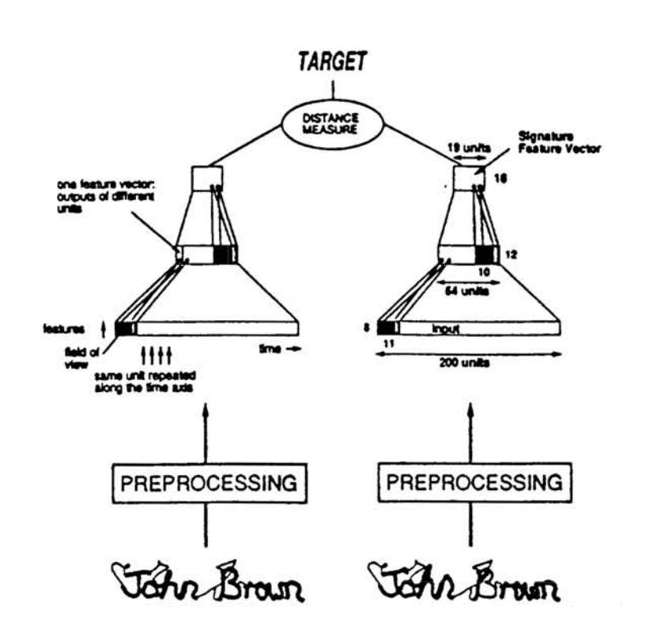

Kiến trúc Siamese làm tốt các bài toán này vì:

1. các mạng con dùng chung trọng số nên cần ít tham số hơn để huấn luyện, tức cần ít dữ liệu hơn và khó quá khớp hơn;
2. mỗi mạng con về bản chất sinh ra một biểu diễn của đầu vào (trong hình là "vector đặc trưng chữ ký"). Nếu các đầu vào cùng loại, như so hai câu hay hai ảnh, thì dùng mô hình giống nhau để xử lý đầu vào giống nhau là hợp lý. Nhờ đó các vector biểu diễn có cùng ngữ nghĩa, dễ so sánh hơn.

Với hỏi đáp, một số nghiên cứu gần đây dùng kiến trúc Siamese để chấm điểm độ liên quan giữa câu hỏi và các câu trả lời ứng viên: một đầu vào là câu hỏi, đầu vào kia là câu trả lời, đầu ra là mức độ câu trả lời liên quan tới câu hỏi. Câu hỏi và câu trả lời trông không giống nhau, nhưng nếu mục tiêu là trích độ tương đồng hoặc mối liên hệ giữa chúng, kiến trúc Siamese vẫn làm tốt.

**Ma trận tương tác (MatchPyramid)**

Ý tưởng cơ bản của khớp văn bản là:

$$\mathrm{match}(T_1, T_2) = F\big(\theta(T_1), \theta(T_2)\big),$$

trong đó $T$ là văn bản, hàm $\theta$ chuyển văn bản thành biểu diễn, hàm $F$ biểu diễn quan hệ tương tác giữa hai biểu diễn. Tùy chỗ nhấn mạnh, có phương pháp biểu diễn (nhấn vào $\theta$) và phương pháp tương tác (nhấn vào $F$); MatchPyramid (Pang và cộng sự 2016) thuộc loại sau.

Cách làm cơ bản: dựng ma trận tương đồng giữa hai văn bản, dùng CNN trích đặc trưng từ ma trận, cuối cùng dùng softmax lấy xác suất phân loại, đánh giá bằng entropy chéo.

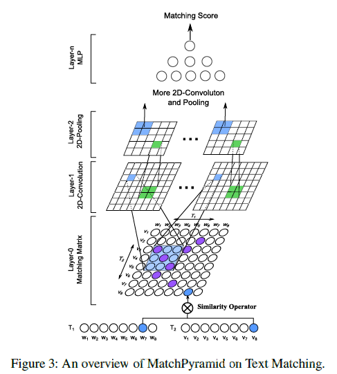

Quy trình:

- **Ma trận tương đồng.** CNN làm việc với dữ liệu dạng lưới, còn văn bản là dữ liệu chuỗi, nên cần chuyển đổi. Có ba cách dựng ma trận tương đồng (trong bài báo, tích vô hướng cho kết quả tốt nhất):
  - kiểu 0–1: từ ở hai vị trí giống nhau thì là 1, khác thì là 0:
    $$M_{ij} = \mathbb 1_{\{w_i = v_j\}} = \begin{cases}1, & w_i = v_j,\\ 0, & \text{ngược lại;}\end{cases}$$
  - cosine: dùng GloVe huấn luyện sẵn chuyển từ thành vector $\vec\alpha_i$, $\vec\beta_j$, rồi tính cosine:
    $$M_{ij} = \frac{\vec\alpha_i^\top \vec\beta_j}{\lVert\vec\alpha_i\rVert\cdot\lVert\vec\beta_j\rVert};$$
  - tích vô hướng: như trên nhưng thay cosine bằng tích vô hướng:
    $$M_{ij} = \vec\alpha_i^\top \vec\beta_j.$$
- **Hai tầng CNN.** Dùng hai tầng CNN trích đặc trưng từ ma trận tương đồng; lưu ý vì ma trận ở tầng trước có kích thước không cố định (câu dài ngắn khác nhau), maxpool sau tầng CNN thứ nhất phải dùng pooling động (dynamic pooling).
- **Hai tầng MLP.** Cuối cùng dùng hai tầng kết nối đầy đủ biến đổi kết quả của CNN, dùng softmax cho xác suất phân loại cuối cùng.

> Người viết bản gốc cho biết đã dùng mô hình trong bài báo trên tập dữ liệu Quora của Kaggle, đạt điểm khá tốt, nhóm xếp thứ tư.
> Mã cài đặt tham khảo: https://github.com/faneshion/MatchZoo

> **Biên tập:** bản gốc có một trích dẫn "[2]" cho đoạn hỏi đáp dùng Siamese nhưng không có trong danh mục (một công trình tiêu biểu là Feng và cộng sự 2015, *Applying Deep Learning to Answer Selection*). Hiện nay khớp ngữ nghĩa thường dùng **bi-encoder** (mô hình nhúng câu kiểu Sentence-BERT, đúng tinh thần Siamese) để truy hồi nhanh, và **cross-encoder** (đưa cả hai câu vào một Transformer, đúng tinh thần tương tác) để xếp hạng lại; xem 16.5 và 16.18.

### 18.5.7 Tìm Top N vector tương đồng trong một lượng vector khổng lồ thế nào?

<div class="qa-theory">

**Lý thuyết:** [Học máy · 10.1 Giới thiệu](ml/ch10_vi?id=_101-giới-thiệu) · [Ôn tập · 16.18 Các mô hình hỏi đáp thường gặp là gì? Triển khai nhanh thế nào?](qa/ch16_vi?id=_1618-các-mô-hình-hỏi-đáp-thường-gặp-là-gì-triển-khai-nhanh-thế-nào)

</div>

**Thuật toán tìm kiếm Annoy**

Mục tiêu của Annoy là dựng một cấu trúc dữ liệu để thời gian tìm láng giềng gần nhất của một điểm là dưới tuyến tính. Annoy dựng cây nhị phân để mỗi lần tìm chỉ mất $O(\log n)$. Xem hình dưới: chọn ngẫu nhiên hai điểm làm hai tâm ban đầu, chạy k-means với 2 cụm, được hai tâm cụm sau khi hội tụ. Nối hai tâm bằng một đoạn thẳng (đoạn xám ngắn), dựng đường vuông góc với đoạn này và đi qua trung điểm của nó (đường đen đậm). Đường đen đậm chia không gian dữ liệu làm hai phần. Trong không gian nhiều chiều, nó là siêu phẳng trung trực.

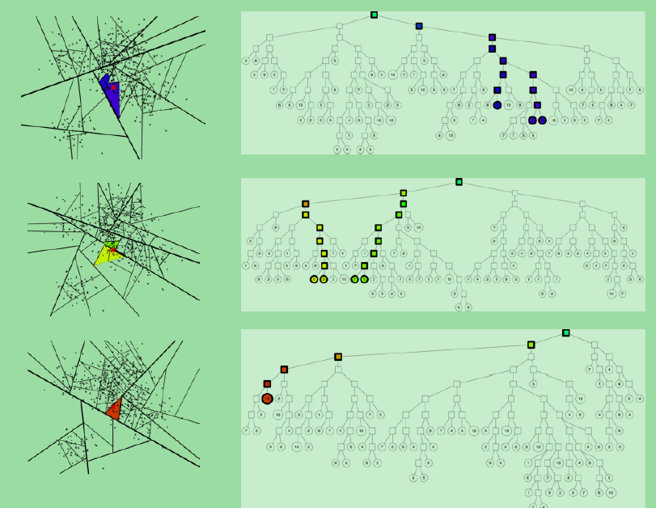

Chia đệ quy nhiều lần như vậy, dữ liệu ban đầu tạo thành một cây nhị phân. Tầng dưới cùng của cây là các nút lá ghi các điểm dữ liệu gốc, các nút trung gian ghi thông tin siêu phẳng chia. Annoy dựng cây nhị phân như vậy với hy vọng thỏa giả thiết: các điểm tương tự nằm gần nhau trên cây, một siêu phẳng chia không nên tách các điểm tương tự vào các nhánh khác nhau.

```text
Tóm tắt: Annoy dựng một cấu trúc dữ liệu để thời gian tìm các vector láng giềng gần nhất của một vector là dưới tuyến tính.
Các bước: chọn ngẫu nhiên hai điểm phân cụm → chia bằng siêu phẳng → dựng cây nhị phân → dựng nhiều cây → gộp kết quả tìm được và sắp xếp.
Lưu ý: lần truy vấn đầu khá chậm (phải nạp chỉ mục); là thuật toán xấp xỉ, độ chính xác gần 100%.
```

> **Biên tập:** "độ chính xác gần 100%" phụ thuộc số cây và tham số `search_k`; đánh đổi giữa tốc độ và độ phủ luôn có. Các thư viện tìm láng giềng gần đúng phổ biến hiện nay: **FAISS** (Meta, có chỉ mục IVF, PQ, HNSW, chạy GPU), **HNSW** (hnswlib), ScaNN (Google); các cơ sở dữ liệu vector (Milvus, Qdrant, pgvector…) dựng trên những thuật toán này. Thứ tự hình trong bản gốc bị lẫn: hình Annoy mang tên file `18-5-6-1.jpg` (trùng số với hình Siamese ở mục trước).

### 18.5.8 Làm rõ câu hỏi (clarification) là gì?

Khi câu hỏi mơ hồ, hoặc câu trả lời khớp được có độ tin cậy nhưng chưa đủ cao, hệ thống kích hoạt làm rõ câu hỏi. Nói đơn giản là làm rõ ý định: khi ý định chưa rõ thì hỏi lại người dùng để xác nhận.

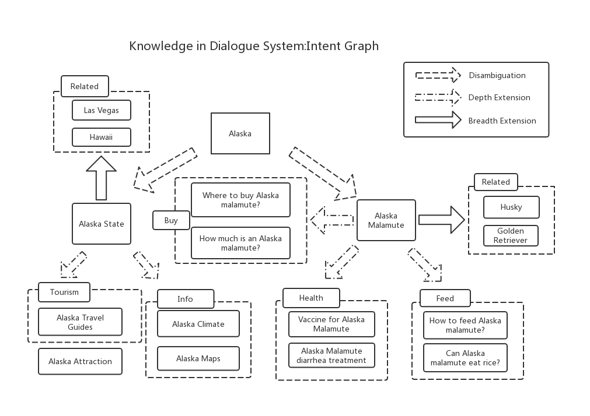

Các nút của đồ thị ý định là các ý định. Quan hệ giữa các "ý định" gồm làm rõ nhu cầu (disambiguation), đào sâu nhu cầu (depth extension), mở rộng ngang nhu cầu (breadth extension)… Trong ví dụ ở hình, khi "Alaska" nghĩa là "bang Alaska", các ý định liên quan là thành phố, du lịch…; khi "Alaska" nghĩa là "chó Alaska (Alaskan Malamute)", ý định mở rộng là chó cảnh, chăm sóc chó, cho ăn thế nào…

### 18.5.9 Xếp hạng, chấm điểm kết quả thế nào?

<div class="qa-theory">

**Lý thuyết:** [Ôn tập · 16.4 Hiểu vector từ (word vector) thế nào?](qa/ch16_vi?id=_164-hiểu-vector-từ-word-vector-thế-nào)

</div>

**DRMM + PACRR**

DRMM + PACRR là các mô hình mới cho xếp hạng độ liên quan của văn bản (McDonald, Brokos, Androutsopoulos, EMNLP 2018), dựa trên mô hình DRMM trước đó. Cụ thể, DRMM dùng cách mã hóa từ (term encoding) không phụ thuộc ngữ cảnh; mô hình cải tiến học ý tưởng của PACRR, kết hợp thông tin n-gram và ngữ cảnh mã hóa theo nhiều cách khác nhau.

- Dùng mã hóa từ nhạy ngữ cảnh (context-sensitive term encodings) dựng ma trận tương đồng truy vấn–văn bản, dùng tích chập trích thông tin n-gram.
- Hai tầng max-pooling lấy thông tin tương đồng mạnh nhất rồi ghép lại.
- Dùng cùng một mạng MLP tính điểm độc lập cho từng mã hóa của từ trong truy vấn (mỗi hàng của ma trận), rồi qua một tầng tuyến tính để có điểm liên quan giữa truy vấn và văn bản.

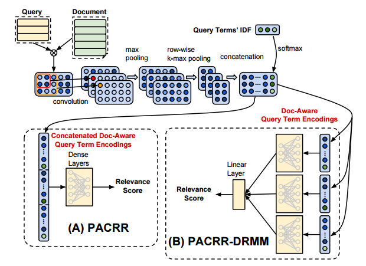

GitHub: https://github.com/nlpaueb/deep-relevance-ranking

**N-gram**

N-gram là một mô hình ngôn ngữ khá quan trọng trong xử lý ngôn ngữ tự nhiên, thường dùng để so độ tương đồng câu, tìm kiếm mờ, đánh giá tính hợp lý của câu, sửa câu…

Nếu bạn chơi Liên Minh Huyền Thoại (LOL) ở Trung Quốc, khi nghe "đi rừng hình vuông", "bạn đúng là lầy", "bạn lầy mặc bạn lầy", bạn sẽ nghĩ từ tiếp theo có lẽ là "Đại Tư Mã" (tên một streamer) chứ không phải "Ngũ Ngũ Khai". Nếu không chơi LOL cũng không sao: khi nghe "nóng trong người", "lon vàng", bạn có lẽ nghĩ tới "Gia Đa Bảo" (một loại trà thảo mộc) hơn là "Coca-Cola". N-gram dựa đúng trên ý tưởng này: đặc điểm thứ nhất là sự xuất hiện của một từ phụ thuộc vào vài từ khác; đặc điểm thứ hai là càng có nhiều thông tin, dự đoán càng chính xác. Có thể nói mỗi người đều có một mô hình N-gram trong đầu, không ngừng được hoàn thiện và huấn luyện; hiểu biết và trải nghiệm làm phong phú thêm vốn sống, tăng khả năng liên tưởng của ta.

Mô hình N-gram là một mô hình ngôn ngữ (language model, LM); mô hình ngôn ngữ là mô hình xác suất, đầu vào là một câu (dãy từ có thứ tự), đầu ra là xác suất của câu đó, tức xác suất đồng thời của các từ.

**Tính xác suất trong N-gram**

Giả sử có câu $S = (w_1, w_2, \dots, w_n)$ gồm $n$ từ; đo xác suất của nó thế nào? Giả sử mỗi từ $w_i$ phụ thuộc vào mọi từ từ $w_1$ tới $w_{i-1}$:

$$p(S) = p(w_1 w_2 \cdots w_n) = p(w_1)\,p(w_2\mid w_1)\cdots p(w_n\mid w_{n-1}\cdots w_2 w_1).$$

Cách đo này có hai nhược điểm:

- **không gian tham số quá lớn:** xác suất có điều kiện $p(w_n\mid w_{n-1}\cdots w_1)$ có tới $O(|V|^n)$ tham số ($|V|$ là kích thước từ điển);
- **dữ liệu thưa nghiêm trọng:** nhiều tổ hợp từ có thể chưa từng xuất hiện, nhất là khi bậc cao.

Để giải quyết vấn đề thứ nhất, ta đưa vào **giả thiết Markov**: sự xuất hiện của một từ chỉ phụ thuộc vào vài từ đứng ngay trước nó:

$$p(w_1\cdots w_n) = \prod_i p(w_i\mid w_{i-1}\cdots w_1) \approx \prod_i p(w_i\mid w_{i-1}\cdots w_{i-N+1}).$$

Nếu một từ chỉ phụ thuộc vào một từ đứng trước, ta gọi là **bi-gram**:

$$p(S) = p(w_1 w_2\cdots w_n) = p(w_1)\,p(w_2\mid w_1)\cdots p(w_n\mid w_{n-1}).$$

Nếu một từ chỉ phụ thuộc vào hai từ đứng trước, ta gọi là **tri-gram**:

$$p(S) = p(w_1 w_2\cdots w_n) = p(w_1)\,p(w_2\mid w_1)\cdots p(w_n\mid w_{n-1} w_{n-2}).$$

$N$ có thể lấy rất lớn, nhưng thực tế bi-gram và tri-gram thường là đủ.

Vậy tính từng xác suất có điều kiện $p(w_n\mid w_{n-1}\cdots w_1)$ thế nào? Câu trả lời là **ước lượng hợp lý cực đại** (MLE), tức đếm tần số:

$$p(w_n\mid w_{n-1}) = \frac{C(w_{n-1} w_n)}{C(w_{n-1})},\qquad p(w_n\mid w_{n-1} w_{n-2}) = \frac{C(w_{n-2} w_{n-1} w_n)}{C(w_{n-2} w_{n-1})},$$

$$p(w_n\mid w_{n-1}\cdots w_1) = \frac{C(w_1 w_2\cdots w_n)}{C(w_1 w_2\cdots w_{n-1})}.$$

**Cụ thể**, với bi-gram, xét kho ngữ liệu gồm ba câu:

```text
<s> I am Sam </s>
<s> Sam I am </s>
<s> I do not like eggs and ham </s>
```

Dễ đếm được "I" xuất hiện 3 lần, "I am" xuất hiện 2 lần, nên:

$$p(\text{am}\mid \text{I}) = \frac{2}{3}.$$

Tương tự tính được:

$$p(\text{I}\mid \langle s\rangle) = 0{,}67,\quad p(\text{do}\mid \text{I}) = 0{,}33,\quad p(\text{Sam}\mid \text{am}) = 0{,}5,\quad p(\text{not}\mid \text{do}) = 1,\quad p(\langle/s\rangle\mid \text{Sam}) = 0{,}5,\quad p(\text{like}\mid \text{not}) = 1.$$

> **Biên tập:** sửa so với bản gốc: (1) bản gốc gọi mô hình ngôn ngữ là "mô hình phân biệt dựa trên xác suất"; mô hình ngôn ngữ là mô hình xác suất (sinh) trên chuỗi từ, không phải mô hình phân biệt; (2) số tham số của xác suất có điều kiện bậc $n$ là $O(|V|^n)$, không phải "$O(n)$"; (3) các công thức trong bản gốc bị vỡ khi chép (phân số lật ngược, chỉ số tách dòng), đã gõ lại; (4) ảnh kho ngữ liệu trong bản gốc kết thúc câu bằng `<s>` và có $p(\langle s\rangle\mid \text{Sam})$; ký hiệu cuối câu phải là `</s>`. Ví dụ này lấy từ sách *Speech and Language Processing* của Jurafsky và Martin. Thực tế cần làm trơn (smoothing, như Kneser–Ney) cho các n-gram chưa gặp; N-gram dùng ở đây như một đặc trưng xếp hạng (độ hợp lý của câu, độ trùng n-gram giữa câu hỏi và câu trả lời).

### 18.5.10 Đánh giá hiệu quả của hệ tương tác người–máy thế nào?

<div class="qa-theory">

**Lý thuyết:** [Học máy · E.4 Precision, recall và F1](ml/eval_vi?id=e4-precision-recall-và-f1)

</div>

Hiệu quả của hệ tương tác người–máy có thể đo bằng các chỉ số như số câu hỏi hợp lệ, độ chính xác của câu trả lời gợi ý Top 1, độ chính xác Top 3, độ chính xác phản hồi cho câu hỏi hợp lệ, độ phủ tri thức.

| Loại | Chỉ số | Cách thu thập |
| --- | --- | --- |
| Chỉ số đánh giá hỏi đáp | số câu hỏi hợp lệ | lấy mẫu log và thống kê |
| Chỉ số đánh giá hỏi đáp | độ chính xác Top 1 | lấy mẫu log và thống kê |
| Chỉ số đánh giá hỏi đáp | độ chính xác Top 3 | lấy mẫu log và thống kê |
| Chỉ số đánh giá hỏi đáp | độ chính xác phản hồi cho câu hỏi hợp lệ | lấy mẫu log và thống kê |
| Chỉ số đánh giá hỏi đáp | độ phủ tri thức | lấy mẫu log và thống kê |

| Loại | Chỉ số | Công thức | Mục đích | Cách thu thập |
| --- | --- | --- | --- | --- |
| Tổng thể | tỉ lệ lượng yêu cầu | số yêu cầu tới bot FAQ, bot nhiệm vụ, bot trò chuyện / tổng số yêu cầu | vận hành | lấy từ log |
| Tổng thể | tổng số người dùng | số khách độc lập của bộ máy FAQ, nhiệm vụ, trò chuyện | vận hành | lấy từ log |
| Tổng thể | tỉ lệ giải quyết | (số lần bấm "đã giải quyết" + số lần không bấm) / tổng số lượt hỏi FAQ = 1 − số lần bấm "chưa giải quyết" / tổng số lượt hỏi FAQ | phân tích | lấy từ log |
| Tổng thể | tỉ lệ chưa giải quyết | số lần bấm "chưa giải quyết" / tổng số lượt hỏi FAQ = 1 − tỉ lệ giải quyết | phân tích | lấy từ log |
| Tổng thể | tỉ lệ chuyển nhân viên | số lượt FAQ chuyển sang nhân viên / tổng số lượt hỏi FAQ | phân tích | lấy từ log |
| Tổng thể | tỉ lệ hoàn thành nhiệm vụ | số lượt xử lý nghiệp vụ thành công / số yêu cầu xử lý nghiệp vụ | phân tích | lấy từ log |
| Tổng thể | thời lượng phiên trung bình | tổng thời lượng hội thoại FAQ, nhiệm vụ, trò chuyện / tổng số người dùng | phân tích | lấy từ log |
| Tổng thể | số lượt hội thoại trung bình | tổng số lượt hội thoại / tổng số người dùng | phân tích | lấy từ log |
| Tổng thể | phân tích câu hỏi bị đứt | câu hỏi khiến người dùng chuyển sang nhân viên | phân tích | lấy từ log |
| Tổng thể | phân tích câu hỏi không có câu trả lời | câu hỏi mà bot trả về câu trả lời dự phòng | phân tích | lấy từ log |
| Tổng thể | phân tích câu hỏi nóng | Top N câu hỏi theo tổng số lượt hỏi | phân tích | lấy từ log |

> **Biên tập:** sửa so với bản gốc: "tỉ lệ chưa giải quyết" bản gốc ghi là "số lần bấm *đã giải quyết* / tổng", mâu thuẫn với vế "= 1 − tỉ lệ giải quyết"; đúng phải là số lần bấm *chưa giải quyết*. Các chữ hỏng: "向量对话" (hội thoại vector) đúng là trò chuyện xã giao (寒暄), "转空客" đúng là chuyển nhân viên (转人工), "总对话论数" là tổng số lượt hội thoại.

## 18.6 Thiết kế hệ thống gợi ý cá nhân hóa thế nào?

<div class="qa-theory">

**Lý thuyết:** [d2l (tiếng Anh) · 21.1 Tổng quan hệ gợi ý](https://d2l.ai/chapter_recommender-systems/recsys-intro.html) ↗

</div>

### 18.6.1 Hệ thống gợi ý cá nhân hóa là gì?

Hệ thống gợi ý cá nhân hóa là loại ứng dụng dựa trên lịch sử, quan hệ xã hội, điểm quan tâm, ngữ cảnh… của người dùng để phán đoán nội dung mà người dùng đang cần hoặc có thể quan tâm.

Trong thời đại dữ liệu lớn, mọi mặt của cuộc sống đều quá tải thông tin: thương mại điện tử, trang phim hay video, đài nhạc trực tuyến cá nhân hóa, mạng xã hội, đọc cá nhân hóa, dịch vụ dựa trên vị trí, email cá nhân hóa, quảng cáo cá nhân hóa…; dạo Taobao, đặt đồ ăn, nghe đài trực tuyến, xem phim… Hệ gợi ý âm thầm đẩy nội dung bạn quan tâm tới bạn, có lúc còn hiểu bạn hơn chính bạn.

Nghiệp vụ của hệ gợi ý gồm bốn phần chính:

- **lắp ráp nội dung:** sản xuất quảng cáo, cá nhân hóa nội dung như lời quảng cáo, hình ảnh;
- **gọi lại nội dung (recall):** từ lượng nội dung khổng lồ, gọi lại một tập con làm nội dung gợi ý;
- **xếp hạng nội dung:** xếp hạng tinh tập con được gọi lại theo một tiêu chuẩn nào đó;
- **chiến lược vận hành:** thêm một số chiến lược vận hành để xếp lại một phần, rồi mới gửi nội dung.

Hệ gợi ý phải có chức năng thu thập và phân tích dữ liệu. Thu thập dữ liệu gồm: gắn điểm theo dõi (tracking), báo cáo, lưu trữ. Phân tích dữ liệu gồm: dựng chân dung (người dùng và nội dung), quy kết hành vi.

Thuật toán của hệ gợi ý thể hiện ở hai phần: **gọi lại và xếp hạng**. Thuật toán gọi lại rất đa dạng: itemCF, userCF, luật kết hợp, embedding, khớp chuỗi, gom theo cùng loại… Thuật toán xếp hạng có thể mô tả từ nhiều góc; ở đây nhìn vĩ mô, chia làm năm phần: **dựng mẫu, thiết kế mô hình, xác định hàm mục tiêu, chọn phương pháp tối ưu, đánh giá**.

### 18.6.2 Thiết kế kiến trúc bộ máy gợi ý của hệ gợi ý cá nhân hóa thế nào?

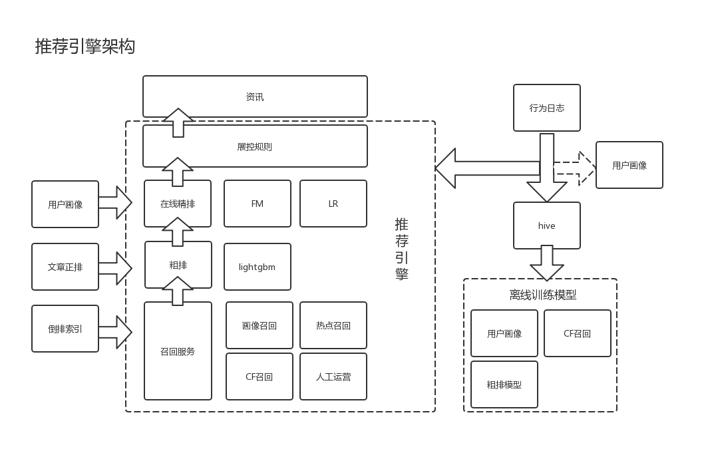

### 18.6.3 Mô-đun gọi lại

- gọi lại tin nóng và vận hành thủ công: chiến lược dự phòng;
- gọi lại theo chân dung người dùng (dựa trên nội dung, CB): xếp hạng nhãn, cắt từ chỉ mục đảo;
- thuật toán gọi lại CF: dựa trên người dùng (user-based) và dựa trên vật phẩm (item-based);
- làm gọi lại CF người dùng trực tuyến quy mô lớn thế nào?
  - tính ngoại tuyến top k người dùng tương tự của mỗi người dùng, lưu vào cache;
  - lưu trực tuyến lịch sử bấm của mỗi người dùng;
  - tra cứu trực tuyến lịch sử bấm của các người dùng tương tự.

### 18.6.4 Mô-đun xếp hạng

<div class="qa-theory">

**Lý thuyết:** [Học máy · Chương 14 Logistic regression](ml/ch14_vi) · [Học máy · Ensemble learning](ml/ensemble_vi)

</div>

- Chọn mô hình: LR, FM, GBDT, DNN…

| Đặc trưng phức tạp + mô hình đơn giản | Đặc trưng đơn giản + mô hình phức tạp |
| --- | --- |
| mô hình tuyến tính: LR | mô hình phi tuyến: GBDT, DNN |
| huấn luyện nhanh, dễ giải thích | biểu diễn mạnh, điểm xuất phát cao |
| dự đoán trực tuyến đơn giản | huấn luyện chậm, khó giải thích |
| phải tự dựng đặc trưng quy mô lớn mới tăng hiệu quả, về sau khó bảo trì | dễ quá khớp, khó tối ưu |

- Quá trình phát triển thuật toán xếp hạng của hệ thống:
  1. xếp hạng tinh bằng LR (Spark MLlib, huấn luyện ngoại tuyến một máy);
  2. xếp hạng thô bằng GBDT (LightGBM);
  3. xếp hạng tinh bằng LR học trực tuyến (dựa trên FTRL);
  4. xếp hạng tinh bằng FM học trực tuyến (dựa trên FTRL);
  5. xếp hạng tinh bằng LR học trực tuyến quy mô lớn (cụm chuyên dụng).

> **Biên tập:** sơ đồ quá trình phát triển (chữ tiếng Trung) đã được viết lại thành danh sách trên.

### 18.6.5 Huấn luyện ngoại tuyến

<div class="qa-theory">

**Lý thuyết:** [Học máy · Chương 14 Logistic regression](ml/ch14_vi)

</div>

- Quy trình huấn luyện ngoại tuyến: log hiển thị (exposure) và log bấm của feed → trích mẫu gốc → join chân dung người dùng, join đặc trưng tin tức → sinh mẫu huấn luyện và mẫu kiểm thử → huấn luyện mô hình → đánh giá mô hình (AUC).
- Đưa đặc trưng phản hồi thời gian thực vào mô hình thế nào?
  - tính trực tuyến, báo cáo cùng log hiển thị, huấn luyện ngoại tuyến dùng trực tiếp.
- Giải quyết vấn đề hiển thị chưa đủ (exposure không đủ) thế nào?
  - dùng làm trơn Bayes cho CTR (CTR = số lần bấm / số lần hiển thị):
    - CTR riêng $r$ của mọi tin tức tuân theo phân phối Beta:
      $$r\sim\mathrm{Beta}(\alpha,\beta),\qquad p(r\mid\alpha,\beta) = \frac{\Gamma(\alpha+\beta)}{\Gamma(\alpha)\Gamma(\beta)}\,r^{\alpha-1}(1-r)^{\beta-1};$$
    - với một tin tức, khi biết số lần hiển thị $I$ và CTR riêng $r$, số lần bấm $C$ tuân theo phân phối nhị thức:
      $$C\sim\mathrm{Binomial}(I, r),\qquad P(C\mid I, r)\propto r^{C}(1-r)^{I-C};$$
    - ước lượng $\hat\alpha$, $\hat\beta$ bằng hợp lý cực đại (trên dữ liệu của mọi tin tức), rồi ước lượng hậu nghiệm CTR của tin tức $i$:
      $$\hat r_i = \frac{C_i + \hat\alpha}{I_i + \hat\alpha + \hat\beta};$$
    - tin hiển thị ít được làm trơn mạnh, tin hiển thị đủ nhiều gần như không bị ảnh hưởng.

> **Biên tập:** sửa so với bản gốc: (1) CTR = số lần **bấm** / số lần **hiển thị** (bản gốc viết ngược); (2) số lần bấm khi biết số lần hiển thị tuân theo phân phối **nhị thức**, không phải Bernoulli (Bernoulli là cho một lần hiển thị); (3) $\hat\alpha,\hat\beta$ được ước lượng bằng cách cực đại hợp lý biên (phân phối Beta–nhị thức) trên toàn bộ tin tức, hoặc bằng phương pháp mô-men. Ví dụ với $\hat\alpha = 2$, $\hat\beta = 98$ (CTR tiên nghiệm 2%): tin mới có 3 lượt bấm trên 10 lượt hiển thị (CTR thô 30%) được làm trơn thành $5/110\approx4{,}5\%$; tin có 300 lượt bấm trên 10000 lượt hiển thị (3%) thành $302/10100\approx3{,}0\%$. Phương pháp theo Wang và cộng sự, *Click-Through Rate Estimation for Rare Events in Online Advertising*.

### 18.6.6 Chân dung người dùng

- nhãn người dùng;
- phương pháp thống kê:
  - đếm hành vi trong feed theo nhãn (tỉ lệ bấm); nhược điểm: không thêm được đặc trưng khác, khó tối ưu về sau;
- phương pháp dựa trên học máy:
  - mô hình hóa sở thích dài hạn của người dùng;
  - mô hình LR;
  - dùng nhãn người dùng làm đặc trưng.

### 18.6.7 Xếp hạng thô bằng GBDT

<div class="qa-theory">

**Lý thuyết:** [Học máy · Ensemble learning](ml/ensemble_vi) · [Học máy · Decision trees](ml/tree_vi)

</div>

- Vì sao cần xếp hạng thô?
  - nhanh chóng lọc ra tập ứng viên chất lượng cao;
  - tiện dùng đặc trưng phản hồi thời gian thực trực tuyến.
- Thiết kế đặc trưng cho xếp hạng thô thế nào?
  - đặc trưng cần tương đối dày đặc.
- Chọn mô hình thuật toán phù hợp thế nào?
  - LightGBM;
  - XGBoost;
  - LightGBM nhanh hơn XGBoost; khi dự đoán trực tuyến, an toàn luồng hơn.

### 18.6.8 Xếp hạng tinh trực tuyến bằng FM

<div class="qa-theory">

**Lý thuyết:** [d2l (tiếng Anh) · 21.9 Factorization machines](https://d2l.ai/chapter_recommender-systems/fm.html) ↗ · [Học máy · Chương 12 Gradient descent](ml/ch12_vi)

</div>

- Vì sao cần học trực tuyến?
  - nội dung feed cập nhật nhanh;
  - sở thích người dùng thay đổi theo thời gian;
  - mô hình xếp hạng phải phản ứng nhanh với thay đổi sở thích của người dùng.

- **Mô hình FM** (factorization machine):

  $$\hat y(x) = w_0 + \sum_{i=1}^{n} w_i x_i + \sum_{i=1}^{n}\sum_{j=i+1}^{n}\langle v_i, v_j\rangle x_i x_j,\qquad \sigma(y) = \frac{1}{1+\exp(-y)}.$$

  Mỗi đặc trưng $i$ có một vector ẩn $v_i\in\mathbb R^k$; trọng số của cặp đặc trưng $(i,j)$ là tích vô hướng $\langle v_i, v_j\rangle$, nên học được tương tác cả với những cặp hiếm khi cùng xuất hiện trong dữ liệu thưa. Hạng tương tác tính được trong $O(kn)$ nhờ đẳng thức $\sum_{i<j}\langle v_i,v_j\rangle x_ix_j = \tfrac12\sum_{f=1}^{k}\big[(\sum_i v_{i,f}x_i)^2 - \sum_i v_{i,f}^2x_i^2\big]$.

- **Cập nhật mô hình bằng FTRL (Follow The Regularized Leader)**

  - Tổng quan thuật toán: FTRL là thuật toán tối ưu phổ biến cho học trực tuyến trên dữ liệu cực lớn có rất nhiều đặc trưng thưa, tiện dụng và hiệu quả tốt, thường dùng để cập nhật mô hình dự đoán CTR trực tuyến. FTRL kết hợp ưu điểm của hai thuật toán FOBOS và RDA: vừa có độ chính xác khá cao như FOBOS, vừa (với một chút đánh đổi độ chính xác) cho mô hình thưa hơn như RDA. FTRL làm rất tốt các bài toán tối ưu lồi có số hạng chính quy hóa không trơn (như L1): không chỉ điều khiển độ thưa của mô hình qua chính quy hóa L1 mà còn hội tụ nhanh.

  - Các điểm chính và thuật toán (theo McMahan và cộng sự 2013, *Ad Click Prediction: a View from the Trenches*, thuật toán 1: FTRL-Proximal theo từng tọa độ với chính quy hóa $L_1$, $L_2$ cho hồi quy logistic):

    ```text
    Input: tham số α, β, λ1, λ2
    for i ∈ {1, …, d}: z_i ← 0, n_i ← 0          # khởi tạo
    for t = 1 to T:
        nhận vector đặc trưng x_t; I ← {i | x_i ≠ 0}
        for i ∈ I:                                # tính trọng số từ z, n
            if |z_i| ≤ λ1: w_{t,i} ← 0
            else: w_{t,i} ← −(z_i − sgn(z_i)·λ1) / ((β + √n_i)/α + λ2)
        p_t ← σ(x_t · w)                          # dự đoán
        nhận nhãn y_t ∈ {0, 1}
        for i ∈ I:
            g_i ← (p_t − y_t)·x_i                 # gradient của mất mát theo w_i
            σ_i ← (√(n_i + g_i²) − √n_i) / α      # bằng 1/η_{t,i} − 1/η_{t−1,i}
            z_i ← z_i + g_i − σ_i·w_{t,i}
            n_i ← n_i + g_i²
    ```

  - Đặc tính và ưu nhược điểm: học trực tuyến, tính thời gian thực cao; xử lý được dữ liệu thưa quy mô lớn; huấn luyện được mô hình có rất nhiều tham số; mỗi đặc trưng có tốc độ học riêng (per-coordinate learning rate).

    Các mẹo cài đặt FTRL-Proximal trong thực tế:

    1. **Tiết kiệm bộ nhớ:**

       ```text
       Cách 1) Poisson Inclusion: với mẫu huấn luyện có một chiều đặc trưng chưa có trong mô hình, chỉ nhận đặc trưng đó vào mô hình và cập nhật với xác suất p.
       Cách 2) Bloom Filter Inclusion: dùng bloom filter để (về mặt xác suất) chỉ cập nhật một đặc trưng khi nó đã xuất hiện k lần.
       ```

    2. **Mã hóa lại số thực:**

       ```text
       1) trọng số đặc trưng không cần lưu bằng số thực 32 hay 64 bit, lãng phí bộ nhớ.
       2) mã hóa 16 bit, nhưng cần chú ý ảnh hưởng của cách làm tròn tới regret (ghi chú: Python có thể thử định dạng numpy.float16).
       ```

    3. **Huấn luyện đồng thời vài mô hình tương tự:**

       ```text
       1) với cùng một chuỗi dữ liệu huấn luyện, huấn luyện cùng lúc nhiều mô hình tương tự.
       2) các mô hình có một số đặc trưng riêng, và một số đặc trưng dùng chung.
       3) ý tưởng: có chiều đặc trưng riêng cho từng mô hình, còn các đặc trưng dùng chung thì huấn luyện bằng cùng dữ liệu.
       ```

    4. **Single Value Structure:**

       ```text
       1) nhiều mô hình dùng chung một kho đặc trưng (ví dụ đặt trong cbase hay redis), mọi mô hình cùng cập nhật cấu trúc đặc trưng chung này.
       2) với một mô hình, ở mỗi chiều của vector đặc trưng nó huấn luyện, tính thẳng kết quả một bước lặp rồi lấy trung bình với giá trị cũ.
       ```

    5. **Dùng số mẫu dương và âm để tính tổng gradient** (mọi mô hình có cùng $N$ và $P$): với hồi quy logistic, tổng bình phương gradient của một đặc trưng có thể xấp xỉ từ số lần nó xuất hiện trong mẫu âm $N$ và mẫu dương $P$: $\sum_t g_{t,i}^2 \approx \dfrac{PN}{N+P}$, nên không cần lưu riêng $n_i$ cho từng mô hình.

    6. **Lấy mẫu con dữ liệu huấn luyện (subsampling):**

       ```text
       1) thực tế CTR nhỏ hơn 50% nhiều, nên mẫu dương có giá trị hơn. Lấy mẫu con tập huấn luyện giảm được rất nhiều kích thước tập huấn luyện.
       2) lấy hết mẫu dương (các truy vấn có ít nhất một quảng cáo được bấm), mẫu âm lấy theo tỉ lệ r (các truy vấn không có quảng cáo nào được bấm). Nhưng nếu huấn luyện thẳng trên mẫu này, dự đoán sẽ lệch khá nhiều.
       3) cách giải quyết: khi huấn luyện, nhân mỗi mẫu với một trọng số; trọng số nhân thẳng vào mất mát, nên gradient cũng được nhân với trọng số đó.
       ```

       $$\omega_t = \begin{cases}1, & \text{sự kiện } t \text{ thuộc một truy vấn có lượt bấm},\\[2pt] \dfrac{1}{r}, & \text{sự kiện } t \text{ thuộc một truy vấn không có lượt bấm.}\end{cases}$$

  - Kịch bản phù hợp: mô hình dự đoán tỉ lệ bấm (CTR).

  - Ví dụ:
    - https://www.kaggle.com/jiweiliu/ftrl-starter-code
    - https://github.com/Angel-ML/angel/blob/master/docs/algo/ftrl_lr_spark.md

- Chọn đặc trưng cho xếp hạng tinh thế nào?
  - thêm đặc trưng mới phải giữ nguyên chỉ số của các đặc trưng đã có;
  - định kỳ huấn luyện ngoại tuyến để loại đặc trưng vô dụng, tránh số đặc trưng phình ra vô hạn;
  - dùng kết quả chia khoảng CTR dự đoán của bước xếp hạng thô GBDT làm đặc trưng.

> **Biên tập:** bản gốc trỏ hai hình của FTRL tới ổ `H:/DeepLearning-500-questions/...` trên máy người viết (không hiển thị được), và trỏ hình so sánh UserCF/ItemCF tới `C:\Users\XinRui\Desktop\...`; các file ảnh này có trong thư mục ảnh của repo, bản dịch gõ lại nội dung: thuật toán FTRL thành khối mã giả, công thức trọng số lấy mẫu thành LaTeX, bảng so sánh thành bảng. Bản gốc đặt hình công thức trọng số $\omega_t$ dưới mẹo 5, nhưng công thức đó thuộc mẹo 6 (lấy mẫu con); bản dịch chuyển về mẹo 6 và ghi lại ý của mẹo 5 theo bài báo gốc. Công thức FM trong ảnh gốc viết hạng tuyến tính là "$w1_i$", đã viết lại thành $w_i$.

### 18.6.9 Giới thiệu thuật toán

<div class="qa-theory">

**Lý thuyết:** [d2l (tiếng Anh) · 21.3 Phân rã ma trận](https://d2l.ai/chapter_recommender-systems/mf.html) ↗

</div>

- **Thuật toán lọc cộng tác**

  Lọc cộng tác (collaborative filtering, CF) là một trong những thuật toán phổ biến nhất hiện nay của hệ gợi ý cá nhân hóa. Có hai thuật toán cơ bản: **lọc cộng tác dựa trên người dùng (UserCF) và lọc cộng tác dựa trên vật phẩm (ItemCF)**.

  | | UserCF | ItemCF |
  | --- | --- | --- |
  | Hiệu năng | hợp khi số người dùng ít; nếu rất nhiều người dùng, tính ma trận tương đồng người dùng rất tốn | hợp khi số vật phẩm ít hơn hẳn số người dùng; nếu rất nhiều vật phẩm (như trang web), tính ma trận tương đồng vật phẩm rất tốn |
  | Lĩnh vực | tính thời sự cao, sở thích cá nhân không rõ rệt | vật phẩm đuôi dài phong phú, nhu cầu cá nhân hóa mạnh |
  | Thời gian thực | người dùng có hành vi mới chưa chắc làm kết quả gợi ý thay đổi ngay | người dùng có hành vi mới chắc chắn làm kết quả gợi ý thay đổi ngay |
  | Khởi động lạnh | khi người dùng mới có hành vi với vài vật phẩm, chưa gợi ý cá nhân hóa ngay được, vì bảng tương đồng người dùng được tính ngoại tuyến định kỳ | người dùng mới chỉ cần có hành vi với một vật phẩm là gợi ý được các vật phẩm liên quan |
  | | vật phẩm mới lên một thời gian, khi đã có người dùng có hành vi với nó, có thể gợi ý nó cho những người có sở thích giống người dùng đó | nhưng không gợi ý được vật phẩm mới cho người dùng nếu chưa cập nhật ngoại tuyến bảng tương đồng vật phẩm |
  | Lý do gợi ý | khó đưa ra lời giải thích thuyết phục người dùng | dùng lịch sử hành vi của người dùng để giải thích, khá thuyết phục |

  > **Biên tập:** bảng so sánh gõ lại từ ảnh trong bản gốc (theo sách *Thực hành hệ thống gợi ý* của Hạng Lượng).

- **Thuật toán gợi ý dựa trên thuộc tính**

  - *Gợi ý dựa trên nhãn người dùng:* thống kê các nhãn người dùng hay dùng nhất; với mỗi nhãn, thống kê các vật phẩm được gắn nhãn đó nhiều nhất, rồi gợi ý cho người dùng các vật phẩm nóng nhất có những nhãn này. Cách này rất hợp với người dùng mới hoặc khởi động lạnh ít dữ liệu; hiện nhiều app cho người dùng mới chọn nhãn sở thích khi vào lần đầu để tiện đẩy nội dung.
  - *Gợi ý dựa trên nội dung sản phẩm:* dùng thuộc tính nội dung của sản phẩm tính độ tương đồng giữa các sản phẩm, là kiểu "vật gợi ý vật". Cách này không phụ thuộc hành vi người dùng, chỉ cần có thông tin nội dung của vật phẩm là tính được độ tương đồng ở mức ngữ nghĩa, không có vấn đề khởi động lạnh vật phẩm. Nhược điểm là không phải vật phẩm nào cũng dễ trích thành đặc trưng có nghĩa, và tính phức tạp của hiện tượng một từ nhiều nghĩa, nhiều từ một nghĩa trong tiếng Trung cũng là một khó khăn cần vượt qua.

- **Thuật toán gợi ý dựa trên phân rã ma trận**

  Nguyên lý: từ ma trận điểm đánh giá có sẵn (rất thưa), phân rã thành ma trận đặc trưng người dùng ít chiều (mức thích của người đánh giá với từng nhân tố) và ma trận đặc trưng sản phẩm (mức sản phẩm chứa từng nhân tố), cuối cùng ngược lại phân tích dữ liệu (nhân ma trận đặc trưng người dùng với ma trận đặc trưng sản phẩm được ma trận điểm mới) để có kết quả dự đoán. Đây là thuật toán gợi ý rất đẹp, vì khi nói tới phân rã ma trận, ta thường không nghĩ nhiều về việc vật phẩm nào sẽ nằm ở hàng, cột nào của ma trận thu được; nhưng với bộ máy gợi ý này, ta thấy rõ $u_i$ là vector sở thích của người dùng thứ $i$, $v_j$ là vector tham số của phim thứ $j$:

  $$x_{ij} \approx \langle u_i, v_j\rangle,\qquad \sum_{i,j}\big(\langle u_i, v_j\rangle - x_{ij}\big)^2 \to \min$$

  (tổng chỉ lấy trên các ô $x_{ij}$ đã biết).

  Vì vậy có thể ước lượng $x_{ij}$ (điểm người dùng $i$ cho phim $j$) bằng tích vô hướng của $u$ và $v$. Ta dựng các vector này từ các điểm đã biết, rồi dùng chúng dự đoán các điểm chưa biết.

  Ví dụ, sau khi phân rã ma trận, vector của Ted là $(1{,}4;\ 0{,}9)$, vector của phim A là $(1{,}4;\ 0{,}8)$; tính tích vô hướng $1{,}4\times1{,}4 + 0{,}9\times0{,}8 = 2{,}68$ là dự đoán điểm Ted cho phim A.

  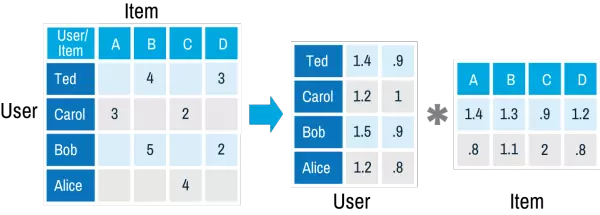

  > **Biên tập:** bản gốc ghi vector của Ted là (1,4; 0,8) và của phim A là (1,4; 0,9), ngược với hình; đã sửa theo hình (tích vô hướng không đổi). Thực tế cần thêm chính quy hóa $\lambda(\lVert u_i\rVert^2 + \lVert v_j\rVert^2)$ để không quá khớp, và giải bằng SGD hoặc ALS (ALS chính là thuật toán gợi ý của Spark MLlib ở 18.2.4).

- **Thuật toán gợi ý dựa trên nội dung nóng**

  Gợi ý cho người dùng vật phẩm có độ phổ biến cao, tức vật phẩm mới, đang nóng. Ví dụ gần đây miền Bắc Trung Quốc trở lạnh đột ngột, rất nhiều người dùng bắt đầu tìm mua áo khoác, áo lông vũ trên Taobao, Taobao sẽ gợi ý áo khoác cho người dùng miền Bắc. Khi cốc giữ nhiệt "55 độ" mới ra, ai cũng tìm mua, rồi cốc 55 độ xuất hiện trong luồng nội dung của người dùng. Thuật toán độ phổ biến giải quyết tốt khởi động lạnh, nhưng vật phẩm gợi ý có hạn, không trúng được sở thích người dùng; danh sách gợi ý của nó thường dùng làm danh sách dự phòng; là cách thường dùng cho gợi ý weibo, tin tức… Quy trình cơ bản: xác định chu kỳ phổ biến của vật phẩm, tính độ phổ biến của vật phẩm trong chu kỳ đó, vật phẩm có độ phổ biến cao được gợi ý.

### 18.6.10 Đánh giá hiệu quả của hệ gợi ý cá nhân hóa thế nào?

<div class="qa-theory">

**Lý thuyết:** [Học máy · E.4 Precision, recall và F1](ml/eval_vi?id=e4-precision-recall-và-f1) · [Học máy · E.6 Đường ROC và AUC](ml/eval_vi?id=e6-Đường-roc-và-auc) · [Ôn tập · Bổ sung: IoU và mAP là gì?](qa/ch08_vi?id=bổ-sung-iou-và-map-là-gì)

</div>

- **Độ chính xác và độ phủ (Precision & Recall)**

  Độ chính xác (precision) và độ phủ (recall) là hai chỉ số dùng rộng rãi trong truy xuất thông tin và phân loại thống kê để đánh giá chất lượng kết quả. Precision là tỉ lệ số tài liệu liên quan được truy xuất trên tổng số tài liệu được truy xuất, đo độ chính xác của hệ thống truy xuất; recall là tỉ lệ số tài liệu liên quan được truy xuất trên tổng số tài liệu liên quan trong kho, đo độ đầy đủ của hệ thống.

  | | Liên quan | Không liên quan |
  | --- | --- | --- |
  | **Được truy xuất** | $A$ | $B$ |
  | **Không được truy xuất** | $C$ | $D$ |

  $$P = \frac{A}{A+B},\qquad R = \frac{A}{A+C},\qquad F = \frac{2PR}{P+R}.$$

  Nói chung, precision là trong các mục được truy xuất (tài liệu, trang web…) có bao nhiêu mục đúng; recall là trong tất cả các mục đúng có bao nhiêu mục được truy xuất ra.

  Precision, recall và giá trị F là các chỉ số quan trọng để đánh giá việc chọn ra mục tiêu trong một môi trường lẫn lộn. Định nghĩa:

  ```text
  Precision = số thông tin đúng trích được / số thông tin trích được
  Recall    = số thông tin đúng trích được / số thông tin đúng trong mẫu
  ```

  Cả hai nằm trong khoảng 0 tới 1, càng gần 1 thì độ chính xác hoặc độ phủ càng cao.

  ```text
  F = Precision × Recall × 2 / (Precision + Recall)   (F là trung bình điều hòa của precision và recall)
  ```

  Ví dụ: một ao có 1400 con cá chép, 300 con tôm, 300 con ba ba. Mục tiêu là bắt cá chép. Quăng một mẻ lưới, bắt được 700 cá chép, 200 tôm, 100 ba ba. Các chỉ số là:

  ```text
  Precision = 700 / (700 + 200 + 100) = 70%
  Recall    = 700 / 1400 = 50%
  F         = 70% × 50% × 2 / (70% + 50%) = 58,3%
  ```

  Nếu vét sạch cả ao, mọi cá chép, tôm và ba ba, các chỉ số thay đổi thế nào:

  ```text
  Precision = 1400 / (1400 + 300 + 300) = 70%
  Recall    = 1400 / 1400 = 100%
  F         = 70% × 100% × 2 / (70% + 100%) = 82,35%
  ```

  Có thể thấy precision là tỉ lệ thành quả mục tiêu trong toàn bộ thành quả bắt được; recall, đúng như tên gọi, là tỉ lệ gọi lại được lớp mục tiêu từ vùng quan tâm; còn giá trị F là chỉ số tổng hợp hai chỉ số trên, phản ánh tổng thể.

  Tất nhiên ta muốn precision càng cao càng tốt, recall cũng càng cao càng tốt, nhưng thực tế trong một số trường hợp hai chỉ số mâu thuẫn. Ví dụ cực đoan: chỉ trả về một kết quả và nó đúng thì precision là 100% nhưng recall rất thấp; còn nếu trả về mọi kết quả thì recall là 100% nhưng precision rất thấp. Vì vậy tùy tình huống phải tự quyết định muốn precision cao hay recall cao. Nếu làm nghiên cứu thực nghiệm, có thể vẽ đường cong precision–recall để hỗ trợ phân tích.

  **Lưu ý: precision và recall ảnh hưởng lẫn nhau; lý tưởng là cả hai đều cao, nhưng thường precision cao thì recall thấp, recall cao thì precision thấp; tất nhiên nếu cả hai đều thấp thì có chỗ nào đó sai.** Thường người ta dùng các ngưỡng khác nhau để thống kê một loạt cặp precision và recall ở từng ngưỡng, như hình dưới:

  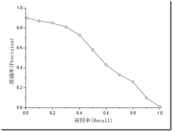

  **Nếu làm tìm kiếm thì tăng precision mà vẫn giữ recall; nếu làm phát hiện bệnh, chống spam thì tăng recall mà vẫn giữ precision.**

  > **Biên tập:** câu cuối có lẽ đảo hai trường hợp so với cách nói thông dụng: với phát hiện bệnh thường ưu tiên **recall** (không bỏ sót người bệnh), còn lọc spam thường ưu tiên **precision** (không đánh nhầm thư thật là spam); tìm kiếm trên web thường ưu tiên precision ở các kết quả đầu. Câu "precision cao thì recall thấp, recall thấp thì precision cao" trong bản gốc lặp ý, đã sửa thành "recall cao thì precision thấp".

  Vì vậy khi cả hai đều cần cao, có thể dùng giá trị F1 để đo:

  $$F_1 = \frac{2PR}{P+R}.$$

  Công thức cơ bản là vậy, nhưng tính $A$, $B$, $C$, $D$ trong bảng thế nào? **Cần người gán nhãn; gán nhãn thủ công tốn thời gian và nhàm chán; nếu chỉ làm thực nghiệm có thể dùng ngữ liệu có sẵn. Tất nhiên còn một cách: lấy một thuật toán đã chín muồi làm chuẩn, dùng kết quả của nó làm mẫu để so sánh.** Cách này cũng có vấn đề: nếu đã có sẵn thuật toán rất tốt thì không cần nghiên cứu nữa.

- **Chỉ số tổng hợp (F-Measure)**

  P và R đôi khi mâu thuẫn, nên cần xét tổng hợp; cách phổ biến nhất là F-Measure (còn gọi F-Score), là trung bình điều hòa có trọng số của precision và recall:

  $$F_\alpha = \frac{(\alpha^2+1)\,P\,R}{\alpha^2 P + R}.$$

  Khi $\alpha = 1$ là F1 phổ biến nhất:

  $$F_1 = \frac{2PR}{P+R}.$$

  F1 tổng hợp kết quả của P và R; F1 cao cho thấy phương pháp thực nghiệm khá hiệu quả.

  > **Biên tập:** ảnh công thức trong bản gốc viết mẫu số là $\alpha^2(P+R)$, sai: khi đó với $\alpha=1$ ra $2PR/(P+R)$ nhưng với $\alpha\ne1$ không phải trung bình điều hòa có trọng số. Dạng đúng là $\alpha^2P + R$; $\alpha>1$ đặt nặng recall hơn, $\alpha<1$ đặt nặng precision hơn.

- **Giá trị E**

  Giá trị E là trung bình có trọng số của precision P và recall R; khi một trong hai bằng 0 thì E bằng 1. Công thức:

  $$E = 1 - \frac{1+b^2}{\dfrac{b^2}{P} + \dfrac{1}{R}}.$$

  $b$ càng lớn, precision càng được đặt trọng số lớn.

  > **Biên tập:** với cách viết trong bản gốc (số hạng $b^2$ đi cùng $P$), nhận xét "$b$ càng lớn, precision càng nặng" là đúng. Lưu ý độ đo E gốc của van Rijsbergen thường viết $E = 1 - \dfrac{(1+b^2)PR}{b^2P + R} = 1 - F_b$, trong đó $b$ càng lớn thì **recall** càng nặng (giống $F_\beta$); hai cách viết chỉ đổi vai trò của P và R.

- **Độ chính xác trung bình (Average Precision)**

  Độ chính xác trung bình là trung bình của precision tại các mức recall khác nhau.

- **AP và mAP (mean Average Precision)**

  mAP ra đời để khắc phục hạn chế giá trị đơn điểm của P, R, F-measure. Để có một chỉ số phản ánh hiệu năng toàn cục, xem hình dưới, trong đó hai đường (điểm vuông và điểm tròn) là đường precision–recall của hai hệ thống truy xuất.

  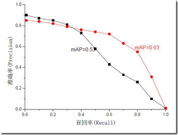

  Có thể thấy, dù hai đường hiệu năng có chỗ chồng nhau, hệ thống đánh dấu bằng điểm tròn tốt hơn hẳn hệ thống điểm vuông trong đa số trường hợp. Từ đó thấy: hệ thống càng tốt thì đường cong càng phải lồi lên trên; cụ thể hơn, diện tích giữa đường cong và các trục tọa độ càng lớn càng tốt. Hệ thống lý tưởng có diện tích bằng 1, mọi hệ thống đều có diện tích lớn hơn 0. Đây là chỉ số hiệu năng phổ biến nhất để đánh giá hệ thống truy xuất thông tin; định nghĩa:

  $$\mathrm{AP} = \int_0^1 P(R)\,dR,\qquad \mathrm{mAP} = \frac{1}{|Q|}\sum_{q\in Q}\mathrm{AP}(q).$$

  > **Biên tập:** bản gốc gọi tích phân $\int_0^1 P(R)\,dR$ là mAP; tích phân đó là **AP** của một truy vấn (một lớp), còn mAP là trung bình AP trên mọi truy vấn (hay mọi lớp, như trong phát hiện đối tượng, xem chương 8).

- **ROC và AUC**

  ROC và AUC là các chỉ số đánh giá bộ phân loại; bảng $A$, $B$, $C$, $D$ ở trên vẫn dùng được, chỉ cần biến đổi một chút:

  | | Thực tế dương ($p$) | Thực tế âm ($n$) |
  | --- | --- | --- |
  | **Dự đoán dương ($p'$)** | dương thật (TP) | dương giả (FP) |
  | **Dự đoán âm ($n'$)** | âm giả (FN) | âm thật (TN) |

  ROC quan tâm hai chỉ số:

  ```text
  True Positive Rate  (TPR) = TP / (TP + FN), xác suất phân loại đúng mẫu dương
  False Positive Rate (FPR) = FP / (FP + TN), xác suất phân loại nhầm mẫu âm thành dương
  ```

  Trong không gian ROC, hoành độ mỗi điểm là FPR, tung độ là TPR, mô tả sự đánh đổi của bộ phân loại giữa TP (dương thật) và FP (dương giả). Công cụ phân tích chính của ROC là đường cong vẽ trong không gian ROC, gọi là ROC curve. Với bài toán phân loại nhị phân, đầu ra của mỗi mẫu thường là giá trị liên tục; ta đặt một ngưỡng để xếp mẫu vào lớp dương hay âm (ví dụ lớn hơn ngưỡng là dương). Vì vậy có thể thay đổi ngưỡng, phân loại theo từng ngưỡng, tính điểm tương ứng trong không gian ROC từ kết quả phân loại, nối các điểm lại thành đường ROC. Đường ROC đi qua $(0,0)$ và $(1,1)$; đường thẳng nối $(0,0)$ và $(1,1)$ biểu diễn một bộ phân loại ngẫu nhiên. Thường đường ROC phải nằm phía trên đường nối này, như hình.

  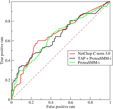

  Dùng đường ROC biểu diễn hiệu năng bộ phân loại rất trực quan, dễ dùng. Nhưng người ta vẫn muốn có một con số để chỉ bộ phân loại tốt hay xấu.

  Vì vậy có **AUC (Area Under ROC Curve)**. Đúng như tên, giá trị AUC là diện tích phần nằm dưới đường ROC. Thường AUC nằm trong khoảng 0,5 tới 1,0; AUC càng lớn thì hiệu năng càng tốt.

  Công cụ tính AUC: <http://mark.goadrich.com/programs/AUC/>

  **P/R và ROC là hai chỉ số đánh giá và cách tính khác nhau; thường truy xuất dùng cái trước, phân loại, nhận dạng dùng cái sau.**

  > **Biên tập:** AUC còn có nghĩa xác suất: là xác suất một mẫu dương chọn ngẫu nhiên được chấm điểm cao hơn một mẫu âm chọn ngẫu nhiên; vì vậy AUC rất hay dùng cho mô hình CTR (18.6.5). Khi dữ liệu mất cân bằng mạnh (tỉ lệ bấm vài phần trăm), đường precision–recall và AP phản ánh rõ hơn ROC. Công cụ tính hiện nay: `sklearn.metrics.roc_auc_score`, `average_precision_score`. Xem thêm chủ đề "Đánh giá mô hình" của khóa Học máy.

### 18.6.11 Phân tích một ví dụ hệ gợi ý cá nhân hóa

<div class="qa-theory">

**Lý thuyết:** [Ôn tập · 16.4 Hiểu vector từ (word vector) thế nào?](qa/ch16_vi?id=_164-hiểu-vector-từ-word-vector-thế-nào)

</div>

Trong mười năm qua, mạng neuron đã có bước tiến lớn. Ngày nay mạng neuron được dùng rộng rãi và dần thay thế các phương pháp học máy truyền thống. Dưới đây giới thiệu cách YouTube dùng học sâu để gợi ý cá nhân hóa (Covington, Adams, Sargin, *Deep Neural Networks for YouTube Recommendations*, RecSys 2016).

Vì quy mô khổng lồ, kho nội dung liên tục thay đổi và nhiều yếu tố bên ngoài không quan sát được, gợi ý nội dung cho người dùng YouTube là bài toán rất thách thức.

*Thuật toán gợi ý của YouTube gồm hai mạng neuron: một để sinh ứng viên, một để xếp hạng. Nếu không có thời gian đọc kỹ bài báo, có thể xem tóm tắt ngắn dưới đây.*

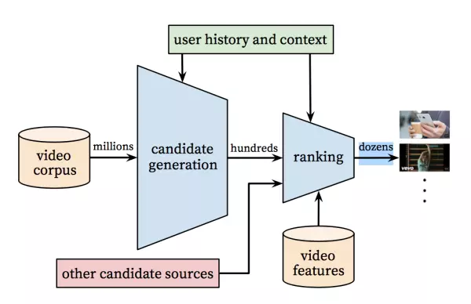

Lấy lịch sử xem của người dùng làm đầu vào, mạng sinh ứng viên giảm đáng kể số video có thể gợi ý, chọn ra từ kho khổng lồ một nhóm video liên quan nhất. Các video ứng viên sinh ra có độ liên quan cao nhất với người dùng; sau đó ta dự đoán điểm của người dùng.

Mục tiêu của mạng này chỉ là cung cấp cá nhân hóa rộng hơn qua lọc cộng tác.

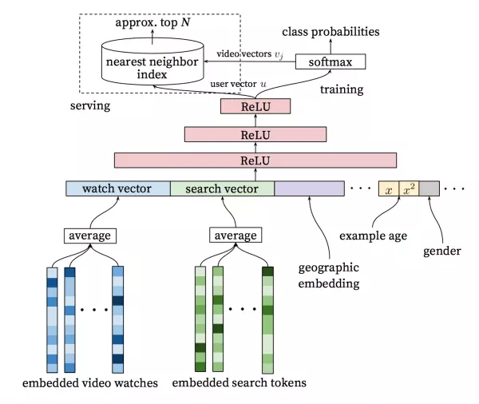

Tới bước này, ta có một nhóm nội dung nhỏ hơn nhưng liên quan hơn. Mục tiêu là phân tích kỹ các ứng viên này để chọn tốt nhất.

Việc này do mạng xếp hạng làm.

Xếp hạng là dựa trên dữ liệu mô tả video và thông tin hành vi người dùng, dùng hàm mục tiêu đã thiết kế để chấm điểm từng video; video điểm cao nhất được hiển thị cho người dùng.

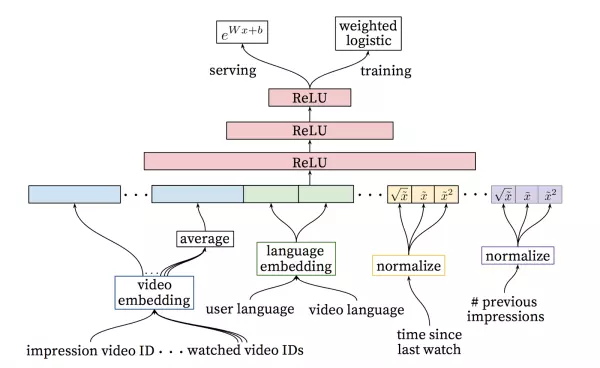

Qua hai bước này, ta chọn được video từ kho rất lớn và gợi ý có mục tiêu cho người dùng. Cách làm này cũng cho phép đưa thêm nội dung từ các nguồn khác vào.

Bài toán gợi ý là một bài toán phân loại nhiều lớp cực lớn. Bản chất của bài toán dự đoán này là: dựa trên người dùng $U$ và ngữ cảnh $C$, tại thời điểm $t$, phân loại chính xác lượt xem video $w_t$ trong hàng triệu lớp video $i$ của kho $V$:

$$P(w_t = i \mid U, C) = \frac{e^{v_i u}}{\sum_{j\in V} e^{v_j u}},$$

trong đó $u$ là vector nhúng của cặp (người dùng, ngữ cảnh), $v_j$ là vector nhúng của video $j$.

> **Biên tập:** bản gốc kết thúc bằng "còn tiếp". Vì softmax trên hàng triệu lớp rất tốn, bài báo dùng lấy mẫu âm có hiệu chỉnh trọng số theo tầm quan trọng (importance sampling) khi huấn luyện; khi phục vụ không cần softmax mà tìm láng giềng gần nhất của $u$ (xem 18.5.7). Kiến trúc hai tầng "gọi lại → xếp hạng" này vẫn là chuẩn của hệ gợi ý công nghiệp; gọi lại thường dùng mô hình hai tháp (two-tower), xếp hạng dùng các mô hình như Wide & Deep (2016), DeepFM (2017), DIN (2018), DCN-v2 (2021), và gần đây có các mô hình gợi ý dạng sinh (generative recommendation) dùng Transformer.

## 18.7 Bổ sung: các mục chỉ có tiêu đề trong bản nháp

> **Biên tập:** bản nháp "后端架构选型、离线及实时计算" có năm câu hỏi chỉ có tiêu đề (đánh số 18.3, 18.5–18.8 trong bản nháp). Mục 18.5 của bản nháp (tính toán ngoại tuyến) đã có nội dung ở 18.4 trên; bốn câu còn lại được người biên tập trả lời ngắn dưới đây.

### 18.7.1 Chọn framework tính toán phân tán phù hợp để huấn luyện mô hình thế nào?

<div class="qa-theory">

**Lý thuyết:** [Ôn tập · 15.8.1 Cấu hình môi trường nhiều GPU](qa/ch15_vi?id=_1581-cấu-hình-môi-trường-nhiều-gpu) · [Ôn tập · 15.8.2 Có huấn luyện phân tán được không?](qa/ch15_vi?id=_1582-có-huấn-luyện-phân-tán-được-không)

</div>

Chọn theo ba câu hỏi:

1. **Dữ liệu đang nằm ở đâu?** Nếu dữ liệu và quy trình xử lý đã ở trên cụm Hadoop/Spark, và mô hình không quá lớn, có thể huấn luyện ngay trên Spark (Spark MLlib cho mô hình cổ điển; `TorchDistributor`, Horovod on Spark cho học sâu), hoặc dùng Spark chuẩn bị dữ liệu thành Parquet rồi đọc bằng Petastorm/Ray Data. Nếu không, dựng cụm GPU riêng (Kubernetes, Slurm).
2. **Mô hình lớn cỡ nào?** Mô hình vừa một GPU: song song dữ liệu bằng PyTorch DDP (hoặc Horovod). Mô hình lớn hơn bộ nhớ một GPU: FSDP/DeepSpeed ZeRO; mô hình hàng chục tỉ tham số trở lên: Megatron-LM, DeepSpeed, kết hợp song song tensor và pipeline (xem 15.8.2).
3. **Bài toán có cấu trúc gì đặc biệt?** Học tăng cường, tìm siêu tham số, nhiều tác vụ dị thể: Ray (RLlib, Tune). Mô hình CTR với hàng tỉ đặc trưng thưa: máy chủ tham số chuyên dụng (như PaddlePaddle, các hệ thống nội bộ của công ty lớn) hoặc TorchRec.

### 18.7.2 Dùng framework phân tán để tăng tốc huấn luyện mô hình thế nào?

<div class="qa-theory">

**Lý thuyết:** [Ôn tập · 15.8.1 Cấu hình môi trường nhiều GPU](qa/ch15_vi?id=_1581-cấu-hình-môi-trường-nhiều-gpu) · [Ôn tập · 14.3.4 Huấn luyện mạng với kích thước batch cực đoan thế nào?](qa/ch14_vi?id=_1434-huấn-luyện-mạng-với-kích-thước-batch-cực-đoan-thế-nào)

</div>

- Bắt đầu bằng song song dữ liệu (DDP), tăng batch toàn cục tỉ lệ với số GPU và tăng tốc độ học theo quy tắc tỉ lệ tuyến tính kèm khởi động (warm-up), như bài "huấn luyện ImageNet trong một giờ" mà Horovod nhắc tới.
- Đảm bảo nạp dữ liệu không thành nút cổ chai: định dạng đọc nhanh (Parquet, WebDataset, TFRecord), nhiều tiến trình nạp, đệm cục bộ (như Petastorm).
- Giảm chi phí truyền thông: dùng NCCL với mạng nhanh (NVLink, InfiniBand), gộp gradient thành các gói lớn (bucket), chồng lấp truyền thông với lan truyền ngược (DDP làm sẵn), tích lũy gradient qua nhiều bước nhỏ.
- Dùng độ chính xác hỗn hợp (15.3.5) để giảm cả tính toán lẫn lượng dữ liệu truyền.
- Đo hiệu suất mở rộng: thời gian mỗi bước với $k$ GPU so với 1 GPU; nếu hiệu suất thấp thì tìm nút cổ chai trước khi thêm máy.

### 18.7.3 Framework tính toán phân tán học sâu được ứng dụng thế nào trong Internet di động?

<div class="qa-theory">

**Lý thuyết:** [Ôn tập · 17.1 Hiểu nén mô hình thế nào?](qa/ch17_vi?id=_171-hiểu-nén-mô-hình-thế-nào)

</div>

Trên Internet di động, phần nặng (huấn luyện, xử lý log, tính đặc trưng) chạy trên cụm phân tán ở máy chủ, còn điện thoại chủ yếu làm suy luận:

- **Phía máy chủ:** log hành vi từ ứng dụng di động được thu bằng hệ thống luồng (Kafka, Flink) và lưu trữ (18.3, 18.4); huấn luyện phân tán định kỳ hoặc liên tục các mô hình gợi ý, tìm kiếm, quảng cáo, nhận dạng ảnh, giọng nói; phục vụ dự đoán trực tuyến có độ trễ thấp.
- **Phía thiết bị:** mô hình được nén và triển khai trên điện thoại (chương 17) cho các tác vụ cần phản hồi tức thì hoặc cần bảo vệ riêng tư (camera, bàn phím, nhận dạng giọng nói ngoại tuyến).
- **Học liên kết (federated learning):** huấn luyện phân tán ngay trên điện thoại người dùng, chỉ gửi cập nhật mô hình (không gửi dữ liệu) về máy chủ để tổng hợp; Google dùng cách này cho bàn phím Gboard.

### 18.7.4 Ứng dụng framework phân tán học sâu trong gợi ý cá nhân hóa thế nào?

<div class="qa-theory">

**Lý thuyết:** [Ôn tập · 18.6 Thiết kế hệ thống gợi ý cá nhân hóa thế nào?](qa/ch18_vi?id=_186-thiết-kế-hệ-thống-gợi-ý-cá-nhân-hóa-thế-nào)

</div>

Mô hình gợi ý có đặc điểm riêng: phần lớn tham số nằm ở **bảng nhúng** của các đặc trưng thưa (ID người dùng, ID vật phẩm…), có thể tới hàng trăm GB hoặc TB, còn phần mạng dày đặc phía trên lại nhỏ. Vì vậy:

- bảng nhúng được chia mảnh ra nhiều máy (song song mô hình), thường theo kiến trúc **máy chủ tham số** hoặc các thư viện như TorchRec, HugeCTR; phần mạng dày đặc dùng song song dữ liệu;
- huấn luyện trực tuyến hoặc gần trực tuyến từ luồng log (như FTRL ở 18.6.8, hoặc huấn luyện liên tục mạng sâu) để bắt kịp thay đổi sở thích;
- các bước gọi lại (two-tower + tìm láng giềng gần đúng, 18.5.7) và xếp hạng (18.6.4) được huấn luyện và phục vụ riêng, cập nhật với tần suất khác nhau;
- dữ liệu đặc trưng và mẫu huấn luyện được tính bằng Spark/Flink (18.3, 18.4) và lưu trong kho đặc trưng (feature store) để dùng chung giữa huấn luyện và phục vụ.

## Tài liệu tham khảo

1. PaddlePaddle. *Personalized Recommendation* (bộ sách hướng dẫn PaddlePaddle 0.11). https://github.com/PaddlePaddle/book/tree/develop/05.recommender_system (trang tài liệu 0.11 cũ trên paddlepaddle.org đã chết, thay bằng mã nguồn của sách trên GitHub)
2. Deeplearning4j. *So sánh DL4J với Torch, Theano, Caffe…* https://deeplearning4j.org/cn/compare-dl4j-torch7-pylearn.html
3. Apache Mahout. http://mahout.apache.org/
4. Spark MLlib Guide (Spark 1.1.0). Trang tài liệu 1.1.0 nay không còn; bản hiện hành: https://spark.apache.org/docs/latest/ml-guide.html
5. Ray documentation. https://ray.readthedocs.io/en/latest/tutorial.html
6. Spark Streaming. http://spark.apache.org/streaming/
7. Horovod. https://github.com/uber/horovod
8. Intel. *BigDL: Distributed Deep Learning on Apache Spark*. https://software.intel.com/en-us/articles/bigdl-distributed-deep-learning-on-apache-spark
9. Uber Engineering. *Introducing Petastorm*. Blog cũ eng.uber.com đã chết; mã nguồn và tài liệu: https://github.com/uber/petastorm
10. Yahoo. *TensorFlowOnSpark*. https://yahoo.github.io/TensorFlowOnSpark/
11. Jane Bromley và cộng sự. *Signature Verification using a "Siamese" Time Delay Neural Network*. NeurIPS 1993. https://papers.nips.cc/paper_files/paper/1993/hash/288cc0ff022877bd3df94bc9360b9c5d-Abstract.html
12. Liang Pang và cộng sự. *Text Matching as Image Recognition* (MatchPyramid). AAAI 2016. https://arxiv.org/pdf/1602.06359.pdf
13. Ryan McDonald, Georgios-Ioannis Brokos, Ion Androutsopoulos. *Deep Relevance Ranking Using Enhanced Document-Query Interactions*. EMNLP 2018. https://aclanthology.org/D18-1211/
14. Paul Covington, Jay Adams, Emre Sargin. *Deep Neural Networks for YouTube Recommendations*. RecSys 2016. https://static.googleusercontent.com/media/research.google.com/ru//pubs/archive/45530.pdf
15. Xuerui Wang và cộng sự. *Click-Through Rate Estimation for Rare Events in Online Advertising*. http://www.cs.cmu.edu/afs/cs/Web/People/xuerui/papers/ctr.pdf
16. H. Brendan McMahan và cộng sự. *Ad Click Prediction: a View from the Trenches*. KDD 2013.
